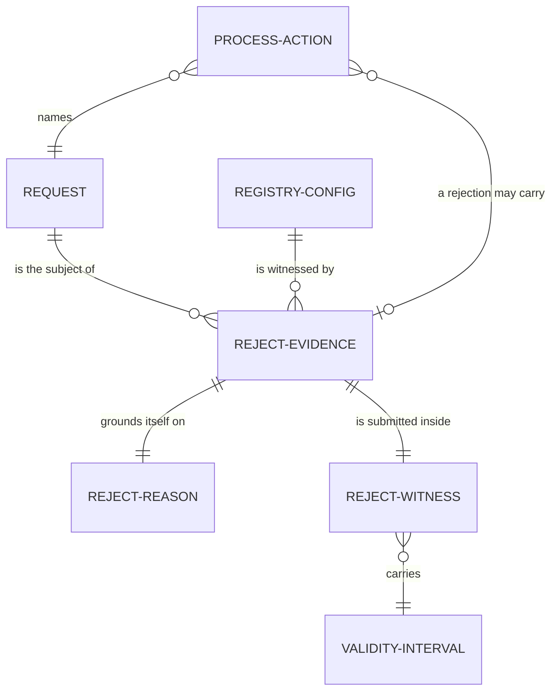

# Data model: what a rejection carries and what a request now records

This page owns the fields, relationships, validation and state invariants that ticket 494
adds or changes in the model. It names no function body and no proof. Where a signature is
needed see [functions](functions-model.md); where a thing belongs see
[modules](modules-model.md). The base is the two-edge model at `e3c9ab01`.

## Story

As the author of a validator or a builder, I read one page and learn exactly which facts a
rejection must carry, which facts a booked request must expose, and what must be true of
them, so that neither of us has to read the proofs to find out.

The diagram shows that evidence belongs to one request and one registry configuration, is
grounded on exactly one reason and is submitted with one validity interval; a batch action
names a request and a rejection action may carry evidence.

## Changed entities

### Request records its booked identity

A request gains two serialized fields, each defaulting to zero when absent from older input:
the time it was booked (`submittedAt`, in milliseconds since the epoch, the submission time its
datum carries on chain) and the abstract identity of the registry it was booked into
(`registryId`). The first is added by the first coding slice and is used by retraction and by
expiry; the second is added by the second coding slice and is used by evidence binding. A
booked request is never given a time or a registry by the party who rejects it.

Validation: a request that is the subject of evidence must equal, field for field, the request
the action names. The question a consumer asks the model carries these booked fields, and the
request's output reference, only for the exits that read them: a rejection and a retraction. A
fold is asked exactly what it was asked before. The earlier candidate widened every exit's
question and thereby made three separately booked attempts at one deletion look like three
different requests to a conformance row that compares them; this ticket does not repeat that.

### Registry configuration records its identity

The registry configuration gains one field, `registryId`: the abstract identity of the registry
state token, allocated by the consumer that runs the model. It is not a ninth datum field on
chain. Every step preserves it exactly as it preserves the four policy pins; only the root
tracks the map. When absent from older input it reads as zero.

State invariant: for every reachable state the configuration's root equals the commitment over
the state's logical map, as before; evidence is admitted only while that holds.

### The retraction witness stops owning the clock

The retraction witness keeps its legacy `submittedAt` field on the wire so that older callers
still decode. Admission ignores it and reads the request's booked time. The only inputs
admission reads from the witness are its validity bounds and its signatories.

## New entities

### Reject reason

Exactly two cases. A mismatch names the leaf the processor claims the key holds. An expiry
names nothing further, because the instant is computed from the request and the configuration.

### Reject evidence

Four facts, no more: the complete registry configuration as it stands at that action
(including the root and the registry identity), the complete request, and the reason. The
earlier candidate also carried a separate registry identity beside the configuration; that
field is dropped here because the configuration already carries it and equality with the
state's configuration already checks it. This is the only change to the earlier evidence
shape.

Validation, in the order admission reports a failure: evidence present; configuration equals the
state's configuration and the request's registry identity equals the state's, and the state's
root equals the commitment over its map; the request equals the action's request; the interval is
non-empty; then the ground (mismatch: the named leaf equals the leaf held at the key and the edge
has no successor from it; expiry: the lower bound is at or after the expiry threshold).

### Reject witness

The evidence together with the finite validity interval of the transaction that would carry the
rejection: lower bound included, upper bound excluded, strictly increasing.

### Process action

One element of an ordered batch: either a fold of a request, or a rejection of a request with
optional evidence. It deliberately excludes the owner's retraction, which is a separate
transaction and never part of a processor's batch.

## Expiry and the windows

For a request submitted at time `s` under a configuration with processing duration `p` and
reclaim duration `c`: an owner's retraction may run only inside the interval from `s + p`
(included) to `s + p + c` (the excluded upper bound may reach it and not pass it); an expiry
rejection may begin only at or after `s + p + c`. For every request the latest instant a
retraction may end is therefore never after the earliest instant an expiry rejection may begin.

## Truth table of mismatch rejection

Well-bound evidence with the mismatch ground is admitted in every cell below except the two
marked compatible. A rejection is admitted at a cell exactly when the edge has no successor from
the leaf.

| Edge tag | Unknown | Absent | Active | Terminal |
|---|---|---|---|---|
| insertActive | compatible, refused | mismatch, admitted | mismatch, admitted | mismatch, admitted |
| updateTerminal | mismatch, admitted | mismatch, admitted | compatible, refused | mismatch, admitted |
| insertAbsent, updateActive, deleteAbsent, deleteActive, witnessTerminal | admitted | admitted | admitted | admitted |

The last row follows the reading recorded in [decisions](decisions.md): an excluded tag has no
successor at any leaf. For the expiry ground the leaf does not matter: well-bound evidence is
admitted exactly when the interval's lower bound is at or after `s + p + c`. With `s` 10000,
`p` 1000 and `c` 500 a lower bound of 11499 is refused and 11500 is admitted; a lower bound
before `s + p`, between `s + p` and `s + p + c`, and at `s + p + c` are the three time
positions the corpus exports.

## Refusal reasons

The refusal reasons admission can give, with the check each names: evidence missing; registry
mismatch (identity, configuration or root); request mismatch; invalid interval; leaf mismatch
(the named leaf is not the held leaf); compatible (the edge has a successor); not expired.
A batch adds: empty batch; and the first refusal of its first refused action.
