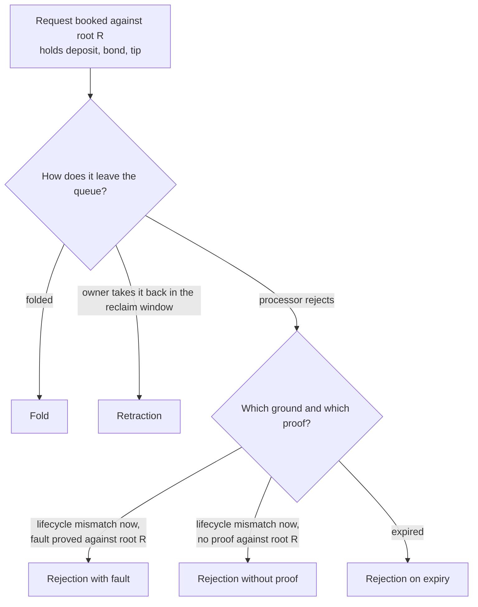

# Economics of rejection and termination: the design the model states

This page records the operator's economic design for the registry as the Lean model will state it, the amounts that move in
every outcome, the attacks the mechanism prices and the ones it cannot. It is the design behind the
[theorem list](economics-plan.md) and the paper; it changes no code. Rulings are quoted as the operator gave them in the
[decisions](decisions.md) and the [mandate](mandate.md).

## Story

As a scientist reviewing the registry's economics, I read one page and learn which amounts a requester, a processor and the
treasury pay or receive in each outcome, which parameters a creator sets, and which attacks the design prices or leaves
unpriced, so that I can judge every claim the paper makes before it is written and see which are proved and which are not.

## The rulings

Operator, 13 October 2026, in his words: "provable rejection must be punished but not with the deposit"; "it's a new parameter
bond"; "termination should pay the treasury"; on the order of work: "what I want is the lean model done, and from it the full
economic system explained in a paper, so I get a review now"; and "the paper will be reviewed by a scientist; do not gloss over
details". The adopted design, as the desk worded it for planning:

1. A registry parameter, the bond, carried by every request beside its deposit.
2. A rejection forfeits the bond only on a fault proved against the root the request recorded at booking. Without that proof, a
   rejection refunds deposit and bond.
3. The tip pays the processor for the slot on every rejection, as on a fold.
4. The forfeited bond is split between the proving processor and the treasury (a treasury donation); the split is a registry
   parameter set at creation, beside the bond.
5. Rejection on expiry returns the bond.
6. A registry parameter, the termination fee: a fold that terminates a key donates at least the fee to the treasury; the terminate
   request carries it.

Also adopted: the registry parameters are set at creation and never changed by a fold; a fold, a retraction and an exit by expiry
return the bond to the owner; the owner's refund of the deposit and the approval holds on every rejection; the treasury donation is
a transaction field that the model owes.

## One request, every outcome

The diagram is the whole set of outcomes: five, the same five the paper tabulates. A fault is a lifecycle mismatch at booking:
the request's edge has no successor from the leaf its key held in the state with root R, which includes a request that names an
excluded edge.

## Where each amount goes

Amounts: deposit, bond, tip, termination fee. The processor's share of a forfeited bond is the floor of the split times the bond;
the treasury receives the rest, so the two always add up to the bond exactly. What the model owes is a floor to the owner and a
floor to the treasury; the processor keeps what the request held beyond those floors, so its gain is bounded by conservation,
never stated as a payment.

| Outcome | Owner receives | Treasury receives | Processor can keep at most |
|---|---|---|---|
| Fold, registration | bond (deposit goes to the destination the request names) | nothing | tip |
| Fold, termination | deposit and bond | at least the termination fee per terminated key | tip |
| Retraction | deposit, tip and bond | nothing | nothing |
| Rejection without proof | deposit, bond and the approval | nothing | tip |
| Rejection on expiry | deposit, bond and the approval | nothing | tip |
| Rejection with fault | deposit and the approval | the bond minus the processor share | tip and the processor share |

Three facts the table fixes. The tip is returned on a retraction and paid to the processor on everything else, so an honest
requester whose request is rejected without proof or on expiry loses the tip. A zero donation cannot be written on the ledger (the
donation field is a positive amount), so a zero treasury share or a zero termination fee means the field is left out; the model's
donation obligation applies only when the owed amount is positive. And the fee of a termination is owed per terminated key, so a
batch of terminations owes the fee times their number.

## The fault proof

The request records the root of the state it read at booking. A rejection that claims the forfeit carries the whole logical map
whose commitment is that root, and the model checks that the commitment of the supplied map equals the recorded root and that the
request's edge has no successor from the leaf the supplied map holds at the key. This is the authenticated logical read the
rejection evidence already uses, one state earlier. Collision resistance of the commitment is a named assumption of the model, and
every honesty theorem is stated under it. The processor chooses the ground: a rejection on the expiry ground never forfeits; a
rejection on the mismatch ground forfeits exactly when its fault proof holds. A mismatch that arose after booking (another key
holder folded first) has no fault proof, so the requester keeps the bond.

## What the creator sets, and what the model will constrain

| Parameter | Set by | Meaning |
|---|---|---|
| Bond | creator, at creation | amount every request carries beside its deposit |
| Processor split | creator, at creation | the processor's fraction of a forfeited bond, as a numerator over a denominator, strictly below one |
| Termination fee | creator, at creation | amount a termination donates per terminated key |
| Tip | requester, per request | pays the processor's slot |

The paper derives each constraint as an inequality with a worked example in lovelace. The ones the design already implies: the
treasury share of one forfeited bond must exceed the cost a flood is meant to carry; the processor share plus the tip must cover
the processor's cost of a rejection, or faults wait for expiry; the tip alone must cover a processor's share of a fold; the
split must stay below one or a requester who rejects its own faulty request pays nothing; the fee must exceed the value of
holding a key terminal. Each constraint names the model definition it is read from.

## What the design prices, and what it does not

| Attack | What it costs the attacker | Status in the model |
|---|---|---|
| Flood of requests that are faulty at booking | the bond per request, of which at least the treasury share is lost even when the attacker rejects its own requests | proved from the transfer table |
| Self-rejecting attacker | the treasury share per faulty request, plus fees | proved |
| Front-running a booking for an untaken key | the front-runner gains at most the victim's tip from rejecting her request; it does not gain the bond | proved; the key itself is not protected by this mechanism |
| Squat and terminate | at least the termination fee, plus fees | proved for the fee; the deposit comes back |
| Concurrent duplicate bookings of one untaken key | the tip and fees of the losers, not the bond, because every copy is valid at booking | **not priced**; a counterexample is stated and kept |
| Holding a squatted key without terminating it | nothing the termination fee prices | **not priced**; the defence is the application's approval policy, an assumption |
| Delay by refusing to process or reject | the capital locked for the honest requester | not modelled; liveness |

## Honest limits stated up front

The model has floors and conservation, not fees, execution units or markets. Costs in lovelace are real; the value of a key,
opportunity cost and fee volatility are outside the model, so claims that involve them are derived by hand from proved transfer
lemmas and labelled so. An honest requester loses no deposit and no bond, but may lose the tip. After the reclaim window has closed it can still leave the queue on
its own by rejecting its expired request itself, since a rejection requires no signer; it then pays only fees, and its capital stays locked
until it does or a processor does for it. The correspondence between this
model and the validators is evidenced by the conformance suite, not proved, and is named as an assumption.
