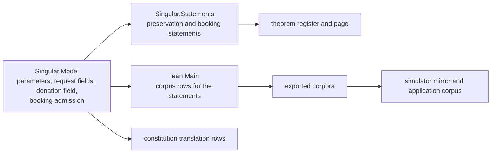

# Economic model rows: modules, data and functions of slices five to eight

This page owns the new or changed rows of the economic slices, in the same three layers as the [modules](modules-model.md), [data](data-model.md) and
[functions](functions-model.md) pages of the protected rejection rule, for the [economics plan](economics-plan.md) and the
[design](economics-design.md). It contains no bodies and no proofs. Slice five's rows are complete; the rows of slices six to eight are added to this
page by the ticket owner, before each of those slices is dispatched, so that no coder chooses a name or a signature.

## Story

As the coder given an economic slice, I read the rows of that slice and nothing I have to guess, so that the model, the transport and the paper name
every amount, parameter and statement the same way.

## Slice five: modules

| Module | Responsibility | Dependency direction |
|---|---|---|
| `Singular.Model` | Owns the three registry parameters on the configuration, the three economic fields on a request, the donation amount on a transaction and the booking admission | Reads nothing new |
| `Singular.Statements` | Holds the preservation statement and the booking statements | Reads Model |
| `lean/Main.lean` | Exports the statements' rows through the existing model runner | Reads Model, Statements |
| Generated copies | Corpora, register and digests, theorem page, simulator mirror, application corpus, coverage record, restatement table, constitution entry | Produced by tools, never edited |

No new module is added in slice five. The driver, its declared operations and its questions do not change.

## Slice five: data

| Entity | Field | Meaning | Default and encoding |
|---|---|---|---|
| Registry configuration | `bond` | amount every request carries beside its deposit | zero; written only when positive |
| Registry configuration | `splitNumerator`, `splitDenominator` | the processor's fraction of a forfeited bond; the denominator is positive | zero over one; written only when not the default |
| Registry configuration | `terminationFee` | amount a terminating fold donates per terminated key | zero; written only when positive |
| Request | `bond` | the bond the request carries | zero; written only when positive |
| Request | `fee` | the termination fee a terminate request carries | zero; written only when positive |
| Request | `bookedRoot` | the root of the state the request read at booking | absent; written only when present |
| Transaction | `donation` | the treasury donation amount | zero; written only when positive, because the ledger cannot write a zero donation |

Validation and invariants. An old input without these fields reads as the defaults, so every existing question, scenario and corpus row means what it meant.
A fold's question is exactly what it was: nothing is written for a default. Every step preserves the three parameters exactly as it preserves the four
policy pins. The split's denominator is positive and its numerator does not exceed it; a configuration that breaks that is refused at decoding.

## Slice five: functions

| Name | Arguments | Result | Constraint |
|---|---|---|---|
| `bookingAdmission` | `s : RegistryState`, `r : Request` | `Option String` | `none` admits. Reasons in this order: `bond-below-registry-bond` when the request's bond is below the configuration's; `fee-below-registry-fee` when the request names the terminating edge and its carried fee is below the configuration's; `booked-root-mismatch` when the recorded root is absent or differs from the configuration's root. Reads only its arguments |
| `Statements.parameters_preserved_by_fold` | a step, a batch | statement | The three parameters are equal before and after every step and every batch |
| `Statements.booking_admission_iff` | `s`, `r` | statement | The admission is `none` exactly when the three conditions hold; the refusal is the first failing one |
| Rows for the two statements | in `lean/Main.lean` | corpus rows | Each condition fails alone in one row; one row admits; one row exercises an old request with every economic field at its default against a configuration whose parameters are zero |

The booking admission is a defined rule, not a transition: the model has no booking step. The request-tag mint must enforce exactly this admission.
