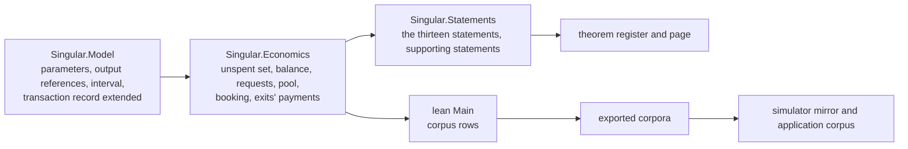

# Economic model rows: modules, data and functions of slices five to ten

This page owns the new or changed rows of the economic slices, in the same three layers as the [modules](modules-model.md), [data](data-model.md) and
[functions](functions-model.md) pages of the protected rejection rule, for the [economics plan](economics-plan.md) and the [design](economics-design.md).
It contains no bodies and no proofs. The rows here say what each slice owns; the exact signatures of a slice are added to this page by the ticket owner
before that slice is dispatched, so that no writer chooses a name that another slice, the transport or the paper depends on.

## Story

As the writer given an economic slice, I read the rows of that slice and nothing I have to guess, so that the model, the transport and the paper name every
amount, parameter and statement the same way.

## Modules

| Module | Responsibility | Slices | Dependency direction |
|---|---|---|---|
| `Singular.Model` | The configuration gains the three parameters; the vocabulary types `OutRef`, `Interval` and `TokenId` and the new fields of the transaction record live here, beside the record they extend | five | Reads nothing new |
| `Singular.Economics` (new) | The unspent set, the presence and balance judgements, the registration and termination requests, the exact-contents rule, the pending pool, booking steps, the world and its reachability, the payments of every exit; definitions only | five to ten | Reads Model |
| `Singular.Statements` | The thirteen statements, the supporting statements and the kept variants | five to ten | Reads Model and Economics |
| `lean/Main.lean`, `Driver.lean` | Corpus rows and, where a declared question changes, its wire form | five to ten | Reads Model, Statements |
| `tools/check_model.py` | The frozen source extent of the generic corpus lists the new module, so the corpus binds it | five | Mechanical consumer change |
| Generated copies | Corpora, register and digests, theorem page, simulator mirror, application corpus, coverage record, restatement table, constitution entry | five to ten | Produced by tools, never edited |

The new module is imported by the root module so the axiom gate and the audit report walk it. The model checker refuses a change to the imports of `Singular.Model`
beyond the naming layer's, which is why the vocabulary types sit in the model file and only functions over them sit in `Singular.Economics`.

## Data

| Entity | Field or shape | Meaning | Slice | Default and encoding |
|---|---|---|---|---|
| Registry configuration | `registrationCost`, `minimumTip`, `bookingWidth` | The three parameters, fixed at creation. From slice seven-c the minimum tip is the only pinned tip number: it replaces the old fee pin, in the same field of the state | five, seven-c | Zero; written only when positive, until slice seven-c, which writes the one number under the existing wire key `maxFee` (not omitted at zero, as that field always was). The width is below the processing window |
| Output reference (`OutRef`) | The identity of the transaction that made the output and the output's position in it | What a transaction spends or reads | five | Required on a spent or read input |
| Transaction | `referenceInputs`, `validity`, `fee`, `donation` | Outputs read and not spent; the finite interval, lower end included and upper end excluded; the ledger fee; the treasury donation | five | Empty, none, zero, zero; a zero donation is not written |
| Registry state token | Policy and asset name | The exact identity a rejection checks on the output it reads | five | The existing registry identity names it |
| Registration request | Refund address, destination, booked time, registration cost, declared tip, carrier ada, application tag, trie-ready tag (built under the name syntax tag in slice six; renamed in seven-b), and from seven-b a nonce | What a registration holds and promises | six, seven-b | The booked time is the upper end of the booking interval |
| Request pool | The pending requests of a world | Requests booked and neither folded, rejected nor retracted | six | Empty at genesis |
| Termination request | Singular tag, declared tip, carrier ada, trie-ready tag, and from seven-b a nonce | What a termination holds; no refund address, no time, and from seven-b no application tag | seven, seven-b | |
| World | The registry state with the pool | What the statements quantify over | six | The registry state alone for every existing row |
| Treasury recipient | A recipient in the payment vocabulary | Owed the donation | ten | |

Validation and invariants. An old input without these fields reads as the defaults, so every existing question, scenario and corpus row means what it meant
and a fold's question is exactly what it was. Every step preserves the three parameters exactly as it preserves the pins. A request is pending only if a booking
produced it. The supply of a token kind counts the tokens held at the application's custody and the tokens held by pending requests until the fold burns them.

## Functions (named here, signed before dispatch)

| Name | Slice | Constraint |
|---|---|---|
| `applyTx` | five | Removes spent inputs from the unspent set, adds the outputs, leaves reference inputs in place; refuses a reference to an output not in the set |
| `balanced` | five | Inputs plus mint equal outputs plus donation plus fee, for native assets and lovelace |
| `exactContents` | six, seven | A request holds exactly the amounts its kind allows; a tip of at least the minimum is declared apart from the held value |
| `book` | six, seven | Registration: interval no wider than the maximum, booked time its upper end, exact contents, syntax tag minted once. Termination: the token moves from custody into the request, exact contents; from seven-b the request holds no application tag |
| `rejectionAccepted` | eight | Over a transaction and the unspent set: state output referenced with the exact token, no state output spent, request inputs distinct, one interval, every member admitted by a current mismatch or by expiry, no termination |
| `refundObligations` | nine | Held minus tip in lovelace to each refund address, summed per address; a retraction returns everything held except the two tags, which are burned |
| `foldObligations` | ten | The registration cost to the treasury, the tip to the processor, the carrier with the singular tag minted at the destination; both folds burn the syntax tag and the application tag; a termination also burns the singular tag and donates held minus tip |
| `requestAddressSpend` | eight | Two arms: an output lacking either tag is spent freely; a tagged output leaves only through an exit that burns its tags in the same transaction; the exit rules are the validator's spend, not the burn branch of a tag policy |

A statement is declared where the plan puts it, never beside its definition in `Economics`, so the axiom gate and the register cover it.

## Slice six: as built

The registration booking is modelled by `RegistrationRequest` (with `carrierAda`, the declared carrier allocation), `exactContents`, `registrationBookingRefusal`, the request pool, `book`, `World` and `WorldReachable`, in `Singular/Economics/`, with the statements in `Singular/Statements/Booking.lean`. The syntax tag's identity is `Config.syntaxTag = (registryId, 1)` beside `Config.stateToken = (registryId, 0)`: an abstraction, with no new configuration pin, whose relation to real policy identities and asset names is left to the correspondence work. The application tag keeps the historical `Approval` type and `approvalAssetName`. Booking observations separate syntax tags, application tags and other assets, so later slices that burn tags read the same separation.

## Slice seven: as built

The termination booking is modelled in `Singular/Model/Termination.lean` and `Singular/Economics/Termination.lean` (`terminationBookingRefusal`, `terminationExactContents`, `terminationCustody`) and extends the world in `Singular/Economics/World.lean` (`bookTermination`, `bookTerminations`, `worldSingularSupply`, `WorldReachable`). The singular tag leaves the application's custody into the pending request; the key's leaf stays active; the supply law counts custody plus pending terminations, so the registry component of a world with a pending termination is not consistent in the registry-level sense and the world-level law replaces it for worlds. A transaction is accepted or refused as a whole. Statements, in `Singular/Statements/`: `at_most_one_pending_termination`, `world_supply_sync`, `termination_request_carries_genuine_token`, and the supporting `termination_booking_has_exact_contents`.

What slice ten must follow: the termination fold consumes the pending request and its carried singular tag, burns the singular tag and the trie-ready tag (a termination holds no application tag from slice seven-b on), makes the leaf terminal, leaves no pending termination for it, extends `WorldReachable` with the real transition and reproves the world law and provenance for the remaining requests; the donation is the held lovelace minus the declared tip; a termination has neither booked time nor refund address, so its fold adds no window; rejection and retraction never consume a termination; reference uniqueness is shared across both pools; the supply of the trie-ready tag across both pools, and of the application tag across the registration pool, is the planned `tag_supplies_equal_pending`. Slice seven-b restates this slice's termination declarations: the application tag is removed and the syntax tag is renamed the trie-ready tag.

## Slices eight-a, seven-b and seven-c: planned rows (15 October 2026)

Rows only; the exact signatures of each slice are added to this page by the ticket owner before that slice is dispatched.

| Slice | Module or declaration | Row |
|---|---|---|
| eight-a | The fold model's declarations in `Model.lean`, `Lemmas.lean` and `Statements.lean` | Move to cohesive child modules; facades keep every import path; qualified names kept or the move recorded on the theorem page; no statement or control changes |
| seven-b | Declarations built under the name syntax tag (`Config.syntaxTag`, the booking contents and mint fields, the refusal reason, the booking statements and their controls) | Renamed to the trie-ready names; main's `Approval`, `approvalAssetName` and exit names are untouched |
| seven-b | Application tag and trie-ready tag names | Two commitments beside the existing approval commitment: the application tag's name commits to the payload and a nonce, the trie-ready tag's to the operation and a nonce; one nonce per request; no injectivity assumed |
| seven-b | Termination request and booking | No application tag: its validity predicates, the tags it holds and mints and the refusal "forged-application-tag" go; a termination that holds an application tag is refused as dirty; the singular tag present in custody stays the trie-ready tag's precondition |
| seven-b | Controls | A tag minted for another operation or nonce is refused (new); the two controls on a termination's application tag become the one above |
| seven-c | `Config` | One tip field, the minimum tip, written under the wire key `maxFee`; `onlyRootChanged` keeps the one pin |
| seven-c | The old tip-cover predicate and its uses | Retired with the two transaction-row statements' hypothesis and conjunct, the tip-cover lemma and the two scenario rows about the old fee pin; append-only restatement rows name each |
| seven-c | Corpora and baseline | The transaction baseline's tip fields and the general control `wrong-fee` are listed at the first checkpoint; a row whose expectation changes is published unmet by ruling |

## Slice five: signed rows

Names and shapes the writer keeps; anything not stated is the writer's to choose, and a name that another slice or the paper depends on is stated here.

| Where | Declaration | Shape and constraint |
|---|---|---|
| `Singular.Model` | `OutRef` | `tx : Nat`, `index : Nat`; serialized; equality decidable |
| `Singular.Model` | `Interval` | `lower upper : Nat`, the half-open interval from `lower` included to `upper` excluded; `Interval.width`, `Interval.valid` (`lower < upper`) and `Interval.contains` |
| `Singular.Model` | `TokenId` | `policy name : Nat`; `Config.stateToken` is the pair (`registryId`, 0): each registry is modelled by one abstract state policy and the fixed name zero, an abstraction whose limit is stated in its docstring; the pair an output presents is a full pair, so the check stays exact for what a transaction shows |
| `Singular.Model` | `Config.registrationCost`, `Config.minimumTip`, `Config.bookingWidth` | `Nat`, default 0; omitted from the written form when 0, read as 0 when absent, so no existing row changes; `Config.bookingWidthSized` is `bookingWidth < processTime` and is a predicate, not a decoding rule |
| `Singular.Model` | `onlyRootChanged` | Extended with the three parameters |
| `Singular.Model` | `TxInput.ref`, `TxInput.stateToken` | The output the input spends, and the state token identity it presents; defaults none |
| `Singular.Model` | `TxOutput.stateToken` | The state token identity the output presents; the state output of every built fold names `Config.stateToken` |
| `Singular.Model` | `Tx.referenceInputs`, `Tx.validity`, `Tx.fee`, `Tx.donation` | Outputs read and not spent (default empty), the validity interval (default none), the ledger fee (default 0), the treasury donation (default 0); each omitted from the written form at its default, so a zero donation is never written |
| `Singular.Economics` | `Utxo` | A list of output references with the outputs they name |
| `Singular.Economics` | `disjointInputs` | `Tx → Bool`; no output reference is both spent and referenced |
| `Singular.Economics` | `inputPresenceRefusal` (was `inputsPresent`; the helper `inputNames` is `inputsContainReference`) | `Utxo → Tx → Option String`; `none` when every spent input and every reference input names an output of the set; otherwise a reason that tells a missing spent input from a missing reference input |
| `Singular.Economics` | `applyTx` | `Utxo → Nat → Tx → Utxo`; the number is the new transaction's identity; removes the spent inputs, adds the outputs at that identity and their positions, leaves every reference input in place; it is the raw update, spending wins for an output both spent and referenced, so the refusal of an overlap belongs to the rejection judgement of slice eight |
| `Singular.Economics` | `balanced` | `Utxo → Tx → Bool`; the values of the spent inputs are read from the set, never from the input's own claim; lovelace in equals lovelace out plus donation plus fee; assets in plus mint equal assets out; state tokens in equal state tokens out |
| `Singular.Statements` | `parameters_preserved_by_fold` | Statement 1, for a step and for a batch |
| `Singular.Statements` | `reference_inputs_not_consumed`, `spent_reference_refused`, `overlapping_reference_is_spent`, `balanced_transaction_conserves_value`, `zero_donation_omits_field` | The supporting statements of slice five, worded in the plan; the first takes `disjointInputs` as an explicit premise and the third keeps the raw-update limit as a checked statement |

The driver protocol version moves only if a declared question's written form changes; with every new field omitted at its default none does, and the writer says so in the first checkpoint.
