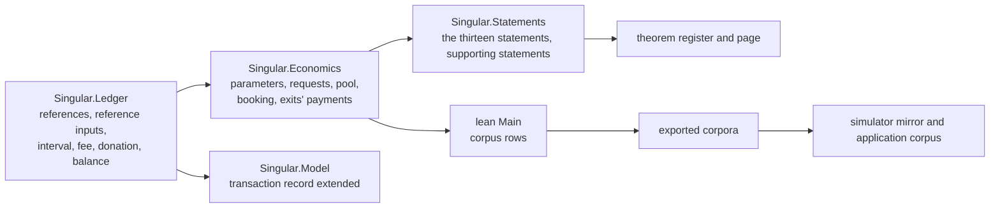

# Economic model rows: modules, data and functions of slices five to ten

This page owns the new or changed rows of the economic slices, in the same three layers as the [modules](modules-model.md), [data](data-model.md) and
[functions](functions-model.md) pages of the protected rejection rule, for the [economics plan](economics-plan.md) and the [design](economics-design.md).
It contains no bodies and no proofs. The rows here say what each slice owns; the exact signatures of a slice are added to this page by the ticket owner
before that slice is dispatched, so that no writer chooses a name that another slice, the transport or the paper depends on.

## Story

As the writer given an economic slice, I read the rows of that slice and nothing I have to guess, so that the model, the transport and the paper name every
amount, parameter and statement the same way.

## Modules

| Module | Responsibility | Slices | Dependency direction |
|---|---|---|---|
| `Singular.Ledger` (new) | Output references, the unspent set, reference inputs, the validity interval, fee, donation, the balance relation, the exact state token identity | five | Reads nothing of the registry |
| `Singular.Economics` (new) | The three parameters' meaning, the registration and termination requests, the exact-contents rule, the pending pool, booking steps, the world and its reachability, the payments of every exit, definitions only | five to ten | Reads Ledger and Model |
| `Singular.Model` | The configuration gains the three parameters; the transaction record gains the Ledger fields with defaults; the rejection arm leaves the fold | five, eight | Reads Ledger |
| `Singular.Statements` | The thirteen statements, the supporting statements and the kept variants | five to ten | Reads Model and Economics |
| `lean/Main.lean`, `Driver.lean` | Corpus rows and, where a declared question changes, its wire form | five to ten | Reads Model, Statements |
| Generated copies | Corpora, register and digests, theorem page, simulator mirror, application corpus, coverage record, restatement table, constitution entry | five to ten | Produced by tools, never edited |

The new modules are imported by the root module so the axiom gate and the audit report walk them. Whether the vocabulary is a module of its own or part of
the model is the writer's call if the dependency direction above holds.

## Data

| Entity | Field or shape | Meaning | Slice | Default and encoding |
|---|---|---|---|---|
| Registry configuration | `registrationCost`, `minimumTip`, `bookingWidth` | The three parameters, fixed at creation | five | Zero; written only when positive. The width is below the processing window |
| Output reference | An abstract identity of one output | What a transaction spends or reads | five | Required on a spent or read input |
| Transaction | `referenceInputs`, `validity`, `fee`, `donation` | Outputs read and not spent; the finite interval, lower end included and upper end excluded; the ledger fee; the treasury donation | five | Empty, none, zero, zero; a zero donation is not written |
| Registry state token | Policy and asset name | The exact identity a rejection checks on the output it reads | five | The existing registry identity names it |
| Registration request | Refund address, destination, booked time, registration cost, declared tip, carrier ada, approval, tag | What a registration holds and promises | six | The booked time is the upper end of the booking interval |
| Request pool | The pending requests of a world | Requests booked and neither folded, rejected nor retracted | six | Empty at genesis |
| Termination request | Active token, declared tip, carrier ada, approval, tag | What a termination holds; no refund address, no time | seven | |
| World | The registry state with the pool | What the statements quantify over | six | The registry state alone for every existing row |
| Treasury recipient | A recipient in the payment vocabulary | Owed the donation | ten | |

Validation and invariants. An old input without these fields reads as the defaults, so every existing question, scenario and corpus row means what it meant
and a fold's question is exactly what it was. Every step preserves the three parameters exactly as it preserves the pins. A request is pending only if a booking
produced it. The supply of a token kind counts the tokens held at the application's custody and the tokens held by pending requests until the fold burns them.

## Functions (named here, signed before dispatch)

| Name | Slice | Constraint |
|---|---|---|
| `applyTx` | five | Removes spent inputs from the unspent set, adds the outputs, leaves reference inputs in place; refuses a reference to an output not in the set |
| `balanced` | five | Inputs plus mint equal outputs plus donation plus fee, for native assets and lovelace |
| `exactContents` | six, seven | A request holds exactly the amounts its kind allows; a tip of at least the minimum is declared apart from the held value |
| `book` | six, seven | Registration: interval no wider than the maximum, booked time its upper end, exact contents, tag minted once. Termination: the token moves from custody into the request, exact contents, approval bound to terminate, key, destination |
| `rejectionAccepted` | eight | Over a transaction and the unspent set: state output referenced with the exact token, no state output spent, request inputs distinct, one interval, every member admitted by a current mismatch or by expiry, no termination |
| `refundObligations` | nine | Held minus tip to each refund address, summed per address, approval included; a retraction returns everything held |
| `foldObligations` | ten | The registration cost to the treasury, the tip to the processor, the carrier with the token; a termination burns the token and the approval and donates held minus tip |

A statement is declared where the plan puts it, never beside its definition in `Economics`, so the axiom gate and the register cover it.
