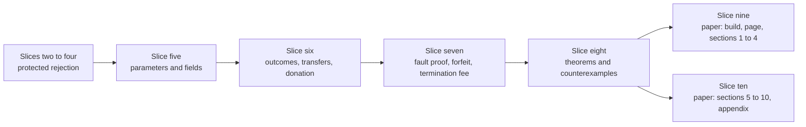

# Plan: the economic model, its theorems and the paper

This page plans the work after slice four: the whole economic design of the [design page](economics-design.md) stated in the Lean
model, its properties as theorems, and a formal paper written from them. It names every theorem the model should prove, says
which ones are expected not to hold and why, cuts the work into slices, and outlines the paper. Planning only: no model or paper
work starts before the desk answers the plan question.

## Story

As the operator receiving a review, I read one page and learn which economic properties will be proved in Lean, which will be
shown false with a counterexample, which are argued by hand from proved lemmas, in what order the work lands and where the paper
appears, so that I can say yes or return a line before anyone writes a proof.

## The model additions, in plain words

Registry configuration gains the bond, the processor split (a numerator and a denominator) and the termination fee; each defaults to
zero in old input and is preserved by every fold. The model has no booking transition (a request is an argument, not a state), so the booking
rule is a defined admission: the request's bond is at least the registry bond, a terminate request carries at least the registry fee, and the
root it recorded equals the root of the state read at booking. The request-tag mint must enforce exactly that admission, and the honesty
theorems quantify over requests that passed it. A request gains its bond, the termination fee it carries, and the root it recorded at
booking. A transaction gains a treasury donation amount. A new payment recipient, the treasury, is owed the donation. Every new field
defaults to zero, so every existing row of the public suite, which builds requests without them, behaves exactly as before. No
validator, builder or command-line file is touched.

## Theorems

Status: **proved** means a Lean theorem with only the standard axioms; **argued** means derived by hand from proved lemmas and labelled
so in the paper (it involves the value of a key, fees or opportunity cost, which the model does not contain); **expected to fail** means
the statement is false in the model, and a Lean example with the counterexample is kept instead.

| Lean name | Statement in words | Status | Slice |
|---|---|---|---|
| `transfer_conserves` | In every outcome the owner floor, the treasury floor and the processor ceiling add up to what the request held | proved | six |
| `forfeit_shares_add_up` | Processor share plus treasury share equals the bond exactly | proved | six |
| `treasury_share_positive` | With the split below one and a positive bond the treasury share is positive | proved | six |
| `parameters_preserved_by_fold` | Bond, split and termination fee are equal before and after every fold | proved | five |
| `fold_returns_bond`, `retraction_returns_everything` | A fold and a retraction owe the owner the bond; a retraction owes deposit, tip and bond | proved | six |
| `expiry_never_forfeits` | A rejection on the expiry ground owes the owner deposit and bond | proved | seven |
| `termination_donates_fee` | A fold that terminates a key owes the treasury at least the fee per terminated key, also in a batch | proved | seven |
| `zero_owed_means_no_donation` | A zero owed amount imposes no donation, so the field can be omitted | proved | six |
| `forfeit_requires_fault_at_booking` | A rejection that forfeits carries a map whose commitment is the recorded booking root and in which the edge has no successor at the key | proved | seven |
| `no_proof_no_forfeit` | A rejection without a valid booking proof owes the owner deposit and bond | proved | seven |
| `known_stays_known` | A key that is known never becomes unknown, so a fault at booking of a registration persists as a mismatch | proved | eight |
| `honest_requester_keeps_bond` | If the request passed the booking admission against a reachable state in which its edge was admissible, and the commitment is collision free, no reachable state and no admitted rejection takes its deposit or its bond | proved | eight |
| `honest_payoff_floor` | The requester's lovelace outcome is at least minus the tip, before fees | proved | eight |
| `live_compatible_request_protected` | No request that can be folded now can be rejected before expiry (already proved in slice two) | proved | two |
| `rejection_without_proof_processor_cap` | On a rejection without proof the processor keeps at most the tip | proved | eight |
| `self_rejection_cost` | A requester that is also the processor of its own faulty request loses at least the treasury share | proved, needs split below one | eight |
| `termination_cost_floor` | Ending a key as terminal costs at least the fee | proved | eight |
| Flood cost per faulty request, griefing factor, processor incentive to clear faults, collusion | Inequalities in the parameters derived from the transfer lemmas | argued | paper |
| `duplicate_bookings_cost_only_tip` | Concurrent bookings of one untaken key are all admissible at the booking root; the losers cost their tip, not the bond | **expected to fail as a defence**; counterexample kept | eight |
| `rejection_requires_no_signer` | A rejection requires no signer, so anyone may submit it, the owner of an expired request included | proved | eight |
| `owner_exit_after_expiry` | After the reclaim window the owner of a request exits by rejecting it itself on the expiry ground: deposit and bond come back to it, and it pays only fees | proved | eight |
| `full_processor_split_costs_nothing` | With the split equal to one a self-rejecting requester pays nothing | **expected to fail**; shows the constraint | eight |
| `honest_loses_tip_on_race` | A requester that lost a race loses its tip | shows the exact scope of the honesty theorem | eight |
| `key_capture_not_priced` | A front-runner that registers the key first is not charged for the capture | **expected to fail as a defence**; example kept | eight |

The economic theorems and the kept counterexamples are declared in `Statements.lean`, the namespace the axioms guard and the register already cover;
the new `Economics.lean` holds definitions only. The termination fee is deliberately expensive: the paper derives its lower bound from what it
must deter and says plainly that an honest owner pays it once at the end of a key's life; the contract enforces no floor.

Where the desk's guide claims the cost of squat-and-terminate as the fee plus the deposit plus the tip, the model returns the deposit
at termination, so the proved floor is the fee; the deposit is capital, not cost. The statement is written that way and the difference
is explained in the paper. Conservation is stated for a balanced transaction (inputs equal outputs plus donation plus fee), because the
model has no ledger fee; the balance is a named premise, not a model rule.

## Slices

| Slice | Delivers | Consumers it regenerates |
|---|---|---|
| Five: parameters and fields | The three registry parameters, the request's bond, carried fee and booking root, the booking admission, the transaction donation field, protocol version, preservation by folds | Corpora, register and digests, transport, simulator mirror, application corpus, coverage record |
| Six: outcomes and transfers | The five outcomes, the transfer table as a definition, bond returns in fold, retraction and rejection obligations, the treasury recipient and donation settlement, zero-donation handling | As five, plus the rows of the driver corpus |
| Seven: fault proof, forfeit, termination fee | The booking proof in rejection evidence, forfeit and split on the mismatch ground, no forfeit on expiry or without proof, the termination fee owed by a terminating fold, refusals naming the bond and the fee | As six |
| Eight: theorems and counterexamples | The proved economic theorems, the kept counterexamples, the audit report entries and the theorem-to-name table | The theorem page and register |
| Nine: paper build and first sections | The LaTeX source, its Nix build into the documentation site, the docs page with abstract, theorem table and PDF link, sections one to four; the documents check gains two assertions (the PDF is in the built site, the table equals the audit report and every cited Lean name resolves) and the code inventory classifies the paper sources | Documentation site, preview |
| Ten: paper completion | Sections five to ten, related work, limitations with every counterexample, the appendix generated from the audit report | Documentation site |

One writer at a time, Muse; Grok audits every slice; the paper's claims are audited against the Lean statements they cite. Each slice
is cut again if it runs for hours. Slices five to eight touch only Lean, its runners and corpora, the model rows of the conformance
suite and generated copies; nine and ten touch documentation only.

## The paper

Format: LaTeX in the LIPIcs style, built in a Nix derivation into the documentation site, with a page carrying the abstract, the
theorem-to-Lean table and the PDF link so that the pull request preview shows it. If the LIPIcs class is not available in the pinned
package set, the class file is vendored under its licence, or the plain article class is used and the page says so.

Sections, as the operator and the desk specified: system model; adversary and cost model (what an attacker controls: block
production, mempool view, ordering; what each action costs); mechanism (the transfer table as one table); properties as definitions and
theorems with proofs or mechanized references; parameter constraints as derived inequalities with worked lovelace examples; related
work (only verified entries); limitations, including every property that does not hold with its counterexample; appendix mapping every
theorem to its Lean name, file, line and pinned commit with the axioms printed, the trusted base stated and the model-to-validator
correspondence named as an assumption with the checks that have no counterpart listed as gaps. Statements are quantified over reachable
states and say so. Every claim cites its Lean theorem; nothing is claimed that the model does not prove; unproved statements are
marked in the first draft.

## Touch list

The files of slices five to ten, all new work, are listed in the [touch list](touch-list.md), section "Slices five to ten". Not touched: the
root `flake.nix` and `.github/workflows/ci.yml` unless the desk finds the docs build cannot carry the PDF, in which case that is a question;
everything under `onchain/`, `offchain/`, builders and the command line.

## Assumptions

The booking proof is carried by the rejection evidence as the whole map (a logical read, one state earlier) and root collision resistance is
a named assumption of the theorems. The processor chooses the ground, and only the mismatch ground with a valid booking proof forfeits. The
booking admission is a defined rule, not a transition; the request-tag mint must enforce it and the honesty theorems quantify over the
requests that passed it. The termination donation floor is the registry fee, the request's carried fee being checked by the booking
admission. The donation encoding follows the ledger, so a zero amount omits the field. The owner of an expired request exits by rejecting it
itself, because a rejection requires no signer; what remains of the delay attack is the capital locked until someone does.
