# Plan: the economic model, rebuilt on the decided design

This page plans the Lean work that runs after slice three: the whole [economic design](economics-design.md) stated in the model, the thirteen statements the
design allows the paper to make, and the controls that keep each of them honest. The paper itself waits until this work is done. Planning only: no model
work starts before this plan is cleared. It replaces the earlier plan, whose bond, split, booking root and termination fee no longer exist.

## Story

As the operator reading one page, I learn which statements the model will prove, in which slice, which scenario guards each one, and which choices the plan
still needs from me, so that I can clear the plan or return a line before anyone writes a proof.

```mermaid
flowchart LR
    S3[Slices one to three<br/>on the branch] --> P5[Slice five<br/>parameters and the transaction vocabulary]
    P5 --> P5b[Slice five-b<br/>review and improvement of the Lean base]
    P5b --> P6[Slice six<br/>registrations: contents and booked time]
    P6 --> P7[Slice seven<br/>terminations and the supply]
    P7 --> P8a[Slice eight-a<br/>the fold model in small modules]
    P8a --> P7b[Slice seven-b<br/>the trie-ready tag]
    P7b --> P7c[Slice seven-c<br/>one tip number]
    P7c --> P8[Slice eight<br/>rejection reads the state]
    P8 --> P8c[Slice eight-c<br/>the live rows published unmet]
    P8c --> P9[Slice nine<br/>refunds]
    P9 --> P10[Slice ten<br/>folds: the charge and the donation]
    P10 --> Paper[The paper<br/>written from the finished model]
```

## What the model has, and what the design adds

| Already in the model | Where the new work uses it |
|---|---|
| The map, its root, the two supported edges, the token supply laws (`biconditional_supply_sync`, `active_witness_unique`) | Statements 8 and 9, extended to count tokens held by pending requests |
| Reachability by folds (`Reachable`) | Extended to a world that also holds the pending requests and books into them |
| Rejection admission over evidence, `live_compatible_request_protected`, `rejection_without_evidence` (slices two and three) | Restated in slice eight for a rejection that reads the state output |
| Exits and floor payments (`Exit`, `obligations`, `settle`) | Restated for the new request contents in slices nine and ten |
| The transaction record (inputs, outputs, mint, signers) | Extended in slice five |
| The booked time of a request (slice one) | Becomes the upper end of the booking interval in slice six |

The model lacks, and the slices add: output references and a set of unspent outputs; reference inputs beside spent inputs; a validity interval, a ledger fee and a
donation on a transaction; the registration cost, minimum tip and maximum booking width; a pending-request pool and booking steps (today a request is an
argument, not a state); the registration and the termination request with their exact contents; the treasury as a recipient. Registration is the edge
`insertActive` and termination the edge `updateTerminal`; the five refused edges stay refused.

## Names

The operator agreed these names on 14 October 2026 and renamed the first of them on 15 October 2026; the plan and the model use them from slice six on, and slice seven-b brings the declarations of this branch to them. Main's declarations keep their names until the public rename ticket named at acceptance.

| Name | Meaning | Replaces |
|---|---|---|
| trie-ready tag | The token the request policy mints at booking. It proves that the request can be judged against the Merkle trie, positively (a fold) or negatively (a rejection): exact contents, a tip of at least the minimum tip, a booking interval at most the maximum width wide, and its precondition present: the application tag for a registration, the singular tag for a termination. Its asset name is the hash of the operation plus a nonce; the operation contains the payload. A registration and a termination both carry one | syntax tag, request tag, request-policy tag |
| singular tag | The key's active token: one per registered key, kept at the destination under the application's custody, carried by a termination request and burned when it folds. A termination's trie-ready tag is minted only if the singular tag is present | the key's active token |
| application tag | The application's approval that a payload may enter. A registration only: a termination carries none. It is bound to register, key, refund address and destination. Its asset name is the hash of the payload plus a nonce. Minting it is the application's own judgment; Singular requires it as the precondition of a registration's trie-ready tag and never judges the application's rule | approval |
| state token | The registry's own token on its state output, kept distinct from the singular tag | unchanged |

The trie-ready tag is minted only with its precondition present, and Singular does not police where else the application tag is minted.
The trie-ready tag and the application tag share one life: both are minted at booking and burned by every exit of a registration, never returned, so there is no tag without a pending request and no pending request without its tags. Tag flow: a registration fold burns the trie-ready tag and the application tag and mints the singular tag at the destination; a registration rejection or retraction burns both; a termination fold burns the trie-ready tag and the singular tag. The tag policies allow a burn with no condition; the exit rules are the request validator's spend.

## The statements

Numbers are those of the design's list of what the paper may state. Names are planned and live in `Singular.Statements`. A statement is **to prove** until a Lean declaration with only the
standard axioms exists. Every statement quantifies over accepted transactions in reachable worlds, never over what a builder produces.

| Statement | Planned Lean name | In words | Slice |
|---|---|---|---|
| 1 | `parameters_preserved_by_fold` | Every fold keeps the registration cost, the minimum tip (the one pinned number, which replaces the old fee pin), the maximum booking width and every other pin | five, restated in seven-c |
| 2 | `rejection_leaves_registry_untouched` | An accepted rejection, or rejection batch, spends no state output and changes neither the map nor the token supply | eight |
| 3 | `rejection_cannot_invalidate_fold` | A fold stays valid after any accepted rejection ordered before it, when their other inputs are disjoint | eight |
| 4 | `live_request_not_rejected` | A registration that can still be folded is not rejected before expiry (restates `live_compatible_request_protected`) | eight |
| 5 | `rejection_requires_referenced_state` | No rejection without the registry's state output referenced (restates `rejection_without_evidence`) | eight |
| 6 | `rejection_refund_floor`, `retraction_refund_floor` | Each refund address receives at least held minus tip, in lovelace, per rejected request; a retraction returns everything held except the two tags, which are burned | nine |
| 7 | `fold_donates_registration_cost`, `registration_cost_returned_on_exit` | A fold registering n keys donates at least n times the registration cost; the cost comes back on rejection and retraction | ten, nine |
| 8 | `termination_unrejectable` | In every reachable world no rejection of a termination carrying its key's genuine token is accepted, on either ground | eight |
| 9 | `at_most_one_pending_termination` | At most one termination per key is pending | seven |
| 10 | `only_booked_terminations_fold` | Only a booked termination folds, and a booked termination carries its key's genuine singular tag (restated on 15 October 2026: a termination carries no application tag; the application's consent is the release of the singular tag from its custody, outside Singular's scripts) | ten |
| 11 | `booked_termination_foldable` | A booked termination can be folded at any later time, given a folder that accepts its tip and fees inside the sized envelope | ten |
| 12 | `processors_take_at_most_the_tips` | Across a batch, what the processors take is at most the sum of the tips, with no outside funding | ten |
| 13 | not a Lean statement in this plan | The minimum tip covers the measured cost of every supported exit; it waits for measured values (open item 3) and the paper states it as conditional | none |

Supporting statements, each in the slice that needs it: `reference_inputs_not_consumed` (with the premise `disjointInputs`), `spent_reference_refused`, `overlapping_reference_is_spent`,
`balanced_transaction_conserves_value`, `zero_donation_omits_field` (five, proved); `booked_request_has_exact_contents`, `booked_time_is_interval_end`, `booked_time_not_before_inclusion`,
`booking_width_within_limit` (six); `world_supply_sync`, `termination_request_carries_genuine_token` (seven); `rejection_batch_members_distinct`, `sweep_leaves_pool_untouched` (eight);
`refunds_sum_per_address` (nine); `fold_routes_every_amount`, `tag_supplies_equal_pending` (ten). Statement 4 rests on `booked_time_not_before_inclusion`: the booked time is the upper end of
the interval the booking transaction was valid in, so expiry comes no earlier than both windows after the booking was included.

## The slices

After slice five-b the Lean tree is split into small modules and new declarations go to the module of their kind, never back into a large facade: definitions of the model's vocabulary in `Singular/Model/` and the economic definitions in `Singular/Economics.lean`; statements in `Singular/Statements/<property>.lean`, the facade `Statements.lean` keeping the namespace the axiom gate walks; corpus fixtures in `Main/` and `DriverMain/`. The fold model's own declarations stay in `Model.lean`, `Lemmas.lean` and `Statements.lean` until the fold admission change of another lane is on main, and move in slice eight-a.

Each slice starts with its failing controls, committed first and failing for the intended reason on the branch as it stands, then the model, the statements,
the corpus rows, and the regeneration of every copy the change moves (corpora, register and digests, theorem page, simulator mirror, application corpus,
coverage record, restatement table). The driver protocol version moves in the first slice that changes a declared question. A slice ends with the list of
its statements and their axiom lines (see "Names and receipts"). One writer per slice; a slice that runs for four hours is cut again.

- **Five: parameters and the transaction vocabulary.** *As a registry creator, I fix the three parameters once and see every fold leave them as they were; as a reviewer, I read a transaction as the ledger shows it.* Adds the three parameters (default zero in old input, preserved by folds, the maximum booking width below the processing window); output references and the unspent set; reference inputs; the validity interval, fee and donation on a transaction (a zero donation omits the field); the exact state token identity (policy and name); the balance relation. Statement 1 and the five supporting statements. Controls: a fold that changes a parameter; a spent reference; an unbalanced transaction. The registry's expected state token is the pair (registry identity, name zero): an abstraction, stated as such, that keeps the check exact for every pair an output presents.
- **Five-b: review and improvement of the Lean base (done).** *As the author of slices six to ten, and of the paper, I build on a base whose names say what they mean and whose modules are small and cohesive.* Inserted by the operator's direction before slice six. A bounded review of the whole `lean/` tree (about 8,400 lines; five modules over 700 lines) in at most seven checkpoints: a written review ranked by what each finding costs slices six to ten; the tools that read the model by file learn to read a set of modules; the large modules are split into cohesive submodules, each split a move with no change of meaning; at most two batches of renames and structural improvements. No statement is weakened and no meaning changes; the qualified names of protected and paper-cited statements stay; renaming a declaration that main already has, and any finding that needs a ruling, is listed and not applied. Writer Codex `gpt-6-astra` at medium effort, auditor Grok. No new statement and no new control; the written forms and the corpora of scenarios stay byte-identical.
- **Six: registrations (done).** *As a requester, I book a registration holding exactly the registration cost, a tip of at least the minimum, the carrier ada and the application tag, and my booked time cannot be moved.* Adds the pending-request pool and the booking step into it, the registration request, the exact-contents rule (declared tip apart from held value), the trie-ready tag (built under its earlier name, the syntax tag, which slice seven-b replaces) with its provenance (a request is pending only if a booking made it), and the booking rule: the interval is at most the maximum width wide and the booked time is its upper end. The trie-ready tag and the application tag are minted at booking with the pending request; the application tag is the precondition of the registration's trie-ready tag. The mint validator stays with ticket 529; this slice models what the syntax tag guarantees. The four supporting statements. Controls: a dirty request, hidden surplus, a forged syntax tag, a backdated booking, a booking wider than the maximum.
- **Seven: terminations (done, restated by seven-b).** *As an application, I release a key's singular tag into a termination request; as anyone, I see at most one termination pending per key and the supply still adds up.* Adds the termination request (token, tip, carrier ada, with the application tag it was built to carry; no refund address, no time), its booking step (the token moves from the application's custody into the request) and the supply laws counting tokens held by pending requests. Statement 9 and the two supporting statements. Controls: a forged singular tag or application tag, a second termination of one key, a termination whose token is not in custody. Slice seven-b removes the termination's application tag.
- **Eight-a: the fold model in small modules.** *As the author of slices seven-b to ten, I add declarations to small cohesive modules.* A move with no change of meaning of the declarations that define or admit a fold, which slice five-b left in the facade files until the fold lane's changes were on main. No statement and no control is added, changed or dropped; the qualified names are kept or the theorem page records the move. Writer Codex `gpt-6-astra` at medium effort.
- **Seven-b: the trie-ready tag (inserted on 15 October 2026).** *As a reviewer, I read one vocabulary and see the model refuse a trie-ready tag minted for another operation.* This branch's declarations built under the name syntax tag take the name trie-ready tag (main's names stay); a termination carries no application tag (its contents, its booking refusals and its controls change: a termination that holds an application tag is refused as dirty, and the two earlier controls on its application tag become that one); both tag names are commitments beside the existing approval commitment (the application tag's name commits to the payload and a nonce, the trie-ready tag's to the operation and a nonce; one nonce per request; no injectivity assumed); the booking statements restate with the new vocabulary; statement 10 is restated for slice ten. New control: a tag minted for another operation or nonce is refused. Writer Codex `gpt-6-astra` at high effort, one persistent auditor.
- **Seven-c: one tip number (inserted on 15 October 2026).** *As a registry creator, I pin one number, the floor on the tip a requester declares, and the processor takes exactly the declared tip.* The configuration's two fields become one: the Lean field is named the minimum tip and is written under the existing wire key `maxFee` until the public rename ticket, so the chain datum, the off-chain code, the corpora of unchanged rows and the transport read what they read now. The old tip-cover predicate, its use in the two transaction-row statements, the tip-cover lemma and the two scenario rows about the old fee pin are retired by append-only restatement rows; the booking rows that already refuse a tip below the minimum state the single-number rule; the processor's exact take is a statement of slice ten. A live row whose expectation changes under the new meaning is published unmet by ruling with the tripwire of slice eight-c, never as a pass; a row that keeps passing is not touched. Because it touches main's declarations, it runs the consumers of a `lean/` change before its push (model check, transaction baseline, simulator, application corpus, coverage, the conformance commands without a devnet). The writer lists the general control `wrong-fee` and the tip fields of the transaction baseline at its first checkpoint. Writer Codex `gpt-6-astra` at high effort, one persistent auditor.
- **Eight: rejection reads the state.** *As a processor, I reject mismatching or expired registrations in one batch against the state output I read but do not spend.* Adds the accepted-rejection judgement over a transaction: the state output referenced with the exact token and read for its root, no state output spent, distinct request inputs, one interval, each member admitted on a current mismatch or on expiry, terminations never admitted; each rejected request's trie-ready tag and application tag burned; the rejection arm leaves the fold. The request address has two spending arms: an output lacking the trie-ready tag is not a request and anyone may spend it (a trie-ready tag is minted only with its precondition present, so a genuine request holds the tags its kind requires), a tagged output leaves only through an exit that burns its tags. Restates slices two and three. Statements 2, 3, 4, 5 and 8 and two supporting statements. Controls: the old state-spending path, a fake, foreign or stale state, an overlapping state spend, a live member inside a batch, a repeated input, a tagged request spent through the sweep arm, a rejection that carries a tag out alive. The driver keeps answering the old fold-with-rejection question from a retained, explicitly named legacy declaration, with scenario payloads byte-identical. Writer Codex `gpt-6-astra` at high effort.
- **Eight-c: the live rows published unmet.** *As a consumer reading the conformance page, I see which live rows the deployed validators do not yet meet and why.* Conformance and CI code: the live rows that exercise the old fold-with-rejection path (early rejection inside the windows, reject and retract refund controls, the running book, the generic rows) are published as unmet by ruling ("implementation follows the superseded rule; the ruled rule is not implemented"), with a tripwire that turns red when the deployed validators implement the ruled rule; nothing counts the old behaviour as meeting the ruled design. Writer Codex `gpt-6-astra` at medium effort.
- **Nine: refunds.** *As a requester, I get back everything but the tip when my request is rejected and everything when I retract; as a refund address in a batch, I get exactly my sum.* Adds the refund obligations of rejection and retraction for the new contents, in lovelace and summed per refund address, the return of the registration cost, and the burn of both tags of a registration by retraction. Statement 6, the second half of statement 7 and one supporting statement. Controls: a reused refund, a refund short of held minus tip, a retraction that carries a tag out alive.
- **Ten: folds.** *As the treasury, I receive at least the registration cost for each key registered and everything but the tip of each terminated key; as a requester with a booked termination, I see it can always be folded.* Adds the fold of a registration (the processing window; routing of the cost, tip and carrier) and of a termination (no window; the singular tag and the trie-ready tag burned; everything but the tip donated; the processor takes exactly the declared tip), the tag flow of both folds (a registration fold burns the trie-ready tag and the application tag and mints the singular tag at the destination; a termination fold burns the trie-ready tag and the singular tag), the donation floor and the processors' take. Statements 7 (first half), 10 (restated), 11 and 12 and two supporting statements. Controls: a termination stranded by a check made at fold time, one donation counted for many keys, a forged application tag on a registration, an unbalanced fold, a fold that carries a tag out alive.

## Controls

A control is a scenario the model must refuse, or a variant of the model for which a statement must fail. Each is kept as corpus rows that are refused for the
intended reason (the wrong-reason control applies), and, where it is a variant, as a Lean example. The slice of each is above. Two controls recur in every slice that has exits: a tagged request cannot be spent through the sweep arm, and an exit that spends a request without burning its tags (a tag carried out alive) is refused.

## Decisions taken

1. **The old fee pin and the new minimum tip (ruled again on 15 October 2026).** The first version of this decision kept both numbers and left their relation open. The operator
   retired the fee pin: the minimum tip replaces it, one pinned number, the floor on the tip a requester declares, and the processor takes exactly the declared tip. The state keeps
   its shape: the existing field carries the minimum tip, and only its meaning changes. Slice seven-c states this in the model; the validators follow after Demo 1 with the rest of
   protected rejection.
2. **Slice four is withdrawn.** The design takes rejection out of the fold's action list: a rejection never spends the state output and never shares a transaction with a
   fold, so no batch holds both and the story of slice four cannot be told. Statement 3 (a rejection ordered before a fold cannot invalidate it) carries the protection,
   in slice eight.

## Open items, kept open

The items of the design that remain open, and one the plan found. The fate of a registration's application tag on a successful fold is decided: it is burned, never returned, so no restitution output exists.

| Open item | Where it meets the model | What the plan does |
|---|---|---|
| 1. Adapting open-datum | Its committed corpus embeds requests | Regenerated mechanically when the serialization moves; its behavior is not changed and its token release stays as it is |
| 2. Adapting cardano-keri | Its reward and refund differ from the decided termination | Not modelled and not touched |
| 3. Measured values | The registration cost, the minimum tip and the maximum booking width (the carrier minimum is a ledger figure, not a registry parameter) | They are numbers in corpus rows, marked illustrative; statement 13 waits |

Closed by ruling. The relation between the fee pin and the minimum tip is closed on 15 October 2026: the pin is retired and the minimum tip replaces it, in the same state field.
The source of the carrier amount is closed on 14 October 2026: the ledger sets the carrier ada, the requester declares it, the booking checks held value against cost plus declared tip
plus declared carrier, and the model makes no claim about the ledger minimum (the ledger enforces it when the output is created); no registry pin exists.

## The design page and the paper

The [design page](economics-design.md) is the decided design, committed with this plan. The paper starts only when this Lean work is done, so that it can refer
to the model: a fresh writer, briefed from the finished model and the design page. Until then every statement is a plan, not a claim.

**Names and receipts.** Every statement above is declared as a theorem in `Singular.Statements`, the namespace the compiled axiom gate walks, so its fully
qualified name is `Singular.Statements.<planned name>` and a build that passes proves it uses only `propext`, `Classical.choice` and `Quot.sound`. Each slice ends
with a list of its new statements, each with its fully qualified name, the `AXIOMS` line that `#audit_statements report` prints for it, and the revision it was
printed at; the regenerated theorem register and theorem page carry the same names and digests. A definition the paper cites (for example `onlyRootChanged`) is
cited by its qualified name at the same revision. The paper's brief requires each economic statement to name its declaration by qualified name, exact revision and
axiom line, and marks nothing proved unless that declaration exists and the gate passed on it.

## Staffing and gate

The Lean writer is Codex `gpt-6-astra` at high effort (slices seven-b, seven-c, eight, nine and ten; the paper); implementation, conformance and CI code and rebases are Codex `gpt-6-astra`
at medium effort (slices eight-a and eight-c). The persistent auditor of each slice is Codex `gpt-6.1-sol` at high effort in a read-only detached worktree until Grok's weekly limit resets,
then Grok. The [gate](gate.md) versions 4 and 5 map the existing commands onto these slices. The files are in the [touch list](touch-list.md), section "Slices five to ten"; the modules, data and functions in the
[model rows](economics-models.md).
