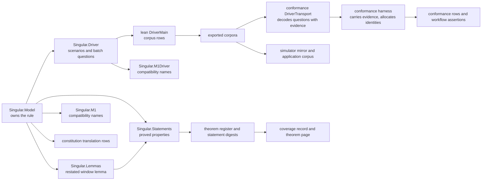

# Modules model: where the rejection rule lives and who reads it

This page owns responsibility and dependency direction for the modules ticket 494 changes. It
sits above [data](data-model.md) and [functions](functions-model.md) and does not repeat them.

## Standing since 14 October 2026

This page covers where the first stage of the rule lives. The economic stage adds modules beside these, listed in the economics models, and leaves the earlier path in place. The decided economic design ([design](economics-design.md)) is what the ticket now delivers: a rejection reads the current state by reference and spends no state output, never shares a transaction with a fold, and returns each refund address at least what its requests held minus their tips. The [economics plan](economics-plan.md) lists the slices and the [economics models](economics-models.md) the rows as built. The live conformance rows that still follow the earlier rules are published as unmet until the validators and builders follow the model.

## Story

As the person who reviews or later extends the rule, I see one module that owns it, the modules
that only restate or execute it, and the generated copies that must follow, so that a change to
the rule has one place to start and one list of places that must agree afterwards.

The arrows point from the owner to the readers. Nothing on the right of the model may state
the rule differently from the model; the generated copies are produced from it, never edited.

## Responsibilities

| Module or component | Responsibility after this ticket | Dependency direction |
|---|---|---|
| `Singular.Model` | Owns the booked identity on a request, the registry identity on a configuration, the rejection evidence types, the rejection admission beside the retraction admission, the extended exit admission, and the ordered mixed-batch engine. Promotes nothing: admission already lives here, so it stays here. | Depends on nothing in the project. |
| `Singular.Lemmas` | Restates the one lemma that names the retraction window, because the window now reads the request. | Reads Model. |
| `Singular.Statements` | Holds the proved properties named in the requirements and restates the statements whose signature moved. | Reads Model and Lemmas. |
| `Singular.Driver` | Carries the scenario's rejection witness, the batch scenario's per-request witnesses and the new mixed-batch question; serializes evidence; moves the protocol version and the declared surface. | Reads Model. |
| `Singular.M1`, `Singular.M1Driver` | Compatibility names for the same model; their restated statements follow the new signatures. No second law. | Read Model and Driver. |
| `lean/DriverMain.lean`, `lean/Main.lean` | Export the accepting and refusing cases and the historical scenario; guard the protocol version. | Read Driver. |
| `conformance/lean/DriverTransport.lean` | Decodes a question that carries evidence; refuses a rejection question without its booked metadata and evidence attached to another exit. | Reads Driver; read by the harness. |
| Conformance harness and story vocabulary | Allocates the registry identity while acting, reads the booked time from the request datum, builds the lawful reject and batch stories, and states each row in the suite's own language. | Reads the transport. |
| Workflow assertions for the conformance rows | Follow the rows; no row's meaning changes silently. | Read the harness. |
| Generated copies | Simulator mirror, application corpus, exported corpora, theorem register, coverage record, theorem page, speech companions and audio clips: regenerated by their own tools from the model. | Read everything above. |

## Decisions

| Decision | Chosen | Rejected, and why |
|---|---|---|
| Where rejection admission lives | Beside retraction admission in the model | A new module for rejection: it would split one admission concept in two and force the driver to import both for the same exit. |
| One engine for batches | All-reject batches run through the mixed-batch engine | A separate all-reject loop: two admission paths is exactly the hole the earlier review found. |
| Evidence shape | The complete configuration and request, a reason | Merkle proof bytes in the model: the model has no byte level; a concrete verifier (ticket 495) must show that its proof establishes the logical read. |
| Window clock | The request's booked time | The time in a retraction witness: a self-chosen time lets retraction and expiry disagree. |
| Who regenerates what | Each slice regenerates every copy its change moves | Regenerating at the end: a slice would not be green on its own and the consumers' failures would be found one hosted run at a time. |

## Challenges returned to planning

A coder who finds that a function belongs elsewhere, or that a signature below does not
suffice, stops and reports it; the ticket owner versions this page and the functions page
before the work continues.
