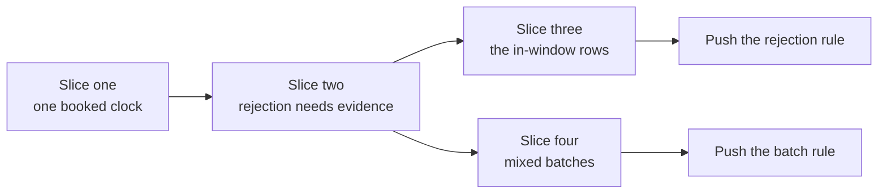

# Plan: protected rejection in the Lean model, in four slices

Ticket 494 under epic 498. Base `e3c9ab01`, branch `feat/494-protected-rejection-rule`,
worktree `/code/singular-issue-494`. Read the [specification](spec.md) for what must hold, the
[rulings](decisions.md) for why, the [research](research.md) for the evidence behind the tables
below, and the [touch list](touch-list.md) for the files. Planning only: no coding starts before
the command-line split (528) merges and the desk grants a slot.

## Status

Planning artifacts written and committed locally. One question is open (what the public suite shows
for an in-window rejection until the validators change); it blocks slice three and the frozen gate's
last rows only. The gate has two independent authors, synthesized once in the [gate](gate.md).

## Story

As the person accepting this ticket, I read one page and learn what changes in which order, what the
eight red checks of the earlier attempt mean, what happens to that attempt, and where the work can
collide with other lanes, so that I can approve the plan without reading the model.

## Strategy

The earlier attempt put the whole rule, its batch semantics and every consumer into one change on a
tree that has since lost five of its seven edges. This plan ports the same reviewed design onto the
two-edge model in four vertical slices. Each slice leaves the repository green by regenerating the
copies its own change moves, and each ends in something a person can run: the model runner, a
conformance row, or the public page.

Slices three and four are independent after slice two. The rule is pushed for hosted checks after
slice one, after slice three (which completes the rejection rule) and after slice four.

## The four slices

Each slice is sized for one commit owner run, with the inner loop on `lake build` of the changed
modules and the gate's own commands run once per candidate. A slice that runs for hours without a
product commit is cut again, not supervised harder.

| Slice | The person's observable result | Delivers | Consumers it regenerates |
|---|---|---|---|
| One: one booked clock | As an owner, my retraction window is computed from when my request was booked. | `submittedAt` on a request; the window lemma and retraction admission read it; the retraction question carries it; protocol version 7; constitution amendment opened | Corpora, theorem register and digests, simulator mirror, application corpus, coverage record with a restatement table |
| Two: rejection needs evidence | As a requester, the model refuses to reject my foldable request and accepts a lawful rejection with its evidence; the historical scenario flips from accepted to refused. | Registry identity; evidence, reason, witness; rejection admission; the extended exit admission; per-request witnesses for an all-reject batch; the lawful rejection rows of the suite | As slice one, plus the transport, the harness and the workflow assertions of the running book, refund controls, generic rows and batch harness |
| Three: the in-window rows | As a reader of the suite, I see the in-window rows say what is true until the validators change. | The dedicated early-rejection row, the standing unmet consumer-requirement row of the generic session, and their workflow assertions rewritten as the pending ruling directs; the unmet row books a foldable request | Row prose, the consumer record, the book |
| Four: mixed batches | As a processor, the model accepts fold-then-reject of the same fresh key and refuses the reverse. | The action engine; the mixed-batch question; the all-reject batch moved onto the engine; constitution amendment completed | Corpora, transport, simulator mirror, theorem register |

Slice one is the smallest and is independent of the pending question. Slice two carries the weight
of the proofs and is where the historical scenario is run before and after.

## The eight red checks of the earlier attempt

Each check failed at `a7224021` on an assertion found in the hosted log (see the research page for
the line). Each was green at the attempt's own base `23964e66` and on main at `e3c9ab01`, so the
attempt introduced it and none is flaky. The classes are named for what they mean, with the epic
owner's letter in parentheses: moves-with-the-model (a), where the model change contradicts an
expectation that must move with it in this ticket; needs-the-validators (b), where the expectation
can only hold once ticket 495 changes the validators; stale-against-main (c), fixed by re-deriving on
`e3c9ab01`; and other (d). The table says which slice cures each.

| Check | Class | Cause in one line | Cured by |
|---|---|---|---|
| Batch instructions asked of the model | moves-with-the-model (a); needs-the-validators (b) for the in-window variant | The story rejects two foldable requests inside the processing window with no evidence. | Slice two re-bases the second instruction after both windows with expiry evidence; the in-window variant is never a passing row. |
| The running book | moves-with-the-model (a); stale-against-main (c) | A lawful after-the-windows reject carries no evidence; the book's step list is also the seven-edge one. | Slice two |
| Retire-active-key | stale-against-main (c); other (d) | The attempt added booked fields to every exit's question; three separately booked folds then differed under the old whole-request comparison. On main that comparison reads only the request's key (`permanent-retirement-evidence.sh`), so re-deriving cures it. | Re-deriving on main; and a fold's question carries what it carried before, so the over-reach is not repeated. |
| Reject and retract refund controls | moves-with-the-model (a) | As the running book. | Slice two |
| Early rejection inside the windows | moves-with-the-model (a); needs-the-validators (b) | The row asserts model and chain both accept a reject of a foldable request inside the windows; the model now refuses and the validators accept. | Slice three, as the pending ruling directs |
| The generic rows | moves-with-the-model (a); needs-the-validators (b) for one row | The rejection-after-the-windows row sends no evidence and the failure ends the shared session of thirteen rows. Behind it, the standing unmet row about rejecting a foldable request inside the window has the same problem on all three of its steps. | Slice two for the first; slice three for the unmet row |
| Development shell checks | moves-with-the-model (a) | The open-datum application's committed corpus embeds requests that gained fields, so its regenerated corpus differs. | Slices one, two and four regenerate it with the application's own check. |
| Theorem coverage gate | moves-with-the-model (a); stale-against-main (c) | Restated statements have new digests and new ones need claims; the record on main differs from the attempt's base. | Slices one, two and four re-emit the record with a published restatement table; no obligation is dropped. |

Only the early-rejection row cannot be made to agree by this ticket. That is the pending question.

## What happens to pull request 508

Recommendation to the epic owner, for a decision when coding is released; nothing is closed now:
re-derive the change on this branch and close 508 as superseded when this branch opens its pull
request. The reasons: its base is 74 commits and 514 files behind and models seven edges; a rebase
would conflict in every Lean file and every generated corpus, and the corpus is regenerated anyway;
its constitution amendment collides in number and content with the one on main; and its design is
not lost, because this plan ports it name for name (the data model lists the one difference) and
its two source reviews stay in the epic's record as evidence for the design, not for the new code.
The branch `feat/protected-rejection` is kept, never deleted, as historical evidence.

## Ordering and the other lanes

This ticket sits in the validators-and-Lean surface of the merge queue: after 505 (merged), before
495, 529 and 506, which stay strictly serial behind it. It follows the command-line split (528) and
the logic lanes the desk orders before it. It rebases only at a safe boundary after each merge and
never under a running coder. The touch list names the shared surfaces, which lane owns each, and the
one open pull request (525) that touches the conformance cabal file and its test entry point.

## A neighbouring defect: the approval a reject returns

Ticket 532 reports that a reject sends the request's approval to the folder's change, not the owner's
refund. The base model states otherwise: a rejection's owner output commits to the request's approval
asset name, and the rule of this ticket keeps that exactly, because an admitted rejection is proved
equal to the base exit. The comparison row that would expose the builder is placed with ticket 496,
not here. Reason: the defect is in the builder, so such a row fails on every reject the suite builds
until 496 lands, which would put one builder defect on every reject row of slices two and three and
tie this ticket's gate to a repair it cannot make; the row and its fix belong in one change so the
row's tripwire is the fix. If the epic owner wants the row here, it is a fifth slice that makes the
reject comparison read the approval and records each reject row as a divergence until 496.

## Pending question and what it changes

The question file asks what the suite shows for the in-window row until the validators change.
Option B (recommended) rewrites the row into a lawful mismatch rejection that both sides accept and
adds an unmet row with a tripwire that ticket 495 must flip. Option A holds the rule's push until
495. Option C is refused. Until it is answered the plan treats B as the working assumption and marks
slice three and the last gate rows "pending the question".

## Budget and ceilings

| Item | Ceiling |
|---|---|
| Planning, ticket owner | about 90 minutes, then handoff |
| Gate author | 15 minutes, one seat, exits after its table |
| Coder run per slice | one run; a slice that exceeds four hours is cut again |
| Hosted checks | the earlier attempt's eight, plus the existing required set |
| Artifact lines | specification 200, plan 200, others 150, mandate 250 |

One team per epic at a time: the coder is Muse and the persistent auditor GLM, both launched only at
coding release. The operator is on credits; no seat beyond those named is authorized.

## Risks

| Risk | Early signal | Mitigation |
|---|---|---|
| A proof does not port to the two-edge model | The first `lake build` of the statements | Statement wording may change only with a stated reason in the receipt; the earlier proofs are the reference |
| A consumer nobody listed | A hosted job red after the first push | The touch list was built from a repository-wide search of every changed name; the coder re-runs that search |
| Devnet rows slow the loop | Each row runs for minutes | Devnet rows run on hosted checks; the gate selects the narrowest local commands |
| The question is answered late | Slice three has no direction | Slices one, two and four proceed without it |
