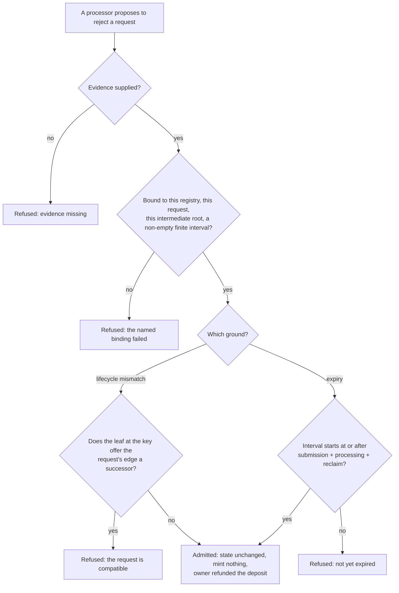

# Protected rejection in the Lean model: stories and requirements

Ticket 494, child of epic 498. Base: main `e7b55ac9` (the two-edge model, constitution 1.15.0).
The rulings are in [decisions](decisions.md); the technical route is in [plan](plan.md).
This ticket changes the Lean model and everything that consumes it. It changes no validator,
no off-chain builder and no shipped command; those belong to the neighbouring tickets named
under out of scope.

## The paramount story

As a requester, I book a valid request and observe that a permissionless processor cannot
cancel it and collect its tip without satisfying an explicit rejection rule.

This ticket touches no shipped command line. The requester sees the rule today only through
the model runner (`lake exe` of the driver, run in CI by `nix run .#model-check`) and through
the public conformance suite; the rule reaches a command only when ticket 495 and ticket 496
build on the model revision this ticket releases.

## Other stories

As a requester whose request cannot fold because its key is in the wrong lifecycle state, I
see a processor reject it at once with proof of the mismatch and I get my deposit back, so
that a dead request does not sit at the cage until it expires.

As a requester whose request has outlived both its processing and its reclaim window, I see
a processor reject it with proof of the expiry, so that abandoned requests can be cleared by
anyone without my consent being needed after I had my chance to reclaim.

As a processor building one batch, I fold Bob's insertion of a fresh key and reject Carol's
insertion of the same key in the same batch, and the model accepts the batch because Carol's
request is judged on the state Bob's fold left. Reversed, with Carol's request first, the
model refuses it, because at that point her request is still foldable.

As an owner retracting a pending request, I see my window computed from the time my request
was booked, not from a time written into the retraction, so that a retraction and a rejection
of the same request can never disagree about when the windows end.

As the author of the validators (ticket 495) or the builders (ticket 496), I receive one exact
model revision and one written evidence contract, so that I implement the rule the model
proves instead of inferring it.

As a reader of the public conformance suite, I see which rejections the model allows and the
chain accepts today, and which it forbids while the chain still accepts them, labelled as unmet
until the validators change; I never see a forbidden rejection presented as a pass.

The diagram is the whole admission for one request. A batch applies it to each action in
order, on the state the actions before it left.

## Requirements

Each requirement has a descriptive name; the plan and the tasks use the same names.

### Rejection needs evidence

The model refuses every rejection that carries no evidence, whatever the request, the state or
the refund. A missing proof is never an inadmissibility proof. (`rejection-needs-evidence`)

### Evidence is bound

Admitted evidence names the registry's abstract identity, carries the complete registry
configuration including its root as it stands at that action, carries the complete request,
and arrives with a non-empty finite validity interval, lower bound included and upper bound
excluded. Evidence for another registry, another configuration or root, another request, or an
empty or reversed interval is refused with a reason that names which binding failed.
(`evidence-is-bound`)

### Two grounds only

Evidence is admitted exactly on a lifecycle mismatch or on expiry. Mismatch means the leaf the
evidence names is the leaf the state holds at the request's key, and the model's own transition
table gives the request's edge no successor from it; the unknown leaf and the stored Absent
state are different leaves. Expiry means the interval's lower bound is at or after the booked
submission time plus the processing duration plus the reclaim duration. No other reason is
admitted. (`two-grounds-only`, `mismatch-means-no-transition`, `expiry-follows-both-windows`)

### A foldable request is protected

For any request whose edge has a successor at the key's current leaf, no evidence at all makes
a rejection admissible while the interval begins before expiry. (`foldable-request-is-protected`)

### Rejection changes nothing but the queue

An admitted rejection leaves the registry state as it was, mints nothing, and owes the owner
exactly the deposit it owed before this ticket. The base model also returns the request's approval in the owner's refund output of a rejection; that stays exactly as it is, and the statement that an admitted exit is the base exit proves it unchanged. Refund amounts and the unresolved refund
discrepancy of ticket 361 are unchanged. (`rejection-effects-unchanged`)

### Retraction and rejection share one clock

Retraction and expiry both read the request's booked submission time. The legacy field carried
in a retraction witness stays on the wire and is ignored by admission. For one request the
earliest instant an expiry rejection may start is never before the latest instant an admitted
retraction may end. (`one-booked-clock`)

### A batch is judged action by action

An ordered batch of folds and evidenced rejections is judged action by action; each action sees
the state left by those before it, a rejection leaves that state unchanged, and each rejection's
evidence binds the intermediate state's configuration and root. An empty batch is refused. A
batch with any refused action is refused whole, with no partial result. An all-reject batch is
judged by the same engine as a mixed batch. A foldable request cannot be rejected at any
position of an admitted batch. (`batch-judged-action-by-action`)

### Folds and retractions are not weakened

An exit that passes its admission is exactly the exit the model had before; admission adds
permission checks and changes no payment, mint or state effect. A fold, and a retraction its
own admission lets through, behave as on the base. (`admission-changes-no-effect`)

### The model states everything it relies on

The constitution's model driver translation, the declared driver surface, the theorem register
and its statement digests, the exported corpora and the simulator's mirror of the model all
state the rule and agree with the Lean source. (`consumers-state-the-rule`)

### Nothing is passed that was not shown

The public suite keeps every unmet requirement visible. A row whose subject is a forbidden
rejection that the chain still accepts is published as unmet and never as a pass. Behavior the
base left uncovered stays uncovered. (`unmet-stays-unmet`)

## Acceptance

Every item must hold on the exact head that is handed to review. The mandate names the proving
check of each item and the plan names the slice that delivers it.

- [ ] The three rulings and the historical counterexample are recorded, with concrete request
      stories and a truth table over the seven edge tags, the four leaf states, the time
      boundaries and both grounds.
- [ ] The historical scenario is run against the base model and reports the unguarded rejection
      accepted; it is preserved as historical behavior and, against the changed model, the same
      scenario is refused.
- [ ] Rejection evidence and admission are defined in Lean with exact binding to request,
      registry, intermediate root and interval; unknown and Absent are distinguished.
- [ ] Every requirement above is a proved statement; the protection and permitted-rejection
      statements are exported as runnable accepting and refusing cases through the existing
      model runner; invalid evidence never counts as inadmissibility evidence.
- [ ] Batch ordering and root semantics are defined and proved, with refund, tip and state
      continuation effects unchanged; ticket 361's refund rule is not chosen.
- [ ] The constitution mapping, theorem and corpus bindings, the consumer compatibility record
      and the history of ticket 320's early rejection are updated; uncovered behavior stays
      uncovered.
- [ ] The eight required checks that failed on pull request 508 are green on the exact head, or
      the one that cannot be is published unmet as the decision on the decisions page directs.
- [ ] An exact accepted model revision and the written evidence contract are released for the
      validator and builder tickets.

## Out of scope

The coding slices touch nothing owned by these tickets, and a coder who finds a reason to
touch one stops and reports it instead.

| Ticket | What it owns |
|---|---|
| 495 | The state and request validators, their compiled identity, and flipping any row this ticket publishes as unmet. |
| 496 | Building rejection evidence in the production fold path, including the reject command's lower validity bound. |
| 497 | Connected acceptance of protected rejection on a ledger through the packaged command line. |
| 487 | Making rejection a separate all-or-nothing command rather than part of a fold. |
| 529 | The request tag and the mint that checks it. The bond, its forfeit and its split are modelled by the economic slices of this ticket (see the [economics plan](economics-plan.md)); the tag is not modelled. |
| 361 | The unresolved refund policy: the model sums by owner, the validator pays by position. Refund amounts stay as they are. |
| 500 | Research on address pollution and malformed deposits. |
| 528 | The command-line split. The ticket builds against the library's request and fold, not the open-datum envelope. |
| 506 | Verification of the packaged two-edge contract and every deferred-edge refusal. |
| 310 | The open-datum application: this ticket only regenerates its committed corpus, because the corpus embeds requests that gain fields. |
| 532 | A reject sends the request's approval to the folder's change instead of the owner's refund. The base model returns the approval in the owner's reject output; this ticket keeps that exactly. The builder fix belongs to 496, the question whether validators enforce the approval's destination to 495. |
