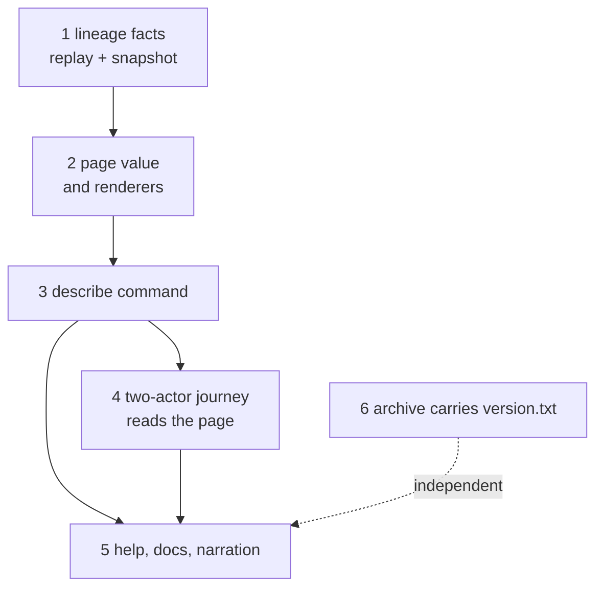

# The registry page: plan

Read the [spec](spec.md) for the story and the requirements, the [touch list](touch-list.md) for
every file, and the [tasks](tasks.md) for the commit boundaries. Base `main` at `e7b55ac9`.

## Strategy

`singular registry describe` reuses what `inspect` already does and adds nothing to the chain
side. It selects the registry from its token and the release, runs the same public replay,
reads the live request outputs, and renders one value two ways. Three things are new: the replay
reports the facts the page needs (create transaction, fold transactions in order, the keys the
folds named); a pure page value with a text and a JSON rendering; and the command that composes
them. The two-actor journey then reads the page for real and its two waiting rows pass.

| decision | chosen | rejected, and why |
|---|---|---|
| where counts come from | the replay names the keys the folds touched; the command reads each key's leaf from the replayed trie and counts `active` and `terminal` | counting edges in the fold requests (a second reading of the edge law, outside the trie); reading the trie's nodes (no enumeration exists, and adding one widens the trie interface) |
| one replay or two | the counts, root and last fold come from the one snapshot the command already selects | asking the library twice (two history reads that could disagree) |
| release label | `version.txt` beside the blueprint, refused by name when absent | a release-directory flag (the spec rules it out); a label optional on the page (a page that may silently omit its release) |
| text on success, receipt on failure | success prints the page; every refusal prints the usual one JSON receipt | a receipt wrapped around the text (a person reading the page would read JSON) |
| pending requests | the same renderer `inspect` uses, exported from `Inspect.hs` | a second copy (the journey compares the two lists for equality, so one function is the guarantee) |
| provenance wording | what was replayed, the provider named (Koios) and that its answers are unverified, in fixed text; nothing worded as verified chain state (operator, 2026-10-13) | a "verified" label on a page whose provider serves no ledger proofs |
| block anchor of the last fold | left out; the page names the last fold's transaction | a provider read added to the ledger-provider interface, the Koios client and the devnet facade in this pull request |

## Class and staffing

The command is new product behavior, so the full path applies: one writer, a mute persistent
auditor, the existing CI commands as the gate. Staffing is the operator's: ticket owner Claude
Sonnet 5.5 at extra-high effort; writer Muse, one at a time; auditor Grok 4.7 at high effort,
persistent and mute, an alarm that blocks only with a concrete failure scenario. No gate-author
pair and no other seat: the gate below is written by the ticket owner from the workflow files,
one hosted command per acceptance line.

## Slices

Writer time in minutes, about 250 in all. Cut rule: if slice 5 ends past minute 210, slice 6 moves
to the second pull request below; nothing else moves. Applied: slice 5 ended past minute 210, so
slice 6 is in the second pull request, which holds slices 6, 7 and 8.

| slice | outcome a person can observe | time |
|---|---|---|
| 1 lineage facts | the snapshot of a replayed registry reports its create transaction, its fold transactions in chain order and the distinct keys the folds named, ascending; a fixture snapshot says it has no lineage | 35 |
| 2 page value | a pure page built from explicit inputs renders as text and as JSON with the same facts, fixed order, no clock; version labels parse or are refused by name; links to the claimed version's release and documentation asset are computed | 45 |
| 3 describe command | `singular registry describe` prints the page; `--json` prints the JSON; write settings are refused by name; refusals print the usual receipt; nothing is written | 60 |
| 4 journey | Alice and Bob each read the page before and after their own lifecycle in the two-actor job; the page equals `inspect` and the fold receipts; the same call twice gives the same bytes; the actor's home is unchanged; both waiting rows pass | 60 |
| 5 help and docs | the usage text, the flags page and the onboarding page describe the command; a new page explains the registry page with a generated sample; narration regenerated by the tool | 30 |
| 6 archive version (moved to the second pull request) | the on-chain archive stages `version.txt` beside its blueprint; the release check refuses disagreement of version, asset name or checksum | 20 |

## Gate

Written by the ticket owner from the workflow files. Each line is an existing command; the
budget is 25 minutes per candidate without the journey. The journey is the hosted job at the
pushed head: the writer runs it locally while developing slice 4 and it is not a repeated gate.
`just ci` runs once, on the final candidate.

| acceptance line | command | hosted job | expect |
|---|---|---|---|
| formatting and lint of touched Haskell | `(cd offchain && nix run --quiet .#lint)`; `nix run --quiet .#format-check` | Off-chain lint; Conformance Haskell format and lint check | exit 0 |
| library and command compile | `(cd offchain && nix build --quiet .#component-build)` | Off-chain component build | exit 0 |
| lineage facts, page value, command parsing, no-write controls | `(cd offchain && nix run --quiet .#cage-tests -- --match "TrieState" --match "Page" --match "Describe")` | the journey job's step "Run the focused off-chain suite" | exit 0, every match non-empty |
| replay expectations that name the new facts | compile of the end-to-end suite; its replay lanes run in the hosted end-to-end jobs | End-to-end part jobs | exit 0 |
| help, flags and docs agree | `nix run --quiet .#cli-flags-check`; `nix run --quiet .#cli-flags-controls` | Documented CLI flags and refusal controls | exit 0 |
| docs, speech, narration, presentation | `nix run --quiet .#docs-check` | Rendered documentation | exit 0 |
| both page rows pass, page equals readback | `nix run --quiet .#registry-two-actors` | Two actors insert and fold from the state token alone | exit 0, both page rows `passed` |
| harness cannot go green by accident | `nix run --quiet .#registry-two-actors-control`; `nix run --quiet .#registry-two-actors-replay-fault` | the two control jobs of the same name | exit 0 |
| archive carries its version (second pull request) | `nix run --quiet .#release-artifacts -- "$RUNNER_TEMP/release"` and `nix run --quiet .#release-check` | On-chain release assembly; Documentation release checks | exit 0 |

## Invariants the writer proves, each seen to fail first

| name | fails when | passes when |
|---|---|---|
| `lineage-facts-equal-the-replayed-history` | a replay of a known history reports another create, other folds, another order or a key missing or repeated | facts equal the independently listed history |
| `page-bytes-identical-for-identical-input` | the same inputs, or the same pending requests in another order, render differently, or a rendering holds a clock, tip or session | byte equal |
| `page-text-and-json-carry-the-same-facts` | any key found in the JSON is absent from the text (quantified over the discovered keys) | every discovered key appears in both |
| `page-names-its-release-or-refuses` | an absent, unreadable or malformed version is rendered with a label, or a foreign blueprint is accepted | each is refused by its name and prints no label |
| `page-reads-and-writes-nothing` | a write setting is accepted, or the actor's home differs after a page | each is refused by name; home tree identical before and after |
| `page-state-equals-public-replay` | the page root, counts, last fold or pending list differ from the `inspect` and fold receipts of the same moment | all equal, for both actors, before and after their lifecycle |
| `archive-version-agreement` (second pull request) | an archive with a missing, other or unchecksummed `version.txt` passes the release check | it is refused by name |

## Model rows

Signatures only; no bodies.

| module | responsibility | depends on |
|---|---|---|
| `Singular.Registry.Replay` | `Replayed` also reports the keys the applied updates named | trie interface, unchanged |
| `Singular.Registry.TrieState` (`Types`, `Core`, `Lineage`, `Fixture`) | a snapshot carries `PublicLineage`; the fixture snapshot reports none | `Replay` |
| `Singular.Registry.Page` | the pure page value, release info and links, two renderers, version refusals | nothing from the CLI |
| `Singular.CLI.Describe` | the one composition: release, session, selection, leaves, pending requests, rendering, printing | `Live`, `Inspect` (pending renderer), `Page`, `Session` (read only) |
| `Singular.CLI.Command` | the `describe` subcommand, its argument record, its usage lines | unchanged parser machinery |

| name | type, in words |
|---|---|
| `PublicLineage` | create transaction; fold transactions in chain order; distinct named keys ascending |
| `snapshotLineage` / `trieLineage` | snapshot field and accessor; result is `PublicLineage` or says none |
| `ReleaseInfo` | version label, blueprint title, blueprint SHA-256, applied application script hash |
| `ReleaseLinks` / `releaseLinks` | release URL for tag `v<version>` and documentation asset URL, from a `ReleaseInfo` |
| `parseVersionLabel` | text to a version label or a named `PageRefusal` |
| `PageInputs` / `Page` / `describeRegistry` | explicit facts in, page value out, total |
| `renderPageText` / `renderPageJson` | page to text; page to JSON; same facts |
| `DescribeArgs` / `Describe` | blueprint, state token, provider settings, json switch |
| `runDescribe` | application, environment, arguments to an exit status; success prints the page, failure the usual receipt |

The JSON rendering is a receipt: `command` is `describe`, `outcome` is `success`, then the sections
`registry`, `release`, `rules`, `state` and `provenance`. `state` has `root`, `activeKeys`,
`terminalKeys`, `foldsSinceCreate`, `createTransaction`, `lastFold` (null when there is none),
`stateOutput` and `pendingRequests`, whose entries are the objects `inspect` prints for pending
requests. The journey reads these names.

Data rules: the page holds no timestamp, tip or session identity. Pending requests are ordered by
request output reference. Active plus terminal plus other counts equal the distinct named keys.
The last fold is the final element of the fold list and is absent exactly when the list is empty.

## Live lanes and constraints

Single-threaded rule: `describe` starts no thread. Reads only: no signing, no submission, no write
under a state directory. Files held by live lanes stay out of the touch list: `Session.hs`,
`Receipt.hs`, `Reconcile.hs`, the fold builder, `Create.hs`, `Deploy.hs`, `Recorder.hs`, `Terminal.hs`,
`flake.nix`, `registry.yml` and anything under `onchain/`. Three shared files meet other lanes and
are marked in the touch list: `Command.hs` and `singular-registry.cabal` (other lanes edit both)
and `Inspect.hs` (the related inspect ticket). A new runnable file gets its hosted job in this
pull request: the new specs run in the existing focused suite step, the journey is an existing job.

## Second pull request: the Demo 1 path

Ruled by the desk (2026-10-13): two lines are on the Demo 1 path and are this ticket's second pull
request. Both holders have merged: the one-output create (PR 625) put `main` at `0272dadc`, the base
of this pull request, and the files are re-read there. Slices 6 and 7 start now. Slice 8 edits Demo
1's run page and journey scripts, which #518 pull request 3b also edits, so it starts on the desk's
note that 3b merged. Deadline: second pull request merged by 18 October.

| slice | outcome a person can observe | waits for | time |
|---|---|---|---|
| 6 archive version | the on-chain archive stages `onchain/version.txt` beside its blueprint; the release check refuses a missing, other or unchecksummed version by name, each shown on an otherwise valid archive | none | 20 |
| 7 create prints the command | the `create` receipt (registry and open-datum, one `Create.hs`) carries `describeCommand`, the working `describe` command built from the arguments create ran with: blueprint as given, the new state token, provider and network settings, the network time directory when given; never a wallet key; run as printed, it prints the page | none | 40 |
| 8 page from the archive | Demo 1's run page reads the page right after create; the archive journey runs the archive's own `singular`, blueprint and adjacent `version.txt` against the node right after create and after the lifecycle, prints the page to the log and compares it with `inspect` and the fold receipts; the step check of the run page follows | #518 pull request 3b merged | 60 |

Invariants, each seen to fail first (BLOCKING fails the checkpoint, ADVISORY is a note):

| name | fails when | passes when |
|---|---|---|
| `no-secret-in-the-printed-command` (BLOCKING) | the receipt's command names a wallet key path, a credential path or a signing flag | it carries only blueprint, token, provider URL, network and time directory |
| `printed-command-prints-the-page` (ADVISORY) | the command, run as printed, does not exit 0 with the page | it does |
| `archive-describe-agrees-with-readback` (BLOCKING) | the page from the extracted archive differs from `inspect` and the fold receipts after the lifecycle | root, counts, last fold and pending list are equal |
| `run-page-follows-the-journey` (ADVISORY) | the run page lacks the page step or its step check passes a page without it | the check fails on a page without it |
| `archive-version-agreement` (ADVISORY) | an archive with a missing, other or unchecksummed `version.txt` passes the release check | each is refused by name |

Gate, existing commands only, budget 25 minutes per candidate without the archive journey (the
journey is the hosted job at the pushed head; local runs while developing are not repeated gates;
`just` recipes run with `TMPDIR` outside `/tmp`, issue 621):

| acceptance line | command | hosted job |
|---|---|---|
| lint and compile | `(cd offchain && nix run --quiet .#lint)`; `(cd offchain && nix build --quiet .#component-build)` | Off-chain lint; Off-chain component build |
| create receipt, registry and open-datum | `(cd offchain && nix run --quiet .#cage-tests -- --match "Create" --fail-on=empty)`; `(cd applications/open-datum/offchain && nix run --quiet .#open-datum-tests)` | focused suite step; Open datum tests |
| flags and docs | `nix run --quiet .#cli-flags-check`; `.#cli-flags-controls`; `.#docs-check` | flags and docs jobs |
| archive version | `nix run --quiet .#release-artifacts -- "$RUNNER_TEMP/release"`; `nix run --quiet .#release-check` | On-chain release assembly; Documentation release checks |
| journey from the archive | `nix run --quiet .#demo1-cli-check`; `nix run --quiet .#demo1-cli-test-harness` | Demo 1 journey from the release archive |
| final head, once | the first-pull-request gate list, `just` recipes included | hosted CI is the net; the browser recipe cannot run in the author sandbox |

Seats as in the first pull request: writer Muse one at a time, persistent mute auditor Grok, no
gate-author pair. Checkpoints: RED, slice 6, slice 7, slice 8, pre-push.

## Follow-ups outside both pull requests

Accepted by the desk as follow-ups. The first pull request's body lists them as limits, and #503
stays open until they are delivered or ruled.

| issue line | why it waits | needs |
|---|---|---|
| block anchor of the last fold, with named missing and failed-read controls | a versioned provider read through the ledger-provider interface, the Koios client and the devnet facade | its own slice |
| documentation links checked against the published asset | needs a published release to check against | a release |
| independently derived action identity in the public report | `Conformance.Cli.Controls` meets three live lanes | their merges |

## Ceilings

Spec 130 lines, plan 200, tasks 70, touch list 100. Compiled writer brief 300 lines.
