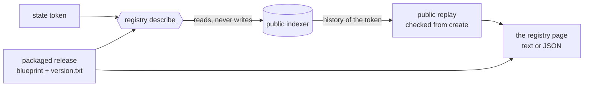

# The registry page, generated from the chain

Ticket [#503](https://github.com/lambdasistemi/singular/issues/503), a vertical slice of the
[join-by-token plan](../437-join-by-token/spec.md). Read the [plan](plan.md) for the slices and the
[touch list](touch-list.md) for the files. Base: `main` at `e7b55ac9`.

## Story

As Alice, I have a registry's state token and the packaged release, and nothing else: no wallet
file of mine, nothing from the person who created the registry. I run
`singular registry describe --state-token …` and read a page that says which registry this is,
which release it runs, what its rules are and what it holds now. I run it with `--json` and a
program reads the same facts. Everything on the page comes from the public history of the state
token and from the release; nothing is typed by hand. I can start Demo 1 from this page.

As Bob, I run the same command on my own machine. If we read the same chain state with the same
release, my page and Alice's are the same bytes.

As an integrator, I want to know what the page does not prove. The page says so itself: the
indexer's answers are unverified claims, the release label is the archive's own claim, and the
page is unsigned.

## What the page shows

| section | facts | where each comes from |
|---|---|---|
| registry | the state token, the live state output, the five script hashes the release derives (state, application, active, absent, terminal) | the token; the release; the live state output |
| release | version label, blueprint title, blueprint SHA-256, applied application script hash, links to that version's GitHub release and documentation asset | the release alone; the links are computed from the label, never fetched |
| rules | processing window, retract window, tip per request, the key length bound; the statement that anyone may build a fold from public inputs | the state datum; the release's own limit; `Singular.Statements.fold_inputs_public` |
| state | root, number of active keys, number of terminal keys, folds since create, create transaction, last fold transaction, each pending request with its owner, key, edge, submission time and what it locks | the public replay and the live request outputs |
| limits | what is unverified or not shown | fixed text |

The page carries no clock, no chain tip and no session identity, so identical inputs give
identical bytes. Pending requests appear in one fixed order. The text and the JSON carry the same
fields.

## Requirements

- `page-from-chain-and-release-alone`: the command takes the state token, the blueprint of the
  packaged release, a provider and a network. It takes no wallet, no signing key, no state
  directory and no file of any actor. Any other setting is refused by name before anything is read.
- `page-reads-and-writes-nothing`: no signature, no submission, no journal, no lock and no file
  under a state directory. The two-actor journey shows the actor's home unchanged after a page.
- `page-state-equals-public-replay`: root, counts, last fold and pending requests equal what a
  separate public readback of the same chain state shows (the journey compares the page with
  `inspect` and with the fold receipts, after each actor's own lifecycle).
- `page-bytes-identical-for-identical-input`: the same replayed history and the same release give
  the same text and the same JSON, byte for byte, across runs.
- `page-names-its-release-or-refuses`: the version label is read from `version.txt` beside the
  blueprint. A missing, unreadable or malformed `version.txt` is refused by name, with no label.
  A blueprint that derives a state script hash other than the token's is refused by name.
- `page-limits-are-stated-not-claimed`: the page's provenance states, in fixed text, what was
  replayed (the public history of the state token from create to the live state output, each
  fold's rebuilt root compared with the root in its state datum), from which provider (Koios,
  named, not its address), that the provider's answers are not verified (it serves no ledger
  proofs and Demo 1 has no anchor), that the release label is the archive's own claim and that the
  page is unsigned. Nothing, in the page or the documentation, is worded as verified chain state.
  No limit is written by hand: the page links to the documentation of the claimed version.
- `release-archive-carries-its-version`: the on-chain release archive stages `version.txt` beside
  its blueprint and the release check refuses an archive whose version, asset name or checksum
  disagree. Delivered by the second pull request: the cut rule moved it there.

## Named refusals

| situation | what Alice sees |
|---|---|
| a wallet, key, state directory or other write setting is given | refused by name, before any read |
| `version.txt` is missing, unreadable or not a version | refused by name; no release label is printed |
| the blueprint is another release's | the existing foreign-release refusal, unchanged |
| the indexer cannot be read | the existing node-unavailable outcome, unchanged |
| the history is incomplete or does not chain to the live root | the existing named trie refusal, unchanged; no page is printed |

A refusal prints one JSON receipt on standard output with a non-zero exit status, as every command
does. A success prints the page, and nothing else.

## Not in the first pull request

Three lines of the issue are delivered by a second pull request of this ticket, planned in the
[plan](plan.md#second-pull-request-the-demo-1-path): the release archive stages `version.txt`
beside its blueprint (until then `describe` run from the extracted archive refuses by name, with no
release label), `create` prints the working `describe` command, and `describe` runs from the
extracted release archive against a node, with Demo 1's run page starting from the page. Three
lines are accepted follow-ups, listed with
their reason in the [plan](plan.md#follow-ups-outside-both-pull-requests): a block anchor for the
last fold, documentation links verified against a published asset, and the independently derived
action identity in the public conformance report. The issue stays open until they are delivered or
ruled.

## Model binding

Lean source `20b35407c8a8e955dea396e59ae926b7c9e13d03`, model tree
`d9161edd0274b67151f331949521f34bbf18612f`, constitution 1.15.0. Lean states the registry state, its
eight-field configuration, the leaf kinds and the root, and proves that a fold is built from the
public view. It has no report command. The page shows only state fields from a checked replay and
claims nothing beyond them: the desk ruled this a page with no Lean row and not a stop condition.
The page's provenance says exactly that, in fixed text: the facts are state fields read from a
replay of the public history, the provider is named and its answers are unverified, the release
label is the archive's own claim, and the page is unsigned. The count of active and terminal keys is the number
of keys whose replayed leaf is `active` or `terminal`. No Lean change, no validator change and no
blueprint change.
