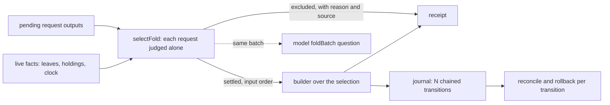

# Plan: fold the whole selection

Read the [spec](spec.md) for the stories, the rulings and the acceptance, the [gate](gate.md) for the checks, the [touch list](touch-list.md) for every file, and the [tasks](tasks.md) for the commit boundaries.

## Where the work stands

Pull request 1 is merged (`9d5f4c7a`, https://github.com/lambdasistemi/singular/pull/556). Pull request 2 is on the branch `feat/518-receipt-readers` from that head; the bullets below describe the ticket as planned for pull request 1.

- Repository `lambdasistemi/singular`, issue #518, parent epic #396, milestone M1.
- Worktree `/code/singular-issue-518`, branch `feat/518-fold-every-settleable`. Base: `main` at `8a99415d`. The command-line split (#528) merged as `c6748950`; this branch was planned and written stacked on the split's approved heads (`24e0c9ba`, then `58335316`) and has since been rebased onto main. Main at the time of planning was `e3c9ab01` (the #505 merge).
- Runtime root `/home/paolino/.orch-runtime/singular/m1/epic-396/ticket-518`.
- Model: Lean tree `d9161edd0274b67151f331949521f34bbf18612f` (last change `20b35407`), constitution 1.15.0 (Principle VII was added after the work was planned). No Lean, validator or blueprint file changes.
- Harvest source, read only: closed PR #469, branch `origin/feat/396-fold-every-pending` at `4cb4a441`. Its selection, builder subset, journal, reconciliation, receipt and recovery parts are taken where they still apply to this base. Not taken: its processing-window admission and "a batch cannot consume what it creates" model work (#519), and its chained judging, which option A replaces.

## Strategy

The library's fold already speculates every pending request at the request address; it gains an explicit selection, and the validity bound follows the selection. The command chooses the selection purely, from the pending outputs, the live state, the clock and the capacity bound, and carries a list through the receipt, the journal and reconciliation. The selection itself is a pure library module with no command-line and no open-datum import, so a conformance test can ask the model about its output, and the registry's command line and the open-datum executable use it without it knowing either.

The old single-request path is removed in the same change that replaces it: `foldTarget`, `FoldTargetRefusal`, `SeveralPending` and the sentences "built only while exactly one is pending" leave the code and the pages together.

## Three pull requests

The slice is cut into pull requests that each ship a runnable outcome. The first cut (two pull requests) was made before dispatch; on 2026-10-11 the epic owner ruled a second cut (the desk's option B): the receipt readers and the other pages move behind pull request 1, and the former pull request 2 ("many per fold") becomes pull request 3. The spec and the gate were frozen under the first numbering and still say "2" for what is now pull request 3 (their lines marked 1 are pull request 1, except where the touch list moves a reader or a page to pull request 2). One patch per slice in a patch stack, no journey commits. Each slice builds and passes its candidate gate; hosted CI at the exact head is the net. Merge order: #528, #381, pull request 1, #358 slice 3, pull request 2, then pull request 3.

**Main stays green between the pull requests.** The receipt of pull request 1 is additive: the earlier single-request top-level fields stay for the one settled request, unchanged, and the lists (`settled`, `excluded`, the capacity bound with its provenance) are added. No existing reader needs to change. If a run finds a reader, readback script or journey that the new receipt or the new refusal behaviour breaks anyway, that reader's minimal fix stays in pull request 1 (a row added to the touch list) and the pull request body names it. Pull request 2 moves the readers to the lists and removes the top-level duplicates in the same change (the swap rule). "Read only from pull request 2 on" covers the new fields only.

### Pull request 1: each request judged alone, one settled per fold

Runnable outcome: with two pending requests, one of them stuck, `registry fold` settles the other and names the stuck one; the refusal of the 2026-10-07 rehearsal is gone.

1. **selection-in-the-library.** The new pure module with `selectFold`, the exclusions in both vocabularies, the capacity bound as an argument, and the model-agreement test in the conformance unit suite with its same-key negative control.
2. **fold-the-first-selected**, in three runs. (a) *builder over a chosen request*: the builder entry point that spends the state output and exactly the chosen pending request, refusing a chosen reference that is not pending at any pending-set size. (b) *command-line rules*: the named-request guard, `nothing-to-fold` naming every exclusion, the spend check, the refusal wording, in `Singular.CLI.FoldRules` with specs in `cage-tests`. (c) *the fold routine and the entry commands*: `registry fold` and the combined forms gather the live facts, call the selection with a bound of 1, settle the first included request, check the built fold spends exactly the selection before signing, and print the additive list receipt; a termination under the neutral value is excluded `application-required`; `foldTarget` and its refusals are deleted with their last caller; the open-datum spec group for the removed rule is deleted.
3. **devnet-unsettleable-left-and-named.** The Demo 1 journey leaves a request that cannot be settled and names it while an eligible one settles.
4. **docs-of-what-ships-first.** The page describing `registry fold` states this behaviour, the two vocabularies, the bound of 1 and its provenance, and the residuals, with that page's narration regenerated; the API reference page keeps its counts; speech re-stamped. The other pages move to pull request 2.

The journal, `Session.hs`, `Receipt.hs` and `Reconcile.hs` are not touched.

Allowance: 7.5 hours of commit-owner time for pull request 1 (the epic owner's ruling), with the per-run stop rules unchanged: a run that passes its own estimate by half, or whose checkpoint is still blocked after one repair round, stops at its last approved checkpoint and a question is filed.

### Pull request 2: the receipt readers and the other pages

Runnable outcome: every reader of a fold receipt reads the list receipt, the top-level single-request fields are gone from the fold receipt and from the combined forms, and the pages state it. Started from `main` at `9d5f4c7a` (pull request 1 merged; #528 merged, so the desk's base is main, release of 2026-10-11). Behaviour does not change: the bound is still 1; only the shape of the receipt and its readers move.

What goes: the single-request fields `request`, `key`, `edge`, `liveOutput`, `envelope`, `released` and `deposit`, and the datum hash and datum bytes of a datum delivery, from the receipt of `registry fold`; the four fold-derived duplicates `liveOutput`, `envelope`, `released` and `deposit` from the receipts of `insert --fold` and `terminate --fold`. What stays at the top level, being facts of the transaction and not of one request: the folder, the fold transaction, the root, the fold deadline, the validity bound slot, the post-build verdict, the host clock, the time remaining, the booking of a combined form and the key fields of a booking, and the three lists. A reader takes a settled request's request, key, edge, owner, settlement and deadline from `settled[0]` (settlement carries the output and the envelope, or the released output and the deposit).

Readers on main (found by reading the code and the scripts, 2026-10-11): the conformance command-line controls and their unit fixtures; the Demo 1 journey script; the command-run specs of the registry and of the open-datum package; the rows of the fold rules spec that pin the earlier fields. The recovery controls script and the control check script read none of the removed fields (checked) and are not edited. No page shows the removed fields as a receipt example; `docs/singular-node.md` states that they are kept, which stops being true.

Slices, one patch each, in this order so that main stays green at each (the lists exist since pull request 1, so a reader can move before the fields go):

1. **readers-move-to-the-list.** The conformance controls and fixtures, the Demo 1 journey script and the two command-run specs read the settled list instead of the top-level fields. The fields are still printed at this slice.
2. **duplicates-removed.** The receipt builders of `registry fold` and of the combined forms stop printing the fields; the rows that pinned them pin their absence and the list, per delivery branch. Any reader not moved in slice 1 fails here, which is the proof that every reader moved.
3. **docs-of-the-other-pages.** The node guide, the preprod page, the fold responsibilities page and the rehearsal document state the list receipt and what was removed; speech re-stamped; narration regenerated from the final pages after the last rebase.

Pull request body: names each removed field and each reader moved, under the template's interface section (the epic owner's condition of 2026-10-11), and carries the Principle VII paragraph.

Allowance: 3 hours of writer time (the desk's ruling, A-016), base-forced rebases apart; a race box names writer time and the gate's run time separately. Estimate with the observed ratio of 1.4 over a plain estimate: slice 1 about 70 minutes (two runs, controls, then journey and specs), slice 2 about 50, slice 3 about 45, 165 in all. Writers are one-task runs alternating the two families (the last brief of pull request 1 went to GLM, so the first goes to Muse), with a fresh Codex auditor.

Cut point (the epic owner asked for it to be named in the plan, 2026-10-11): the slice that leaves pull request 2 if the forecast passes the allowance is **docs-of-the-other-pages**, meaning the preprod page, the fold responsibilities page and the rehearsal document, with their speech companions and narration. The owner is the ticket owner of #518, in a docs-only pull request from main after pull request 2 merges (or in the documentation slice of pull request 3 if that starts first). The trigger is mechanical: after each accepted slice the forecast is the writer minutes spent plus the remaining estimates, and if it passes 180 the cut is executed without a question. The slices that stay are the readers, the removal and the node guide sentence, because readers and removal cannot be separated and the guide must say the fields are gone. The three pages state behaviour that has been stale since pull request 1 and does not depend on the removal, so leaving them strands no reader; pull request 2's body then names them as a recorded limit. If the forecast still passes 180 with the readers, the removal and the guide alone, that is a question for a longer allowance.

### Pull request 3: many per fold

Runnable outcome: one fold settles every settleable pending request up to the bound of 9, and an interrupted multi-request fold recovers.

1. **builder-over-many.** The chosen-set entry point takes several requests; the validity bound is the earliest deadline among them.
2. **journal-and-recovery-for-many.** The journal line carries the chained transitions, an earlier line reads as a batch of one, observation checks each key against its last transition, rollback returns every included request, a lost race is `stale-state`. This is the one slice that touches the session layer the desk flags; the touch list names the functions.
3. **capacity-nine-and-the-command.** The bound is 9 with its provenance; the command settles the whole selection.
4. **devnet-two-actors-and-interruption.** Two actors book concurrently and one fold settles both, each payout to its owner; an interrupted two-request fold reconciles both.
5. **docs-of-many-per-fold.** The pages state the whole behaviour; speech re-stamped.

Order: pull request 3 is cut from the merge of pull request 2. It needs its own slot in the merge queue; #477 builds on its journal format and waits for it. It edits `Session`, `Receipt` and `Reconcile` only after #485 and #528 have both merged, against the moved library modules; it does not wait for #493 (desk ruling).

## The command-line split (#528) is the base

#528 makes the Singular command line registry-only, moves the open datum into its own executable and package, and introduces an application value that carries everything the registry needs to know of an application. Its mandate is `specs/528-registry-cli-split/` in the repository. #528 has merged (`c6748950`); this plan was written against the code as #528 left it on its approved heads, and the branch now sits on main.

What the base gives:

- The registry's command-line modules are the public library `registry-cli` of `offchain/singular-registry.cabal`, source `offchain/cli/src/`; module names and paths are unchanged.
- `foldPending` takes the application value first; `runFold` (the body of `singular registry fold`) passes it; the combined forms, now in the open-datum package, call `foldPending openDatumApplication`.
- `singular` composes the neutral value, which carries no decoder and no holding rules; `open-datum` composes the open-datum value.
- The open datum's entry commands, parser, executable and specs are under `applications/open-datum/offchain/`.

What the plan does with it:

- **The selection** lives in the registry library, imports nothing of the open datum and does not read the envelope. Its place is the same before and after #528.
- **One application step per request.** The only place the fold reaches application knowledge is one per-request function in `Singular.CLI.Fold`, and it reaches it only through the application value: the carried-datum check, the live holding lookup, the release and the added context (the split's rule that the value is the only door). It returns the settlement inputs of a selected request or the reason it cannot settle; the reason is carried into the selection as a field of the pending request, as `undecodable` already is.
- **A termination under the neutral value** cannot be settled by `singular`: the value has no holding rules. The step's verdict is the selection-policy exclusion `application-required`, whose detail names the application's executable (the words of `neutralTerminationRefusal`), in place of the whole-command refusal the base gives. It is judged at the sixth check, after the model's leaf check, so a termination of an unknown key is still `key-unknown`. This is the one new reason; it is added to the spec, the data model, the functions model and the vocabulary tables, and the total of reason names becomes fourteen.
- **One fold routine.** `foldPending` stays the only routine that `registry fold` and the combined forms call; it takes the selection and the value.
- **Binaries.** The scripts and controls run `registry fold` through `singular`, and terminations, `--fold` and the combined forms through `open-datum`.
- **Specs.** The old tests of the one-request rule sat in the open-datum package's `FoldSpec`, which moved with the split. That suite has a hosted job at the base (`open-datum-tests`, `ci.yml` line 151) and the gate cites it. The group is deleted there so the suite compiles, and the replacements (the named-request guard and its wording, `spendsSelection`, the selection) are written in `cage-tests`, which a hosted job runs. The question that lists the touched files names this.
- **Files both touch.** While the split was unmerged the desk ruled the overlap (option A) and the touch list named what its later branches still changed; those branches have merged and the branch took them with the rebase onto main.
- **Registry and application stay separate.** The registry trees (`offchain/`, comments and test values included) name no application; the selection receives the application's executable name as an argument. The hosted job `offchain-component-build` runs `application-separation-check` for this, and the gate carries it as a row from v1.2.
- **#486.** The booking-time refusal of a key the edge rules out is written once in #528's booking call and is in the base. The placement is a contract (desk ruling): the library exports the booking check; every ordinary verb calls it in planning, preview and live, before signing; the booking primitive and the application builders stay permissive. This slice does not touch booking, and the fold changes keep that shape.

Stacking (historical): the branch was stacked on the split until it merged; it is rebased onto main (never piped into a push) and the first push is a draft pull request on main.

## Team, process and merge order

- **Staffing** (operator ruling 2026-10-09, quoted): "Codex is out for now. Claude seats at the highest levels, GLM and Muse at the working levels." Applied as: ticket owners Claude Sonnet 5.5 xhigh; commit owners (source writers) Muse through the pi harness; mute persistent auditors GLM through the pi harness in a read-only audit worktree; "gate authors: the ticket owner and the auditor seat". The approved team for this ticket: "draft=NONE. No other seat." Each gate author writes its table independently before the commit owner runs, and the ticket owner synthesizes the frozen gate once. One team per epic at a time, because the operator is on credits. Amended on 2026-10-10 by the epic owner (operator staffing ruling, amended): the mute persistent auditor is Codex (`gpt-6.1-sol`, high effort) in a read-only audit worktree, not GLM; the commit owners stay Muse.
- **Plan review.** No commit owner is launched before the epic owner journals `PLAN-REVIEWED t518` against the seven planning-quality lines. This set, the gate and the question that names them are that review's input.
- **Dispatch.** Each commit-owner run receives one task it can finish well under an hour, one slice of pull request 1 per run (a fresh root and pane each, the previous run retired at its terminal), with a terminal condition (green, blocked, or at capacity); no run counting, no nudges. The allowance for pull request 1 is 7.5 hours of commit-owner time in total (the epic owner's ruling of 2026-10-11, raised from 4.5 hours), with the per-run stop rules stated under pull request 1. The auditor is launched beside it from the first run and is mute toward it. Checkpoints: the failing tests of each slice, each acceptance line green, and before the push. The push waits for every checkpoint to be approved.
- **Gate budget.** Existing commands only. The local candidate gate carries the budget of 40 minutes and runs the filtered focused suite, the conformance unit suite, the lint and format checks, the component build and the docs check; the repository aggregate (`just ci`) runs once on the final candidate. Local runs respect the 50 MiB receipt cap of #513; no hosted job is rerun locally. The Demo 1 end-to-end jobs and the recovery jobs run on the exact head in hosted CI, and the merge waits for them.
- **Merge order.** The desk's queue is #485, #528 (exclusive window), #471, pull request 1, pull request 2, pull request 3, #477, #493; the epic owner's order of 2026-10-11 is #528, #381, pull request 1, #358 slice 3, pull request 2, pull request 3. #528 merged before pull request 1. Pull request 1 takes its slot after #471; each later pull request asks for its own slot after the one before it merges, and #477 waits for pull request 3. No rebase, retarget or merge without a granted slot; when every checkpoint is approved and the exact head is green, the ticket owner asks for the slot and merges with a merge commit once it is granted and the rebased head is green again.
- **The touch list binds.** A file that is not on the [touch list](touch-list.md) and that the work later needs is a question to the epic owner, forwarded to the desk, before it is edited. The commit owner and the auditor are told this in their briefs. Pull request 3 edits the session layer the desk flags (`Session.hs`, `Receipt.hs`, `Reconcile.hs`); it does not start before the desk has ruled on that collision.
- **Commits.** No attribution trailer of any kind; the commit range is searched for one before the push. Spec and plan commits stay local; the first push is the reviewed candidate, as a draft pull request, because every push to the pull request starts the whole hosted matrix.

## Evidence this ticket produces

Receipts: the failing and passing runs of each slice's focused suite; the conformance unit run with its same-key control; the hosted run links for the three executed devnet items (two actors one fold, an excluded request left and named, an interrupted two-request fold reconciled) and for every required check at the exact head. The pull request body is a fill-in of the repository template:

| template section | content |
|---|---|
| story | the paramount story and the four-request example |
| exact model revision | base main `8a99415d`, Lean tree `d9161edd…`, constitution 1.15.0 (Principle VII added after the work was planned; the audit of the final head found no newly introduced production MUST violation) |
| implementation mapping | `Singular.refusal` leaf and approval checks → the selection's leaf and approval judgements; `Singular.allowed` → `edge-inadmissible`; `Singular.step`/`foldBatch` → the model-agreement test and the live batch row; the redeemer `Modify(List<RequestAction>)` → the builder over the selection |
| verification limits | the residuals of the spec, one by one with its owning ticket |

Left uncovered, written before the work: the residuals listed in the spec (no batch transaction in the model, no commutation theorem, same-key insert-then-terminate enforcement, processing-window admission, capacity unmeasured on preprod, no executed fold race, prose unchecked by a job).

## Budget and size

One team per epic at a time; the operator is on credits. The split is decided above with an estimate per pull request, each followed by 60 to 90 minutes of hosted CI that the merge waits for. The estimates of the first cut were 2 to 3 hours of commit-owner time for pull request 1 and 3 to 4 hours for the former pull request 2; the observed ratio over the estimates is about 1.4, 41 of the first 133 minutes came from the stacked base, and the epic owner ruled an allowance of 7.5 hours for pull request 1. Commit owners are launched one task at a time, each with the terminal condition green, blocked or at capacity. Pull requests 2 and 3 are new dispatches after the pull request before them merges; pull request 3 also waits for the desk to rule on the session-layer collision. A pull request that would run past its estimate by a working day is stopped at its last green checkpoint and the remainder is proposed to the epic owner as a question, not ground out.
