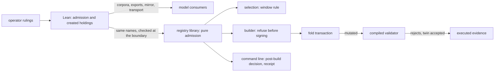

# Plan: the model, the builder and the compiled validator say one thing about a fold's window

Read the [spec](spec.md) for the stories, the rulings and the acceptance, the [ruling](ruling.md) for the operator's words, the [gate](gate.md) for the checks, the [touch list](touch-list.md) for every file, and the [tasks](tasks.md) for the commit boundaries.

## Where the work stands

- Repository `lambdasistemi/singular`, issue #519, parent epic #396, milestone M1.
- Worktree `/code/singular-issue-519`, branch `feat/519-fold-admission`, base main `38c7fbc1` (the merge of #518's last pull request). The first plan was written on `e3c9ab01` and reviewed on 2026-10-09; this text is that plan re-derived on the new base, and the section "What changed on main since the first plan" lists what moved. Runtime root `/home/paolino/.orch-runtime/singular/m1/epic-396/ticket-519`.
- Model bound: Lean tree `30b38e10f6a843999ae6f1e4d3a5bb5b382314b8` (last model change `20b35407`, last restamp `f88c7771`, the Lean 4.27 move), onchain `validators` tree `6fa081de28d45893e2199cabc1c3d9b19a286579` and `lib` tree `21e7e992170247a951efa5a0c3bf493dbae9ad9b`, constitution 1.15.0. Each of the two model pull requests is a new minor version on it, 1.16.0 and 1.17.0 at the time of writing; the numbers are taken again at each rebase if main has moved.
- Harvest source, read only: closed pull request #469, branch `origin/feat/396-fold-every-pending` at `4cb4a441`. Taken, re-cut onto this base: the model slice (`90ad13a4`, `e7e38664`, `f8855634`), its consumers (`c93f2413`, `d481ea9c`, `ee7944af`, `1d45f993`, `f33ed705`), the live translation (`0e7d6647`) and the driver pages (`5ff9bb02`). Not taken: its batch builder, journal and recovery (those are #518), and its 1.13.0 constitution text, which belongs to a different amendment and is written again.
- What main changed since the harvest, and why the harvested Lean cannot be copied: #505 retired five edges, so the harvested created-holdings and created-custody bookkeeping loses its custody half and four of its edge arms; `Singular.M1` and `Singular.M1Driver` now carry compatibility names for the same definitions and have their own statements (`excluded_fold` among them) that the new admission order touches; the corpora gained a permanent-contract set (`lean/m1-corpus.json`, `lean/m1-theorem-debt.json`).
- Two findings of the consumer survey that the harvest could not have had: the permanent contract's corpus (`lean/M1Main.lean`, `lean/m1-corpus.json`) has exactly one accepted batch, a registration then a termination of one key, which is the pair the second ruling refuses; and the open-datum application keeps its own Lean model under `applications/open-datum/lean` whose proofs unfold `foldBatch`, so it is a consumer checked by `just application-model`.
- What the survey found, which shapes the cut: the validator already refuses both cases (`not-phase1` in `onchain/lib/registry/fold.ak`, line 168, and `onchain/validators/request.ak`, line 85; the termination's burn needs an input, `token-missing` in `onchain/lib/registry/discharge.ak`), so the ticket changes no validator source and no compiled hash. The builder spends every pending request and sets the upper bound at the earliest deadline, with a clock fallback that can pass a deadline; the command line checks one deadline after building; the library checks none. The validator's tests pin none of the exact boundary, differing submission times, an open bound or any same-key pair.

### What changed on main since the first plan

Read on `38c7fbc1`; every item below was checked against the tree, not recalled.

| change on main | what it does to this plan |
|---|---|
| #528 moved the registry validators from `onchain/validators/registry/` to `onchain/lib/registry/` (and `shared.ak`, `types.ak`, `lib.ak`, `registry_fixtures.ak` beside them), and the open datum into `applications/open-datum/` with its own offchain tree and tests | every validator source path below says `onchain/lib/`; `offchain/cli/src/Singular/CLI/Entry.hs` and `offchain/test/Singular/CLI/FoldSpec.hs` no longer exist (they became open-datum files that do not mention the window), so their rows are gone; the command modules keep their paths under `offchain/cli/src/Singular/CLI/` |
| #518 created `Singular.Registry.FoldSelection` (`selectFold`, `judgeAlone`, the capacity bound `foldCapacity = 9` stated as an estimate, `exclusionName`, `exclusionSource`), `updateTokenSelected` in `TxBuilder/Update.hs`, and `foldPending` / `foldPendingBounded` in `CLI/Fold.hs` | pull request 3 changes exactly these: `judgeAlone` tests `deadline - now <= margin` and names `ReasonWindowClosed`, source `selection-policy`; that test becomes the library's admission at the probe bound and the reason becomes `not-phase1`, source `model-refusal` |
| every reader of `window-closed` on the new base: `FoldSelection.hs` (lines 20 and 195), `CLI/Fold.hs` (line 666), `CLI/FoldRules.hs` (the legacy combined message, line 965), `FoldSelectionSpec.hs`, `CLI/FoldRulesSpec.hs` (line 1153), `tools/demo1_cli_journey.sh` (line 1926), `docs/singular-node.md` (lines 179 and 200) and its speech companion and audio | the complete list pull request 3 deletes in one change; the conformance control readers no longer mention it |
| #518's devnet item already leaves an expired request pending beside a fresh one and asserts the excluded entry `window-closed` with source `selection-policy` (`fold_selection_excluded` in the journey) | pull request 3 re-points that one assertion to `not-phase1` and `model-refusal`; it adds no second devnet item |
| constitution 1.15.0 (effects and state have named owners, #540) | the two amendments of this ticket are 1.16.0 and 1.17.0 |
| the Lean 4.27 move (#588) restamped the corpora | no semantic change to the model; the corpora are regenerated by their commands anyway |
| the workflows grew (93 required status checks on `main`, new jobs `declared-checks-hosted`, `workflow-commands-resolve`, `registry-cli-build-graph`, split Demo 1 and recovery jobs) | the gate's command lines are re-derived (see the gate); no job is added by this ticket, so no required-check change is owed |

## Strategy

The model leads. The registry library gets one pure function for the window and one for the within-batch rule, named as the model names them, so the selection, the builder and the command line call the same thing instead of three copies of a comparison. The conformance unit suite asks the model the same question through the driver transport and requires equal verdicts at the boundary and one past it. The validator is not edited; its refusals are pinned by tests, by contexts evaluated against its compiled bytes, and by one live row.

## Four pull requests

Each ships a runnable outcome and carries the pages for what it ships. One patch per slice in a patch stack, no journey commits. Every pull request is cut from the merge of the one before it. The cut is by the fan-out of a Lean change: a Lean change fans out to dozens of files, mostly regenerated or restamped, each rule needs its own pass, and one pull request for both would be a working day of consumer repair. Pull requests 1 and 2 are the model's, in the order the constitution requires; pull requests 3 and 4 depend on the model and on nothing of each other.

### The Lean pull requests stay two, and why

The desk asked on 2026-10-14 whether pull requests 1 and 2 stay two or become one. They stay two.

- **Each one can be stopped.** A Lean change fans out to the same consumers every time: five corpora regenerated in two passes, the simulator's mirror, the coverage record and its fixed counts, the theorem register, the readme counts, the open-datum application's proofs, the narration. One pull request would carry both rules' model work, driver rows and consumer repair in one writer run of at least 5 hours of writer time, which is the first overrun trigger before the first push, and nothing would land if it overran. Two pull requests have the triggers 5 and 6.5 hours, and the first lands alone.
- **The first lands early.** Pull request 1 is the smaller one (3 to 3.5 hours). The one row it changes in the permanent contract's corpus is already ruled (the desk answered A by the operator's ruling of 2026-10-06 on #396; the pull request body names the corrected row and that ruling). The protected rejection lane (#494) rewrites the fold model in its later slices and rebases onto this ticket's Lean changes; two small rebases onto the same two match arms cost less than one large one.
- **What one pull request would save** is the second consumer pass, about 1.5 to 2 hours of writer time and one hosted run of 60 to 90 minutes. That does not outweigh an early, stoppable first landing.

Pull requests 1 to 3 are on the Demo 1 path, because pull request 3 states the builder's refusals in the words of both model rules; pull request 4 is evidence and is not.

### Pull request 1: the model refuses what a batch creates and consumes

Runnable outcome: anyone can ask the model's driver the batch question for an insertion then a termination of one key (the conformance transport's batch question, replayed by `nix run .#conformance-appendix-tests` from `conformance/`, and the row in `lean/driver-corpus.json`) and read `token-missing`, where the model accepted the pair before; the permanent contract's accepted batch is now a batch on two distinct keys. No runtime behavior changes.

1. **batch-statements-first.** The statements, stated and committed failing: the pair refused; a termination of a pre-existing holding accepted; an accepted batch burning only live holdings; independent requests folding as a batch.
2. **created-holdings-in-foldBatch.** The list of keys the batch has created so far, the refusal `token-missing` after the mint check (the validator's order), the proofs repaired (`foldBatch_inv`, `fold_batch_cons`, the batch-of-one statement), the permanent contract's anchor reselected.
3. **consumers-follow-the-batch-rule.** The driver and permanent-contract rows for every same-key pair, the regenerated corpora in two passes (the statement digests written into the scenario sources must equal the exported manifest), the simulator's mirror, rules and gate, the coverage record and its fixed counts, the open-datum application's proofs, `docs/theorems.md`, the README counts, the narration clips whose text changes, and the first constitution amendment.

Estimate, commit-owner time: 3 to 3.5 hours (the Lean sources and proofs about 1 hour with `lake build` as the inner loop; the rows and the two-pass export about 45 minutes; the simulator and the coverage record about 45 minutes; the application proofs, the register and the constitution about 45 minutes), then 60 to 90 minutes of hosted CI. Overrun trigger: 5 hours.

### Pull request 2: the model admits a fold only inside its window

Runnable outcome: anyone can ask the model's driver the fold question under a validity upper bound one past a request's deadline and read `not-phase1`, and at the deadline read it admitted (same command and corpus), where the model admitted both before; a reject is admitted in any window and a retraction is unchanged.

4. **admission-statements-first.** The statements, stated and committed failing: the boundary, any expired request, each request by its own submission time, admission before the law, a reject reading no time.
5. **fold-admission-in-the-model.** `Request.submittedAt`, the fold witness, the admission, the fold arm of the exit admission, the batch under a witness, the adjusted permanent-contract statements (`excluded_fold` and its neighbours), proofs.
6. **driver-and-corpora-under-a-witness.** Every fold scenario and fold batch carries a witness; a fold without one is `unsupported`; rows for the boundary, an expired request, a batch in and past its window; the regenerated corpora in two passes.
7. **transport-live-driver-simulator.** The conformance transport and the live driver read the request's submission time off its datum and the upper bound off the built transaction; the simulator's schema, actions, rules, gate and playable fold; the mirror.
8. **register-book-constitution.** The coverage record and counts, the register, the README counts, the conformance book sentence that called the window a tracked discrepancy, the second constitution amendment, narration.

Estimate, commit-owner time: 4 to 4.5 hours (the Lean sources and proofs about 1 hour; the driver, rows and two-pass export about 1 hour; the transport and the live driver about 1 hour; the simulator about 45 minutes; the register, book and constitution about 45 minutes), then 60 to 90 minutes of hosted CI including every live conformance job. Overrun trigger: 6.5 hours. The harvested branch is the guide: its model slice is about 130 lines of Lean source and 170 of statements, and its consumers about 25 files.

### Pull request 3: the builder enforces it and the receipt names it

Runnable outcome: `singular registry fold` with an expired and an in-window request pending settles the in-window one and prints the expired one `not-phase1` as a model refusal, where it printed `window-closed` as processor policy; a fold the builder would sign outside a window or with a termination of a key its own batch inserts is refused before signing.

9. **admission-in-the-library.** The new pure module with the two functions, their unit tests and the conformance agreement test with its failing control (a version that admits one past the deadline must fail it).
10. **builder-refuses-before-signing.** The builder entry points call the library after building, reading the bound from the built body; the within-batch refusal carries the model's reason; both name the request.
11. **selection-and-receipt-in-the-models-words.** The selection's window rule (`judgeAlone` in `FoldSelection.hs`) calls the library at the probe bound, and `ReasonWindowClosed` becomes the model refusal `not-phase1`; `window-closed` is deleted in the same change from every reader the table above lists (`FoldSelection.hs`, `CLI/Fold.hs`, `CLI/FoldRules.hs`, their three specs, the Demo 1 journey script and `docs/singular-node.md`); the command line's post-build decision calls the library; the receipt names the request, the reason, the source, the deadline and the probe bound. A deadline equal to the probe bound, which `window-closed` refused, is now admitted, as the model and the chain admit it; the receipt pages and the pull request body state that change.
12. **devnet-expired-request-named-by-the-model.** #518's own devnet item already leaves an expired request pending beside a fresh in-window one and asserts the excluded entry's reason and source (`fold_selection_excluded` in `tools/demo1_cli_journey.sh`, line 1926: `window-closed`, `selection-policy`). This slice re-points that one assertion to `not-phase1` and `model-refusal`, keeps its failing control, and adds no second devnet item: the settled in-window request and the named expired one are one run.
13. **docs-of-what-ships.** The pages that describe the fold, the two vocabularies and the residuals; speech re-stamped; narration regenerated.

Estimate, commit-owner time: 3 to 3.5 hours (the library module and the agreement test about 1 hour; the builder and the selection about 1 hour; the receipt, the readers and the scripts about 1 hour; the pages about 30 minutes), then 60 to 90 minutes of hosted CI including the Demo 1 jobs. Overrun trigger: 5 hours.

### Pull request 4: the compiled validator is shown to refuse the mutated transaction

Runnable outcome: `nix flake check` in `onchain/` turns red when the validator's window rule moves by one millisecond or its burn discharge is removed, and one dedicated conformance row compares the chain's refusal with the model's `not-phase1`.

14. **validator-window-and-same-key-tests.** Aiken tests for the exact boundary under the ledger's excluded upper bound, for different submission times, for an open bound, for an expired reject beside an in-window update, for reason precedence, and for the four same-key pairs, each with its accepted twin and each asserting the traced reason.
15. **compiled-contexts-and-fault-control.** The same transactions exported as labelled contexts; the boundary checker evaluates them against the blueprint's compiled state bytes; its always-accept fault control must fail on the new labels; the label counts are derived from the discovered set.
16. **live-fold-window-row.** One dedicated conformance row on a devnet: a registry of its own, a fold built with an upper bound past one request's deadline, refused by the ledger, answered `not-phase1` by the model, attributed by script hash. It runs inside the existing batch job so that no required check is added. It is the last slice and the only one nothing else in the pull request depends on: if the suite's own mechanism (the published evidence page and its receipts) makes it larger than the budget, it is cut at its checkpoint and filed as a follow-up, and the pull request ships without it.
17. **book-and-docs.** The conformance book and the pages follow; speech and narration.

Estimate, commit-owner time: 2.5 to 3 hours (the Aiken tests about 1 hour; the exported contexts and checker rows about 1 hour; the live row about 1 hour), then 60 to 90 minutes of hosted CI. Overrun trigger: 4.5 hours. The pull request edits test files of the validator surface only; the table below says what happens if another lane has moved them.

## Decisions, and the alternatives they rejected

| decision | rejected | why |
|---|---|---|
| A request carries its own submission time and the witness carries the upper bound alone | a list of submission times in the witness | a list can omit a request; the harvest's final form, kept |
| `window-closed` becomes the model's `not-phase1`, evaluated at the probe bound | keep `window-closed` as policy beside `not-phase1` | one predicate, one name, one source; two names for one predicate blur the vocabularies the epic owner required never to mix |
| the validator is not edited | share a window helper between `fold.ak` and `request.ak` | the chain already refuses both cases; any source edit moves the compiled hashes, the script identity and the permanent contract |
| the within-batch rule is a created-holdings list in `foldBatch` | a batch transaction in the model | the transaction needs a new driver extent, transport and live comparison; it is a named residual |
| the delivered batch statement is independent requests folding as a batch | a commutation theorem with equal roots | the model's root sorts with a library sort whose behaviour on permuted input core does not state; the independence statement is what #518's selection relies on, and it is provable from the law alone |
| the live row runs in the existing batch job | a new required job | a new job is a new required check, which the desk owns |
| the retraction witness keeps its own submission time | move retraction onto the request's | a settled admission; unification is a follow-up with its own statement digests |

## What #518 and #528 left on main

Both are merged (#518 through its pull requests 556, 569, 591, 622, 626 and 627; #528). Nothing here edits their purpose; these are the seams, read on `38c7fbc1`:

- #518: `Singular.Registry.FoldSelection` is pure and imports no command module. Its cut is `selectFold bound now margin facts requests`; the capacity is `foldCapacity`, nine, stated as an estimate and not a measurement (#530). The seven checks run in the order edge, window, approval, leaf, application verdict, same key, capacity. The window check is the only one this ticket changes. `updateTokenSelected` takes a non-empty selected set and `foldPendingBounded` is the command's fold; both keep their shape, and pull request 3 changes what the builder does after building.
- #528: the command-line modules keep their module names and their paths under `offchain/cli/src/Singular/CLI/` and build in the `registry-cli` library of `offchain/singular-registry.cabal`; the open datum is a separate project under `applications/open-datum/`. Module names are used throughout, never directories.
- The paths of the [touch list](touch-list.md) are those of `38c7fbc1`. A coding seat re-verifies each against the base it rebases onto and changes only a moved path, never a row's meaning.

## Script identity: no pull request of this ticket moves it

The desk expected the on-chain change to move the script identities (`onchain/script-identity.json`, `onchain/permanent-contract.json`, the registry pin cascade) and asked which pull request does. None does, because no validator source is edited. The evidence, on `38c7fbc1`:

| fact | where |
|---|---|
| the fold validator refuses a request whose window the fold's validity upper bound passes, `not-phase1`, for each request, from the request's own submission time and the registry's processing time | `onchain/lib/registry/fold.ak` line 168 (`in_phase1(validity_range, submitted_at, pins.process_time)`) and the reason on line 169 |
| the request validator repeats the window | `onchain/validators/request.ak` line 85 |
| the window predicate is the ledger's finite-interval test: entirely before `submitted_at + process_time`, so an upper bound at the deadline is admitted, one past it refused, and a non-finite bound refused | `onchain/lib/shared.ak` line 51 |
| a termination must burn the active token from an input and is refused `token-missing` otherwise, so a batch that inserts and then terminates one key is refused | `onchain/lib/registry/discharge.ak` line 71 (`BurnFromInput`) and lines 136 to 142 (`token-missing`) |
| the identity check compares the compiled hash of every validator of the built blueprint with the manifest and the registry pin with the built state validator; tests and fixtures are not in the blueprint, which is `aiken build` | `onchain/flake.nix` lines 114 to 125 (blueprint) and 233 to 312 (`script-identity`) |
| tests-only commits left the identity files alone | `d4e2eeaf` (a test naming the `not-phase1` refusal of an update outside the window) and `f513ed8a` (the permanent boundary tests, #505) change no identity file |

Pull request 4 adds Aiken test files and edits the fixtures module `onchain/lib/registry_fixtures.ak`, which only tests import (the registry's tests and the open-datum application's `open_datum.tests.ak`, so its new parameters carry defaults) and which lies outside the documentation guard's extent of `state.ak` and `lib/registry/`. The checks `script-identity`, `blueprint`, `aiken-suite` and the application's `application-script-identity` and `application-aiken-suite` prove the hashes unchanged, and the path fence in the [gate](gate.md) proves no validator source changed. The registry pin and the permanent-contract file therefore do not move in this ticket. Two other lanes plan validator edits that do move them, and they are not this ticket's: #495 (the expiry clock and the finite-interval reader in `shared.ak`, `fold.ak` and `request.ak`) and #529 (the request tag). One consequence stays visible: the model, the builder and the chain say one thing about the window only while the chain keeps this window predicate; if #495 changes `in_phase1`, pull request 4's tests move with it. The schedule for a fresh preprod registry follows whichever pull requests the desk lands, not this ticket.

## If other lanes touch the same surface first

Measured on 2026-10-14 from the lanes' branches and open pull requests, not recalled. Open pull requests: #615 (protected rejection, #494), #628 (page part two, #503), #516 (#471), #384 (#233), #597 (a workflow change). Pull requests 516, 384 and 597 share no file with the [touch list](touch-list.md). The lane of #491 (wallet preparation) has its plan on one branch and funding work on another; its plan names command modules that this ticket's third pull request edits.

| lane | what it changes that this ticket also changes | what happens |
|---|---|---|
| #494, pull request 615 (draft, 27 commits on `33ed29fc`) | every Lean source of this ticket except `M1.lean` and `M1Driver.lean` (`Model`, `Statements`, `Lemmas`, `Driver`, the three corpus programs), all corpora and theorem registers, the simulator including its byte mirror, `tools/check_model.py`, `tools/check_m1_transport.py`, the conformance transport, `Live.hs`, `rows.json`, `BOOK.md`, the coverage record and its tests, `conformance.yml`, the constitution, `docs/theorems.md`; and slices eight to ten rewrite the fold model | the desk's order of 2026-10-14: this ticket's Lean pull requests land first and #494 rebases onto them. The match arms differ (fold arm and reject arm of one admission), so a text merge is mechanical; corpora, exports, mirror and coverage record are regenerated by their commands, never hand-merged; the constitution minor is taken again at each rebase |
| #503, pull request 628 (page part two) | `docs/singular-node.md` and the audio index and manifest today; its later slices edit `tools/demo1_cli_journey.sh`, `tools/demo1_cli_check.sh`, `onchain-release/DEMO1.md`, `docs/registry-page.md` | pull request 3 edits other lines of the same files (the fold-selection block of the journey, the policy list and sample receipt of the page); the later merge rebases, regenerates the audio index and manifest from the merged pages, and re-reads the journey block it did not write |
| #491 (wallet preparation) | `CLI/Fold.hs`, `CLI/FoldRules.hs`, `CLI/Reject.hs`, `CLI/Reclaim.hs`, `CLI/Reconcile.hs`, `CLI/Receipt.hs`, `TxBuilder/Update/Context.hs`, `tools/demo1_cli_journey.sh`, `tools/demo1_cli_controls.sh`, `onchain-release/DEMO1.md`, the cabal file and `offchain/test/Main.hs` | pull request 3 edits the post-build decision and the window exclusion in `Fold.hs` and `FoldRules.hs` and the upper-slot logic in `Update/Context.hs`; #491 edits funding in the same modules; the later merge rebases, and the desk orders the two |
| #495, #529, #506 | validators and Lean in the stated serial order; #495 edits `shared.ak`, `fold.ak`, `request.ak` and the same test and fixtures modules; #529 edits `request.ak`, `fold.ak`, `modify.ak`, `admission.ak`, the fixtures and the model's request | the desk orders them; pull request 4 waits for its slot and rebases its tests onto whatever they change; pull request 3 reads the request's submission time through the library's request decoder, so a request-datum change moves one call |
| any lane adding Aiken tests or boundary rows | `permanent_boundary.tests.ak`, `onchain/lib/registry_fixtures.ak`, `tools/m1_boundary.py` | counts are derived from discovered labels; a new fixture parameter is added with a default so earlier tests are unchanged |

If this ticket's first pull request lands first, the others rebase onto it at their own next safe boundary; the desk grants one slot at a time.

## Team, process and merge order

- **Staffing** (operator rulings for this lane, 2026-10-14, from the desk's release note): Lean model work is written by Codex gpt-6-astra at high effort (`codex --dangerously-bypass-approvals-and-sandbox -C <worktree> -m gpt-6-astra -c model_reasoning_effort=high`), which makes pull requests 1 and 2 its work; implementation code by Muse (`/home/paolino/.local/bin/muse --approve`), which makes pull requests 3 and 4 its work; the auditor is Grok (`grok --always-approve -m grok-4.7 --effort high`) in a read-only audit worktree, persistent, mute toward the writer, an alarm that blocks only with a concrete failure scenario; the ticket owner stays Claude Sonnet 5.5 at xhigh effort. One writer at a time in the lane. No draft tool and no other seat. These rulings bind this lane only. Codex drops the first pointer after a fresh start, so no writer is relied on before its pane-bound `START` is in its journal. The gate was written by the ticket owner and a second seat independently and synthesized once (the second author was the GLM seat of the planning run, retired).
- **Plan review.** The first plan was reviewed on 2026-10-09 against the seven planning-quality lines, with amendments all applied here. This re-derived plan and the touch-list question that names it go to the desk; no writer starts before the answer is on disk.
- **Dispatch.** One commit owner per pull request, each with the whole pull request as its task and the terminal condition green, blocked or at capacity; no run counting, no nudges. The auditor is launched beside it from the first run and is mute toward it. Checkpoints: the failing statements or tests of each slice, each acceptance line green, and before the push. The push waits for every checkpoint to be approved. Pull request 1 is dispatched first. Pull request 2 is a new dispatch after pull request 1 merges, pull request 3 after pull request 2, and pull request 4 after pull request 2 and in the writer's turn after pull request 3.
- **Gate budget.** Existing commands only. The local candidate gate carries a budget of 40 minutes per candidate and runs what the slice can break; the repository aggregate runs once on the final candidate; hosted CI is the net. Local runs respect the 50 MiB receipt cap of #513; no hosted job is rerun locally. Every new test is deterministic: pure functions with fixed times, no wall clock, no timing margin; the one test that waits on a deadline is the existing devnet item.
- **Lean changes.** Before the first push of pull requests 1 and 2 the commit owner runs every consumer the [touch list](touch-list.md) names for it: the model job, the simulator and browser checks, the coverage commands, the conformance unit suite. A Lean change fans out to consumers no single gate enumerates; the list is there so that none is found one hosted run at a time.
- **Merge order.** Pull requests 1 and 2 first, ahead of the other Lean lanes (desk, 2026-10-14); then in the desk's order and one slot at a time; no rebase, retarget or merge without a granted slot. When every checkpoint is approved and the exact head is green, the ticket owner asks for the slot and merges with a merge commit once it is granted and the rebased head is green again.
- **The touch list binds.** A file that is not on it and that the work later needs is a question to the epic owner, forwarded to the desk, before it is edited.
- **Commits.** No attribution trailer of any kind; the commit range is searched for one before the push. Spec and plan commits stay local; the first push is the reviewed candidate, as a draft pull request, because every push to the pull request starts the whole hosted matrix.

## Evidence this ticket produces

Receipts: the failing and passing runs of each slice's focused check; the conformance unit run with its failing control; the compiled-context evaluation with the always-accept fault control failing; the hosted run links for the executed items (an in-window request admitted and an expired one left out and named on a devnet; the live window row) and for every required check at the exact head. The pull request body is a fill-in of the repository template:

| template section | content |
|---|---|
| story | the paramount story and the two examples of the spec |
| exact model revision | base `38c7fbc1` or the rebased main, Lean tree `30b38e10…` and the tree after, constitution 1.15.0 and the amendment (1.16.0 for pull request 1, 1.17.0 for pull request 2) |
| implementation mapping | `Singular.foldAdmission` → the library's `foldAdmission`, the fold validator's `in_phase1`; `Singular.batchConsumesCreated` → the library's function, the burn discharge of the validator; `Singular.foldBatch` → the selection's agreement test |
| verification limits | the residuals of the spec, one by one with its owning ticket |

Left uncovered, written before the work: the model's batch transaction; equal root bytes for two orders of independent requests; the batch's leaves, holdings, mint and payments equal to those of each request folded alone; an open validity bound in the model; the retraction witness's duplicate submission time; the ledger's own refusal reason, which the deployed validators do not trace; prose of the pages.

## Budget and size

One team per epic at a time; the operator is on credits. The split is decided above, before dispatch, with an estimate per pull request: 3 to 3.5 hours, 4 to 4.5 hours, 3 to 3.5 hours and 2.5 to 3 hours of commit-owner time, each followed by 60 to 90 minutes of hosted CI that the merge waits for. A pull request that passes its overrun trigger without every checkpoint approved is stopped at its last green checkpoint and the remainder is proposed to the epic owner as a question, not ground out.
