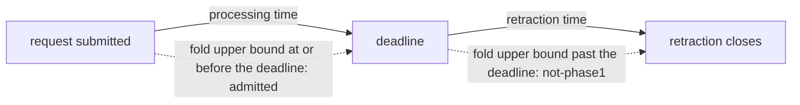
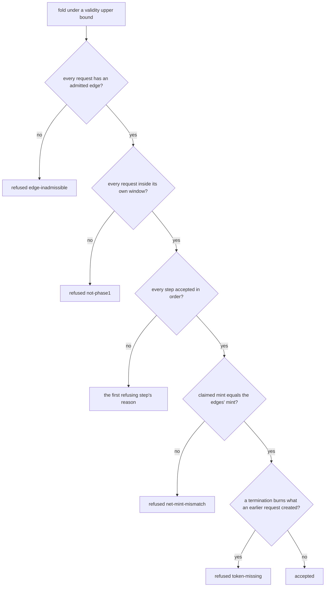

# A fold admits a request only inside its processing window

As a requester, I see a fold include my request only while my request is inside its processing window. The window is judged from my request's own submission time against the fold transaction's finite validity upper bound. A batch never consumes an output that the same batch creates.

Issue [#519](https://github.com/lambdasistemi/singular/issues/519), slice 2 of epic [#396](https://github.com/lambdasistemi/singular/issues/396). Read the [ruling](ruling.md) for the operator's words, the [plan](plan.md) for the four pull requests, the [gate](gate.md) for the checks, the [touch list](touch-list.md) for every file, and the [tasks](tasks.md) for the commit boundaries. Base: main `38c7fbc1`.

## Stories

As Alice, I booked a registration and the processor's fold includes it while its window is open. If my window has closed, the fold leaves my request out, and the receipt names it and says why in the model's words, so I know the fold did not take it and that I can retract it or ask for it to be rejected.

As a registry processor, I run `singular registry fold` and the model, the fold builder and the compiled validator all give one answer about a request's window: the same submission time, the same upper bound, the same boundary. A fold I could not submit is refused before I sign it, with the reason the model gives.

As a folder with key K unknown and two pending requests in ledger order, an insertion of K and then a termination of K, I fold once: the insertion settles and the termination is not part of that fold. The model refuses the pair as one batch, the builder refuses it before signing, and the compiled validator rejects a transaction that contains both. The next fold settles the termination from the live holding.

As an integrator reading the model, the registry's rule about time and about what a batch may consume is stated in Lean, proved, exported to the corpora, the simulator and the conformance suite, and compared with the chain, not left to the validator alone.

## What is wrong today

The chain already refuses both cases, so this ticket mostly brings the model and the builder up to the chain and pins the chain's refusals with executed evidence.

- **The model is silent about time.** `Singular.Request` carries no submission time, a fold is exactly `Singular.exitStep`, and the constitution says a fold has no admission. A fold of a request past its deadline is accepted by the model and refused `not-phase1` by the chain. The conformance book calls this "a separate tracked discrepancy".
- **The model accepts what the chain cannot settle.** `Singular.foldBatch` threads each step's state into the next, so an insertion of K followed by a termination of K is accepted. The chain refuses the batch `token-missing`: the termination must burn the active token from an input, and the insertion delivers it to an output of the same transaction.
- **The library fold builder checks no window.** It spends every pending request and places the validity upper bound at the earliest deadline, falling back to the clock when the slot of that deadline cannot be found. The command line checks one deadline after building; the library, used by the conformance harness and the end-to-end suite, checks none.
- **The validator's refusals are thinly pinned.** Its window tests use closed intervals against a deadline of 10 000, every test request is submitted at time 0, and no test puts an insertion and a termination of one key in one fold.

## Four pull requests

The ticket is cut now, before dispatch, into four pull requests that each ship something runnable. A Lean change fans out to dozens of files, most of them regenerated or restamped, so the two model rules are two pull requests rather than one that would run for a working day. The model leads, because the constitution requires it, and the builder and the validator evidence depend on it.

**Pull request 1: the model refuses what a batch creates and consumes.** The within-batch rule in `foldBatch`, the statement that independent requests fold as a batch, every consumer of the model that this rule moves (corpora, theorem register, simulator, coverage record, the open-datum application's proofs) and the first constitution amendment. The one accepted batch of the permanent contract's corpus, a registration then a termination of one key, is the very pair the ruling refuses; its row becomes a refusal and the accepted anchor is a batch on two distinct keys. Runnable outcome: anyone can ask the model's driver the batch question for an insertion then a termination of one key, with the conformance transport's batch question replayed by `nix run .#conformance-appendix-tests` from `conformance/` and the row in `lean/driver-corpus.json`, and read `token-missing`, where the model accepted the pair before. No runtime behavior changes, because the chain already refuses it.

**Pull request 2: the model admits a fold only inside its window.** `Request.submittedAt`, the fold witness, the fold admission, the admission order, every fold scenario and batch under a witness, the transport and the live driver reading the request's submission time and the built transaction's upper bound, the simulator's playable fold, and the second constitution amendment. Runnable outcome: anyone can ask the model's driver the fold question under a validity upper bound one past a request's deadline and read `not-phase1`, and at the deadline read it admitted (same command and corpus), where the model admitted both before. No runtime behavior changes, because the chain already refuses it.

**Pull request 3: the builder enforces it and the receipt names it.** A pure admission check and a pure within-batch check in the registry library, called by the builder before signing and by the command line's post-build decision; the selection's window rule becomes the model's `not-phase1`; the receipt names the request; the Demo 1 scripts show an in-window request admitted and an expired one left out and named. Runnable outcome: `singular registry fold` with an expired and an in-window request pending settles the in-window one and prints the expired one `not-phase1` as a model refusal, where it printed `window-closed` as processor policy.

**Pull request 4: the compiled validator is shown to refuse the mutated transaction.** Aiken tests for the exact boundary, for requests with different submission times, for an open upper bound and for every same-key pair; the same transactions exported as contexts and evaluated against the blueprint's compiled bytes, with the always-accept fault control; one live conformance row. Runnable outcome: `nix flake check` in `onchain/` turns red when the validator's window rule moves by one millisecond or its burn discharge is removed, and one dedicated conformance row compares the chain's refusal with the model's `not-phase1`.

## Rulings in force

Quoted so no reader needs another page to know them. The [ruling](ruling.md) holds the operator's full text.

- **Lean is the behavioural authority** (constitution 1.15.0, Principles I and II). Model: Lean tree `30b38e10f6a843999ae6f1e4d3a5bb5b382314b8`, whose last model change is `20b35407` (#505) and last restamp `f88c7771` (the Lean 4.27 move, #588); onchain `validators` tree `6fa081de28d45893e2199cabc1c3d9b19a286579` and `lib` tree `21e7e992170247a951efa5a0c3bf493dbae9ad9b` (the registry validators moved to `onchain/lib` in #528); base `38c7fbc1`. Where Lean is ambiguous or underspecified for a claim, work stops and the question goes to the user as a story with the model revision.
- **Fold admission for every fold** (operator, 2026-10-06): "the model gains the fold-time admission for every fold, single and batch. A fold including a request past `submittedAt + processTime` is refused `not-phase1`, as the chain refuses it. Inside the window nothing changes." The upper bound equal to the deadline is admitted; one past it is refused.
- **A batch cannot consume what it created** (operator, 2026-10-06): the model "refuses a request that consumes a holding or a custody entry created earlier in the same batch: `token-missing` for a holding, `not-booked` for a custody entry. The names are the model's existing ones." Since #505 only the holding half has an edge to apply to; the plan asks the epic owner to confirm that reading.
- **Batch selection, option A** (epic owner, 2026-10-09, for #518): each pending request is judged alone against the live state; at most one request per key per fold; included requests keep ledger input order. Its fourth condition assigns to this ticket: the model has no batch transaction, there is no distinct-key commutation theorem, and a same-key insertion then termination in one batch must be enforced in model and validator.
- **Two vocabularies, never mixed** (same ruling, condition one): model refusal reasons are reported verbatim; selection reasons the model does not carry are named as processor policy and never appear as a model refusal.
- **Request datum inline, no size cap** (operator, 2026-10-09): "The request keeps carrying its datum inline; no size cap; the application decides what rides in it."
- **The command-line split** (#528, desk planning ruling 2026-10-09): "build fold selection and receipts against the library's request and fold, not against the open-datum envelope, so #528 can move the command without rewriting this logic." This ticket reads the request through the library and never through the envelope.
- **Batch capacity** (operator, 2026-10-08/09): about nine requests on preprod's execution budget of 14 million memory units, bound by trie-proof verification, unmeasured; measuring it is #530. **Rejection** belongs to #498 and #508, and none is invented here. **The request tag** is #529: the fold keeps discovering requests at the request address until that lands.
- **Merge queue** (desk, 2026-10-09; amended 2026-10-14): #518 and #528 are merged. The operator chose this ticket for Demo 1, so its Lean pull requests land first: the protected rejection lane (#494) rewrites the fold model in its later slices and rebases onto them. Validators and Lean are otherwise one serial surface (#494, #495, #529, #506). This ticket edits Lean and validator tests, so the [touch list](touch-list.md) names the collision with every live lane and the [plan](plan.md) says what happens if another lane lands first.
- **Staffing** (operator rulings for this lane, 2026-10-14): Lean model writer Codex gpt-6-astra at high effort; implementation code writer Muse; auditor Grok, persistent, mute, an alarm; ticket owner Claude Sonnet 5.5 at xhigh effort; one writer at a time in the lane; no draft tool. A ruling given to one lane binds that lane only.

## The rule

The window of a request is the interval from its submission up to `submittedAt + processTime`. A fold is admitted when its finite validity upper bound, excluded as the ledger hands it to a script, is at or before the deadline of every request it includes. A reject reads no time. A retraction keeps its own admission, which looks at a later window.

The order of refusals follows the chain. The validator first checks that every updating request has an edge the registry admits, and refuses `edge-inadmissible` whatever the window. It then checks each included request's window before that request's approval and leaf, and refuses `not-phase1`. A batch that passes every step and balances its mint is last refused `token-missing` if a termination burns a holding an earlier request of the batch created, because the validator discharges the burn after the trie walk and the mint check. The model checks the three groups in that order over the whole batch. The chain interleaves the window and the law request by request, so a batch with two different defects at two requests can be refused for a different one of them; both refuse, and no live row compares such a batch.

### The two examples

Window. Processing time 60 seconds. r1 submitted at 1 000 (deadline 61 000), r2 submitted at 20 000 (deadline 80 000). A fold with upper bound 61 000 including both: admitted. Upper bound 61 001: refused `not-phase1`, whichever request comes first in the batch. r2 alone under upper bound 61 001: admitted.

Created outputs. Key K unknown. Batch [insertion of K, termination of K]: refused `token-missing`. The same two requests folded one after the other, the insertion first and the termination in the next fold: both accepted, the termination burning the holding the first fold delivered.

The permanent contract's corpus. Its one accepted batch today, "register then terminate in one atomic batch", is exactly the pair this rule refuses, because it was only ever evaluated by the model and never settled on a chain. After pull request 1 the corpus says what the chain says: that row is refused `token-missing`, and the accepted anchor is a registration of one key with a registration of another. This follows from the operator's ruling and moves no conformance row; the plan asks the epic owner to confirm it, because the batch was accepted in the corpus that #505 published.

### The two vocabularies after this ticket

| source | reasons | where they come from |
|---|---|---|
| model refusal, verbatim | `not-phase1`, `edge-inadmissible`, `no-approval`, `approval-mismatch`, `key-exists`, `token-missing`, `key-unknown`, `not-booked`, `terminal-immutable` | `Singular.foldAdmission` and `Singular.refusal`, reported as the model words them |
| selection policy | `undecodable`, `application-datum-unreadable`, `key-in-batch`, `capacity` | the processor's own rules; the model has no counterpart for them |

`window-closed` leaves the policy list: it was the processor's evaluation of the predicate the model now states, so the same predicate is now named once, by the model. The processor evaluates it at the earliest upper bound it will build, the clock plus its fold margin; a request the model refuses at that bound is excluded `not-phase1`. A request whose deadline equals that bound is now included, where #518 excluded it: the model admits an upper bound equal to the deadline.

`key-in-batch` stays a policy name. With this ticket the model refuses every same-key pair in one batch (insertion then insertion `key-exists`, insertion then termination `token-missing`, termination then insertion `key-exists`, termination then termination `terminal-immutable`), but the selection judges each request alone against the live state, and a later same-key request is accepted alone; naming it with the model's pair reason would claim a refusal the model does not give that request alone.

## What the receipt says

One receipt shape for one request or many, as #518 ships it. After this ticket, for an excluded request whose window is closed: the request, the reason `not-phase1`, the source `model-refusal`, its deadline and the upper bound the processor probed. For a built fold refused before signing: the refusal names the request whose deadline the built bound passes, with the same reason and source, and no transaction is signed or submitted.

## Acceptance

Each line names the check of the [gate](gate.md) that proves it, in italics at the end of the line. A number in brackets is the pull request the line belongs to; two numbers mean the line is proved again by the second.

- [ ] (1) batch-cannot-consume-what-it-creates: an insertion then a termination of one key is refused `token-missing` by the model; a termination of a holding that existed before the batch is accepted; every other same-key pair is refused by the reason the law already gives it. *model-check, conformance-unit-suite*
- [ ] (1) batch-burns-only-live-holdings: a batch the model accepts burns only holdings that existed in the state it started from. *model-check*
- [ ] (1) independent-requests-fold-as-a-batch: a non-empty batch of requests on pairwise distinct keys, each claiming the mint of its own edge and each accepted alone from the same state, is accepted as a batch; the empty batch keeps its existing refusal. *model-check*
- [ ] (1) permanent-contract-anchor-follows: the permanent contract's accepted batch is on two distinct keys and its registration then termination row is a refusal `token-missing`. *model-check, application-model*
- [ ] (1, 2) model-consumers-follow: corpora, exports, theorem register, simulator, transport, live driver, coverage record and the open-datum application's proofs carry every case of the pull request. *model-check, simulator-check, browser-check, coverage-check, coverage-tests, coverage-gate, conformance-unit-suite, application-model*
- [ ] (1, 2) constitution-amended: a new minor version with its sync impact report; the translation rows say what each rule adds. *model-check*
- [ ] (2) fold-admitted-up-to-the-deadline: an upper bound equal to a request's deadline is admitted, one past it is refused `not-phase1`. *model-check, conformance-unit-suite*
- [ ] (2) fold-refused-for-any-request-past-its-deadline: one expired request in a batch refuses the whole batch, a fold of one included. *model-check*
- [ ] (2) each-request-judged-from-its-own-submission-time: two requests with different submission times under one bound. *model-check, conformance-unit-suite*
- [ ] (2) admission-comes-before-the-law: an excluded edge is `edge-inadmissible` whatever the window, then `not-phase1` precedes approval and leaf reasons; a reject reads no time; a retraction keeps its own admission. *model-check*
- [ ] (2) chain-and-model-agree-under-the-witness: every existing live fold and batch row stays accepted by both. *the conformance devnet jobs*
- [ ] (3) builder-refuses-a-fold-outside-its-window-before-signing: refused with `not-phase1` naming the request; built at the deadline. *focused-offchain-suite*
- [ ] (3) builder-refuses-a-batch-that-consumes-what-it-creates-before-signing: refused `token-missing`. *focused-offchain-suite*
- [ ] (3) builder-and-model-agree-on-admission: the builder's verdict equals the model's at the boundary and one past; a control that admits one past fails. *conformance-unit-suite*
- [ ] (3) receipt-names-a-request-excluded-for-its-window: `not-phase1`, model refusal, with its deadline; `window-closed` appears nowhere. *focused-offchain-suite, demo1-refusal-controls*
- [ ] (3) in-window-request-admitted-end-to-end and expired-request-left-and-named-end-to-end, on a devnet. *demo1-journey-from-archive, demo1-refusal-controls*
- [ ] (4) compiled-validator-rejects-a-fold-whose-bound-passes-a-deadline and compiled-validator-rejects-a-batch-consuming-what-it-creates, each beside its accepted twin, with the always-accept fault control failing. *aiken-suite*
- [ ] (4) chain-refuses-a-fold-past-a-deadline-live: one dedicated conformance row compares the chain's refusal with the model's `not-phase1`. *conformance-batch-job*
- [ ] (2, 3, 4) docs-state-what-ships-and-its-limits. *rendered-docs, presentation-check, release-docs-check, cli-flags*
- [ ] (1, 2, 3, 4) fences: no validator source, blueprint or script identity change; repository checks stay green. *script-identity, blueprint, the root gate and the owner path fence*

## Out of scope

By number: #518 the selection and the batch builder this ticket builds on; #528 the command-line split; #486 the booking-time leaf check; #487 a mixed fold with rejection; #498, #508, #494, #495 the rejection rule and the protected-rejection validators; #529 the request tag; #530 capacity measurement; #506. By name: any validator source change; the model's batch transaction; unifying the retraction witness's submission time with the request's.

## Limits and residuals

- The model builds no transaction for a batch, so a batch is compared with `foldBatch`'s state, mint and payments, not a model transaction. Delivered here instead: the within-batch rule and the independent-batch statement. Owner of the transaction: #632.
- The distinct-key independence statement covers the acceptance of a non-empty batch and nothing else. It does not compare the batch's leaves, holdings, mint or payments with those of folding each request alone, so a claim that the processor's batch equals its parts is a named residual with its own follow-up. It also does not claim that the two orders give equal root bytes: the model's root sorts its pairs with a library sort whose behaviour on permuted input the core library does not state, and the constitution already treats the root as the model's own abstract commitment. Owner of the equal-roots and batch-equals-its-parts claims: #631.
- For a batch with two different defects at two requests the model reports the fixed edge set first, then the window, then the law in order; the chain interleaves the window and the law request by request. Both refuse; the reasons can differ, and the ledger's own reason is not observed live. No live row compares such a batch. Owner of this model-and-chain difference: #636. The fold builders show the same family on one side: they run the steps the duties and the proofs report before judging the window from the built body, so a batch with a failing step and a closed window names the step where the model names the window; the step message is the builder's own wording, never labelled as a model refusal.
- The connected fold builder has a mode that skips script evaluation (conformance only, with caller-supplied mints; not reachable from `singular registry fold`). It judges the fixed edge set, the window, the keyed mint and same-key pairs, in that order, and skips the approval checks (`no-approval`, `approval-mismatch`), the leaf checks (`key-exists`, `key-unknown`, `not-booked`, `terminal-immutable` and a step's `token-missing`) and the empty-fold refusal entirely: its callers supply valid approvals and a non-empty batch, and no builder code judges them there.
- The model represents only finite validity bounds. An open upper bound is outside it and stays a named non-goal; the validator refuses it `not-phase1`, which the Aiken tests pin.
- The retraction witness keeps its own submission time. Two fields now name one datum value, until the retraction admission is moved onto the request's own submission time (#633).
- Compiled-context evaluation is component-level script execution over an exported transaction, not a reachable ledger history; it says so in its own output. The ledger's refusal reason is not observed live (the deployed validators are compiled without traces); the live row attributes the refusal by script hash and takes the reason from the traced replay.
- Prose of the pages is read, not asserted by a job.
