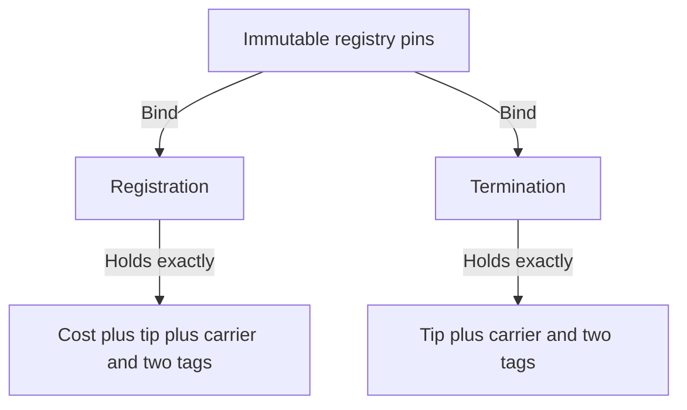

# What a booked request contains

## Story

As a requester, I want the value, addresses and clock I authorize to be the ones enforced on chain, so that a processor cannot reinterpret a carried token or spend my refund.

The two tags on a registration are the application and trie-ready tags. A termination holds the singular and trie-ready tags. The amount declarations are independent of observed lovelace, so hidden surplus is detectable.

| Value | Fields and constraint |
|---|---|
| Registration | Registry identity, key, refund address, destination and optional delivered datum, booked time, registration cost, declared tip, carrier ada, nonce, actual contents and output reference. |
| Termination | Registry identity, key, destination, declared tip, carrier ada, nonce, singular tag and trie-ready tag. Refund and booked time absent. |
| Registry configuration | Exact state identity, application and singular policies, request policy identity, registration cost, minimum tip, booking width and processing/reclaim windows. Every pin immutable; the root alone evolves. Concrete additions must preserve all bound meanings. |
| Commitment | Canonical, domain-separated payload/operation encoding plus one nonce. Registration operation binds key, refund, destination, cost, tip and carrier. Termination operation binds key and destination. |
| Retraction transaction | One pending registration plus ordinary lovelace funding, signers, finite nonempty interval, outputs, exact burns, zero donation and ledger fee. No state input or reference. |
| Fold transaction | Current state input and continuation, distinct pending requests, processing interval for registrations, exact tag burns and singular mint, exact carriers with booked datums, donation, ordinary funding, fee and balance. Termination has no processing deadline. |
| Expiry transaction | Distinct pending registrations, one authenticated reference state, one shared finite interval, exact burns and actual output payments summed by refund address. No state spend. |

Concrete byte encodings are implementation representations, not the model's numeric hash. The writer must present the encoding and cross-language correspondence before accepting it. Existing seven-edge wire tags remain distinguishable as refused values; do not silently reinterpret a historical encoding. New script identities must be propagated through all compiled consumers.
