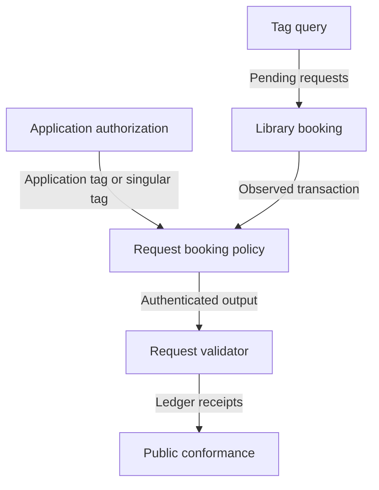

# Owners of the request boundary

## Story

As a maintainer, I want booking, spending, discovery and evidence to have explicit owners, so that a check cannot silently move from the validator into a cooperating client.

The application's rule authorizes registration or releases custody; Singular validates the resulting tag and request contents. The library builds transactions and never replaces a policy condition. The provider selects tagged outputs. Conformance reads the ledger's result independently.

| Owner | Change | Boundary |
|---|---|---|
| `onchain/lib/types.ak` and request-domain modules | Ruled request/configuration vocabulary and commitments | Pure values; no application policy logic. |
| New request mint policy | Authenticated output and mint at booking | Registration clock only; burns unconditional. |
| `onchain/validators/request.ak` and request exit modules | Sweep, tag disposal, registration retraction and expiry | Mismatch proof verification remains issue 495. |
| State, fold and settlement modules | Minimum economic fold, exact routing and only-folds-spend-state rule | Explicit shared ownership from the epic; no mismatch proof implementation. |
| `offchain/lib/Singular/Registry/Wire` and `Blueprint` | Matching concrete representation and applied policy identities | No independently invented law or hardcoded acceptance hash. |
| Library booking, discovery and exit builders | Actual minting, indexed selection, fee funding and transaction construction | Provider effects supplied explicitly; bounded command lifetime. |
| Packaged application/registry CLI | User-visible booking, sweep, reclaim and expiry | Application consumer model must agree before changed termination is accepted. |
| Conformance description, execution and receipt readers | Named product cases and observed evidence | No product assertion outside the description language; apparatus stays appendix. |

The application model is not promoted into Singular. Shared representation belongs upstream of its consumers; identical commitment logic must have correspondence checks rather than unrelated encoders with matching names.
