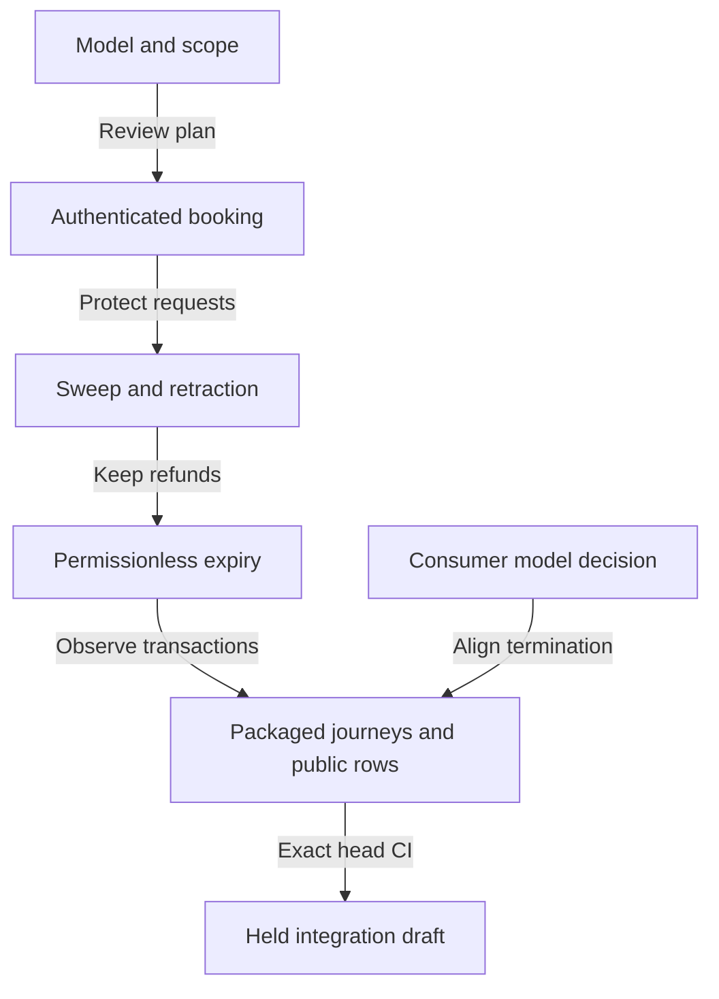

# Delivering authenticated requests

## Story

As the reviewer of this change, I want each commit to state which usable path it adds and which later integration it still needs, so that a passing component check never becomes an unsupported lifecycle claim.

This changes on-chain behavior and public conformance claims. It uses the approved commit owner and persistent mute auditor, with no draft tool. The target is a running product with checks for the named invariants and real boundary journeys; it does not claim universal implementation equivalence.



The commits share one branch, `integration/498-protected-rejection`; there are no child pull requests. No merge occurs before the 22 October review, and this ticket owner never merges. At the first push the draft title is `Protected rejection (1.0.0)`, with the repository PR template and the review hold stated explicitly.

## Ordered slices

| Slice | Deliverable | Acceptance boundary |
|---|---|---|
| Authenticated booking | Request/configuration representation, trie-ready policy, canonical commitments, immutable pins and generic library minting | Real mint evaluation and a booked registration; malformed contents, mint, address, fields, tags and clock controls. Application names wait for the next model slice. |
| Open-datum consumer model, registration | Amend the consumer's request, `mintApproval` and `booked` to carry the nonce and use Singular's ruled `applicationTagAssetName`; restate affected statements and regenerate the corpus | Model-first, before application name changes. Historical expected values change only through the amended model and generated corpus. Singular's root model stays frozen. |
| Economic fold | Minimum state, fold, settlement, codec and builder changes needed by the new booking | Both request kinds obey `foldAccepted`, exact burns, carrier routing, donation and gross-tip equation; no state-spending rejection. |
| Sweep and retraction | Request spend prerequisite, unconditional policy burns, junk sweep, ordinary-funded registration retraction and builders | Stranger sweeps actual junk; tagged sweep refused; signed retraction returns full held value with fee from ordinary funding and no state access. |
| Permissionless expiry | Authenticated reference-read expiry, batch refunds, request-side rejection interface, library and CLI rejection | A stranger exits genuinely booked expired registrations, including shared refund addresses; live requests and terminations cannot take expiry. |
| Discovery and published evidence | Tag-indexed discovery, pollution controls, compiled and packaged registration paths, receipt-derived public rows and identity propagation | Actual provider query/read evidence, positive and adverse journeys, exact-head hosted CI; all acceptance items retained. |
| Application termination integration, held | Align the packaged application termination path after its model-first decision | Last slice; Q-003 must be resolved first. No weakening of the existing consumer guarantee by this lane. |

Every slice is committed locally and reviewed through checkpoints. RED-before-GREEN records demonstrate the real behavioral failure, not missing symbols or setup errors. Final task stamps precede the final candidate's verification. Only reviewed candidates are pushed.

## Shared boundary with the following ticket

The epic owner's 16 October answer assigns this ticket the minimum economic fold, settlement and state-validator changes its booking and existing journeys require. Registration burns both tags, donates cost and delivers its exact carrier; termination burns trie-ready and singular tags and donates held minus tip. Only folds spend the state. This ticket owns shared reference-state authentication and expiry, including tag burns, distinct consumption and summed refunds. Issue 495 owns mismatch proofs against that referenced root, any remaining per-member batch admission and state-validator work beyond this cut.

A current legacy fold cannot be relabelled economic. New datum and tag changes can break its consumers; no expected result is weakened merely to keep CI green. The explicit shared ownership above covers the required fold changes. Any further expansion remains a question. Each push is lawful; local RED or incomplete intermediate slices are never pushed as green candidates. The first slice's exact touch list is reviewed before coding.

## Resources and execution

Every cabal build/test, nix build/run, aiken build/check and packaged control runs under this wrapper, with COMMAND replaced by the exact command:

```sh
systemd-run --user --scope --quiet -p MemoryMax=12G -p MemorySwapMax=0 -- timeout 900 COMMAND </dev/null
```
 A command exceeding the cap stops for a question. Read loops have byte caps and deadlines; no unowned producer threads.

The inner loop uses the narrowest real test filter. Candidate checks target changed behavior. One local `nix develop --quiet -c just ci` precedes the first push; additionally run the listed affected consumers locally before that push. Hosted CI then supplies the exact-head net; do not rerun its job list locally. Every check records command, candidate/tree, exit, duration and evidence hash. Local planning checks are not hosted acceptance.

## Release and recovery

Rebase before a push, at least daily while live, and earlier when main touches changed paths or the draft conflicts. Inspect status and log after the rebase before any push. Refresh candidate-bound evidence after source or identity changes. Signed commits only, no attribution trailers; inspect the whole pushed range. Use `gh run list` and `gh run view`, never GitHub comments or `gh pr checks`.

The epic approved the initial plan at `063b3fe5`; its later A-006 assigns the consumer-model amendment to this ticket. Planning source ceiling is revised to 64 KiB for that added slice, with 12 KiB per page; each child packet remains at most 20 KiB excluding source pointers. An oversized slice is split. Singular's accepted model remains frozen; unresolved consumer conflicts hold affected acceptance.

The consumer-model writer is Codex gpt-6-astra high, launched with `codex --dangerously-bypass-approvals-and-sandbox -C WORKTREE -m gpt-6-astra -c model_reasoning_effort=high`, with the existing Sol auditor. Schedule it between Sonnet slices: one writer at a time. Its fence is `applications/open-datum/lean/` and generated consumer corpus/oracle outputs. Part one is the nonce-bearing registration name already ruled by the operator; part two, termination custody and deposit destination, remains held under Q-003. No root Lean or simulator-law edit is authorized. The same capped execution and checkpoint requirements apply.
