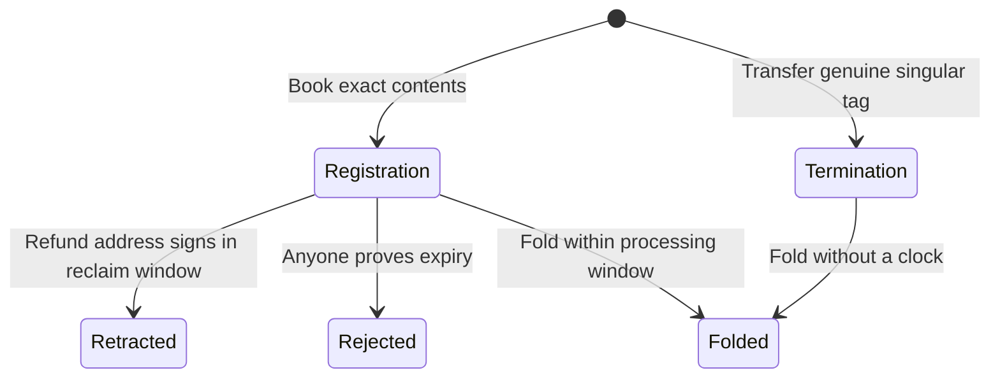

# Requests authenticated at booking

## Story

As a requester, I book a registration whose exact contents and clock are authenticated, reclaim its whole value inside my reclaim window, or receive everything except its tip when anyone rejects it after both windows. As a processor, I discover requests by their trie-ready tags without decoding junk at the request address. Anyone may collect an untagged output; nobody may collect a genuine request that way.

This is the implementation plan for [issue 529](https://github.com/lambdasistemi/singular/issues/529), on the protected-rejection integration branch. It is a proposed implementation contract, not evidence that these behaviors run today. Read the [plan](plan.md), [model mapping](mandate.md), [touch list](touch-list.md) and [gate](gate.md).

Registrations have three exits. Terminations have only a fold. This ticket delivers the minimum economic fold and settlement changes needed for lawful booking and existing journeys, plus tags, sweep, retraction and expiry. Issue 495 adds mismatch proof verification and any remaining state-validator obligations.

## Authority

The accepted Singular model is commit `4254a3073fe0457946eba0a68d974c999c930ebf`, Lean tree `5c704fd7efb5ce2f1ced67cdb22b559ca40cf772`, released by PR 615. The integration base `45cd8a754dbb695ae55e91b1cede942ff627d69f` contains that same Lean tree. The [economic contract](../494-protected-rejection-rule/contracts/economic-contract.md), [release record](../494-protected-rejection-rule/contracts/release-record.md) and constitution 1.18.0 bind behavior. Singular's root Lean stays frozen. Epic answer A-006 authorizes the separate open-datum consumer-model registration amendment described in the plan; its checked revision must be bound before application acceptance.

The epic owner's 16 October answers confirm that this ticket retains its library booking, discovery, packaged CLI and devnet criteria, and that the bounded booking interval applies only to registrations. The original issue body remains unchanged. The epic owner also assigned the minimum economic fold/settlement changes and shared rejection-state authentication to this ticket, so each pushed candidate remains lawful.

## Required outcomes

| Requirement | Observable result |
|---|---|
| Registration is born authenticated | One trie-ready tag and one application tag are minted with the inline request at its bound request address; held lovelace equals declared cost, tip and carrier. The minimum tip, registry and full commitments are checked. |
| Registration has an authenticated clock | Its booked time equals the finite nonempty booking interval's upper bound; its width does not exceed the immutable limit. |
| Termination transfers genuine custody | One genuine singular tag moves from application custody into an exact termination with one trie-ready tag, no application tag, no refund address and no clock. |
| Burns do not gate exits | Policy burn branches impose no exit conditions. Every request-validator exit enforces the required burns in that transaction. |
| Junk is collectible | An unrelated wallet can spend an output without a trie-ready tag, including malformed or absent datum, to any destination. A tagged request cannot use this path. |
| Retraction preserves the request's value | One registration is reclaimed by its signing refund address within its booked window. Ordinary lovelace inputs fund the fee; no state is read or spent, no other request is consumed, no foreign assets or donation are admitted. Actual refund outputs sum to at least the whole request value. |
| Expiry is permissionless | A stranger rejects one or more registrations at or after booked time plus both windows. The state is authenticated by reference and never spent. Members are distinct; tags burn; actual refunds sum per address to held minus declared tips. |
| Folds route every amount | Registration burns both request tags, donates cost and delivers the singular tag with exact carrier and datum; termination burns trie-ready and singular tags and donates held minus tip. Ordinary funding pays the fee and gross allocation is exactly the declared tips. Only folds spend the state; immutable pins and state value are preserved. |
| Discovery ignores junk | The provider selects by the exact tag policy before request decoding. A planted finite population of untagged and malformed datum-shaped outputs leaves the tagged requests read, selected and judged unchanged. Evidence reports the population and actual provider reads. |
| A person can run the paths | Packaged application booking and registry commands produce receipts from real transactions. The devnet expiry actor is neither requester nor original processor. Compilation and seeded fixtures cannot substitute for this journey. |
| Evidence stays honest | Product rows use the conformance description language and receipt-derived states. Uncovered and unmet rows remain published; harness controls remain in the appendix. |

## Superseded issue claims

| Earlier issue wording | Binding interpretation |
|---|---|
| Bond, forfeiture, penalty destination and flood-price defense | Removed by the economic ruling. Successful registration donates cost; rejected or retracted registration returns that cost. No flood-price guarantee. |
| Both registration and termination mint application approval | Only registration carries an application tag. Termination is authorized by release of its genuine singular tag. |
| Every request has refund, owner reclaim or expiry rejection | Registration only. Termination has no refund address and only folds. |
| Request tag | Trie-ready tag, distinct from state token, singular tag and application tag. |
| Booker's submission time | Registration interval upper bound, authenticated at booking. |
| Rejection occupies a fold action | Rejection is a separate reference-read transaction. No state spend. |
| Old fee pin | One immutable minimum tip; no independent fee pin. |
| Old registry migration or continued recognition | No migration or automatic recognition is claimed. The integration introduces new identities; old receipts retain their historical scope. |
| Universal eventual exit | Conditional model availability is distinct from real funding, inclusion, application release and builder success; demonstrate the named journeys, retain those limits. |

## Decisions still required

The bound open-datum model says termination booking keeps its application outputs and tag locked (`OpenDatumApplication.Statements.bookTerminate_keeps_locked`). Singular requires the tag to move into the request. Question Q-003 holds the affected consumer acceptance until the operator resolves it and the consumer model is aligned. A passing old application replay is not evidence for the new path.

Its `mintApproval` also uses the historical name without a nonce. A-006 requires a model-first registration amendment to Singular's ruled `applicationTagAssetName`; application name changes wait for that amendment and its regenerated corpus. This is authorized work, not completed verification.

The original unpayable-refund control must be realized through a documented concrete address representation and ledger output constraints. Do not silently turn it into an assumption about available wallet funds. Any missing semantic rule is escalated before acceptance.
