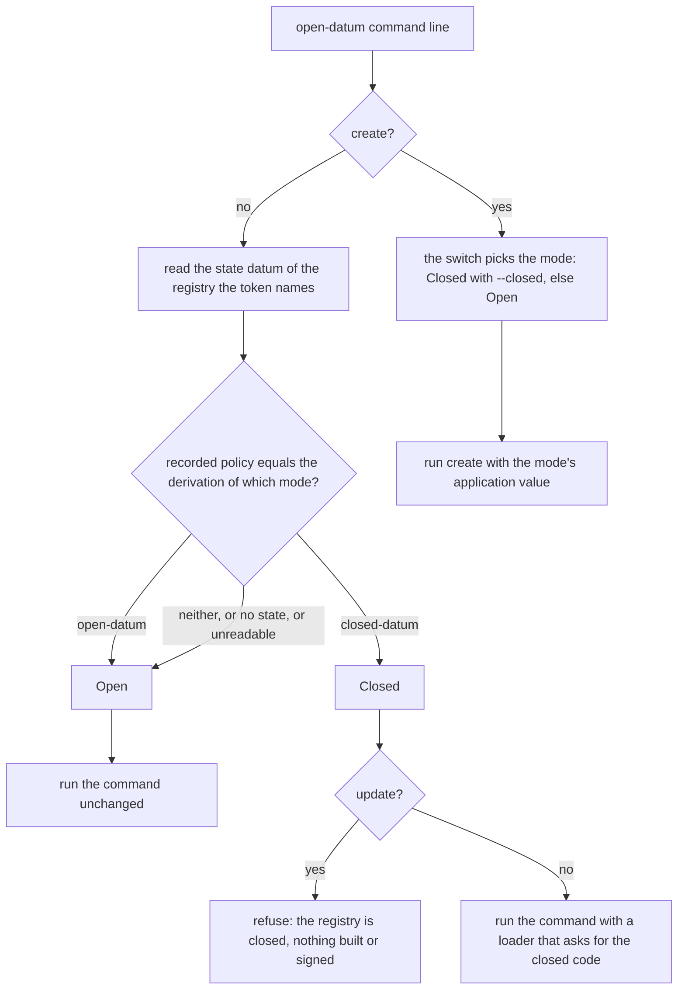

# Closed mode: plan

The story, the requirements and the rulings are in the closed mode specification.
This page records the class of the change, the shape of the code, the order of
work, the invariants and the hosted checks that accept it. Issue 654, one pull
request, one slice, about four hours of writing. Base: main cfe78df1. It lands
after issue 651 (the blueprint title it consumes) and is merged by Saturday
17 October 09:00 UTC.

## Class and team

The change adds behaviour to the open-datum executable: a flag, a read of the
chain, and a refusal. It takes the full process. One commit owner writes the
slice. A persistent auditor, silent toward the writer, answers the checkpoints.
One independent gate author wrote a table of hosted checks before any coding, and
the author of this plan combined it with a table of their own, once. Draft tool:
none. No part of the change is Lean, on-chain code or a workflow.

## How a command finds its mode

When the mode cannot be read, the command runs as open-datum. This is safe
because the command's own registry resolution re-checks the recorded policy
against the code it loaded and refuses by name before anything is built or
signed.

## Decisions

- **One application value, a mode that picks its pin.** `applicationIn` builds
  the value for a mode; the open value stays the constant every other module
  names, and the closed value differs from it in the pin title alone. The
  negative host, the conformance driver and the entry commands keep using the
  open constant.
- **The loader carries the mode.** For a registry read as closed, the commands
  `insert`, `terminate`, `fold` and `inspect` run with the environment whose
  release loader ignores the application it is asked for and loads the mode's.
  An open registry runs with the unchanged environment, so nothing about an
  open run changes, not even a closure.
- **The mode read is one read of one output.** It opens the provider the command
  names, finds the state output by its token, takes the recorded application
  policy, and compares it with the policy each mode's code gives for this registry
  identity. The open code is required; the closed code is optional, so an older
  blueprint with no closed title still reads an open registry.
- **The refusal of an update names the registry.** It is raised through the same
  failure path every refusal takes, so the receipt, the trace and the exit status
  are the ones of any client refusal.
- **`--closed` is split out before the shared tokenizer** and carried as the
  create command's first field. It is refused by name on every other command.

## Modules, data and functions

No new library module. The test suite gains one module.

| Module | Responsibility after the change |
|---|---|
| `Singular.Application.OpenDatum.Value` | The application value and its mode: what pins a registry as open or closed. Depends on the envelope and release rules only. |
| `Singular.Application.OpenDatum.Command` | The parse of a command line. Owns the `--closed` switch and the create command's mode. Depends on `Value` for the mode type. |
| `Singular.Application.OpenDatum.Run` | The dispatch. Owns the mode read, the environment that follows a mode, and the refusal of an update on a closed registry. Depends on `Value`, `Command` and the registry command line's session. |
| `Singular.Application.OpenDatum.ClosedModeSpec` (test) | The unit tests of this change, in the existing Open-datum tests job. |

Data. Names only; fields as named.

| Name | Meaning |
|---|---|
| `Mode` | `Open` or `Closed`: which of the two entry points of the application a registry runs. Two constructors, derived equality, show, order and bounds. |
| `ModeRefusal` | Why a mode was not read: the open-datum release or the state of the token could not be read (with the named reason), or the recorded policy is neither mode's derivation (with the policy bytes). |
| the recorded policy | The bytes `stateAppPolicyBytes` returns for the state datum. Read, never stored. |

Functions. Name, arguments, result, effect.

| Function | Arguments | Result | Effect |
|---|---|---|---|
| `modeTitle` | a `Mode` | the blueprint title | none |
| `applicationIn` | a `Mode` | the application value | none |
| `closedDatumApplication` | none | `applicationIn Closed` | none |
| `openDatumApplication` | none | `applicationIn Open`, unchanged in every field | none |
| `OpenCreate` | a `Mode`, the create arguments | the create command | none |
| `closedSwitch` | none | the text `--closed` | none |
| `modeOfRecordedPolicy` | the recorded policy, each mode's derived policy where its code is present | the mode, or the refusal | none |
| `registryMode` | the environment, the provider settings, the blueprint path, the state token | the mode, or the refusal | one provider read, traced like any read; asynchronous and bounded-wait failures propagate, any other failure is a refusal |
| `followingMode` | a `Mode`, the environment | the environment | none: `Open` returns the environment it was given |
| `closedUpdateRefusal` | none | the plain message | none |

Constraints. `modeTitle` is injective. `applicationIn Open` equals the constant
value of today. `applicationIn Closed` equals it in every field but the pin.
`modeOfRecordedPolicy` is total and never chooses a mode whose derivation is
absent or unequal. `registryMode` writes nothing and opens no wallet.

## Order of work

One slice, in this order. Each step leaves the tree green for the jobs it can
reach.

1. Add the mode and the closed value to `Value.hs`; keep the open constant.
2. Add the `--closed` split, the create field and the refusal to `Command.hs`,
   fix the pattern sites in the specs, and add the switch to the usage text.
3. Add the mode read, the following environment and the update refusal to
   `Run.hs`, and make create, fold and inspect use the mode's value.
4. Write `ClosedModeSpec` and register it with its tags; run the open-datum suite.
5. Add the `--closed` row to the settings table of `docs/singular-node.md` and a
   paragraph to `onchain-release/DEMO1.md`; regenerate their speech and, for the
   site page, its narration clips.
6. Run the cheap local legs below, fold fixes into the one code patch, and hand
   the candidate over for review.

The pull request is a stacked patch series: one patch for these pages, one for
the code, one for the documentation. No journey commits are pushed.

## Invariants and what makes them fail

Each name is stable and appears in the tasks.

| Invariant | Fails when | Proved by |
|---|---|---|
| `closed-switch-at-create-only` | a command other than create parses `--closed`, create refuses it, a key named `--closed` flips the mode, or the usage text names the switch outside the create lines | Open-datum tests |
| `closed-create-pins-closed-datum` | create with the switch asks the loader for any title but the closed one, or create without it asks for any but the open one | Open-datum tests |
| `mode-read-from-the-chain` | a state recording the closed derivation reads as open, or one recording the open derivation reads as closed | Open-datum tests, with both datums built from the boot-side functions and never typed |
| `unreadable-or-unrecognised-mode-is-not-guessed` | a recorded policy that is neither derivation, or a missing state, reads as a mode; or the command's own refusal text changes | Open-datum tests |
| `later-commands-follow-the-registry` | insert, terminate, fold or inspect on a closed registry ask the loader for the open title after the mode read, or on an open registry for the closed one | Open-datum tests, with a loader that records each request |
| `loader-decides-the-code` | resolving a closed registry through the open-titled value refuses, or the value's title reaches the derivation | Open-datum tests |
| `update-on-a-closed-registry-stops-before-building` | update or its preview on a closed registry reads the signing key, builds, signs or submits, or does not name the closed registry, or exits other than 10 | Open-datum tests, run with a signing key path that does not exist: an update that reached the key would fail with another message |
| `open-registries-behave-as-today` | any existing open-datum test changes its result | the existing suites in the Open-datum tests job, and the Demo 1 journey from the release archive |
| `help-and-pages-carry-the-switch` | the help names the switch and the documented-flags check refuses the pages, or a changed page's speech or clips are stale | Documented CLI flags and refusal controls; Documentation release checks |
| `registry-and-fences-untouched` | a file outside the touch list changes | the file-list check outside the repository, run before the push |

## Hosted checks that accept the work

The gate is the continuous integration itself: each row names the job and the
verbatim command. The local leg is the cheap command run before the push; the
hosted jobs run once on the pushed head, and no hosted job is repeated locally.
The synthesis of the independent gate table and the plan author's table, with the
cited red runs, is kept in the ticket's runtime record; the frozen result is below.

| Accepts | Hosted job | Command | Local leg |
|---|---|---|---|
| the switch, the mode read, the refusal of an update, the requested code, existing suites | Open-datum tests | `nix run --quiet .#open-datum-tests` in `applications/open-datum/offchain` | same command, narrowed with the suite's match filter, then whole once |
| compile, format and lint of the touched Haskell | Open-datum component build | `nix build --quiet .#component-build`, then `nix run --quiet .#lint`, in `applications/open-datum/offchain` | same commands |
| the flag is in the settings table, for `open-datum create` only; pages use only printed flags | Documented CLI flags and refusal controls | `nix run --quiet .#cli-flags-check`, then `nix run --quiet .#cli-flags-controls` | the check script over the built binaries, once |
| the run page still numbers the journey; the archive journey is unchanged | Demo 1 journey from the release archive | `nix run --quiet .#demo1-cli-check`, then `nix run --quiet .#demo1-cli-test-harness` | hosted only |
| the changed pages render and carry current speech and clips | Rendered documentation; Documentation release checks; Development shell checks | `nix run --quiet .#docs-check`; `nix run --quiet .#release-check`; `nix develop --quiet -c just check-presentation` | the extraction tool, then `python3 tools/check_presentation_repo.py` |
| new Haskell is inventoried and tagged from the closed vocabulary | Code inventory | `nix run --quiet .#inventory-check`, then `nix run --quiet .#inventory-controls` | `python3 tools/code_inventory.py` |
| no new reference cell, variable, queue or thread in the touched Haskell | Development shell checks | `nix develop --quiet -c just io-ownership-check`, then `just io-ownership-controls` | `bash tools/io_ownership_check.sh .` |
| the archive stages the changed run page and verifies | On-chain release assembly and artifact checks | `nix run --quiet .#release-build-control`; `nix run --quiet .#release-artifacts -- "$RUNNER_TEMP/release"`; `nix run --quiet .#verify-release-controls -- "$RUNNER_TEMP/release"` | hosted only |
| the packages that build `open-datum` elsewhere still build | Conformance Haskell format and lint check; Conformance checks without a devnet; Negative host sources: format and lint; Negative host parser, dispatch and handler controls; Demo 1 one-output create from a fresh wallet | each job's own command, unchanged | hosted only |

Every other required context that reads the open-datum commands, the archive or
the registry (the recovery lanes, the Demo 1 refusal and two-actor jobs, the
conformance devnet jobs and the devnet end-to-end parts) is listed in the runtime
record's census and must be green on the exact head. The checks the author of the
change runs before the push, outside the repository, are: the diff names only
files of the touch list; no fenced file changed; no attribution in the pushed
range; the new test module adds no reference cell, variable, queue, thread or
unsafe escape; and the final tree equals the last approved checkpoint tree.

## Risks the plan settles

- **A read before every command but create.** Each later command now reads the state
  output once before it reads it again. A rig that counts or orders reads, and a
  journey that asserts on reads, could notice. The mode read is made through the same
  read path as any read, writes nothing, and a failure of it changes nothing; the
  hosted jobs that run these commands are the net.
- **The title in the value the entry commands pass.** The entry commands pass the
  open value when closed code is loaded. This is correct because the title is read only
  by the loader, which the dispatch replaces, and it is guarded by a test that resolves
  a closed registry through that value.
- **An interrupted create has no state output.** The mode read names it as a missing
  state, the command then runs as open-datum, and `inspect` prints its own refusal as
  today.
- **Help text read by the flags check.** The check treats every `--flag` in the
  help's prose as unattributed. The explanation of the switch therefore says "the
  closed switch" and names `--closed` only on the create usage lines.

## Residuals this change leaves, written before the work

- The real blueprint's closed-datum title is first used by the devnet journey from
  the release archive, the next ticket of issue 650. Until then the title is proved
  requested, not proved present.
- The write-once rule has no Lean statement, by ruling.
- The node's refusal of a crafted update on a closed registry is the last ticket
  of issue 650.
- `singular registry describe` on a closed registry is exercised by the journey
  ticket.
- No hosted check asserts that the run page carries the closed line, or that the
  run page's speech is current: the presentation check does not name that folder.
  The flags check binds an invocation on the page to the help, the speech is
  regenerated with the extraction tool in the same change, and the acceptance walk
  reads the line. This is a missing job, reported to the epic owner.
