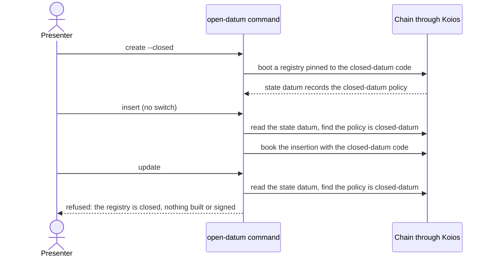

# Closed mode: create a closed-datum registry, and refuse an update on it

The release archive carries the open-datum application and, once issue 651
lands, a closed-datum entry point in the same program: the payload of a name is
written once at registration and every update is refused on chain. A person
cannot yet choose it. This ticket gives the open-datum executable the choice
at create and teaches every later command to follow the registry's mode, with
no further flag. It is the executable half of issue 650. Issue 654.

## Story

As the presenter of Demo 1, I type `open-datum create --closed` from the release
and get a registry whose application is closed-datum. Every later `open-datum`
command (`insert`, `inspect`, `terminate`, `fold`) follows that registry's mode
with no further flag, and `open-datum update` on it stops before anything is
built or signed, with a plain message saying the registry is closed. Without
`--closed`, every command behaves exactly as today.

What the presenter sees: the create receipt names the application
`open_datum.closed_datum` and prints its pin; an insert, a fold, a termination
and an inspect on that registry work as they do on an open one; an update prints
that the registry is closed and exits with the client-refusal status, having
read no key and built no transaction. The scene is rehearsed on Saturday
17 October.

## What is established

Read on main at cfe78df1 on 15 October 2026. Each statement below was checked
against the source before the plan relied on it.

- The open-datum value is one constant, `openDatumApplication`, pinned by the
  title `open_datum.open_datum`. The title is read in exactly two places: the
  release loader, which extracts that title's code from the blueprint
  (`offchain/cli/src/Singular/CLI/Registry.hs`, the `PinByScript` case), and the
  create receipt, which prints it as `application`
  (`offchain/cli/src/Singular/CLI/Create.hs`, `pinApplicationName`).
- Every command loads its release through the environment's loader,
  `envLoadRelease env app blueprint`: create (`Create.hs`), inspect
  (`Inspect.hs`), the booking precheck (`Booking.hs`), the attached write
  (`Attached.hs`) and the preview (`Preview.hs`). The loader is a field of the
  environment record, so one command can be run with a different loader without
  editing any module that calls it.
- The registry resolution (`resolveRegistry`) derives the application policy from
  the code the loaded release carries, applied to the registry identity, and
  refuses `registry-pin-mismatch application` when the state datum records another
  policy. The title inside the application value plays no part in that derivation.
  A command that loads the wrong mode's code therefore cannot build against the
  wrong script: it stops at that named refusal.
- The state datum records the application hash (`application_policy`). The
  state output is found from the state token alone (`findStateOutput`), so the
  mode is readable from the chain with no local file.
- The shared flag reader refuses a switch it does not know ("is not a flag
  singular reads"), and the `singular` binary reads the same shared list. Adding
  `--closed` to the shared list would change `singular` commands.
- The wallet-preparation work (issue 491) edits the open-datum `Entry.hs`,
  `Plan.hs`, `Preview.hs` and `WalletShortfallSpec.hs`, and the registry command
  line's `Prepare.hs`, `Plan.hs` and `CommandRunSpec.hs`. Its two open branches
  were read on 15 October 2026 (`feat/491-prepare-application` at 0d1d184e):
  they change no file this ticket changes.

## Requirements

- `closed-switch-at-create-only`: `open-datum create` accepts `--closed`, also
  together with `--preview`. Every other command, `help` aside, refuses it by name
  before anything is read, saying that a registry's mode is chosen at create and
  read from the chain by every later command. A key whose text is `--closed` is a
  key, not the switch. The registry's own `singular` commands still refuse
  `--closed` as an unknown flag.
- `closed-create-pins-closed-datum`: `create --closed` loads the closed-datum
  code, pins it, and its receipt names the application `open_datum.closed_datum`.
  Without the switch the value, the title and the receipt are the ones of today.
- `mode-read-from-the-chain`: the mode is the one whose application, applied to
  the registry identity, hashes to the policy recorded in the registry's state
  datum. It is read from the chain through the state token and never from a file.
- `unreadable-or-unrecognised-mode-is-not-guessed`: a recorded policy that is
  neither mode's derivation, and a missing or unreadable state, are named
  refusals of the mode read. The command then runs exactly as it does today, so
  the registry's own refusal (`registry-pin-mismatch application`,
  `state-output-missing`, and the others) is what the person sees, before
  anything is built or signed.
- `later-commands-follow-the-registry`: for `insert`, `terminate`, `fold` and
  `inspect`, the release the command loads carries the code of the registry's
  mode: the closed-datum code for a closed registry, the open-datum code for an
  open one. No flag is read.
- `loader-decides-the-code`: the application value that `Entry.hs` passes still
  carries the open title when the closed code is loaded. This is stated and
  guarded: the title does not choose the code, the loader does, and a resolution
  of a closed registry through that value succeeds.
- `update-on-a-closed-registry-stops-before-building`: `update`, and `update
  --preview`, on a closed registry stop before the release code is used to build,
  before any signing key is read and before anything is submitted. The
  message says the registry is closed and that a payload is written once. The
  outcome class is the client refusal, exit status 10.
- `open-registries-behave-as-today`: on a registry whose recorded policy is the
  open-datum derivation, and without `--closed`, every command reads, builds and
  prints what it does today. The existing suites pass unchanged except for the
  constructor arity named in the touch list.
- `help-and-pages-carry-the-switch`: the command help, `onchain-release/DEMO1.md`
  and the settings table of `docs/singular-node.md` say what `--closed` does, and
  the documented-flags check accepts them. Every changed page keeps its speech and
  its narration clips, regenerated with the tools.
- `no-lean-statement`: by operator ruling the write-once rule has no Lean
  statement (see below). Nothing here claims otherwise.
- `registry-and-fences-untouched`: no change to the registry library, the
  `singular` commands, the registry command line, the on-chain code, or the files
  the wallet-preparation work and the signing work are changing.
- `nothing-on-preprod`: no test or command of this ticket reaches preprod.

## Rulings in force

Recorded in the words they were given. The first two are the same rulings that
bound issue 651 (see its ruling page).

- No Lean (operator, 15 October 2026): "We do not need lean here. This is just
  for demo one, and then we decide if to formalize it." The affected story is the
  presenter's closed registration. The ruling declares a limit: the write-once
  rule has no Lean statement, theorem, corpus row or simulator case. It does not
  change any Lean statement about the registry or open-datum, and it does not
  permit a rule that contradicts clear Lean: the closed-datum validator reaches
  every other rule by calling open-datum's handlers.
- One application, one flag (operator, 15 October 2026): "make sure you refactor
  the open datum application enough so that closed datum is just a flag over it."
  In this ticket the flag is the mode of one application value: the closed value
  is the open one with a different pin title, and nothing else differs.
- On chain (desk and epic owner, 15 October 2026): `validator closed_datum` is
  appended inside `open_datum.ak` with blueprint titles
  `open_datum.closed_datum.{mint,spend,else}`; open-datum's hash does not move.
  Issue 651 delivers it; this ticket consumes it.
- The mode comes from the chain (operator, 6 October 2026, users have only a
  page and the chain): no local file decides it.
- Required checks (operator, 14 October 2026): a published check is required by
  default, and a new hosted job name goes into ruleset 22633401 in the same
  change. This ticket adds no job name.
- Nothing on preprod. Scene 5 on preprod with a closed registry is a separate
  decision of the operator.

## Decisions and what they were chosen over

| Decision | Chosen over | Why |
|---|---|---|
| The mode is read from the state datum of the registry the token names, by comparing the recorded policy with each mode's derivation | A mode file kept beside the journal; a mode flag on every command; running as open and retrying as closed on a pin mismatch | A file is local disk, which users do not have; a flag on every command can disagree with the chain; a retry reads the chain twice on every closed command and depends on the wording of a refusal |
| The closed code is loaded by running the command with an environment whose loader asks for the mode's title | Editing the entry commands to take the application as an argument | The entry commands, the planner and the preview are being changed by the wallet-preparation work; the loader is the one place the title is read |
| A mode that cannot be read or recognised runs the command as open-datum, whose own resolution refuses by name | A new refusal text for the mode read | Every existing refusal text and test stays byte-identical, and nothing is built or signed before the resolution that refuses |
| `--closed` is split out of the command line by the open-datum parser | Adding it to the shared switch list | The shared list is read by `singular`, which would then accept a flag it cannot honour |
| The refusal of an update sits at the dispatch, after the mode read | A guard inside the update command | That command is in the files the wallet-preparation work changes, and the dispatch is the one place that already knows the mode |
| No new library module: the mode type and the application value join `Value.hs`, the read joins `Run.hs` | A module of their own | Fewer files, no module list to keep in the documentation, and the two files already own the application value and the dispatch |

## Stated limits

- The write-once rule has no Lean statement, by ruling.
- The real blueprint's closed-datum title is consumed only by the next ticket of
  issue 650 (the devnet journey from the release archive). The unit tests here
  load toy programs under both titles, so they prove which title is requested,
  not that a release carries it.
- A closed registry is read by `singular registry describe` through the pin in
  its state datum, as any registry is; the journey ticket exercises that page.
- The node's refusal of a crafted update is the last ticket of issue 650.
- Nothing runs on preprod.
