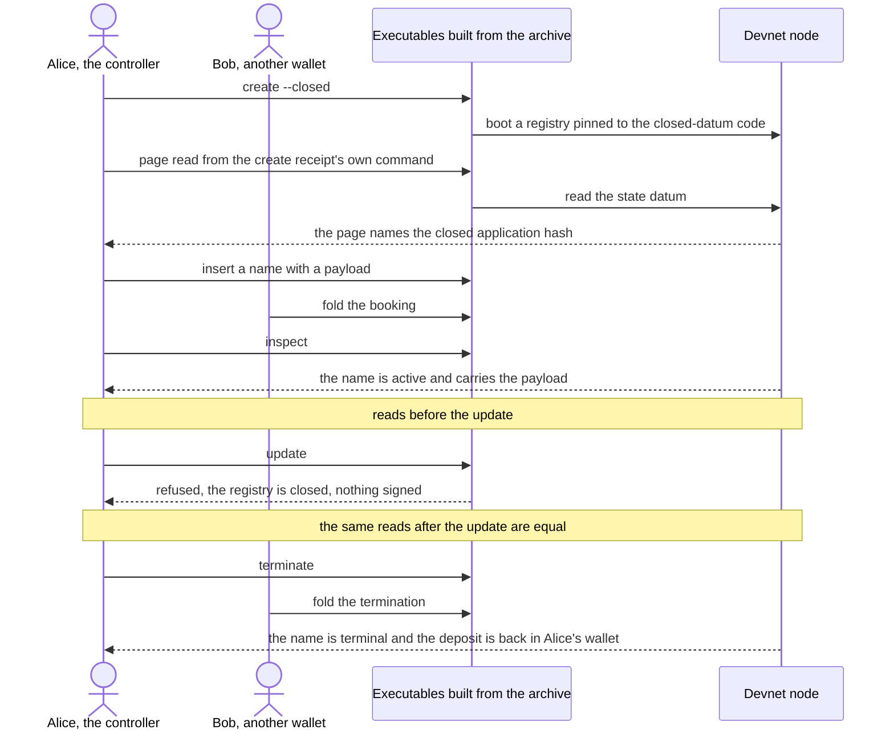

# Closed-datum journey from the release archive: specification

The closed-datum entry point is on chain (issue 651) and the executable can create
and follow a closed registry (issue 654). Nothing yet runs the closed scene the way
every other scene is run: from the release archive, on a devnet, on every change.
This ticket adds that run. It changes no product code. Issue 660.

## Story

As the presenter of Demo 1, I rehearse the closed scene from the release archive,
the way every other scene is rehearsed. I create a registry with
`open-datum create --closed`. I register a name with a payload and read it back. I
try to update it, and the executable refuses before anything is signed. I terminate
the name and get the deposit back. A hosted job runs the same journey on a devnet
on every change, so the scene cannot silently break before Saturday's rehearsal or
after it.

What the presenter and a reader of the job log see: one receipt per step, a page
read of the registry that names the closed application, the closed refusal with the
registry's name in it, and the controller's wallet holding the returned deposit.

## Requirements

Each name is stable and appears in the tasks and the gate.

- `journey-runs-from-the-release-archive`: the journey runs the executables
  `singular` and `open-datum` and the development node built from the extracted
  release archive's own flakes, through the release verifier's journey seam, as
  separate processes against one devnet. It is the ordinary build: no test
  control input reaches any invocation, which the verifier already checks.
- `closed-registry-created-with-the-switch`: step one is
  `open-datum create --closed`. Its receipt succeeds and names the application
  `open_datum.closed_datum`.
- `closed-mode-is-read-from-the-chain`: the page that the create receipt prints a
  command for reads the registry's application hash from the state datum. That hash
  equals the application hash the create receipt names, equals the hash a closed
  preview of the same seed derives, and differs from the hash an open preview of the
  same seed derives. The mode is therefore shown by the chain, not by the
  executable's say-so.
- `registered-name-reads-back-with-its-payload`: an insert books the name with a
  payload, another wallet folds it, and `inspect` reads the name active with the
  payload and the deposit the insert named, controlled by the inserting wallet.
- `update-is-refused-before-anything-is-signed`: `open-datum update` on the closed
  registry ends in the client refusal (exit status 10) whose reason names the
  registry as closed and says a payload is written once. The command is given the
  signing key; it must still stop.
- `refused-update-submits-no-transaction`: reads of the chain taken before and after
  the refused update are equal: the outputs at the controller's wallet address, and
  the name's output with its datum and value. An update that had been submitted
  would spend both. The wallet read taken after the termination booking, which does
  submit, is different. The proof is the chain; the executable's text and the registry
  directory's journal are not evidence.
- `termination-returns-the-deposit`: after the termination is booked and folded,
  `inspect` reads the name terminal with its holding gone, and a read of the
  outputs at the controller's wallet address lists an output created by the fold
  transaction whose lovelace is at least the deposit that the booking and the fold
  receipts name.
- `every-step-leaves-a-receipt`: each of the steps above writes its receipt file and
  the journey ends by printing, per step, the receipt file and its outcome.
- `new-job-runs-the-journey-on-every-change`: a hosted job named "Closed-datum
  journey from the release archive" in `registry.yml` runs a new nix app beside
  `demo1-cli-check`, with the same runner label, dependency and a timeout that fits.
  It runs on every pull request, as its sibling does.
- `open-datum-job-unchanged`: the job "Demo 1 journey from the release archive",
  its app, its journey and the release verifier script are not edited.
- `new-check-is-required`: the new job's exact check-run name is added to ruleset
  22633401. The ticket owner prepares the ruleset JSON; the desk applies it at the
  merge grant.
- `docs-note-names-the-job`: the run page `onchain-release/DEMO1.md` says which
  hosted job runs the closed journey. Its speech companion is produced by the
  extraction tool and not edited.
- `declared-checks-stay-hosted`: the new app is run by a workflow step, so the
  "Declared checks are hosted" census passes with no new entry in the not-hosted
  list; "Workflow commands resolve and controls" passes.
- `no-product-code-changes`: no Haskell, no Aiken, no Lean, no change to the
  registry library, the `singular` commands, the wallet-preparation files or the
  signing files.
- `nothing-on-preprod`: the journey reaches only its own devnet.

## Rulings in force

Recorded in the words they were given. All are repeated from issue 650 and the
tickets before this one.

- No Lean (operator, 15 October 2026): "We do not need lean here. This is just for
  demo one, and then we decide if to formalize it." The affected story is the
  presenter's closed registration. The ruling declares a limit: the write-once rule
  has no Lean statement, theorem, corpus row or simulator case, and nothing in this
  change claims otherwise. It changes no Lean statement about the registry or
  open-datum.
- One application, one flag (operator, 15 October 2026): "make sure you refactor
  the open datum application enough so that closed datum is just a flag over it."
  `create --closed` chooses the mode; every later command follows the registry's
  mode, read from the chain. The journey passes no flag after create.
- Users have only a page and the chain (operator, 6 October 2026): every fact is
  proved by a chain read or by the executable's own output. A local file the
  executable wrote is not evidence.
- Required checks (operator, 14 October 2026): a published check is required by
  default; the job name goes into the ruleset in the same change.
- Nothing on preprod. A closed registry on preprod is a separate decision of the
  operator.

## Stated limits

- The write-once rule has no Lean statement, by ruling.
- `inspect` does not print the registry's mode: issue 654 changes the create receipt
  and the update refusal, not the inspect receipt. The journey therefore shows the
  mode through the create receipt, the page read of the recorded application hash
  with its open-versus-closed comparison, and the closed refusal that only a mode
  read from the chain can produce. Making `inspect` itself print the mode would be a
  change to the open-datum executable, which this ticket does not make.
- The no-transaction proof reads the controller's wallet and the name's output. It
  does not read the outputs at the application address: the executable's outputs-at
  option refuses a script address on every registry, and widening it is a Haskell
  change outside this ticket.
- The node's own refusal of a crafted update that bypasses the executable is the last
  ticket of issue 650.
- The journey proves the executable refuses and the chain did not move. It does not
  prove the validator rejects an update transaction built by hand.
- The run takes the devnet's real time for each step; the job's timeout is chosen
  from the first hosted run.
