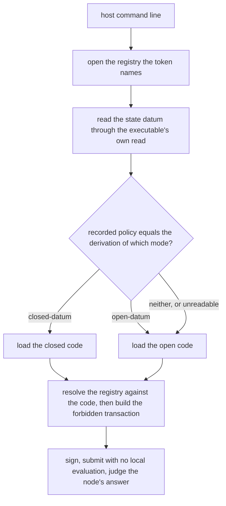
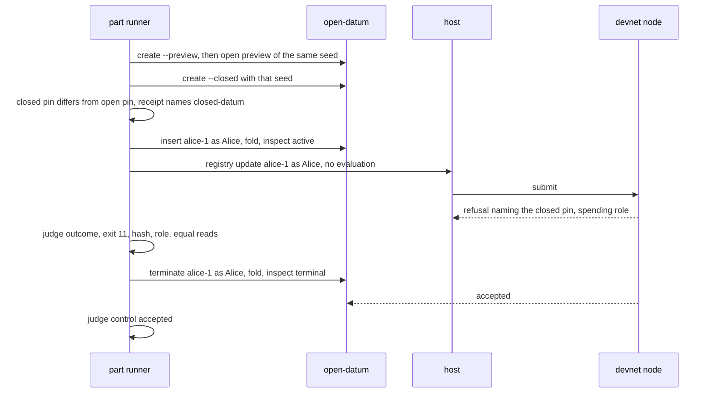

# Closed update refused by the node: plan

The story, the requirements and the rulings are in the specification. This page
records the class of the change, the shape of the code, the order of work, the
invariants and the hosted checks that accept it. Issue 661, one pull request, one
slice, about four hours of writing. Base: main 38c2e436. It should merge on Saturday
17 October.

## Class and team

The change adds no product behaviour and no on-chain code. It adds to the instrument
that judges on-chain behaviour: the negative host follows a registry's mode, one
part and one mutant are added, and the pages are updated. Because the part and the
mutant are the evidence for a claim about the validator, the work takes the full
process of the approved team: one commit owner writes the slice; a persistent
auditor, silent toward the writer, answers the checkpoints; one independent gate author
wrote a table of hosted checks before any coding, and the owner of this ticket combined
it with a table of their own, once. Draft tool: none.

## How the host finds its code

When the mode cannot be read, the host runs as it does today: the registry's own
resolution then refuses by name before anything is built or signed.

## How the part runs

## Decisions

- **One mode read.** The two small functions that apply the mode read to a command's
  arguments are exported from the executable's dispatch module, and the host calls
  them. The host does not copy the fallback.
- **Five calls change.** Each of the host's five handlers reads the mode and passes
  the mode's application value and following environment to the one call that
  resolves a registry. The reads in `Negative/Craft.hs` and `Negative/Read.hs`
  keep the open value because they use only what both values share.
- **The part is one new branch of the runner**, parameterised the way the runner says
  its parts are: a flag on the two creates, a setup block, a forbidden command, a
  control, and an expectation of the judge. The judge's body is not changed.
- **The pin is compared, not trusted.** The part creates the registry with the
  previewed seed, reads the pin an open creation of the same seed would have, and
  requires them to differ and the recorded one to equal the closed one. If previewing
  an open creation with a given seed is not possible, the writer files a question
  before choosing another way.
- **The mutant is a one-line replacement** of the closed spend's update arm with a
  call to open-datum's spend for the update redeemer. Its control pair is the update
  pair on an open registry (`stranger-updates-the-key`), which the mutated build still
  refuses.
- **The self-check gains one step.** The self-check job names its mutant on the command
  line, so it does not follow the mutant table. A second step runs the same control for
  `closed-update-accepted`: with no patch, the part's forbidden command is refused and
  nothing flips. The job keeps its name and its timeout of 45 minutes (18.7 measured for
  the registry mutant; one more pair).
- **Numbers leave comments.** The comments that say "13-name" in the workflow, the
  nix file and the control script are reworded without a number, so the next part
  does not make them false.

## Modules, data and functions

No new module. The negative host's cabal file does not change.

| Module | Responsibility after the change |
|---|---|
| `Singular.Application.OpenDatum.Run` | Also exports the two functions that read the mode for an entry command and for a fold. |
| `Negative.Run` | Each handler that resolves a registry first reads the mode and resolves against the mode's code. |

Data. None new. The mode type is `Singular.Application.OpenDatum.Value.Mode`.

| Function | Arguments | Result | Effect |
|---|---|---|---|
| `readModeFor` | the environment, the entry arguments | the mode and the environment that follows it | one provider read; an unreadable mode is the open mode and the given environment |
| `readModeForFold` | the environment, the fold arguments | the mode and the environment that follows it | the same, for a fold |

Both exist today. Only their export changes. The new host code calls them and passes
`applicationIn mode` and the returned environment to the call that resolves the registry.

## Order of work

One slice, in this order. Each step leaves the tree green for the jobs it can reach.

1. Export the two mode readers from the dispatch module. The host follows the mode at
   its five calls. Run the host's node-free controls once and the host's format and lint.
2. Add `closed-update` to the discovery table, to the runner's part list and judge
   expectations, and to the node-free membership control (fourteen names); reword the
   comments that carry the count.
3. Add the part's setup, forbidden command and control to the runner.
4. Add the mutant: its patch, its row in the mutant table and the self-check step.
5. Update `docs/negative-host.md`; regenerate its speech and, with the narration
   authorization, the clips of changed segments.
6. Run the cheap local legs below, fold fixes into the one code patch, and hand the
   candidate over for review. Run the new part once on the final candidate.

The pull request is a stacked patch series: one patch for these pages, one for the code
and runner, one for the mutant, one for the documentation. No journey commits are pushed.

## Invariants and what makes them fail

Each name is stable and appears in the tasks.

| Invariant | Fails when | Proved by |
|---|---|---|
| `host-follows-the-registry-mode` | a host handler against a closed registry loads the open code and stops at the registry's pin refusal; or the mode read escapes the command's classification, so an unreachable provider no longer ends in exit status 10 | the new part, and the node-free handler controls |
| `open-registries-behave-as-today` | any of the thirteen existing parts or eight existing mutants changes its result | the existing matrix jobs |
| `closed-update-is-refused-by-the-closed-spend` | the update is accepted, refused with another exit status or outcome, refused by a script that is not the registry's application pin, or the read of the registry differs after | the part, and the mutant, which makes the first case real |
| `refused-script-is-closed-datums` | the registry is open, or the recorded pin equals the open pin of the seed, or the receipt names another application | the part's own setup guards, failing the run as a setup error and never counted |
| `closed-update-control-is-a-termination` | the termination is refused, or the key is not terminal afterwards | the part |
| `part-lists-agree` | a list misses the part or counts another number | the node-free membership control, the discovery job, the part runner's unknown-part refusal |
| `closed-update-accepted-flips-closed-update` | the patch fails the runner's hygiene (more than its label line removed), the honest update is still refused, or the control pair no longer passes | the mutant job |
| `docs-name-the-part-and-the-mutant` | the page misses a name, or its speech or clips are stale | Documentation release checks; Rendered documentation; Development shell checks |
| `registry-and-fences-untouched` | a file outside the touch list changes | the file-list check outside the repository, run before the push |

## Hosted checks that accept the work

The gate is the continuous integration itself. The frozen table, with the failed runs
that show each command can fail, is on the gate page. The local leg is the cheap command
run before the push; the hosted jobs run once on the pushed head and no hosted job is
repeated locally.

| Accepts | Hosted job | Local leg |
|---|---|---|
| the part and the control | "Negative host pairs", through "Negative host pair from the release archive: closed-update" | the part, once, on the final candidate, in a memory-capped scope |
| the mutant | "Negative host mutants", through "Negative host mutant: closed-update-accepted" | a check that the patch applies to a scratch copy of the source |
| the unchanged mutants and the rules table parse; with no patch the new mutant's pair is refused and nothing flips | "Negative host mutant self-check", through its added step | none |
| membership, handler controls | "Negative host parser, dispatch and handler controls" | the same command, once |
| compile, format and lint of the host | "Negative host sources: format and lint" | the same command |
| the ordinary executables still cannot reach the bypass | "Ordinary executables cannot reach the bypass" | none |
| the changed export compiles, the open-datum suites pass | "Open-datum component build"; "Open-datum tests" | the build only |
| the page renders and carries current speech and clips | "Documentation release checks"; "Rendered documentation"; "Development shell checks" | the extraction tool, then the presentation check |

The remaining required checks that read the open-datum commands or the archive must be
green on the exact head. The checks run before the push, outside the repository, are:
the diff names only files of the touch list; no fenced file changed; no attribution in
the pushed range; and the final tree equals the last approved checkpoint tree.

## Risks the plan settles

- **A new read in every host command.** Each handler reads the state output before it
  resolves the registry. An unreadable blueprint or provider must fall back to the open
  mode and end in the command's own classified refusal. The node-free controls run the
  insert and terminate handlers against an unreachable provider and expect exit status 10.
- **Collateral collapse in the mutant run.** When the update is accepted, the part's
  control may fail afterwards. The runner already treats that as a flip when the
  forbidden receipt reports success.
- **A known red.** A release archive build of the open-datum executable can lose its
  store path in the middle of a run (issue 659). If it recurs on the head, the job
  numbers are reported and nothing is rerun locally.

## Residuals this change leaves, written before the work

- The write-once rule has no Lean statement, by ruling.
- The node's reason text for the refusal is not observed; the failing script is named by
  hash and role.
- That a tampered update on a closed registry is refused is not shown separately.
