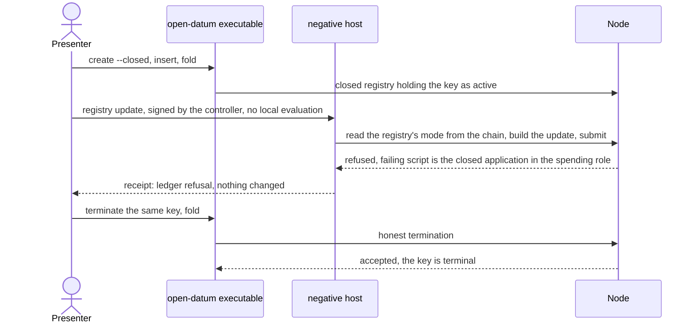

# Closed update refused by the node: the negative host follows a closed registry

A closed registry refuses an update twice. The open-datum executable stops it before
anything is built, and the closed-datum validator refuses it on chain. Only the first is
shown today. This ticket adds the second to the negative host, the instrument that
skips the executable, submits what the executable would never build, and reports what
the node itself says. Issue 661, a part of issue 650.

## Story

As the presenter of Demo 1, I can say that a closed-datum update is refused by the
application on chain, not only by the executable. Someone who skips the executable and
submits an honest controller update anyway sees the node refuse it, and the failing
script is closed-datum's spend.

What the presenter shows: a registry created with `open-datum create --closed`, a key
registered in it, then the controller's own update of that key, built by the negative
host and submitted with no local evaluation. The node answers with a refusal, and the
refusal names the registry's own application script in the spending role. In the same
registry, on the same key, the controller's termination is accepted: the node refuses
the update and nothing else. The scene is rehearsed on Saturday 17 October, after the
journey of issue 660.

## What is established

Read on main at 38c2e436 on 15 October 2026. Each statement was checked in the source
before the plan relied on it.

- The negative host builds forbidden transactions, signs them, skips local evaluation,
  submits them and judges the node's own answer. It finds the application's script hash
  from the registry it opened, never from a literal (`Negative/Submit.hs`,
  `applicationHashOf`), so a refusal is judged against the registry's own pin.
- The host opens a registry in five handlers (insert, update, terminate, withdraw,
  fold), each through one call that names `openDatumApplication`
  (`Negative/Run.hs`, the five calls to `attached`). That call loads the code the
  application value names and resolves the registry against it, refusing when the
  recorded policy is another derivation. Against a closed registry every host handler
  therefore stops at that named refusal before it builds anything. The host needs to
  follow the registry's mode.
- The other places that name the open value (`Negative/Craft.hs`, `Negative/Read.hs`,
  and the reads inside `Negative/Run.hs`) use it for the holding rules and the
  application address only. The two modes share both: `applicationIn` differs from the
  open value in the pin title alone, and `liveOutputs` ignores its application
  argument. They need no change.
- The executable reads a registry's mode with `registryMode` and `followingMode`,
  exported from `Singular.Application.OpenDatum.Run`. The two small functions that
  apply them to a command's arguments (`readModeFor`, `readModeForFold`) are not
  exported.
- The part runner builds the open-datum executable and the host from the release
  archive, creates the registry with `open-datum create` and judges the node's
  refusal: the receipt outcome, the failing script's hash against the registry's own
  pin, the script's role, and an equal read of the registry before and after. The
  update pairs use an honest controller update as their accepting control. On a
  closed registry that update is itself what the node refuses, so this part's control
  is the termination of the same key, as the part for a release outside any fold
  already does.
- Part names are listed in the part runner, in the discovery table
  (`negative/pairs.json`), and in the node-free controls. The mutant table
  (`mutants/rules.json`) is the second table. The workflow discovers both from the
  tables, so it needs no new job.
- The ruleset lists the aggregator jobs ("Negative host pairs", "Negative host mutants",
  "Negative host mutant self-check" and the others). The matrix job names are not
  listed, so this ticket adds no required name. The self-check job runs the no-patch
  control for the registry mutant only (`negative-host.yml:218`); it does not grow with
  the mutant table.
- The closed spend refuses an update with the trace `closed-datum-update`, once in
  `open_datum.ak`. The mutant runner checks that a patch removes exactly the lines of
  its rule's label and touches one file.
- Open pull requests that touch the same files: draft 597 edits
  `negative-host.yml` (in other places than this change) and `flake.nix`; draft 662
  (the journey of issue 660) names the negative host as not touched.

## Requirements

- `host-follows-the-registry-mode`: each host handler that opens a registry reads its
  mode from the chain, by the same read the executable uses, and loads the code of
  that mode. A registry whose mode cannot be read runs exactly as it does today, so
  the registry's own refusal is what the host reports. The read happens inside the
  command, where a provider failure is classified as it is today.
- `open-registries-behave-as-today`: on a registry whose recorded policy is the
  open-datum derivation, every host handler builds, submits and reports what it does
  today. The thirteen existing parts pass unchanged.
- `closed-update-is-refused-by-the-closed-spend`: the part `closed-update` creates a
  registry with `open-datum create --closed` from the release archive, registers a key
  and folds it active with the executable, then submits the controller's honest update
  of that key through the host. The node refuses it: the receipt reports a ledger
  refusal and exit status 11, the failing script's hash equals the registry's own
  application pin and its role is the application spending role, and the read of the
  registry is equal before and after.
- `refused-script-is-closed-datums`: the pin judged is closed-datum's. The create
  receipt names the application `open_datum.closed_datum`, and the pin differs from the
  pin the open-datum application would have for the same seed, which the part reads by
  previewing the creation of the same seed without the switch. A refusal by the open
  application's script could not satisfy both.
- `closed-update-control-is-a-termination`: in the same registry, on the same key, the
  controller books the key's termination and folds it, with the executable. The node
  accepts both and the key reads as terminal. A refusal for another reason (a wrong
  key, a broken registry) would fail this control too.
- `part-lists-agree`: the part is named in the discovery table, in the part runner and
  in the node-free membership control, which asserts fourteen names. A part missing
  from any of them fails a hosted check.
- `closed-update-accepted-flips-closed-update`: the mutant `closed-update-accepted`
  patches closed-datum's spend so that an update is no longer refused but handled by
  open-datum's update rule. Run by the unchanged mutant runner, it makes the honest
  update accepted, so `closed-update` flips, while its control pair still passes. The
  mutant self-check job also runs the runner's no-patch control for this mutant, which
  shows that without the patch nothing flips.
- `existing-mutants-unchanged`: the eight existing mutants run as today.
- `docs-name-the-part-and-the-mutant`: `docs/negative-host.md` names the part in its
  story and its table, and the mutant, with the counts they change; the page's speech
  is regenerated by the extraction tool and its changed segments carry clips.
- `no-lean-statement`: by operator ruling the write-once rule has no Lean statement. No
  document of this change claims otherwise.
- `registry-and-fences-untouched`: no change to the registry contract, its script
  hashes, the registry library, the `singular` commands, the validator source, or the
  files of the wallet-preparation and signing work.
- `nothing-on-preprod`: no part, mutant or command of this ticket reaches preprod.

## Rulings in force

Recorded in the words they were given.

- No Lean (operator, 15 October 2026): "We do not need lean here. This is just for demo
  one, and then we decide if to formalize it." The affected story is the presenter's
  closed registration. The ruling declares a limit: the write-once rule has no Lean
  statement, theorem, corpus row or simulator case. It does not change any Lean
  statement and does not permit a rule that contradicts clear Lean: the closed spend
  reaches every other rule by calling open-datum's handlers.
- One application, one flag (operator, 15 October 2026): "make sure you refactor the
  open datum application enough so that closed datum is just a flag over it." Here the
  flag is the mode of one application value, and the host follows it.
- On chain (desk and epic owner, 15 October 2026): `validator closed_datum` sits inside
  `open_datum.ak`; its spend refuses an update with the trace `closed-datum-update`,
  and mint and release delegate to open-datum. Issue 651 delivered it. This ticket
  consumes it and never edits it: the mutant is a patch applied to a scratch copy.
- The mode comes from the chain (operator, 6 October 2026, users have only a page and
  the chain): no local file decides it.
- Required checks (operator, 14 October 2026): a published check is required by
  default. The part and the mutant run under the existing aggregators, so no new name
  exists.
- Nothing on preprod.

## Decisions and what they were chosen over

| Decision | Chosen over | Why |
|---|---|---|
| The host reads the mode with the executable's own read, exported from the dispatch module | A second mode read written in the host; an option of the host naming the mode | One read of one output decides the mode for both programs, so they cannot disagree; an option could disagree with the chain |
| The host follows the mode at the five calls that resolve a registry | Threading an application value through every host module | The other uses read holding rules and addresses, which both modes share by construction; the part itself runs them against a closed registry |
| The control is a termination of the same key, by the executable | The honest update as control, as the update pairs do | On a closed registry the honest update is what the node refuses |
| The pin is shown to be closed-datum's by comparing with the open pin of the same seed | Trusting the create receipt's title alone | The title is text; a differing pin for the same seed is the application hash itself |
| The mutant makes the closed spend delegate an update to open-datum's update rule | A mutant that accepts every update | Closed becomes open, which is the flag removed; an honest update is accepted, and a tampered one would still be refused, so the mutant removes exactly one rule |
| The workflow keeps its jobs; both tables drive the matrices | A new job per part | The matrices already discover parts and mutants from their tables |

## Stated limits

- The write-once rule has no Lean statement, by ruling.
- The refusal is attributed by the failing script's hash and role. The node's reason
  text is not observed: the deployed validators are compiled without traces.
- The part runs on a devnet from the release archive. Nothing runs on preprod.
- What the part submits is the host's honest update of a closed registry. That the
  closed spend refuses a tampered update as well is not claimed: the closed arm refuses
  every update before any field is read.
- Each host command now reads the registry's state output once more before it reads it
  again.
