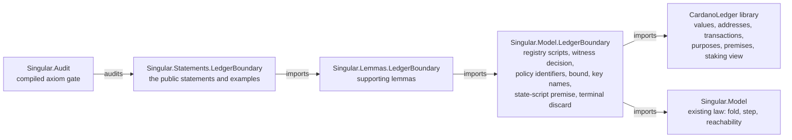

# Modules for the ledger boundary

As a later extractor of a shared Cardano ledger library, I find the ledger layer in its own library with no Singular dependency, and the registry's use of it in Singular's own modules.

## Boundary

| Module | Responsibility | May import |
|---|---|---|
| `CardanoLedger` and its submodules under `lean/CardanoLedger/` | Cardano's own transaction vocabulary at the ledger boundary, the ledger premises as named propositions, the staking-free view of a transaction, and generic lemmas about them | Lean core only |
| `Singular.Model.LedgerBoundary` | the registry instance: its script, redeemer and datum types, the world of a registry, the witness decision per kind, policy identifiers, the bound predicate, key to asset name, the state-script premise, and the holder's terminal discard | `CardanoLedger`, existing `Singular.Model` modules |
| `Singular.Lemmas.LedgerBoundary` | lemmas the statements need | the instance and existing lemmas |
| `Singular.Statements.LedgerBoundary` | the public statements and the satisfying examples, as theorems only | the lemmas; imported by the `Singular.Statements` facade |

The registry instance sits inside the model's existing source extent and the statements inside the statement extent, so the frozen generic corpus extent in the model checker needs no change. The registry-free library is bound by the full-extent corpora and by the simulator mirror, both of which already read every Lean file.

The registry-free library is its own Lake library, built by default, so that no module of it is reachable only by accident; the model checker's reachability check covers it as it covers `lean/Singular/`.

## What stays untouched

- `Singular.Economics.Transaction`, `Singular.Model.Transaction` and `Singular.Model.Assets`: the economic unspent-output accounting, the fold transaction the model builds, and keyed assets by kind and key are unchanged. They remain Singular's private ledger pieces until lambdasistemi/lockness#42 replaces them with instances of the shared library.
- `Singular.Model.Registry`: the configuration's abstract pins and state token identity are unchanged; this child relates the ledger's identities to the model only through the bound predicate and the state-script premise.
- The fold law, the driver, its protocol and every existing statement: unchanged in meaning and text.

## Dependency rules

- Nothing under `lean/CardanoLedger/` imports a Singular module, declares or opens the Singular namespace, or mentions a Singular name. A hosted check enforces this.
- The instance depends on the library, never the reverse.
- Statement modules hold theorems only; definitions live in the instance or lemma modules, as the compiled gate requires.
