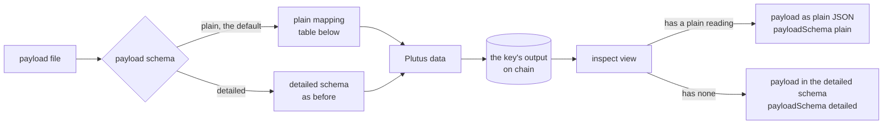

# A payload written as plain JSON

Ticket [#719](https://github.com/lambdasistemi/singular/issues/719). Read the [plan](plan.md) for the slices, the
gate and the files, and the [data model](data-model.md), [modules model](modules-model.md) and
[functions model](functions-model.md) for the shapes. Base: `main` at `14d50c40` (release 0.14.0).

## Story

As a reader who has a registry and a key, I store the document `{"answer": 42}` under the key by
writing that file and nothing else. I read the key back and the page shows `{"answer": 42}`. I did
not learn how Plutus data is written in JSON first.

As an integrator who needs exact control of the bytes on chain, I keep writing the detailed schema
(`{"constructor":0,"fields":[{"int":42}]}`) and say so on the command, so nothing is guessed.

As someone with a script from the previous release, my payload file in the detailed schema is
refused with a sentence that tells me to say so, never stored as something else.

## Decisions

| question | decision | rejected |
|---|---|---|
| how a command knows which form a file is in | the reader says so: a payload schema setting with the values plain and detailed, plain when absent | guessing from the file's shape, because `{"int": 42}` is a valid plain object and a valid detailed datum |
| what happens to a detailed file given without the setting | refused with the instruction, because it would otherwise be stored as a map of text keys | storing it as plain, which silently changes the datum a script meant |
| what a number may be | a whole number | fractions: Plutus data has no number with a fraction |
| what null is | refused | an invented constructor, which no consumer of the data could rely on |
| how objects are stored | a map from text keys to values, keys in ascending order of their UTF-8 bytes | the file's key order, which the JSON reader does not keep |
| what inspect prints for data the plain mapping cannot produce | the detailed schema, with a field that says so | an error, which hides a stored value; a second field in every output, which readers must learn to prefer |
| where the mapping lives | one library module read by every command that takes a payload | one copy per command, which is how the three existing readers of the detailed schema drifted |

## The plain mapping

Reading a file in the plain schema turns its JSON into Plutus data by this table, and nothing
else. A reader can apply it by hand.

| the file holds | the key's data is | notes |
|---|---|---|
| a whole number, such as `42`, `-7`, `0` | the integer | `1.0` and `5e2` are whole numbers too and are stored as `1` and `500`; the way the number was written is not kept; at most 1000 digits |
| a text, such as `"alice"` | the byte string of its UTF-8 | the empty text is the empty byte string |
| `true` | the constructor with index 1 and no fields | the same as the Plutus boolean |
| `false` | the constructor with index 0 and no fields | the same as the Plutus boolean |
| an array | the list of its items, mapped in order | the empty array is the empty list |
| an object | the map from each key, as a byte string of its UTF-8, to its value, mapped; entries in ascending order of key bytes | the empty object is the empty map; a key repeated in the file keeps its first value, as the JSON reader does |
| `null` | refused | no Plutus data stands for it |
| a number with a fraction, such as `1.5` | refused | |

Whole documents are accepted, not only objects: the file may hold `42`, `"alice"` or `[1, 2]`.

Worked by hand: the file `{"answer": 42}` holds one object with one key, so the data is a map with
one entry, the byte string of the text `answer` (hex `616e73776572`) to the integer 42. In the
detailed schema that is `{"map":[{"k":{"bytes":"616e73776572"},"v":{"int":42}}]}`. The file `42`
is the integer 42, the same data as the detailed `{"int":42}`.

### Reading the data back

A stored payload has a plain reading when it is one that this table could have produced:
an integer of at most 1000 digits; a byte string that is valid UTF-8, read as text; a list whose
items all have a plain reading; a map whose keys are valid UTF-8 byte strings in strictly
ascending order of bytes and whose values all have a plain reading; the constructor with index 0
or 1 and no fields, read as `false` or `true`. The plain reading is the JSON the table started
from. Anything else has none: a byte string that is not text, a map with a key that is not text or
keys out of order, any other constructor, a number past the digit limit.

The reading is a property of the data, not of how it was stored. The detailed `{"int":42}` and the
plain `42` store the same data, so both read back as `42`.

## Refusals

A refusal names the file, says what it asked for, and names the value and where it is, written as
a path from the document: `$` is the whole document, `.name` an object key, `[2]` an item.

| the file | the command says |
|---|---|
| holds `{"price": 1.5}` | the number 1.5 at `$.price` has a fraction; only whole numbers are stored |
| holds `{"gone": null}` | `null` at `$.gone` has no Plutus data counterpart |
| holds `1e5000` | the number at `$` is too large: more than 1000 digits |
| is not JSON | the file is not JSON, with the reader's reason |
| is in the detailed schema and the setting is plain | the file is Plutus data in the detailed schema; say so with the payload schema setting `detailed`, or nest it in an object to store it as plain JSON |
| is not in the detailed schema and the setting is detailed | the refusal sentence `<file>: --payload is not Plutus data: <reason>` with the reason the previous release printed, unchanged; insert and register printed that sentence before, update, its preview and the negative host printed the reason alone |

The detailed-schema refusal covers the whole document only. A detailed-looking object nested
inside a larger document is plain JSON like any other. Every file the previous release accepted
is therefore either refused with the instruction or read exactly as before when the setting is
detailed; none is stored as a different datum.

All refusals come before the node is read, so a preview with an unreachable node shows them.

## Selecting the schema

The setting is `--payload-schema` with the values `plain` and `detailed`; `plain` when it is
absent. It is not a standing setting: no environment variable, no configuration key. Every command
that reads a payload file takes it and reads the file one way:

- `open-datum insert` and `open-datum update`, with and without `--preview`;
- `keri-stub register`;
- the insert and update of the negative host, which share the open-datum parser.

No command reads a payload file by any other path.

## What inspect and the update receipt print

`open-datum inspect` prints the key's payload under `payload` in the application output, with a
field `payloadSchema` beside it. When the stored data has a plain reading, `payload` is that JSON
and `payloadSchema` is `plain`. Otherwise `payload` is the detailed schema of the data and
`payloadSchema` is `detailed`. The update receipt prints `payload` and `payloadSchema` the same
way. The envelope, with the control and the payload in the detailed schema, is printed as before
and is the way to read the exact data.

`keri-stub status` prints its payload the same way, because it runs the same shared inspect code.

## What does not change

- The detailed schema: the same documents are accepted, with the same meanings and the same
  refusals.
- The validators and the script hashes. The open-datum validator reads no payload; the Lean model
  states that a payload update leaves the registry unchanged and treats the payload as opaque
  data. Nothing in `lean/` or `onchain/` is touched.
- Data already on chain, and the envelope, the control, the deposit and every transaction the
  commands build.

## Observable acceptance

Each line is an invariant with a name and fails when the behaviour is absent.

| name | success | failure |
|---|---|---|
| plain-reading-returns-the-same-json | for every JSON the plain mapping accepts, the data it produces has a plain reading equal to that JSON; a property test over generated JSON and the worked examples | any accepted value reads back as other JSON |
| plain-mapping-is-total-over-what-it-accepts | every JSON value is either mapped or refused with a value-naming refusal; none crashes or hangs, including `1e1000000000` | an exception or a refusal that names no value |
| plain-reading-is-a-function-of-the-data | data with a plain reading maps back to itself; data without one prints in the detailed schema with the schema named | data that prints as plain JSON which maps to other data |
| detailed-schema-is-unchanged | a document of the detailed schema stored with the setting `detailed` gives the same data and the same transaction as the previous release, and a file that is not Plutus data is refused for the same reason | a changed datum, transaction or refusal reason |
| detailed-document-is-never-stored-as-plain | with the setting plain, every document the detailed schema accepts is refused with the instruction | one is stored as a map |
| every-payload-file-is-read-one-way | insert, update, previews, `keri-stub register` and the negative host give the same data for the same file and setting | two commands differ |
| inspect-names-the-schema-it-prints | `payload` is accompanied by `payloadSchema`, `plain` or `detailed`, in inspect and in the update receipt | a payload with no schema, or a schema that does not match the form |
| hosted-journey-stores-and-reads-back-plain-and-detailed | on a development network the Demo 1 journey stores `{"answer": 42}` with no setting and reads back the equal JSON with schema `plain`, updates it, and stores a detailed document with the setting `detailed`; the same job refuses a detailed file given without the setting | the job passes when the plain store is refused, as it was on the previous release |
| help-and-documentation-agree | the help of the commands, the help snapshots, the parser corpora, the flag table in `docs/singular-node.md` and the new documentation page name the setting and the table | a disagreement the flags check names |

## Limits

- `null` is not stored. A later release may accept it without changing what is stored today.
- The text of a number is not kept: `1.0` is read back as `1`.
- An object's key order in the file is not kept; stored order is ascending by key bytes. JSON
  readers do not preserve it and a map in Plutus data is ordered.
- A payload with a byte string that is not text, a map with non-text keys or any constructor other
  than the two booleans needs the detailed schema; it prints in the detailed schema.
- A text stored as bytes by the detailed schema reads back as text when the bytes are valid UTF-8;
  nobody can tell from the chain which form wrote it.
- A whole payload that looks like a detailed document, such as `{"int": 5}` as a plain object,
  cannot be written in the plain schema because of the refusal above. It can be stored through the
  detailed schema as a map with the text key; it then reads back as plain JSON, and writing that
  JSON again needs the detailed form.
- The tutorial in the singular-demo repository changes with the release that contains this; its
  lines are listed in a handoff for the desk. Nothing is pushed there.
