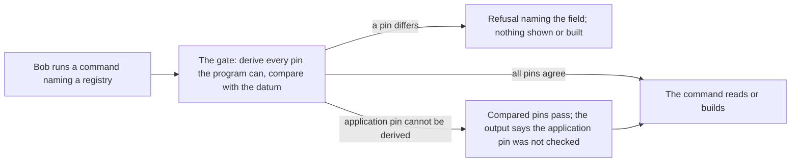

# An application gates every operation on the registry's pinned policies

Issue 730. This page is for the people who build on a registry (an application author, a third-party reader) and for the people who run the commands (Bob). It records the story, the trust model, the command table, the requirements and the refusals.

## Story

Mallory creates a genuine registry: a real state token, minted by the real contract. Its datum pins an "active" policy of her own, and she mints `alice` under it with a payload she chose. Bob is handed the registry's address. Whatever Bob runs, `open-datum inspect` for `alice`, any write, or a third-party reader built on our library, the registry is refused before anything about it is shown or built, and the refusal says which pinned policy is not the one the application derives. A registry with honest pins reads and works as today.

## The trust model

| Layer | What it guarantees | Who guarantees it |
| --- | --- | --- |
| The address | which registry: one state token under Singular's state policy, on that network | checksum and prefix (issue 728); the chain, which holds one such token and minted it from its seed |
| The datum's pinned policies | the four pinned policies never change after the registry is created: only the state contract spends the state output, and every fold preserves them | the state token and the state contract |
| Witness correctness | the pinned policies are the right ones for this application | the application, which applies its blueprint to the registry's identity and gates every operation, reads included, on the result |

Creation does not check the pins: they are chosen freely at boot, and the witness policy at minting checks only that its registry's state token is spent. So a token under a registry's pinned active policy means nothing until a reader has compared the pins with its own derivation. A reader that trusts the datum is shown whatever the registry's creator pinned: an always-true active policy lets its creator mint a token named after any key, with any payload, and the registry's own contracts will fold it. This ticket makes the comparison total in our programs and states it for everyone else.

## The commands

Each command that names a registry resolves it through the one gate before it prints a fact about the registry or builds a transaction. The right-hand column is the state after this ticket; the middle column was read from the code at the start of the ticket and each gap was confirmed there.

| Program and command | Where it resolves on main | After this ticket |
| --- | --- | --- |
| singular create, and its preview | no registry exists to resolve; after the boot it reads the new state output and reports its root without comparing the datum's pins | compares the new datum's four pins with the ones it built before it reports success; says the application pin was not checked against any blueprint when the creator gave the policy as a hash |
| singular fold, reject, reclaim | attaches, which resolves | unchanged gate; the output says the application pin was not checked |
| singular inspect, with or without a wallet address | resolves, except the report of an interrupted create, which prints the recorded identity, the tip and inclusion first | resolves first; a state token not yet on the chain is the one result that lets the report of an interrupted create go on, because no registry exists to be shown |
| singular describe | resolves, then prints the datum's application policy as if the release had derived it | resolves; prints the application policy among the registry's pinned policies, with its standing: not checked against any blueprint |
| singular submit | checks nothing about the registry its bundle names | resolves the registry the bundle names before the first send; a bundle that names none is refused unless it is a create bundle |
| singular wallet sign | offline: shows the registry name the bundle states | unchanged: it cannot read the chain; the line says the name is the writer's statement, and submit is where the bundle meets the chain |
| singular wallet create, wallet address | no registry | not applicable |
| open-datum create, and its preview | as singular create | as singular create, with the application pin derived, so all four pins are compared |
| open-datum insert, update, terminate, and their previews | reads the registry's mode from the datum first, without any check; an update on a registry whose datum classes it closed stops there | the gate runs first and the mode is the one the gate accepts; nothing is said about the registry before |
| open-datum fold | reads the mode first, as above | as above |
| open-datum inspect | reads the mode first, as above; the report of an interrupted create as in singular inspect | as above |

A pull request lists this table with the module and function where each command now resolves.

## Requirements

- gate-before-anything: a command in the table resolves its registry before any output about the registry and before any transaction is built; no read of the state datum comes before it, the choice of an application's mode included.
- refusal-names-the-field: a registry whose pinned policies differ is refused with the existing name registry-pin-mismatch and the field: application, active, absent or terminal.
- application-pin-always-compared-when-known: an application that knows its own script, whether it states it as a blueprint title applied to the registry, as a compiled script or as a hash, compares the application pin as well as the three witness pins.
- application-pin-unchecked-is-said: where the program cannot derive the application pin (`singular`, which takes it from the datum), every output that shows registry content says once that the application pin was not checked against any application's blueprint.
- mode-is-behind-the-gate: an open-datum registry is classed open or closed only by an application pin that equals one of the two derivations the gate makes; a datum matching neither is refused naming the application field.
- describe-does-not-borrow-the-release: describe never presents a value read from the datum as derived from the release.
- interrupted-create-is-gated: the report of an interrupted create resolves the state token first when it is on the chain.
- submit-gates-the-named-registry: submit resolves the registry its bundle names, with the release the user gives, before sending anything; the older bundles are accepted because the bundle format is unchanged and the user gives the release the registry was created under.
- create-reads-back-its-pins: create compares the pins of the datum it finds after the boot with the pins it built, and reports a partial outcome naming the field when they differ.
- honest-registry-unchanged: with honest pins every command behaves, prints and exits as before, apart from the sentence about the application pin where it applies.
- library-gate-is-usable-outside-the-commands: the function the commands call is exported from the library the commands use, documented with a worked example in the library reference.
- trust-model-is-published: the protocol page states the trust model above, in the reader's words, including what a reader that trusts the datum can be shown.
- pins-compared-once-per-command: the documentation states that pins are compared when a command resolves its registry and not again within the command, and why that is enough: every fold preserves them on chain.
- no-contract-change: nothing under the on-chain code, the Lean model or any script hash changes.

## Refusals

- registry-pin-mismatch FIELD: the datum's policy for that field differs from the one derived (existing).
- A bundle that names no registry and is not a create bundle: refused by submit before the chain is read.
- A bundle that names a registry, submitted without a release to derive from: refused before the chain is read.
- A create whose new datum pins differ from the pins it built: partial, naming the field, no root reported as success.

## Decisions

| Question | Chosen | Rejected, and why |
| --- | --- | --- |
| How does submit know which registry? | The bundle's state token field, with the release the user gives | Reading registry identity out of transaction bodies: the check would grow into a second transaction reader, and the bundle already names the registry for every command that has one |
| What of a bundle that names none? | Refused unless it is a create bundle, whose registry does not exist until it is sent | Refusing all: create bundles could not be submitted; accepting all: a writer could drop the name to skip the gate |
| How does open-datum learn its mode? | The gate accepts the datum only if its application pin equals the open or the closed derivation, and returns which | Keeping the early read and gating afterwards: a closed-looking forged datum would still be answered before the gate |
| Where does the unchecked-application statement live? | In the receipt of every command that shows registry content, once | A warning on a separate stream: a receipt is what readers keep |
| One pull request or two? | Two: the gate everywhere with offline rows and documentation first, then the hosted forged-pins row and its evidence | One: the hosted row needs a new harness and would hold a safety fix behind it |

## Limits

- The gate protects the programs that run it. Another reader of the chain must run the same comparison; the protocol page says so.
- Making the pins unforgeable at creation is on-chain hardening and is not in this ticket.
- The browser build does not exist on main; the gate stays a function of the portable library, and a ticket asks for the browser build to expose it.
- The registry name in a bundle is its writer's statement; submit checks the registry it names, not that the transactions act on it.
