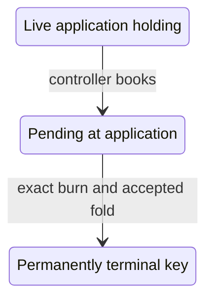

# Keep a pending termination at the application

As a controller, I want booking retirement to lock my genuine token and request together at the application until the same key is permanently retired. As an integrator, I want the controller's payment promises preserved when the application stops reading Singular's state and request scripts.

## Status and reading route

This is a hypothetical surface candidate under the 23 October ruling in [decisions.md](decisions.md). Accepted source facts bind revision `00771d77af996605845cf062285263909a049cf8`. The earlier [destination investigation](destination.md) remains history: transfer to a separate request script and the destination-name commitment are superseded. No accepted Lean, application or validator behavior changes. No general proof, policy execution, ledger transaction or composed acceptance is reported.

Read the source comparison below, then the frozen records in [data-model.md](data-model.md) and functions in [functions-model.md](functions-model.md). The operator resolved the [settlement story](questions.md#how-can-local-release-preserve-the-controllers-combined-payment) on 23 October: ruled root economics applies, and application release pays the protected deposits additively. The legacy registryPayments duty is removed. General candidate statements remain unproved.

## The pending state

A tagged pending output is distinct from a live holding even at the same application address. Booking spends the live output and creates a fresh pending output in that application family. It retains the complete genuine asset, protected control and payload; its request and trie-ready tag are checked through the accepted economic booking, rather than a second copy of its content rules. The root request contains exactly its declared tip plus carrier. Under the authorized value-partition amendment, the physical pending output contains that amount plus the retained protected deposit, as disjoint allocations. The root observer receives the request allocation; the local release observes the physical controller payments.

The accepted wire spend constructors are Update and Release. Update preserves Control, so there is no separate controller-change constructor to model. The candidate dispatch refuses both ordinary live spend constructors on pending output; only the dedicated pending-burn judgement can consume it. Rebooking refuses a pending source. These pending-path restrictions and the absence of cancellation are explicit unruled hypotheses, not additional operator rulings.

The two application states share an address family but occupy different economic categories. A public pending marker, complete token identity, exact root booking and authenticated public observations are discovery inputs; no booker's private file or folder signature is an input. An incomplete provider observation establishes no absence.

## Current booking and root economics

The bound application bookTerminateStep checks the terminating edge, pinned application, selected output, application address and active holding, key and registry binding, controller ownership and signature, and empty delivered destination. It appends a legacy approval-bearing request while leaving the application output, token and deposit untouched. It does not create the distinct pending-output state.

The bound root bookTermination instead calls terminationBookingRefusal, requires a fresh reference across both pending pools, removes the exact active custody holding and inserts the retained TerminationBooking. Admission checks the tip floor, no other assets, no refund or clock or application tag, exact declared lovelace, genuine registry/key singular tag, the exact bound trie-ready tag and its mint, active leaf, and the one actual custody input. This judgement executes no application's spending validator.

The candidate's physical pending output stays at the application; its economic projection nevertheless removes it from live custody and includes its actual retained booking in terminations. worldSingularSupply counts live custody plus the actual pending singular tags. The root fold's foldProjectedRegistry restores pending custody only for the mathematical registry transition; foldRegistryEffect removes the unspent pending holdings again. The selected pending output is consumed and its singular and trie-ready tags burn. Termination has no processing expiry, and its held-minus-tip amount goes to the treasury. None of these classifications is inferred by filtering an address.

## Every current release check and its replacement boundary

The table maps every release trace label derived from validRelease. The handler also requires a script payment credential, a found spending input and a decoded Envelope before these labelled checks; the hypothetical input observation must authenticate those facts. Each replacement is a candidate obligation, never a claim that the present scripts implement it.

| Current trace label | Current guarantee | Candidate guarantee or conflict |
|---|---|---|
| release-holding-token | The spent envelope carries exactly one own active token | Full held policy/name, quantity one and authenticated origin are bound to the pending record. |
| release-registry | Protected registry equals this application's parameter | Complete runtime registry/key/token binding replaces the parameter; authentic registration and observation correspondence remain explicit premises. |
| release-no-fold | Exactly one authenticated own registry Modify input | Named BurnCoupling premise binds this transaction to accepted same-registry, same-key terminal effect; it supplies no aggregate settlement guarantee. |
| release-not-pinned | The fold's application pin equals this script | Authenticated initial application holding plus controller-authorized pending transition; admission/correspondence debt remains, and no pin-free provenance follows from a copied datum. |
| release-active-policy | Protected active policy equals the fold's active pin | Derived complete witness identity and the explicit root-to-candidate asset correspondence. No policy-only recognition. |
| release-controller | Exactly one matching terminating row names this controller | Protected controller authorizes booking; pending control is retained. The burn premise binds that pending key and transaction. No controller signature gates the later fold. |
| release-burn | This precise active policy/key quantity is minus one | mintQty on the complete held candidate token is exactly minus one. |
| release-settlement | The authenticated fold supplies registry obligations and eligible settlement outputs | The operator removes the legacy registryPayments duty. Root termination donation and tip routing remain governed by the unchanged economic fold; local release protects the application deposits. |
| release-additive | Eligible controller payment covers registryOwed plus every deposit released by this application instance | The ruled replacement sums every protected deposit released by this application family for the controller. Physical outputs are indexed once, and the value-partition correspondence separates these deposits from root economic outputs. |
| release-no-termination | Exactly one non-rejected terminating row for this key | BurnCoupling names the accepted pending termination and terminal result for this registry/key; wrong-key and no-fold observations must violate it. |

registryOwed derives all ReturnDeposit duties through the registry's own dutiesOf, including rejected refunds and terminating rows. releasedTo sums every Release input at this application script for the same controller, rather than checking each input's deposit separately. settlesOf excludes the state credential and all delivered-token carriers. The local view of the held token, control and burn does not compute these other obligations or identify those carriers. An exact burn supplies no payment amount. The candidate separately checks the ruled additive application deposits; it does not claim equivalence to the removed legacy aggregate duty.

For example, released deposits of five and seven plus eleven owed by the fold require twenty-three eligible lovelace. Paying twelve covers the local deposits and fails the original combined duty. This is a source-derived discriminator, not an executed exploit. This contrast explains the operator's choice: the new local obligation is twelve, while root economics independently governs treasury and processor routing. The candidate does not call twelve equivalent to the legacy twenty-three.

## What burning establishes

The accepted active witness policy checks only that its full registry state is spent with Modify. It never inspects individual names or quantities. The state modify validator computes the keyed deltas and compares complete normalized mint maps. The terminal-kind pure-burn exception is inapplicable to an active holding. Thus same-key terminal coupling is a new explicit premise of the proposed shared policy, not a theorem about witness.ak.

FoldObservation is a separate hypothetical record of the existing accepted economic world, unspent observations, transaction and result. Minimal NoPin.TxView stays byte-identical. A named observation-correspondence premise connects them; it is debt to the accepted ledger/history vocabulary, not an invented ledger evaluator. Satisfying and violating instances must use the existing foldAccepted computation, with same-key, wrong-key and absent-fold cases.

## Availability and interaction limits

The accepted booked_termination_foldable theorem supplies an economic fold at any chosen time under reachable-world, pending-membership, processor willingness, ordinary funding covering the fee, and fee-within-tip premises. It explicitly excludes application release. The candidate reuses that economic result. Its additional physical construction retains every protected deposit in the inputs and routes those deposits additively to the physical controller outputs. The value-partition correspondence, genuine public observations, finite encoding/hash separation, and coherent asset mapping are explicit premises; availability of real funding, builder success and ledger inclusion are not established.

The permanent-key declaration Singular.Statements.termination and accepted batch no-remint effects remain the authority for future terminal states. They must be reused by exact name with their actual reachability and accepted-batch premises, not replaced by a bare name check. Cancellation and changes to the pending control or payload have no ruling. The provisional candidate exposes no such path, and keeps the question open.

## Identity results retained and consumer mappings reopened

All fifteen existing statement rows and their source declarations stay byte-identical. Complete-registry approval inversion and cross-registry refusal, same-transaction two-policy genesis, across-history spent-once, and the rejected name-only contrast keep their meanings. The existing role/name/provenance inversions and seed/role separation keep their finite-domain premises; they do not establish the new pending-state authenticity. The policy-only exclusion claim remains expected-refutable.

The simplified trie-ready and application role assets use only registry/role/key. They cannot stand for economic request tags containing the operation and nonce. New pending-authenticity rows must bind the actual terminationBookingRefusal, not relabel the old request-tag rows. Witness recognition gains a pending-state consumer but its old source statement is unchanged; live-versus-pending dispatch, exact burn coupling, supply projection, non-rejection and local payment statements are new obligations. No existing row is edited in place.

| Choice for the candidate | Alternative left behind | Reason |
|---|---|---|
| Application-held tagged pending output | Transfer to a separate request script and destination commitment | The recorded 23 October ruling supersedes that direction. |
| Reuse accepted economic booking and fold through a projection | A second economic transition or invented supply count | Accepted root obligations remain bound directly. |
| Apply the operator's deposit-only local settlement ruling | Preserve legacy registryPayments | Ruled economic routing governs the fold, and local release separately sums protected deposits. |

## Revision-bound source register

Each source link below names the immutable accepted revision and quotes the exact trimmed line. Citation integrity and the release-label mapping are source checks; they establish no behavioral execution. The corresponding new [impact rows](impact.md#application-held-termination-source-bindings) bind complete-file digests.

| Source fact | Exact quoted line |
|---|---|
| [Application booking](https://raw.githubusercontent.com/lambdasistemi/singular/00771d77af996605845cf062285263909a049cf8/applications/open-datum/lean/OpenDatumApplication/Model.lean#L431) | `def bookTerminateStep (w : World) (r : Request) (ref : Nat) (signatures : List Nat) :` |
| [Consumer combined payments](https://raw.githubusercontent.com/lambdasistemi/singular/00771d77af996605845cf062285263909a049cf8/applications/open-datum/lean/OpenDatumApplication/Model.lean#L532) | `def foldPayments (rows : List FoldRow) : List Payment :=` |
| [Consumer settlement](https://raw.githubusercontent.com/lambdasistemi/singular/00771d77af996605845cf062285263909a049cf8/applications/open-datum/lean/OpenDatumApplication/Model.lean#L538) | `def settleFold (law : Law) (rows : List FoldRow) (outputs : List TxOutput) : Option String :=` |
| [Live spend constructors](https://raw.githubusercontent.com/lambdasistemi/singular/00771d77af996605845cf062285263909a049cf8/applications/open-datum/onchain/validators/application/envelope.ak#L75) | `pub type OpenDatumSpend {` |
| [Application update](https://raw.githubusercontent.com/lambdasistemi/singular/00771d77af996605845cf062285263909a049cf8/applications/open-datum/onchain/validators/open_datum.ak#L365) | `fn validUpdate(control: Control, self: Output, tx: Transaction) -> Bool {` |
| [Application release](https://raw.githubusercontent.com/lambdasistemi/singular/00771d77af996605845cf062285263909a049cf8/applications/open-datum/onchain/validators/open_datum.ak#L620) | `fn validRelease(` |
| [Registry fold selection](https://raw.githubusercontent.com/lambdasistemi/singular/00771d77af996605845cf062285263909a049cf8/applications/open-datum/onchain/validators/open_datum.ak#L535) | `fn ownFold(` |
| [Registry obligations](https://raw.githubusercontent.com/lambdasistemi/singular/00771d77af996605845cf062285263909a049cf8/applications/open-datum/onchain/validators/open_datum.ak#L557) | `fn registryOwed(` |
| [Released deposit aggregate](https://raw.githubusercontent.com/lambdasistemi/singular/00771d77af996605845cf062285263909a049cf8/applications/open-datum/onchain/validators/open_datum.ak#L586) | `fn releasedTo(script: ByteArray, controller: ByteArray, tx: Transaction) -> Int {` |
| [Eligible settlement outputs](https://raw.githubusercontent.com/lambdasistemi/singular/00771d77af996605845cf062285263909a049cf8/onchain/lib/registry/settlement.ak#L138) | `pub fn settlesOf(` |
| [Witness policy](https://raw.githubusercontent.com/lambdasistemi/singular/00771d77af996605845cf062285263909a049cf8/onchain/validators/witness.ak#L48) | `validator witness(kind: Int, registry: ByteArray) {` |
| [Witness co-presence](https://raw.githubusercontent.com/lambdasistemi/singular/00771d77af996605845cf062285263909a049cf8/onchain/validators/witness.ak#L91) | `fn foldPresent(registry: ByteArray, tx: Transaction) -> Bool {` |
| [Keyed fold mint accounting](https://raw.githubusercontent.com/lambdasistemi/singular/00771d77af996605845cf062285263909a049cf8/onchain/lib/registry/modify.ak#L159) | `fn mintMatches(pins: State, expected: Value, mint: Value) -> Bool {` |
| [Termination admission](https://raw.githubusercontent.com/lambdasistemi/singular/00771d77af996605845cf062285263909a049cf8/lean/Singular/Economics/Termination.lean#L31) | `def terminationBookingRefusal (registry : RegistryState) (b : TerminationBooking) : Option String :=` |
| [Termination booking](https://raw.githubusercontent.com/lambdasistemi/singular/00771d77af996605845cf062285263909a049cf8/lean/Singular/Economics/WorldState.lean#L39) | `def bookTermination (world : World) (booking : TerminationBooking) : Except String World :=` |
| [Actual pending-token census](https://raw.githubusercontent.com/lambdasistemi/singular/00771d77af996605845cf062285263909a049cf8/lean/Singular/Economics/World.lean#L32) | `def carriedSingularCount (world : World) (key : Key) : Nat :=` |
| [World supply](https://raw.githubusercontent.com/lambdasistemi/singular/00771d77af996605845cf062285263909a049cf8/lean/Singular/Economics/World.lean#L40) | `def worldSingularSupply (world : World) (key : Key) : Nat :=` |
| [Fold projection](https://raw.githubusercontent.com/lambdasistemi/singular/00771d77af996605845cf062285263909a049cf8/lean/Singular/Economics/FoldProjection.lean#L56) | `def foldProjectedRegistry (world : World) : RegistryState :=` |
| [Fold consumption](https://raw.githubusercontent.com/lambdasistemi/singular/00771d77af996605845cf062285263909a049cf8/lean/Singular/Economics/Fold.lean#L43) | `def foldAccepted (world : World) (u : EconomicUtxo) (tx : EconomicTransaction) : Except String World :=` |
| [Termination routing](https://raw.githubusercontent.com/lambdasistemi/singular/00771d77af996605845cf062285263909a049cf8/lean/Singular/Economics/FoldProjection.lean#L28) | `def FoldMember.donation : FoldMember → Nat` |
| [Non-rejection admission](https://raw.githubusercontent.com/lambdasistemi/singular/00771d77af996605845cf062285263909a049cf8/lean/Singular/Economics/Rejection.lean#L39) | `def rejectionMemberRefusal (world : World) (interval : Interval)` |
| [Permissionless economic availability](https://raw.githubusercontent.com/lambdasistemi/singular/00771d77af996605845cf062285263909a049cf8/lean/Singular/Statements/FoldTermination.lean#L36) | `theorem booked_termination_foldable (world : World) (reachable : WorldReachable world)` |
| [Permanent retirement](https://raw.githubusercontent.com/lambdasistemi/singular/00771d77af996605845cf062285263909a049cf8/lean/Singular/Statements/Preservation.lean#L223) | `theorem termination (s : RegistryState) (key : Key) (h : Reachable s)` |
| [Ruled economics supersedes legacy payments](https://raw.githubusercontent.com/lambdasistemi/singular/00771d77af996605845cf062285263909a049cf8/.specify/memory/constitution.md#L106) | `These economic rows supersede the legacy rejection, retraction, payment and` |

The constitution explicitly supersedes legacy rejection, retraction, payment and transaction rules with the ruled economic rows. The bound consumer still computes registryPayments from those legacy duties, whereas the economic termination sends held-minus-tip to the treasury. This is a consumer/model conflict as well as a missing local observation. The 23 October operator ruling resolves this conflict in favor of ruled economics and additive protected deposits. A-003 authorizes a disjoint physical allocation: physical pending lovelace equals root contents plus the deposit; valuePartition removes the exact deposit slice from the physical input and controller output before the unchanged root fold. Composed availability is now a candidate statement, still unproved. No claim says observesTermination accepts an unprojected physical pending output.
