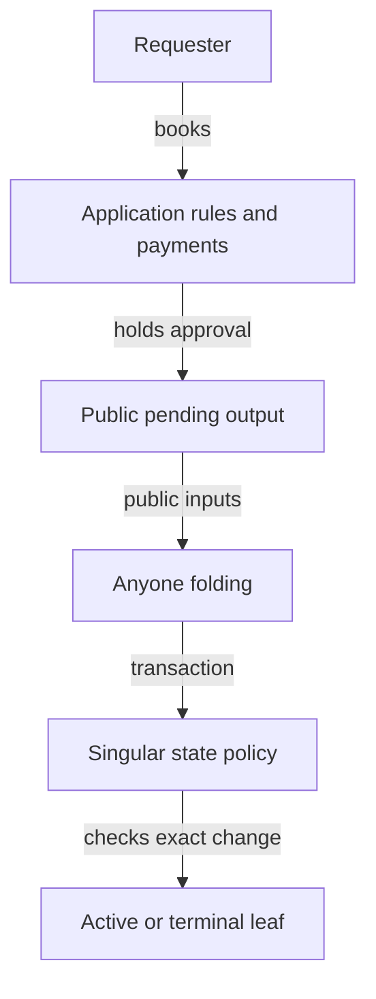
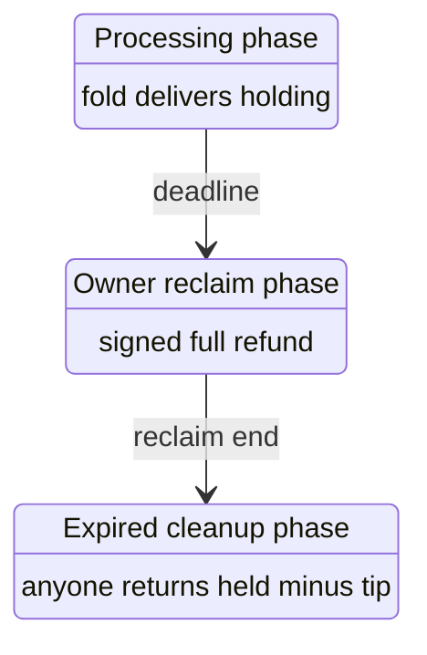

# Requests belong to the application

As a requester, I want my application to protect the deposit, refund and initial datum while anyone can fold an acceptable request. As a registry reader, I want Singular to authenticate the exact registry and token transition without inheriting the application's money rules.

## Status and reading route

This is a hypothetical surface candidate. No new theorem, accepted law, application law, validator behavior, ledger result or journey acceptance is claimed. Accepted source facts bind revision `00771d77af996605845cf062285263909a049cf8`; the candidate starts at `d4593f146ea5442c0ccec47f89684bb7cca2c836`. Read the responsibility diagram, the value and journey qualifications, then the exact records in [data-model.md](data-model.md#application-owned-request-records) and callables in [functions-model.md](functions-model.md#application-owned-request-callables). The earlier [held termination](application-held.md) and [shared request](shared-request.md) pages retain their historical meanings.

The frozen mandate is statements only. Every future general theorem remains an explicitly marked hypothesis with a sorry body; finite witnesses and mutation falsifications must be separate kernel-checked declarations. A matching source inventory is source evidence, never proof of a behavioral guarantee. Accepted root, application and implementation files remain unchanged.

## Responsibilities and trust boundaries

The application owns booking, request custody, reclaim and ADA routing. Singular authenticates the consumed approvals, state lineage, trie changes and exact active-token mint/burn. The folder needs no controller signature or private booking file. Real funding, proof availability and complete authenticated observations remain explicit premises; public data alone is not a promise of ledger inclusion.

| Candidate choice | Alternative retained as history | Reason |
|---|---|---|
| One state script applied to the application once per release | A request script specialized per registry or shared per release | Both request kinds now stay at the application. |
| Root-only state datum, with identity from the script and state-role token | Four policy pins plus request economic configuration in the datum | Each surviving use has a replacement owner in the inventory below. |
| Exact whole-state-policy mint map and one state continuation | A per-asset check that ignores other names under the policy | Extra mint, extra burn, counterfeit state and token stuffing must refuse. |
| Request value enforced by the application | Singular routing every request's ADA | The money-leaves-Singular ruling; the state output's own ADA floor remains. |

## The Singular surface

The published application minting policy and application payment script credential are distinct inputs. The state program is applied to the policy once per release; Singular authenticates operation approvals under that policy. Application booking, spending and discovery authenticate their output credential separately. No application-policy/address equality or derivation is assumed.

Genesis consumes its public seed once, executes the published application-bound state policy and mints only its role-separated state asset at quantity one into one state output at that script. That output contains only ADA and its own state token and commits the empty trie through the explicit trie commitment parameter. Seed uniqueness across accepted history and actual script application/hash correspondence remain upstream premises.

A fold authenticates its spent state token by the structured state-role preimage and its complete policy/name identity, not by the script address, copied root datum or policy alone. Its redeemer supplies the seed; a PublicRegistry observation binds that seed to public genesis data. The new state-role and active-role constructors are distinct. A finite occurring-domain serialization premise and a separate finite collision premise prevent a fold-minted active token from satisfying state recognition. Providing the seed is not a hash inversion procedure: a provider must expose the needed public genesis data, or liveness lacks that input.

The batch is nonempty. Every supplied change pairs with exactly one consumed approval-bearing application request, with distinct input references; there is no missing or surplus action. A registration changes an unknown leaf to active, consumes and burns the exact registration approval, and mints one derived active token into the approval-committed new holding address with its initial datum. A termination consumes the approval and its held genuine active token, burns both, and changes that same active leaf to terminal. A holding created by the batch cannot be consumed by its termination. Every other mint or burn under the state policy is zero, including state-token mint/burn on the fold path. Conservation and the exact observed input/output map bind placement; list membership alone is insufficient.

Exactly one state continuation stays at its script with exactly one same state token, the computed batch root, no foreign asset, and at least the spent state ADA. No request ADA, minimum tip, refund, donation or application deposit appears in Singular's admission. Its permanent-key and supply statements must quantify over actual reachable candidate histories and actual token counts. The accepted permanent-key statements are reused by name only through a declared logical projection satisfying their real reachability and successful-batch premises; the accepted FNV root is never used to name a candidate asset.

## Application request and value surfaces

A registration request is one public application output holding exactly one registration approval and its booked data: complete registry, key, controller/refund address, initial holding address and datum, required deposit, booked deadline and declared value allocations. The approval preimage commits the operation, complete registry, key, holding address and initial datum. Booking authorization and immutable request-data provenance belong to the application. A freely burnable approval grants nothing on its own.

A termination request is one output at the application with empty datum, one termination approval and one genuine active token. The approval preimage commits termination, key and the complete registry. Booking is an application operation: the controller authorizes it, its protected deposit is settled at booking, and Singular does nothing. The pending request spends without a controller/folder signature only when its exact held active token burns in the same transaction. Live payload update and ordinary live release cannot consume that pending request. No cancellation or top-up path is invented.

The generic folder remainder is request ADA minus the application-enforced retained/payment allocation. It need not equal the old declared tip: if a request has an extra three ADA beyond those allocations, the market remainder is the old tip plus three. Equality to the old declared tip is an application-specific exact-allocation condition; it is not a Singular guarantee. For registration the holding keeps its committed datum, genuine token and at least the application's deposit. Application-required treasury payments reduce the remainder. For termination, the protected deposit already returned at booking. Open datum enforces the treasury share at fold and caps the request remainder by its fixed release tip; a generic application may impose different value rules.

The decided open-datum rule holds registration cost pending and pays that share to the treasury at fold through its request spending rule, allowing full owner reclaim to return the cost too. The rejected immediate-payment-at-booking contrast exposes why: with cost ten, tip two and carrier five, the old reclaim owes seventeen, while paying ten away first leaves seven. There is no such missing amount under the decided pending-cost rule. Termination booking returns the protected deposit; the pending request holds the bid and treasury share, and its application spending rule enforces that share at fold. Both request kinds therefore pay the treasury at fold. The empty termination datum cannot authenticate the accepted per-request variable split: held ten with declared tip two or three has different old treasury shares but the same new output. The ticket owner selected a fixed application release tip and requires that variable-tip result explicitly restated. With a fixed tip two, both requests now yield two/eight, so the old three/seven result is not called equal. The candidate must still state and prove these allocation obligations; the bound implementation is unchanged.

The application fixes the processing deadline and reclaim end at booking. Fold intervals end by the processing deadline; signed reclaim intervals start at that deadline and end by the reclaim end; permissionless cleanup intervals start at reclaim end. Nonempty validity intervals make these phases disjoint. Reclaim returns everything held; expired cleanup returns held minus the declared tip to the refund address, and the cleaner receives that tip. This preserves the old three outcomes without a Singular rejection handler. The resolved comparison is recorded in [questions.md](questions.md#reclaim-and-the-old-expiry-outcome). Whether a top-up path is needed remains open: a requester may fold its own acceptable request under the same public-data and ordinary-funding premises, but neither willingness nor actual funding is proved by that observation.

If a registration remains unspent, the diagram shows which phase its booked times permit next. Spending ends that pending request: folding delivers the holding, reclaim returns everything, and cleanup returns held minus tip. These spends are alternatives under disjoint interval tests. A termination instead moves from live holding to empty-datum pending request through controller-authorized booking, then to a terminal key through the exact held-token burn. Its protected deposit returns on the first transition, and the treasury and fixed folder allocation settle on the second.

## Every application journey

The source-derived constructor inventory below retains refused actions as well as successful journeys. Create is the separate accepted genesis function, rather than an AppAction constructor. Old-versus-new means accepted economic rules plus the recorded deposit/controller rulings; legacy registryPayments is not the baseline. Every changed outcome is exposed, never hidden inside the relation's preconditions. Registration retains its old phases and allocations; the fixed termination tip explicitly restates the old variable-tip result.

| Accepted application constructor | Candidate journey and equivalence disposition |
|---|---|
| `AppAction.bookInsert` | Registration booking: controller authorization and exact initial holding datum/deposit survive; the application holds approval plus cost, bid and carrier until fold. Treasury payment occurs at fold. |
| `AppAction.bookTerminate` | Termination booking: controller signs, the protected deposit is returned at booking, and the genuine active token plus termination approval remain at the application with an empty datum. The application request spending rule enforces the treasury share at fold. |
| `AppAction.bookOther` | Refused unsupported certification stays refused: only registration and termination approvals have constructors in the new candidate. |
| `AppAction.update` | Live payload update: controller signs, one successor retains complete control, assets and deposit. No Singular state is read or spent; a pending termination cannot use this path. |
| `AppAction.fold` | Registration/termination fold: same accepted logical transitions and committed holding; application request rules enforce cost/deposit/treasury flows. Registration retains its declared tip; termination uses the fixed application release tip as an explicit changed outcome. |
| `AppAction.reject` | Request exits move to the application: signed reclaim returns everything in its booked window; after expiry anyone may clean up and must return held minus tip. State is not spent. |
| `AppAction.withdraw` | An arbitrary live holding withdrawal stays refused. Registration owner reclaim is a separate new request exit; it must not be mistaken for this refused live-output constructor. |

Create preserves an empty permanent registry under the same release/application binding, with state ADA supplied by its creator; there is no new treasury payment or ownership right inferred. Successful registration compares the treasury cost, folder allocation and protected holding under exact application allocations. Update preserves controller, control, assets and deposit and changes only the payload. Termination compares the combined booking-plus-fold journey, with deposit returned at booking and the application enforcing treasury allocation at fold; the fixed-tip exception is restated explicitly. Reclaim compares actual admitted intervals and amounts; the decided three-phase schedule preserves its full-refund and permissionless-expired-cleanup outcomes.

## State fields and their replacement owners

The declaration of Singular.Config supplies the field extent. The source tool inventories 178 source files, including proofs, serializers, examples and Aiken fixtures. The inventory contains 885 field/file/enclosing-declaration triples, including conservative whole-record equality and copy bindings as well as direct field identifiers. To avoid silently dropping a use, this is a conservative lexical superset: it also retains homonymous application-control fields and functions such as a root accessor. It does not claim inferred field types or call-graph semantics. The reason on every row is the new owner of that field's obligation; a fixture or proof occurrence needs restatement with its governing declaration, not a production datum read.

Lean's minimumTip maps to Aiken State.tip (wire maxFee); processTime and retractTime map to process_time and retract_time. The application and witness pins map to application_policy, active_policy, absent_policy and terminal_policy. Root maps to root. Accepted registryId is an abstract Lean identity: Aiken State stores no such field and authenticates identity from its input and validator parameters. Registration cost and booking width have no accepted Aiken State fields; their economic rules exist in Lean. The application Control.activePolicy is a protected full-asset input, a homonymous retained use rather than an extra State field.

Only the root's datum read survives unchanged. Application-policy and active-policy obligations survive through the state script parameter, its own policy and runtime full identities, so merely deleting their checks would be wrong. Registry identity survives as the observed state-role asset. Timing, bid, cost and width leave the Singular datum only with their application owners and decided journey relations explicit. The two excluded-kind pins have no admitted token effect; their preserved historical checks do not create a new obligation to mint those kinds. Thus every non-root storage field is a conditional drop candidate, never an authorization to drop the surviving semantic obligation.

Open datum preserves registration cost, minimum tip, processing and reclaim durations, and booking width in one immutable application configuration output per registry. Its application-policy asset name hashes a separate configuration-role constructor with the complete registry. The output is created with that registry's genuine state-role genesis mint, carries the five parameters inline, and cannot be spent or removed. Registration booking references and authenticates it, then checks cost, tip floor, booked time and interval width and computes both deadlines from its parameters. The old-Config-to-record relation preserves the same values; a controller cannot replace the expected cost or window with another request field. Clients derive its token name by hashing and read the record from public chain data. Configuration metadata is under the application policy and is not a Singular request tag. The termination tip remains the application's separate release constant.

| Field | Source file | Enclosing declaration | Disposition | Reason |
|---|---|---|---|---|
| `root` | `applications/open-datum/lean/OpenDatumApplication/Driver.lean` | `OpenDatumApplication.Driver.cfg0` | kept | Keep the authenticated trie commitment in the state datum; new commitment is an explicit parameter, never the accepted FNV stand-in. |
| `minimumTip` | `applications/open-datum/lean/OpenDatumApplication/Driver.lean` | `OpenDatumApplication.Driver.cfg0` | moved | The application owns declared bids and refund allocations; Singular reads no request ADA or configured tip. |
| `processTime` | `applications/open-datum/lean/OpenDatumApplication/Driver.lean` | `OpenDatumApplication.Driver.cfg0` | moved | The application owns the booked registration fold deadline; timing does not enter the Singular fold law. |
| `retractTime` | `applications/open-datum/lean/OpenDatumApplication/Driver.lean` | `OpenDatumApplication.Driver.cfg0` | moved | The application retains the booked finite reclaim window and permissionless post-expiry cleanup; Singular has no such exit. |
| `applicationPolicy` | `applications/open-datum/lean/OpenDatumApplication/Driver.lean` | `OpenDatumApplication.Driver.cfg0` | reexpressed | Approval-policy identity survives as the one application parameter of the state program; no datum pin is read. |
| `activePolicy` | `applications/open-datum/lean/OpenDatumApplication/Driver.lean` | `OpenDatumApplication.Driver.cfg0` | reexpressed | The genuine active asset is under the current state policy with a structured active-role name; protected application control retains the complete asset. |
| `absentPolicy` | `applications/open-datum/lean/OpenDatumApplication/Driver.lean` | `OpenDatumApplication.Driver.cfg0` | retired | No admitted absent edge or absent-token mint remains; historical refusal, fixture and preservation uses do not justify a new datum pin. |
| `terminalPolicy` | `applications/open-datum/lean/OpenDatumApplication/Driver.lean` | `OpenDatumApplication.Driver.cfg0` | retired | Terminal is a permanent trie leaf, with no terminal witness asset; historical refusal and preservation uses introduce no new pin. |
| `activePolicy` | `applications/open-datum/lean/OpenDatumApplication/Driver.lean` | `OpenDatumApplication.Driver.envelopeFor` | reexpressed | The genuine active asset is under the current state policy with a structured active-role name; protected application control retains the complete asset. |
| `activePolicy` | `applications/open-datum/lean/OpenDatumApplication/Model.lean` | `OpenDatumApplication.Control` | reexpressed | The genuine active asset is under the current state policy with a structured active-role name; protected application control retains the complete asset. |
| `activePolicy` | `applications/open-datum/lean/OpenDatumApplication/Model.lean` | `OpenDatumApplication.controlFields` | reexpressed | The genuine active asset is under the current state policy with a structured active-role name; protected application control retains the complete asset. |
| `root` | `applications/open-datum/lean/OpenDatumApplication/Model.lean` | `OpenDatumApplication.genesis` | kept | Keep the authenticated trie commitment in the state datum; new commitment is an explicit parameter, never the accepted FNV stand-in. |
| `minimumTip` | `applications/open-datum/lean/OpenDatumApplication/Model.lean` | `OpenDatumApplication.genesis` | moved | Whole-record comparison/copy includes this field. The application owns declared bids and refund allocations; Singular reads no request ADA or configured tip. |
| `processTime` | `applications/open-datum/lean/OpenDatumApplication/Model.lean` | `OpenDatumApplication.genesis` | moved | Whole-record comparison/copy includes this field. The application owns the booked registration fold deadline; timing does not enter the Singular fold law. |
| `retractTime` | `applications/open-datum/lean/OpenDatumApplication/Model.lean` | `OpenDatumApplication.genesis` | moved | Whole-record comparison/copy includes this field. The application retains the booked finite reclaim window and permissionless post-expiry cleanup; Singular has no such exit. |
| `applicationPolicy` | `applications/open-datum/lean/OpenDatumApplication/Model.lean` | `OpenDatumApplication.genesis` | reexpressed | Whole-record comparison/copy includes this field. Approval-policy identity survives as the one application parameter of the state program; no datum pin is read. |
| `activePolicy` | `applications/open-datum/lean/OpenDatumApplication/Model.lean` | `OpenDatumApplication.genesis` | reexpressed | Whole-record comparison/copy includes this field. The genuine active asset is under the current state policy with a structured active-role name; protected application control retains the complete asset. |
| `absentPolicy` | `applications/open-datum/lean/OpenDatumApplication/Model.lean` | `OpenDatumApplication.genesis` | retired | Whole-record comparison/copy includes this field. No admitted absent edge or absent-token mint remains; historical refusal, fixture and preservation uses do not justify a new datum pin. |
| `terminalPolicy` | `applications/open-datum/lean/OpenDatumApplication/Model.lean` | `OpenDatumApplication.genesis` | retired | Whole-record comparison/copy includes this field. Terminal is a permanent trie leaf, with no terminal witness asset; historical refusal and preservation uses introduce no new pin. |
| `registryId` | `applications/open-datum/lean/OpenDatumApplication/Model.lean` | `OpenDatumApplication.genesis` | reexpressed | Whole-record comparison/copy includes this field. Complete registry identity is authenticated from the state-role token and its policy, and bound in approvals; no abstract registryId datum field remains. |
| `registrationCost` | `applications/open-datum/lean/OpenDatumApplication/Model.lean` | `OpenDatumApplication.genesis` | moved | Whole-record comparison/copy includes this field. The application retains the cost pending registration and enforces treasury payment at fold; owner reclaim returns the cost too. |
| `bookingWidth` | `applications/open-datum/lean/OpenDatumApplication/Model.lean` | `OpenDatumApplication.genesis` | moved | Whole-record comparison/copy includes this field. Booking time and width are application request rules; their old guarantees are compared under the ruled journey relation. |
| `applicationPolicy` | `applications/open-datum/lean/OpenDatumApplication/Model.lean` | `OpenDatumApplication.bookInsertStep` | reexpressed | Approval-policy identity survives as the one application parameter of the state program; no datum pin is read. |
| `activePolicy` | `applications/open-datum/lean/OpenDatumApplication/Model.lean` | `OpenDatumApplication.bookInsertStep` | reexpressed | The genuine active asset is under the current state policy with a structured active-role name; protected application control retains the complete asset. |
| `applicationPolicy` | `applications/open-datum/lean/OpenDatumApplication/Model.lean` | `OpenDatumApplication.bookTerminateStep` | reexpressed | Approval-policy identity survives as the one application parameter of the state program; no datum pin is read. |
| `applicationPolicy` | `applications/open-datum/lean/OpenDatumApplication/ProofSupport.lean` | `OpenDatumApplication.ProofSupport.step_app_edge` | reexpressed | Approval-policy identity survives as the one application parameter of the state program; no datum pin is read. |
| `applicationPolicy` | `applications/open-datum/lean/OpenDatumApplication/ProofSupport.lean` | `OpenDatumApplication.ProofSupport.foldActions_key` | reexpressed | Approval-policy identity survives as the one application parameter of the state program; no datum pin is read. |
| `applicationPolicy` | `applications/open-datum/lean/OpenDatumApplication/ProofSupport.lean` | `OpenDatumApplication.ProofSupport.fold_shape` | reexpressed | Approval-policy identity survives as the one application parameter of the state program; no datum pin is read. |
| `applicationPolicy` | `applications/open-datum/lean/OpenDatumApplication/ProofSupport.lean` | `OpenDatumApplication.ProofSupport.booked_insert_refusal` | reexpressed | Approval-policy identity survives as the one application parameter of the state program; no datum pin is read. |
| `root` | `applications/open-datum/lean/OpenDatumApplication/ProofSupport.lean` | `OpenDatumApplication.ProofSupport.consistentB_iff` | kept | Whole-record comparison/copy includes this field. Keep the authenticated trie commitment in the state datum; new commitment is an explicit parameter, never the accepted FNV stand-in. |
| `minimumTip` | `applications/open-datum/lean/OpenDatumApplication/ProofSupport.lean` | `OpenDatumApplication.ProofSupport.consistentB_iff` | moved | Whole-record comparison/copy includes this field. The application owns declared bids and refund allocations; Singular reads no request ADA or configured tip. |
| `processTime` | `applications/open-datum/lean/OpenDatumApplication/ProofSupport.lean` | `OpenDatumApplication.ProofSupport.consistentB_iff` | moved | Whole-record comparison/copy includes this field. The application owns the booked registration fold deadline; timing does not enter the Singular fold law. |
| `retractTime` | `applications/open-datum/lean/OpenDatumApplication/ProofSupport.lean` | `OpenDatumApplication.ProofSupport.consistentB_iff` | moved | Whole-record comparison/copy includes this field. The application retains the booked finite reclaim window and permissionless post-expiry cleanup; Singular has no such exit. |
| `applicationPolicy` | `applications/open-datum/lean/OpenDatumApplication/ProofSupport.lean` | `OpenDatumApplication.ProofSupport.consistentB_iff` | reexpressed | Whole-record comparison/copy includes this field. Approval-policy identity survives as the one application parameter of the state program; no datum pin is read. |
| `activePolicy` | `applications/open-datum/lean/OpenDatumApplication/ProofSupport.lean` | `OpenDatumApplication.ProofSupport.consistentB_iff` | reexpressed | Whole-record comparison/copy includes this field. The genuine active asset is under the current state policy with a structured active-role name; protected application control retains the complete asset. |
| `absentPolicy` | `applications/open-datum/lean/OpenDatumApplication/ProofSupport.lean` | `OpenDatumApplication.ProofSupport.consistentB_iff` | retired | Whole-record comparison/copy includes this field. No admitted absent edge or absent-token mint remains; historical refusal, fixture and preservation uses do not justify a new datum pin. |
| `terminalPolicy` | `applications/open-datum/lean/OpenDatumApplication/ProofSupport.lean` | `OpenDatumApplication.ProofSupport.consistentB_iff` | retired | Whole-record comparison/copy includes this field. Terminal is a permanent trie leaf, with no terminal witness asset; historical refusal and preservation uses introduce no new pin. |
| `registryId` | `applications/open-datum/lean/OpenDatumApplication/ProofSupport.lean` | `OpenDatumApplication.ProofSupport.consistentB_iff` | reexpressed | Whole-record comparison/copy includes this field. Complete registry identity is authenticated from the state-role token and its policy, and bound in approvals; no abstract registryId datum field remains. |
| `registrationCost` | `applications/open-datum/lean/OpenDatumApplication/ProofSupport.lean` | `OpenDatumApplication.ProofSupport.consistentB_iff` | moved | Whole-record comparison/copy includes this field. The application retains the cost pending registration and enforces treasury payment at fold; owner reclaim returns the cost too. |
| `bookingWidth` | `applications/open-datum/lean/OpenDatumApplication/ProofSupport.lean` | `OpenDatumApplication.ProofSupport.consistentB_iff` | moved | Whole-record comparison/copy includes this field. Booking time and width are application request rules; their old guarantees are compared under the ruled journey relation. |
| `applicationPolicy` | `applications/open-datum/lean/OpenDatumApplication/Statements.lean` | `OpenDatumApplication.Statements.bookInsert_inversion` | reexpressed | Approval-policy identity survives as the one application parameter of the state program; no datum pin is read. |
| `activePolicy` | `applications/open-datum/lean/OpenDatumApplication/Statements.lean` | `OpenDatumApplication.Statements.bookInsert_inversion` | reexpressed | The genuine active asset is under the current state policy with a structured active-role name; protected application control retains the complete asset. |
| `applicationPolicy` | `applications/open-datum/lean/OpenDatumApplication/Statements.lean` | `OpenDatumApplication.Statements.bookTerminate_inversion` | reexpressed | Approval-policy identity survives as the one application parameter of the state program; no datum pin is read. |
| `root` | `applications/open-datum/lean/OpenDatumApplication/Statements.lean` | `OpenDatumApplication.Statements.genesis_consistent` | kept | Keep the authenticated trie commitment in the state datum; new commitment is an explicit parameter, never the accepted FNV stand-in. |
| `minimumTip` | `applications/open-datum/lean/OpenDatumApplication/Statements.lean` | `OpenDatumApplication.Statements.genesis_consistent` | moved | Whole-record comparison/copy includes this field. The application owns declared bids and refund allocations; Singular reads no request ADA or configured tip. |
| `processTime` | `applications/open-datum/lean/OpenDatumApplication/Statements.lean` | `OpenDatumApplication.Statements.genesis_consistent` | moved | Whole-record comparison/copy includes this field. The application owns the booked registration fold deadline; timing does not enter the Singular fold law. |
| `retractTime` | `applications/open-datum/lean/OpenDatumApplication/Statements.lean` | `OpenDatumApplication.Statements.genesis_consistent` | moved | Whole-record comparison/copy includes this field. The application retains the booked finite reclaim window and permissionless post-expiry cleanup; Singular has no such exit. |
| `applicationPolicy` | `applications/open-datum/lean/OpenDatumApplication/Statements.lean` | `OpenDatumApplication.Statements.genesis_consistent` | reexpressed | Whole-record comparison/copy includes this field. Approval-policy identity survives as the one application parameter of the state program; no datum pin is read. |
| `activePolicy` | `applications/open-datum/lean/OpenDatumApplication/Statements.lean` | `OpenDatumApplication.Statements.genesis_consistent` | reexpressed | Whole-record comparison/copy includes this field. The genuine active asset is under the current state policy with a structured active-role name; protected application control retains the complete asset. |
| `absentPolicy` | `applications/open-datum/lean/OpenDatumApplication/Statements.lean` | `OpenDatumApplication.Statements.genesis_consistent` | retired | Whole-record comparison/copy includes this field. No admitted absent edge or absent-token mint remains; historical refusal, fixture and preservation uses do not justify a new datum pin. |
| `terminalPolicy` | `applications/open-datum/lean/OpenDatumApplication/Statements.lean` | `OpenDatumApplication.Statements.genesis_consistent` | retired | Whole-record comparison/copy includes this field. Terminal is a permanent trie leaf, with no terminal witness asset; historical refusal and preservation uses introduce no new pin. |
| `registryId` | `applications/open-datum/lean/OpenDatumApplication/Statements.lean` | `OpenDatumApplication.Statements.genesis_consistent` | reexpressed | Whole-record comparison/copy includes this field. Complete registry identity is authenticated from the state-role token and its policy, and bound in approvals; no abstract registryId datum field remains. |
| `registrationCost` | `applications/open-datum/lean/OpenDatumApplication/Statements.lean` | `OpenDatumApplication.Statements.genesis_consistent` | moved | Whole-record comparison/copy includes this field. The application retains the cost pending registration and enforces treasury payment at fold; owner reclaim returns the cost too. |
| `bookingWidth` | `applications/open-datum/lean/OpenDatumApplication/Statements.lean` | `OpenDatumApplication.Statements.genesis_consistent` | moved | Whole-record comparison/copy includes this field. Booking time and width are application request rules; their old guarantees are compared under the ruled journey relation. |
| `applicationPolicy` | `applications/open-datum/onchain/validators/open_datum.ak` | `open_datum` | reexpressed | Approval-policy identity survives as the one application parameter of the state program; no datum pin is read. |
| `activePolicy` | `applications/open-datum/onchain/validators/open_datum.ak` | `bookInsert` | reexpressed | The genuine active asset is under the current state policy with a structured active-role name; protected application control retains the complete asset. |
| `activePolicy` | `applications/open-datum/onchain/validators/open_datum.ak` | `bookTerminate` | reexpressed | The genuine active asset is under the current state policy with a structured active-role name; protected application control retains the complete asset. |
| `minimumTip` | `applications/open-datum/onchain/validators/open_datum.ak` | `rowDuties` | moved | The application owns declared bids and refund allocations; Singular reads no request ADA or configured tip. |
| `applicationPolicy` | `applications/open-datum/onchain/validators/open_datum.ak` | `validRelease` | reexpressed | Approval-policy identity survives as the one application parameter of the state program; no datum pin is read. |
| `activePolicy` | `applications/open-datum/onchain/validators/open_datum.ak` | `validRelease` | reexpressed | The genuine active asset is under the current state policy with a structured active-role name; protected application control retains the complete asset. |
| `root` | `applications/open-datum/onchain/validators/open_datum.tests.ak` | `stateOutputAt` | kept | Keep the authenticated trie commitment in the state datum; new commitment is an explicit parameter, never the accepted FNV stand-in. |
| `root` | `applications/open-datum/onchain/validators/open_datum.tests.ak` | `stateInputWith` | kept | Keep the authenticated trie commitment in the state datum; new commitment is an explicit parameter, never the accepted FNV stand-in. |
| `minimumTip` | `applications/open-datum/onchain/validators/open_datum.tests.ak` | `requestOutput` | moved | The application owns declared bids and refund allocations; Singular reads no request ADA or configured tip. |
| `applicationPolicy` | `applications/open-datum/onchain/validators/open_datum.tests.ak` | `insert_booking_state_of_other_application_refuses` | reexpressed | Approval-policy identity survives as the one application parameter of the state program; no datum pin is read. |
| `applicationPolicy` | `applications/open-datum/onchain/validators/open_datum.tests.ak` | `release_under_a_state_pinning_another_application_refuses` | reexpressed | Approval-policy identity survives as the one application parameter of the state program; no datum pin is read. |
| `applicationPolicy` | `applications/open-datum/onchain/validators/open_datum.tests.ak` | `stateTwo` | reexpressed | Approval-policy identity survives as the one application parameter of the state program; no datum pin is read. |
| `activePolicy` | `applications/open-datum/onchain/validators/open_datum.tests.ak` | `stateTwo` | reexpressed | The genuine active asset is under the current state policy with a structured active-role name; protected application control retains the complete asset. |
| `root` | `applications/open-datum/onchain/validators/open_datum.tests.ak` | `continuationTwo` | kept | Keep the authenticated trie commitment in the state datum; new commitment is an explicit parameter, never the accepted FNV stand-in. |
| `minimumTip` | `applications/open-datum/onchain/validators/open_datum.tests.ak` | `requestTwo` | moved | The application owns declared bids and refund allocations; Singular reads no request ADA or configured tip. |
| `processTime` | `lean/DriverMain.lean` | `windowState` | moved | The application owns the booked registration fold deadline; timing does not enter the Singular fold law. |
| `root` | `lean/DriverMain/Fixtures.lean` | `cfg0` | kept | Keep the authenticated trie commitment in the state datum; new commitment is an explicit parameter, never the accepted FNV stand-in. |
| `minimumTip` | `lean/DriverMain/Fixtures.lean` | `cfg0` | moved | The application owns declared bids and refund allocations; Singular reads no request ADA or configured tip. |
| `processTime` | `lean/DriverMain/Fixtures.lean` | `cfg0` | moved | The application owns the booked registration fold deadline; timing does not enter the Singular fold law. |
| `retractTime` | `lean/DriverMain/Fixtures.lean` | `cfg0` | moved | The application retains the booked finite reclaim window and permissionless post-expiry cleanup; Singular has no such exit. |
| `applicationPolicy` | `lean/DriverMain/Fixtures.lean` | `cfg0` | reexpressed | Approval-policy identity survives as the one application parameter of the state program; no datum pin is read. |
| `activePolicy` | `lean/DriverMain/Fixtures.lean` | `cfg0` | reexpressed | The genuine active asset is under the current state policy with a structured active-role name; protected application control retains the complete asset. |
| `absentPolicy` | `lean/DriverMain/Fixtures.lean` | `cfg0` | retired | No admitted absent edge or absent-token mint remains; historical refusal, fixture and preservation uses do not justify a new datum pin. |
| `terminalPolicy` | `lean/DriverMain/Fixtures.lean` | `cfg0` | retired | Terminal is a permanent trie leaf, with no terminal witness asset; historical refusal and preservation uses introduce no new pin. |
| `processTime` | `lean/DriverMain/Fixtures.lean` | `sTimed` | moved | The application owns the booked registration fold deadline; timing does not enter the Singular fold law. |
| `retractTime` | `lean/DriverMain/Fixtures.lean` | `sTimed` | moved | The application retains the booked finite reclaim window and permissionless post-expiry cleanup; Singular has no such exit. |
| `root` | `lean/DriverMain/Fixtures.lean` | `absentState` | kept | Keep the authenticated trie commitment in the state datum; new commitment is an explicit parameter, never the accepted FNV stand-in. |
| `root` | `lean/LifecycleMain.lean` | `maintenanceRows` | kept | Keep the authenticated trie commitment in the state datum; new commitment is an explicit parameter, never the accepted FNV stand-in. |
| `root` | `lean/LifecycleMain.lean` | `recoveryRows` | kept | Keep the authenticated trie commitment in the state datum; new commitment is an explicit parameter, never the accepted FNV stand-in. |
| `activePolicy` | `lean/LifecycleMain.lean` | `initializationRows` | reexpressed | The genuine active asset is under the current state policy with a structured active-role name; protected application control retains the complete asset. |
| `terminalPolicy` | `lean/LifecycleMain.lean` | `initializationRows` | retired | Terminal is a permanent trie leaf, with no terminal witness asset; historical refusal and preservation uses introduce no new pin. |
| `root` | `lean/M1Main.lean` | `PermanentCorpus.config` | kept | Keep the authenticated trie commitment in the state datum; new commitment is an explicit parameter, never the accepted FNV stand-in. |
| `minimumTip` | `lean/M1Main.lean` | `PermanentCorpus.config` | moved | The application owns declared bids and refund allocations; Singular reads no request ADA or configured tip. |
| `processTime` | `lean/M1Main.lean` | `PermanentCorpus.config` | moved | The application owns the booked registration fold deadline; timing does not enter the Singular fold law. |
| `retractTime` | `lean/M1Main.lean` | `PermanentCorpus.config` | moved | The application retains the booked finite reclaim window and permissionless post-expiry cleanup; Singular has no such exit. |
| `applicationPolicy` | `lean/M1Main.lean` | `PermanentCorpus.config` | reexpressed | Approval-policy identity survives as the one application parameter of the state program; no datum pin is read. |
| `activePolicy` | `lean/M1Main.lean` | `PermanentCorpus.config` | reexpressed | The genuine active asset is under the current state policy with a structured active-role name; protected application control retains the complete asset. |
| `absentPolicy` | `lean/M1Main.lean` | `PermanentCorpus.config` | retired | No admitted absent edge or absent-token mint remains; historical refusal, fixture and preservation uses do not justify a new datum pin. |
| `terminalPolicy` | `lean/M1Main.lean` | `PermanentCorpus.config` | retired | Terminal is a permanent trie leaf, with no terminal witness asset; historical refusal and preservation uses introduce no new pin. |
| `applicationPolicy` | `lean/M1Main.lean` | `PermanentCorpus.request` | reexpressed | Approval-policy identity survives as the one application parameter of the state program; no datum pin is read. |
| `minimumTip` | `lean/Main.lean` | `registrationConfig` | moved | The application owns declared bids and refund allocations; Singular reads no request ADA or configured tip. |
| `processTime` | `lean/Main.lean` | `registrationConfig` | moved | The application owns the booked registration fold deadline; timing does not enter the Singular fold law. |
| `retractTime` | `lean/Main.lean` | `registrationConfig` | moved | The application retains the booked finite reclaim window and permissionless post-expiry cleanup; Singular has no such exit. |
| `registryId` | `lean/Main.lean` | `registrationConfig` | reexpressed | Complete registry identity is authenticated from the state-role token and its policy, and bound in approvals; no abstract registryId datum field remains. |
| `registrationCost` | `lean/Main.lean` | `registrationConfig` | moved | The application retains the cost pending registration and enforces treasury payment at fold; owner reclaim returns the cost too. |
| `bookingWidth` | `lean/Main.lean` | `registrationConfig` | moved | Booking time and width are application request rules; their old guarantees are compared under the ruled journey relation. |
| `applicationPolicy` | `lean/Main.lean` | `registrationApplicationTag` | reexpressed | Approval-policy identity survives as the one application parameter of the state program; no datum pin is read. |
| `applicationPolicy` | `lean/Main.lean` | `bindRegistrationTags` | reexpressed | Approval-policy identity survives as the one application parameter of the state program; no datum pin is read. |
| `registryId` | `lean/Main.lean` | `lawfulRegistrationBooking` | reexpressed | Complete registry identity is authenticated from the state-role token and its policy, and bound in approvals; no abstract registryId datum field remains. |
| `registrationCost` | `lean/Main.lean` | `lawfulRegistrationBooking` | moved | The application retains the cost pending registration and enforces treasury payment at fold; owner reclaim returns the cost too. |
| `minimumTip` | `lean/Main.lean` | `registrationBookingControls` | moved | The application owns declared bids and refund allocations; Singular reads no request ADA or configured tip. |
| `registryId` | `lean/Main.lean` | `registrationBookingControls` | reexpressed | Complete registry identity is authenticated from the state-role token and its policy, and bound in approvals; no abstract registryId datum field remains. |
| `registrationCost` | `lean/Main.lean` | `registrationBookingControls` | moved | The application retains the cost pending registration and enforces treasury payment at fold; owner reclaim returns the cost too. |
| `registryId` | `lean/Main.lean` | `terminationBookingFor` | reexpressed | Complete registry identity is authenticated from the state-role token and its policy, and bound in approvals; no abstract registryId datum field remains. |
| `minimumTip` | `lean/Main.lean` | `terminationBookingControls` | moved | The application owns declared bids and refund allocations; Singular reads no request ADA or configured tip. |
| `registryId` | `lean/Main.lean` | `terminationBookingControls` | reexpressed | Complete registry identity is authenticated from the state-role token and its policy, and bound in approvals; no abstract registryId datum field remains. |
| `root` | `lean/Main.lean` | `terminationControlRows` | kept | Whole-record comparison/copy includes this field. Keep the authenticated trie commitment in the state datum; new commitment is an explicit parameter, never the accepted FNV stand-in. |
| `minimumTip` | `lean/Main.lean` | `terminationControlRows` | moved | Whole-record comparison/copy includes this field. The application owns declared bids and refund allocations; Singular reads no request ADA or configured tip. |
| `processTime` | `lean/Main.lean` | `terminationControlRows` | moved | Whole-record comparison/copy includes this field. The application owns the booked registration fold deadline; timing does not enter the Singular fold law. |
| `retractTime` | `lean/Main.lean` | `terminationControlRows` | moved | Whole-record comparison/copy includes this field. The application retains the booked finite reclaim window and permissionless post-expiry cleanup; Singular has no such exit. |
| `applicationPolicy` | `lean/Main.lean` | `terminationControlRows` | reexpressed | Whole-record comparison/copy includes this field. Approval-policy identity survives as the one application parameter of the state program; no datum pin is read. |
| `activePolicy` | `lean/Main.lean` | `terminationControlRows` | reexpressed | Whole-record comparison/copy includes this field. The genuine active asset is under the current state policy with a structured active-role name; protected application control retains the complete asset. |
| `absentPolicy` | `lean/Main.lean` | `terminationControlRows` | retired | Whole-record comparison/copy includes this field. No admitted absent edge or absent-token mint remains; historical refusal, fixture and preservation uses do not justify a new datum pin. |
| `terminalPolicy` | `lean/Main.lean` | `terminationControlRows` | retired | Whole-record comparison/copy includes this field. Terminal is a permanent trie leaf, with no terminal witness asset; historical refusal and preservation uses introduce no new pin. |
| `registryId` | `lean/Main.lean` | `terminationControlRows` | reexpressed | Whole-record comparison/copy includes this field. Complete registry identity is authenticated from the state-role token and its policy, and bound in approvals; no abstract registryId datum field remains. |
| `registrationCost` | `lean/Main.lean` | `terminationControlRows` | moved | Whole-record comparison/copy includes this field. The application retains the cost pending registration and enforces treasury payment at fold; owner reclaim returns the cost too. |
| `bookingWidth` | `lean/Main.lean` | `terminationControlRows` | moved | Whole-record comparison/copy includes this field. Booking time and width are application request rules; their old guarantees are compared under the ruled journey relation. |
| `root` | `lean/Main.lean` | `oneTipControls` | kept | Whole-record comparison/copy includes this field. Keep the authenticated trie commitment in the state datum; new commitment is an explicit parameter, never the accepted FNV stand-in. |
| `minimumTip` | `lean/Main.lean` | `oneTipControls` | moved | The application owns declared bids and refund allocations; Singular reads no request ADA or configured tip. |
| `processTime` | `lean/Main.lean` | `oneTipControls` | moved | Whole-record comparison/copy includes this field. The application owns the booked registration fold deadline; timing does not enter the Singular fold law. |
| `retractTime` | `lean/Main.lean` | `oneTipControls` | moved | Whole-record comparison/copy includes this field. The application retains the booked finite reclaim window and permissionless post-expiry cleanup; Singular has no such exit. |
| `applicationPolicy` | `lean/Main.lean` | `oneTipControls` | reexpressed | Whole-record comparison/copy includes this field. Approval-policy identity survives as the one application parameter of the state program; no datum pin is read. |
| `activePolicy` | `lean/Main.lean` | `oneTipControls` | reexpressed | Whole-record comparison/copy includes this field. The genuine active asset is under the current state policy with a structured active-role name; protected application control retains the complete asset. |
| `absentPolicy` | `lean/Main.lean` | `oneTipControls` | retired | Whole-record comparison/copy includes this field. No admitted absent edge or absent-token mint remains; historical refusal, fixture and preservation uses do not justify a new datum pin. |
| `terminalPolicy` | `lean/Main.lean` | `oneTipControls` | retired | Whole-record comparison/copy includes this field. Terminal is a permanent trie leaf, with no terminal witness asset; historical refusal and preservation uses introduce no new pin. |
| `registryId` | `lean/Main.lean` | `oneTipControls` | reexpressed | Whole-record comparison/copy includes this field. Complete registry identity is authenticated from the state-role token and its policy, and bound in approvals; no abstract registryId datum field remains. |
| `registrationCost` | `lean/Main.lean` | `oneTipControls` | moved | Whole-record comparison/copy includes this field. The application retains the cost pending registration and enforces treasury payment at fold; owner reclaim returns the cost too. |
| `bookingWidth` | `lean/Main.lean` | `oneTipControls` | moved | Whole-record comparison/copy includes this field. Booking time and width are application request rules; their old guarantees are compared under the ruled journey relation. |
| `root` | `lean/Main/Base.lean` | `cfg` | kept | Keep the authenticated trie commitment in the state datum; new commitment is an explicit parameter, never the accepted FNV stand-in. |
| `minimumTip` | `lean/Main/Base.lean` | `cfg` | moved | The application owns declared bids and refund allocations; Singular reads no request ADA or configured tip. |
| `processTime` | `lean/Main/Base.lean` | `cfg` | moved | The application owns the booked registration fold deadline; timing does not enter the Singular fold law. |
| `retractTime` | `lean/Main/Base.lean` | `cfg` | moved | The application retains the booked finite reclaim window and permissionless post-expiry cleanup; Singular has no such exit. |
| `applicationPolicy` | `lean/Main/Base.lean` | `cfg` | reexpressed | Approval-policy identity survives as the one application parameter of the state program; no datum pin is read. |
| `activePolicy` | `lean/Main/Base.lean` | `cfg` | reexpressed | The genuine active asset is under the current state policy with a structured active-role name; protected application control retains the complete asset. |
| `absentPolicy` | `lean/Main/Base.lean` | `cfg` | retired | No admitted absent edge or absent-token mint remains; historical refusal, fixture and preservation uses do not justify a new datum pin. |
| `terminalPolicy` | `lean/Main/Base.lean` | `cfg` | retired | Terminal is a permanent trie leaf, with no terminal witness asset; historical refusal and preservation uses introduce no new pin. |
| `root` | `lean/Main/Base.lean` | `legacyAbsent` | kept | Keep the authenticated trie commitment in the state datum; new commitment is an explicit parameter, never the accepted FNV stand-in. |
| `minimumTip` | `lean/Main/Base.lean` | `legacyAbsent` | moved | Whole-record comparison/copy includes this field. The application owns declared bids and refund allocations; Singular reads no request ADA or configured tip. |
| `processTime` | `lean/Main/Base.lean` | `legacyAbsent` | moved | Whole-record comparison/copy includes this field. The application owns the booked registration fold deadline; timing does not enter the Singular fold law. |
| `retractTime` | `lean/Main/Base.lean` | `legacyAbsent` | moved | Whole-record comparison/copy includes this field. The application retains the booked finite reclaim window and permissionless post-expiry cleanup; Singular has no such exit. |
| `applicationPolicy` | `lean/Main/Base.lean` | `legacyAbsent` | reexpressed | Whole-record comparison/copy includes this field. Approval-policy identity survives as the one application parameter of the state program; no datum pin is read. |
| `activePolicy` | `lean/Main/Base.lean` | `legacyAbsent` | reexpressed | Whole-record comparison/copy includes this field. The genuine active asset is under the current state policy with a structured active-role name; protected application control retains the complete asset. |
| `absentPolicy` | `lean/Main/Base.lean` | `legacyAbsent` | retired | Whole-record comparison/copy includes this field. No admitted absent edge or absent-token mint remains; historical refusal, fixture and preservation uses do not justify a new datum pin. |
| `terminalPolicy` | `lean/Main/Base.lean` | `legacyAbsent` | retired | Whole-record comparison/copy includes this field. Terminal is a permanent trie leaf, with no terminal witness asset; historical refusal and preservation uses introduce no new pin. |
| `registryId` | `lean/Main/Base.lean` | `legacyAbsent` | reexpressed | Whole-record comparison/copy includes this field. Complete registry identity is authenticated from the state-role token and its policy, and bound in approvals; no abstract registryId datum field remains. |
| `registrationCost` | `lean/Main/Base.lean` | `legacyAbsent` | moved | Whole-record comparison/copy includes this field. The application retains the cost pending registration and enforces treasury payment at fold; owner reclaim returns the cost too. |
| `bookingWidth` | `lean/Main/Base.lean` | `legacyAbsent` | moved | Whole-record comparison/copy includes this field. Booking time and width are application request rules; their old guarantees are compared under the ruled journey relation. |
| `minimumTip` | `lean/Main/Economics.lean` | `parameterCodecControl` | moved | The application owns declared bids and refund allocations; Singular reads no request ADA or configured tip. |
| `registrationCost` | `lean/Main/Economics.lean` | `parameterCodecControl` | moved | The application retains the cost pending registration and enforces treasury payment at fold; owner reclaim returns the cost too. |
| `bookingWidth` | `lean/Main/Economics.lean` | `parameterCodecControl` | moved | Booking time and width are application request rules; their old guarantees are compared under the ruled journey relation. |
| `registryId` | `lean/Main/Economics.lean` | `stateIdentityControls` | reexpressed | Complete registry identity is authenticated from the state-role token and its policy, and bound in approvals; no abstract registryId datum field remains. |
| `registryId` | `lean/Main/Economics.lean` | `economicControls` | reexpressed | Complete registry identity is authenticated from the state-role token and its policy, and bound in approvals; no abstract registryId datum field remains. |
| `registrationCost` | `lean/Main/Economics.lean` | `registrationCommitmentControls` | moved | The application retains the cost pending registration and enforces treasury payment at fold; owner reclaim returns the cost too. |
| `root` | `lean/Main/Exits.lean` | `leavesRegistry` | kept | Whole-record comparison/copy includes this field. Keep the authenticated trie commitment in the state datum; new commitment is an explicit parameter, never the accepted FNV stand-in. |
| `minimumTip` | `lean/Main/Exits.lean` | `leavesRegistry` | moved | Whole-record comparison/copy includes this field. The application owns declared bids and refund allocations; Singular reads no request ADA or configured tip. |
| `processTime` | `lean/Main/Exits.lean` | `leavesRegistry` | moved | Whole-record comparison/copy includes this field. The application owns the booked registration fold deadline; timing does not enter the Singular fold law. |
| `retractTime` | `lean/Main/Exits.lean` | `leavesRegistry` | moved | Whole-record comparison/copy includes this field. The application retains the booked finite reclaim window and permissionless post-expiry cleanup; Singular has no such exit. |
| `applicationPolicy` | `lean/Main/Exits.lean` | `leavesRegistry` | reexpressed | Whole-record comparison/copy includes this field. Approval-policy identity survives as the one application parameter of the state program; no datum pin is read. |
| `activePolicy` | `lean/Main/Exits.lean` | `leavesRegistry` | reexpressed | Whole-record comparison/copy includes this field. The genuine active asset is under the current state policy with a structured active-role name; protected application control retains the complete asset. |
| `absentPolicy` | `lean/Main/Exits.lean` | `leavesRegistry` | retired | Whole-record comparison/copy includes this field. No admitted absent edge or absent-token mint remains; historical refusal, fixture and preservation uses do not justify a new datum pin. |
| `terminalPolicy` | `lean/Main/Exits.lean` | `leavesRegistry` | retired | Whole-record comparison/copy includes this field. Terminal is a permanent trie leaf, with no terminal witness asset; historical refusal and preservation uses introduce no new pin. |
| `registryId` | `lean/Main/Exits.lean` | `leavesRegistry` | reexpressed | Whole-record comparison/copy includes this field. Complete registry identity is authenticated from the state-role token and its policy, and bound in approvals; no abstract registryId datum field remains. |
| `registrationCost` | `lean/Main/Exits.lean` | `leavesRegistry` | moved | Whole-record comparison/copy includes this field. The application retains the cost pending registration and enforces treasury payment at fold; owner reclaim returns the cost too. |
| `bookingWidth` | `lean/Main/Exits.lean` | `leavesRegistry` | moved | Whole-record comparison/copy includes this field. Booking time and width are application request rules; their old guarantees are compared under the ruled journey relation. |
| `registryId` | `lean/Main/FoldControls.lean` | `FoldControls.additionalControls` | reexpressed | Complete registry identity is authenticated from the state-role token and its policy, and bound in approvals; no abstract registryId datum field remains. |
| `registryId` | `lean/Main/FoldFixtures.lean` | `FoldControls.legacyRegistration` | reexpressed | Complete registry identity is authenticated from the state-role token and its policy, and bound in approvals; no abstract registryId datum field remains. |
| `registryId` | `lean/Main/FoldFixtures.lean` | `FoldControls.legacyTermination` | reexpressed | Complete registry identity is authenticated from the state-role token and its policy, and bound in approvals; no abstract registryId datum field remains. |
| `registrationCost` | `lean/Main/FoldFixtures.lean` | `FoldControls.lawful` | moved | The application retains the cost pending registration and enforces treasury payment at fold; owner reclaim returns the cost too. |
| `applicationPolicy` | `lean/Main/Refunds.lean` | `RefundControls.registration` | reexpressed | Approval-policy identity survives as the one application parameter of the state program; no datum pin is read. |
| `registrationCost` | `lean/Main/Refunds.lean` | `RefundControls.controls` | moved | The application retains the cost pending registration and enforces treasury payment at fold; owner reclaim returns the cost too. |
| `minimumTip` | `lean/Main/RejectionReadsState.lean` | `RejectionReadControls.config` | moved | The application owns declared bids and refund allocations; Singular reads no request ADA or configured tip. |
| `processTime` | `lean/Main/RejectionReadsState.lean` | `RejectionReadControls.config` | moved | The application owns the booked registration fold deadline; timing does not enter the Singular fold law. |
| `retractTime` | `lean/Main/RejectionReadsState.lean` | `RejectionReadControls.config` | moved | The application retains the booked finite reclaim window and permissionless post-expiry cleanup; Singular has no such exit. |
| `registryId` | `lean/Main/RejectionReadsState.lean` | `RejectionReadControls.config` | reexpressed | Complete registry identity is authenticated from the state-role token and its policy, and bound in approvals; no abstract registryId datum field remains. |
| `registrationCost` | `lean/Main/RejectionReadsState.lean` | `RejectionReadControls.config` | moved | The application retains the cost pending registration and enforces treasury payment at fold; owner reclaim returns the cost too. |
| `bookingWidth` | `lean/Main/RejectionReadsState.lean` | `RejectionReadControls.config` | moved | Booking time and width are application request rules; their old guarantees are compared under the ruled journey relation. |
| `applicationPolicy` | `lean/Main/RejectionReadsState.lean` | `RejectionReadControls.registration` | reexpressed | Approval-policy identity survives as the one application parameter of the state program; no datum pin is read. |
| `registryId` | `lean/Main/RejectionReadsState.lean` | `RejectionReadControls.registration` | reexpressed | Complete registry identity is authenticated from the state-role token and its policy, and bound in approvals; no abstract registryId datum field remains. |
| `registrationCost` | `lean/Main/RejectionReadsState.lean` | `RejectionReadControls.registration` | moved | The application retains the cost pending registration and enforces treasury payment at fold; owner reclaim returns the cost too. |
| `registryId` | `lean/Main/RejectionReadsState.lean` | `RejectionReadControls.world` | reexpressed | Complete registry identity is authenticated from the state-role token and its policy, and bound in approvals; no abstract registryId datum field remains. |
| `root` | `lean/Main/RejectionReadsState.lean` | `RejectionReadControls.controls` | kept | Keep the authenticated trie commitment in the state datum; new commitment is an explicit parameter, never the accepted FNV stand-in. |
| `minimumTip` | `lean/Main/RejectionReadsState.lean` | `RejectionReadControls.controls` | moved | Whole-record comparison/copy includes this field. The application owns declared bids and refund allocations; Singular reads no request ADA or configured tip. |
| `processTime` | `lean/Main/RejectionReadsState.lean` | `RejectionReadControls.controls` | moved | Whole-record comparison/copy includes this field. The application owns the booked registration fold deadline; timing does not enter the Singular fold law. |
| `retractTime` | `lean/Main/RejectionReadsState.lean` | `RejectionReadControls.controls` | moved | Whole-record comparison/copy includes this field. The application retains the booked finite reclaim window and permissionless post-expiry cleanup; Singular has no such exit. |
| `applicationPolicy` | `lean/Main/RejectionReadsState.lean` | `RejectionReadControls.controls` | reexpressed | Whole-record comparison/copy includes this field. Approval-policy identity survives as the one application parameter of the state program; no datum pin is read. |
| `activePolicy` | `lean/Main/RejectionReadsState.lean` | `RejectionReadControls.controls` | reexpressed | Whole-record comparison/copy includes this field. The genuine active asset is under the current state policy with a structured active-role name; protected application control retains the complete asset. |
| `absentPolicy` | `lean/Main/RejectionReadsState.lean` | `RejectionReadControls.controls` | retired | Whole-record comparison/copy includes this field. No admitted absent edge or absent-token mint remains; historical refusal, fixture and preservation uses do not justify a new datum pin. |
| `terminalPolicy` | `lean/Main/RejectionReadsState.lean` | `RejectionReadControls.controls` | retired | Whole-record comparison/copy includes this field. Terminal is a permanent trie leaf, with no terminal witness asset; historical refusal and preservation uses introduce no new pin. |
| `registryId` | `lean/Main/RejectionReadsState.lean` | `RejectionReadControls.controls` | reexpressed | Complete registry identity is authenticated from the state-role token and its policy, and bound in approvals; no abstract registryId datum field remains. |
| `registrationCost` | `lean/Main/RejectionReadsState.lean` | `RejectionReadControls.controls` | moved | Whole-record comparison/copy includes this field. The application retains the cost pending registration and enforces treasury payment at fold; owner reclaim returns the cost too. |
| `bookingWidth` | `lean/Main/RejectionReadsState.lean` | `RejectionReadControls.controls` | moved | Whole-record comparison/copy includes this field. Booking time and width are application request rules; their old guarantees are compared under the ruled journey relation. |
| `registryId` | `lean/Main/RejectionReadsState.lean` | `RejectionReadControls.legacyStateSpendingWitness` | reexpressed | Complete registry identity is authenticated from the state-role token and its policy, and bound in approvals; no abstract registryId datum field remains. |
| `processTime` | `lean/Main/Retraction.lean` | `judgementRows` | moved | The application owns the booked registration fold deadline; timing does not enter the Singular fold law. |
| `minimumTip` | `lean/Main/Transactions.lean` | `otherRegistry` | moved | The application owns declared bids and refund allocations; Singular reads no request ADA or configured tip. |
| `processTime` | `lean/Main/Transactions.lean` | `otherRegistry` | moved | The application owns the booked registration fold deadline; timing does not enter the Singular fold law. |
| `retractTime` | `lean/Main/Transactions.lean` | `otherRegistry` | moved | The application retains the booked finite reclaim window and permissionless post-expiry cleanup; Singular has no such exit. |
| `activePolicy` | `lean/Main/Transactions.lean` | `otherRegistry` | reexpressed | The genuine active asset is under the current state policy with a structured active-role name; protected application control retains the complete asset. |
| `absentPolicy` | `lean/Main/Transactions.lean` | `otherRegistry` | retired | No admitted absent edge or absent-token mint remains; historical refusal, fixture and preservation uses do not justify a new datum pin. |
| `terminalPolicy` | `lean/Main/Transactions.lean` | `otherRegistry` | retired | Terminal is a permanent trie leaf, with no terminal witness asset; historical refusal and preservation uses introduce no new pin. |
| `root` | `lean/Main/Transactions.lean` | `transactionRowJson` | kept | Keep the authenticated trie commitment in the state datum; new commitment is an explicit parameter, never the accepted FNV stand-in. |
| `applicationPolicy` | `lean/Main/Transactions.lean` | `transactionRowJson` | reexpressed | Approval-policy identity survives as the one application parameter of the state program; no datum pin is read. |
| `root` | `lean/Main/Transactions.lean` | `retirementRowJson` | kept | Keep the authenticated trie commitment in the state datum; new commitment is an explicit parameter, never the accepted FNV stand-in. |
| `applicationPolicy` | `lean/Main/Transactions.lean` | `retirementRowJson` | reexpressed | Approval-policy identity survives as the one application parameter of the state program; no datum pin is read. |
| `root` | `lean/Singular/Driver.lean` | `Driver.consistentB` | kept | Keep the authenticated trie commitment in the state datum; new commitment is an explicit parameter, never the accepted FNV stand-in. |
| `root` | `lean/Singular/Driver.lean` | `Driver.resultObservations` | kept | Keep the authenticated trie commitment in the state datum; new commitment is an explicit parameter, never the accepted FNV stand-in. |
| `applicationPolicy` | `lean/Singular/Economics/Booking.lean` | `Singular.registrationApplicationTagValid` | reexpressed | Approval-policy identity survives as the one application parameter of the state program; no datum pin is read. |
| `registrationCost` | `lean/Singular/Economics/Booking.lean` | `Singular.registrationDeclaredLovelace` | moved | The application retains the cost pending registration and enforces treasury payment at fold; owner reclaim returns the cost too. |
| `minimumTip` | `lean/Singular/Economics/Booking.lean` | `Singular.registrationContentsShape` | moved | The application owns declared bids and refund allocations; Singular reads no request ADA or configured tip. |
| `registryId` | `lean/Singular/Economics/Booking.lean` | `Singular.registrationContentsShape` | reexpressed | Complete registry identity is authenticated from the state-role token and its policy, and bound in approvals; no abstract registryId datum field remains. |
| `registrationCost` | `lean/Singular/Economics/Booking.lean` | `Singular.registrationContentsShape` | moved | The application retains the cost pending registration and enforces treasury payment at fold; owner reclaim returns the cost too. |
| `bookingWidth` | `lean/Singular/Economics/Booking.lean` | `Singular.registrationBookingRefusal` | moved | Booking time and width are application request rules; their old guarantees are compared under the ruled journey relation. |
| `registrationCost` | `lean/Singular/Economics/FoldProjection.lean` | `Singular.FoldMember.donation` | moved | The application retains the cost pending registration and enforces treasury payment at fold; owner reclaim returns the cost too. |
| `applicationPolicy` | `lean/Singular/Economics/FoldProjection.lean` | `Singular.foldLegacyRequest` | reexpressed | Approval-policy identity survives as the one application parameter of the state program; no datum pin is read. |
| `registryId` | `lean/Singular/Economics/FoldProjection.lean` | `Singular.foldLegacyRequest` | reexpressed | Complete registry identity is authenticated from the state-role token and its policy, and bound in approvals; no abstract registryId datum field remains. |
| `root` | `lean/Singular/Economics/FoldRouting.lean` | `Singular.foldStateShape` | kept | Whole-record comparison/copy includes this field. Keep the authenticated trie commitment in the state datum; new commitment is an explicit parameter, never the accepted FNV stand-in. |
| `minimumTip` | `lean/Singular/Economics/FoldRouting.lean` | `Singular.foldStateShape` | moved | Whole-record comparison/copy includes this field. The application owns declared bids and refund allocations; Singular reads no request ADA or configured tip. |
| `processTime` | `lean/Singular/Economics/FoldRouting.lean` | `Singular.foldStateShape` | moved | Whole-record comparison/copy includes this field. The application owns the booked registration fold deadline; timing does not enter the Singular fold law. |
| `retractTime` | `lean/Singular/Economics/FoldRouting.lean` | `Singular.foldStateShape` | moved | Whole-record comparison/copy includes this field. The application retains the booked finite reclaim window and permissionless post-expiry cleanup; Singular has no such exit. |
| `applicationPolicy` | `lean/Singular/Economics/FoldRouting.lean` | `Singular.foldStateShape` | reexpressed | Whole-record comparison/copy includes this field. Approval-policy identity survives as the one application parameter of the state program; no datum pin is read. |
| `activePolicy` | `lean/Singular/Economics/FoldRouting.lean` | `Singular.foldStateShape` | reexpressed | Whole-record comparison/copy includes this field. The genuine active asset is under the current state policy with a structured active-role name; protected application control retains the complete asset. |
| `absentPolicy` | `lean/Singular/Economics/FoldRouting.lean` | `Singular.foldStateShape` | retired | Whole-record comparison/copy includes this field. No admitted absent edge or absent-token mint remains; historical refusal, fixture and preservation uses do not justify a new datum pin. |
| `terminalPolicy` | `lean/Singular/Economics/FoldRouting.lean` | `Singular.foldStateShape` | retired | Whole-record comparison/copy includes this field. Terminal is a permanent trie leaf, with no terminal witness asset; historical refusal and preservation uses introduce no new pin. |
| `registryId` | `lean/Singular/Economics/FoldRouting.lean` | `Singular.foldStateShape` | reexpressed | Whole-record comparison/copy includes this field. Complete registry identity is authenticated from the state-role token and its policy, and bound in approvals; no abstract registryId datum field remains. |
| `registrationCost` | `lean/Singular/Economics/FoldRouting.lean` | `Singular.foldStateShape` | moved | Whole-record comparison/copy includes this field. The application retains the cost pending registration and enforces treasury payment at fold; owner reclaim returns the cost too. |
| `bookingWidth` | `lean/Singular/Economics/FoldRouting.lean` | `Singular.foldStateShape` | moved | Whole-record comparison/copy includes this field. Booking time and width are application request rules; their old guarantees are compared under the ruled journey relation. |
| `root` | `lean/Singular/Economics/FoldRouting.lean` | `Singular.foldRoutingRefusal` | kept | Keep the authenticated trie commitment in the state datum; new commitment is an explicit parameter, never the accepted FNV stand-in. |
| `processTime` | `lean/Singular/Economics/Rejection.lean` | `Singular.registrationRejectionGround` | moved | The application owns the booked registration fold deadline; timing does not enter the Singular fold law. |
| `retractTime` | `lean/Singular/Economics/Rejection.lean` | `Singular.registrationRejectionGround` | moved | The application retains the booked finite reclaim window and permissionless post-expiry cleanup; Singular has no such exit. |
| `root` | `lean/Singular/Economics/Rejection.lean` | `Singular.rejectionStateRefusal` | kept | Keep the authenticated trie commitment in the state datum; new commitment is an explicit parameter, never the accepted FNV stand-in. |
| `minimumTip` | `lean/Singular/Economics/Rejection.lean` | `Singular.rejectionStateRefusal` | moved | Whole-record comparison/copy includes this field. The application owns declared bids and refund allocations; Singular reads no request ADA or configured tip. |
| `processTime` | `lean/Singular/Economics/Rejection.lean` | `Singular.rejectionStateRefusal` | moved | Whole-record comparison/copy includes this field. The application owns the booked registration fold deadline; timing does not enter the Singular fold law. |
| `retractTime` | `lean/Singular/Economics/Rejection.lean` | `Singular.rejectionStateRefusal` | moved | Whole-record comparison/copy includes this field. The application retains the booked finite reclaim window and permissionless post-expiry cleanup; Singular has no such exit. |
| `applicationPolicy` | `lean/Singular/Economics/Rejection.lean` | `Singular.rejectionStateRefusal` | reexpressed | Whole-record comparison/copy includes this field. Approval-policy identity survives as the one application parameter of the state program; no datum pin is read. |
| `activePolicy` | `lean/Singular/Economics/Rejection.lean` | `Singular.rejectionStateRefusal` | reexpressed | Whole-record comparison/copy includes this field. The genuine active asset is under the current state policy with a structured active-role name; protected application control retains the complete asset. |
| `absentPolicy` | `lean/Singular/Economics/Rejection.lean` | `Singular.rejectionStateRefusal` | retired | Whole-record comparison/copy includes this field. No admitted absent edge or absent-token mint remains; historical refusal, fixture and preservation uses do not justify a new datum pin. |
| `terminalPolicy` | `lean/Singular/Economics/Rejection.lean` | `Singular.rejectionStateRefusal` | retired | Whole-record comparison/copy includes this field. Terminal is a permanent trie leaf, with no terminal witness asset; historical refusal and preservation uses introduce no new pin. |
| `registryId` | `lean/Singular/Economics/Rejection.lean` | `Singular.rejectionStateRefusal` | reexpressed | Whole-record comparison/copy includes this field. Complete registry identity is authenticated from the state-role token and its policy, and bound in approvals; no abstract registryId datum field remains. |
| `registrationCost` | `lean/Singular/Economics/Rejection.lean` | `Singular.rejectionStateRefusal` | moved | Whole-record comparison/copy includes this field. The application retains the cost pending registration and enforces treasury payment at fold; owner reclaim returns the cost too. |
| `bookingWidth` | `lean/Singular/Economics/Rejection.lean` | `Singular.rejectionStateRefusal` | moved | Whole-record comparison/copy includes this field. Booking time and width are application request rules; their old guarantees are compared under the ruled journey relation. |
| `processTime` | `lean/Singular/Economics/Retraction.lean` | `Singular.retractionRefusal` | moved | The application owns the booked registration fold deadline; timing does not enter the Singular fold law. |
| `retractTime` | `lean/Singular/Economics/Retraction.lean` | `Singular.retractionRefusal` | moved | The application retains the booked finite reclaim window and permissionless post-expiry cleanup; Singular has no such exit. |
| `minimumTip` | `lean/Singular/Economics/Termination.lean` | `Singular.terminationContentsShape` | moved | The application owns declared bids and refund allocations; Singular reads no request ADA or configured tip. |
| `registryId` | `lean/Singular/Economics/Termination.lean` | `Singular.terminationExactContents` | reexpressed | Complete registry identity is authenticated from the state-role token and its policy, and bound in approvals; no abstract registryId datum field remains. |
| `registryId` | `lean/Singular/Economics/Termination.lean` | `Singular.terminationBookingRefusal` | reexpressed | Complete registry identity is authenticated from the state-role token and its policy, and bound in approvals; no abstract registryId datum field remains. |
| `root` | `lean/Singular/Lemmas/Batch.lean` | `Singular.foldActions_preserves_terminal` | kept | Whole-record comparison/copy includes this field. Keep the authenticated trie commitment in the state datum; new commitment is an explicit parameter, never the accepted FNV stand-in. |
| `minimumTip` | `lean/Singular/Lemmas/Batch.lean` | `Singular.foldActions_preserves_terminal` | moved | Whole-record comparison/copy includes this field. The application owns declared bids and refund allocations; Singular reads no request ADA or configured tip. |
| `processTime` | `lean/Singular/Lemmas/Batch.lean` | `Singular.foldActions_preserves_terminal` | moved | Whole-record comparison/copy includes this field. The application owns the booked registration fold deadline; timing does not enter the Singular fold law. |
| `retractTime` | `lean/Singular/Lemmas/Batch.lean` | `Singular.foldActions_preserves_terminal` | moved | Whole-record comparison/copy includes this field. The application retains the booked finite reclaim window and permissionless post-expiry cleanup; Singular has no such exit. |
| `applicationPolicy` | `lean/Singular/Lemmas/Batch.lean` | `Singular.foldActions_preserves_terminal` | reexpressed | Whole-record comparison/copy includes this field. Approval-policy identity survives as the one application parameter of the state program; no datum pin is read. |
| `activePolicy` | `lean/Singular/Lemmas/Batch.lean` | `Singular.foldActions_preserves_terminal` | reexpressed | Whole-record comparison/copy includes this field. The genuine active asset is under the current state policy with a structured active-role name; protected application control retains the complete asset. |
| `absentPolicy` | `lean/Singular/Lemmas/Batch.lean` | `Singular.foldActions_preserves_terminal` | retired | Whole-record comparison/copy includes this field. No admitted absent edge or absent-token mint remains; historical refusal, fixture and preservation uses do not justify a new datum pin. |
| `terminalPolicy` | `lean/Singular/Lemmas/Batch.lean` | `Singular.foldActions_preserves_terminal` | retired | Whole-record comparison/copy includes this field. Terminal is a permanent trie leaf, with no terminal witness asset; historical refusal and preservation uses introduce no new pin. |
| `registryId` | `lean/Singular/Lemmas/Batch.lean` | `Singular.foldActions_preserves_terminal` | reexpressed | Whole-record comparison/copy includes this field. Complete registry identity is authenticated from the state-role token and its policy, and bound in approvals; no abstract registryId datum field remains. |
| `registrationCost` | `lean/Singular/Lemmas/Batch.lean` | `Singular.foldActions_preserves_terminal` | moved | Whole-record comparison/copy includes this field. The application retains the cost pending registration and enforces treasury payment at fold; owner reclaim returns the cost too. |
| `bookingWidth` | `lean/Singular/Lemmas/Batch.lean` | `Singular.foldActions_preserves_terminal` | moved | Whole-record comparison/copy includes this field. Booking time and width are application request rules; their old guarantees are compared under the ruled journey relation. |
| `root` | `lean/Singular/Lemmas/EconomicFold.lean` | `Singular.foldAccepted_config` | kept | Keep the authenticated trie commitment in the state datum; new commitment is an explicit parameter, never the accepted FNV stand-in. |
| `minimumTip` | `lean/Singular/Lemmas/EconomicFold.lean` | `Singular.foldAccepted_config` | moved | Whole-record comparison/copy includes this field. The application owns declared bids and refund allocations; Singular reads no request ADA or configured tip. |
| `processTime` | `lean/Singular/Lemmas/EconomicFold.lean` | `Singular.foldAccepted_config` | moved | Whole-record comparison/copy includes this field. The application owns the booked registration fold deadline; timing does not enter the Singular fold law. |
| `retractTime` | `lean/Singular/Lemmas/EconomicFold.lean` | `Singular.foldAccepted_config` | moved | Whole-record comparison/copy includes this field. The application retains the booked finite reclaim window and permissionless post-expiry cleanup; Singular has no such exit. |
| `applicationPolicy` | `lean/Singular/Lemmas/EconomicFold.lean` | `Singular.foldAccepted_config` | reexpressed | Whole-record comparison/copy includes this field. Approval-policy identity survives as the one application parameter of the state program; no datum pin is read. |
| `activePolicy` | `lean/Singular/Lemmas/EconomicFold.lean` | `Singular.foldAccepted_config` | reexpressed | Whole-record comparison/copy includes this field. The genuine active asset is under the current state policy with a structured active-role name; protected application control retains the complete asset. |
| `absentPolicy` | `lean/Singular/Lemmas/EconomicFold.lean` | `Singular.foldAccepted_config` | retired | Whole-record comparison/copy includes this field. No admitted absent edge or absent-token mint remains; historical refusal, fixture and preservation uses do not justify a new datum pin. |
| `terminalPolicy` | `lean/Singular/Lemmas/EconomicFold.lean` | `Singular.foldAccepted_config` | retired | Whole-record comparison/copy includes this field. Terminal is a permanent trie leaf, with no terminal witness asset; historical refusal and preservation uses introduce no new pin. |
| `registryId` | `lean/Singular/Lemmas/EconomicFold.lean` | `Singular.foldAccepted_config` | reexpressed | Whole-record comparison/copy includes this field. Complete registry identity is authenticated from the state-role token and its policy, and bound in approvals; no abstract registryId datum field remains. |
| `registrationCost` | `lean/Singular/Lemmas/EconomicFold.lean` | `Singular.foldAccepted_config` | moved | Whole-record comparison/copy includes this field. The application retains the cost pending registration and enforces treasury payment at fold; owner reclaim returns the cost too. |
| `bookingWidth` | `lean/Singular/Lemmas/EconomicFold.lean` | `Singular.foldAccepted_config` | moved | Whole-record comparison/copy includes this field. Booking time and width are application request rules; their old guarantees are compared under the ruled journey relation. |
| `registrationCost` | `lean/Singular/Lemmas/FoldFacts.lean` | `Singular.fold_donation_floor` | moved | The application retains the cost pending registration and enforces treasury payment at fold; owner reclaim returns the cost too. |
| `registryId` | `lean/Singular/Lemmas/FoldPending.lean` | `Singular.terminationBooking_custody_shape` | reexpressed | Complete registry identity is authenticated from the state-role token and its policy, and bound in approvals; no abstract registryId datum field remains. |
| `root` | `lean/Singular/Lemmas/FoldWitness.lean` | `Singular.foldActions_root` | kept | Keep the authenticated trie commitment in the state datum; new commitment is an explicit parameter, never the accepted FNV stand-in. |
| `root` | `lean/Singular/Lemmas/FoldWitness.lean` | `Singular.reachable_world_root` | kept | Keep the authenticated trie commitment in the state datum; new commitment is an explicit parameter, never the accepted FNV stand-in. |
| `root` | `lean/Singular/Lemmas/FoldWitnessRouting.lean` | `Singular.terminationWitness_routing` | kept | Keep the authenticated trie commitment in the state datum; new commitment is an explicit parameter, never the accepted FNV stand-in. |
| `processTime` | `lean/Singular/Lemmas/Refunds.lean` | `Singular.RefundProof.retraction_checks` | moved | The application owns the booked registration fold deadline; timing does not enter the Singular fold law. |
| `retractTime` | `lean/Singular/Lemmas/Refunds.lean` | `Singular.RefundProof.retraction_checks` | moved | The application retains the booked finite reclaim window and permissionless post-expiry cleanup; Singular has no such exit. |
| `registrationCost` | `lean/Singular/Lemmas/Refunds.lean` | `Singular.RefundProof.allocations` | moved | The application retains the cost pending registration and enforces treasury payment at fold; owner reclaim returns the cost too. |
| `registrationCost` | `lean/Singular/Lemmas/Refunds.lean` | `Singular.RefundProof.costs_le_owed` | moved | The application retains the cost pending registration and enforces treasury payment at fold; owner reclaim returns the cost too. |
| `root` | `lean/Singular/Lemmas/RejectionState.lean` | `Singular.rejectionState_facts` | kept | Keep the authenticated trie commitment in the state datum; new commitment is an explicit parameter, never the accepted FNV stand-in. |
| `minimumTip` | `lean/Singular/Lemmas/RejectionState.lean` | `Singular.rejectionState_facts` | moved | Whole-record comparison/copy includes this field. The application owns declared bids and refund allocations; Singular reads no request ADA or configured tip. |
| `processTime` | `lean/Singular/Lemmas/RejectionState.lean` | `Singular.rejectionState_facts` | moved | Whole-record comparison/copy includes this field. The application owns the booked registration fold deadline; timing does not enter the Singular fold law. |
| `retractTime` | `lean/Singular/Lemmas/RejectionState.lean` | `Singular.rejectionState_facts` | moved | Whole-record comparison/copy includes this field. The application retains the booked finite reclaim window and permissionless post-expiry cleanup; Singular has no such exit. |
| `applicationPolicy` | `lean/Singular/Lemmas/RejectionState.lean` | `Singular.rejectionState_facts` | reexpressed | Whole-record comparison/copy includes this field. Approval-policy identity survives as the one application parameter of the state program; no datum pin is read. |
| `activePolicy` | `lean/Singular/Lemmas/RejectionState.lean` | `Singular.rejectionState_facts` | reexpressed | Whole-record comparison/copy includes this field. The genuine active asset is under the current state policy with a structured active-role name; protected application control retains the complete asset. |
| `absentPolicy` | `lean/Singular/Lemmas/RejectionState.lean` | `Singular.rejectionState_facts` | retired | Whole-record comparison/copy includes this field. No admitted absent edge or absent-token mint remains; historical refusal, fixture and preservation uses do not justify a new datum pin. |
| `terminalPolicy` | `lean/Singular/Lemmas/RejectionState.lean` | `Singular.rejectionState_facts` | retired | Whole-record comparison/copy includes this field. Terminal is a permanent trie leaf, with no terminal witness asset; historical refusal and preservation uses introduce no new pin. |
| `registryId` | `lean/Singular/Lemmas/RejectionState.lean` | `Singular.rejectionState_facts` | reexpressed | Whole-record comparison/copy includes this field. Complete registry identity is authenticated from the state-role token and its policy, and bound in approvals; no abstract registryId datum field remains. |
| `registrationCost` | `lean/Singular/Lemmas/RejectionState.lean` | `Singular.rejectionState_facts` | moved | Whole-record comparison/copy includes this field. The application retains the cost pending registration and enforces treasury payment at fold; owner reclaim returns the cost too. |
| `bookingWidth` | `lean/Singular/Lemmas/RejectionState.lean` | `Singular.rejectionState_facts` | moved | Whole-record comparison/copy includes this field. Booking time and width are application request rules; their old guarantees are compared under the ruled journey relation. |
| `processTime` | `lean/Singular/Lemmas/Retraction.lean` | `Singular.inPhase2_iff` | moved | The application owns the booked registration fold deadline; timing does not enter the Singular fold law. |
| `retractTime` | `lean/Singular/Lemmas/Retraction.lean` | `Singular.inPhase2_iff` | moved | The application retains the booked finite reclaim window and permissionless post-expiry cleanup; Singular has no such exit. |
| `processTime` | `lean/Singular/Lemmas/RetractionWitnessAccepted.lean` | `Singular.retractionWitness_accepted` | moved | The application owns the booked registration fold deadline; timing does not enter the Singular fold law. |
| `retractTime` | `lean/Singular/Lemmas/RetractionWitnessAccepted.lean` | `Singular.retractionWitness_accepted` | moved | The application retains the booked finite reclaim window and permissionless post-expiry cleanup; Singular has no such exit. |
| `root` | `lean/Singular/Lemmas/Step.lean` | `Singular.step_config_root` | kept | Keep the authenticated trie commitment in the state datum; new commitment is an explicit parameter, never the accepted FNV stand-in. |
| `minimumTip` | `lean/Singular/Lemmas/Step.lean` | `Singular.step_config_root` | moved | Whole-record comparison/copy includes this field. The application owns declared bids and refund allocations; Singular reads no request ADA or configured tip. |
| `processTime` | `lean/Singular/Lemmas/Step.lean` | `Singular.step_config_root` | moved | Whole-record comparison/copy includes this field. The application owns the booked registration fold deadline; timing does not enter the Singular fold law. |
| `retractTime` | `lean/Singular/Lemmas/Step.lean` | `Singular.step_config_root` | moved | Whole-record comparison/copy includes this field. The application retains the booked finite reclaim window and permissionless post-expiry cleanup; Singular has no such exit. |
| `applicationPolicy` | `lean/Singular/Lemmas/Step.lean` | `Singular.step_config_root` | reexpressed | Whole-record comparison/copy includes this field. Approval-policy identity survives as the one application parameter of the state program; no datum pin is read. |
| `activePolicy` | `lean/Singular/Lemmas/Step.lean` | `Singular.step_config_root` | reexpressed | Whole-record comparison/copy includes this field. The genuine active asset is under the current state policy with a structured active-role name; protected application control retains the complete asset. |
| `absentPolicy` | `lean/Singular/Lemmas/Step.lean` | `Singular.step_config_root` | retired | Whole-record comparison/copy includes this field. No admitted absent edge or absent-token mint remains; historical refusal, fixture and preservation uses do not justify a new datum pin. |
| `terminalPolicy` | `lean/Singular/Lemmas/Step.lean` | `Singular.step_config_root` | retired | Whole-record comparison/copy includes this field. Terminal is a permanent trie leaf, with no terminal witness asset; historical refusal and preservation uses introduce no new pin. |
| `registryId` | `lean/Singular/Lemmas/Step.lean` | `Singular.step_config_root` | reexpressed | Whole-record comparison/copy includes this field. Complete registry identity is authenticated from the state-role token and its policy, and bound in approvals; no abstract registryId datum field remains. |
| `registrationCost` | `lean/Singular/Lemmas/Step.lean` | `Singular.step_config_root` | moved | Whole-record comparison/copy includes this field. The application retains the cost pending registration and enforces treasury payment at fold; owner reclaim returns the cost too. |
| `bookingWidth` | `lean/Singular/Lemmas/Step.lean` | `Singular.step_config_root` | moved | Whole-record comparison/copy includes this field. Booking time and width are application request rules; their old guarantees are compared under the ruled journey relation. |
| `root` | `lean/Singular/Lemmas/Step.lean` | `Singular.foldActions_config_root` | kept | Keep the authenticated trie commitment in the state datum; new commitment is an explicit parameter, never the accepted FNV stand-in. |
| `minimumTip` | `lean/Singular/Lemmas/Step.lean` | `Singular.foldActions_config_root` | moved | Whole-record comparison/copy includes this field. The application owns declared bids and refund allocations; Singular reads no request ADA or configured tip. |
| `processTime` | `lean/Singular/Lemmas/Step.lean` | `Singular.foldActions_config_root` | moved | Whole-record comparison/copy includes this field. The application owns the booked registration fold deadline; timing does not enter the Singular fold law. |
| `retractTime` | `lean/Singular/Lemmas/Step.lean` | `Singular.foldActions_config_root` | moved | Whole-record comparison/copy includes this field. The application retains the booked finite reclaim window and permissionless post-expiry cleanup; Singular has no such exit. |
| `applicationPolicy` | `lean/Singular/Lemmas/Step.lean` | `Singular.foldActions_config_root` | reexpressed | Whole-record comparison/copy includes this field. Approval-policy identity survives as the one application parameter of the state program; no datum pin is read. |
| `activePolicy` | `lean/Singular/Lemmas/Step.lean` | `Singular.foldActions_config_root` | reexpressed | Whole-record comparison/copy includes this field. The genuine active asset is under the current state policy with a structured active-role name; protected application control retains the complete asset. |
| `absentPolicy` | `lean/Singular/Lemmas/Step.lean` | `Singular.foldActions_config_root` | retired | Whole-record comparison/copy includes this field. No admitted absent edge or absent-token mint remains; historical refusal, fixture and preservation uses do not justify a new datum pin. |
| `terminalPolicy` | `lean/Singular/Lemmas/Step.lean` | `Singular.foldActions_config_root` | retired | Whole-record comparison/copy includes this field. Terminal is a permanent trie leaf, with no terminal witness asset; historical refusal and preservation uses introduce no new pin. |
| `registryId` | `lean/Singular/Lemmas/Step.lean` | `Singular.foldActions_config_root` | reexpressed | Whole-record comparison/copy includes this field. Complete registry identity is authenticated from the state-role token and its policy, and bound in approvals; no abstract registryId datum field remains. |
| `registrationCost` | `lean/Singular/Lemmas/Step.lean` | `Singular.foldActions_config_root` | moved | Whole-record comparison/copy includes this field. The application retains the cost pending registration and enforces treasury payment at fold; owner reclaim returns the cost too. |
| `bookingWidth` | `lean/Singular/Lemmas/Step.lean` | `Singular.foldActions_config_root` | moved | Whole-record comparison/copy includes this field. Booking time and width are application request rules; their old guarantees are compared under the ruled journey relation. |
| `root` | `lean/Singular/Lemmas/Step.lean` | `Singular.applyEdge_insertActive` | kept | Keep the authenticated trie commitment in the state datum; new commitment is an explicit parameter, never the accepted FNV stand-in. |
| `minimumTip` | `lean/Singular/Lemmas/Step.lean` | `Singular.applyEdge_insertActive` | moved | Whole-record comparison/copy includes this field. The application owns declared bids and refund allocations; Singular reads no request ADA or configured tip. |
| `processTime` | `lean/Singular/Lemmas/Step.lean` | `Singular.applyEdge_insertActive` | moved | Whole-record comparison/copy includes this field. The application owns the booked registration fold deadline; timing does not enter the Singular fold law. |
| `retractTime` | `lean/Singular/Lemmas/Step.lean` | `Singular.applyEdge_insertActive` | moved | Whole-record comparison/copy includes this field. The application retains the booked finite reclaim window and permissionless post-expiry cleanup; Singular has no such exit. |
| `applicationPolicy` | `lean/Singular/Lemmas/Step.lean` | `Singular.applyEdge_insertActive` | reexpressed | Whole-record comparison/copy includes this field. Approval-policy identity survives as the one application parameter of the state program; no datum pin is read. |
| `activePolicy` | `lean/Singular/Lemmas/Step.lean` | `Singular.applyEdge_insertActive` | reexpressed | Whole-record comparison/copy includes this field. The genuine active asset is under the current state policy with a structured active-role name; protected application control retains the complete asset. |
| `absentPolicy` | `lean/Singular/Lemmas/Step.lean` | `Singular.applyEdge_insertActive` | retired | Whole-record comparison/copy includes this field. No admitted absent edge or absent-token mint remains; historical refusal, fixture and preservation uses do not justify a new datum pin. |
| `terminalPolicy` | `lean/Singular/Lemmas/Step.lean` | `Singular.applyEdge_insertActive` | retired | Whole-record comparison/copy includes this field. Terminal is a permanent trie leaf, with no terminal witness asset; historical refusal and preservation uses introduce no new pin. |
| `registryId` | `lean/Singular/Lemmas/Step.lean` | `Singular.applyEdge_insertActive` | reexpressed | Whole-record comparison/copy includes this field. Complete registry identity is authenticated from the state-role token and its policy, and bound in approvals; no abstract registryId datum field remains. |
| `registrationCost` | `lean/Singular/Lemmas/Step.lean` | `Singular.applyEdge_insertActive` | moved | Whole-record comparison/copy includes this field. The application retains the cost pending registration and enforces treasury payment at fold; owner reclaim returns the cost too. |
| `bookingWidth` | `lean/Singular/Lemmas/Step.lean` | `Singular.applyEdge_insertActive` | moved | Whole-record comparison/copy includes this field. Booking time and width are application request rules; their old guarantees are compared under the ruled journey relation. |
| `root` | `lean/Singular/Lemmas/Step.lean` | `Singular.applyEdge_updateTerminal` | kept | Keep the authenticated trie commitment in the state datum; new commitment is an explicit parameter, never the accepted FNV stand-in. |
| `minimumTip` | `lean/Singular/Lemmas/Step.lean` | `Singular.applyEdge_updateTerminal` | moved | Whole-record comparison/copy includes this field. The application owns declared bids and refund allocations; Singular reads no request ADA or configured tip. |
| `processTime` | `lean/Singular/Lemmas/Step.lean` | `Singular.applyEdge_updateTerminal` | moved | Whole-record comparison/copy includes this field. The application owns the booked registration fold deadline; timing does not enter the Singular fold law. |
| `retractTime` | `lean/Singular/Lemmas/Step.lean` | `Singular.applyEdge_updateTerminal` | moved | Whole-record comparison/copy includes this field. The application retains the booked finite reclaim window and permissionless post-expiry cleanup; Singular has no such exit. |
| `applicationPolicy` | `lean/Singular/Lemmas/Step.lean` | `Singular.applyEdge_updateTerminal` | reexpressed | Whole-record comparison/copy includes this field. Approval-policy identity survives as the one application parameter of the state program; no datum pin is read. |
| `activePolicy` | `lean/Singular/Lemmas/Step.lean` | `Singular.applyEdge_updateTerminal` | reexpressed | Whole-record comparison/copy includes this field. The genuine active asset is under the current state policy with a structured active-role name; protected application control retains the complete asset. |
| `absentPolicy` | `lean/Singular/Lemmas/Step.lean` | `Singular.applyEdge_updateTerminal` | retired | Whole-record comparison/copy includes this field. No admitted absent edge or absent-token mint remains; historical refusal, fixture and preservation uses do not justify a new datum pin. |
| `terminalPolicy` | `lean/Singular/Lemmas/Step.lean` | `Singular.applyEdge_updateTerminal` | retired | Whole-record comparison/copy includes this field. Terminal is a permanent trie leaf, with no terminal witness asset; historical refusal and preservation uses introduce no new pin. |
| `registryId` | `lean/Singular/Lemmas/Step.lean` | `Singular.applyEdge_updateTerminal` | reexpressed | Whole-record comparison/copy includes this field. Complete registry identity is authenticated from the state-role token and its policy, and bound in approvals; no abstract registryId datum field remains. |
| `registrationCost` | `lean/Singular/Lemmas/Step.lean` | `Singular.applyEdge_updateTerminal` | moved | Whole-record comparison/copy includes this field. The application retains the cost pending registration and enforces treasury payment at fold; owner reclaim returns the cost too. |
| `bookingWidth` | `lean/Singular/Lemmas/Step.lean` | `Singular.applyEdge_updateTerminal` | moved | Whole-record comparison/copy includes this field. Booking time and width are application request rules; their old guarantees are compared under the ruled journey relation. |
| `applicationPolicy` | `lean/Singular/Lemmas/Step.lean` | `Singular.refusal_none_iff` | reexpressed | Approval-policy identity survives as the one application parameter of the state program; no datum pin is read. |
| `root` | `lean/Singular/Model.lean` | `Oracle.referenceConfig` | kept | Keep the authenticated trie commitment in the state datum; new commitment is an explicit parameter, never the accepted FNV stand-in. |
| `minimumTip` | `lean/Singular/Model.lean` | `Oracle.referenceConfig` | moved | The application owns declared bids and refund allocations; Singular reads no request ADA or configured tip. |
| `processTime` | `lean/Singular/Model.lean` | `Oracle.referenceConfig` | moved | The application owns the booked registration fold deadline; timing does not enter the Singular fold law. |
| `retractTime` | `lean/Singular/Model.lean` | `Oracle.referenceConfig` | moved | The application retains the booked finite reclaim window and permissionless post-expiry cleanup; Singular has no such exit. |
| `applicationPolicy` | `lean/Singular/Model.lean` | `Oracle.referenceConfig` | reexpressed | Approval-policy identity survives as the one application parameter of the state program; no datum pin is read. |
| `activePolicy` | `lean/Singular/Model.lean` | `Oracle.referenceConfig` | reexpressed | The genuine active asset is under the current state policy with a structured active-role name; protected application control retains the complete asset. |
| `absentPolicy` | `lean/Singular/Model.lean` | `Oracle.referenceConfig` | retired | No admitted absent edge or absent-token mint remains; historical refusal, fixture and preservation uses do not justify a new datum pin. |
| `terminalPolicy` | `lean/Singular/Model.lean` | `Oracle.referenceConfig` | retired | Terminal is a permanent trie leaf, with no terminal witness asset; historical refusal and preservation uses introduce no new pin. |
| `applicationPolicy` | `lean/Singular/Model.lean` | `Oracle.canonicalApproval` | reexpressed | Approval-policy identity survives as the one application parameter of the state program; no datum pin is read. |
| `applicationPolicy` | `lean/Singular/Model.lean` | `Oracle.toApproval` | reexpressed | Approval-policy identity survives as the one application parameter of the state program; no datum pin is read. |
| `root` | `lean/Singular/Model.lean` | `Oracle.canonicalCustody` | kept | Keep the authenticated trie commitment in the state datum; new commitment is an explicit parameter, never the accepted FNV stand-in. |
| `processTime` | `lean/Singular/Model/Admission.lean` | `Singular.inPhase2` | moved | The application owns the booked registration fold deadline; timing does not enter the Singular fold law. |
| `retractTime` | `lean/Singular/Model/Admission.lean` | `Singular.inPhase2` | moved | The application retains the booked finite reclaim window and permissionless post-expiry cleanup; Singular has no such exit. |
| `processTime` | `lean/Singular/Model/Admission.lean` | `Singular.inPhase1` | moved | The application owns the booked registration fold deadline; timing does not enter the Singular fold law. |
| `root` | `lean/Singular/Model/Admission.lean` | `Singular.rejectAdmission` | kept | Keep the authenticated trie commitment in the state datum; new commitment is an explicit parameter, never the accepted FNV stand-in. |
| `minimumTip` | `lean/Singular/Model/Admission.lean` | `Singular.rejectAdmission` | moved | Whole-record comparison/copy includes this field. The application owns declared bids and refund allocations; Singular reads no request ADA or configured tip. |
| `processTime` | `lean/Singular/Model/Admission.lean` | `Singular.rejectAdmission` | moved | The application owns the booked registration fold deadline; timing does not enter the Singular fold law. |
| `retractTime` | `lean/Singular/Model/Admission.lean` | `Singular.rejectAdmission` | moved | The application retains the booked finite reclaim window and permissionless post-expiry cleanup; Singular has no such exit. |
| `applicationPolicy` | `lean/Singular/Model/Admission.lean` | `Singular.rejectAdmission` | reexpressed | Whole-record comparison/copy includes this field. Approval-policy identity survives as the one application parameter of the state program; no datum pin is read. |
| `activePolicy` | `lean/Singular/Model/Admission.lean` | `Singular.rejectAdmission` | reexpressed | Whole-record comparison/copy includes this field. The genuine active asset is under the current state policy with a structured active-role name; protected application control retains the complete asset. |
| `absentPolicy` | `lean/Singular/Model/Admission.lean` | `Singular.rejectAdmission` | retired | Whole-record comparison/copy includes this field. No admitted absent edge or absent-token mint remains; historical refusal, fixture and preservation uses do not justify a new datum pin. |
| `terminalPolicy` | `lean/Singular/Model/Admission.lean` | `Singular.rejectAdmission` | retired | Whole-record comparison/copy includes this field. Terminal is a permanent trie leaf, with no terminal witness asset; historical refusal and preservation uses introduce no new pin. |
| `registryId` | `lean/Singular/Model/Admission.lean` | `Singular.rejectAdmission` | reexpressed | Complete registry identity is authenticated from the state-role token and its policy, and bound in approvals; no abstract registryId datum field remains. |
| `registrationCost` | `lean/Singular/Model/Admission.lean` | `Singular.rejectAdmission` | moved | Whole-record comparison/copy includes this field. The application retains the cost pending registration and enforces treasury payment at fold; owner reclaim returns the cost too. |
| `bookingWidth` | `lean/Singular/Model/Admission.lean` | `Singular.rejectAdmission` | moved | Whole-record comparison/copy includes this field. Booking time and width are application request rules; their old guarantees are compared under the ruled journey relation. |
| `registryId` | `lean/Singular/Model/Booking.lean` | `Singular.Config.trieReadyTag` | reexpressed | Complete registry identity is authenticated from the state-role token and its policy, and bound in approvals; no abstract registryId datum field remains. |
| `registrationCost` | `lean/Singular/Model/Booking.lean` | `Singular.BookingOperation` | moved | The application retains the cost pending registration and enforces treasury payment at fold; owner reclaim returns the cost too. |
| `registryId` | `lean/Singular/Model/Booking.lean` | `Singular.RegistrationRequest` | reexpressed | Complete registry identity is authenticated from the state-role token and its policy, and bound in approvals; no abstract registryId datum field remains. |
| `registrationCost` | `lean/Singular/Model/Booking.lean` | `Singular.RegistrationRequest` | moved | The application retains the cost pending registration and enforces treasury payment at fold; owner reclaim returns the cost too. |
| `registryId` | `lean/Singular/Model/Booking.lean` | `Singular.instance@72:instance : ToJson RegistrationRequest where` | reexpressed | Complete registry identity is authenticated from the state-role token and its policy, and bound in approvals; no abstract registryId datum field remains. |
| `registrationCost` | `lean/Singular/Model/Booking.lean` | `Singular.instance@72:instance : ToJson RegistrationRequest where` | moved | The application retains the cost pending registration and enforces treasury payment at fold; owner reclaim returns the cost too. |
| `registryId` | `lean/Singular/Model/Booking.lean` | `Singular.instance@81:instance : FromJson RegistrationRequest where` | reexpressed | Complete registry identity is authenticated from the state-role token and its policy, and bound in approvals; no abstract registryId datum field remains. |
| `registrationCost` | `lean/Singular/Model/Booking.lean` | `Singular.instance@81:instance : FromJson RegistrationRequest where` | moved | The application retains the cost pending registration and enforces treasury payment at fold; owner reclaim returns the cost too. |
| `registrationCost` | `lean/Singular/Model/Booking.lean` | `Singular.RegistrationRequest.operation` | moved | The application retains the cost pending registration and enforces treasury payment at fold; owner reclaim returns the cost too. |
| `applicationPolicy` | `lean/Singular/Model/Fold.lean` | `Singular.admitsFor` | reexpressed | Approval-policy identity survives as the one application parameter of the state program; no datum pin is read. |
| `applicationPolicy` | `lean/Singular/Model/Fold.lean` | `Singular.refusal` | reexpressed | Approval-policy identity survives as the one application parameter of the state program; no datum pin is read. |
| `root` | `lean/Singular/Model/Fold.lean` | `Singular.applyEdge` | kept | Keep the authenticated trie commitment in the state datum; new commitment is an explicit parameter, never the accepted FNV stand-in. |
| `minimumTip` | `lean/Singular/Model/Fold.lean` | `Singular.applyEdge` | moved | Whole-record comparison/copy includes this field. The application owns declared bids and refund allocations; Singular reads no request ADA or configured tip. |
| `processTime` | `lean/Singular/Model/Fold.lean` | `Singular.applyEdge` | moved | Whole-record comparison/copy includes this field. The application owns the booked registration fold deadline; timing does not enter the Singular fold law. |
| `retractTime` | `lean/Singular/Model/Fold.lean` | `Singular.applyEdge` | moved | Whole-record comparison/copy includes this field. The application retains the booked finite reclaim window and permissionless post-expiry cleanup; Singular has no such exit. |
| `applicationPolicy` | `lean/Singular/Model/Fold.lean` | `Singular.applyEdge` | reexpressed | Whole-record comparison/copy includes this field. Approval-policy identity survives as the one application parameter of the state program; no datum pin is read. |
| `activePolicy` | `lean/Singular/Model/Fold.lean` | `Singular.applyEdge` | reexpressed | Whole-record comparison/copy includes this field. The genuine active asset is under the current state policy with a structured active-role name; protected application control retains the complete asset. |
| `absentPolicy` | `lean/Singular/Model/Fold.lean` | `Singular.applyEdge` | retired | Whole-record comparison/copy includes this field. No admitted absent edge or absent-token mint remains; historical refusal, fixture and preservation uses do not justify a new datum pin. |
| `terminalPolicy` | `lean/Singular/Model/Fold.lean` | `Singular.applyEdge` | retired | Whole-record comparison/copy includes this field. Terminal is a permanent trie leaf, with no terminal witness asset; historical refusal and preservation uses introduce no new pin. |
| `registryId` | `lean/Singular/Model/Fold.lean` | `Singular.applyEdge` | reexpressed | Whole-record comparison/copy includes this field. Complete registry identity is authenticated from the state-role token and its policy, and bound in approvals; no abstract registryId datum field remains. |
| `registrationCost` | `lean/Singular/Model/Fold.lean` | `Singular.applyEdge` | moved | Whole-record comparison/copy includes this field. The application retains the cost pending registration and enforces treasury payment at fold; owner reclaim returns the cost too. |
| `bookingWidth` | `lean/Singular/Model/Fold.lean` | `Singular.applyEdge` | moved | Whole-record comparison/copy includes this field. Booking time and width are application request rules; their old guarantees are compared under the ruled journey relation. |
| `root` | `lean/Singular/Model/Fold.lean` | `Singular.Consistent` | kept | Keep the authenticated trie commitment in the state datum; new commitment is an explicit parameter, never the accepted FNV stand-in. |
| `root` | `lean/Singular/Model/Fold.lean` | `Singular.Reachable` | kept | Keep the authenticated trie commitment in the state datum; new commitment is an explicit parameter, never the accepted FNV stand-in. |
| `minimumTip` | `lean/Singular/Model/Fold.lean` | `Singular.Reachable` | moved | Whole-record comparison/copy includes this field. The application owns declared bids and refund allocations; Singular reads no request ADA or configured tip. |
| `processTime` | `lean/Singular/Model/Fold.lean` | `Singular.Reachable` | moved | Whole-record comparison/copy includes this field. The application owns the booked registration fold deadline; timing does not enter the Singular fold law. |
| `retractTime` | `lean/Singular/Model/Fold.lean` | `Singular.Reachable` | moved | Whole-record comparison/copy includes this field. The application retains the booked finite reclaim window and permissionless post-expiry cleanup; Singular has no such exit. |
| `applicationPolicy` | `lean/Singular/Model/Fold.lean` | `Singular.Reachable` | reexpressed | Whole-record comparison/copy includes this field. Approval-policy identity survives as the one application parameter of the state program; no datum pin is read. |
| `activePolicy` | `lean/Singular/Model/Fold.lean` | `Singular.Reachable` | reexpressed | Whole-record comparison/copy includes this field. The genuine active asset is under the current state policy with a structured active-role name; protected application control retains the complete asset. |
| `absentPolicy` | `lean/Singular/Model/Fold.lean` | `Singular.Reachable` | retired | Whole-record comparison/copy includes this field. No admitted absent edge or absent-token mint remains; historical refusal, fixture and preservation uses do not justify a new datum pin. |
| `terminalPolicy` | `lean/Singular/Model/Fold.lean` | `Singular.Reachable` | retired | Whole-record comparison/copy includes this field. Terminal is a permanent trie leaf, with no terminal witness asset; historical refusal and preservation uses introduce no new pin. |
| `registryId` | `lean/Singular/Model/Fold.lean` | `Singular.Reachable` | reexpressed | Whole-record comparison/copy includes this field. Complete registry identity is authenticated from the state-role token and its policy, and bound in approvals; no abstract registryId datum field remains. |
| `registrationCost` | `lean/Singular/Model/Fold.lean` | `Singular.Reachable` | moved | Whole-record comparison/copy includes this field. The application retains the cost pending registration and enforces treasury payment at fold; owner reclaim returns the cost too. |
| `bookingWidth` | `lean/Singular/Model/Fold.lean` | `Singular.Reachable` | moved | Whole-record comparison/copy includes this field. Booking time and width are application request rules; their old guarantees are compared under the ruled journey relation. |
| `root` | `lean/Singular/Model/Registry.lean` | `Singular.Config` | kept | Keep the authenticated trie commitment in the state datum; new commitment is an explicit parameter, never the accepted FNV stand-in. |
| `minimumTip` | `lean/Singular/Model/Registry.lean` | `Singular.Config` | moved | The application owns declared bids and refund allocations; Singular reads no request ADA or configured tip. |
| `processTime` | `lean/Singular/Model/Registry.lean` | `Singular.Config` | moved | The application owns the booked registration fold deadline; timing does not enter the Singular fold law. |
| `retractTime` | `lean/Singular/Model/Registry.lean` | `Singular.Config` | moved | The application retains the booked finite reclaim window and permissionless post-expiry cleanup; Singular has no such exit. |
| `applicationPolicy` | `lean/Singular/Model/Registry.lean` | `Singular.Config` | reexpressed | Approval-policy identity survives as the one application parameter of the state program; no datum pin is read. |
| `activePolicy` | `lean/Singular/Model/Registry.lean` | `Singular.Config` | reexpressed | The genuine active asset is under the current state policy with a structured active-role name; protected application control retains the complete asset. |
| `absentPolicy` | `lean/Singular/Model/Registry.lean` | `Singular.Config` | retired | No admitted absent edge or absent-token mint remains; historical refusal, fixture and preservation uses do not justify a new datum pin. |
| `terminalPolicy` | `lean/Singular/Model/Registry.lean` | `Singular.Config` | retired | Terminal is a permanent trie leaf, with no terminal witness asset; historical refusal and preservation uses introduce no new pin. |
| `registryId` | `lean/Singular/Model/Registry.lean` | `Singular.Config` | reexpressed | Complete registry identity is authenticated from the state-role token and its policy, and bound in approvals; no abstract registryId datum field remains. |
| `registrationCost` | `lean/Singular/Model/Registry.lean` | `Singular.Config` | moved | The application retains the cost pending registration and enforces treasury payment at fold; owner reclaim returns the cost too. |
| `bookingWidth` | `lean/Singular/Model/Registry.lean` | `Singular.Config` | moved | Booking time and width are application request rules; their old guarantees are compared under the ruled journey relation. |
| `root` | `lean/Singular/Model/Registry.lean` | `Singular.instance@50:instance : ToJson Config where` | kept | Keep the authenticated trie commitment in the state datum; new commitment is an explicit parameter, never the accepted FNV stand-in. |
| `minimumTip` | `lean/Singular/Model/Registry.lean` | `Singular.instance@50:instance : ToJson Config where` | moved | The application owns declared bids and refund allocations; Singular reads no request ADA or configured tip. |
| `processTime` | `lean/Singular/Model/Registry.lean` | `Singular.instance@50:instance : ToJson Config where` | moved | The application owns the booked registration fold deadline; timing does not enter the Singular fold law. |
| `retractTime` | `lean/Singular/Model/Registry.lean` | `Singular.instance@50:instance : ToJson Config where` | moved | The application retains the booked finite reclaim window and permissionless post-expiry cleanup; Singular has no such exit. |
| `applicationPolicy` | `lean/Singular/Model/Registry.lean` | `Singular.instance@50:instance : ToJson Config where` | reexpressed | Approval-policy identity survives as the one application parameter of the state program; no datum pin is read. |
| `activePolicy` | `lean/Singular/Model/Registry.lean` | `Singular.instance@50:instance : ToJson Config where` | reexpressed | The genuine active asset is under the current state policy with a structured active-role name; protected application control retains the complete asset. |
| `absentPolicy` | `lean/Singular/Model/Registry.lean` | `Singular.instance@50:instance : ToJson Config where` | retired | No admitted absent edge or absent-token mint remains; historical refusal, fixture and preservation uses do not justify a new datum pin. |
| `terminalPolicy` | `lean/Singular/Model/Registry.lean` | `Singular.instance@50:instance : ToJson Config where` | retired | Terminal is a permanent trie leaf, with no terminal witness asset; historical refusal and preservation uses introduce no new pin. |
| `registryId` | `lean/Singular/Model/Registry.lean` | `Singular.instance@50:instance : ToJson Config where` | reexpressed | Complete registry identity is authenticated from the state-role token and its policy, and bound in approvals; no abstract registryId datum field remains. |
| `registrationCost` | `lean/Singular/Model/Registry.lean` | `Singular.instance@50:instance : ToJson Config where` | moved | The application retains the cost pending registration and enforces treasury payment at fold; owner reclaim returns the cost too. |
| `bookingWidth` | `lean/Singular/Model/Registry.lean` | `Singular.instance@50:instance : ToJson Config where` | moved | Booking time and width are application request rules; their old guarantees are compared under the ruled journey relation. |
| `root` | `lean/Singular/Model/Registry.lean` | `Singular.instance@61:instance : FromJson Config where` | kept | Keep the authenticated trie commitment in the state datum; new commitment is an explicit parameter, never the accepted FNV stand-in. |
| `minimumTip` | `lean/Singular/Model/Registry.lean` | `Singular.instance@61:instance : FromJson Config where` | moved | The application owns declared bids and refund allocations; Singular reads no request ADA or configured tip. |
| `processTime` | `lean/Singular/Model/Registry.lean` | `Singular.instance@61:instance : FromJson Config where` | moved | The application owns the booked registration fold deadline; timing does not enter the Singular fold law. |
| `retractTime` | `lean/Singular/Model/Registry.lean` | `Singular.instance@61:instance : FromJson Config where` | moved | The application retains the booked finite reclaim window and permissionless post-expiry cleanup; Singular has no such exit. |
| `applicationPolicy` | `lean/Singular/Model/Registry.lean` | `Singular.instance@61:instance : FromJson Config where` | reexpressed | Approval-policy identity survives as the one application parameter of the state program; no datum pin is read. |
| `activePolicy` | `lean/Singular/Model/Registry.lean` | `Singular.instance@61:instance : FromJson Config where` | reexpressed | The genuine active asset is under the current state policy with a structured active-role name; protected application control retains the complete asset. |
| `absentPolicy` | `lean/Singular/Model/Registry.lean` | `Singular.instance@61:instance : FromJson Config where` | retired | No admitted absent edge or absent-token mint remains; historical refusal, fixture and preservation uses do not justify a new datum pin. |
| `terminalPolicy` | `lean/Singular/Model/Registry.lean` | `Singular.instance@61:instance : FromJson Config where` | retired | Terminal is a permanent trie leaf, with no terminal witness asset; historical refusal and preservation uses introduce no new pin. |
| `registryId` | `lean/Singular/Model/Registry.lean` | `Singular.instance@61:instance : FromJson Config where` | reexpressed | Complete registry identity is authenticated from the state-role token and its policy, and bound in approvals; no abstract registryId datum field remains. |
| `registrationCost` | `lean/Singular/Model/Registry.lean` | `Singular.instance@61:instance : FromJson Config where` | moved | The application retains the cost pending registration and enforces treasury payment at fold; owner reclaim returns the cost too. |
| `bookingWidth` | `lean/Singular/Model/Registry.lean` | `Singular.instance@61:instance : FromJson Config where` | moved | Booking time and width are application request rules; their old guarantees are compared under the ruled journey relation. |
| `processTime` | `lean/Singular/Model/Registry.lean` | `Singular.Config.bookingWidthSized` | moved | The application owns the booked registration fold deadline; timing does not enter the Singular fold law. |
| `bookingWidth` | `lean/Singular/Model/Registry.lean` | `Singular.Config.bookingWidthSized` | moved | Booking time and width are application request rules; their old guarantees are compared under the ruled journey relation. |
| `processTime` | `lean/Singular/Model/Registry.lean` | `Singular.instance@88:instance (c : Config) : Decidable c.bookingWidthSized :=` | moved | The application owns the booked registration fold deadline; timing does not enter the Singular fold law. |
| `bookingWidth` | `lean/Singular/Model/Registry.lean` | `Singular.instance@88:instance (c : Config) : Decidable c.bookingWidthSized :=` | moved | Booking time and width are application request rules; their old guarantees are compared under the ruled journey relation. |
| `registryId` | `lean/Singular/Model/Registry.lean` | `Singular.Config.stateToken` | reexpressed | Complete registry identity is authenticated from the state-role token and its policy, and bound in approvals; no abstract registryId datum field remains. |
| `activePolicy` | `lean/Singular/Model/Registry.lean` | `Singular.kindPolicy` | reexpressed | The genuine active asset is under the current state policy with a structured active-role name; protected application control retains the complete asset. |
| `absentPolicy` | `lean/Singular/Model/Registry.lean` | `Singular.kindPolicy` | retired | No admitted absent edge or absent-token mint remains; historical refusal, fixture and preservation uses do not justify a new datum pin. |
| `terminalPolicy` | `lean/Singular/Model/Registry.lean` | `Singular.kindPolicy` | retired | Terminal is a permanent trie leaf, with no terminal witness asset; historical refusal and preservation uses introduce no new pin. |
| `registryId` | `lean/Singular/Model/Request.lean` | `Singular.Request` | reexpressed | Complete registry identity is authenticated from the state-role token and its policy, and bound in approvals; no abstract registryId datum field remains. |
| `registryId` | `lean/Singular/Model/Request.lean` | `Singular.instance@76:instance : ToJson Request where` | reexpressed | Complete registry identity is authenticated from the state-role token and its policy, and bound in approvals; no abstract registryId datum field remains. |
| `minimumTip` | `lean/Singular/Model/Routing.lean` | `Singular.onlyRootChanged` | moved | The application owns declared bids and refund allocations; Singular reads no request ADA or configured tip. |
| `processTime` | `lean/Singular/Model/Routing.lean` | `Singular.onlyRootChanged` | moved | The application owns the booked registration fold deadline; timing does not enter the Singular fold law. |
| `retractTime` | `lean/Singular/Model/Routing.lean` | `Singular.onlyRootChanged` | moved | The application retains the booked finite reclaim window and permissionless post-expiry cleanup; Singular has no such exit. |
| `applicationPolicy` | `lean/Singular/Model/Routing.lean` | `Singular.onlyRootChanged` | reexpressed | Approval-policy identity survives as the one application parameter of the state program; no datum pin is read. |
| `activePolicy` | `lean/Singular/Model/Routing.lean` | `Singular.onlyRootChanged` | reexpressed | The genuine active asset is under the current state policy with a structured active-role name; protected application control retains the complete asset. |
| `absentPolicy` | `lean/Singular/Model/Routing.lean` | `Singular.onlyRootChanged` | retired | No admitted absent edge or absent-token mint remains; historical refusal, fixture and preservation uses do not justify a new datum pin. |
| `terminalPolicy` | `lean/Singular/Model/Routing.lean` | `Singular.onlyRootChanged` | retired | Terminal is a permanent trie leaf, with no terminal witness asset; historical refusal and preservation uses introduce no new pin. |
| `registryId` | `lean/Singular/Model/Routing.lean` | `Singular.onlyRootChanged` | reexpressed | Complete registry identity is authenticated from the state-role token and its policy, and bound in approvals; no abstract registryId datum field remains. |
| `registrationCost` | `lean/Singular/Model/Routing.lean` | `Singular.onlyRootChanged` | moved | The application retains the cost pending registration and enforces treasury payment at fold; owner reclaim returns the cost too. |
| `bookingWidth` | `lean/Singular/Model/Routing.lean` | `Singular.onlyRootChanged` | moved | Booking time and width are application request rules; their old guarantees are compared under the ruled journey relation. |
| `applicationPolicy` | `lean/Singular/Model/Routing.lean` | `Singular.openApproval` | reexpressed | Approval-policy identity survives as the one application parameter of the state program; no datum pin is read. |
| `registryId` | `lean/Singular/Model/Termination.lean` | `Singular.SingularTag` | reexpressed | Complete registry identity is authenticated from the state-role token and its policy, and bound in approvals; no abstract registryId datum field remains. |
| `activePolicy` | `lean/Singular/Model/Termination.lean` | `Singular.Config.singularTag` | reexpressed | The genuine active asset is under the current state policy with a structured active-role name; protected application control retains the complete asset. |
| `registryId` | `lean/Singular/Model/Termination.lean` | `Singular.Config.singularTag` | reexpressed | Complete registry identity is authenticated from the state-role token and its policy, and bound in approvals; no abstract registryId datum field remains. |
| `registryId` | `lean/Singular/Model/Termination.lean` | `Singular.TerminationRequest` | reexpressed | Complete registry identity is authenticated from the state-role token and its policy, and bound in approvals; no abstract registryId datum field remains. |
| `registryId` | `lean/Singular/Model/Termination.lean` | `Singular.instance@39:instance : ToJson TerminationRequest where` | reexpressed | Complete registry identity is authenticated from the state-role token and its policy, and bound in approvals; no abstract registryId datum field remains. |
| `registryId` | `lean/Singular/Model/Termination.lean` | `Singular.instance@48:instance : FromJson TerminationRequest where` | reexpressed | Complete registry identity is authenticated from the state-role token and its policy, and bound in approvals; no abstract registryId datum field remains. |
| `root` | `lean/Singular/Naming.lean` | `Singular.namingConfig` | kept | Keep the authenticated trie commitment in the state datum; new commitment is an explicit parameter, never the accepted FNV stand-in. |
| `minimumTip` | `lean/Singular/Naming.lean` | `Singular.namingConfig` | moved | The application owns declared bids and refund allocations; Singular reads no request ADA or configured tip. |
| `processTime` | `lean/Singular/Naming.lean` | `Singular.namingConfig` | moved | The application owns the booked registration fold deadline; timing does not enter the Singular fold law. |
| `retractTime` | `lean/Singular/Naming.lean` | `Singular.namingConfig` | moved | The application retains the booked finite reclaim window and permissionless post-expiry cleanup; Singular has no such exit. |
| `applicationPolicy` | `lean/Singular/Naming.lean` | `Singular.namingConfig` | reexpressed | Approval-policy identity survives as the one application parameter of the state program; no datum pin is read. |
| `activePolicy` | `lean/Singular/Naming.lean` | `Singular.namingConfig` | reexpressed | The genuine active asset is under the current state policy with a structured active-role name; protected application control retains the complete asset. |
| `absentPolicy` | `lean/Singular/Naming.lean` | `Singular.namingConfig` | retired | No admitted absent edge or absent-token mint remains; historical refusal, fixture and preservation uses do not justify a new datum pin. |
| `terminalPolicy` | `lean/Singular/Naming.lean` | `Singular.namingConfig` | retired | Terminal is a permanent trie leaf, with no terminal witness asset; historical refusal and preservation uses introduce no new pin. |
| `applicationPolicy` | `lean/Singular/Naming.lean` | `Singular.namingApproval` | reexpressed | Approval-policy identity survives as the one application parameter of the state program; no datum pin is read. |
| `root` | `lean/Singular/Naming.lean` | `Singular.moveActiveToRetirementCustody` | kept | Whole-record comparison/copy includes this field. Keep the authenticated trie commitment in the state datum; new commitment is an explicit parameter, never the accepted FNV stand-in. |
| `minimumTip` | `lean/Singular/Naming.lean` | `Singular.moveActiveToRetirementCustody` | moved | Whole-record comparison/copy includes this field. The application owns declared bids and refund allocations; Singular reads no request ADA or configured tip. |
| `processTime` | `lean/Singular/Naming.lean` | `Singular.moveActiveToRetirementCustody` | moved | Whole-record comparison/copy includes this field. The application owns the booked registration fold deadline; timing does not enter the Singular fold law. |
| `retractTime` | `lean/Singular/Naming.lean` | `Singular.moveActiveToRetirementCustody` | moved | Whole-record comparison/copy includes this field. The application retains the booked finite reclaim window and permissionless post-expiry cleanup; Singular has no such exit. |
| `applicationPolicy` | `lean/Singular/Naming.lean` | `Singular.moveActiveToRetirementCustody` | reexpressed | Whole-record comparison/copy includes this field. Approval-policy identity survives as the one application parameter of the state program; no datum pin is read. |
| `activePolicy` | `lean/Singular/Naming.lean` | `Singular.moveActiveToRetirementCustody` | reexpressed | Whole-record comparison/copy includes this field. The genuine active asset is under the current state policy with a structured active-role name; protected application control retains the complete asset. |
| `absentPolicy` | `lean/Singular/Naming.lean` | `Singular.moveActiveToRetirementCustody` | retired | Whole-record comparison/copy includes this field. No admitted absent edge or absent-token mint remains; historical refusal, fixture and preservation uses do not justify a new datum pin. |
| `terminalPolicy` | `lean/Singular/Naming.lean` | `Singular.moveActiveToRetirementCustody` | retired | Whole-record comparison/copy includes this field. Terminal is a permanent trie leaf, with no terminal witness asset; historical refusal and preservation uses introduce no new pin. |
| `registryId` | `lean/Singular/Naming.lean` | `Singular.moveActiveToRetirementCustody` | reexpressed | Whole-record comparison/copy includes this field. Complete registry identity is authenticated from the state-role token and its policy, and bound in approvals; no abstract registryId datum field remains. |
| `registrationCost` | `lean/Singular/Naming.lean` | `Singular.moveActiveToRetirementCustody` | moved | Whole-record comparison/copy includes this field. The application retains the cost pending registration and enforces treasury payment at fold; owner reclaim returns the cost too. |
| `bookingWidth` | `lean/Singular/Naming.lean` | `Singular.moveActiveToRetirementCustody` | moved | Whole-record comparison/copy includes this field. Booking time and width are application request rules; their old guarantees are compared under the ruled journey relation. |
| `applicationPolicy` | `lean/Singular/Naming.lean` | `Singular.namingRetire` | reexpressed | Approval-policy identity survives as the one application parameter of the state program; no datum pin is read. |
| `applicationPolicy` | `lean/Singular/NamingLifecycle.lean` | `Singular.ConsumerBinding` | reexpressed | Approval-policy identity survives as the one application parameter of the state program; no datum pin is read. |
| `activePolicy` | `lean/Singular/NamingLifecycle.lean` | `Singular.ConsumerBinding` | reexpressed | The genuine active asset is under the current state policy with a structured active-role name; protected application control retains the complete asset. |
| `absentPolicy` | `lean/Singular/NamingLifecycle.lean` | `Singular.ConsumerBinding` | retired | No admitted absent edge or absent-token mint remains; historical refusal, fixture and preservation uses do not justify a new datum pin. |
| `terminalPolicy` | `lean/Singular/NamingLifecycle.lean` | `Singular.ConsumerBinding` | retired | Terminal is a permanent trie leaf, with no terminal witness asset; historical refusal and preservation uses introduce no new pin. |
| `applicationPolicy` | `lean/Singular/NamingLifecycle.lean` | `Singular.namingConsumerBinding` | reexpressed | Approval-policy identity survives as the one application parameter of the state program; no datum pin is read. |
| `activePolicy` | `lean/Singular/NamingLifecycle.lean` | `Singular.namingConsumerBinding` | reexpressed | The genuine active asset is under the current state policy with a structured active-role name; protected application control retains the complete asset. |
| `absentPolicy` | `lean/Singular/NamingLifecycle.lean` | `Singular.namingConsumerBinding` | retired | No admitted absent edge or absent-token mint remains; historical refusal, fixture and preservation uses do not justify a new datum pin. |
| `terminalPolicy` | `lean/Singular/NamingLifecycle.lean` | `Singular.namingConsumerBinding` | retired | Terminal is a permanent trie leaf, with no terminal witness asset; historical refusal and preservation uses introduce no new pin. |
| `applicationPolicy` | `lean/Singular/NamingLifecycle.lean` | `Singular.InitializationAttempt` | reexpressed | Approval-policy identity survives as the one application parameter of the state program; no datum pin is read. |
| `activePolicy` | `lean/Singular/NamingLifecycle.lean` | `Singular.InitializationAttempt` | reexpressed | The genuine active asset is under the current state policy with a structured active-role name; protected application control retains the complete asset. |
| `absentPolicy` | `lean/Singular/NamingLifecycle.lean` | `Singular.InitializationAttempt` | retired | No admitted absent edge or absent-token mint remains; historical refusal, fixture and preservation uses do not justify a new datum pin. |
| `terminalPolicy` | `lean/Singular/NamingLifecycle.lean` | `Singular.InitializationAttempt` | retired | Terminal is a permanent trie leaf, with no terminal witness asset; historical refusal and preservation uses introduce no new pin. |
| `applicationPolicy` | `lean/Singular/NamingLifecycle.lean` | `Singular.canonicalInitialization` | reexpressed | Approval-policy identity survives as the one application parameter of the state program; no datum pin is read. |
| `activePolicy` | `lean/Singular/NamingLifecycle.lean` | `Singular.canonicalInitialization` | reexpressed | The genuine active asset is under the current state policy with a structured active-role name; protected application control retains the complete asset. |
| `absentPolicy` | `lean/Singular/NamingLifecycle.lean` | `Singular.canonicalInitialization` | retired | No admitted absent edge or absent-token mint remains; historical refusal, fixture and preservation uses do not justify a new datum pin. |
| `terminalPolicy` | `lean/Singular/NamingLifecycle.lean` | `Singular.canonicalInitialization` | retired | Terminal is a permanent trie leaf, with no terminal witness asset; historical refusal and preservation uses introduce no new pin. |
| `applicationPolicy` | `lean/Singular/NamingLifecycle.lean` | `Singular.initializeConsumer` | reexpressed | Approval-policy identity survives as the one application parameter of the state program; no datum pin is read. |
| `activePolicy` | `lean/Singular/NamingLifecycle.lean` | `Singular.initializeConsumer` | reexpressed | The genuine active asset is under the current state policy with a structured active-role name; protected application control retains the complete asset. |
| `absentPolicy` | `lean/Singular/NamingLifecycle.lean` | `Singular.initializeConsumer` | retired | No admitted absent edge or absent-token mint remains; historical refusal, fixture and preservation uses do not justify a new datum pin. |
| `terminalPolicy` | `lean/Singular/NamingLifecycle.lean` | `Singular.initializeConsumer` | retired | Terminal is a permanent trie leaf, with no terminal witness asset; historical refusal and preservation uses introduce no new pin. |
| `activePolicy` | `lean/Singular/NamingLifecycleStatements.lean` | `Singular.NamingLifecycleStatements.consumer_binding_pins_policies` | reexpressed | The genuine active asset is under the current state policy with a structured active-role name; protected application control retains the complete asset. |
| `processTime` | `lean/Singular/Statements/Admission.lean` | `Singular.Statements.retract_admitted_iff` | moved | The application owns the booked registration fold deadline; timing does not enter the Singular fold law. |
| `retractTime` | `lean/Singular/Statements/Admission.lean` | `Singular.Statements.retract_admitted_iff` | moved | The application retains the booked finite reclaim window and permissionless post-expiry cleanup; Singular has no such exit. |
| `processTime` | `lean/Singular/Statements/Admission.lean` | `Singular.Statements.retract_refusal_first_failing` | moved | The application owns the booked registration fold deadline; timing does not enter the Singular fold law. |
| `retractTime` | `lean/Singular/Statements/Admission.lean` | `Singular.Statements.retract_refusal_first_failing` | moved | The application retains the booked finite reclaim window and permissionless post-expiry cleanup; Singular has no such exit. |
| `processTime` | `lean/Singular/Statements/Admission.lean` | `Singular.Statements.fold_admitted_up_to_the_deadline` | moved | The application owns the booked registration fold deadline; timing does not enter the Singular fold law. |
| `processTime` | `lean/Singular/Statements/Admission.lean` | `Singular.Statements.fold_refused_past_any_deadline` | moved | The application owns the booked registration fold deadline; timing does not enter the Singular fold law. |
| `processTime` | `lean/Singular/Statements/Admission.lean` | `Singular.Statements.fold_admission_judges_each_request_by_its_own_time` | moved | The application owns the booked registration fold deadline; timing does not enter the Singular fold law. |
| `root` | `lean/Singular/Statements/Batch.lean` | `Singular.Statements.fold_batch_claimed_mint_by_kind_key` | kept | Keep the authenticated trie commitment in the state datum; new commitment is an explicit parameter, never the accepted FNV stand-in. |
| `processTime` | `lean/Singular/Statements/Booking.lean` | `Singular.Statements.booked_time_not_before_inclusion` | moved | The application owns the booked registration fold deadline; timing does not enter the Singular fold law. |
| `retractTime` | `lean/Singular/Statements/Booking.lean` | `Singular.Statements.booked_time_not_before_inclusion` | moved | The application retains the booked finite reclaim window and permissionless post-expiry cleanup; Singular has no such exit. |
| `bookingWidth` | `lean/Singular/Statements/Booking.lean` | `Singular.Statements.booking_width_within_limit` | moved | Booking time and width are application request rules; their old guarantees are compared under the ruled journey relation. |
| `applicationPolicy` | `lean/Singular/Statements/Booking.lean` | `Singular.Statements.booked_request_tags_commit_to_own_fields` | reexpressed | Approval-policy identity survives as the one application parameter of the state program; no datum pin is read. |
| `registryId` | `lean/Singular/Statements/ExitPayments.lean` | `Singular.Statements.fold_requires_no_signer` | reexpressed | Complete registry identity is authenticated from the state-role token and its policy, and bound in approvals; no abstract registryId datum field remains. |
| `registrationCost` | `lean/Singular/Statements/FoldAccounting.lean` | `Singular.Statements.fold_donates_registration_cost` | moved | The application retains the cost pending registration and enforces treasury payment at fold; owner reclaim returns the cost too. |
| `root` | `lean/Singular/Statements/Inversions.lean` | `Singular.Statements.insert_active_inversion` | kept | Keep the authenticated trie commitment in the state datum; new commitment is an explicit parameter, never the accepted FNV stand-in. |
| `minimumTip` | `lean/Singular/Statements/Inversions.lean` | `Singular.Statements.insert_active_inversion` | moved | Whole-record comparison/copy includes this field. The application owns declared bids and refund allocations; Singular reads no request ADA or configured tip. |
| `processTime` | `lean/Singular/Statements/Inversions.lean` | `Singular.Statements.insert_active_inversion` | moved | Whole-record comparison/copy includes this field. The application owns the booked registration fold deadline; timing does not enter the Singular fold law. |
| `retractTime` | `lean/Singular/Statements/Inversions.lean` | `Singular.Statements.insert_active_inversion` | moved | Whole-record comparison/copy includes this field. The application retains the booked finite reclaim window and permissionless post-expiry cleanup; Singular has no such exit. |
| `applicationPolicy` | `lean/Singular/Statements/Inversions.lean` | `Singular.Statements.insert_active_inversion` | reexpressed | Approval-policy identity survives as the one application parameter of the state program; no datum pin is read. |
| `activePolicy` | `lean/Singular/Statements/Inversions.lean` | `Singular.Statements.insert_active_inversion` | reexpressed | Whole-record comparison/copy includes this field. The genuine active asset is under the current state policy with a structured active-role name; protected application control retains the complete asset. |
| `absentPolicy` | `lean/Singular/Statements/Inversions.lean` | `Singular.Statements.insert_active_inversion` | retired | Whole-record comparison/copy includes this field. No admitted absent edge or absent-token mint remains; historical refusal, fixture and preservation uses do not justify a new datum pin. |
| `terminalPolicy` | `lean/Singular/Statements/Inversions.lean` | `Singular.Statements.insert_active_inversion` | retired | Whole-record comparison/copy includes this field. Terminal is a permanent trie leaf, with no terminal witness asset; historical refusal and preservation uses introduce no new pin. |
| `registryId` | `lean/Singular/Statements/Inversions.lean` | `Singular.Statements.insert_active_inversion` | reexpressed | Whole-record comparison/copy includes this field. Complete registry identity is authenticated from the state-role token and its policy, and bound in approvals; no abstract registryId datum field remains. |
| `registrationCost` | `lean/Singular/Statements/Inversions.lean` | `Singular.Statements.insert_active_inversion` | moved | Whole-record comparison/copy includes this field. The application retains the cost pending registration and enforces treasury payment at fold; owner reclaim returns the cost too. |
| `bookingWidth` | `lean/Singular/Statements/Inversions.lean` | `Singular.Statements.insert_active_inversion` | moved | Whole-record comparison/copy includes this field. Booking time and width are application request rules; their old guarantees are compared under the ruled journey relation. |
| `root` | `lean/Singular/Statements/Inversions.lean` | `Singular.Statements.update_terminal_inversion` | kept | Keep the authenticated trie commitment in the state datum; new commitment is an explicit parameter, never the accepted FNV stand-in. |
| `minimumTip` | `lean/Singular/Statements/Inversions.lean` | `Singular.Statements.update_terminal_inversion` | moved | Whole-record comparison/copy includes this field. The application owns declared bids and refund allocations; Singular reads no request ADA or configured tip. |
| `processTime` | `lean/Singular/Statements/Inversions.lean` | `Singular.Statements.update_terminal_inversion` | moved | Whole-record comparison/copy includes this field. The application owns the booked registration fold deadline; timing does not enter the Singular fold law. |
| `retractTime` | `lean/Singular/Statements/Inversions.lean` | `Singular.Statements.update_terminal_inversion` | moved | Whole-record comparison/copy includes this field. The application retains the booked finite reclaim window and permissionless post-expiry cleanup; Singular has no such exit. |
| `applicationPolicy` | `lean/Singular/Statements/Inversions.lean` | `Singular.Statements.update_terminal_inversion` | reexpressed | Approval-policy identity survives as the one application parameter of the state program; no datum pin is read. |
| `activePolicy` | `lean/Singular/Statements/Inversions.lean` | `Singular.Statements.update_terminal_inversion` | reexpressed | Whole-record comparison/copy includes this field. The genuine active asset is under the current state policy with a structured active-role name; protected application control retains the complete asset. |
| `absentPolicy` | `lean/Singular/Statements/Inversions.lean` | `Singular.Statements.update_terminal_inversion` | retired | Whole-record comparison/copy includes this field. No admitted absent edge or absent-token mint remains; historical refusal, fixture and preservation uses do not justify a new datum pin. |
| `terminalPolicy` | `lean/Singular/Statements/Inversions.lean` | `Singular.Statements.update_terminal_inversion` | retired | Whole-record comparison/copy includes this field. Terminal is a permanent trie leaf, with no terminal witness asset; historical refusal and preservation uses introduce no new pin. |
| `registryId` | `lean/Singular/Statements/Inversions.lean` | `Singular.Statements.update_terminal_inversion` | reexpressed | Whole-record comparison/copy includes this field. Complete registry identity is authenticated from the state-role token and its policy, and bound in approvals; no abstract registryId datum field remains. |
| `registrationCost` | `lean/Singular/Statements/Inversions.lean` | `Singular.Statements.update_terminal_inversion` | moved | Whole-record comparison/copy includes this field. The application retains the cost pending registration and enforces treasury payment at fold; owner reclaim returns the cost too. |
| `bookingWidth` | `lean/Singular/Statements/Inversions.lean` | `Singular.Statements.update_terminal_inversion` | moved | Whole-record comparison/copy includes this field. Booking time and width are application request rules; their old guarantees are compared under the ruled journey relation. |
| `root` | `lean/Singular/Statements/Preservation.lean` | `Singular.Statements.parameters_preserved_by_fold` | kept | Whole-record comparison/copy includes this field. Keep the authenticated trie commitment in the state datum; new commitment is an explicit parameter, never the accepted FNV stand-in. |
| `minimumTip` | `lean/Singular/Statements/Preservation.lean` | `Singular.Statements.parameters_preserved_by_fold` | moved | The application owns declared bids and refund allocations; Singular reads no request ADA or configured tip. |
| `processTime` | `lean/Singular/Statements/Preservation.lean` | `Singular.Statements.parameters_preserved_by_fold` | moved | Whole-record comparison/copy includes this field. The application owns the booked registration fold deadline; timing does not enter the Singular fold law. |
| `retractTime` | `lean/Singular/Statements/Preservation.lean` | `Singular.Statements.parameters_preserved_by_fold` | moved | Whole-record comparison/copy includes this field. The application retains the booked finite reclaim window and permissionless post-expiry cleanup; Singular has no such exit. |
| `applicationPolicy` | `lean/Singular/Statements/Preservation.lean` | `Singular.Statements.parameters_preserved_by_fold` | reexpressed | Whole-record comparison/copy includes this field. Approval-policy identity survives as the one application parameter of the state program; no datum pin is read. |
| `activePolicy` | `lean/Singular/Statements/Preservation.lean` | `Singular.Statements.parameters_preserved_by_fold` | reexpressed | Whole-record comparison/copy includes this field. The genuine active asset is under the current state policy with a structured active-role name; protected application control retains the complete asset. |
| `absentPolicy` | `lean/Singular/Statements/Preservation.lean` | `Singular.Statements.parameters_preserved_by_fold` | retired | Whole-record comparison/copy includes this field. No admitted absent edge or absent-token mint remains; historical refusal, fixture and preservation uses do not justify a new datum pin. |
| `terminalPolicy` | `lean/Singular/Statements/Preservation.lean` | `Singular.Statements.parameters_preserved_by_fold` | retired | Whole-record comparison/copy includes this field. Terminal is a permanent trie leaf, with no terminal witness asset; historical refusal and preservation uses introduce no new pin. |
| `registryId` | `lean/Singular/Statements/Preservation.lean` | `Singular.Statements.parameters_preserved_by_fold` | reexpressed | Whole-record comparison/copy includes this field. Complete registry identity is authenticated from the state-role token and its policy, and bound in approvals; no abstract registryId datum field remains. |
| `registrationCost` | `lean/Singular/Statements/Preservation.lean` | `Singular.Statements.parameters_preserved_by_fold` | moved | Whole-record comparison/copy includes this field. The application retains the cost pending registration and enforces treasury payment at fold; owner reclaim returns the cost too. |
| `bookingWidth` | `lean/Singular/Statements/Preservation.lean` | `Singular.Statements.parameters_preserved_by_fold` | moved | Whole-record comparison/copy includes this field. Booking time and width are application request rules; their old guarantees are compared under the ruled journey relation. |
| `root` | `lean/Singular/Statements/Preservation.lean` | `Singular.Statements.parameters_preserved_by_batch` | kept | Whole-record comparison/copy includes this field. Keep the authenticated trie commitment in the state datum; new commitment is an explicit parameter, never the accepted FNV stand-in. |
| `minimumTip` | `lean/Singular/Statements/Preservation.lean` | `Singular.Statements.parameters_preserved_by_batch` | moved | The application owns declared bids and refund allocations; Singular reads no request ADA or configured tip. |
| `processTime` | `lean/Singular/Statements/Preservation.lean` | `Singular.Statements.parameters_preserved_by_batch` | moved | Whole-record comparison/copy includes this field. The application owns the booked registration fold deadline; timing does not enter the Singular fold law. |
| `retractTime` | `lean/Singular/Statements/Preservation.lean` | `Singular.Statements.parameters_preserved_by_batch` | moved | Whole-record comparison/copy includes this field. The application retains the booked finite reclaim window and permissionless post-expiry cleanup; Singular has no such exit. |
| `applicationPolicy` | `lean/Singular/Statements/Preservation.lean` | `Singular.Statements.parameters_preserved_by_batch` | reexpressed | Whole-record comparison/copy includes this field. Approval-policy identity survives as the one application parameter of the state program; no datum pin is read. |
| `activePolicy` | `lean/Singular/Statements/Preservation.lean` | `Singular.Statements.parameters_preserved_by_batch` | reexpressed | Whole-record comparison/copy includes this field. The genuine active asset is under the current state policy with a structured active-role name; protected application control retains the complete asset. |
| `absentPolicy` | `lean/Singular/Statements/Preservation.lean` | `Singular.Statements.parameters_preserved_by_batch` | retired | Whole-record comparison/copy includes this field. No admitted absent edge or absent-token mint remains; historical refusal, fixture and preservation uses do not justify a new datum pin. |
| `terminalPolicy` | `lean/Singular/Statements/Preservation.lean` | `Singular.Statements.parameters_preserved_by_batch` | retired | Whole-record comparison/copy includes this field. Terminal is a permanent trie leaf, with no terminal witness asset; historical refusal and preservation uses introduce no new pin. |
| `registryId` | `lean/Singular/Statements/Preservation.lean` | `Singular.Statements.parameters_preserved_by_batch` | reexpressed | Whole-record comparison/copy includes this field. Complete registry identity is authenticated from the state-role token and its policy, and bound in approvals; no abstract registryId datum field remains. |
| `registrationCost` | `lean/Singular/Statements/Preservation.lean` | `Singular.Statements.parameters_preserved_by_batch` | moved | Whole-record comparison/copy includes this field. The application retains the cost pending registration and enforces treasury payment at fold; owner reclaim returns the cost too. |
| `bookingWidth` | `lean/Singular/Statements/Preservation.lean` | `Singular.Statements.parameters_preserved_by_batch` | moved | Whole-record comparison/copy includes this field. Booking time and width are application request rules; their old guarantees are compared under the ruled journey relation. |
| `applicationPolicy` | `lean/Singular/Statements/Preservation.lean` | `Singular.Statements.no_tree_change_without_approval` | reexpressed | Approval-policy identity survives as the one application parameter of the state program; no datum pin is read. |
| `activePolicy` | `lean/Singular/Statements/Preservation.lean` | `Singular.Statements.no_tree_change_without_approval` | reexpressed | The genuine active asset is under the current state policy with a structured active-role name; protected application control retains the complete asset. |
| `absentPolicy` | `lean/Singular/Statements/Preservation.lean` | `Singular.Statements.no_tree_change_without_approval` | retired | No admitted absent edge or absent-token mint remains; historical refusal, fixture and preservation uses do not justify a new datum pin. |
| `terminalPolicy` | `lean/Singular/Statements/Preservation.lean` | `Singular.Statements.no_tree_change_without_approval` | retired | Terminal is a permanent trie leaf, with no terminal witness asset; historical refusal and preservation uses introduce no new pin. |
| `root` | `lean/Singular/Statements/Preservation.lean` | `Singular.Statements.booked_at_most_once` | kept | Whole-record comparison/copy includes this field. Keep the authenticated trie commitment in the state datum; new commitment is an explicit parameter, never the accepted FNV stand-in. |
| `minimumTip` | `lean/Singular/Statements/Preservation.lean` | `Singular.Statements.booked_at_most_once` | moved | Whole-record comparison/copy includes this field. The application owns declared bids and refund allocations; Singular reads no request ADA or configured tip. |
| `processTime` | `lean/Singular/Statements/Preservation.lean` | `Singular.Statements.booked_at_most_once` | moved | Whole-record comparison/copy includes this field. The application owns the booked registration fold deadline; timing does not enter the Singular fold law. |
| `retractTime` | `lean/Singular/Statements/Preservation.lean` | `Singular.Statements.booked_at_most_once` | moved | Whole-record comparison/copy includes this field. The application retains the booked finite reclaim window and permissionless post-expiry cleanup; Singular has no such exit. |
| `applicationPolicy` | `lean/Singular/Statements/Preservation.lean` | `Singular.Statements.booked_at_most_once` | reexpressed | Whole-record comparison/copy includes this field. Approval-policy identity survives as the one application parameter of the state program; no datum pin is read. |
| `activePolicy` | `lean/Singular/Statements/Preservation.lean` | `Singular.Statements.booked_at_most_once` | reexpressed | Whole-record comparison/copy includes this field. The genuine active asset is under the current state policy with a structured active-role name; protected application control retains the complete asset. |
| `absentPolicy` | `lean/Singular/Statements/Preservation.lean` | `Singular.Statements.booked_at_most_once` | retired | Whole-record comparison/copy includes this field. No admitted absent edge or absent-token mint remains; historical refusal, fixture and preservation uses do not justify a new datum pin. |
| `terminalPolicy` | `lean/Singular/Statements/Preservation.lean` | `Singular.Statements.booked_at_most_once` | retired | Whole-record comparison/copy includes this field. Terminal is a permanent trie leaf, with no terminal witness asset; historical refusal and preservation uses introduce no new pin. |
| `registryId` | `lean/Singular/Statements/Preservation.lean` | `Singular.Statements.booked_at_most_once` | reexpressed | Whole-record comparison/copy includes this field. Complete registry identity is authenticated from the state-role token and its policy, and bound in approvals; no abstract registryId datum field remains. |
| `registrationCost` | `lean/Singular/Statements/Preservation.lean` | `Singular.Statements.booked_at_most_once` | moved | Whole-record comparison/copy includes this field. The application retains the cost pending registration and enforces treasury payment at fold; owner reclaim returns the cost too. |
| `bookingWidth` | `lean/Singular/Statements/Preservation.lean` | `Singular.Statements.booked_at_most_once` | moved | Whole-record comparison/copy includes this field. Booking time and width are application request rules; their old guarantees are compared under the ruled journey relation. |
| `root` | `lean/Singular/Statements/Preservation.lean` | `Singular.Statements.terminal_attestation_permanent` | kept | Whole-record comparison/copy includes this field. Keep the authenticated trie commitment in the state datum; new commitment is an explicit parameter, never the accepted FNV stand-in. |
| `minimumTip` | `lean/Singular/Statements/Preservation.lean` | `Singular.Statements.terminal_attestation_permanent` | moved | Whole-record comparison/copy includes this field. The application owns declared bids and refund allocations; Singular reads no request ADA or configured tip. |
| `processTime` | `lean/Singular/Statements/Preservation.lean` | `Singular.Statements.terminal_attestation_permanent` | moved | Whole-record comparison/copy includes this field. The application owns the booked registration fold deadline; timing does not enter the Singular fold law. |
| `retractTime` | `lean/Singular/Statements/Preservation.lean` | `Singular.Statements.terminal_attestation_permanent` | moved | Whole-record comparison/copy includes this field. The application retains the booked finite reclaim window and permissionless post-expiry cleanup; Singular has no such exit. |
| `applicationPolicy` | `lean/Singular/Statements/Preservation.lean` | `Singular.Statements.terminal_attestation_permanent` | reexpressed | Whole-record comparison/copy includes this field. Approval-policy identity survives as the one application parameter of the state program; no datum pin is read. |
| `activePolicy` | `lean/Singular/Statements/Preservation.lean` | `Singular.Statements.terminal_attestation_permanent` | reexpressed | Whole-record comparison/copy includes this field. The genuine active asset is under the current state policy with a structured active-role name; protected application control retains the complete asset. |
| `absentPolicy` | `lean/Singular/Statements/Preservation.lean` | `Singular.Statements.terminal_attestation_permanent` | retired | Whole-record comparison/copy includes this field. No admitted absent edge or absent-token mint remains; historical refusal, fixture and preservation uses do not justify a new datum pin. |
| `terminalPolicy` | `lean/Singular/Statements/Preservation.lean` | `Singular.Statements.terminal_attestation_permanent` | retired | Whole-record comparison/copy includes this field. Terminal is a permanent trie leaf, with no terminal witness asset; historical refusal and preservation uses introduce no new pin. |
| `registryId` | `lean/Singular/Statements/Preservation.lean` | `Singular.Statements.terminal_attestation_permanent` | reexpressed | Whole-record comparison/copy includes this field. Complete registry identity is authenticated from the state-role token and its policy, and bound in approvals; no abstract registryId datum field remains. |
| `registrationCost` | `lean/Singular/Statements/Preservation.lean` | `Singular.Statements.terminal_attestation_permanent` | moved | Whole-record comparison/copy includes this field. The application retains the cost pending registration and enforces treasury payment at fold; owner reclaim returns the cost too. |
| `bookingWidth` | `lean/Singular/Statements/Preservation.lean` | `Singular.Statements.terminal_attestation_permanent` | moved | Whole-record comparison/copy includes this field. Booking time and width are application request rules; their old guarantees are compared under the ruled journey relation. |
| `applicationPolicy` | `lean/Singular/Statements/Preservation.lean` | `Singular.Statements.occupancy_free_key_succeeds` | reexpressed | Approval-policy identity survives as the one application parameter of the state program; no datum pin is read. |
| `registrationCost` | `lean/Singular/Statements/Refunds.lean` | `Singular.Statements.rejection_refund_floor` | moved | The application retains the cost pending registration and enforces treasury payment at fold; owner reclaim returns the cost too. |
| `processTime` | `lean/Singular/Statements/Refunds.lean` | `Singular.Statements.retraction_refund_floor` | moved | The application owns the booked registration fold deadline; timing does not enter the Singular fold law. |
| `retractTime` | `lean/Singular/Statements/Refunds.lean` | `Singular.Statements.retraction_refund_floor` | moved | The application retains the booked finite reclaim window and permissionless post-expiry cleanup; Singular has no such exit. |
| `registrationCost` | `lean/Singular/Statements/Refunds.lean` | `Singular.Statements.retraction_refund_floor` | moved | The application retains the cost pending registration and enforces treasury payment at fold; owner reclaim returns the cost too. |
| `registrationCost` | `lean/Singular/Statements/Refunds.lean` | `Singular.Statements.registration_cost_returned_on_exit` | moved | The application retains the cost pending registration and enforces treasury payment at fold; owner reclaim returns the cost too. |
| `root` | `lean/Singular/Statements/RegistrationTransaction.lean` | `Singular.Statements.insert_active_transaction_row` | kept | Keep the authenticated trie commitment in the state datum; new commitment is an explicit parameter, never the accepted FNV stand-in. |
| `minimumTip` | `lean/Singular/Statements/RegistrationTransaction.lean` | `Singular.Statements.insert_active_transaction_row` | moved | Whole-record comparison/copy includes this field. The application owns declared bids and refund allocations; Singular reads no request ADA or configured tip. |
| `processTime` | `lean/Singular/Statements/RegistrationTransaction.lean` | `Singular.Statements.insert_active_transaction_row` | moved | Whole-record comparison/copy includes this field. The application owns the booked registration fold deadline; timing does not enter the Singular fold law. |
| `retractTime` | `lean/Singular/Statements/RegistrationTransaction.lean` | `Singular.Statements.insert_active_transaction_row` | moved | Whole-record comparison/copy includes this field. The application retains the booked finite reclaim window and permissionless post-expiry cleanup; Singular has no such exit. |
| `applicationPolicy` | `lean/Singular/Statements/RegistrationTransaction.lean` | `Singular.Statements.insert_active_transaction_row` | reexpressed | Approval-policy identity survives as the one application parameter of the state program; no datum pin is read. |
| `activePolicy` | `lean/Singular/Statements/RegistrationTransaction.lean` | `Singular.Statements.insert_active_transaction_row` | reexpressed | The genuine active asset is under the current state policy with a structured active-role name; protected application control retains the complete asset. |
| `absentPolicy` | `lean/Singular/Statements/RegistrationTransaction.lean` | `Singular.Statements.insert_active_transaction_row` | retired | Whole-record comparison/copy includes this field. No admitted absent edge or absent-token mint remains; historical refusal, fixture and preservation uses do not justify a new datum pin. |
| `terminalPolicy` | `lean/Singular/Statements/RegistrationTransaction.lean` | `Singular.Statements.insert_active_transaction_row` | retired | Whole-record comparison/copy includes this field. Terminal is a permanent trie leaf, with no terminal witness asset; historical refusal and preservation uses introduce no new pin. |
| `registryId` | `lean/Singular/Statements/RegistrationTransaction.lean` | `Singular.Statements.insert_active_transaction_row` | reexpressed | Whole-record comparison/copy includes this field. Complete registry identity is authenticated from the state-role token and its policy, and bound in approvals; no abstract registryId datum field remains. |
| `registrationCost` | `lean/Singular/Statements/RegistrationTransaction.lean` | `Singular.Statements.insert_active_transaction_row` | moved | Whole-record comparison/copy includes this field. The application retains the cost pending registration and enforces treasury payment at fold; owner reclaim returns the cost too. |
| `bookingWidth` | `lean/Singular/Statements/RegistrationTransaction.lean` | `Singular.Statements.insert_active_transaction_row` | moved | Whole-record comparison/copy includes this field. Booking time and width are application request rules; their old guarantees are compared under the ruled journey relation. |
| `root` | `lean/Singular/Statements/Rejection.lean` | `Singular.Statements.rejection_admitted_iff` | kept | Keep the authenticated trie commitment in the state datum; new commitment is an explicit parameter, never the accepted FNV stand-in. |
| `minimumTip` | `lean/Singular/Statements/Rejection.lean` | `Singular.Statements.rejection_admitted_iff` | moved | Whole-record comparison/copy includes this field. The application owns declared bids and refund allocations; Singular reads no request ADA or configured tip. |
| `processTime` | `lean/Singular/Statements/Rejection.lean` | `Singular.Statements.rejection_admitted_iff` | moved | The application owns the booked registration fold deadline; timing does not enter the Singular fold law. |
| `retractTime` | `lean/Singular/Statements/Rejection.lean` | `Singular.Statements.rejection_admitted_iff` | moved | The application retains the booked finite reclaim window and permissionless post-expiry cleanup; Singular has no such exit. |
| `applicationPolicy` | `lean/Singular/Statements/Rejection.lean` | `Singular.Statements.rejection_admitted_iff` | reexpressed | Whole-record comparison/copy includes this field. Approval-policy identity survives as the one application parameter of the state program; no datum pin is read. |
| `activePolicy` | `lean/Singular/Statements/Rejection.lean` | `Singular.Statements.rejection_admitted_iff` | reexpressed | Whole-record comparison/copy includes this field. The genuine active asset is under the current state policy with a structured active-role name; protected application control retains the complete asset. |
| `absentPolicy` | `lean/Singular/Statements/Rejection.lean` | `Singular.Statements.rejection_admitted_iff` | retired | Whole-record comparison/copy includes this field. No admitted absent edge or absent-token mint remains; historical refusal, fixture and preservation uses do not justify a new datum pin. |
| `terminalPolicy` | `lean/Singular/Statements/Rejection.lean` | `Singular.Statements.rejection_admitted_iff` | retired | Whole-record comparison/copy includes this field. Terminal is a permanent trie leaf, with no terminal witness asset; historical refusal and preservation uses introduce no new pin. |
| `registryId` | `lean/Singular/Statements/Rejection.lean` | `Singular.Statements.rejection_admitted_iff` | reexpressed | Complete registry identity is authenticated from the state-role token and its policy, and bound in approvals; no abstract registryId datum field remains. |
| `registrationCost` | `lean/Singular/Statements/Rejection.lean` | `Singular.Statements.rejection_admitted_iff` | moved | Whole-record comparison/copy includes this field. The application retains the cost pending registration and enforces treasury payment at fold; owner reclaim returns the cost too. |
| `bookingWidth` | `lean/Singular/Statements/Rejection.lean` | `Singular.Statements.rejection_admitted_iff` | moved | Whole-record comparison/copy includes this field. Booking time and width are application request rules; their old guarantees are compared under the ruled journey relation. |
| `processTime` | `lean/Singular/Statements/Rejection.lean` | `Singular.Statements.live_compatible_request_protected` | moved | The application owns the booked registration fold deadline; timing does not enter the Singular fold law. |
| `retractTime` | `lean/Singular/Statements/Rejection.lean` | `Singular.Statements.live_compatible_request_protected` | moved | The application retains the booked finite reclaim window and permissionless post-expiry cleanup; Singular has no such exit. |
| `root` | `lean/Singular/Statements/Rejection.lean` | `Singular.Statements.protected_rejection_effects` | kept | Whole-record comparison/copy includes this field. Keep the authenticated trie commitment in the state datum; new commitment is an explicit parameter, never the accepted FNV stand-in. |
| `minimumTip` | `lean/Singular/Statements/Rejection.lean` | `Singular.Statements.protected_rejection_effects` | moved | Whole-record comparison/copy includes this field. The application owns declared bids and refund allocations; Singular reads no request ADA or configured tip. |
| `processTime` | `lean/Singular/Statements/Rejection.lean` | `Singular.Statements.protected_rejection_effects` | moved | Whole-record comparison/copy includes this field. The application owns the booked registration fold deadline; timing does not enter the Singular fold law. |
| `retractTime` | `lean/Singular/Statements/Rejection.lean` | `Singular.Statements.protected_rejection_effects` | moved | Whole-record comparison/copy includes this field. The application retains the booked finite reclaim window and permissionless post-expiry cleanup; Singular has no such exit. |
| `applicationPolicy` | `lean/Singular/Statements/Rejection.lean` | `Singular.Statements.protected_rejection_effects` | reexpressed | Whole-record comparison/copy includes this field. Approval-policy identity survives as the one application parameter of the state program; no datum pin is read. |
| `activePolicy` | `lean/Singular/Statements/Rejection.lean` | `Singular.Statements.protected_rejection_effects` | reexpressed | Whole-record comparison/copy includes this field. The genuine active asset is under the current state policy with a structured active-role name; protected application control retains the complete asset. |
| `absentPolicy` | `lean/Singular/Statements/Rejection.lean` | `Singular.Statements.protected_rejection_effects` | retired | Whole-record comparison/copy includes this field. No admitted absent edge or absent-token mint remains; historical refusal, fixture and preservation uses do not justify a new datum pin. |
| `terminalPolicy` | `lean/Singular/Statements/Rejection.lean` | `Singular.Statements.protected_rejection_effects` | retired | Whole-record comparison/copy includes this field. Terminal is a permanent trie leaf, with no terminal witness asset; historical refusal and preservation uses introduce no new pin. |
| `registryId` | `lean/Singular/Statements/Rejection.lean` | `Singular.Statements.protected_rejection_effects` | reexpressed | Whole-record comparison/copy includes this field. Complete registry identity is authenticated from the state-role token and its policy, and bound in approvals; no abstract registryId datum field remains. |
| `registrationCost` | `lean/Singular/Statements/Rejection.lean` | `Singular.Statements.protected_rejection_effects` | moved | Whole-record comparison/copy includes this field. The application retains the cost pending registration and enforces treasury payment at fold; owner reclaim returns the cost too. |
| `bookingWidth` | `lean/Singular/Statements/Rejection.lean` | `Singular.Statements.protected_rejection_effects` | moved | Whole-record comparison/copy includes this field. Booking time and width are application request rules; their old guarantees are compared under the ruled journey relation. |
| `processTime` | `lean/Singular/Statements/RejectionProtection.lean` | `Singular.Statements.live_request_not_rejected` | moved | The application owns the booked registration fold deadline; timing does not enter the Singular fold law. |
| `retractTime` | `lean/Singular/Statements/RejectionProtection.lean` | `Singular.Statements.live_request_not_rejected` | moved | The application retains the booked finite reclaim window and permissionless post-expiry cleanup; Singular has no such exit. |
| `root` | `lean/Singular/Statements/RejectionState.lean` | `Singular.Statements.rejection_requires_referenced_state` | kept | Keep the authenticated trie commitment in the state datum; new commitment is an explicit parameter, never the accepted FNV stand-in. |
| `minimumTip` | `lean/Singular/Statements/RejectionState.lean` | `Singular.Statements.rejection_requires_referenced_state` | moved | Whole-record comparison/copy includes this field. The application owns declared bids and refund allocations; Singular reads no request ADA or configured tip. |
| `processTime` | `lean/Singular/Statements/RejectionState.lean` | `Singular.Statements.rejection_requires_referenced_state` | moved | Whole-record comparison/copy includes this field. The application owns the booked registration fold deadline; timing does not enter the Singular fold law. |
| `retractTime` | `lean/Singular/Statements/RejectionState.lean` | `Singular.Statements.rejection_requires_referenced_state` | moved | Whole-record comparison/copy includes this field. The application retains the booked finite reclaim window and permissionless post-expiry cleanup; Singular has no such exit. |
| `applicationPolicy` | `lean/Singular/Statements/RejectionState.lean` | `Singular.Statements.rejection_requires_referenced_state` | reexpressed | Whole-record comparison/copy includes this field. Approval-policy identity survives as the one application parameter of the state program; no datum pin is read. |
| `activePolicy` | `lean/Singular/Statements/RejectionState.lean` | `Singular.Statements.rejection_requires_referenced_state` | reexpressed | Whole-record comparison/copy includes this field. The genuine active asset is under the current state policy with a structured active-role name; protected application control retains the complete asset. |
| `absentPolicy` | `lean/Singular/Statements/RejectionState.lean` | `Singular.Statements.rejection_requires_referenced_state` | retired | Whole-record comparison/copy includes this field. No admitted absent edge or absent-token mint remains; historical refusal, fixture and preservation uses do not justify a new datum pin. |
| `terminalPolicy` | `lean/Singular/Statements/RejectionState.lean` | `Singular.Statements.rejection_requires_referenced_state` | retired | Whole-record comparison/copy includes this field. Terminal is a permanent trie leaf, with no terminal witness asset; historical refusal and preservation uses introduce no new pin. |
| `registryId` | `lean/Singular/Statements/RejectionState.lean` | `Singular.Statements.rejection_requires_referenced_state` | reexpressed | Whole-record comparison/copy includes this field. Complete registry identity is authenticated from the state-role token and its policy, and bound in approvals; no abstract registryId datum field remains. |
| `registrationCost` | `lean/Singular/Statements/RejectionState.lean` | `Singular.Statements.rejection_requires_referenced_state` | moved | Whole-record comparison/copy includes this field. The application retains the cost pending registration and enforces treasury payment at fold; owner reclaim returns the cost too. |
| `bookingWidth` | `lean/Singular/Statements/RejectionState.lean` | `Singular.Statements.rejection_requires_referenced_state` | moved | Whole-record comparison/copy includes this field. Booking time and width are application request rules; their old guarantees are compared under the ruled journey relation. |
| `registrationCost` | `lean/Singular/Statements/Retraction.lean` | `Singular.Statements.retraction_pays_only_the_refund_and_the_fee` | moved | The application retains the cost pending registration and enforces treasury payment at fold; owner reclaim returns the cost too. |
| `processTime` | `lean/Singular/Statements/Retraction.lean` | `Singular.Statements.pending_registration_can_be_retracted` | moved | The application owns the booked registration fold deadline; timing does not enter the Singular fold law. |
| `retractTime` | `lean/Singular/Statements/Retraction.lean` | `Singular.Statements.pending_registration_can_be_retracted` | moved | The application retains the booked finite reclaim window and permissionless post-expiry cleanup; Singular has no such exit. |
| `registryId` | `lean/Singular/Statements/Termination.lean` | `Singular.Statements.termination_booking_has_exact_contents` | reexpressed | Complete registry identity is authenticated from the state-role token and its policy, and bound in approvals; no abstract registryId datum field remains. |
| `root` | `lean/Singular/Statements/Termination.lean` | `Singular.Statements.world_supply_sync` | kept | Keep the authenticated trie commitment in the state datum; new commitment is an explicit parameter, never the accepted FNV stand-in. |
| `registryId` | `lean/Singular/Statements/Termination.lean` | `Singular.Statements.termination_request_carries_genuine_token` | reexpressed | Complete registry identity is authenticated from the state-role token and its policy, and bound in approvals; no abstract registryId datum field remains. |
| `root` | `lean/Singular/Statements/TerminationTransaction.lean` | `Singular.Statements.update_terminal_transaction_row` | kept | Keep the authenticated trie commitment in the state datum; new commitment is an explicit parameter, never the accepted FNV stand-in. |
| `minimumTip` | `lean/Singular/Statements/TerminationTransaction.lean` | `Singular.Statements.update_terminal_transaction_row` | moved | Whole-record comparison/copy includes this field. The application owns declared bids and refund allocations; Singular reads no request ADA or configured tip. |
| `processTime` | `lean/Singular/Statements/TerminationTransaction.lean` | `Singular.Statements.update_terminal_transaction_row` | moved | Whole-record comparison/copy includes this field. The application owns the booked registration fold deadline; timing does not enter the Singular fold law. |
| `retractTime` | `lean/Singular/Statements/TerminationTransaction.lean` | `Singular.Statements.update_terminal_transaction_row` | moved | Whole-record comparison/copy includes this field. The application retains the booked finite reclaim window and permissionless post-expiry cleanup; Singular has no such exit. |
| `applicationPolicy` | `lean/Singular/Statements/TerminationTransaction.lean` | `Singular.Statements.update_terminal_transaction_row` | reexpressed | Whole-record comparison/copy includes this field. Approval-policy identity survives as the one application parameter of the state program; no datum pin is read. |
| `activePolicy` | `lean/Singular/Statements/TerminationTransaction.lean` | `Singular.Statements.update_terminal_transaction_row` | reexpressed | The genuine active asset is under the current state policy with a structured active-role name; protected application control retains the complete asset. |
| `absentPolicy` | `lean/Singular/Statements/TerminationTransaction.lean` | `Singular.Statements.update_terminal_transaction_row` | retired | Whole-record comparison/copy includes this field. No admitted absent edge or absent-token mint remains; historical refusal, fixture and preservation uses do not justify a new datum pin. |
| `terminalPolicy` | `lean/Singular/Statements/TerminationTransaction.lean` | `Singular.Statements.update_terminal_transaction_row` | retired | Whole-record comparison/copy includes this field. Terminal is a permanent trie leaf, with no terminal witness asset; historical refusal and preservation uses introduce no new pin. |
| `registryId` | `lean/Singular/Statements/TerminationTransaction.lean` | `Singular.Statements.update_terminal_transaction_row` | reexpressed | Whole-record comparison/copy includes this field. Complete registry identity is authenticated from the state-role token and its policy, and bound in approvals; no abstract registryId datum field remains. |
| `registrationCost` | `lean/Singular/Statements/TerminationTransaction.lean` | `Singular.Statements.update_terminal_transaction_row` | moved | Whole-record comparison/copy includes this field. The application retains the cost pending registration and enforces treasury payment at fold; owner reclaim returns the cost too. |
| `bookingWidth` | `lean/Singular/Statements/TerminationTransaction.lean` | `Singular.Statements.update_terminal_transaction_row` | moved | Whole-record comparison/copy includes this field. Booking time and width are application request rules; their old guarantees are compared under the ruled journey relation. |
| `activePolicy` | `onchain/lib/registry/duty.ak` | `dutiesOf` | reexpressed | The genuine active asset is under the current state policy with a structured active-role name; protected application control retains the complete asset. |
| `applicationPolicy` | `onchain/lib/registry/fold.ak` | `admitted` | reexpressed | Approval-policy identity survives as the one application parameter of the state program; no datum pin is read. |
| `minimumTip` | `onchain/lib/registry/fold.ak` | `stepRequest` | moved | The application owns declared bids and refund allocations; Singular reads no request ADA or configured tip. |
| `processTime` | `onchain/lib/registry/fold.ak` | `stepRequest` | moved | The application owns the booked registration fold deadline; timing does not enter the Singular fold law. |
| `activePolicy` | `onchain/lib/registry/fold.ak` | `applyEdge` | reexpressed | The genuine active asset is under the current state policy with a structured active-role name; protected application control retains the complete asset. |
| `root` | `onchain/lib/registry/genesis.ak` | `validateMint` | kept | Keep the authenticated trie commitment in the state datum; new commitment is an explicit parameter, never the accepted FNV stand-in. |
| `root` | `onchain/lib/registry/modify.ak` | `validFold` | kept | Keep the authenticated trie commitment in the state datum; new commitment is an explicit parameter, never the accepted FNV stand-in. |
| `minimumTip` | `onchain/lib/registry/modify.ak` | `pinsPreserved` | moved | The application owns declared bids and refund allocations; Singular reads no request ADA or configured tip. |
| `processTime` | `onchain/lib/registry/modify.ak` | `pinsPreserved` | moved | The application owns the booked registration fold deadline; timing does not enter the Singular fold law. |
| `retractTime` | `onchain/lib/registry/modify.ak` | `pinsPreserved` | moved | The application retains the booked finite reclaim window and permissionless post-expiry cleanup; Singular has no such exit. |
| `applicationPolicy` | `onchain/lib/registry/modify.ak` | `pinsPreserved` | reexpressed | Approval-policy identity survives as the one application parameter of the state program; no datum pin is read. |
| `activePolicy` | `onchain/lib/registry/modify.ak` | `pinsPreserved` | reexpressed | The genuine active asset is under the current state policy with a structured active-role name; protected application control retains the complete asset. |
| `absentPolicy` | `onchain/lib/registry/modify.ak` | `pinsPreserved` | retired | No admitted absent edge or absent-token mint remains; historical refusal, fixture and preservation uses do not justify a new datum pin. |
| `terminalPolicy` | `onchain/lib/registry/modify.ak` | `pinsPreserved` | retired | Terminal is a permanent trie leaf, with no terminal witness asset; historical refusal and preservation uses introduce no new pin. |
| `activePolicy` | `onchain/lib/registry/modify.ak` | `mintMatches` | reexpressed | The genuine active asset is under the current state policy with a structured active-role name; protected application control retains the complete asset. |
| `absentPolicy` | `onchain/lib/registry/modify.ak` | `mintMatches` | retired | No admitted absent edge or absent-token mint remains; historical refusal, fixture and preservation uses do not justify a new datum pin. |
| `terminalPolicy` | `onchain/lib/registry/modify.ak` | `mintMatches` | retired | Terminal is a permanent trie leaf, with no terminal witness asset; historical refusal and preservation uses introduce no new pin. |
| `root` | `onchain/lib/registry_fixtures.ak` | `emptyRoot` | kept | Keep the authenticated trie commitment in the state datum; new commitment is an explicit parameter, never the accepted FNV stand-in. |
| `root` | `onchain/lib/registry_fixtures.ak` | `oneLeaf` | kept | Keep the authenticated trie commitment in the state datum; new commitment is an explicit parameter, never the accepted FNV stand-in. |
| `root` | `onchain/lib/registry_fixtures.ak` | `twoLeaves` | kept | Keep the authenticated trie commitment in the state datum; new commitment is an explicit parameter, never the accepted FNV stand-in. |
| `root` | `onchain/lib/registry_fixtures.ak` | `stateOf` | kept | Keep the authenticated trie commitment in the state datum; new commitment is an explicit parameter, never the accepted FNV stand-in. |
| `minimumTip` | `onchain/lib/registry_fixtures.ak` | `stateOf` | moved | The application owns declared bids and refund allocations; Singular reads no request ADA or configured tip. |
| `processTime` | `onchain/lib/registry_fixtures.ak` | `stateOf` | moved | The application owns the booked registration fold deadline; timing does not enter the Singular fold law. |
| `retractTime` | `onchain/lib/registry_fixtures.ak` | `stateOf` | moved | The application retains the booked finite reclaim window and permissionless post-expiry cleanup; Singular has no such exit. |
| `applicationPolicy` | `onchain/lib/registry_fixtures.ak` | `stateOf` | reexpressed | Approval-policy identity survives as the one application parameter of the state program; no datum pin is read. |
| `activePolicy` | `onchain/lib/registry_fixtures.ak` | `stateOf` | reexpressed | The genuine active asset is under the current state policy with a structured active-role name; protected application control retains the complete asset. |
| `absentPolicy` | `onchain/lib/registry_fixtures.ak` | `stateOf` | retired | No admitted absent edge or absent-token mint remains; historical refusal, fixture and preservation uses do not justify a new datum pin. |
| `terminalPolicy` | `onchain/lib/registry_fixtures.ak` | `stateOf` | retired | Terminal is a permanent trie leaf, with no terminal witness asset; historical refusal and preservation uses introduce no new pin. |
| `root` | `onchain/lib/registry_fixtures.ak` | `stateInput` | kept | Keep the authenticated trie commitment in the state datum; new commitment is an explicit parameter, never the accepted FNV stand-in. |
| `root` | `onchain/lib/registry_fixtures.ak` | `stateOutput` | kept | Keep the authenticated trie commitment in the state datum; new commitment is an explicit parameter, never the accepted FNV stand-in. |
| `root` | `onchain/lib/registry_fixtures.ak` | `foldTx` | kept | Keep the authenticated trie commitment in the state datum; new commitment is an explicit parameter, never the accepted FNV stand-in. |
| `root` | `onchain/lib/registry_fixtures.ak` | `foldTxWith` | kept | Keep the authenticated trie commitment in the state datum; new commitment is an explicit parameter, never the accepted FNV stand-in. |
| `root` | `onchain/lib/registry_fixtures.ak` | `foreignStateInput` | kept | Keep the authenticated trie commitment in the state datum; new commitment is an explicit parameter, never the accepted FNV stand-in. |
| `processTime` | `onchain/lib/shared.ak` | `in_phase1` | moved | The application owns the booked registration fold deadline; timing does not enter the Singular fold law. |
| `processTime` | `onchain/lib/shared.ak` | `in_phase2` | moved | The application owns the booked registration fold deadline; timing does not enter the Singular fold law. |
| `retractTime` | `onchain/lib/shared.ak` | `in_phase2` | moved | The application retains the booked finite reclaim window and permissionless post-expiry cleanup; Singular has no such exit. |
| `minimumTip` | `onchain/lib/shared.ak` | `processableRequest` | moved | The application owns declared bids and refund allocations; Singular reads no request ADA or configured tip. |
| `root` | `onchain/lib/types.ak` | `State` | kept | Keep the authenticated trie commitment in the state datum; new commitment is an explicit parameter, never the accepted FNV stand-in. |
| `minimumTip` | `onchain/lib/types.ak` | `State` | moved | The application owns declared bids and refund allocations; Singular reads no request ADA or configured tip. |
| `processTime` | `onchain/lib/types.ak` | `State` | moved | The application owns the booked registration fold deadline; timing does not enter the Singular fold law. |
| `retractTime` | `onchain/lib/types.ak` | `State` | moved | The application retains the booked finite reclaim window and permissionless post-expiry cleanup; Singular has no such exit. |
| `applicationPolicy` | `onchain/lib/types.ak` | `State` | reexpressed | Approval-policy identity survives as the one application parameter of the state program; no datum pin is read. |
| `activePolicy` | `onchain/lib/types.ak` | `State` | reexpressed | The genuine active asset is under the current state policy with a structured active-role name; protected application control retains the complete asset. |
| `absentPolicy` | `onchain/lib/types.ak` | `State` | retired | No admitted absent edge or absent-token mint remains; historical refusal, fixture and preservation uses do not justify a new datum pin. |
| `terminalPolicy` | `onchain/lib/types.ak` | `State` | retired | Terminal is a permanent trie leaf, with no terminal witness asset; historical refusal and preservation uses introduce no new pin. |
| `processTime` | `onchain/validators/cage.ak` | `in_phase1` | moved | The application owns the booked registration fold deadline; timing does not enter the Singular fold law. |
| `processTime` | `onchain/validators/cage.ak` | `in_phase2` | moved | The application owns the booked registration fold deadline; timing does not enter the Singular fold law. |
| `retractTime` | `onchain/validators/cage.ak` | `in_phase2` | moved | The application retains the booked finite reclaim window and permissionless post-expiry cleanup; Singular has no such exit. |
| `processTime` | `onchain/validators/cage.props.ak` | `prop_phase1_phase2_exclusive` | moved | The application owns the booked registration fold deadline; timing does not enter the Singular fold law. |
| `retractTime` | `onchain/validators/cage.props.ak` | `prop_phase1_phase2_exclusive` | moved | The application retains the booked finite reclaim window and permissionless post-expiry cleanup; Singular has no such exit. |
| `processTime` | `onchain/validators/cage.props.ak` | `prop_phase1_phase3_exclusive` | moved | The application owns the booked registration fold deadline; timing does not enter the Singular fold law. |
| `retractTime` | `onchain/validators/cage.props.ak` | `prop_phase1_phase3_exclusive` | moved | The application retains the booked finite reclaim window and permissionless post-expiry cleanup; Singular has no such exit. |
| `processTime` | `onchain/validators/cage.props.ak` | `prop_phase2_phase3_exclusive` | moved | The application owns the booked registration fold deadline; timing does not enter the Singular fold law. |
| `retractTime` | `onchain/validators/cage.props.ak` | `prop_phase2_phase3_exclusive` | moved | The application retains the booked finite reclaim window and permissionless post-expiry cleanup; Singular has no such exit. |
| `processTime` | `onchain/validators/cage.props.ak` | `prop_phase_coverage_point` | moved | The application owns the booked registration fold deadline; timing does not enter the Singular fold law. |
| `retractTime` | `onchain/validators/cage.props.ak` | `prop_phase_coverage_point` | moved | The application retains the booked finite reclaim window and permissionless post-expiry cleanup; Singular has no such exit. |
| `root` | `onchain/validators/cage_end.tests.ak` | `modify_rejects_foreign_policy_same_asset` | kept | Keep the authenticated trie commitment in the state datum; new commitment is an explicit parameter, never the accepted FNV stand-in. |
| `minimumTip` | `onchain/validators/cage_end.tests.ak` | `modify_rejects_foreign_policy_same_asset` | moved | The application owns declared bids and refund allocations; Singular reads no request ADA or configured tip. |
| `processTime` | `onchain/validators/cage_end.tests.ak` | `modify_rejects_foreign_policy_same_asset` | moved | The application owns the booked registration fold deadline; timing does not enter the Singular fold law. |
| `retractTime` | `onchain/validators/cage_end.tests.ak` | `modify_rejects_foreign_policy_same_asset` | moved | The application retains the booked finite reclaim window and permissionless post-expiry cleanup; Singular has no such exit. |
| `applicationPolicy` | `onchain/validators/cage_end.tests.ak` | `modify_rejects_foreign_policy_same_asset` | reexpressed | Approval-policy identity survives as the one application parameter of the state program; no datum pin is read. |
| `activePolicy` | `onchain/validators/cage_end.tests.ak` | `modify_rejects_foreign_policy_same_asset` | reexpressed | The genuine active asset is under the current state policy with a structured active-role name; protected application control retains the complete asset. |
| `absentPolicy` | `onchain/validators/cage_end.tests.ak` | `modify_rejects_foreign_policy_same_asset` | retired | No admitted absent edge or absent-token mint remains; historical refusal, fixture and preservation uses do not justify a new datum pin. |
| `terminalPolicy` | `onchain/validators/cage_end.tests.ak` | `modify_rejects_foreign_policy_same_asset` | retired | Terminal is a permanent trie leaf, with no terminal witness asset; historical refusal and preservation uses introduce no new pin. |
| `root` | `onchain/validators/cage_end.tests.ak` | `end_rejects_foreign_policy_same_asset` | kept | Keep the authenticated trie commitment in the state datum; new commitment is an explicit parameter, never the accepted FNV stand-in. |
| `minimumTip` | `onchain/validators/cage_end.tests.ak` | `end_rejects_foreign_policy_same_asset` | moved | The application owns declared bids and refund allocations; Singular reads no request ADA or configured tip. |
| `processTime` | `onchain/validators/cage_end.tests.ak` | `end_rejects_foreign_policy_same_asset` | moved | The application owns the booked registration fold deadline; timing does not enter the Singular fold law. |
| `retractTime` | `onchain/validators/cage_end.tests.ak` | `end_rejects_foreign_policy_same_asset` | moved | The application retains the booked finite reclaim window and permissionless post-expiry cleanup; Singular has no such exit. |
| `applicationPolicy` | `onchain/validators/cage_end.tests.ak` | `end_rejects_foreign_policy_same_asset` | reexpressed | Approval-policy identity survives as the one application parameter of the state program; no datum pin is read. |
| `activePolicy` | `onchain/validators/cage_end.tests.ak` | `end_rejects_foreign_policy_same_asset` | reexpressed | The genuine active asset is under the current state policy with a structured active-role name; protected application control retains the complete asset. |
| `absentPolicy` | `onchain/validators/cage_end.tests.ak` | `end_rejects_foreign_policy_same_asset` | retired | No admitted absent edge or absent-token mint remains; historical refusal, fixture and preservation uses do not justify a new datum pin. |
| `terminalPolicy` | `onchain/validators/cage_end.tests.ak` | `end_rejects_foreign_policy_same_asset` | retired | Terminal is a permanent trie leaf, with no terminal witness asset; historical refusal and preservation uses introduce no new pin. |
| `root` | `onchain/validators/cage_fixtures.ak` | `stateSpendRedeemerData` | kept | Keep the authenticated trie commitment in the state datum; new commitment is an explicit parameter, never the accepted FNV stand-in. |
| `minimumTip` | `onchain/validators/cage_fixtures.ak` | `stateSpendRedeemerData` | moved | The application owns declared bids and refund allocations; Singular reads no request ADA or configured tip. |
| `processTime` | `onchain/validators/cage_fixtures.ak` | `stateSpendRedeemerData` | moved | The application owns the booked registration fold deadline; timing does not enter the Singular fold law. |
| `retractTime` | `onchain/validators/cage_fixtures.ak` | `stateSpendRedeemerData` | moved | The application retains the booked finite reclaim window and permissionless post-expiry cleanup; Singular has no such exit. |
| `applicationPolicy` | `onchain/validators/cage_fixtures.ak` | `stateSpendRedeemerData` | reexpressed | Approval-policy identity survives as the one application parameter of the state program; no datum pin is read. |
| `activePolicy` | `onchain/validators/cage_fixtures.ak` | `stateSpendRedeemerData` | reexpressed | The genuine active asset is under the current state policy with a structured active-role name; protected application control retains the complete asset. |
| `absentPolicy` | `onchain/validators/cage_fixtures.ak` | `stateSpendRedeemerData` | retired | No admitted absent edge or absent-token mint remains; historical refusal, fixture and preservation uses do not justify a new datum pin. |
| `terminalPolicy` | `onchain/validators/cage_fixtures.ak` | `stateSpendRedeemerData` | retired | Terminal is a permanent trie leaf, with no terminal witness asset; historical refusal and preservation uses introduce no new pin. |
| `root` | `onchain/validators/cage_migrate.tests.ak` | `mint` | kept | Keep the authenticated trie commitment in the state datum; new commitment is an explicit parameter, never the accepted FNV stand-in. |
| `minimumTip` | `onchain/validators/cage_migrate.tests.ak` | `mint` | moved | The application owns declared bids and refund allocations; Singular reads no request ADA or configured tip. |
| `processTime` | `onchain/validators/cage_migrate.tests.ak` | `mint` | moved | The application owns the booked registration fold deadline; timing does not enter the Singular fold law. |
| `retractTime` | `onchain/validators/cage_migrate.tests.ak` | `mint` | moved | The application retains the booked finite reclaim window and permissionless post-expiry cleanup; Singular has no such exit. |
| `applicationPolicy` | `onchain/validators/cage_migrate.tests.ak` | `mint` | reexpressed | Approval-policy identity survives as the one application parameter of the state program; no datum pin is read. |
| `activePolicy` | `onchain/validators/cage_migrate.tests.ak` | `mint` | reexpressed | The genuine active asset is under the current state policy with a structured active-role name; protected application control retains the complete asset. |
| `absentPolicy` | `onchain/validators/cage_migrate.tests.ak` | `mint` | retired | No admitted absent edge or absent-token mint remains; historical refusal, fixture and preservation uses do not justify a new datum pin. |
| `terminalPolicy` | `onchain/validators/cage_migrate.tests.ak` | `mint` | retired | Terminal is a permanent trie leaf, with no terminal witness asset; historical refusal and preservation uses introduce no new pin. |
| `minimumTip` | `onchain/validators/cage_migrate.tests.ak` | `migrate_changes_tip` | moved | The application owns declared bids and refund allocations; Singular reads no request ADA or configured tip. |
| `root` | `onchain/validators/cage_mint.tests.ak` | `mint` | kept | Keep the authenticated trie commitment in the state datum; new commitment is an explicit parameter, never the accepted FNV stand-in. |
| `minimumTip` | `onchain/validators/cage_mint.tests.ak` | `mint` | moved | The application owns declared bids and refund allocations; Singular reads no request ADA or configured tip. |
| `processTime` | `onchain/validators/cage_mint.tests.ak` | `mint` | moved | The application owns the booked registration fold deadline; timing does not enter the Singular fold law. |
| `retractTime` | `onchain/validators/cage_mint.tests.ak` | `mint` | moved | The application retains the booked finite reclaim window and permissionless post-expiry cleanup; Singular has no such exit. |
| `applicationPolicy` | `onchain/validators/cage_mint.tests.ak` | `mint` | reexpressed | Approval-policy identity survives as the one application parameter of the state program; no datum pin is read. |
| `activePolicy` | `onchain/validators/cage_mint.tests.ak` | `mint` | reexpressed | The genuine active asset is under the current state policy with a structured active-role name; protected application control retains the complete asset. |
| `absentPolicy` | `onchain/validators/cage_mint.tests.ak` | `mint` | retired | No admitted absent edge or absent-token mint remains; historical refusal, fixture and preservation uses do not justify a new datum pin. |
| `terminalPolicy` | `onchain/validators/cage_mint.tests.ak` | `mint` | retired | Terminal is a permanent trie leaf, with no terminal witness asset; historical refusal and preservation uses introduce no new pin. |
| `root` | `onchain/validators/cage_mint.tests.ak` | `mint_nonempty_root` | kept | Keep the authenticated trie commitment in the state datum; new commitment is an explicit parameter, never the accepted FNV stand-in. |
| `minimumTip` | `onchain/validators/cage_mint.tests.ak` | `mint_nonempty_root` | moved | The application owns declared bids and refund allocations; Singular reads no request ADA or configured tip. |
| `processTime` | `onchain/validators/cage_mint.tests.ak` | `mint_nonempty_root` | moved | The application owns the booked registration fold deadline; timing does not enter the Singular fold law. |
| `retractTime` | `onchain/validators/cage_mint.tests.ak` | `mint_nonempty_root` | moved | The application retains the booked finite reclaim window and permissionless post-expiry cleanup; Singular has no such exit. |
| `applicationPolicy` | `onchain/validators/cage_mint.tests.ak` | `mint_nonempty_root` | reexpressed | Approval-policy identity survives as the one application parameter of the state program; no datum pin is read. |
| `activePolicy` | `onchain/validators/cage_mint.tests.ak` | `mint_nonempty_root` | reexpressed | The genuine active asset is under the current state policy with a structured active-role name; protected application control retains the complete asset. |
| `absentPolicy` | `onchain/validators/cage_mint.tests.ak` | `mint_nonempty_root` | retired | No admitted absent edge or absent-token mint remains; historical refusal, fixture and preservation uses do not justify a new datum pin. |
| `terminalPolicy` | `onchain/validators/cage_mint.tests.ak` | `mint_nonempty_root` | retired | Terminal is a permanent trie leaf, with no terminal witness asset; historical refusal and preservation uses introduce no new pin. |
| `root` | `onchain/validators/cage_mint.tests.ak` | `prop_mint_roundtrip` | kept | Keep the authenticated trie commitment in the state datum; new commitment is an explicit parameter, never the accepted FNV stand-in. |
| `minimumTip` | `onchain/validators/cage_mint.tests.ak` | `prop_mint_roundtrip` | moved | The application owns declared bids and refund allocations; Singular reads no request ADA or configured tip. |
| `processTime` | `onchain/validators/cage_mint.tests.ak` | `prop_mint_roundtrip` | moved | The application owns the booked registration fold deadline; timing does not enter the Singular fold law. |
| `retractTime` | `onchain/validators/cage_mint.tests.ak` | `prop_mint_roundtrip` | moved | The application retains the booked finite reclaim window and permissionless post-expiry cleanup; Singular has no such exit. |
| `applicationPolicy` | `onchain/validators/cage_mint.tests.ak` | `prop_mint_roundtrip` | reexpressed | Approval-policy identity survives as the one application parameter of the state program; no datum pin is read. |
| `activePolicy` | `onchain/validators/cage_mint.tests.ak` | `prop_mint_roundtrip` | reexpressed | The genuine active asset is under the current state policy with a structured active-role name; protected application control retains the complete asset. |
| `absentPolicy` | `onchain/validators/cage_mint.tests.ak` | `prop_mint_roundtrip` | retired | No admitted absent edge or absent-token mint remains; historical refusal, fixture and preservation uses do not justify a new datum pin. |
| `terminalPolicy` | `onchain/validators/cage_mint.tests.ak` | `prop_mint_roundtrip` | retired | Terminal is a permanent trie leaf, with no terminal witness asset; historical refusal and preservation uses introduce no new pin. |
| `root` | `onchain/validators/cage_modify.tests.ak` | `modify_no_requests` | kept | Keep the authenticated trie commitment in the state datum; new commitment is an explicit parameter, never the accepted FNV stand-in. |
| `minimumTip` | `onchain/validators/cage_modify.tests.ak` | `modify_no_requests` | moved | The application owns declared bids and refund allocations; Singular reads no request ADA or configured tip. |
| `processTime` | `onchain/validators/cage_modify.tests.ak` | `modify_no_requests` | moved | The application owns the booked registration fold deadline; timing does not enter the Singular fold law. |
| `retractTime` | `onchain/validators/cage_modify.tests.ak` | `modify_no_requests` | moved | The application retains the booked finite reclaim window and permissionless post-expiry cleanup; Singular has no such exit. |
| `applicationPolicy` | `onchain/validators/cage_modify.tests.ak` | `modify_no_requests` | reexpressed | Approval-policy identity survives as the one application parameter of the state program; no datum pin is read. |
| `activePolicy` | `onchain/validators/cage_modify.tests.ak` | `modify_no_requests` | reexpressed | The genuine active asset is under the current state policy with a structured active-role name; protected application control retains the complete asset. |
| `absentPolicy` | `onchain/validators/cage_modify.tests.ak` | `modify_no_requests` | retired | No admitted absent edge or absent-token mint remains; historical refusal, fixture and preservation uses do not justify a new datum pin. |
| `terminalPolicy` | `onchain/validators/cage_modify.tests.ak` | `modify_no_requests` | retired | Terminal is a permanent trie leaf, with no terminal witness asset; historical refusal and preservation uses introduce no new pin. |
| `root` | `onchain/validators/cage_modify.tests.ak` | `modify_skip_other_token` | kept | Keep the authenticated trie commitment in the state datum; new commitment is an explicit parameter, never the accepted FNV stand-in. |
| `minimumTip` | `onchain/validators/cage_modify.tests.ak` | `modify_skip_other_token` | moved | The application owns declared bids and refund allocations; Singular reads no request ADA or configured tip. |
| `processTime` | `onchain/validators/cage_modify.tests.ak` | `modify_skip_other_token` | moved | The application owns the booked registration fold deadline; timing does not enter the Singular fold law. |
| `retractTime` | `onchain/validators/cage_modify.tests.ak` | `modify_skip_other_token` | moved | The application retains the booked finite reclaim window and permissionless post-expiry cleanup; Singular has no such exit. |
| `applicationPolicy` | `onchain/validators/cage_modify.tests.ak` | `modify_skip_other_token` | reexpressed | Approval-policy identity survives as the one application parameter of the state program; no datum pin is read. |
| `activePolicy` | `onchain/validators/cage_modify.tests.ak` | `modify_skip_other_token` | reexpressed | The genuine active asset is under the current state policy with a structured active-role name; protected application control retains the complete asset. |
| `absentPolicy` | `onchain/validators/cage_modify.tests.ak` | `modify_skip_other_token` | retired | No admitted absent edge or absent-token mint remains; historical refusal, fixture and preservation uses do not justify a new datum pin. |
| `terminalPolicy` | `onchain/validators/cage_modify.tests.ak` | `modify_skip_other_token` | retired | Terminal is a permanent trie leaf, with no terminal witness asset; historical refusal and preservation uses introduce no new pin. |
| `root` | `onchain/validators/cage_modify.tests.ak` | `modify_wrong_root` | kept | Keep the authenticated trie commitment in the state datum; new commitment is an explicit parameter, never the accepted FNV stand-in. |
| `minimumTip` | `onchain/validators/cage_modify.tests.ak` | `modify_wrong_root` | moved | The application owns declared bids and refund allocations; Singular reads no request ADA or configured tip. |
| `processTime` | `onchain/validators/cage_modify.tests.ak` | `modify_wrong_root` | moved | The application owns the booked registration fold deadline; timing does not enter the Singular fold law. |
| `retractTime` | `onchain/validators/cage_modify.tests.ak` | `modify_wrong_root` | moved | The application retains the booked finite reclaim window and permissionless post-expiry cleanup; Singular has no such exit. |
| `applicationPolicy` | `onchain/validators/cage_modify.tests.ak` | `modify_wrong_root` | reexpressed | Approval-policy identity survives as the one application parameter of the state program; no datum pin is read. |
| `activePolicy` | `onchain/validators/cage_modify.tests.ak` | `modify_wrong_root` | reexpressed | The genuine active asset is under the current state policy with a structured active-role name; protected application control retains the complete asset. |
| `absentPolicy` | `onchain/validators/cage_modify.tests.ak` | `modify_wrong_root` | retired | No admitted absent edge or absent-token mint remains; historical refusal, fixture and preservation uses do not justify a new datum pin. |
| `terminalPolicy` | `onchain/validators/cage_modify.tests.ak` | `modify_wrong_root` | retired | Terminal is a permanent trie leaf, with no terminal witness asset; historical refusal and preservation uses introduce no new pin. |
| `root` | `onchain/validators/cage_modify.tests.ak` | `modify_altered_representative_policy_refuses` | kept | Keep the authenticated trie commitment in the state datum; new commitment is an explicit parameter, never the accepted FNV stand-in. |
| `minimumTip` | `onchain/validators/cage_modify.tests.ak` | `modify_altered_representative_policy_refuses` | moved | The application owns declared bids and refund allocations; Singular reads no request ADA or configured tip. |
| `processTime` | `onchain/validators/cage_modify.tests.ak` | `modify_altered_representative_policy_refuses` | moved | The application owns the booked registration fold deadline; timing does not enter the Singular fold law. |
| `retractTime` | `onchain/validators/cage_modify.tests.ak` | `modify_altered_representative_policy_refuses` | moved | The application retains the booked finite reclaim window and permissionless post-expiry cleanup; Singular has no such exit. |
| `applicationPolicy` | `onchain/validators/cage_modify.tests.ak` | `modify_altered_representative_policy_refuses` | reexpressed | Approval-policy identity survives as the one application parameter of the state program; no datum pin is read. |
| `activePolicy` | `onchain/validators/cage_modify.tests.ak` | `modify_altered_representative_policy_refuses` | reexpressed | The genuine active asset is under the current state policy with a structured active-role name; protected application control retains the complete asset. |
| `absentPolicy` | `onchain/validators/cage_modify.tests.ak` | `modify_altered_representative_policy_refuses` | retired | No admitted absent edge or absent-token mint remains; historical refusal, fixture and preservation uses do not justify a new datum pin. |
| `terminalPolicy` | `onchain/validators/cage_modify.tests.ak` | `modify_altered_representative_policy_refuses` | retired | Terminal is a permanent trie leaf, with no terminal witness asset; historical refusal and preservation uses introduce no new pin. |
| `root` | `onchain/validators/cage_modify.tests.ak` | `prop_empty_modify_refuses` | kept | Keep the authenticated trie commitment in the state datum; new commitment is an explicit parameter, never the accepted FNV stand-in. |
| `minimumTip` | `onchain/validators/cage_modify.tests.ak` | `prop_empty_modify_refuses` | moved | The application owns declared bids and refund allocations; Singular reads no request ADA or configured tip. |
| `processTime` | `onchain/validators/cage_modify.tests.ak` | `prop_empty_modify_refuses` | moved | The application owns the booked registration fold deadline; timing does not enter the Singular fold law. |
| `retractTime` | `onchain/validators/cage_modify.tests.ak` | `prop_empty_modify_refuses` | moved | The application retains the booked finite reclaim window and permissionless post-expiry cleanup; Singular has no such exit. |
| `applicationPolicy` | `onchain/validators/cage_modify.tests.ak` | `prop_empty_modify_refuses` | reexpressed | Approval-policy identity survives as the one application parameter of the state program; no datum pin is read. |
| `activePolicy` | `onchain/validators/cage_modify.tests.ak` | `prop_empty_modify_refuses` | reexpressed | The genuine active asset is under the current state policy with a structured active-role name; protected application control retains the complete asset. |
| `absentPolicy` | `onchain/validators/cage_modify.tests.ak` | `prop_empty_modify_refuses` | retired | No admitted absent edge or absent-token mint remains; historical refusal, fixture and preservation uses do not justify a new datum pin. |
| `terminalPolicy` | `onchain/validators/cage_modify.tests.ak` | `prop_empty_modify_refuses` | retired | Terminal is a permanent trie leaf, with no terminal witness asset; historical refusal and preservation uses introduce no new pin. |
| `root` | `onchain/validators/cage_modify.tests.ak` | `modify_zero_requests_root_changes` | kept | Keep the authenticated trie commitment in the state datum; new commitment is an explicit parameter, never the accepted FNV stand-in. |
| `minimumTip` | `onchain/validators/cage_modify.tests.ak` | `modify_zero_requests_root_changes` | moved | The application owns declared bids and refund allocations; Singular reads no request ADA or configured tip. |
| `processTime` | `onchain/validators/cage_modify.tests.ak` | `modify_zero_requests_root_changes` | moved | The application owns the booked registration fold deadline; timing does not enter the Singular fold law. |
| `retractTime` | `onchain/validators/cage_modify.tests.ak` | `modify_zero_requests_root_changes` | moved | The application retains the booked finite reclaim window and permissionless post-expiry cleanup; Singular has no such exit. |
| `applicationPolicy` | `onchain/validators/cage_modify.tests.ak` | `modify_zero_requests_root_changes` | reexpressed | Approval-policy identity survives as the one application parameter of the state program; no datum pin is read. |
| `activePolicy` | `onchain/validators/cage_modify.tests.ak` | `modify_zero_requests_root_changes` | reexpressed | The genuine active asset is under the current state policy with a structured active-role name; protected application control retains the complete asset. |
| `absentPolicy` | `onchain/validators/cage_modify.tests.ak` | `modify_zero_requests_root_changes` | retired | No admitted absent edge or absent-token mint remains; historical refusal, fixture and preservation uses do not justify a new datum pin. |
| `terminalPolicy` | `onchain/validators/cage_modify.tests.ak` | `modify_zero_requests_root_changes` | retired | Terminal is a permanent trie leaf, with no terminal witness asset; historical refusal and preservation uses introduce no new pin. |
| `root` | `onchain/validators/cage_refunds.tests.ak` | `modify_zero_fee` | kept | Keep the authenticated trie commitment in the state datum; new commitment is an explicit parameter, never the accepted FNV stand-in. |
| `minimumTip` | `onchain/validators/cage_refunds.tests.ak` | `modify_zero_fee` | moved | The application owns declared bids and refund allocations; Singular reads no request ADA or configured tip. |
| `processTime` | `onchain/validators/cage_refunds.tests.ak` | `modify_zero_fee` | moved | The application owns the booked registration fold deadline; timing does not enter the Singular fold law. |
| `retractTime` | `onchain/validators/cage_refunds.tests.ak` | `modify_zero_fee` | moved | The application retains the booked finite reclaim window and permissionless post-expiry cleanup; Singular has no such exit. |
| `applicationPolicy` | `onchain/validators/cage_refunds.tests.ak` | `modify_zero_fee` | reexpressed | Approval-policy identity survives as the one application parameter of the state program; no datum pin is read. |
| `activePolicy` | `onchain/validators/cage_refunds.tests.ak` | `modify_zero_fee` | reexpressed | The genuine active asset is under the current state policy with a structured active-role name; protected application control retains the complete asset. |
| `absentPolicy` | `onchain/validators/cage_refunds.tests.ak` | `modify_zero_fee` | retired | No admitted absent edge or absent-token mint remains; historical refusal, fixture and preservation uses do not justify a new datum pin. |
| `terminalPolicy` | `onchain/validators/cage_refunds.tests.ak` | `modify_zero_fee` | retired | Terminal is a permanent trie leaf, with no terminal witness asset; historical refusal and preservation uses introduce no new pin. |
| `root` | `onchain/validators/cage_reject.tests.ak` | `spend` | kept | Keep the authenticated trie commitment in the state datum; new commitment is an explicit parameter, never the accepted FNV stand-in. |
| `minimumTip` | `onchain/validators/cage_reject.tests.ak` | `spend` | moved | The application owns declared bids and refund allocations; Singular reads no request ADA or configured tip. |
| `processTime` | `onchain/validators/cage_reject.tests.ak` | `spend` | moved | The application owns the booked registration fold deadline; timing does not enter the Singular fold law. |
| `retractTime` | `onchain/validators/cage_reject.tests.ak` | `spend` | moved | The application retains the booked finite reclaim window and permissionless post-expiry cleanup; Singular has no such exit. |
| `applicationPolicy` | `onchain/validators/cage_reject.tests.ak` | `spend` | reexpressed | Approval-policy identity survives as the one application parameter of the state program; no datum pin is read. |
| `activePolicy` | `onchain/validators/cage_reject.tests.ak` | `spend` | reexpressed | The genuine active asset is under the current state policy with a structured active-role name; protected application control retains the complete asset. |
| `absentPolicy` | `onchain/validators/cage_reject.tests.ak` | `spend` | retired | No admitted absent edge or absent-token mint remains; historical refusal, fixture and preservation uses do not justify a new datum pin. |
| `terminalPolicy` | `onchain/validators/cage_reject.tests.ak` | `spend` | retired | Terminal is a permanent trie leaf, with no terminal witness asset; historical refusal and preservation uses introduce no new pin. |
| `root` | `onchain/validators/cage_reject.tests.ak` | `reject_root_changes` | kept | Keep the authenticated trie commitment in the state datum; new commitment is an explicit parameter, never the accepted FNV stand-in. |
| `minimumTip` | `onchain/validators/cage_reject.tests.ak` | `reject_root_changes` | moved | The application owns declared bids and refund allocations; Singular reads no request ADA or configured tip. |
| `processTime` | `onchain/validators/cage_reject.tests.ak` | `reject_root_changes` | moved | The application owns the booked registration fold deadline; timing does not enter the Singular fold law. |
| `retractTime` | `onchain/validators/cage_reject.tests.ak` | `reject_root_changes` | moved | The application retains the booked finite reclaim window and permissionless post-expiry cleanup; Singular has no such exit. |
| `applicationPolicy` | `onchain/validators/cage_reject.tests.ak` | `reject_root_changes` | reexpressed | Approval-policy identity survives as the one application parameter of the state program; no datum pin is read. |
| `activePolicy` | `onchain/validators/cage_reject.tests.ak` | `reject_root_changes` | reexpressed | The genuine active asset is under the current state policy with a structured active-role name; protected application control retains the complete asset. |
| `absentPolicy` | `onchain/validators/cage_reject.tests.ak` | `reject_root_changes` | retired | No admitted absent edge or absent-token mint remains; historical refusal, fixture and preservation uses do not justify a new datum pin. |
| `terminalPolicy` | `onchain/validators/cage_reject.tests.ak` | `reject_root_changes` | retired | Terminal is a permanent trie leaf, with no terminal witness asset; historical refusal and preservation uses introduce no new pin. |
| `root` | `onchain/validators/cage_vectors.ak` | `vec_insert_into_empty_trie` | kept | Keep the authenticated trie commitment in the state datum; new commitment is an explicit parameter, never the accepted FNV stand-in. |
| `root` | `onchain/validators/cage_vectors.ak` | `vec_insert_creating_fork` | kept | Keep the authenticated trie commitment in the state datum; new commitment is an explicit parameter, never the accepted FNV stand-in. |
| `root` | `onchain/validators/cage_vectors.ak` | `vec_insert_with_shared_prefix` | kept | Keep the authenticated trie commitment in the state datum; new commitment is an explicit parameter, never the accepted FNV stand-in. |
| `root` | `onchain/validators/deposit_exits.tests.ak` | `scenario` | kept | Keep the authenticated trie commitment in the state datum; new commitment is an explicit parameter, never the accepted FNV stand-in. |
| `root` | `onchain/validators/deposit_exits.tests.ak` | `rejectIn` | kept | Keep the authenticated trie commitment in the state datum; new commitment is an explicit parameter, never the accepted FNV stand-in. |
| `root` | `onchain/validators/duplicate_insert.tests.ak` | `foldBatch` | kept | Keep the authenticated trie commitment in the state datum; new commitment is an explicit parameter, never the accepted FNV stand-in. |
| `root` | `onchain/validators/lone_fork.tests.ak` | `cs07_witness` | kept | Keep the authenticated trie commitment in the state datum; new commitment is an explicit parameter, never the accepted FNV stand-in. |
| `root` | `onchain/validators/lone_fork.tests.ak` | `lone_fork_insert_accepts_real_absence_witness` | kept | Keep the authenticated trie commitment in the state datum; new commitment is an explicit parameter, never the accepted FNV stand-in. |
| `root` | `onchain/validators/permanent_boundary.tests.ak` | `edgeTransaction` | kept | Keep the authenticated trie commitment in the state datum; new commitment is an explicit parameter, never the accepted FNV stand-in. |
| `root` | `onchain/validators/permanent_boundary.tests.ak` | `permanent_boundary` | kept | Keep the authenticated trie commitment in the state datum; new commitment is an explicit parameter, never the accepted FNV stand-in. |
| `root` | `onchain/validators/permanent_boundary.tests.ak` | `excluded_reason_before_approval_or_proof` | kept | Keep the authenticated trie commitment in the state datum; new commitment is an explicit parameter, never the accepted FNV stand-in. |
| `root` | `onchain/validators/permanent_boundary.tests.ak` | `ownerless_end_stays_refused` | kept | Keep the authenticated trie commitment in the state datum; new commitment is an explicit parameter, never the accepted FNV stand-in. |
| `root` | `onchain/validators/permanent_boundary.tests.ak` | `excluded_request_can_still_be_rejected` | kept | Keep the authenticated trie commitment in the state datum; new commitment is an explicit parameter, never the accepted FNV stand-in. |
| `root` | `onchain/validators/permanent_boundary.tests.ak` | `export_compiled_contexts` | kept | Keep the authenticated trie commitment in the state datum; new commitment is an explicit parameter, never the accepted FNV stand-in. |
| `root` | `onchain/validators/permanent_boundary.tests.ak` | `mixedTransaction` | kept | Keep the authenticated trie commitment in the state datum; new commitment is an explicit parameter, never the accepted FNV stand-in. |
| `root` | `onchain/validators/permanent_boundary.tests.ak` | `mixed_batch_refuses_the_excluded_member` | kept | Keep the authenticated trie commitment in the state datum; new commitment is an explicit parameter, never the accepted FNV stand-in. |
| `root` | `onchain/validators/permanent_boundary.tests.ak` | `exportExtra` | kept | Keep the authenticated trie commitment in the state datum; new commitment is an explicit parameter, never the accepted FNV stand-in. |
| `root` | `onchain/validators/permanent_boundary.tests.ak` | `export_mixed_and_malformed_contexts` | kept | Keep the authenticated trie commitment in the state datum; new commitment is an explicit parameter, never the accepted FNV stand-in. |
| `root` | `onchain/validators/permanent_boundary.tests.ak` | `export_request_and_mint_routes` | kept | Keep the authenticated trie commitment in the state datum; new commitment is an explicit parameter, never the accepted FNV stand-in. |
| `root` | `onchain/validators/registry_rows.tests.ak` | `fold` | kept | Keep the authenticated trie commitment in the state datum; new commitment is an explicit parameter, never the accepted FNV stand-in. |
| `root` | `onchain/validators/registry_rows.tests.ak` | `foldOne` | kept | Keep the authenticated trie commitment in the state datum; new commitment is an explicit parameter, never the accepted FNV stand-in. |
| `minimumTip` | `onchain/validators/registry_rows.tests.ak` | `altered_tip_refuses` | moved | The application owns declared bids and refund allocations; Singular reads no request ADA or configured tip. |
| `processTime` | `onchain/validators/registry_rows.tests.ak` | `altered_process_time_refuses` | moved | The application owns the booked registration fold deadline; timing does not enter the Singular fold law. |
| `retractTime` | `onchain/validators/registry_rows.tests.ak` | `altered_retract_time_refuses` | moved | The application retains the booked finite reclaim window and permissionless post-expiry cleanup; Singular has no such exit. |
| `applicationPolicy` | `onchain/validators/registry_rows.tests.ak` | `altered_application_policy_refuses` | reexpressed | Approval-policy identity survives as the one application parameter of the state program; no datum pin is read. |
| `activePolicy` | `onchain/validators/registry_rows.tests.ak` | `altered_active_policy_refuses` | reexpressed | The genuine active asset is under the current state policy with a structured active-role name; protected application control retains the complete asset. |
| `absentPolicy` | `onchain/validators/registry_rows.tests.ak` | `altered_absent_policy_refuses` | retired | No admitted absent edge or absent-token mint remains; historical refusal, fixture and preservation uses do not justify a new datum pin. |
| `terminalPolicy` | `onchain/validators/registry_rows.tests.ak` | `altered_terminal_policy_refuses` | retired | Terminal is a permanent trie leaf, with no terminal witness asset; historical refusal and preservation uses introduce no new pin. |
| `root` | `onchain/validators/registry_rows.tests.ak` | `bookingRefusal` | kept | Keep the authenticated trie commitment in the state datum; new commitment is an explicit parameter, never the accepted FNV stand-in. |
| `minimumTip` | `onchain/validators/registry_rows.tests.ak` | `request_below_its_tip_refuses` | moved | The application owns declared bids and refund allocations; Singular reads no request ADA or configured tip. |
| `root` | `onchain/validators/registry_rows.tests.ak` | `retract` | kept | Keep the authenticated trie commitment in the state datum; new commitment is an explicit parameter, never the accepted FNV stand-in. |
| `processTime` | `onchain/validators/request.ak` | `validateContribute` | moved | The application owns the booked registration fold deadline; timing does not enter the Singular fold law. |
| `root` | `onchain/validators/request.ak` | `retractRefusal` | kept | Keep the authenticated trie commitment in the state datum; new commitment is an explicit parameter, never the accepted FNV stand-in. |
| `minimumTip` | `onchain/validators/request.ak` | `retractRefusal` | moved | The application owns declared bids and refund allocations; Singular reads no request ADA or configured tip. |
| `processTime` | `onchain/validators/request.ak` | `retractRefusal` | moved | The application owns the booked registration fold deadline; timing does not enter the Singular fold law. |
| `retractTime` | `onchain/validators/request.ak` | `retractRefusal` | moved | The application retains the booked finite reclaim window and permissionless post-expiry cleanup; Singular has no such exit. |
| `root` | `onchain/validators/terminal_retire.tests.ak` | `retire` | kept | Keep the authenticated trie commitment in the state datum; new commitment is an explicit parameter, never the accepted FNV stand-in. |
| `root` | `onchain/validators/witness.tests.ak` | `pins` | kept | Keep the authenticated trie commitment in the state datum; new commitment is an explicit parameter, never the accepted FNV stand-in. |
| `minimumTip` | `onchain/validators/witness.tests.ak` | `pins` | moved | The application owns declared bids and refund allocations; Singular reads no request ADA or configured tip. |
| `processTime` | `onchain/validators/witness.tests.ak` | `pins` | moved | The application owns the booked registration fold deadline; timing does not enter the Singular fold law. |
| `retractTime` | `onchain/validators/witness.tests.ak` | `pins` | moved | The application retains the booked finite reclaim window and permissionless post-expiry cleanup; Singular has no such exit. |
| `applicationPolicy` | `onchain/validators/witness.tests.ak` | `pins` | reexpressed | Approval-policy identity survives as the one application parameter of the state program; no datum pin is read. |
| `activePolicy` | `onchain/validators/witness.tests.ak` | `pins` | reexpressed | The genuine active asset is under the current state policy with a structured active-role name; protected application control retains the complete asset. |
| `absentPolicy` | `onchain/validators/witness.tests.ak` | `pins` | retired | No admitted absent edge or absent-token mint remains; historical refusal, fixture and preservation uses do not justify a new datum pin. |
| `terminalPolicy` | `onchain/validators/witness.tests.ak` | `pins` | retired | Terminal is a permanent trie leaf, with no terminal witness asset; historical refusal and preservation uses introduce no new pin. |

## Fold and exit checks

The tool takes the transitive definition-name closure of the accepted state/modify/admission/fold handlers and Lean fold, rejection and retraction judgements, including helpers that construct their reasons. Short-name ambiguity is conservatively retained. These 128 source-label rows classify the old mechanism; they do not assert that the new candidate executes it. Unlabelled Aiken expect/fail paths also matter: inline datum decoding, actual spent-input lookup, script credential, token selection, genesis-only minting, and refusal of destruction/migration/unrecognized redeemers are explicit state/authentication prerequisites in the new surface. Passing an old refusal string is no implementation proof.

Ledger conservation, complete observation and input-presence checks retain a shared external correspondence owner even where the table's application column records their request-side use. The new Singular law still checks its own observed exact assets, input/action pairing and continuation. A label covering both token placement and ADA splits those responsibilities: token and committed datum in Singular, deposit/payment in the application. No protected-rejection law in another lane is edited; composition must reconcile the changed guarantee explicitly.

| Source file | Enclosing declaration | Refusal label | Owner | Reason |
|---|---|---|---|---|
| `lean/Singular/Economics/Fold.lean` | `Singular.foldMemberRefusal` | `not-phase1` | application | Application request admission and ADA routing own this condition; Singular keeps only its own bare-state integrity and token/datum effects. |
| `lean/Singular/Economics/Fold.lean` | `Singular.foldPrerequisite` | `empty-fold` | Singular | Keep exact two-edge transitions, nonempty input/action pairing and complete per-policy mint/burn accounting. |
| `lean/Singular/Economics/Fold.lean` | `Singular.foldPrerequisite` | `fold-duplicate-input` | Singular | Keep exact two-edge transitions, nonempty input/action pairing and complete per-policy mint/burn accounting. |
| `lean/Singular/Economics/Fold.lean` | `Singular.foldPrerequisite` | `fold-input-overlap` | Singular | Keep exact two-edge transitions, nonempty input/action pairing and complete per-policy mint/burn accounting. |
| `lean/Singular/Economics/Fold.lean` | `Singular.foldPrerequisite` | `fold-interval-empty` | application | Application request admission and ADA routing own this condition; Singular keeps only its own bare-state integrity and token/datum effects. |
| `lean/Singular/Economics/Fold.lean` | `Singular.foldPrerequisite` | `fold-interval-missing` | application | Application request admission and ADA routing own this condition; Singular keeps only its own bare-state integrity and token/datum effects. |
| `lean/Singular/Economics/Fold.lean` | `Singular.foldPrerequisite` | `fold-unrecognized-input` | application | Application request admission and ADA routing own this condition; Singular keeps only its own bare-state integrity and token/datum effects. |
| `lean/Singular/Economics/FoldRouting.lean` | `Singular.foldCarrierRefusal` | `destination-carrier-mismatch` | Singular | Keep genuine-token placement and committed datum/address; the application separately checks the deposit and all ADA. |
| `lean/Singular/Economics/FoldRouting.lean` | `Singular.foldCarrierRefusal` | `fold-destination-mismatch` | Singular | Keep genuine-token placement and committed datum/address; the application separately checks the deposit and all ADA. |
| `lean/Singular/Economics/FoldRouting.lean` | `Singular.foldRoutingRefusal` | `fold-donation-mismatch` | application | Application request admission and ADA routing own this condition; Singular keeps only its own bare-state integrity and token/datum effects. |
| `lean/Singular/Economics/FoldRouting.lean` | `Singular.foldRoutingRefusal` | `fold-fee-funding-short` | application | Application request admission and ADA routing own this condition; Singular keeps only its own bare-state integrity and token/datum effects. |
| `lean/Singular/Economics/FoldRouting.lean` | `Singular.foldRoutingRefusal` | `fold-foreign-asset` | application | Application request admission and ADA routing own this condition; Singular keeps only its own bare-state integrity and token/datum effects. |
| `lean/Singular/Economics/FoldRouting.lean` | `Singular.foldRoutingRefusal` | `fold-singular-mismatch` | Singular | Keep exact two-edge transitions, nonempty input/action pairing and complete per-policy mint/burn accounting. |
| `lean/Singular/Economics/FoldRouting.lean` | `Singular.foldRoutingRefusal` | `fold-state-mismatch` | Singular | Keep state identity, same-address continuation, root integrity and the state ADA floor; require only ADA and its own state token. |
| `lean/Singular/Economics/FoldRouting.lean` | `Singular.foldRoutingRefusal` | `fold-state-missing` | Singular | Keep state identity, same-address continuation, root integrity and the state ADA floor; require only ADA and its own state token. |
| `lean/Singular/Economics/FoldRouting.lean` | `Singular.foldRoutingRefusal` | `fold-state-value-mismatch` | Singular | Keep state identity, same-address continuation, root integrity and the state ADA floor; require only ADA and its own state token. |
| `lean/Singular/Economics/FoldRouting.lean` | `Singular.foldRoutingRefusal` | `fold-tag-not-burned` | retired | Singular request tags and its pending pools leave this design; application approval and exact request input replace their discovery role. |
| `lean/Singular/Economics/FoldRouting.lean` | `Singular.foldRoutingRefusal` | `fold-unbalanced` | application | Retain as explicit complete ledger-observation, input-presence and conservation premises shared by the application and Singular; neither infers them from a datum. |
| `lean/Singular/Economics/Observation.lean` | `Singular.economicObservationRefusal` | `output-observation-mismatch` | application | Retain as explicit complete ledger-observation, input-presence and conservation premises shared by the application and Singular; neither infers them from a datum. |
| `lean/Singular/Economics/Observation.lean` | `Singular.economicObservationRefusal` | `request-observation-mismatch` | application | Retain as explicit complete ledger-observation, input-presence and conservation premises shared by the application and Singular; neither infers them from a datum. |
| `lean/Singular/Economics/Observation.lean` | `Singular.economicObservationRefusal` | `transaction-identity-not-fresh` | application | Retain as explicit complete ledger-observation, input-presence and conservation premises shared by the application and Singular; neither infers them from a datum. |
| `lean/Singular/Economics/Observation.lean` | `Singular.economicObservationRefusal` | `unspent-reference-duplicate` | application | Retain as explicit complete ledger-observation, input-presence and conservation premises shared by the application and Singular; neither infers them from a datum. |
| `lean/Singular/Economics/Rejection.lean` | `Singular.registrationRejectionGround` | `reject-compatible` | application | No Singular rejection exit; the application owns any replacement refund/reclaim rule. The decided booked reclaim/cleanup schedule preserves full reclaim and held-minus-tip cleanup with their respective signing rules. |
| `lean/Singular/Economics/Rejection.lean` | `Singular.registrationRejectionGround` | `reject-evidence-mismatch` | application | No Singular rejection exit; the application owns any replacement refund/reclaim rule. The decided booked reclaim/cleanup schedule preserves full reclaim and held-minus-tip cleanup with their respective signing rules. |
| `lean/Singular/Economics/Rejection.lean` | `Singular.registrationRejectionGround` | `reject-not-expired` | application | No Singular rejection exit; the application owns any replacement refund/reclaim rule. The decided booked reclaim/cleanup schedule preserves full reclaim and held-minus-tip cleanup with their respective signing rules. |
| `lean/Singular/Economics/Rejection.lean` | `Singular.rejectionInputsRefusal` | `reject-duplicate-input` | application | No Singular rejection exit; the application owns any replacement refund/reclaim rule. The decided booked reclaim/cleanup schedule preserves full reclaim and held-minus-tip cleanup with their respective signing rules. |
| `lean/Singular/Economics/Rejection.lean` | `Singular.rejectionInputsRefusal` | `reject-input-overlap` | application | No Singular rejection exit; the application owns any replacement refund/reclaim rule. The decided booked reclaim/cleanup schedule preserves full reclaim and held-minus-tip cleanup with their respective signing rules. |
| `lean/Singular/Economics/Rejection.lean` | `Singular.rejectionInputsRefusal` | `reject-state-overlap` | application | No Singular rejection exit; the application owns any replacement refund/reclaim rule. The decided booked reclaim/cleanup schedule preserves full reclaim and held-minus-tip cleanup with their respective signing rules. |
| `lean/Singular/Economics/Rejection.lean` | `Singular.rejectionInputsRefusal` | `reject-state-spent` | application | No Singular rejection exit; the application owns any replacement refund/reclaim rule. The decided booked reclaim/cleanup schedule preserves full reclaim and held-minus-tip cleanup with their respective signing rules. |
| `lean/Singular/Economics/Rejection.lean` | `Singular.rejectionMemberRefusal` | `reject-request-not-pending` | application | No Singular rejection exit; the application owns any replacement refund/reclaim rule. The decided booked reclaim/cleanup schedule preserves full reclaim and held-minus-tip cleanup with their respective signing rules. |
| `lean/Singular/Economics/Rejection.lean` | `Singular.rejectionMemberRefusal` | `reject-termination` | application | No Singular rejection exit; the application owns any replacement refund/reclaim rule. The decided booked reclaim/cleanup schedule preserves full reclaim and held-minus-tip cleanup with their respective signing rules. |
| `lean/Singular/Economics/Rejection.lean` | `Singular.rejectionRefusal` | `reject-empty-batch` | application | No Singular rejection exit; the application owns any replacement refund/reclaim rule. The decided booked reclaim/cleanup schedule preserves full reclaim and held-minus-tip cleanup with their respective signing rules. |
| `lean/Singular/Economics/Rejection.lean` | `Singular.rejectionRefusal` | `reject-input-members` | application | No Singular rejection exit; the application owns any replacement refund/reclaim rule. The decided booked reclaim/cleanup schedule preserves full reclaim and held-minus-tip cleanup with their respective signing rules. |
| `lean/Singular/Economics/Rejection.lean` | `Singular.rejectionRefusal` | `reject-interval-empty` | application | No Singular rejection exit; the application owns any replacement refund/reclaim rule. The decided booked reclaim/cleanup schedule preserves full reclaim and held-minus-tip cleanup with their respective signing rules. |
| `lean/Singular/Economics/Rejection.lean` | `Singular.rejectionRefusal` | `reject-interval-missing` | application | No Singular rejection exit; the application owns any replacement refund/reclaim rule. The decided booked reclaim/cleanup schedule preserves full reclaim and held-minus-tip cleanup with their respective signing rules. |
| `lean/Singular/Economics/Rejection.lean` | `Singular.rejectionRefusal` | `reject-refund-short` | application | No Singular rejection exit; the application owns any replacement refund/reclaim rule. The decided booked reclaim/cleanup schedule preserves full reclaim and held-minus-tip cleanup with their respective signing rules. |
| `lean/Singular/Economics/Rejection.lean` | `Singular.rejectionRefusal` | `reject-registry-supply` | application | No Singular rejection exit; the application owns any replacement refund/reclaim rule. The decided booked reclaim/cleanup schedule preserves full reclaim and held-minus-tip cleanup with their respective signing rules. |
| `lean/Singular/Economics/Rejection.lean` | `Singular.rejectionRefusal` | `reject-tag-not-burned` | retired | Singular request tags and its pending pools leave this design; application approval and exact request input replace their discovery role. |
| `lean/Singular/Economics/Rejection.lean` | `Singular.rejectionStateRefusal` | `reference-input-missing` | application | Retain as explicit complete ledger-observation, input-presence and conservation premises shared by the application and Singular; neither infers them from a datum. |
| `lean/Singular/Economics/Rejection.lean` | `Singular.rejectionStateRefusal` | `reject-foreign-state` | application | No Singular rejection exit; the application owns any replacement refund/reclaim rule. The decided booked reclaim/cleanup schedule preserves full reclaim and held-minus-tip cleanup with their respective signing rules. |
| `lean/Singular/Economics/Rejection.lean` | `Singular.rejectionStateRefusal` | `reject-stale-state` | application | No Singular rejection exit; the application owns any replacement refund/reclaim rule. The decided booked reclaim/cleanup schedule preserves full reclaim and held-minus-tip cleanup with their respective signing rules. |
| `lean/Singular/Economics/Rejection.lean` | `Singular.rejectionStateRefusal` | `reject-state-configuration` | application | No Singular rejection exit; the application owns any replacement refund/reclaim rule. The decided booked reclaim/cleanup schedule preserves full reclaim and held-minus-tip cleanup with their respective signing rules. |
| `lean/Singular/Economics/Rejection.lean` | `Singular.rejectionStateRefusal` | `reject-state-datum` | application | No Singular rejection exit; the application owns any replacement refund/reclaim rule. The decided booked reclaim/cleanup schedule preserves full reclaim and held-minus-tip cleanup with their respective signing rules. |
| `lean/Singular/Economics/Rejection.lean` | `Singular.rejectionStateRefusal` | `reject-state-reference-missing` | application | No Singular rejection exit; the application owns any replacement refund/reclaim rule. The decided booked reclaim/cleanup schedule preserves full reclaim and held-minus-tip cleanup with their respective signing rules. |
| `lean/Singular/Economics/Rejection.lean` | `Singular.rejectionStateRefusal` | `reject-state-token-missing` | application | No Singular rejection exit; the application owns any replacement refund/reclaim rule. The decided booked reclaim/cleanup schedule preserves full reclaim and held-minus-tip cleanup with their respective signing rules. |
| `lean/Singular/Economics/Rejection.lean` | `Singular.rejectionStateRefusal` | `reject-state-token-name` | application | No Singular rejection exit; the application owns any replacement refund/reclaim rule. The decided booked reclaim/cleanup schedule preserves full reclaim and held-minus-tip cleanup with their respective signing rules. |
| `lean/Singular/Economics/Rejection.lean` | `Singular.terminationRejectionGround` | `reject-compatible` | application | No Singular rejection exit; the application owns any replacement refund/reclaim rule. The decided booked reclaim/cleanup schedule preserves full reclaim and held-minus-tip cleanup with their respective signing rules. |
| `lean/Singular/Economics/Rejection.lean` | `Singular.terminationRejectionGround` | `reject-evidence-mismatch` | application | No Singular rejection exit; the application owns any replacement refund/reclaim rule. The decided booked reclaim/cleanup schedule preserves full reclaim and held-minus-tip cleanup with their respective signing rules. |
| `lean/Singular/Economics/Rejection.lean` | `Singular.terminationRejectionGround` | `reject-termination-no-expiry` | application | No Singular rejection exit; the application owns any replacement refund/reclaim rule. The decided booked reclaim/cleanup schedule preserves full reclaim and held-minus-tip cleanup with their respective signing rules. |
| `lean/Singular/Economics/Retraction.lean` | `Singular.retractionInputsRefusal` | `retract-duplicate-input` | application | Owner signing, booked reclaim admission, refund, ordinary fee funding and no state read/spend belong to the application; the booked three-phase schedule retains full reclaim and permissionless cleanup. |
| `lean/Singular/Economics/Retraction.lean` | `Singular.retractionInputsRefusal` | `retract-input-overlap` | application | Owner signing, booked reclaim admission, refund, ordinary fee funding and no state read/spend belong to the application; the booked three-phase schedule retains full reclaim and permissionless cleanup. |
| `lean/Singular/Economics/Retraction.lean` | `Singular.retractionInputsRefusal` | `retract-state-read` | application | Owner signing, booked reclaim admission, refund, ordinary fee funding and no state read/spend belong to the application; the booked three-phase schedule retains full reclaim and permissionless cleanup. |
| `lean/Singular/Economics/Retraction.lean` | `Singular.retractionInputsRefusal` | `retract-state-spent` | application | Owner signing, booked reclaim admission, refund, ordinary fee funding and no state read/spend belong to the application; the booked three-phase schedule retains full reclaim and permissionless cleanup. |
| `lean/Singular/Economics/Retraction.lean` | `Singular.retractionRefusal` | `retract-donation` | application | Owner signing, booked reclaim admission, refund, ordinary fee funding and no state read/spend belong to the application; the booked three-phase schedule retains full reclaim and permissionless cleanup. |
| `lean/Singular/Economics/Retraction.lean` | `Singular.retractionRefusal` | `retract-fee-funding-short` | application | Owner signing, booked reclaim admission, refund, ordinary fee funding and no state read/spend belong to the application; the booked three-phase schedule retains full reclaim and permissionless cleanup. |
| `lean/Singular/Economics/Retraction.lean` | `Singular.retractionRefusal` | `retract-foreign-asset` | application | Owner signing, booked reclaim admission, refund, ordinary fee funding and no state read/spend belong to the application; the booked three-phase schedule retains full reclaim and permissionless cleanup. |
| `lean/Singular/Economics/Retraction.lean` | `Singular.retractionRefusal` | `retract-interval-empty` | application | Owner signing, booked reclaim admission, refund, ordinary fee funding and no state read/spend belong to the application; the booked three-phase schedule retains full reclaim and permissionless cleanup. |
| `lean/Singular/Economics/Retraction.lean` | `Singular.retractionRefusal` | `retract-interval-missing` | application | Owner signing, booked reclaim admission, refund, ordinary fee funding and no state read/spend belong to the application; the booked three-phase schedule retains full reclaim and permissionless cleanup. |
| `lean/Singular/Economics/Retraction.lean` | `Singular.retractionRefusal` | `retract-owner` | application | Owner signing, booked reclaim admission, refund, ordinary fee funding and no state read/spend belong to the application; the booked three-phase schedule retains full reclaim and permissionless cleanup. |
| `lean/Singular/Economics/Retraction.lean` | `Singular.retractionRefusal` | `retract-refund-short` | application | Owner signing, booked reclaim admission, refund, ordinary fee funding and no state read/spend belong to the application; the booked three-phase schedule retains full reclaim and permissionless cleanup. |
| `lean/Singular/Economics/Retraction.lean` | `Singular.retractionRefusal` | `retract-registry-supply` | application | Owner signing, booked reclaim admission, refund, ordinary fee funding and no state read/spend belong to the application; the booked three-phase schedule retains full reclaim and permissionless cleanup. |
| `lean/Singular/Economics/Retraction.lean` | `Singular.retractionRefusal` | `retract-tag-not-burned` | retired | Singular request tags and its pending pools leave this design; application approval and exact request input replace their discovery role. |
| `lean/Singular/Economics/Retraction.lean` | `Singular.retractionRefusal` | `retract-unbalanced` | application | Retain as explicit complete ledger-observation, input-presence and conservation premises shared by the application and Singular; neither infers them from a datum. |
| `lean/Singular/Economics/Retraction.lean` | `Singular.retractionRefusal` | `retract-window` | application | Owner signing, booked reclaim admission, refund, ordinary fee funding and no state read/spend belong to the application; the booked three-phase schedule retains full reclaim and permissionless cleanup. |
| `lean/Singular/Economics/Retraction.lean` | `Singular.retractionRequest` | `retract-registration-only` | application | Owner signing, booked reclaim admission, refund, ordinary fee funding and no state read/spend belong to the application; the booked three-phase schedule retains full reclaim and permissionless cleanup. |
| `lean/Singular/Economics/Retraction.lean` | `Singular.retractionRequest` | `retract-request-not-pending` | application | Owner signing, booked reclaim admission, refund, ordinary fee funding and no state read/spend belong to the application; the booked three-phase schedule retains full reclaim and permissionless cleanup. |
| `lean/Singular/Economics/Retraction.lean` | `Singular.retractionRequest` | `retract-single-request` | application | Owner signing, booked reclaim admission, refund, ordinary fee funding and no state read/spend belong to the application; the booked three-phase schedule retains full reclaim and permissionless cleanup. |
| `lean/Singular/Economics/RetractionFunding.lean` | `Singular.retractionFundingRefusal` | `retract-funding-application-tag` | retired | Singular request tags and its pending pools leave this design; application approval and exact request input replace their discovery role. |
| `lean/Singular/Economics/RetractionFunding.lean` | `Singular.retractionFundingRefusal` | `retract-funding-request-address` | application | Owner signing, booked reclaim admission, refund, ordinary fee funding and no state read/spend belong to the application; the booked three-phase schedule retains full reclaim and permissionless cleanup. |
| `lean/Singular/Economics/RetractionFunding.lean` | `Singular.retractionFundingRefusal` | `retract-funding-request` | application | Owner signing, booked reclaim admission, refund, ordinary fee funding and no state read/spend belong to the application; the booked three-phase schedule retains full reclaim and permissionless cleanup. |
| `lean/Singular/Economics/RetractionFunding.lean` | `Singular.retractionFundingRefusal` | `retract-funding-singular-tag` | retired | Singular request tags and its pending pools leave this design; application approval and exact request input replace their discovery role. |
| `lean/Singular/Economics/RetractionFunding.lean` | `Singular.retractionFundingRefusal` | `retract-funding-trie-ready-tag` | retired | Singular request tags and its pending pools leave this design; application approval and exact request input replace their discovery role. |
| `lean/Singular/Economics/RetractionFunding.lean` | `Singular.retractionFundingRefusal` | `retract-state-spent` | application | Owner signing, booked reclaim admission, refund, ordinary fee funding and no state read/spend belong to the application; the booked three-phase schedule retains full reclaim and permissionless cleanup. |
| `lean/Singular/Economics/Transaction.lean` | `Singular.inputPresenceRefusal` | `reference-input-missing` | application | Retain as explicit complete ledger-observation, input-presence and conservation premises shared by the application and Singular; neither infers them from a datum. |
| `lean/Singular/Economics/Transaction.lean` | `Singular.inputPresenceRefusal` | `spent-input-missing` | application | Retain as explicit complete ledger-observation, input-presence and conservation premises shared by the application and Singular; neither infers them from a datum. |
| `lean/Singular/Model/Admission.lean` | `Singular.foldAdmission` | `edge-inadmissible` | Singular | Keep exact two-edge transitions, nonempty input/action pairing and complete per-policy mint/burn accounting. |
| `lean/Singular/Model/Admission.lean` | `Singular.foldAdmission` | `not-phase1` | application | Application request admission and ADA routing own this condition; Singular keeps only its own bare-state integrity and token/datum effects. |
| `lean/Singular/Model/Admission.lean` | `Singular.rejectAdmission` | `reject-compatible` | application | No Singular rejection exit; the application owns any replacement refund/reclaim rule. The decided booked reclaim/cleanup schedule preserves full reclaim and held-minus-tip cleanup with their respective signing rules. |
| `lean/Singular/Model/Admission.lean` | `Singular.rejectAdmission` | `reject-evidence-missing` | application | No Singular rejection exit; the application owns any replacement refund/reclaim rule. The decided booked reclaim/cleanup schedule preserves full reclaim and held-minus-tip cleanup with their respective signing rules. |
| `lean/Singular/Model/Admission.lean` | `Singular.rejectAdmission` | `reject-invalid-interval` | application | No Singular rejection exit; the application owns any replacement refund/reclaim rule. The decided booked reclaim/cleanup schedule preserves full reclaim and held-minus-tip cleanup with their respective signing rules. |
| `lean/Singular/Model/Admission.lean` | `Singular.rejectAdmission` | `reject-leaf-mismatch` | application | No Singular rejection exit; the application owns any replacement refund/reclaim rule. The decided booked reclaim/cleanup schedule preserves full reclaim and held-minus-tip cleanup with their respective signing rules. |
| `lean/Singular/Model/Admission.lean` | `Singular.rejectAdmission` | `reject-not-expired` | application | No Singular rejection exit; the application owns any replacement refund/reclaim rule. The decided booked reclaim/cleanup schedule preserves full reclaim and held-minus-tip cleanup with their respective signing rules. |
| `lean/Singular/Model/Admission.lean` | `Singular.rejectAdmission` | `reject-registry-mismatch` | application | No Singular rejection exit; the application owns any replacement refund/reclaim rule. The decided booked reclaim/cleanup schedule preserves full reclaim and held-minus-tip cleanup with their respective signing rules. |
| `lean/Singular/Model/Admission.lean` | `Singular.rejectAdmission` | `reject-request-mismatch` | application | No Singular rejection exit; the application owns any replacement refund/reclaim rule. The decided booked reclaim/cleanup schedule preserves full reclaim and held-minus-tip cleanup with their respective signing rules. |
| `lean/Singular/Model/Admission.lean` | `Singular.retractAdmission` | `not-phase2` | application | Owner signing, booked reclaim admission, refund, ordinary fee funding and no state read/spend belong to the application; the booked three-phase schedule retains full reclaim and permissionless cleanup. |
| `lean/Singular/Model/Admission.lean` | `Singular.retractAdmission` | `retract-owner` | application | Owner signing, booked reclaim admission, refund, ordinary fee funding and no state read/spend belong to the application; the booked three-phase schedule retains full reclaim and permissionless cleanup. |
| `lean/Singular/Model/Admission.lean` | `Singular.retractAdmission` | `withdraw-insert-only` | application | Owner signing, booked reclaim admission, refund, ordinary fee funding and no state read/spend belong to the application; the booked three-phase schedule retains full reclaim and permissionless cleanup. |
| `lean/Singular/Model/Exits.lean` | `Singular.exitStep` | `exit-edge-mismatch` | application | Retain the relevant request/settlement obligation in the application or an explicit ledger correspondence, with no extra Singular exit. |
| `lean/Singular/Model/Fold.lean` | `Singular.batchConsumesCreated` | `token-missing` | Singular | Keep exact two-edge transitions, nonempty input/action pairing and complete per-policy mint/burn accounting. |
| `lean/Singular/Model/Fold.lean` | `Singular.foldBatch` | `empty-fold` | Singular | Keep exact two-edge transitions, nonempty input/action pairing and complete per-policy mint/burn accounting. |
| `lean/Singular/Model/Fold.lean` | `Singular.foldBatch` | `net-mint-mismatch` | Singular | Keep exact two-edge transitions, nonempty input/action pairing and complete per-policy mint/burn accounting. |
| `lean/Singular/Model/Fold.lean` | `Singular.refusal` | `approval-mismatch` | Singular | Keep an exact operation/key/complete-registry approval paired to one consumed request and burned once. |
| `lean/Singular/Model/Fold.lean` | `Singular.refusal` | `edge-inadmissible` | Singular | Keep exact two-edge transitions, nonempty input/action pairing and complete per-policy mint/burn accounting. |
| `lean/Singular/Model/Fold.lean` | `Singular.refusal` | `key-exists` | Singular | Keep exact two-edge transitions, nonempty input/action pairing and complete per-policy mint/burn accounting. |
| `lean/Singular/Model/Fold.lean` | `Singular.refusal` | `key-unknown` | Singular | Keep exact two-edge transitions, nonempty input/action pairing and complete per-policy mint/burn accounting. |
| `lean/Singular/Model/Fold.lean` | `Singular.refusal` | `no-approval` | Singular | Keep an exact operation/key/complete-registry approval paired to one consumed request and burned once. |
| `lean/Singular/Model/Fold.lean` | `Singular.refusal` | `not-booked` | Singular | Keep exact two-edge transitions, nonempty input/action pairing and complete per-policy mint/burn accounting. |
| `lean/Singular/Model/Fold.lean` | `Singular.refusal` | `terminal-immutable` | Singular | Keep exact two-edge transitions, nonempty input/action pairing and complete per-policy mint/burn accounting. |
| `lean/Singular/Model/Fold.lean` | `Singular.refusal` | `token-missing` | Singular | Keep exact two-edge transitions, nonempty input/action pairing and complete per-policy mint/burn accounting. |
| `onchain/lib/lib.ak` | `mintRefusal` | `net-mint-mismatch` | Singular | Keep exact two-edge transitions, nonempty input/action pairing and complete per-policy mint/burn accounting. |
| `onchain/lib/lib.ak` | `occupiedRefusal` | `key-exists` | Singular | Keep exact two-edge transitions, nonempty input/action pairing and complete per-policy mint/burn accounting. |
| `onchain/lib/registry/admission.ak` | `validModify` | `edge-inadmissible` | Singular | Keep exact two-edge transitions, nonempty input/action pairing and complete per-policy mint/burn accounting. |
| `onchain/lib/registry/discharge.ak` | `deliveryFault` | `destination` | Singular | Keep genuine-token placement and committed datum/address; the application separately checks the deposit and all ADA. |
| `onchain/lib/registry/discharge.ak` | `tokenMissingRefusal` | `token-missing` | Singular | Keep exact two-edge transitions, nonempty input/action pairing and complete per-policy mint/burn accounting. |
| `onchain/lib/registry/fold.ak` | `admitted` | `approval-binding` | Singular | Keep an exact operation/key/complete-registry approval paired to one consumed request and burned once. |
| `onchain/lib/registry/fold.ak` | `admitted` | `no-approval` | Singular | Keep an exact operation/key/complete-registry approval paired to one consumed request and burned once. |
| `onchain/lib/registry/fold.ak` | `stepRequest` | `deposit-mismatch` | application | Application request admission and ADA routing own this condition; Singular keeps only its own bare-state integrity and token/datum effects. |
| `onchain/lib/registry/fold.ak` | `stepRequest` | `edge-inadmissible` | Singular | Keep exact two-edge transitions, nonempty input/action pairing and complete per-policy mint/burn accounting. |
| `onchain/lib/registry/fold.ak` | `stepRequest` | `missing-action` | Singular | Keep exact two-edge transitions, nonempty input/action pairing and complete per-policy mint/burn accounting. |
| `onchain/lib/registry/fold.ak` | `stepRequest` | `not-phase1` | application | Application request admission and ADA routing own this condition; Singular keeps only its own bare-state integrity and token/datum effects. |
| `onchain/lib/registry/fold.ak` | `stepRequest` | `tip-coverage` | application | Application request admission and ADA routing own this condition; Singular keeps only its own bare-state integrity and token/datum effects. |
| `onchain/lib/registry/modify.ak` | `validFold` | `continuation-address` | Singular | Keep exact two-edge transitions, nonempty input/action pairing and complete per-policy mint/burn accounting. |
| `onchain/lib/registry/modify.ak` | `validFold` | `empty-fold` | Singular | Keep exact two-edge transitions, nonempty input/action pairing and complete per-policy mint/burn accounting. |
| `onchain/lib/registry/modify.ak` | `validFold` | `pins-altered` | application | Retain the relevant request/settlement obligation in the application or an explicit ledger correspondence, with no extra Singular exit. |
| `onchain/lib/registry/modify.ak` | `validFold` | `root` | Singular | Keep exact two-edge transitions, nonempty input/action pairing and complete per-policy mint/burn accounting. |
| `onchain/lib/registry/modify.ak` | `validFold` | `state-drain` | Singular | Keep state identity, same-address continuation, root integrity and the state ADA floor; require only ADA and its own state token. |
| `onchain/lib/registry/modify.ak` | `validFold` | `state-token` | Singular | Keep state identity, same-address continuation, root integrity and the state ADA floor; require only ADA and its own state token. |
| `onchain/lib/registry/modify.ak` | `validFold` | `surplus-actions` | Singular | Keep exact two-edge transitions, nonempty input/action pairing and complete per-policy mint/burn accounting. |
| `onchain/lib/registry/refusal.ak` | `depositReturned` | `deposit-returned` | application | Application request admission and ADA routing own this condition; Singular keeps only its own bare-state integrity and token/datum effects. |
| `onchain/lib/registry/trie.ak` | `terminalFault` | `key-unknown` | Singular | Keep exact two-edge transitions, nonempty input/action pairing and complete per-policy mint/burn accounting. |
| `onchain/lib/registry/trie.ak` | `terminalFault` | `not-booked` | Singular | Keep exact two-edge transitions, nonempty input/action pairing and complete per-policy mint/burn accounting. |
| `onchain/lib/registry/trie.ak` | `terminalFault` | `terminal-immutable` | Singular | Keep exact two-edge transitions, nonempty input/action pairing and complete per-policy mint/burn accounting. |
| `onchain/validators/request.ak` | `retractRefusal` | `deposit-returned` | application | Application request admission and ADA routing own this condition; Singular keeps only its own bare-state integrity and token/datum effects. |
| `onchain/validators/request.ak` | `retractRefusal` | `not-phase2` | application | Owner signing, booked reclaim admission, refund, ordinary fee funding and no state read/spend belong to the application; the booked three-phase schedule retains full reclaim and permissionless cleanup. |
| `onchain/validators/request.ak` | `retractRefusal` | `retract-owner` | application | Owner signing, booked reclaim admission, refund, ordinary fee funding and no state read/spend belong to the application; the booked three-phase schedule retains full reclaim and permissionless cleanup. |
| `onchain/validators/request.ak` | `retractRefusal` | `retract-state-spent` | application | Owner signing, booked reclaim admission, refund, ordinary fee funding and no state read/spend belong to the application; the booked three-phase schedule retains full reclaim and permissionless cleanup. |
| `onchain/validators/request.ak` | `retractRefusal` | `withdraw-insert-only` | application | Owner signing, booked reclaim admission, refund, ordinary fee funding and no state read/spend belong to the application; the booked three-phase schedule retains full reclaim and permissionless cleanup. |
| `onchain/validators/witness.ak` | `witness` | `no-fold` | Singular | Replace witness-policy co-presence by the shared state policy enforcing its own same-registry/key fold, not an assumed independent witness policy. |

## Reconcile earlier statements without rewriting them

All earlier declaration text, statement digests and ledger rows remain unchanged. The disposition below is an overlay on those historical rows; future restatements use new names and new digests. Superseded means the new design stops relying on that statement, not that the old hypothetical proposition has been disproved. Neither the original identity family nor the held family is silently promoted to accepted law.

| Earlier statement | New-design disposition |
|---|---|
| `NoPin.Statements.full_approval_inversion` | Preserve its stated scope or rejected-reading status as historical identity evidence; restate changed approval payloads as new rows, never edit this row. |
| `NoPin.Statements.name_only_inversion` | Preserve its stated scope or rejected-reading status as historical identity evidence; restate changed approval payloads as new rows, never edit this row. |
| `NoPin.Statements.policy_only_inversion` | Preserve its stated scope or rejected-reading status as historical identity evidence; restate changed approval payloads as new rows, never edit this row. |
| `NoPin.Statements.state_inversion` | Restate in the new role-separated state/active preimage family and complete whole-policy accounting; retain the original statement unchanged. |
| `NoPin.Statements.witness_inversion` | Restate in the new role-separated state/active preimage family and complete whole-policy accounting; retain the original statement unchanged. |
| `NoPin.Statements.trieReady_inversion` | Historical simplified request-role identity only; no request tag is created in the new design. |
| `NoPin.Statements.application_inversion` | Historical simplified request-role identity only; no request tag is created in the new design. |
| `NoPin.Statements.genesis_inversion` | Restate in the new role-separated state/active preimage family and complete whole-policy accounting; retain the original statement unchanged. |
| `NoPin.Statements.history_inversion` | Preserve its stated scope or rejected-reading status as historical identity evidence; restate changed approval payloads as new rows, never edit this row. |
| `NoPin.Statements.cross_registry_approval_refused` | Preserve its stated scope or rejected-reading status as historical identity evidence; restate changed approval payloads as new rows, never edit this row. |
| `NoPin.Statements.name_only_separation_claim` | Preserve its stated scope or rejected-reading status as historical identity evidence; restate changed approval payloads as new rows, never edit this row. |
| `NoPin.Statements.policy_only_excludes_witness` | Preserve its stated scope or rejected-reading status as historical identity evidence; restate changed approval payloads as new rows, never edit this row. |
| `NoPin.Statements.same_transaction_two_applications` | Restate in the new role-separated state/active preimage family and complete whole-policy accounting; retain the original statement unchanged. |
| `NoPin.Statements.history_reuse_refused` | Preserve its stated scope or rejected-reading status as historical identity evidence; restate changed approval payloads as new rows, never edit this row. |
| `NoPin.Statements.authenticated_state_role_separation` | Restate in the new role-separated state/active preimage family and complete whole-policy accounting; retain the original statement unchanged. |
| `NoPin.Held.Statements.additive_settlement` | Restate at application-only termination booking: additive protected deposits return before the empty-datum request exists. |
| `NoPin.Held.Statements.booking_inversion` | Superseded as a design: this row reads tagged root pending bookings, retained payload/control or fold-time protected-deposit partitions. Keep its source and evidence unchanged. |
| `NoPin.Held.Statements.booking_retains` | Superseded as a design: this row reads tagged root pending bookings, retained payload/control or fold-time protected-deposit partitions. Keep its source and evidence unchanged. |
| `NoPin.Held.Statements.composed_available` | Superseded as a design: this row reads tagged root pending bookings, retained payload/control or fold-time protected-deposit partitions. Keep its source and evidence unchanged. |
| `NoPin.Held.Statements.composed_inversion` | Superseded as a design: this row reads tagged root pending bookings, retained payload/control or fold-time protected-deposit partitions. Keep its source and evidence unchanged. |
| `NoPin.Held.Statements.consumption_inversion` | Superseded as a design: this row reads tagged root pending bookings, retained payload/control or fold-time protected-deposit partitions. Keep its source and evidence unchanged. |
| `NoPin.Held.Statements.coupling_inversion` | Restate with the new shared policy law and same-key burn; old assumed BurnCoupling is historical. |
| `NoPin.Held.Statements.discovery_inversion` | Superseded as a design: this row reads tagged root pending bookings, retained payload/control or fold-time protected-deposit partitions. Keep its source and evidence unchanged. |
| `NoPin.Held.Statements.economicAvailability_inversion` | Superseded as a design: this row reads tagged root pending bookings, retained payload/control or fold-time protected-deposit partitions. Keep its source and evidence unchanged. |
| `NoPin.Held.Statements.genuine_inversion` | Superseded as a design: this row reads tagged root pending bookings, retained payload/control or fold-time protected-deposit partitions. Keep its source and evidence unchanged. |
| `NoPin.Held.Statements.liveRelease_inversion` | Restate the live/pending interaction for the new application-owned request constructors; no cancellation ruling is inferred. |
| `NoPin.Held.Statements.liveUpdate_inversion` | Restate the live/pending interaction for the new application-owned request constructors; no cancellation ruling is inferred. |
| `NoPin.Held.Statements.partition_inversion` | Superseded as a design: this row reads tagged root pending bookings, retained payload/control or fold-time protected-deposit partitions. Keep its source and evidence unchanged. |
| `NoPin.Held.Statements.pending_paths_refused` | Restate the live/pending interaction for the new application-owned request constructors; no cancellation ruling is inferred. |
| `NoPin.Held.Statements.pending_witness_authentication` | Superseded as a design: this row reads tagged root pending bookings, retained payload/control or fold-time protected-deposit partitions. Keep its source and evidence unchanged. |
| `NoPin.Held.Statements.pendingRelease_inversion` | Superseded as a design: this row reads tagged root pending bookings, retained payload/control or fold-time protected-deposit partitions. Keep its source and evidence unchanged. |
| `NoPin.Held.Statements.permanent_inversion` | Superseded as a design: this row reads tagged root pending bookings, retained payload/control or fold-time protected-deposit partitions. Keep its source and evidence unchanged. |
| `NoPin.Held.Statements.projection_inversion` | Superseded as a design: this row reads tagged root pending bookings, retained payload/control or fold-time protected-deposit partitions. Keep its source and evidence unchanged. |
| `NoPin.Held.Statements.rebooking_inversion` | Superseded as a design: this row reads tagged root pending bookings, retained payload/control or fold-time protected-deposit partitions. Keep its source and evidence unchanged. |
| `NoPin.Held.Statements.rejection_inversion` | Superseded as a design: this row reads tagged root pending bookings, retained payload/control or fold-time protected-deposit partitions. Keep its source and evidence unchanged. |
| `NoPin.Held.Statements.release_terminal` | Restate with the new shared policy law and same-key burn; old assumed BurnCoupling is historical. |

## Revision-bound source register

Each quote is the exact trimmed line at the accepted revision. The independent citation census and source-line comparison establish citation identity only. The use/check tables above are local source-register paths, not unverified web quotations.

| Source fact | Exact quoted line |
|---|---|
| [State configuration](https://raw.githubusercontent.com/lambdasistemi/singular/00771d77af996605845cf062285263909a049cf8/lean/Singular/Model/Registry.lean#L35) | `structure Config where` |
| [Accepted logical transition](https://raw.githubusercontent.com/lambdasistemi/singular/00771d77af996605845cf062285263909a049cf8/lean/Singular/Model/Fold.lean#L23) | `def transition (e : Edge) (before : Leaf) : Option Leaf :=` |
| [Accepted batch](https://raw.githubusercontent.com/lambdasistemi/singular/00771d77af996605845cf062285263909a049cf8/lean/Singular/Model/Fold.lean#L178) | `def foldBatch (s : RegistryState) (batch : List Action) : Except String Result := do` |
| [State identity](https://raw.githubusercontent.com/lambdasistemi/singular/00771d77af996605845cf062285263909a049cf8/onchain/validators/state.ak#L103) | `fn stateIdentity(input: Input) -> (PolicyId, TokenId) {` |
| [Continuation checks](https://raw.githubusercontent.com/lambdasistemi/singular/00771d77af996605845cf062285263909a049cf8/onchain/lib/registry/modify.ak#L55) | `pub fn validFold(` |
| [Approval admission](https://raw.githubusercontent.com/lambdasistemi/singular/00771d77af996605845cf062285263909a049cf8/onchain/lib/registry/fold.ak#L61) | `fn admitted(` |
| [Registration allocations](https://raw.githubusercontent.com/lambdasistemi/singular/00771d77af996605845cf062285263909a049cf8/lean/Singular/Economics/Booking.lean#L19) | `def registrationDeclaredLovelace (r : RegistrationRequest) : Nat :=` |
| [Refund amounts](https://raw.githubusercontent.com/lambdasistemi/singular/00771d77af996605845cf062285263909a049cf8/lean/Singular/Economics/Refunds.lean#L9) | `def refundAmount (request : RegistrationRequest) (retraction : Bool) : Nat :=` |
| [Owner reclaim](https://raw.githubusercontent.com/lambdasistemi/singular/00771d77af996605845cf062285263909a049cf8/lean/Singular/Economics/Retraction.lean#L30) | `def retractionRefusal (world : World) (u : EconomicUtxo)` |
| [Expiry rejection](https://raw.githubusercontent.com/lambdasistemi/singular/00771d77af996605845cf062285263909a049cf8/lean/Singular/Economics/Rejection.lean#L16) | `def registrationRejectionGround (world : World) (r : RegistrationRequest)` |
| [Treasury allocation](https://raw.githubusercontent.com/lambdasistemi/singular/00771d77af996605845cf062285263909a049cf8/lean/Singular/Economics/FoldProjection.lean#L28) | `def FoldMember.donation : FoldMember → Nat` |
| [Root fold](https://raw.githubusercontent.com/lambdasistemi/singular/00771d77af996605845cf062285263909a049cf8/lean/Singular/Economics/Fold.lean#L43) | `def foldAccepted (world : World) (u : EconomicUtxo) (tx : EconomicTransaction) : Except String World :=` |
| [Application actions](https://raw.githubusercontent.com/lambdasistemi/singular/00771d77af996605845cf062285263909a049cf8/applications/open-datum/lean/OpenDatumApplication/Model.lean#L377) | `inductive AppAction where` |
| [Application update](https://raw.githubusercontent.com/lambdasistemi/singular/00771d77af996605845cf062285263909a049cf8/applications/open-datum/lean/OpenDatumApplication/Model.lean#L452) | `def updateStep (law : Law) (w : World) (ref : Nat) (successors : List Successor)` |
| [Application protected release](https://raw.githubusercontent.com/lambdasistemi/singular/00771d77af996605845cf062285263909a049cf8/applications/open-datum/onchain/validators/open_datum.ak#L620) | `fn validRelease(` |
| [Accepted permanent key](https://raw.githubusercontent.com/lambdasistemi/singular/00771d77af996605845cf062285263909a049cf8/lean/Singular/Statements/Preservation.lean#L223) | `theorem termination (s : RegistryState) (key : Key) (h : Reachable s)` |

## Evidence and limits

The source inventory is a local tool; it makes no behavioral or hosted-CI claim. Its removal, quote and line-number controls must fail before it is cited as a complete textual classification. The statements checkpoint still owes compiled type digests, non-vacuous reachable antecedents, same-input single-guard falsifications, source-derived inversions, generic oracle replay, clean committed-head receipts and the packaged root/application/documentation checks. Exact CBOR/Plutus Data bytes, CDDL constructor numbers, real hashing, authenticated release/history observations, application inclusion and client implementation remain separate obligations.
