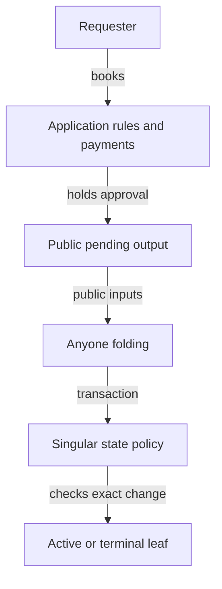
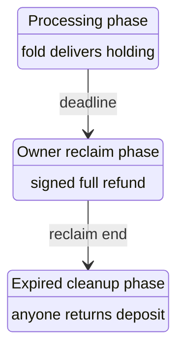

# Requests belong to the application

As a requester, I want the approved deposit and initial datum protected while anyone can fold an acceptable request. As a folder, I want the public request value to show the available bid. As an application author, I want lifecycle rules and treasury funding explicit.

## Status and reading route

This is a hypothetical surface candidate. No accepted law, validator behavior, ledger result or journey acceptance is claimed. Source facts bind revision `00771d77af996605845cf062285263909a049cf8`; the candidate starts at `d4593f146ea5442c0ccec47f89684bb7cca2c836`. Parent NOTE-010 delivers the operator's latest Tip and Treasury rulings. They supersede the fixed termination tip, treasury at fold and deposit return to the controller at booking. Earlier candidate surfaces and receipts are historical evidence only. Read the journey differences here and the current [records](data-model.md#application-owned-request-records) and [callables](functions-model.md#application-owned-request-callables).

Every future general theorem remains a hypothesis with a sorry body; finite witnesses and mutation falsifications must be separately kernel-checked. A source inventory is not proof of behavioral completeness. Accepted root, application and implementation sources remain unchanged.

## Responsibilities and trust boundaries

The application owns booking, custody, the timed request exits and treasury funding. Singular authenticates consumed approvals, state lineage, trie changes and active-token mint/burn, including delivery of at least the deposit committed in a registration approval. Open datum separately requires its exact deposit and its own genuine-token check. Singular neither routes request ADA nor funds a treasury. Public genesis/proofs, authentic complete observations, real funding and willing processing remain explicit premises; public data is not a promise of inclusion.

| Candidate choice | Earlier alternative | Current reason |
|---|---|---|
| One state script per application | Registry-specialized or shared request script | Both request kinds stay at the application. |
| Root-only state datum and structured role names | Policy pins, timing and request fees in the state | Surviving checks have explicit owners; old cost and tip checks retire. |
| Request value is the bid | Declared or fixed tips and fold treasury shares | Registration leaves its committed deposit; termination leaves nothing. |
| Deposit funds the application's treasury at termination booking | Deposit returned to the controller or paid at fold | The operator's Treasury ruling; a never-folded registration still has a full owner reclaim. |

## The Singular surface

The application minting policy and payment script credential are distinct published inputs. The publisher applies the state program to the application policy once per release. Singular authenticates operation approvals under that policy; application outputs authenticate their credential separately. No application-policy/address equality or derivation is assumed.

Genesis consumes its public seed once, invokes the published state policy and mints only one state-role asset into one state output at that script, with an empty-trie commitment. The output holds exactly ADA and its own state token. Public once-only seed provenance, actual script/hash correspondence and ledger conservation remain upstream premises.

A fold supplies the public genesis seed and authenticates the spent state token's full policy/name against its structured state-role preimage. Address, copied root datum or policy alone are insufficient. Separate finite serialization and collision premises distinguish the occurring state and active-role preimages. A provider must expose the genesis and trie-proof data; the seed is not recovered by hash inversion.

The batch is nonempty. Each change pairs once with one consumed, burned approval for its operation, complete registry and key; input references are distinct and no action or consumed approval is missing or surplus. Registration changes unknown to active and mints exactly one genuine active token into the approval-committed holding address with its committed datum hash and at least its committed deposit ADA. Its structured approval includes that deposit, supplied explicitly in the registration change witness. Open datum separately enforces its exact deposit. Termination consumes the matching approval and its held genuine active token, burns both, and changes active to terminal. A holding created by this batch cannot be consumed by its termination. Every other mint or burn under the state policy is zero, including the state token. Complete observations and conservation bind actual placement, not list membership alone.

One bare state continuation stays at the same script with one same state token, exactly the computed root and no decrease in its own ADA. Singular routes no money; its value checks are the state ADA integrity floor and at least the committed deposit at the new holding. It reads no request ADA, tip, cost, refund, treasury allocation or clock. The approved deposit is an explicit registration witness, not inferred from the amount actually received. The application keeps its own genuine-token delivery check because freely burning an approval does not establish a fold. Actual unspent-token census and genuine reachable histories support supply/permanence statements. Accepted permanent-key statements are reused by name only through an explicit logical projection satisfying their real premises; accepted FNV commitments never name candidate assets.

## Application request and value surfaces

A registration output at the application holds one approval and immutable booked data: complete registry, key, controller/refund address, holding address, initial datum, deposit and booked deadlines. Its approval preimage commits registration, complete registry, key, holding address, initial datum and deposit. Its actual ADA is the public bid-bearing value; it must cover the deposit. There is no declared tip, carrier allocation, registration cost payment or fixed reward.

A termination output at the application has an empty datum, one matching termination approval, one genuine active token and its actual ADA bid. Its preimage commits termination, complete registry and key. The controller authorizes booking from the genuine live holding. At booking the protected deposit goes to the treasury, the token moves into this pending request, and Singular does nothing. The request spends without a signature or deadline only when that exact held token burns in the same approved terminal fold. No live update, withdrawal or cancellation releases it.

The registration folder's gross available request value is held ADA minus the committed deposit; the holding receives exactly that deposit, datum and token. The termination folder's gross available request value is all held ADA. There is no fixed or declared tip and no treasury share at either fold. Actual balance, distinct indexed payments and ordinary fee funding distinguish a gross available bid from a net payout; ordinary change, coincident addresses, gifts and fees cannot be distinguished by a typed purpose label. Public-fold witnesses must construct and check the actual transaction paying the chosen processor address, rather than type a successful receipt.

Open datum retains the five per-seed configuration fields: registrationCost, minimumTip, processTime, retractTime and bookingWidth. The first two are now unused metadata: no registration charge or bid floor follows from their old values. The immutable authenticated application configuration record still contains them; registration booking uses only the processing/reclaim durations and booking width to fix the clock. The deposit is authenticated through approved control and the registration approval, rather than inferred from a cost or tip field.

The three time phases stay. Processing-fold intervals end by the booked deadline; signed full owner-reclaim intervals start there and end by reclaim end; permissionless cleanup intervals start at reclaim end. Nonempty intervals make these phases disjoint. Owner reclaim returns the entire request ADA, deposit included. Cleanup returns exactly the committed deposit to the refund address and makes everything above it available to the cleaner; it does not return the old held-minus-declared-tip amount. Both exits burn the approval, donate nothing and read or spend no registry state. Fees require separate ordinary funding as declared by their balance premises.

A doomed registration has no early mismatch exit; it waits for these booked phases. Open datum never reads a registry root or verifies a trie proof. Singular independently checks whether a fold's key transition is allowed. Termination has no clock and only its exact-token-burn exit. No top-up path is introduced: willingness, actual fee funding and ledger output minimums remain explicit liveness limits, rather than consequences of a positive bid.

## Every application journey

The constructor inventory is derived from accepted AppAction, including refused operations; create is its separate accepted genesis function. Current money flows follow NOTE-010. Comparisons name the accepted economic baseline and prior candidate directions separately. Changed outcomes are decided differences, never hidden behind narrowed equivalence premises.

| Accepted application constructor | Current journey and decided difference |
|---|---|
| `AppAction.bookInsert` | Controller-authorized approval binds the complete registry, holding datum/address and deposit. The request holds its bid-bearing ADA. No cost, minimum-tip or carrier allocation is enforced; the two old configuration fields are unused metadata. |
| `AppAction.bookTerminate` | Controller signs; the genuine active token and fresh approval enter the empty-datum request. The protected deposit goes to the treasury at booking, rather than returning to the controller. No Singular invocation or configured-tip gate. |
| `AppAction.bookOther` | Unsupported certifications remain refused: only registration and termination approval constructors exist. |
| `AppAction.update` | Controller-authorized live update preserves protected control, full assets and deposit floor at the application while changing the payload. The deposit remains protected for the key's life; pending requests cannot use the live branch. |
| `AppAction.fold` | Registration delivers exactly the approved deposit/datum/token and makes the remaining request value available to its folder. Termination burns its held token and makes all its request ADA available. Neither fold pays a treasury share or reads a configured tip. |
| `AppAction.reject` | Rejection retires. A doomed registration waits for signed full reclaim or later cleanup refunding only the deposit. Early admission and payouts, and the old expiry refund amount, deliberately change. No application root or proof check. Terminations have no rejection/expiry exit. |
| `AppAction.withdraw` | Arbitrary live holding withdrawal remains refused. Timed registration owner reclaim is a separate pending-request exit, not this live-output constructor. |

Create retains an empty permanent registry and the immutable five-field per-seed application record, with no new treasury payment. Register with held twenty-three and deposit seven now puts seven in the holding and makes sixteen available to the folder, with no treasury donation; an old cost-thirteen/tip-three/carrier-seven request allocated thirteen to treasury and three to the folder. Update retains the same protected control/assets and deposit floor. At termination booking, deposit seven now goes to treasury, not the controller; a pending termination holding ten then makes all ten available at fold, rather than the old tip-two/treasury-eight split. Full owner reclaim still returns twenty-three. After expiry the new cleanup returns seven and makes sixteen available, rather than the old twenty/three split. These are explicit future producer/witness obligations; this prose is not executed behavior evidence.

## Every rejection ground and request kind

The tool derives both RejectReason constructors and both EconomicRequest constructors, checks each ground-function branch and reconciles their four-cell matrix. Every rejection-family field/refusal row must agree with this replacement. This is source/text consistency evidence only; compiled journey witnesses remain owed.

The operator withdrew rejection entirely (NOTE-008), then changed cleanup money (NOTE-010). A registration whose key is already active or terminal cannot fold, and there is no early state-reference cleanup. It waits for signed full reclaim or later deposit-only cleanup. Admission, signing and payouts deliberately differ from early mismatch rejection. The application never reads the root or a trie proof.

| Accepted request kind | Accepted rejection ground | Current replacement or refusal disposition |
|---|---|---|
| `EconomicRequest.registration` | `RejectReason.mismatch` | Replaced by the three timed phases. An already-active or terminal key waits: signed owner reclaim returns everything, or later cleanup returns only the deposit and makes the remainder available to the cleaner. The early mismatch outcome is deliberately changed. The separate known-absent leaf is unreachable in genuine permanent-registry histories, not a new admissible registration state. |
| `EconomicRequest.registration` | `RejectReason.expired` | Permissionless application cleanup after the booked processing/reclaim durations returns only the approved deposit to the refund address; everything above it is the cleaner's gross available bid. This replaces the old held-minus-declared-tip refund. No root/proof read, state spend, signature or treasury share. |
| `EconomicRequest.termination` | `RejectReason.mismatch` | The accepted member judgement refuses termination rejection even if its separate ground function reports incompatibility. The new pending termination has only its approved terminal fold and exact held-token burn, with all request ADA available to the folder. Genuine supply, reachable history and public-data/funding premises remain necessary. |
| `EconomicRequest.termination` | `RejectReason.expired` | Accepted termination expiry is refused. The new pending termination has no deadline, reclaim or cleanup; only its approved terminal fold burns the held token and exposes its whole ADA bid. |

For a doomed registration booked at zero, processing/reclaim durations one hundred, actual ADA twenty-three and deposit seven: old mismatch rejection at [ten, eleven) could return twenty and allocate three without the owner signing. The replacement has no early exit. At [one hundred, one hundred one), signed reclaim returns twenty-three; at [two hundred, two hundred one), cleanup returns seven and makes sixteen available to its cleaner. There is no treasury donation. Both late time admission and the changed payout are stated, with ordinary fee funding separate. No early mismatch spend races a fold because no such path exists; the remaining time tests are disjoint.

## State fields and their replacement owners

The instrument derives every Config field, conservative lexical/whole-record use triple, transitive fold/exit refusal label and application action at the accepted source revision. Each source use has a candidate disposition and reason below; a matching table is textual inventory, not behavioral proof. Root remains authenticated in Singular. Application policy and full registry/active identities survive in parameters, structured preimages and observations. Unused absent/terminal witness kinds have no new mint path. Request tags and Singular pending pools retire.

The five per-seed parameters remain in an immutable application configuration output created with genuine registry genesis and authenticated by a distinct application-policy configuration-role asset. Its exact inline fields bind to that same output and complete registry. Registration booking references it, using processTime, retractTime and bookingWidth only. minimumTip and registrationCost are retained unused metadata: neither constrains a bid or imposes a cost. The approval commits the separate deposit; its exact amount reaches the new holding. The application never reads a registry root or trie proof.

| Field | Source file | Enclosing declaration | Disposition | Reason |
|---|---|---|---|---|
| `root` | `applications/open-datum/lean/OpenDatumApplication/Driver.lean` | `OpenDatumApplication.Driver.cfg0` | kept | Keep the authenticated trie commitment in the state datum; new commitment is an explicit parameter, never the accepted FNV stand-in. |
| `minimumTip` | `applications/open-datum/lean/OpenDatumApplication/Driver.lean` | `OpenDatumApplication.Driver.cfg0` | retired | The old bid-floor/registration-charge use retires. Its per-seed field remains unused metadata; request ADA above the approved deposit is the bid, with no configured tip or fold treasury share. |
| `processTime` | `applications/open-datum/lean/OpenDatumApplication/Driver.lean` | `OpenDatumApplication.Driver.cfg0` | moved | The application owns the booked registration fold deadline; timing does not enter the Singular fold law. |
| `retractTime` | `applications/open-datum/lean/OpenDatumApplication/Driver.lean` | `OpenDatumApplication.Driver.cfg0` | moved | The application uses the authenticated booked reclaim duration: full signed reclaim, then permissionless deposit-only cleanup. No root or trie proof is read. |
| `applicationPolicy` | `applications/open-datum/lean/OpenDatumApplication/Driver.lean` | `OpenDatumApplication.Driver.cfg0` | reexpressed | Approval-policy identity survives as the one application parameter of the state program; no datum pin is read. |
| `activePolicy` | `applications/open-datum/lean/OpenDatumApplication/Driver.lean` | `OpenDatumApplication.Driver.cfg0` | reexpressed | The genuine active asset is under the current state policy with a structured active-role name; protected application control retains the complete asset. |
| `absentPolicy` | `applications/open-datum/lean/OpenDatumApplication/Driver.lean` | `OpenDatumApplication.Driver.cfg0` | retired | No admitted absent edge or absent-token mint remains; historical refusal, fixture and preservation uses do not justify a new datum pin. |
| `terminalPolicy` | `applications/open-datum/lean/OpenDatumApplication/Driver.lean` | `OpenDatumApplication.Driver.cfg0` | retired | Terminal is a permanent trie leaf, with no terminal witness asset; historical refusal and preservation uses introduce no new pin. |
| `activePolicy` | `applications/open-datum/lean/OpenDatumApplication/Driver.lean` | `OpenDatumApplication.Driver.envelopeFor` | reexpressed | The genuine active asset is under the current state policy with a structured active-role name; protected application control retains the complete asset. |
| `activePolicy` | `applications/open-datum/lean/OpenDatumApplication/Model.lean` | `OpenDatumApplication.Control` | reexpressed | The genuine active asset is under the current state policy with a structured active-role name; protected application control retains the complete asset. |
| `activePolicy` | `applications/open-datum/lean/OpenDatumApplication/Model.lean` | `OpenDatumApplication.controlFields` | reexpressed | The genuine active asset is under the current state policy with a structured active-role name; protected application control retains the complete asset. |
| `root` | `applications/open-datum/lean/OpenDatumApplication/Model.lean` | `OpenDatumApplication.genesis` | kept | Keep the authenticated trie commitment in the state datum; new commitment is an explicit parameter, never the accepted FNV stand-in. |
| `minimumTip` | `applications/open-datum/lean/OpenDatumApplication/Model.lean` | `OpenDatumApplication.genesis` | retired | The old bid-floor/registration-charge use retires. Its per-seed field remains unused metadata; request ADA above the approved deposit is the bid, with no configured tip or fold treasury share. |
| `processTime` | `applications/open-datum/lean/OpenDatumApplication/Model.lean` | `OpenDatumApplication.genesis` | moved | Whole-record comparison/copy includes this field. The application owns the booked registration fold deadline; timing does not enter the Singular fold law. |
| `retractTime` | `applications/open-datum/lean/OpenDatumApplication/Model.lean` | `OpenDatumApplication.genesis` | moved | The application uses the authenticated booked reclaim duration: full signed reclaim, then permissionless deposit-only cleanup. No root or trie proof is read. |
| `applicationPolicy` | `applications/open-datum/lean/OpenDatumApplication/Model.lean` | `OpenDatumApplication.genesis` | reexpressed | Whole-record comparison/copy includes this field. Approval-policy identity survives as the one application parameter of the state program; no datum pin is read. |
| `activePolicy` | `applications/open-datum/lean/OpenDatumApplication/Model.lean` | `OpenDatumApplication.genesis` | reexpressed | Whole-record comparison/copy includes this field. The genuine active asset is under the current state policy with a structured active-role name; protected application control retains the complete asset. |
| `absentPolicy` | `applications/open-datum/lean/OpenDatumApplication/Model.lean` | `OpenDatumApplication.genesis` | retired | Whole-record comparison/copy includes this field. No admitted absent edge or absent-token mint remains; historical refusal, fixture and preservation uses do not justify a new datum pin. |
| `terminalPolicy` | `applications/open-datum/lean/OpenDatumApplication/Model.lean` | `OpenDatumApplication.genesis` | retired | Whole-record comparison/copy includes this field. Terminal is a permanent trie leaf, with no terminal witness asset; historical refusal and preservation uses introduce no new pin. |
| `registryId` | `applications/open-datum/lean/OpenDatumApplication/Model.lean` | `OpenDatumApplication.genesis` | reexpressed | Whole-record comparison/copy includes this field. Complete registry identity is authenticated from the state-role token and its policy, and bound in approvals; no abstract registryId datum field remains. |
| `registrationCost` | `applications/open-datum/lean/OpenDatumApplication/Model.lean` | `OpenDatumApplication.genesis` | retired | The old bid-floor/registration-charge use retires. Its per-seed field remains unused metadata; request ADA above the approved deposit is the bid, with no configured tip or fold treasury share. |
| `bookingWidth` | `applications/open-datum/lean/OpenDatumApplication/Model.lean` | `OpenDatumApplication.genesis` | moved | Whole-record comparison/copy includes this field. Booking time and width are application request rules; their old guarantees are compared under the ruled journey relation. |
| `applicationPolicy` | `applications/open-datum/lean/OpenDatumApplication/Model.lean` | `OpenDatumApplication.bookInsertStep` | reexpressed | Approval-policy identity survives as the one application parameter of the state program; no datum pin is read. |
| `activePolicy` | `applications/open-datum/lean/OpenDatumApplication/Model.lean` | `OpenDatumApplication.bookInsertStep` | reexpressed | The genuine active asset is under the current state policy with a structured active-role name; protected application control retains the complete asset. |
| `applicationPolicy` | `applications/open-datum/lean/OpenDatumApplication/Model.lean` | `OpenDatumApplication.bookTerminateStep` | reexpressed | Approval-policy identity survives as the one application parameter of the state program; no datum pin is read. |
| `applicationPolicy` | `applications/open-datum/lean/OpenDatumApplication/ProofSupport.lean` | `OpenDatumApplication.ProofSupport.step_app_edge` | reexpressed | Approval-policy identity survives as the one application parameter of the state program; no datum pin is read. |
| `applicationPolicy` | `applications/open-datum/lean/OpenDatumApplication/ProofSupport.lean` | `OpenDatumApplication.ProofSupport.foldActions_key` | reexpressed | Approval-policy identity survives as the one application parameter of the state program; no datum pin is read. |
| `applicationPolicy` | `applications/open-datum/lean/OpenDatumApplication/ProofSupport.lean` | `OpenDatumApplication.ProofSupport.fold_shape` | reexpressed | Approval-policy identity survives as the one application parameter of the state program; no datum pin is read. |
| `applicationPolicy` | `applications/open-datum/lean/OpenDatumApplication/ProofSupport.lean` | `OpenDatumApplication.ProofSupport.booked_insert_refusal` | reexpressed | Approval-policy identity survives as the one application parameter of the state program; no datum pin is read. |
| `root` | `applications/open-datum/lean/OpenDatumApplication/ProofSupport.lean` | `OpenDatumApplication.ProofSupport.consistentB_iff` | kept | Whole-record comparison/copy includes this field. Keep the authenticated trie commitment in the state datum; new commitment is an explicit parameter, never the accepted FNV stand-in. |
| `minimumTip` | `applications/open-datum/lean/OpenDatumApplication/ProofSupport.lean` | `OpenDatumApplication.ProofSupport.consistentB_iff` | retired | The old bid-floor/registration-charge use retires. Its per-seed field remains unused metadata; request ADA above the approved deposit is the bid, with no configured tip or fold treasury share. |
| `processTime` | `applications/open-datum/lean/OpenDatumApplication/ProofSupport.lean` | `OpenDatumApplication.ProofSupport.consistentB_iff` | moved | Whole-record comparison/copy includes this field. The application owns the booked registration fold deadline; timing does not enter the Singular fold law. |
| `retractTime` | `applications/open-datum/lean/OpenDatumApplication/ProofSupport.lean` | `OpenDatumApplication.ProofSupport.consistentB_iff` | moved | The application uses the authenticated booked reclaim duration: full signed reclaim, then permissionless deposit-only cleanup. No root or trie proof is read. |
| `applicationPolicy` | `applications/open-datum/lean/OpenDatumApplication/ProofSupport.lean` | `OpenDatumApplication.ProofSupport.consistentB_iff` | reexpressed | Whole-record comparison/copy includes this field. Approval-policy identity survives as the one application parameter of the state program; no datum pin is read. |
| `activePolicy` | `applications/open-datum/lean/OpenDatumApplication/ProofSupport.lean` | `OpenDatumApplication.ProofSupport.consistentB_iff` | reexpressed | Whole-record comparison/copy includes this field. The genuine active asset is under the current state policy with a structured active-role name; protected application control retains the complete asset. |
| `absentPolicy` | `applications/open-datum/lean/OpenDatumApplication/ProofSupport.lean` | `OpenDatumApplication.ProofSupport.consistentB_iff` | retired | Whole-record comparison/copy includes this field. No admitted absent edge or absent-token mint remains; historical refusal, fixture and preservation uses do not justify a new datum pin. |
| `terminalPolicy` | `applications/open-datum/lean/OpenDatumApplication/ProofSupport.lean` | `OpenDatumApplication.ProofSupport.consistentB_iff` | retired | Whole-record comparison/copy includes this field. Terminal is a permanent trie leaf, with no terminal witness asset; historical refusal and preservation uses introduce no new pin. |
| `registryId` | `applications/open-datum/lean/OpenDatumApplication/ProofSupport.lean` | `OpenDatumApplication.ProofSupport.consistentB_iff` | reexpressed | Whole-record comparison/copy includes this field. Complete registry identity is authenticated from the state-role token and its policy, and bound in approvals; no abstract registryId datum field remains. |
| `registrationCost` | `applications/open-datum/lean/OpenDatumApplication/ProofSupport.lean` | `OpenDatumApplication.ProofSupport.consistentB_iff` | retired | The old bid-floor/registration-charge use retires. Its per-seed field remains unused metadata; request ADA above the approved deposit is the bid, with no configured tip or fold treasury share. |
| `bookingWidth` | `applications/open-datum/lean/OpenDatumApplication/ProofSupport.lean` | `OpenDatumApplication.ProofSupport.consistentB_iff` | moved | Whole-record comparison/copy includes this field. Booking time and width are application request rules; their old guarantees are compared under the ruled journey relation. |
| `applicationPolicy` | `applications/open-datum/lean/OpenDatumApplication/Statements.lean` | `OpenDatumApplication.Statements.bookInsert_inversion` | reexpressed | Approval-policy identity survives as the one application parameter of the state program; no datum pin is read. |
| `activePolicy` | `applications/open-datum/lean/OpenDatumApplication/Statements.lean` | `OpenDatumApplication.Statements.bookInsert_inversion` | reexpressed | The genuine active asset is under the current state policy with a structured active-role name; protected application control retains the complete asset. |
| `applicationPolicy` | `applications/open-datum/lean/OpenDatumApplication/Statements.lean` | `OpenDatumApplication.Statements.bookTerminate_inversion` | reexpressed | Approval-policy identity survives as the one application parameter of the state program; no datum pin is read. |
| `root` | `applications/open-datum/lean/OpenDatumApplication/Statements.lean` | `OpenDatumApplication.Statements.genesis_consistent` | kept | Keep the authenticated trie commitment in the state datum; new commitment is an explicit parameter, never the accepted FNV stand-in. |
| `minimumTip` | `applications/open-datum/lean/OpenDatumApplication/Statements.lean` | `OpenDatumApplication.Statements.genesis_consistent` | retired | The old bid-floor/registration-charge use retires. Its per-seed field remains unused metadata; request ADA above the approved deposit is the bid, with no configured tip or fold treasury share. |
| `processTime` | `applications/open-datum/lean/OpenDatumApplication/Statements.lean` | `OpenDatumApplication.Statements.genesis_consistent` | moved | Whole-record comparison/copy includes this field. The application owns the booked registration fold deadline; timing does not enter the Singular fold law. |
| `retractTime` | `applications/open-datum/lean/OpenDatumApplication/Statements.lean` | `OpenDatumApplication.Statements.genesis_consistent` | moved | The application uses the authenticated booked reclaim duration: full signed reclaim, then permissionless deposit-only cleanup. No root or trie proof is read. |
| `applicationPolicy` | `applications/open-datum/lean/OpenDatumApplication/Statements.lean` | `OpenDatumApplication.Statements.genesis_consistent` | reexpressed | Whole-record comparison/copy includes this field. Approval-policy identity survives as the one application parameter of the state program; no datum pin is read. |
| `activePolicy` | `applications/open-datum/lean/OpenDatumApplication/Statements.lean` | `OpenDatumApplication.Statements.genesis_consistent` | reexpressed | Whole-record comparison/copy includes this field. The genuine active asset is under the current state policy with a structured active-role name; protected application control retains the complete asset. |
| `absentPolicy` | `applications/open-datum/lean/OpenDatumApplication/Statements.lean` | `OpenDatumApplication.Statements.genesis_consistent` | retired | Whole-record comparison/copy includes this field. No admitted absent edge or absent-token mint remains; historical refusal, fixture and preservation uses do not justify a new datum pin. |
| `terminalPolicy` | `applications/open-datum/lean/OpenDatumApplication/Statements.lean` | `OpenDatumApplication.Statements.genesis_consistent` | retired | Whole-record comparison/copy includes this field. Terminal is a permanent trie leaf, with no terminal witness asset; historical refusal and preservation uses introduce no new pin. |
| `registryId` | `applications/open-datum/lean/OpenDatumApplication/Statements.lean` | `OpenDatumApplication.Statements.genesis_consistent` | reexpressed | Whole-record comparison/copy includes this field. Complete registry identity is authenticated from the state-role token and its policy, and bound in approvals; no abstract registryId datum field remains. |
| `registrationCost` | `applications/open-datum/lean/OpenDatumApplication/Statements.lean` | `OpenDatumApplication.Statements.genesis_consistent` | retired | The old bid-floor/registration-charge use retires. Its per-seed field remains unused metadata; request ADA above the approved deposit is the bid, with no configured tip or fold treasury share. |
| `bookingWidth` | `applications/open-datum/lean/OpenDatumApplication/Statements.lean` | `OpenDatumApplication.Statements.genesis_consistent` | moved | Whole-record comparison/copy includes this field. Booking time and width are application request rules; their old guarantees are compared under the ruled journey relation. |
| `applicationPolicy` | `applications/open-datum/onchain/validators/open_datum.ak` | `open_datum` | reexpressed | Approval-policy identity survives as the one application parameter of the state program; no datum pin is read. |
| `activePolicy` | `applications/open-datum/onchain/validators/open_datum.ak` | `bookInsert` | reexpressed | The genuine active asset is under the current state policy with a structured active-role name; protected application control retains the complete asset. |
| `activePolicy` | `applications/open-datum/onchain/validators/open_datum.ak` | `bookTerminate` | reexpressed | The genuine active asset is under the current state policy with a structured active-role name; protected application control retains the complete asset. |
| `minimumTip` | `applications/open-datum/onchain/validators/open_datum.ak` | `rowDuties` | retired | The old bid-floor/registration-charge use retires. Its per-seed field remains unused metadata; request ADA above the approved deposit is the bid, with no configured tip or fold treasury share. |
| `applicationPolicy` | `applications/open-datum/onchain/validators/open_datum.ak` | `validRelease` | reexpressed | Approval-policy identity survives as the one application parameter of the state program; no datum pin is read. |
| `activePolicy` | `applications/open-datum/onchain/validators/open_datum.ak` | `validRelease` | reexpressed | The genuine active asset is under the current state policy with a structured active-role name; protected application control retains the complete asset. |
| `root` | `applications/open-datum/onchain/validators/open_datum.tests.ak` | `stateOutputAt` | kept | Keep the authenticated trie commitment in the state datum; new commitment is an explicit parameter, never the accepted FNV stand-in. |
| `root` | `applications/open-datum/onchain/validators/open_datum.tests.ak` | `stateInputWith` | kept | Keep the authenticated trie commitment in the state datum; new commitment is an explicit parameter, never the accepted FNV stand-in. |
| `minimumTip` | `applications/open-datum/onchain/validators/open_datum.tests.ak` | `requestOutput` | retired | The old bid-floor/registration-charge use retires. Its per-seed field remains unused metadata; request ADA above the approved deposit is the bid, with no configured tip or fold treasury share. |
| `applicationPolicy` | `applications/open-datum/onchain/validators/open_datum.tests.ak` | `insert_booking_state_of_other_application_refuses` | reexpressed | Approval-policy identity survives as the one application parameter of the state program; no datum pin is read. |
| `applicationPolicy` | `applications/open-datum/onchain/validators/open_datum.tests.ak` | `release_under_a_state_pinning_another_application_refuses` | reexpressed | Approval-policy identity survives as the one application parameter of the state program; no datum pin is read. |
| `applicationPolicy` | `applications/open-datum/onchain/validators/open_datum.tests.ak` | `stateTwo` | reexpressed | Approval-policy identity survives as the one application parameter of the state program; no datum pin is read. |
| `activePolicy` | `applications/open-datum/onchain/validators/open_datum.tests.ak` | `stateTwo` | reexpressed | The genuine active asset is under the current state policy with a structured active-role name; protected application control retains the complete asset. |
| `root` | `applications/open-datum/onchain/validators/open_datum.tests.ak` | `continuationTwo` | kept | Keep the authenticated trie commitment in the state datum; new commitment is an explicit parameter, never the accepted FNV stand-in. |
| `minimumTip` | `applications/open-datum/onchain/validators/open_datum.tests.ak` | `requestTwo` | retired | The old bid-floor/registration-charge use retires. Its per-seed field remains unused metadata; request ADA above the approved deposit is the bid, with no configured tip or fold treasury share. |
| `processTime` | `lean/DriverMain.lean` | `windowState` | moved | The application owns the booked registration fold deadline; timing does not enter the Singular fold law. |
| `root` | `lean/DriverMain/Fixtures.lean` | `cfg0` | kept | Keep the authenticated trie commitment in the state datum; new commitment is an explicit parameter, never the accepted FNV stand-in. |
| `minimumTip` | `lean/DriverMain/Fixtures.lean` | `cfg0` | retired | The old bid-floor/registration-charge use retires. Its per-seed field remains unused metadata; request ADA above the approved deposit is the bid, with no configured tip or fold treasury share. |
| `processTime` | `lean/DriverMain/Fixtures.lean` | `cfg0` | moved | The application owns the booked registration fold deadline; timing does not enter the Singular fold law. |
| `retractTime` | `lean/DriverMain/Fixtures.lean` | `cfg0` | moved | The application uses the authenticated booked reclaim duration: full signed reclaim, then permissionless deposit-only cleanup. No root or trie proof is read. |
| `applicationPolicy` | `lean/DriverMain/Fixtures.lean` | `cfg0` | reexpressed | Approval-policy identity survives as the one application parameter of the state program; no datum pin is read. |
| `activePolicy` | `lean/DriverMain/Fixtures.lean` | `cfg0` | reexpressed | The genuine active asset is under the current state policy with a structured active-role name; protected application control retains the complete asset. |
| `absentPolicy` | `lean/DriverMain/Fixtures.lean` | `cfg0` | retired | No admitted absent edge or absent-token mint remains; historical refusal, fixture and preservation uses do not justify a new datum pin. |
| `terminalPolicy` | `lean/DriverMain/Fixtures.lean` | `cfg0` | retired | Terminal is a permanent trie leaf, with no terminal witness asset; historical refusal and preservation uses introduce no new pin. |
| `processTime` | `lean/DriverMain/Fixtures.lean` | `sTimed` | moved | The application owns the booked registration fold deadline; timing does not enter the Singular fold law. |
| `retractTime` | `lean/DriverMain/Fixtures.lean` | `sTimed` | moved | The application uses the authenticated booked reclaim duration: full signed reclaim, then permissionless deposit-only cleanup. No root or trie proof is read. |
| `root` | `lean/DriverMain/Fixtures.lean` | `absentState` | kept | Keep the authenticated trie commitment in the state datum; new commitment is an explicit parameter, never the accepted FNV stand-in. |
| `root` | `lean/LifecycleMain.lean` | `maintenanceRows` | kept | Keep the authenticated trie commitment in the state datum; new commitment is an explicit parameter, never the accepted FNV stand-in. |
| `root` | `lean/LifecycleMain.lean` | `recoveryRows` | kept | Keep the authenticated trie commitment in the state datum; new commitment is an explicit parameter, never the accepted FNV stand-in. |
| `activePolicy` | `lean/LifecycleMain.lean` | `initializationRows` | reexpressed | The genuine active asset is under the current state policy with a structured active-role name; protected application control retains the complete asset. |
| `terminalPolicy` | `lean/LifecycleMain.lean` | `initializationRows` | retired | Terminal is a permanent trie leaf, with no terminal witness asset; historical refusal and preservation uses introduce no new pin. |
| `root` | `lean/M1Main.lean` | `PermanentCorpus.config` | kept | Keep the authenticated trie commitment in the state datum; new commitment is an explicit parameter, never the accepted FNV stand-in. |
| `minimumTip` | `lean/M1Main.lean` | `PermanentCorpus.config` | retired | The old bid-floor/registration-charge use retires. Its per-seed field remains unused metadata; request ADA above the approved deposit is the bid, with no configured tip or fold treasury share. |
| `processTime` | `lean/M1Main.lean` | `PermanentCorpus.config` | moved | The application owns the booked registration fold deadline; timing does not enter the Singular fold law. |
| `retractTime` | `lean/M1Main.lean` | `PermanentCorpus.config` | moved | The application uses the authenticated booked reclaim duration: full signed reclaim, then permissionless deposit-only cleanup. No root or trie proof is read. |
| `applicationPolicy` | `lean/M1Main.lean` | `PermanentCorpus.config` | reexpressed | Approval-policy identity survives as the one application parameter of the state program; no datum pin is read. |
| `activePolicy` | `lean/M1Main.lean` | `PermanentCorpus.config` | reexpressed | The genuine active asset is under the current state policy with a structured active-role name; protected application control retains the complete asset. |
| `absentPolicy` | `lean/M1Main.lean` | `PermanentCorpus.config` | retired | No admitted absent edge or absent-token mint remains; historical refusal, fixture and preservation uses do not justify a new datum pin. |
| `terminalPolicy` | `lean/M1Main.lean` | `PermanentCorpus.config` | retired | Terminal is a permanent trie leaf, with no terminal witness asset; historical refusal and preservation uses introduce no new pin. |
| `applicationPolicy` | `lean/M1Main.lean` | `PermanentCorpus.request` | reexpressed | Approval-policy identity survives as the one application parameter of the state program; no datum pin is read. |
| `minimumTip` | `lean/Main.lean` | `registrationConfig` | retired | The old bid-floor/registration-charge use retires. Its per-seed field remains unused metadata; request ADA above the approved deposit is the bid, with no configured tip or fold treasury share. |
| `processTime` | `lean/Main.lean` | `registrationConfig` | moved | The application owns the booked registration fold deadline; timing does not enter the Singular fold law. |
| `retractTime` | `lean/Main.lean` | `registrationConfig` | moved | The application uses the authenticated booked reclaim duration: full signed reclaim, then permissionless deposit-only cleanup. No root or trie proof is read. |
| `registryId` | `lean/Main.lean` | `registrationConfig` | reexpressed | Complete registry identity is authenticated from the state-role token and its policy, and bound in approvals; no abstract registryId datum field remains. |
| `registrationCost` | `lean/Main.lean` | `registrationConfig` | retired | The old bid-floor/registration-charge use retires. Its per-seed field remains unused metadata; request ADA above the approved deposit is the bid, with no configured tip or fold treasury share. |
| `bookingWidth` | `lean/Main.lean` | `registrationConfig` | moved | Booking time and width are application request rules; their old guarantees are compared under the ruled journey relation. |
| `applicationPolicy` | `lean/Main.lean` | `registrationApplicationTag` | reexpressed | Approval-policy identity survives as the one application parameter of the state program; no datum pin is read. |
| `applicationPolicy` | `lean/Main.lean` | `bindRegistrationTags` | reexpressed | Approval-policy identity survives as the one application parameter of the state program; no datum pin is read. |
| `registryId` | `lean/Main.lean` | `lawfulRegistrationBooking` | reexpressed | Complete registry identity is authenticated from the state-role token and its policy, and bound in approvals; no abstract registryId datum field remains. |
| `registrationCost` | `lean/Main.lean` | `lawfulRegistrationBooking` | retired | The old bid-floor/registration-charge use retires. Its per-seed field remains unused metadata; request ADA above the approved deposit is the bid, with no configured tip or fold treasury share. |
| `minimumTip` | `lean/Main.lean` | `registrationBookingControls` | retired | The old bid-floor/registration-charge use retires. Its per-seed field remains unused metadata; request ADA above the approved deposit is the bid, with no configured tip or fold treasury share. |
| `registryId` | `lean/Main.lean` | `registrationBookingControls` | reexpressed | Complete registry identity is authenticated from the state-role token and its policy, and bound in approvals; no abstract registryId datum field remains. |
| `registrationCost` | `lean/Main.lean` | `registrationBookingControls` | retired | The old bid-floor/registration-charge use retires. Its per-seed field remains unused metadata; request ADA above the approved deposit is the bid, with no configured tip or fold treasury share. |
| `registryId` | `lean/Main.lean` | `terminationBookingFor` | reexpressed | Complete registry identity is authenticated from the state-role token and its policy, and bound in approvals; no abstract registryId datum field remains. |
| `minimumTip` | `lean/Main.lean` | `terminationBookingControls` | retired | The old bid-floor/registration-charge use retires. Its per-seed field remains unused metadata; request ADA above the approved deposit is the bid, with no configured tip or fold treasury share. |
| `registryId` | `lean/Main.lean` | `terminationBookingControls` | reexpressed | Complete registry identity is authenticated from the state-role token and its policy, and bound in approvals; no abstract registryId datum field remains. |
| `root` | `lean/Main.lean` | `terminationControlRows` | kept | Whole-record comparison/copy includes this field. Keep the authenticated trie commitment in the state datum; new commitment is an explicit parameter, never the accepted FNV stand-in. |
| `minimumTip` | `lean/Main.lean` | `terminationControlRows` | retired | The old bid-floor/registration-charge use retires. Its per-seed field remains unused metadata; request ADA above the approved deposit is the bid, with no configured tip or fold treasury share. |
| `processTime` | `lean/Main.lean` | `terminationControlRows` | moved | Whole-record comparison/copy includes this field. The application owns the booked registration fold deadline; timing does not enter the Singular fold law. |
| `retractTime` | `lean/Main.lean` | `terminationControlRows` | moved | The application uses the authenticated booked reclaim duration: full signed reclaim, then permissionless deposit-only cleanup. No root or trie proof is read. |
| `applicationPolicy` | `lean/Main.lean` | `terminationControlRows` | reexpressed | Whole-record comparison/copy includes this field. Approval-policy identity survives as the one application parameter of the state program; no datum pin is read. |
| `activePolicy` | `lean/Main.lean` | `terminationControlRows` | reexpressed | Whole-record comparison/copy includes this field. The genuine active asset is under the current state policy with a structured active-role name; protected application control retains the complete asset. |
| `absentPolicy` | `lean/Main.lean` | `terminationControlRows` | retired | Whole-record comparison/copy includes this field. No admitted absent edge or absent-token mint remains; historical refusal, fixture and preservation uses do not justify a new datum pin. |
| `terminalPolicy` | `lean/Main.lean` | `terminationControlRows` | retired | Whole-record comparison/copy includes this field. Terminal is a permanent trie leaf, with no terminal witness asset; historical refusal and preservation uses introduce no new pin. |
| `registryId` | `lean/Main.lean` | `terminationControlRows` | reexpressed | Whole-record comparison/copy includes this field. Complete registry identity is authenticated from the state-role token and its policy, and bound in approvals; no abstract registryId datum field remains. |
| `registrationCost` | `lean/Main.lean` | `terminationControlRows` | retired | The old bid-floor/registration-charge use retires. Its per-seed field remains unused metadata; request ADA above the approved deposit is the bid, with no configured tip or fold treasury share. |
| `bookingWidth` | `lean/Main.lean` | `terminationControlRows` | moved | Whole-record comparison/copy includes this field. Booking time and width are application request rules; their old guarantees are compared under the ruled journey relation. |
| `root` | `lean/Main.lean` | `oneTipControls` | kept | Whole-record comparison/copy includes this field. Keep the authenticated trie commitment in the state datum; new commitment is an explicit parameter, never the accepted FNV stand-in. |
| `minimumTip` | `lean/Main.lean` | `oneTipControls` | retired | The old bid-floor/registration-charge use retires. Its per-seed field remains unused metadata; request ADA above the approved deposit is the bid, with no configured tip or fold treasury share. |
| `processTime` | `lean/Main.lean` | `oneTipControls` | moved | Whole-record comparison/copy includes this field. The application owns the booked registration fold deadline; timing does not enter the Singular fold law. |
| `retractTime` | `lean/Main.lean` | `oneTipControls` | moved | The application uses the authenticated booked reclaim duration: full signed reclaim, then permissionless deposit-only cleanup. No root or trie proof is read. |
| `applicationPolicy` | `lean/Main.lean` | `oneTipControls` | reexpressed | Whole-record comparison/copy includes this field. Approval-policy identity survives as the one application parameter of the state program; no datum pin is read. |
| `activePolicy` | `lean/Main.lean` | `oneTipControls` | reexpressed | Whole-record comparison/copy includes this field. The genuine active asset is under the current state policy with a structured active-role name; protected application control retains the complete asset. |
| `absentPolicy` | `lean/Main.lean` | `oneTipControls` | retired | Whole-record comparison/copy includes this field. No admitted absent edge or absent-token mint remains; historical refusal, fixture and preservation uses do not justify a new datum pin. |
| `terminalPolicy` | `lean/Main.lean` | `oneTipControls` | retired | Whole-record comparison/copy includes this field. Terminal is a permanent trie leaf, with no terminal witness asset; historical refusal and preservation uses introduce no new pin. |
| `registryId` | `lean/Main.lean` | `oneTipControls` | reexpressed | Whole-record comparison/copy includes this field. Complete registry identity is authenticated from the state-role token and its policy, and bound in approvals; no abstract registryId datum field remains. |
| `registrationCost` | `lean/Main.lean` | `oneTipControls` | retired | The old bid-floor/registration-charge use retires. Its per-seed field remains unused metadata; request ADA above the approved deposit is the bid, with no configured tip or fold treasury share. |
| `bookingWidth` | `lean/Main.lean` | `oneTipControls` | moved | Whole-record comparison/copy includes this field. Booking time and width are application request rules; their old guarantees are compared under the ruled journey relation. |
| `root` | `lean/Main/Base.lean` | `cfg` | kept | Keep the authenticated trie commitment in the state datum; new commitment is an explicit parameter, never the accepted FNV stand-in. |
| `minimumTip` | `lean/Main/Base.lean` | `cfg` | retired | The old bid-floor/registration-charge use retires. Its per-seed field remains unused metadata; request ADA above the approved deposit is the bid, with no configured tip or fold treasury share. |
| `processTime` | `lean/Main/Base.lean` | `cfg` | moved | The application owns the booked registration fold deadline; timing does not enter the Singular fold law. |
| `retractTime` | `lean/Main/Base.lean` | `cfg` | moved | The application uses the authenticated booked reclaim duration: full signed reclaim, then permissionless deposit-only cleanup. No root or trie proof is read. |
| `applicationPolicy` | `lean/Main/Base.lean` | `cfg` | reexpressed | Approval-policy identity survives as the one application parameter of the state program; no datum pin is read. |
| `activePolicy` | `lean/Main/Base.lean` | `cfg` | reexpressed | The genuine active asset is under the current state policy with a structured active-role name; protected application control retains the complete asset. |
| `absentPolicy` | `lean/Main/Base.lean` | `cfg` | retired | No admitted absent edge or absent-token mint remains; historical refusal, fixture and preservation uses do not justify a new datum pin. |
| `terminalPolicy` | `lean/Main/Base.lean` | `cfg` | retired | Terminal is a permanent trie leaf, with no terminal witness asset; historical refusal and preservation uses introduce no new pin. |
| `root` | `lean/Main/Base.lean` | `legacyAbsent` | kept | Keep the authenticated trie commitment in the state datum; new commitment is an explicit parameter, never the accepted FNV stand-in. |
| `minimumTip` | `lean/Main/Base.lean` | `legacyAbsent` | retired | The old bid-floor/registration-charge use retires. Its per-seed field remains unused metadata; request ADA above the approved deposit is the bid, with no configured tip or fold treasury share. |
| `processTime` | `lean/Main/Base.lean` | `legacyAbsent` | moved | Whole-record comparison/copy includes this field. The application owns the booked registration fold deadline; timing does not enter the Singular fold law. |
| `retractTime` | `lean/Main/Base.lean` | `legacyAbsent` | moved | The application uses the authenticated booked reclaim duration: full signed reclaim, then permissionless deposit-only cleanup. No root or trie proof is read. |
| `applicationPolicy` | `lean/Main/Base.lean` | `legacyAbsent` | reexpressed | Whole-record comparison/copy includes this field. Approval-policy identity survives as the one application parameter of the state program; no datum pin is read. |
| `activePolicy` | `lean/Main/Base.lean` | `legacyAbsent` | reexpressed | Whole-record comparison/copy includes this field. The genuine active asset is under the current state policy with a structured active-role name; protected application control retains the complete asset. |
| `absentPolicy` | `lean/Main/Base.lean` | `legacyAbsent` | retired | Whole-record comparison/copy includes this field. No admitted absent edge or absent-token mint remains; historical refusal, fixture and preservation uses do not justify a new datum pin. |
| `terminalPolicy` | `lean/Main/Base.lean` | `legacyAbsent` | retired | Whole-record comparison/copy includes this field. Terminal is a permanent trie leaf, with no terminal witness asset; historical refusal and preservation uses introduce no new pin. |
| `registryId` | `lean/Main/Base.lean` | `legacyAbsent` | reexpressed | Whole-record comparison/copy includes this field. Complete registry identity is authenticated from the state-role token and its policy, and bound in approvals; no abstract registryId datum field remains. |
| `registrationCost` | `lean/Main/Base.lean` | `legacyAbsent` | retired | The old bid-floor/registration-charge use retires. Its per-seed field remains unused metadata; request ADA above the approved deposit is the bid, with no configured tip or fold treasury share. |
| `bookingWidth` | `lean/Main/Base.lean` | `legacyAbsent` | moved | Whole-record comparison/copy includes this field. Booking time and width are application request rules; their old guarantees are compared under the ruled journey relation. |
| `minimumTip` | `lean/Main/Economics.lean` | `parameterCodecControl` | retired | The old bid-floor/registration-charge use retires. Its per-seed field remains unused metadata; request ADA above the approved deposit is the bid, with no configured tip or fold treasury share. |
| `registrationCost` | `lean/Main/Economics.lean` | `parameterCodecControl` | retired | The old bid-floor/registration-charge use retires. Its per-seed field remains unused metadata; request ADA above the approved deposit is the bid, with no configured tip or fold treasury share. |
| `bookingWidth` | `lean/Main/Economics.lean` | `parameterCodecControl` | moved | Booking time and width are application request rules; their old guarantees are compared under the ruled journey relation. |
| `registryId` | `lean/Main/Economics.lean` | `stateIdentityControls` | reexpressed | Complete registry identity is authenticated from the state-role token and its policy, and bound in approvals; no abstract registryId datum field remains. |
| `registryId` | `lean/Main/Economics.lean` | `economicControls` | reexpressed | Complete registry identity is authenticated from the state-role token and its policy, and bound in approvals; no abstract registryId datum field remains. |
| `registrationCost` | `lean/Main/Economics.lean` | `registrationCommitmentControls` | retired | The old bid-floor/registration-charge use retires. Its per-seed field remains unused metadata; request ADA above the approved deposit is the bid, with no configured tip or fold treasury share. |
| `root` | `lean/Main/Exits.lean` | `leavesRegistry` | kept | Whole-record comparison/copy includes this field. Keep the authenticated trie commitment in the state datum; new commitment is an explicit parameter, never the accepted FNV stand-in. |
| `minimumTip` | `lean/Main/Exits.lean` | `leavesRegistry` | retired | The old bid-floor/registration-charge use retires. Its per-seed field remains unused metadata; request ADA above the approved deposit is the bid, with no configured tip or fold treasury share. |
| `processTime` | `lean/Main/Exits.lean` | `leavesRegistry` | moved | Whole-record comparison/copy includes this field. The application owns the booked registration fold deadline; timing does not enter the Singular fold law. |
| `retractTime` | `lean/Main/Exits.lean` | `leavesRegistry` | moved | The application uses the authenticated booked reclaim duration: full signed reclaim, then permissionless deposit-only cleanup. No root or trie proof is read. |
| `applicationPolicy` | `lean/Main/Exits.lean` | `leavesRegistry` | reexpressed | Whole-record comparison/copy includes this field. Approval-policy identity survives as the one application parameter of the state program; no datum pin is read. |
| `activePolicy` | `lean/Main/Exits.lean` | `leavesRegistry` | reexpressed | Whole-record comparison/copy includes this field. The genuine active asset is under the current state policy with a structured active-role name; protected application control retains the complete asset. |
| `absentPolicy` | `lean/Main/Exits.lean` | `leavesRegistry` | retired | Whole-record comparison/copy includes this field. No admitted absent edge or absent-token mint remains; historical refusal, fixture and preservation uses do not justify a new datum pin. |
| `terminalPolicy` | `lean/Main/Exits.lean` | `leavesRegistry` | retired | Whole-record comparison/copy includes this field. Terminal is a permanent trie leaf, with no terminal witness asset; historical refusal and preservation uses introduce no new pin. |
| `registryId` | `lean/Main/Exits.lean` | `leavesRegistry` | reexpressed | Whole-record comparison/copy includes this field. Complete registry identity is authenticated from the state-role token and its policy, and bound in approvals; no abstract registryId datum field remains. |
| `registrationCost` | `lean/Main/Exits.lean` | `leavesRegistry` | retired | The old bid-floor/registration-charge use retires. Its per-seed field remains unused metadata; request ADA above the approved deposit is the bid, with no configured tip or fold treasury share. |
| `bookingWidth` | `lean/Main/Exits.lean` | `leavesRegistry` | moved | Whole-record comparison/copy includes this field. Booking time and width are application request rules; their old guarantees are compared under the ruled journey relation. |
| `registryId` | `lean/Main/FoldControls.lean` | `FoldControls.additionalControls` | reexpressed | Complete registry identity is authenticated from the state-role token and its policy, and bound in approvals; no abstract registryId datum field remains. |
| `registryId` | `lean/Main/FoldFixtures.lean` | `FoldControls.legacyRegistration` | reexpressed | Complete registry identity is authenticated from the state-role token and its policy, and bound in approvals; no abstract registryId datum field remains. |
| `registryId` | `lean/Main/FoldFixtures.lean` | `FoldControls.legacyTermination` | reexpressed | Complete registry identity is authenticated from the state-role token and its policy, and bound in approvals; no abstract registryId datum field remains. |
| `registrationCost` | `lean/Main/FoldFixtures.lean` | `FoldControls.lawful` | retired | The old bid-floor/registration-charge use retires. Its per-seed field remains unused metadata; request ADA above the approved deposit is the bid, with no configured tip or fold treasury share. |
| `applicationPolicy` | `lean/Main/Refunds.lean` | `RefundControls.registration` | reexpressed | Approval-policy identity survives as the one application parameter of the state program; no datum pin is read. |
| `registrationCost` | `lean/Main/Refunds.lean` | `RefundControls.controls` | retired | The old bid-floor/registration-charge use retires. Its per-seed field remains unused metadata; request ADA above the approved deposit is the bid, with no configured tip or fold treasury share. |
| `minimumTip` | `lean/Main/RejectionReadsState.lean` | `RejectionReadControls.config` | retired | Replaced by the three timed phases: early mismatch waits for full signed owner reclaim or later deposit-only cleanup, changing admission and payments; termination rejection stays refused. Open datum reads no root or trie proof. |
| `processTime` | `lean/Main/RejectionReadsState.lean` | `RejectionReadControls.config` | retired | Replaced by the three timed phases: early mismatch waits for full signed owner reclaim or later deposit-only cleanup, changing admission and payments; termination rejection stays refused. Open datum reads no root or trie proof. |
| `retractTime` | `lean/Main/RejectionReadsState.lean` | `RejectionReadControls.config` | retired | Replaced by the three timed phases: early mismatch waits for full signed owner reclaim or later deposit-only cleanup, changing admission and payments; termination rejection stays refused. Open datum reads no root or trie proof. |
| `registryId` | `lean/Main/RejectionReadsState.lean` | `RejectionReadControls.config` | retired | Replaced by the three timed phases: early mismatch waits for full signed owner reclaim or later deposit-only cleanup, changing admission and payments; termination rejection stays refused. Open datum reads no root or trie proof. |
| `registrationCost` | `lean/Main/RejectionReadsState.lean` | `RejectionReadControls.config` | retired | Replaced by the three timed phases: early mismatch waits for full signed owner reclaim or later deposit-only cleanup, changing admission and payments; termination rejection stays refused. Open datum reads no root or trie proof. |
| `bookingWidth` | `lean/Main/RejectionReadsState.lean` | `RejectionReadControls.config` | retired | Replaced by the three timed phases: early mismatch waits for full signed owner reclaim or later deposit-only cleanup, changing admission and payments; termination rejection stays refused. Open datum reads no root or trie proof. |
| `applicationPolicy` | `lean/Main/RejectionReadsState.lean` | `RejectionReadControls.registration` | retired | Replaced by the three timed phases: early mismatch waits for full signed owner reclaim or later deposit-only cleanup, changing admission and payments; termination rejection stays refused. Open datum reads no root or trie proof. |
| `registryId` | `lean/Main/RejectionReadsState.lean` | `RejectionReadControls.registration` | retired | Replaced by the three timed phases: early mismatch waits for full signed owner reclaim or later deposit-only cleanup, changing admission and payments; termination rejection stays refused. Open datum reads no root or trie proof. |
| `registrationCost` | `lean/Main/RejectionReadsState.lean` | `RejectionReadControls.registration` | retired | Replaced by the three timed phases: early mismatch waits for full signed owner reclaim or later deposit-only cleanup, changing admission and payments; termination rejection stays refused. Open datum reads no root or trie proof. |
| `registryId` | `lean/Main/RejectionReadsState.lean` | `RejectionReadControls.world` | retired | Replaced by the three timed phases: early mismatch waits for full signed owner reclaim or later deposit-only cleanup, changing admission and payments; termination rejection stays refused. Open datum reads no root or trie proof. |
| `root` | `lean/Main/RejectionReadsState.lean` | `RejectionReadControls.controls` | retired | Replaced by the three timed phases: early mismatch waits for full signed owner reclaim or later deposit-only cleanup, changing admission and payments; termination rejection stays refused. Open datum reads no root or trie proof. |
| `minimumTip` | `lean/Main/RejectionReadsState.lean` | `RejectionReadControls.controls` | retired | Replaced by the three timed phases: early mismatch waits for full signed owner reclaim or later deposit-only cleanup, changing admission and payments; termination rejection stays refused. Open datum reads no root or trie proof. |
| `processTime` | `lean/Main/RejectionReadsState.lean` | `RejectionReadControls.controls` | retired | Replaced by the three timed phases: early mismatch waits for full signed owner reclaim or later deposit-only cleanup, changing admission and payments; termination rejection stays refused. Open datum reads no root or trie proof. |
| `retractTime` | `lean/Main/RejectionReadsState.lean` | `RejectionReadControls.controls` | retired | Replaced by the three timed phases: early mismatch waits for full signed owner reclaim or later deposit-only cleanup, changing admission and payments; termination rejection stays refused. Open datum reads no root or trie proof. |
| `applicationPolicy` | `lean/Main/RejectionReadsState.lean` | `RejectionReadControls.controls` | retired | Replaced by the three timed phases: early mismatch waits for full signed owner reclaim or later deposit-only cleanup, changing admission and payments; termination rejection stays refused. Open datum reads no root or trie proof. |
| `activePolicy` | `lean/Main/RejectionReadsState.lean` | `RejectionReadControls.controls` | retired | Replaced by the three timed phases: early mismatch waits for full signed owner reclaim or later deposit-only cleanup, changing admission and payments; termination rejection stays refused. Open datum reads no root or trie proof. |
| `absentPolicy` | `lean/Main/RejectionReadsState.lean` | `RejectionReadControls.controls` | retired | Replaced by the three timed phases: early mismatch waits for full signed owner reclaim or later deposit-only cleanup, changing admission and payments; termination rejection stays refused. Open datum reads no root or trie proof. |
| `terminalPolicy` | `lean/Main/RejectionReadsState.lean` | `RejectionReadControls.controls` | retired | Replaced by the three timed phases: early mismatch waits for full signed owner reclaim or later deposit-only cleanup, changing admission and payments; termination rejection stays refused. Open datum reads no root or trie proof. |
| `registryId` | `lean/Main/RejectionReadsState.lean` | `RejectionReadControls.controls` | retired | Replaced by the three timed phases: early mismatch waits for full signed owner reclaim or later deposit-only cleanup, changing admission and payments; termination rejection stays refused. Open datum reads no root or trie proof. |
| `registrationCost` | `lean/Main/RejectionReadsState.lean` | `RejectionReadControls.controls` | retired | Replaced by the three timed phases: early mismatch waits for full signed owner reclaim or later deposit-only cleanup, changing admission and payments; termination rejection stays refused. Open datum reads no root or trie proof. |
| `bookingWidth` | `lean/Main/RejectionReadsState.lean` | `RejectionReadControls.controls` | retired | Replaced by the three timed phases: early mismatch waits for full signed owner reclaim or later deposit-only cleanup, changing admission and payments; termination rejection stays refused. Open datum reads no root or trie proof. |
| `registryId` | `lean/Main/RejectionReadsState.lean` | `RejectionReadControls.legacyStateSpendingWitness` | retired | Replaced by the three timed phases: early mismatch waits for full signed owner reclaim or later deposit-only cleanup, changing admission and payments; termination rejection stays refused. Open datum reads no root or trie proof. |
| `processTime` | `lean/Main/Retraction.lean` | `judgementRows` | moved | The application owns the booked registration fold deadline; timing does not enter the Singular fold law. |
| `minimumTip` | `lean/Main/Transactions.lean` | `otherRegistry` | retired | The old bid-floor/registration-charge use retires. Its per-seed field remains unused metadata; request ADA above the approved deposit is the bid, with no configured tip or fold treasury share. |
| `processTime` | `lean/Main/Transactions.lean` | `otherRegistry` | moved | The application owns the booked registration fold deadline; timing does not enter the Singular fold law. |
| `retractTime` | `lean/Main/Transactions.lean` | `otherRegistry` | moved | The application uses the authenticated booked reclaim duration: full signed reclaim, then permissionless deposit-only cleanup. No root or trie proof is read. |
| `activePolicy` | `lean/Main/Transactions.lean` | `otherRegistry` | reexpressed | The genuine active asset is under the current state policy with a structured active-role name; protected application control retains the complete asset. |
| `absentPolicy` | `lean/Main/Transactions.lean` | `otherRegistry` | retired | No admitted absent edge or absent-token mint remains; historical refusal, fixture and preservation uses do not justify a new datum pin. |
| `terminalPolicy` | `lean/Main/Transactions.lean` | `otherRegistry` | retired | Terminal is a permanent trie leaf, with no terminal witness asset; historical refusal and preservation uses introduce no new pin. |
| `root` | `lean/Main/Transactions.lean` | `transactionRowJson` | kept | Keep the authenticated trie commitment in the state datum; new commitment is an explicit parameter, never the accepted FNV stand-in. |
| `applicationPolicy` | `lean/Main/Transactions.lean` | `transactionRowJson` | reexpressed | Approval-policy identity survives as the one application parameter of the state program; no datum pin is read. |
| `root` | `lean/Main/Transactions.lean` | `retirementRowJson` | kept | Keep the authenticated trie commitment in the state datum; new commitment is an explicit parameter, never the accepted FNV stand-in. |
| `applicationPolicy` | `lean/Main/Transactions.lean` | `retirementRowJson` | reexpressed | Approval-policy identity survives as the one application parameter of the state program; no datum pin is read. |
| `root` | `lean/Singular/Driver.lean` | `Driver.consistentB` | kept | Keep the authenticated trie commitment in the state datum; new commitment is an explicit parameter, never the accepted FNV stand-in. |
| `root` | `lean/Singular/Driver.lean` | `Driver.resultObservations` | kept | Keep the authenticated trie commitment in the state datum; new commitment is an explicit parameter, never the accepted FNV stand-in. |
| `applicationPolicy` | `lean/Singular/Economics/Booking.lean` | `Singular.registrationApplicationTagValid` | reexpressed | Approval-policy identity survives as the one application parameter of the state program; no datum pin is read. |
| `registrationCost` | `lean/Singular/Economics/Booking.lean` | `Singular.registrationDeclaredLovelace` | retired | The old bid-floor/registration-charge use retires. Its per-seed field remains unused metadata; request ADA above the approved deposit is the bid, with no configured tip or fold treasury share. |
| `minimumTip` | `lean/Singular/Economics/Booking.lean` | `Singular.registrationContentsShape` | retired | The old bid-floor/registration-charge use retires. Its per-seed field remains unused metadata; request ADA above the approved deposit is the bid, with no configured tip or fold treasury share. |
| `registryId` | `lean/Singular/Economics/Booking.lean` | `Singular.registrationContentsShape` | reexpressed | Complete registry identity is authenticated from the state-role token and its policy, and bound in approvals; no abstract registryId datum field remains. |
| `registrationCost` | `lean/Singular/Economics/Booking.lean` | `Singular.registrationContentsShape` | retired | The old bid-floor/registration-charge use retires. Its per-seed field remains unused metadata; request ADA above the approved deposit is the bid, with no configured tip or fold treasury share. |
| `bookingWidth` | `lean/Singular/Economics/Booking.lean` | `Singular.registrationBookingRefusal` | moved | Booking time and width are application request rules; their old guarantees are compared under the ruled journey relation. |
| `registrationCost` | `lean/Singular/Economics/FoldProjection.lean` | `Singular.FoldMember.donation` | retired | The old bid-floor/registration-charge use retires. Its per-seed field remains unused metadata; request ADA above the approved deposit is the bid, with no configured tip or fold treasury share. |
| `applicationPolicy` | `lean/Singular/Economics/FoldProjection.lean` | `Singular.foldLegacyRequest` | reexpressed | Approval-policy identity survives as the one application parameter of the state program; no datum pin is read. |
| `registryId` | `lean/Singular/Economics/FoldProjection.lean` | `Singular.foldLegacyRequest` | reexpressed | Complete registry identity is authenticated from the state-role token and its policy, and bound in approvals; no abstract registryId datum field remains. |
| `root` | `lean/Singular/Economics/FoldRouting.lean` | `Singular.foldStateShape` | kept | Whole-record comparison/copy includes this field. Keep the authenticated trie commitment in the state datum; new commitment is an explicit parameter, never the accepted FNV stand-in. |
| `minimumTip` | `lean/Singular/Economics/FoldRouting.lean` | `Singular.foldStateShape` | retired | The old bid-floor/registration-charge use retires. Its per-seed field remains unused metadata; request ADA above the approved deposit is the bid, with no configured tip or fold treasury share. |
| `processTime` | `lean/Singular/Economics/FoldRouting.lean` | `Singular.foldStateShape` | moved | Whole-record comparison/copy includes this field. The application owns the booked registration fold deadline; timing does not enter the Singular fold law. |
| `retractTime` | `lean/Singular/Economics/FoldRouting.lean` | `Singular.foldStateShape` | moved | The application uses the authenticated booked reclaim duration: full signed reclaim, then permissionless deposit-only cleanup. No root or trie proof is read. |
| `applicationPolicy` | `lean/Singular/Economics/FoldRouting.lean` | `Singular.foldStateShape` | reexpressed | Whole-record comparison/copy includes this field. Approval-policy identity survives as the one application parameter of the state program; no datum pin is read. |
| `activePolicy` | `lean/Singular/Economics/FoldRouting.lean` | `Singular.foldStateShape` | reexpressed | Whole-record comparison/copy includes this field. The genuine active asset is under the current state policy with a structured active-role name; protected application control retains the complete asset. |
| `absentPolicy` | `lean/Singular/Economics/FoldRouting.lean` | `Singular.foldStateShape` | retired | Whole-record comparison/copy includes this field. No admitted absent edge or absent-token mint remains; historical refusal, fixture and preservation uses do not justify a new datum pin. |
| `terminalPolicy` | `lean/Singular/Economics/FoldRouting.lean` | `Singular.foldStateShape` | retired | Whole-record comparison/copy includes this field. Terminal is a permanent trie leaf, with no terminal witness asset; historical refusal and preservation uses introduce no new pin. |
| `registryId` | `lean/Singular/Economics/FoldRouting.lean` | `Singular.foldStateShape` | reexpressed | Whole-record comparison/copy includes this field. Complete registry identity is authenticated from the state-role token and its policy, and bound in approvals; no abstract registryId datum field remains. |
| `registrationCost` | `lean/Singular/Economics/FoldRouting.lean` | `Singular.foldStateShape` | retired | The old bid-floor/registration-charge use retires. Its per-seed field remains unused metadata; request ADA above the approved deposit is the bid, with no configured tip or fold treasury share. |
| `bookingWidth` | `lean/Singular/Economics/FoldRouting.lean` | `Singular.foldStateShape` | moved | Whole-record comparison/copy includes this field. Booking time and width are application request rules; their old guarantees are compared under the ruled journey relation. |
| `root` | `lean/Singular/Economics/FoldRouting.lean` | `Singular.foldRoutingRefusal` | kept | Keep the authenticated trie commitment in the state datum; new commitment is an explicit parameter, never the accepted FNV stand-in. |
| `processTime` | `lean/Singular/Economics/Rejection.lean` | `Singular.registrationRejectionGround` | retired | Replaced by the three timed phases: early mismatch waits for full signed owner reclaim or later deposit-only cleanup, changing admission and payments; termination rejection stays refused. Open datum reads no root or trie proof. |
| `retractTime` | `lean/Singular/Economics/Rejection.lean` | `Singular.registrationRejectionGround` | retired | Replaced by the three timed phases: early mismatch waits for full signed owner reclaim or later deposit-only cleanup, changing admission and payments; termination rejection stays refused. Open datum reads no root or trie proof. |
| `root` | `lean/Singular/Economics/Rejection.lean` | `Singular.rejectionStateRefusal` | retired | Replaced by the three timed phases: early mismatch waits for full signed owner reclaim or later deposit-only cleanup, changing admission and payments; termination rejection stays refused. Open datum reads no root or trie proof. |
| `minimumTip` | `lean/Singular/Economics/Rejection.lean` | `Singular.rejectionStateRefusal` | retired | Replaced by the three timed phases: early mismatch waits for full signed owner reclaim or later deposit-only cleanup, changing admission and payments; termination rejection stays refused. Open datum reads no root or trie proof. |
| `processTime` | `lean/Singular/Economics/Rejection.lean` | `Singular.rejectionStateRefusal` | retired | Replaced by the three timed phases: early mismatch waits for full signed owner reclaim or later deposit-only cleanup, changing admission and payments; termination rejection stays refused. Open datum reads no root or trie proof. |
| `retractTime` | `lean/Singular/Economics/Rejection.lean` | `Singular.rejectionStateRefusal` | retired | Replaced by the three timed phases: early mismatch waits for full signed owner reclaim or later deposit-only cleanup, changing admission and payments; termination rejection stays refused. Open datum reads no root or trie proof. |
| `applicationPolicy` | `lean/Singular/Economics/Rejection.lean` | `Singular.rejectionStateRefusal` | retired | Replaced by the three timed phases: early mismatch waits for full signed owner reclaim or later deposit-only cleanup, changing admission and payments; termination rejection stays refused. Open datum reads no root or trie proof. |
| `activePolicy` | `lean/Singular/Economics/Rejection.lean` | `Singular.rejectionStateRefusal` | retired | Replaced by the three timed phases: early mismatch waits for full signed owner reclaim or later deposit-only cleanup, changing admission and payments; termination rejection stays refused. Open datum reads no root or trie proof. |
| `absentPolicy` | `lean/Singular/Economics/Rejection.lean` | `Singular.rejectionStateRefusal` | retired | Replaced by the three timed phases: early mismatch waits for full signed owner reclaim or later deposit-only cleanup, changing admission and payments; termination rejection stays refused. Open datum reads no root or trie proof. |
| `terminalPolicy` | `lean/Singular/Economics/Rejection.lean` | `Singular.rejectionStateRefusal` | retired | Replaced by the three timed phases: early mismatch waits for full signed owner reclaim or later deposit-only cleanup, changing admission and payments; termination rejection stays refused. Open datum reads no root or trie proof. |
| `registryId` | `lean/Singular/Economics/Rejection.lean` | `Singular.rejectionStateRefusal` | retired | Replaced by the three timed phases: early mismatch waits for full signed owner reclaim or later deposit-only cleanup, changing admission and payments; termination rejection stays refused. Open datum reads no root or trie proof. |
| `registrationCost` | `lean/Singular/Economics/Rejection.lean` | `Singular.rejectionStateRefusal` | retired | Replaced by the three timed phases: early mismatch waits for full signed owner reclaim or later deposit-only cleanup, changing admission and payments; termination rejection stays refused. Open datum reads no root or trie proof. |
| `bookingWidth` | `lean/Singular/Economics/Rejection.lean` | `Singular.rejectionStateRefusal` | retired | Replaced by the three timed phases: early mismatch waits for full signed owner reclaim or later deposit-only cleanup, changing admission and payments; termination rejection stays refused. Open datum reads no root or trie proof. |
| `processTime` | `lean/Singular/Economics/Retraction.lean` | `Singular.retractionRefusal` | moved | The application owns the booked registration fold deadline; timing does not enter the Singular fold law. |
| `retractTime` | `lean/Singular/Economics/Retraction.lean` | `Singular.retractionRefusal` | moved | The application uses the authenticated booked reclaim duration: full signed reclaim, then permissionless deposit-only cleanup. No root or trie proof is read. |
| `minimumTip` | `lean/Singular/Economics/Termination.lean` | `Singular.terminationContentsShape` | retired | The old bid-floor/registration-charge use retires. Its per-seed field remains unused metadata; request ADA above the approved deposit is the bid, with no configured tip or fold treasury share. |
| `registryId` | `lean/Singular/Economics/Termination.lean` | `Singular.terminationExactContents` | reexpressed | Complete registry identity is authenticated from the state-role token and its policy, and bound in approvals; no abstract registryId datum field remains. |
| `registryId` | `lean/Singular/Economics/Termination.lean` | `Singular.terminationBookingRefusal` | reexpressed | Complete registry identity is authenticated from the state-role token and its policy, and bound in approvals; no abstract registryId datum field remains. |
| `root` | `lean/Singular/Lemmas/Batch.lean` | `Singular.foldActions_preserves_terminal` | kept | Whole-record comparison/copy includes this field. Keep the authenticated trie commitment in the state datum; new commitment is an explicit parameter, never the accepted FNV stand-in. |
| `minimumTip` | `lean/Singular/Lemmas/Batch.lean` | `Singular.foldActions_preserves_terminal` | retired | The old bid-floor/registration-charge use retires. Its per-seed field remains unused metadata; request ADA above the approved deposit is the bid, with no configured tip or fold treasury share. |
| `processTime` | `lean/Singular/Lemmas/Batch.lean` | `Singular.foldActions_preserves_terminal` | moved | Whole-record comparison/copy includes this field. The application owns the booked registration fold deadline; timing does not enter the Singular fold law. |
| `retractTime` | `lean/Singular/Lemmas/Batch.lean` | `Singular.foldActions_preserves_terminal` | moved | The application uses the authenticated booked reclaim duration: full signed reclaim, then permissionless deposit-only cleanup. No root or trie proof is read. |
| `applicationPolicy` | `lean/Singular/Lemmas/Batch.lean` | `Singular.foldActions_preserves_terminal` | reexpressed | Whole-record comparison/copy includes this field. Approval-policy identity survives as the one application parameter of the state program; no datum pin is read. |
| `activePolicy` | `lean/Singular/Lemmas/Batch.lean` | `Singular.foldActions_preserves_terminal` | reexpressed | Whole-record comparison/copy includes this field. The genuine active asset is under the current state policy with a structured active-role name; protected application control retains the complete asset. |
| `absentPolicy` | `lean/Singular/Lemmas/Batch.lean` | `Singular.foldActions_preserves_terminal` | retired | Whole-record comparison/copy includes this field. No admitted absent edge or absent-token mint remains; historical refusal, fixture and preservation uses do not justify a new datum pin. |
| `terminalPolicy` | `lean/Singular/Lemmas/Batch.lean` | `Singular.foldActions_preserves_terminal` | retired | Whole-record comparison/copy includes this field. Terminal is a permanent trie leaf, with no terminal witness asset; historical refusal and preservation uses introduce no new pin. |
| `registryId` | `lean/Singular/Lemmas/Batch.lean` | `Singular.foldActions_preserves_terminal` | reexpressed | Whole-record comparison/copy includes this field. Complete registry identity is authenticated from the state-role token and its policy, and bound in approvals; no abstract registryId datum field remains. |
| `registrationCost` | `lean/Singular/Lemmas/Batch.lean` | `Singular.foldActions_preserves_terminal` | retired | The old bid-floor/registration-charge use retires. Its per-seed field remains unused metadata; request ADA above the approved deposit is the bid, with no configured tip or fold treasury share. |
| `bookingWidth` | `lean/Singular/Lemmas/Batch.lean` | `Singular.foldActions_preserves_terminal` | moved | Whole-record comparison/copy includes this field. Booking time and width are application request rules; their old guarantees are compared under the ruled journey relation. |
| `root` | `lean/Singular/Lemmas/EconomicFold.lean` | `Singular.foldAccepted_config` | kept | Keep the authenticated trie commitment in the state datum; new commitment is an explicit parameter, never the accepted FNV stand-in. |
| `minimumTip` | `lean/Singular/Lemmas/EconomicFold.lean` | `Singular.foldAccepted_config` | retired | The old bid-floor/registration-charge use retires. Its per-seed field remains unused metadata; request ADA above the approved deposit is the bid, with no configured tip or fold treasury share. |
| `processTime` | `lean/Singular/Lemmas/EconomicFold.lean` | `Singular.foldAccepted_config` | moved | Whole-record comparison/copy includes this field. The application owns the booked registration fold deadline; timing does not enter the Singular fold law. |
| `retractTime` | `lean/Singular/Lemmas/EconomicFold.lean` | `Singular.foldAccepted_config` | moved | The application uses the authenticated booked reclaim duration: full signed reclaim, then permissionless deposit-only cleanup. No root or trie proof is read. |
| `applicationPolicy` | `lean/Singular/Lemmas/EconomicFold.lean` | `Singular.foldAccepted_config` | reexpressed | Whole-record comparison/copy includes this field. Approval-policy identity survives as the one application parameter of the state program; no datum pin is read. |
| `activePolicy` | `lean/Singular/Lemmas/EconomicFold.lean` | `Singular.foldAccepted_config` | reexpressed | Whole-record comparison/copy includes this field. The genuine active asset is under the current state policy with a structured active-role name; protected application control retains the complete asset. |
| `absentPolicy` | `lean/Singular/Lemmas/EconomicFold.lean` | `Singular.foldAccepted_config` | retired | Whole-record comparison/copy includes this field. No admitted absent edge or absent-token mint remains; historical refusal, fixture and preservation uses do not justify a new datum pin. |
| `terminalPolicy` | `lean/Singular/Lemmas/EconomicFold.lean` | `Singular.foldAccepted_config` | retired | Whole-record comparison/copy includes this field. Terminal is a permanent trie leaf, with no terminal witness asset; historical refusal and preservation uses introduce no new pin. |
| `registryId` | `lean/Singular/Lemmas/EconomicFold.lean` | `Singular.foldAccepted_config` | reexpressed | Whole-record comparison/copy includes this field. Complete registry identity is authenticated from the state-role token and its policy, and bound in approvals; no abstract registryId datum field remains. |
| `registrationCost` | `lean/Singular/Lemmas/EconomicFold.lean` | `Singular.foldAccepted_config` | retired | The old bid-floor/registration-charge use retires. Its per-seed field remains unused metadata; request ADA above the approved deposit is the bid, with no configured tip or fold treasury share. |
| `bookingWidth` | `lean/Singular/Lemmas/EconomicFold.lean` | `Singular.foldAccepted_config` | moved | Whole-record comparison/copy includes this field. Booking time and width are application request rules; their old guarantees are compared under the ruled journey relation. |
| `registrationCost` | `lean/Singular/Lemmas/FoldFacts.lean` | `Singular.fold_donation_floor` | retired | The old bid-floor/registration-charge use retires. Its per-seed field remains unused metadata; request ADA above the approved deposit is the bid, with no configured tip or fold treasury share. |
| `registryId` | `lean/Singular/Lemmas/FoldPending.lean` | `Singular.terminationBooking_custody_shape` | reexpressed | Complete registry identity is authenticated from the state-role token and its policy, and bound in approvals; no abstract registryId datum field remains. |
| `root` | `lean/Singular/Lemmas/FoldWitness.lean` | `Singular.foldActions_root` | kept | Keep the authenticated trie commitment in the state datum; new commitment is an explicit parameter, never the accepted FNV stand-in. |
| `root` | `lean/Singular/Lemmas/FoldWitness.lean` | `Singular.reachable_world_root` | kept | Keep the authenticated trie commitment in the state datum; new commitment is an explicit parameter, never the accepted FNV stand-in. |
| `root` | `lean/Singular/Lemmas/FoldWitnessRouting.lean` | `Singular.terminationWitness_routing` | kept | Keep the authenticated trie commitment in the state datum; new commitment is an explicit parameter, never the accepted FNV stand-in. |
| `processTime` | `lean/Singular/Lemmas/Refunds.lean` | `Singular.RefundProof.retraction_checks` | moved | The application owns the booked registration fold deadline; timing does not enter the Singular fold law. |
| `retractTime` | `lean/Singular/Lemmas/Refunds.lean` | `Singular.RefundProof.retraction_checks` | moved | The application uses the authenticated booked reclaim duration: full signed reclaim, then permissionless deposit-only cleanup. No root or trie proof is read. |
| `registrationCost` | `lean/Singular/Lemmas/Refunds.lean` | `Singular.RefundProof.allocations` | retired | The old bid-floor/registration-charge use retires. Its per-seed field remains unused metadata; request ADA above the approved deposit is the bid, with no configured tip or fold treasury share. |
| `registrationCost` | `lean/Singular/Lemmas/Refunds.lean` | `Singular.RefundProof.costs_le_owed` | retired | The old bid-floor/registration-charge use retires. Its per-seed field remains unused metadata; request ADA above the approved deposit is the bid, with no configured tip or fold treasury share. |
| `root` | `lean/Singular/Lemmas/RejectionState.lean` | `Singular.rejectionState_facts` | retired | Replaced by the three timed phases: early mismatch waits for full signed owner reclaim or later deposit-only cleanup, changing admission and payments; termination rejection stays refused. Open datum reads no root or trie proof. |
| `minimumTip` | `lean/Singular/Lemmas/RejectionState.lean` | `Singular.rejectionState_facts` | retired | Replaced by the three timed phases: early mismatch waits for full signed owner reclaim or later deposit-only cleanup, changing admission and payments; termination rejection stays refused. Open datum reads no root or trie proof. |
| `processTime` | `lean/Singular/Lemmas/RejectionState.lean` | `Singular.rejectionState_facts` | retired | Replaced by the three timed phases: early mismatch waits for full signed owner reclaim or later deposit-only cleanup, changing admission and payments; termination rejection stays refused. Open datum reads no root or trie proof. |
| `retractTime` | `lean/Singular/Lemmas/RejectionState.lean` | `Singular.rejectionState_facts` | retired | Replaced by the three timed phases: early mismatch waits for full signed owner reclaim or later deposit-only cleanup, changing admission and payments; termination rejection stays refused. Open datum reads no root or trie proof. |
| `applicationPolicy` | `lean/Singular/Lemmas/RejectionState.lean` | `Singular.rejectionState_facts` | retired | Replaced by the three timed phases: early mismatch waits for full signed owner reclaim or later deposit-only cleanup, changing admission and payments; termination rejection stays refused. Open datum reads no root or trie proof. |
| `activePolicy` | `lean/Singular/Lemmas/RejectionState.lean` | `Singular.rejectionState_facts` | retired | Replaced by the three timed phases: early mismatch waits for full signed owner reclaim or later deposit-only cleanup, changing admission and payments; termination rejection stays refused. Open datum reads no root or trie proof. |
| `absentPolicy` | `lean/Singular/Lemmas/RejectionState.lean` | `Singular.rejectionState_facts` | retired | Replaced by the three timed phases: early mismatch waits for full signed owner reclaim or later deposit-only cleanup, changing admission and payments; termination rejection stays refused. Open datum reads no root or trie proof. |
| `terminalPolicy` | `lean/Singular/Lemmas/RejectionState.lean` | `Singular.rejectionState_facts` | retired | Replaced by the three timed phases: early mismatch waits for full signed owner reclaim or later deposit-only cleanup, changing admission and payments; termination rejection stays refused. Open datum reads no root or trie proof. |
| `registryId` | `lean/Singular/Lemmas/RejectionState.lean` | `Singular.rejectionState_facts` | retired | Replaced by the three timed phases: early mismatch waits for full signed owner reclaim or later deposit-only cleanup, changing admission and payments; termination rejection stays refused. Open datum reads no root or trie proof. |
| `registrationCost` | `lean/Singular/Lemmas/RejectionState.lean` | `Singular.rejectionState_facts` | retired | Replaced by the three timed phases: early mismatch waits for full signed owner reclaim or later deposit-only cleanup, changing admission and payments; termination rejection stays refused. Open datum reads no root or trie proof. |
| `bookingWidth` | `lean/Singular/Lemmas/RejectionState.lean` | `Singular.rejectionState_facts` | retired | Replaced by the three timed phases: early mismatch waits for full signed owner reclaim or later deposit-only cleanup, changing admission and payments; termination rejection stays refused. Open datum reads no root or trie proof. |
| `processTime` | `lean/Singular/Lemmas/Retraction.lean` | `Singular.inPhase2_iff` | moved | The application owns the booked registration fold deadline; timing does not enter the Singular fold law. |
| `retractTime` | `lean/Singular/Lemmas/Retraction.lean` | `Singular.inPhase2_iff` | moved | The application uses the authenticated booked reclaim duration: full signed reclaim, then permissionless deposit-only cleanup. No root or trie proof is read. |
| `processTime` | `lean/Singular/Lemmas/RetractionWitnessAccepted.lean` | `Singular.retractionWitness_accepted` | moved | The application owns the booked registration fold deadline; timing does not enter the Singular fold law. |
| `retractTime` | `lean/Singular/Lemmas/RetractionWitnessAccepted.lean` | `Singular.retractionWitness_accepted` | moved | The application uses the authenticated booked reclaim duration: full signed reclaim, then permissionless deposit-only cleanup. No root or trie proof is read. |
| `root` | `lean/Singular/Lemmas/Step.lean` | `Singular.step_config_root` | kept | Keep the authenticated trie commitment in the state datum; new commitment is an explicit parameter, never the accepted FNV stand-in. |
| `minimumTip` | `lean/Singular/Lemmas/Step.lean` | `Singular.step_config_root` | retired | The old bid-floor/registration-charge use retires. Its per-seed field remains unused metadata; request ADA above the approved deposit is the bid, with no configured tip or fold treasury share. |
| `processTime` | `lean/Singular/Lemmas/Step.lean` | `Singular.step_config_root` | moved | Whole-record comparison/copy includes this field. The application owns the booked registration fold deadline; timing does not enter the Singular fold law. |
| `retractTime` | `lean/Singular/Lemmas/Step.lean` | `Singular.step_config_root` | moved | The application uses the authenticated booked reclaim duration: full signed reclaim, then permissionless deposit-only cleanup. No root or trie proof is read. |
| `applicationPolicy` | `lean/Singular/Lemmas/Step.lean` | `Singular.step_config_root` | reexpressed | Whole-record comparison/copy includes this field. Approval-policy identity survives as the one application parameter of the state program; no datum pin is read. |
| `activePolicy` | `lean/Singular/Lemmas/Step.lean` | `Singular.step_config_root` | reexpressed | Whole-record comparison/copy includes this field. The genuine active asset is under the current state policy with a structured active-role name; protected application control retains the complete asset. |
| `absentPolicy` | `lean/Singular/Lemmas/Step.lean` | `Singular.step_config_root` | retired | Whole-record comparison/copy includes this field. No admitted absent edge or absent-token mint remains; historical refusal, fixture and preservation uses do not justify a new datum pin. |
| `terminalPolicy` | `lean/Singular/Lemmas/Step.lean` | `Singular.step_config_root` | retired | Whole-record comparison/copy includes this field. Terminal is a permanent trie leaf, with no terminal witness asset; historical refusal and preservation uses introduce no new pin. |
| `registryId` | `lean/Singular/Lemmas/Step.lean` | `Singular.step_config_root` | reexpressed | Whole-record comparison/copy includes this field. Complete registry identity is authenticated from the state-role token and its policy, and bound in approvals; no abstract registryId datum field remains. |
| `registrationCost` | `lean/Singular/Lemmas/Step.lean` | `Singular.step_config_root` | retired | The old bid-floor/registration-charge use retires. Its per-seed field remains unused metadata; request ADA above the approved deposit is the bid, with no configured tip or fold treasury share. |
| `bookingWidth` | `lean/Singular/Lemmas/Step.lean` | `Singular.step_config_root` | moved | Whole-record comparison/copy includes this field. Booking time and width are application request rules; their old guarantees are compared under the ruled journey relation. |
| `root` | `lean/Singular/Lemmas/Step.lean` | `Singular.foldActions_config_root` | kept | Keep the authenticated trie commitment in the state datum; new commitment is an explicit parameter, never the accepted FNV stand-in. |
| `minimumTip` | `lean/Singular/Lemmas/Step.lean` | `Singular.foldActions_config_root` | retired | The old bid-floor/registration-charge use retires. Its per-seed field remains unused metadata; request ADA above the approved deposit is the bid, with no configured tip or fold treasury share. |
| `processTime` | `lean/Singular/Lemmas/Step.lean` | `Singular.foldActions_config_root` | moved | Whole-record comparison/copy includes this field. The application owns the booked registration fold deadline; timing does not enter the Singular fold law. |
| `retractTime` | `lean/Singular/Lemmas/Step.lean` | `Singular.foldActions_config_root` | moved | The application uses the authenticated booked reclaim duration: full signed reclaim, then permissionless deposit-only cleanup. No root or trie proof is read. |
| `applicationPolicy` | `lean/Singular/Lemmas/Step.lean` | `Singular.foldActions_config_root` | reexpressed | Whole-record comparison/copy includes this field. Approval-policy identity survives as the one application parameter of the state program; no datum pin is read. |
| `activePolicy` | `lean/Singular/Lemmas/Step.lean` | `Singular.foldActions_config_root` | reexpressed | Whole-record comparison/copy includes this field. The genuine active asset is under the current state policy with a structured active-role name; protected application control retains the complete asset. |
| `absentPolicy` | `lean/Singular/Lemmas/Step.lean` | `Singular.foldActions_config_root` | retired | Whole-record comparison/copy includes this field. No admitted absent edge or absent-token mint remains; historical refusal, fixture and preservation uses do not justify a new datum pin. |
| `terminalPolicy` | `lean/Singular/Lemmas/Step.lean` | `Singular.foldActions_config_root` | retired | Whole-record comparison/copy includes this field. Terminal is a permanent trie leaf, with no terminal witness asset; historical refusal and preservation uses introduce no new pin. |
| `registryId` | `lean/Singular/Lemmas/Step.lean` | `Singular.foldActions_config_root` | reexpressed | Whole-record comparison/copy includes this field. Complete registry identity is authenticated from the state-role token and its policy, and bound in approvals; no abstract registryId datum field remains. |
| `registrationCost` | `lean/Singular/Lemmas/Step.lean` | `Singular.foldActions_config_root` | retired | The old bid-floor/registration-charge use retires. Its per-seed field remains unused metadata; request ADA above the approved deposit is the bid, with no configured tip or fold treasury share. |
| `bookingWidth` | `lean/Singular/Lemmas/Step.lean` | `Singular.foldActions_config_root` | moved | Whole-record comparison/copy includes this field. Booking time and width are application request rules; their old guarantees are compared under the ruled journey relation. |
| `root` | `lean/Singular/Lemmas/Step.lean` | `Singular.applyEdge_insertActive` | kept | Keep the authenticated trie commitment in the state datum; new commitment is an explicit parameter, never the accepted FNV stand-in. |
| `minimumTip` | `lean/Singular/Lemmas/Step.lean` | `Singular.applyEdge_insertActive` | retired | The old bid-floor/registration-charge use retires. Its per-seed field remains unused metadata; request ADA above the approved deposit is the bid, with no configured tip or fold treasury share. |
| `processTime` | `lean/Singular/Lemmas/Step.lean` | `Singular.applyEdge_insertActive` | moved | Whole-record comparison/copy includes this field. The application owns the booked registration fold deadline; timing does not enter the Singular fold law. |
| `retractTime` | `lean/Singular/Lemmas/Step.lean` | `Singular.applyEdge_insertActive` | moved | The application uses the authenticated booked reclaim duration: full signed reclaim, then permissionless deposit-only cleanup. No root or trie proof is read. |
| `applicationPolicy` | `lean/Singular/Lemmas/Step.lean` | `Singular.applyEdge_insertActive` | reexpressed | Whole-record comparison/copy includes this field. Approval-policy identity survives as the one application parameter of the state program; no datum pin is read. |
| `activePolicy` | `lean/Singular/Lemmas/Step.lean` | `Singular.applyEdge_insertActive` | reexpressed | Whole-record comparison/copy includes this field. The genuine active asset is under the current state policy with a structured active-role name; protected application control retains the complete asset. |
| `absentPolicy` | `lean/Singular/Lemmas/Step.lean` | `Singular.applyEdge_insertActive` | retired | Whole-record comparison/copy includes this field. No admitted absent edge or absent-token mint remains; historical refusal, fixture and preservation uses do not justify a new datum pin. |
| `terminalPolicy` | `lean/Singular/Lemmas/Step.lean` | `Singular.applyEdge_insertActive` | retired | Whole-record comparison/copy includes this field. Terminal is a permanent trie leaf, with no terminal witness asset; historical refusal and preservation uses introduce no new pin. |
| `registryId` | `lean/Singular/Lemmas/Step.lean` | `Singular.applyEdge_insertActive` | reexpressed | Whole-record comparison/copy includes this field. Complete registry identity is authenticated from the state-role token and its policy, and bound in approvals; no abstract registryId datum field remains. |
| `registrationCost` | `lean/Singular/Lemmas/Step.lean` | `Singular.applyEdge_insertActive` | retired | The old bid-floor/registration-charge use retires. Its per-seed field remains unused metadata; request ADA above the approved deposit is the bid, with no configured tip or fold treasury share. |
| `bookingWidth` | `lean/Singular/Lemmas/Step.lean` | `Singular.applyEdge_insertActive` | moved | Whole-record comparison/copy includes this field. Booking time and width are application request rules; their old guarantees are compared under the ruled journey relation. |
| `root` | `lean/Singular/Lemmas/Step.lean` | `Singular.applyEdge_updateTerminal` | kept | Keep the authenticated trie commitment in the state datum; new commitment is an explicit parameter, never the accepted FNV stand-in. |
| `minimumTip` | `lean/Singular/Lemmas/Step.lean` | `Singular.applyEdge_updateTerminal` | retired | The old bid-floor/registration-charge use retires. Its per-seed field remains unused metadata; request ADA above the approved deposit is the bid, with no configured tip or fold treasury share. |
| `processTime` | `lean/Singular/Lemmas/Step.lean` | `Singular.applyEdge_updateTerminal` | moved | Whole-record comparison/copy includes this field. The application owns the booked registration fold deadline; timing does not enter the Singular fold law. |
| `retractTime` | `lean/Singular/Lemmas/Step.lean` | `Singular.applyEdge_updateTerminal` | moved | The application uses the authenticated booked reclaim duration: full signed reclaim, then permissionless deposit-only cleanup. No root or trie proof is read. |
| `applicationPolicy` | `lean/Singular/Lemmas/Step.lean` | `Singular.applyEdge_updateTerminal` | reexpressed | Whole-record comparison/copy includes this field. Approval-policy identity survives as the one application parameter of the state program; no datum pin is read. |
| `activePolicy` | `lean/Singular/Lemmas/Step.lean` | `Singular.applyEdge_updateTerminal` | reexpressed | Whole-record comparison/copy includes this field. The genuine active asset is under the current state policy with a structured active-role name; protected application control retains the complete asset. |
| `absentPolicy` | `lean/Singular/Lemmas/Step.lean` | `Singular.applyEdge_updateTerminal` | retired | Whole-record comparison/copy includes this field. No admitted absent edge or absent-token mint remains; historical refusal, fixture and preservation uses do not justify a new datum pin. |
| `terminalPolicy` | `lean/Singular/Lemmas/Step.lean` | `Singular.applyEdge_updateTerminal` | retired | Whole-record comparison/copy includes this field. Terminal is a permanent trie leaf, with no terminal witness asset; historical refusal and preservation uses introduce no new pin. |
| `registryId` | `lean/Singular/Lemmas/Step.lean` | `Singular.applyEdge_updateTerminal` | reexpressed | Whole-record comparison/copy includes this field. Complete registry identity is authenticated from the state-role token and its policy, and bound in approvals; no abstract registryId datum field remains. |
| `registrationCost` | `lean/Singular/Lemmas/Step.lean` | `Singular.applyEdge_updateTerminal` | retired | The old bid-floor/registration-charge use retires. Its per-seed field remains unused metadata; request ADA above the approved deposit is the bid, with no configured tip or fold treasury share. |
| `bookingWidth` | `lean/Singular/Lemmas/Step.lean` | `Singular.applyEdge_updateTerminal` | moved | Whole-record comparison/copy includes this field. Booking time and width are application request rules; their old guarantees are compared under the ruled journey relation. |
| `applicationPolicy` | `lean/Singular/Lemmas/Step.lean` | `Singular.refusal_none_iff` | reexpressed | Approval-policy identity survives as the one application parameter of the state program; no datum pin is read. |
| `root` | `lean/Singular/Model.lean` | `Oracle.referenceConfig` | kept | Keep the authenticated trie commitment in the state datum; new commitment is an explicit parameter, never the accepted FNV stand-in. |
| `minimumTip` | `lean/Singular/Model.lean` | `Oracle.referenceConfig` | retired | The old bid-floor/registration-charge use retires. Its per-seed field remains unused metadata; request ADA above the approved deposit is the bid, with no configured tip or fold treasury share. |
| `processTime` | `lean/Singular/Model.lean` | `Oracle.referenceConfig` | moved | The application owns the booked registration fold deadline; timing does not enter the Singular fold law. |
| `retractTime` | `lean/Singular/Model.lean` | `Oracle.referenceConfig` | moved | The application uses the authenticated booked reclaim duration: full signed reclaim, then permissionless deposit-only cleanup. No root or trie proof is read. |
| `applicationPolicy` | `lean/Singular/Model.lean` | `Oracle.referenceConfig` | reexpressed | Approval-policy identity survives as the one application parameter of the state program; no datum pin is read. |
| `activePolicy` | `lean/Singular/Model.lean` | `Oracle.referenceConfig` | reexpressed | The genuine active asset is under the current state policy with a structured active-role name; protected application control retains the complete asset. |
| `absentPolicy` | `lean/Singular/Model.lean` | `Oracle.referenceConfig` | retired | No admitted absent edge or absent-token mint remains; historical refusal, fixture and preservation uses do not justify a new datum pin. |
| `terminalPolicy` | `lean/Singular/Model.lean` | `Oracle.referenceConfig` | retired | Terminal is a permanent trie leaf, with no terminal witness asset; historical refusal and preservation uses introduce no new pin. |
| `applicationPolicy` | `lean/Singular/Model.lean` | `Oracle.canonicalApproval` | reexpressed | Approval-policy identity survives as the one application parameter of the state program; no datum pin is read. |
| `applicationPolicy` | `lean/Singular/Model.lean` | `Oracle.toApproval` | reexpressed | Approval-policy identity survives as the one application parameter of the state program; no datum pin is read. |
| `root` | `lean/Singular/Model.lean` | `Oracle.canonicalCustody` | kept | Keep the authenticated trie commitment in the state datum; new commitment is an explicit parameter, never the accepted FNV stand-in. |
| `processTime` | `lean/Singular/Model/Admission.lean` | `Singular.inPhase2` | moved | The application owns the booked registration fold deadline; timing does not enter the Singular fold law. |
| `retractTime` | `lean/Singular/Model/Admission.lean` | `Singular.inPhase2` | moved | The application uses the authenticated booked reclaim duration: full signed reclaim, then permissionless deposit-only cleanup. No root or trie proof is read. |
| `processTime` | `lean/Singular/Model/Admission.lean` | `Singular.inPhase1` | moved | The application owns the booked registration fold deadline; timing does not enter the Singular fold law. |
| `root` | `lean/Singular/Model/Admission.lean` | `Singular.rejectAdmission` | retired | Replaced by the three timed phases: early mismatch waits for full signed owner reclaim or later deposit-only cleanup, changing admission and payments; termination rejection stays refused. Open datum reads no root or trie proof. |
| `minimumTip` | `lean/Singular/Model/Admission.lean` | `Singular.rejectAdmission` | retired | Replaced by the three timed phases: early mismatch waits for full signed owner reclaim or later deposit-only cleanup, changing admission and payments; termination rejection stays refused. Open datum reads no root or trie proof. |
| `processTime` | `lean/Singular/Model/Admission.lean` | `Singular.rejectAdmission` | retired | Replaced by the three timed phases: early mismatch waits for full signed owner reclaim or later deposit-only cleanup, changing admission and payments; termination rejection stays refused. Open datum reads no root or trie proof. |
| `retractTime` | `lean/Singular/Model/Admission.lean` | `Singular.rejectAdmission` | retired | Replaced by the three timed phases: early mismatch waits for full signed owner reclaim or later deposit-only cleanup, changing admission and payments; termination rejection stays refused. Open datum reads no root or trie proof. |
| `applicationPolicy` | `lean/Singular/Model/Admission.lean` | `Singular.rejectAdmission` | retired | Replaced by the three timed phases: early mismatch waits for full signed owner reclaim or later deposit-only cleanup, changing admission and payments; termination rejection stays refused. Open datum reads no root or trie proof. |
| `activePolicy` | `lean/Singular/Model/Admission.lean` | `Singular.rejectAdmission` | retired | Replaced by the three timed phases: early mismatch waits for full signed owner reclaim or later deposit-only cleanup, changing admission and payments; termination rejection stays refused. Open datum reads no root or trie proof. |
| `absentPolicy` | `lean/Singular/Model/Admission.lean` | `Singular.rejectAdmission` | retired | Replaced by the three timed phases: early mismatch waits for full signed owner reclaim or later deposit-only cleanup, changing admission and payments; termination rejection stays refused. Open datum reads no root or trie proof. |
| `terminalPolicy` | `lean/Singular/Model/Admission.lean` | `Singular.rejectAdmission` | retired | Replaced by the three timed phases: early mismatch waits for full signed owner reclaim or later deposit-only cleanup, changing admission and payments; termination rejection stays refused. Open datum reads no root or trie proof. |
| `registryId` | `lean/Singular/Model/Admission.lean` | `Singular.rejectAdmission` | retired | Replaced by the three timed phases: early mismatch waits for full signed owner reclaim or later deposit-only cleanup, changing admission and payments; termination rejection stays refused. Open datum reads no root or trie proof. |
| `registrationCost` | `lean/Singular/Model/Admission.lean` | `Singular.rejectAdmission` | retired | Replaced by the three timed phases: early mismatch waits for full signed owner reclaim or later deposit-only cleanup, changing admission and payments; termination rejection stays refused. Open datum reads no root or trie proof. |
| `bookingWidth` | `lean/Singular/Model/Admission.lean` | `Singular.rejectAdmission` | retired | Replaced by the three timed phases: early mismatch waits for full signed owner reclaim or later deposit-only cleanup, changing admission and payments; termination rejection stays refused. Open datum reads no root or trie proof. |
| `registryId` | `lean/Singular/Model/Booking.lean` | `Singular.Config.trieReadyTag` | reexpressed | Complete registry identity is authenticated from the state-role token and its policy, and bound in approvals; no abstract registryId datum field remains. |
| `registrationCost` | `lean/Singular/Model/Booking.lean` | `Singular.BookingOperation` | retired | The old bid-floor/registration-charge use retires. Its per-seed field remains unused metadata; request ADA above the approved deposit is the bid, with no configured tip or fold treasury share. |
| `registryId` | `lean/Singular/Model/Booking.lean` | `Singular.RegistrationRequest` | reexpressed | Complete registry identity is authenticated from the state-role token and its policy, and bound in approvals; no abstract registryId datum field remains. |
| `registrationCost` | `lean/Singular/Model/Booking.lean` | `Singular.RegistrationRequest` | retired | The old bid-floor/registration-charge use retires. Its per-seed field remains unused metadata; request ADA above the approved deposit is the bid, with no configured tip or fold treasury share. |
| `registryId` | `lean/Singular/Model/Booking.lean` | `Singular.instance@72:instance : ToJson RegistrationRequest where` | reexpressed | Complete registry identity is authenticated from the state-role token and its policy, and bound in approvals; no abstract registryId datum field remains. |
| `registrationCost` | `lean/Singular/Model/Booking.lean` | `Singular.instance@72:instance : ToJson RegistrationRequest where` | retired | The old bid-floor/registration-charge use retires. Its per-seed field remains unused metadata; request ADA above the approved deposit is the bid, with no configured tip or fold treasury share. |
| `registryId` | `lean/Singular/Model/Booking.lean` | `Singular.instance@81:instance : FromJson RegistrationRequest where` | reexpressed | Complete registry identity is authenticated from the state-role token and its policy, and bound in approvals; no abstract registryId datum field remains. |
| `registrationCost` | `lean/Singular/Model/Booking.lean` | `Singular.instance@81:instance : FromJson RegistrationRequest where` | retired | The old bid-floor/registration-charge use retires. Its per-seed field remains unused metadata; request ADA above the approved deposit is the bid, with no configured tip or fold treasury share. |
| `registrationCost` | `lean/Singular/Model/Booking.lean` | `Singular.RegistrationRequest.operation` | retired | The old bid-floor/registration-charge use retires. Its per-seed field remains unused metadata; request ADA above the approved deposit is the bid, with no configured tip or fold treasury share. |
| `applicationPolicy` | `lean/Singular/Model/Fold.lean` | `Singular.admitsFor` | reexpressed | Approval-policy identity survives as the one application parameter of the state program; no datum pin is read. |
| `applicationPolicy` | `lean/Singular/Model/Fold.lean` | `Singular.refusal` | reexpressed | Approval-policy identity survives as the one application parameter of the state program; no datum pin is read. |
| `root` | `lean/Singular/Model/Fold.lean` | `Singular.applyEdge` | kept | Keep the authenticated trie commitment in the state datum; new commitment is an explicit parameter, never the accepted FNV stand-in. |
| `minimumTip` | `lean/Singular/Model/Fold.lean` | `Singular.applyEdge` | retired | The old bid-floor/registration-charge use retires. Its per-seed field remains unused metadata; request ADA above the approved deposit is the bid, with no configured tip or fold treasury share. |
| `processTime` | `lean/Singular/Model/Fold.lean` | `Singular.applyEdge` | moved | Whole-record comparison/copy includes this field. The application owns the booked registration fold deadline; timing does not enter the Singular fold law. |
| `retractTime` | `lean/Singular/Model/Fold.lean` | `Singular.applyEdge` | moved | The application uses the authenticated booked reclaim duration: full signed reclaim, then permissionless deposit-only cleanup. No root or trie proof is read. |
| `applicationPolicy` | `lean/Singular/Model/Fold.lean` | `Singular.applyEdge` | reexpressed | Whole-record comparison/copy includes this field. Approval-policy identity survives as the one application parameter of the state program; no datum pin is read. |
| `activePolicy` | `lean/Singular/Model/Fold.lean` | `Singular.applyEdge` | reexpressed | Whole-record comparison/copy includes this field. The genuine active asset is under the current state policy with a structured active-role name; protected application control retains the complete asset. |
| `absentPolicy` | `lean/Singular/Model/Fold.lean` | `Singular.applyEdge` | retired | Whole-record comparison/copy includes this field. No admitted absent edge or absent-token mint remains; historical refusal, fixture and preservation uses do not justify a new datum pin. |
| `terminalPolicy` | `lean/Singular/Model/Fold.lean` | `Singular.applyEdge` | retired | Whole-record comparison/copy includes this field. Terminal is a permanent trie leaf, with no terminal witness asset; historical refusal and preservation uses introduce no new pin. |
| `registryId` | `lean/Singular/Model/Fold.lean` | `Singular.applyEdge` | reexpressed | Whole-record comparison/copy includes this field. Complete registry identity is authenticated from the state-role token and its policy, and bound in approvals; no abstract registryId datum field remains. |
| `registrationCost` | `lean/Singular/Model/Fold.lean` | `Singular.applyEdge` | retired | The old bid-floor/registration-charge use retires. Its per-seed field remains unused metadata; request ADA above the approved deposit is the bid, with no configured tip or fold treasury share. |
| `bookingWidth` | `lean/Singular/Model/Fold.lean` | `Singular.applyEdge` | moved | Whole-record comparison/copy includes this field. Booking time and width are application request rules; their old guarantees are compared under the ruled journey relation. |
| `root` | `lean/Singular/Model/Fold.lean` | `Singular.Consistent` | kept | Keep the authenticated trie commitment in the state datum; new commitment is an explicit parameter, never the accepted FNV stand-in. |
| `root` | `lean/Singular/Model/Fold.lean` | `Singular.Reachable` | kept | Keep the authenticated trie commitment in the state datum; new commitment is an explicit parameter, never the accepted FNV stand-in. |
| `minimumTip` | `lean/Singular/Model/Fold.lean` | `Singular.Reachable` | retired | The old bid-floor/registration-charge use retires. Its per-seed field remains unused metadata; request ADA above the approved deposit is the bid, with no configured tip or fold treasury share. |
| `processTime` | `lean/Singular/Model/Fold.lean` | `Singular.Reachable` | moved | Whole-record comparison/copy includes this field. The application owns the booked registration fold deadline; timing does not enter the Singular fold law. |
| `retractTime` | `lean/Singular/Model/Fold.lean` | `Singular.Reachable` | moved | The application uses the authenticated booked reclaim duration: full signed reclaim, then permissionless deposit-only cleanup. No root or trie proof is read. |
| `applicationPolicy` | `lean/Singular/Model/Fold.lean` | `Singular.Reachable` | reexpressed | Whole-record comparison/copy includes this field. Approval-policy identity survives as the one application parameter of the state program; no datum pin is read. |
| `activePolicy` | `lean/Singular/Model/Fold.lean` | `Singular.Reachable` | reexpressed | Whole-record comparison/copy includes this field. The genuine active asset is under the current state policy with a structured active-role name; protected application control retains the complete asset. |
| `absentPolicy` | `lean/Singular/Model/Fold.lean` | `Singular.Reachable` | retired | Whole-record comparison/copy includes this field. No admitted absent edge or absent-token mint remains; historical refusal, fixture and preservation uses do not justify a new datum pin. |
| `terminalPolicy` | `lean/Singular/Model/Fold.lean` | `Singular.Reachable` | retired | Whole-record comparison/copy includes this field. Terminal is a permanent trie leaf, with no terminal witness asset; historical refusal and preservation uses introduce no new pin. |
| `registryId` | `lean/Singular/Model/Fold.lean` | `Singular.Reachable` | reexpressed | Whole-record comparison/copy includes this field. Complete registry identity is authenticated from the state-role token and its policy, and bound in approvals; no abstract registryId datum field remains. |
| `registrationCost` | `lean/Singular/Model/Fold.lean` | `Singular.Reachable` | retired | The old bid-floor/registration-charge use retires. Its per-seed field remains unused metadata; request ADA above the approved deposit is the bid, with no configured tip or fold treasury share. |
| `bookingWidth` | `lean/Singular/Model/Fold.lean` | `Singular.Reachable` | moved | Whole-record comparison/copy includes this field. Booking time and width are application request rules; their old guarantees are compared under the ruled journey relation. |
| `root` | `lean/Singular/Model/Registry.lean` | `Singular.Config` | kept | Keep the authenticated trie commitment in the state datum; new commitment is an explicit parameter, never the accepted FNV stand-in. |
| `minimumTip` | `lean/Singular/Model/Registry.lean` | `Singular.Config` | retired | The old bid-floor/registration-charge use retires. Its per-seed field remains unused metadata; request ADA above the approved deposit is the bid, with no configured tip or fold treasury share. |
| `processTime` | `lean/Singular/Model/Registry.lean` | `Singular.Config` | moved | The application owns the booked registration fold deadline; timing does not enter the Singular fold law. |
| `retractTime` | `lean/Singular/Model/Registry.lean` | `Singular.Config` | moved | The application uses the authenticated booked reclaim duration: full signed reclaim, then permissionless deposit-only cleanup. No root or trie proof is read. |
| `applicationPolicy` | `lean/Singular/Model/Registry.lean` | `Singular.Config` | reexpressed | Approval-policy identity survives as the one application parameter of the state program; no datum pin is read. |
| `activePolicy` | `lean/Singular/Model/Registry.lean` | `Singular.Config` | reexpressed | The genuine active asset is under the current state policy with a structured active-role name; protected application control retains the complete asset. |
| `absentPolicy` | `lean/Singular/Model/Registry.lean` | `Singular.Config` | retired | No admitted absent edge or absent-token mint remains; historical refusal, fixture and preservation uses do not justify a new datum pin. |
| `terminalPolicy` | `lean/Singular/Model/Registry.lean` | `Singular.Config` | retired | Terminal is a permanent trie leaf, with no terminal witness asset; historical refusal and preservation uses introduce no new pin. |
| `registryId` | `lean/Singular/Model/Registry.lean` | `Singular.Config` | reexpressed | Complete registry identity is authenticated from the state-role token and its policy, and bound in approvals; no abstract registryId datum field remains. |
| `registrationCost` | `lean/Singular/Model/Registry.lean` | `Singular.Config` | retired | The old bid-floor/registration-charge use retires. Its per-seed field remains unused metadata; request ADA above the approved deposit is the bid, with no configured tip or fold treasury share. |
| `bookingWidth` | `lean/Singular/Model/Registry.lean` | `Singular.Config` | moved | Booking time and width are application request rules; their old guarantees are compared under the ruled journey relation. |
| `root` | `lean/Singular/Model/Registry.lean` | `Singular.instance@50:instance : ToJson Config where` | kept | Keep the authenticated trie commitment in the state datum; new commitment is an explicit parameter, never the accepted FNV stand-in. |
| `minimumTip` | `lean/Singular/Model/Registry.lean` | `Singular.instance@50:instance : ToJson Config where` | retired | The old bid-floor/registration-charge use retires. Its per-seed field remains unused metadata; request ADA above the approved deposit is the bid, with no configured tip or fold treasury share. |
| `processTime` | `lean/Singular/Model/Registry.lean` | `Singular.instance@50:instance : ToJson Config where` | moved | The application owns the booked registration fold deadline; timing does not enter the Singular fold law. |
| `retractTime` | `lean/Singular/Model/Registry.lean` | `Singular.instance@50:instance : ToJson Config where` | moved | The application uses the authenticated booked reclaim duration: full signed reclaim, then permissionless deposit-only cleanup. No root or trie proof is read. |
| `applicationPolicy` | `lean/Singular/Model/Registry.lean` | `Singular.instance@50:instance : ToJson Config where` | reexpressed | Approval-policy identity survives as the one application parameter of the state program; no datum pin is read. |
| `activePolicy` | `lean/Singular/Model/Registry.lean` | `Singular.instance@50:instance : ToJson Config where` | reexpressed | The genuine active asset is under the current state policy with a structured active-role name; protected application control retains the complete asset. |
| `absentPolicy` | `lean/Singular/Model/Registry.lean` | `Singular.instance@50:instance : ToJson Config where` | retired | No admitted absent edge or absent-token mint remains; historical refusal, fixture and preservation uses do not justify a new datum pin. |
| `terminalPolicy` | `lean/Singular/Model/Registry.lean` | `Singular.instance@50:instance : ToJson Config where` | retired | Terminal is a permanent trie leaf, with no terminal witness asset; historical refusal and preservation uses introduce no new pin. |
| `registryId` | `lean/Singular/Model/Registry.lean` | `Singular.instance@50:instance : ToJson Config where` | reexpressed | Complete registry identity is authenticated from the state-role token and its policy, and bound in approvals; no abstract registryId datum field remains. |
| `registrationCost` | `lean/Singular/Model/Registry.lean` | `Singular.instance@50:instance : ToJson Config where` | retired | The old bid-floor/registration-charge use retires. Its per-seed field remains unused metadata; request ADA above the approved deposit is the bid, with no configured tip or fold treasury share. |
| `bookingWidth` | `lean/Singular/Model/Registry.lean` | `Singular.instance@50:instance : ToJson Config where` | moved | Booking time and width are application request rules; their old guarantees are compared under the ruled journey relation. |
| `root` | `lean/Singular/Model/Registry.lean` | `Singular.instance@61:instance : FromJson Config where` | kept | Keep the authenticated trie commitment in the state datum; new commitment is an explicit parameter, never the accepted FNV stand-in. |
| `minimumTip` | `lean/Singular/Model/Registry.lean` | `Singular.instance@61:instance : FromJson Config where` | retired | The old bid-floor/registration-charge use retires. Its per-seed field remains unused metadata; request ADA above the approved deposit is the bid, with no configured tip or fold treasury share. |
| `processTime` | `lean/Singular/Model/Registry.lean` | `Singular.instance@61:instance : FromJson Config where` | moved | The application owns the booked registration fold deadline; timing does not enter the Singular fold law. |
| `retractTime` | `lean/Singular/Model/Registry.lean` | `Singular.instance@61:instance : FromJson Config where` | moved | The application uses the authenticated booked reclaim duration: full signed reclaim, then permissionless deposit-only cleanup. No root or trie proof is read. |
| `applicationPolicy` | `lean/Singular/Model/Registry.lean` | `Singular.instance@61:instance : FromJson Config where` | reexpressed | Approval-policy identity survives as the one application parameter of the state program; no datum pin is read. |
| `activePolicy` | `lean/Singular/Model/Registry.lean` | `Singular.instance@61:instance : FromJson Config where` | reexpressed | The genuine active asset is under the current state policy with a structured active-role name; protected application control retains the complete asset. |
| `absentPolicy` | `lean/Singular/Model/Registry.lean` | `Singular.instance@61:instance : FromJson Config where` | retired | No admitted absent edge or absent-token mint remains; historical refusal, fixture and preservation uses do not justify a new datum pin. |
| `terminalPolicy` | `lean/Singular/Model/Registry.lean` | `Singular.instance@61:instance : FromJson Config where` | retired | Terminal is a permanent trie leaf, with no terminal witness asset; historical refusal and preservation uses introduce no new pin. |
| `registryId` | `lean/Singular/Model/Registry.lean` | `Singular.instance@61:instance : FromJson Config where` | reexpressed | Complete registry identity is authenticated from the state-role token and its policy, and bound in approvals; no abstract registryId datum field remains. |
| `registrationCost` | `lean/Singular/Model/Registry.lean` | `Singular.instance@61:instance : FromJson Config where` | retired | The old bid-floor/registration-charge use retires. Its per-seed field remains unused metadata; request ADA above the approved deposit is the bid, with no configured tip or fold treasury share. |
| `bookingWidth` | `lean/Singular/Model/Registry.lean` | `Singular.instance@61:instance : FromJson Config where` | moved | Booking time and width are application request rules; their old guarantees are compared under the ruled journey relation. |
| `processTime` | `lean/Singular/Model/Registry.lean` | `Singular.Config.bookingWidthSized` | moved | The application owns the booked registration fold deadline; timing does not enter the Singular fold law. |
| `bookingWidth` | `lean/Singular/Model/Registry.lean` | `Singular.Config.bookingWidthSized` | moved | Booking time and width are application request rules; their old guarantees are compared under the ruled journey relation. |
| `processTime` | `lean/Singular/Model/Registry.lean` | `Singular.instance@88:instance (c : Config) : Decidable c.bookingWidthSized :=` | moved | The application owns the booked registration fold deadline; timing does not enter the Singular fold law. |
| `bookingWidth` | `lean/Singular/Model/Registry.lean` | `Singular.instance@88:instance (c : Config) : Decidable c.bookingWidthSized :=` | moved | Booking time and width are application request rules; their old guarantees are compared under the ruled journey relation. |
| `registryId` | `lean/Singular/Model/Registry.lean` | `Singular.Config.stateToken` | reexpressed | Complete registry identity is authenticated from the state-role token and its policy, and bound in approvals; no abstract registryId datum field remains. |
| `activePolicy` | `lean/Singular/Model/Registry.lean` | `Singular.kindPolicy` | reexpressed | The genuine active asset is under the current state policy with a structured active-role name; protected application control retains the complete asset. |
| `absentPolicy` | `lean/Singular/Model/Registry.lean` | `Singular.kindPolicy` | retired | No admitted absent edge or absent-token mint remains; historical refusal, fixture and preservation uses do not justify a new datum pin. |
| `terminalPolicy` | `lean/Singular/Model/Registry.lean` | `Singular.kindPolicy` | retired | Terminal is a permanent trie leaf, with no terminal witness asset; historical refusal and preservation uses introduce no new pin. |
| `registryId` | `lean/Singular/Model/Request.lean` | `Singular.Request` | reexpressed | Complete registry identity is authenticated from the state-role token and its policy, and bound in approvals; no abstract registryId datum field remains. |
| `registryId` | `lean/Singular/Model/Request.lean` | `Singular.instance@76:instance : ToJson Request where` | reexpressed | Complete registry identity is authenticated from the state-role token and its policy, and bound in approvals; no abstract registryId datum field remains. |
| `minimumTip` | `lean/Singular/Model/Routing.lean` | `Singular.onlyRootChanged` | retired | The old bid-floor/registration-charge use retires. Its per-seed field remains unused metadata; request ADA above the approved deposit is the bid, with no configured tip or fold treasury share. |
| `processTime` | `lean/Singular/Model/Routing.lean` | `Singular.onlyRootChanged` | moved | The application owns the booked registration fold deadline; timing does not enter the Singular fold law. |
| `retractTime` | `lean/Singular/Model/Routing.lean` | `Singular.onlyRootChanged` | moved | The application uses the authenticated booked reclaim duration: full signed reclaim, then permissionless deposit-only cleanup. No root or trie proof is read. |
| `applicationPolicy` | `lean/Singular/Model/Routing.lean` | `Singular.onlyRootChanged` | reexpressed | Approval-policy identity survives as the one application parameter of the state program; no datum pin is read. |
| `activePolicy` | `lean/Singular/Model/Routing.lean` | `Singular.onlyRootChanged` | reexpressed | The genuine active asset is under the current state policy with a structured active-role name; protected application control retains the complete asset. |
| `absentPolicy` | `lean/Singular/Model/Routing.lean` | `Singular.onlyRootChanged` | retired | No admitted absent edge or absent-token mint remains; historical refusal, fixture and preservation uses do not justify a new datum pin. |
| `terminalPolicy` | `lean/Singular/Model/Routing.lean` | `Singular.onlyRootChanged` | retired | Terminal is a permanent trie leaf, with no terminal witness asset; historical refusal and preservation uses introduce no new pin. |
| `registryId` | `lean/Singular/Model/Routing.lean` | `Singular.onlyRootChanged` | reexpressed | Complete registry identity is authenticated from the state-role token and its policy, and bound in approvals; no abstract registryId datum field remains. |
| `registrationCost` | `lean/Singular/Model/Routing.lean` | `Singular.onlyRootChanged` | retired | The old bid-floor/registration-charge use retires. Its per-seed field remains unused metadata; request ADA above the approved deposit is the bid, with no configured tip or fold treasury share. |
| `bookingWidth` | `lean/Singular/Model/Routing.lean` | `Singular.onlyRootChanged` | moved | Booking time and width are application request rules; their old guarantees are compared under the ruled journey relation. |
| `applicationPolicy` | `lean/Singular/Model/Routing.lean` | `Singular.openApproval` | reexpressed | Approval-policy identity survives as the one application parameter of the state program; no datum pin is read. |
| `registryId` | `lean/Singular/Model/Termination.lean` | `Singular.SingularTag` | reexpressed | Complete registry identity is authenticated from the state-role token and its policy, and bound in approvals; no abstract registryId datum field remains. |
| `activePolicy` | `lean/Singular/Model/Termination.lean` | `Singular.Config.singularTag` | reexpressed | The genuine active asset is under the current state policy with a structured active-role name; protected application control retains the complete asset. |
| `registryId` | `lean/Singular/Model/Termination.lean` | `Singular.Config.singularTag` | reexpressed | Complete registry identity is authenticated from the state-role token and its policy, and bound in approvals; no abstract registryId datum field remains. |
| `registryId` | `lean/Singular/Model/Termination.lean` | `Singular.TerminationRequest` | reexpressed | Complete registry identity is authenticated from the state-role token and its policy, and bound in approvals; no abstract registryId datum field remains. |
| `registryId` | `lean/Singular/Model/Termination.lean` | `Singular.instance@39:instance : ToJson TerminationRequest where` | reexpressed | Complete registry identity is authenticated from the state-role token and its policy, and bound in approvals; no abstract registryId datum field remains. |
| `registryId` | `lean/Singular/Model/Termination.lean` | `Singular.instance@48:instance : FromJson TerminationRequest where` | reexpressed | Complete registry identity is authenticated from the state-role token and its policy, and bound in approvals; no abstract registryId datum field remains. |
| `root` | `lean/Singular/Naming.lean` | `Singular.namingConfig` | kept | Keep the authenticated trie commitment in the state datum; new commitment is an explicit parameter, never the accepted FNV stand-in. |
| `minimumTip` | `lean/Singular/Naming.lean` | `Singular.namingConfig` | retired | The old bid-floor/registration-charge use retires. Its per-seed field remains unused metadata; request ADA above the approved deposit is the bid, with no configured tip or fold treasury share. |
| `processTime` | `lean/Singular/Naming.lean` | `Singular.namingConfig` | moved | The application owns the booked registration fold deadline; timing does not enter the Singular fold law. |
| `retractTime` | `lean/Singular/Naming.lean` | `Singular.namingConfig` | moved | The application uses the authenticated booked reclaim duration: full signed reclaim, then permissionless deposit-only cleanup. No root or trie proof is read. |
| `applicationPolicy` | `lean/Singular/Naming.lean` | `Singular.namingConfig` | reexpressed | Approval-policy identity survives as the one application parameter of the state program; no datum pin is read. |
| `activePolicy` | `lean/Singular/Naming.lean` | `Singular.namingConfig` | reexpressed | The genuine active asset is under the current state policy with a structured active-role name; protected application control retains the complete asset. |
| `absentPolicy` | `lean/Singular/Naming.lean` | `Singular.namingConfig` | retired | No admitted absent edge or absent-token mint remains; historical refusal, fixture and preservation uses do not justify a new datum pin. |
| `terminalPolicy` | `lean/Singular/Naming.lean` | `Singular.namingConfig` | retired | Terminal is a permanent trie leaf, with no terminal witness asset; historical refusal and preservation uses introduce no new pin. |
| `applicationPolicy` | `lean/Singular/Naming.lean` | `Singular.namingApproval` | reexpressed | Approval-policy identity survives as the one application parameter of the state program; no datum pin is read. |
| `root` | `lean/Singular/Naming.lean` | `Singular.moveActiveToRetirementCustody` | kept | Whole-record comparison/copy includes this field. Keep the authenticated trie commitment in the state datum; new commitment is an explicit parameter, never the accepted FNV stand-in. |
| `minimumTip` | `lean/Singular/Naming.lean` | `Singular.moveActiveToRetirementCustody` | retired | The old bid-floor/registration-charge use retires. Its per-seed field remains unused metadata; request ADA above the approved deposit is the bid, with no configured tip or fold treasury share. |
| `processTime` | `lean/Singular/Naming.lean` | `Singular.moveActiveToRetirementCustody` | moved | Whole-record comparison/copy includes this field. The application owns the booked registration fold deadline; timing does not enter the Singular fold law. |
| `retractTime` | `lean/Singular/Naming.lean` | `Singular.moveActiveToRetirementCustody` | moved | The application uses the authenticated booked reclaim duration: full signed reclaim, then permissionless deposit-only cleanup. No root or trie proof is read. |
| `applicationPolicy` | `lean/Singular/Naming.lean` | `Singular.moveActiveToRetirementCustody` | reexpressed | Whole-record comparison/copy includes this field. Approval-policy identity survives as the one application parameter of the state program; no datum pin is read. |
| `activePolicy` | `lean/Singular/Naming.lean` | `Singular.moveActiveToRetirementCustody` | reexpressed | Whole-record comparison/copy includes this field. The genuine active asset is under the current state policy with a structured active-role name; protected application control retains the complete asset. |
| `absentPolicy` | `lean/Singular/Naming.lean` | `Singular.moveActiveToRetirementCustody` | retired | Whole-record comparison/copy includes this field. No admitted absent edge or absent-token mint remains; historical refusal, fixture and preservation uses do not justify a new datum pin. |
| `terminalPolicy` | `lean/Singular/Naming.lean` | `Singular.moveActiveToRetirementCustody` | retired | Whole-record comparison/copy includes this field. Terminal is a permanent trie leaf, with no terminal witness asset; historical refusal and preservation uses introduce no new pin. |
| `registryId` | `lean/Singular/Naming.lean` | `Singular.moveActiveToRetirementCustody` | reexpressed | Whole-record comparison/copy includes this field. Complete registry identity is authenticated from the state-role token and its policy, and bound in approvals; no abstract registryId datum field remains. |
| `registrationCost` | `lean/Singular/Naming.lean` | `Singular.moveActiveToRetirementCustody` | retired | The old bid-floor/registration-charge use retires. Its per-seed field remains unused metadata; request ADA above the approved deposit is the bid, with no configured tip or fold treasury share. |
| `bookingWidth` | `lean/Singular/Naming.lean` | `Singular.moveActiveToRetirementCustody` | moved | Whole-record comparison/copy includes this field. Booking time and width are application request rules; their old guarantees are compared under the ruled journey relation. |
| `applicationPolicy` | `lean/Singular/Naming.lean` | `Singular.namingRetire` | reexpressed | Approval-policy identity survives as the one application parameter of the state program; no datum pin is read. |
| `applicationPolicy` | `lean/Singular/NamingLifecycle.lean` | `Singular.ConsumerBinding` | reexpressed | Approval-policy identity survives as the one application parameter of the state program; no datum pin is read. |
| `activePolicy` | `lean/Singular/NamingLifecycle.lean` | `Singular.ConsumerBinding` | reexpressed | The genuine active asset is under the current state policy with a structured active-role name; protected application control retains the complete asset. |
| `absentPolicy` | `lean/Singular/NamingLifecycle.lean` | `Singular.ConsumerBinding` | retired | No admitted absent edge or absent-token mint remains; historical refusal, fixture and preservation uses do not justify a new datum pin. |
| `terminalPolicy` | `lean/Singular/NamingLifecycle.lean` | `Singular.ConsumerBinding` | retired | Terminal is a permanent trie leaf, with no terminal witness asset; historical refusal and preservation uses introduce no new pin. |
| `applicationPolicy` | `lean/Singular/NamingLifecycle.lean` | `Singular.namingConsumerBinding` | reexpressed | Approval-policy identity survives as the one application parameter of the state program; no datum pin is read. |
| `activePolicy` | `lean/Singular/NamingLifecycle.lean` | `Singular.namingConsumerBinding` | reexpressed | The genuine active asset is under the current state policy with a structured active-role name; protected application control retains the complete asset. |
| `absentPolicy` | `lean/Singular/NamingLifecycle.lean` | `Singular.namingConsumerBinding` | retired | No admitted absent edge or absent-token mint remains; historical refusal, fixture and preservation uses do not justify a new datum pin. |
| `terminalPolicy` | `lean/Singular/NamingLifecycle.lean` | `Singular.namingConsumerBinding` | retired | Terminal is a permanent trie leaf, with no terminal witness asset; historical refusal and preservation uses introduce no new pin. |
| `applicationPolicy` | `lean/Singular/NamingLifecycle.lean` | `Singular.InitializationAttempt` | reexpressed | Approval-policy identity survives as the one application parameter of the state program; no datum pin is read. |
| `activePolicy` | `lean/Singular/NamingLifecycle.lean` | `Singular.InitializationAttempt` | reexpressed | The genuine active asset is under the current state policy with a structured active-role name; protected application control retains the complete asset. |
| `absentPolicy` | `lean/Singular/NamingLifecycle.lean` | `Singular.InitializationAttempt` | retired | No admitted absent edge or absent-token mint remains; historical refusal, fixture and preservation uses do not justify a new datum pin. |
| `terminalPolicy` | `lean/Singular/NamingLifecycle.lean` | `Singular.InitializationAttempt` | retired | Terminal is a permanent trie leaf, with no terminal witness asset; historical refusal and preservation uses introduce no new pin. |
| `applicationPolicy` | `lean/Singular/NamingLifecycle.lean` | `Singular.canonicalInitialization` | reexpressed | Approval-policy identity survives as the one application parameter of the state program; no datum pin is read. |
| `activePolicy` | `lean/Singular/NamingLifecycle.lean` | `Singular.canonicalInitialization` | reexpressed | The genuine active asset is under the current state policy with a structured active-role name; protected application control retains the complete asset. |
| `absentPolicy` | `lean/Singular/NamingLifecycle.lean` | `Singular.canonicalInitialization` | retired | No admitted absent edge or absent-token mint remains; historical refusal, fixture and preservation uses do not justify a new datum pin. |
| `terminalPolicy` | `lean/Singular/NamingLifecycle.lean` | `Singular.canonicalInitialization` | retired | Terminal is a permanent trie leaf, with no terminal witness asset; historical refusal and preservation uses introduce no new pin. |
| `applicationPolicy` | `lean/Singular/NamingLifecycle.lean` | `Singular.initializeConsumer` | reexpressed | Approval-policy identity survives as the one application parameter of the state program; no datum pin is read. |
| `activePolicy` | `lean/Singular/NamingLifecycle.lean` | `Singular.initializeConsumer` | reexpressed | The genuine active asset is under the current state policy with a structured active-role name; protected application control retains the complete asset. |
| `absentPolicy` | `lean/Singular/NamingLifecycle.lean` | `Singular.initializeConsumer` | retired | No admitted absent edge or absent-token mint remains; historical refusal, fixture and preservation uses do not justify a new datum pin. |
| `terminalPolicy` | `lean/Singular/NamingLifecycle.lean` | `Singular.initializeConsumer` | retired | Terminal is a permanent trie leaf, with no terminal witness asset; historical refusal and preservation uses introduce no new pin. |
| `activePolicy` | `lean/Singular/NamingLifecycleStatements.lean` | `Singular.NamingLifecycleStatements.consumer_binding_pins_policies` | reexpressed | The genuine active asset is under the current state policy with a structured active-role name; protected application control retains the complete asset. |
| `processTime` | `lean/Singular/Statements/Admission.lean` | `Singular.Statements.retract_admitted_iff` | moved | The application owns the booked registration fold deadline; timing does not enter the Singular fold law. |
| `retractTime` | `lean/Singular/Statements/Admission.lean` | `Singular.Statements.retract_admitted_iff` | moved | The application uses the authenticated booked reclaim duration: full signed reclaim, then permissionless deposit-only cleanup. No root or trie proof is read. |
| `processTime` | `lean/Singular/Statements/Admission.lean` | `Singular.Statements.retract_refusal_first_failing` | moved | The application owns the booked registration fold deadline; timing does not enter the Singular fold law. |
| `retractTime` | `lean/Singular/Statements/Admission.lean` | `Singular.Statements.retract_refusal_first_failing` | moved | The application uses the authenticated booked reclaim duration: full signed reclaim, then permissionless deposit-only cleanup. No root or trie proof is read. |
| `processTime` | `lean/Singular/Statements/Admission.lean` | `Singular.Statements.fold_admitted_up_to_the_deadline` | moved | The application owns the booked registration fold deadline; timing does not enter the Singular fold law. |
| `processTime` | `lean/Singular/Statements/Admission.lean` | `Singular.Statements.fold_refused_past_any_deadline` | moved | The application owns the booked registration fold deadline; timing does not enter the Singular fold law. |
| `processTime` | `lean/Singular/Statements/Admission.lean` | `Singular.Statements.fold_admission_judges_each_request_by_its_own_time` | moved | The application owns the booked registration fold deadline; timing does not enter the Singular fold law. |
| `root` | `lean/Singular/Statements/Batch.lean` | `Singular.Statements.fold_batch_claimed_mint_by_kind_key` | kept | Keep the authenticated trie commitment in the state datum; new commitment is an explicit parameter, never the accepted FNV stand-in. |
| `processTime` | `lean/Singular/Statements/Booking.lean` | `Singular.Statements.booked_time_not_before_inclusion` | moved | The application owns the booked registration fold deadline; timing does not enter the Singular fold law. |
| `retractTime` | `lean/Singular/Statements/Booking.lean` | `Singular.Statements.booked_time_not_before_inclusion` | moved | The application uses the authenticated booked reclaim duration: full signed reclaim, then permissionless deposit-only cleanup. No root or trie proof is read. |
| `bookingWidth` | `lean/Singular/Statements/Booking.lean` | `Singular.Statements.booking_width_within_limit` | moved | Booking time and width are application request rules; their old guarantees are compared under the ruled journey relation. |
| `applicationPolicy` | `lean/Singular/Statements/Booking.lean` | `Singular.Statements.booked_request_tags_commit_to_own_fields` | reexpressed | Approval-policy identity survives as the one application parameter of the state program; no datum pin is read. |
| `registryId` | `lean/Singular/Statements/ExitPayments.lean` | `Singular.Statements.fold_requires_no_signer` | reexpressed | Complete registry identity is authenticated from the state-role token and its policy, and bound in approvals; no abstract registryId datum field remains. |
| `registrationCost` | `lean/Singular/Statements/FoldAccounting.lean` | `Singular.Statements.fold_donates_registration_cost` | retired | The old bid-floor/registration-charge use retires. Its per-seed field remains unused metadata; request ADA above the approved deposit is the bid, with no configured tip or fold treasury share. |
| `root` | `lean/Singular/Statements/Inversions.lean` | `Singular.Statements.insert_active_inversion` | kept | Keep the authenticated trie commitment in the state datum; new commitment is an explicit parameter, never the accepted FNV stand-in. |
| `minimumTip` | `lean/Singular/Statements/Inversions.lean` | `Singular.Statements.insert_active_inversion` | retired | The old bid-floor/registration-charge use retires. Its per-seed field remains unused metadata; request ADA above the approved deposit is the bid, with no configured tip or fold treasury share. |
| `processTime` | `lean/Singular/Statements/Inversions.lean` | `Singular.Statements.insert_active_inversion` | moved | Whole-record comparison/copy includes this field. The application owns the booked registration fold deadline; timing does not enter the Singular fold law. |
| `retractTime` | `lean/Singular/Statements/Inversions.lean` | `Singular.Statements.insert_active_inversion` | moved | The application uses the authenticated booked reclaim duration: full signed reclaim, then permissionless deposit-only cleanup. No root or trie proof is read. |
| `applicationPolicy` | `lean/Singular/Statements/Inversions.lean` | `Singular.Statements.insert_active_inversion` | reexpressed | Approval-policy identity survives as the one application parameter of the state program; no datum pin is read. |
| `activePolicy` | `lean/Singular/Statements/Inversions.lean` | `Singular.Statements.insert_active_inversion` | reexpressed | Whole-record comparison/copy includes this field. The genuine active asset is under the current state policy with a structured active-role name; protected application control retains the complete asset. |
| `absentPolicy` | `lean/Singular/Statements/Inversions.lean` | `Singular.Statements.insert_active_inversion` | retired | Whole-record comparison/copy includes this field. No admitted absent edge or absent-token mint remains; historical refusal, fixture and preservation uses do not justify a new datum pin. |
| `terminalPolicy` | `lean/Singular/Statements/Inversions.lean` | `Singular.Statements.insert_active_inversion` | retired | Whole-record comparison/copy includes this field. Terminal is a permanent trie leaf, with no terminal witness asset; historical refusal and preservation uses introduce no new pin. |
| `registryId` | `lean/Singular/Statements/Inversions.lean` | `Singular.Statements.insert_active_inversion` | reexpressed | Whole-record comparison/copy includes this field. Complete registry identity is authenticated from the state-role token and its policy, and bound in approvals; no abstract registryId datum field remains. |
| `registrationCost` | `lean/Singular/Statements/Inversions.lean` | `Singular.Statements.insert_active_inversion` | retired | The old bid-floor/registration-charge use retires. Its per-seed field remains unused metadata; request ADA above the approved deposit is the bid, with no configured tip or fold treasury share. |
| `bookingWidth` | `lean/Singular/Statements/Inversions.lean` | `Singular.Statements.insert_active_inversion` | moved | Whole-record comparison/copy includes this field. Booking time and width are application request rules; their old guarantees are compared under the ruled journey relation. |
| `root` | `lean/Singular/Statements/Inversions.lean` | `Singular.Statements.update_terminal_inversion` | kept | Keep the authenticated trie commitment in the state datum; new commitment is an explicit parameter, never the accepted FNV stand-in. |
| `minimumTip` | `lean/Singular/Statements/Inversions.lean` | `Singular.Statements.update_terminal_inversion` | retired | The old bid-floor/registration-charge use retires. Its per-seed field remains unused metadata; request ADA above the approved deposit is the bid, with no configured tip or fold treasury share. |
| `processTime` | `lean/Singular/Statements/Inversions.lean` | `Singular.Statements.update_terminal_inversion` | moved | Whole-record comparison/copy includes this field. The application owns the booked registration fold deadline; timing does not enter the Singular fold law. |
| `retractTime` | `lean/Singular/Statements/Inversions.lean` | `Singular.Statements.update_terminal_inversion` | moved | The application uses the authenticated booked reclaim duration: full signed reclaim, then permissionless deposit-only cleanup. No root or trie proof is read. |
| `applicationPolicy` | `lean/Singular/Statements/Inversions.lean` | `Singular.Statements.update_terminal_inversion` | reexpressed | Approval-policy identity survives as the one application parameter of the state program; no datum pin is read. |
| `activePolicy` | `lean/Singular/Statements/Inversions.lean` | `Singular.Statements.update_terminal_inversion` | reexpressed | Whole-record comparison/copy includes this field. The genuine active asset is under the current state policy with a structured active-role name; protected application control retains the complete asset. |
| `absentPolicy` | `lean/Singular/Statements/Inversions.lean` | `Singular.Statements.update_terminal_inversion` | retired | Whole-record comparison/copy includes this field. No admitted absent edge or absent-token mint remains; historical refusal, fixture and preservation uses do not justify a new datum pin. |
| `terminalPolicy` | `lean/Singular/Statements/Inversions.lean` | `Singular.Statements.update_terminal_inversion` | retired | Whole-record comparison/copy includes this field. Terminal is a permanent trie leaf, with no terminal witness asset; historical refusal and preservation uses introduce no new pin. |
| `registryId` | `lean/Singular/Statements/Inversions.lean` | `Singular.Statements.update_terminal_inversion` | reexpressed | Whole-record comparison/copy includes this field. Complete registry identity is authenticated from the state-role token and its policy, and bound in approvals; no abstract registryId datum field remains. |
| `registrationCost` | `lean/Singular/Statements/Inversions.lean` | `Singular.Statements.update_terminal_inversion` | retired | The old bid-floor/registration-charge use retires. Its per-seed field remains unused metadata; request ADA above the approved deposit is the bid, with no configured tip or fold treasury share. |
| `bookingWidth` | `lean/Singular/Statements/Inversions.lean` | `Singular.Statements.update_terminal_inversion` | moved | Whole-record comparison/copy includes this field. Booking time and width are application request rules; their old guarantees are compared under the ruled journey relation. |
| `root` | `lean/Singular/Statements/Preservation.lean` | `Singular.Statements.parameters_preserved_by_fold` | kept | Whole-record comparison/copy includes this field. Keep the authenticated trie commitment in the state datum; new commitment is an explicit parameter, never the accepted FNV stand-in. |
| `minimumTip` | `lean/Singular/Statements/Preservation.lean` | `Singular.Statements.parameters_preserved_by_fold` | retired | The old bid-floor/registration-charge use retires. Its per-seed field remains unused metadata; request ADA above the approved deposit is the bid, with no configured tip or fold treasury share. |
| `processTime` | `lean/Singular/Statements/Preservation.lean` | `Singular.Statements.parameters_preserved_by_fold` | moved | Whole-record comparison/copy includes this field. The application owns the booked registration fold deadline; timing does not enter the Singular fold law. |
| `retractTime` | `lean/Singular/Statements/Preservation.lean` | `Singular.Statements.parameters_preserved_by_fold` | moved | The application uses the authenticated booked reclaim duration: full signed reclaim, then permissionless deposit-only cleanup. No root or trie proof is read. |
| `applicationPolicy` | `lean/Singular/Statements/Preservation.lean` | `Singular.Statements.parameters_preserved_by_fold` | reexpressed | Whole-record comparison/copy includes this field. Approval-policy identity survives as the one application parameter of the state program; no datum pin is read. |
| `activePolicy` | `lean/Singular/Statements/Preservation.lean` | `Singular.Statements.parameters_preserved_by_fold` | reexpressed | Whole-record comparison/copy includes this field. The genuine active asset is under the current state policy with a structured active-role name; protected application control retains the complete asset. |
| `absentPolicy` | `lean/Singular/Statements/Preservation.lean` | `Singular.Statements.parameters_preserved_by_fold` | retired | Whole-record comparison/copy includes this field. No admitted absent edge or absent-token mint remains; historical refusal, fixture and preservation uses do not justify a new datum pin. |
| `terminalPolicy` | `lean/Singular/Statements/Preservation.lean` | `Singular.Statements.parameters_preserved_by_fold` | retired | Whole-record comparison/copy includes this field. Terminal is a permanent trie leaf, with no terminal witness asset; historical refusal and preservation uses introduce no new pin. |
| `registryId` | `lean/Singular/Statements/Preservation.lean` | `Singular.Statements.parameters_preserved_by_fold` | reexpressed | Whole-record comparison/copy includes this field. Complete registry identity is authenticated from the state-role token and its policy, and bound in approvals; no abstract registryId datum field remains. |
| `registrationCost` | `lean/Singular/Statements/Preservation.lean` | `Singular.Statements.parameters_preserved_by_fold` | retired | The old bid-floor/registration-charge use retires. Its per-seed field remains unused metadata; request ADA above the approved deposit is the bid, with no configured tip or fold treasury share. |
| `bookingWidth` | `lean/Singular/Statements/Preservation.lean` | `Singular.Statements.parameters_preserved_by_fold` | moved | Whole-record comparison/copy includes this field. Booking time and width are application request rules; their old guarantees are compared under the ruled journey relation. |
| `root` | `lean/Singular/Statements/Preservation.lean` | `Singular.Statements.parameters_preserved_by_batch` | kept | Whole-record comparison/copy includes this field. Keep the authenticated trie commitment in the state datum; new commitment is an explicit parameter, never the accepted FNV stand-in. |
| `minimumTip` | `lean/Singular/Statements/Preservation.lean` | `Singular.Statements.parameters_preserved_by_batch` | retired | The old bid-floor/registration-charge use retires. Its per-seed field remains unused metadata; request ADA above the approved deposit is the bid, with no configured tip or fold treasury share. |
| `processTime` | `lean/Singular/Statements/Preservation.lean` | `Singular.Statements.parameters_preserved_by_batch` | moved | Whole-record comparison/copy includes this field. The application owns the booked registration fold deadline; timing does not enter the Singular fold law. |
| `retractTime` | `lean/Singular/Statements/Preservation.lean` | `Singular.Statements.parameters_preserved_by_batch` | moved | The application uses the authenticated booked reclaim duration: full signed reclaim, then permissionless deposit-only cleanup. No root or trie proof is read. |
| `applicationPolicy` | `lean/Singular/Statements/Preservation.lean` | `Singular.Statements.parameters_preserved_by_batch` | reexpressed | Whole-record comparison/copy includes this field. Approval-policy identity survives as the one application parameter of the state program; no datum pin is read. |
| `activePolicy` | `lean/Singular/Statements/Preservation.lean` | `Singular.Statements.parameters_preserved_by_batch` | reexpressed | Whole-record comparison/copy includes this field. The genuine active asset is under the current state policy with a structured active-role name; protected application control retains the complete asset. |
| `absentPolicy` | `lean/Singular/Statements/Preservation.lean` | `Singular.Statements.parameters_preserved_by_batch` | retired | Whole-record comparison/copy includes this field. No admitted absent edge or absent-token mint remains; historical refusal, fixture and preservation uses do not justify a new datum pin. |
| `terminalPolicy` | `lean/Singular/Statements/Preservation.lean` | `Singular.Statements.parameters_preserved_by_batch` | retired | Whole-record comparison/copy includes this field. Terminal is a permanent trie leaf, with no terminal witness asset; historical refusal and preservation uses introduce no new pin. |
| `registryId` | `lean/Singular/Statements/Preservation.lean` | `Singular.Statements.parameters_preserved_by_batch` | reexpressed | Whole-record comparison/copy includes this field. Complete registry identity is authenticated from the state-role token and its policy, and bound in approvals; no abstract registryId datum field remains. |
| `registrationCost` | `lean/Singular/Statements/Preservation.lean` | `Singular.Statements.parameters_preserved_by_batch` | retired | The old bid-floor/registration-charge use retires. Its per-seed field remains unused metadata; request ADA above the approved deposit is the bid, with no configured tip or fold treasury share. |
| `bookingWidth` | `lean/Singular/Statements/Preservation.lean` | `Singular.Statements.parameters_preserved_by_batch` | moved | Whole-record comparison/copy includes this field. Booking time and width are application request rules; their old guarantees are compared under the ruled journey relation. |
| `applicationPolicy` | `lean/Singular/Statements/Preservation.lean` | `Singular.Statements.no_tree_change_without_approval` | reexpressed | Approval-policy identity survives as the one application parameter of the state program; no datum pin is read. |
| `activePolicy` | `lean/Singular/Statements/Preservation.lean` | `Singular.Statements.no_tree_change_without_approval` | reexpressed | The genuine active asset is under the current state policy with a structured active-role name; protected application control retains the complete asset. |
| `absentPolicy` | `lean/Singular/Statements/Preservation.lean` | `Singular.Statements.no_tree_change_without_approval` | retired | No admitted absent edge or absent-token mint remains; historical refusal, fixture and preservation uses do not justify a new datum pin. |
| `terminalPolicy` | `lean/Singular/Statements/Preservation.lean` | `Singular.Statements.no_tree_change_without_approval` | retired | Terminal is a permanent trie leaf, with no terminal witness asset; historical refusal and preservation uses introduce no new pin. |
| `root` | `lean/Singular/Statements/Preservation.lean` | `Singular.Statements.booked_at_most_once` | kept | Whole-record comparison/copy includes this field. Keep the authenticated trie commitment in the state datum; new commitment is an explicit parameter, never the accepted FNV stand-in. |
| `minimumTip` | `lean/Singular/Statements/Preservation.lean` | `Singular.Statements.booked_at_most_once` | retired | The old bid-floor/registration-charge use retires. Its per-seed field remains unused metadata; request ADA above the approved deposit is the bid, with no configured tip or fold treasury share. |
| `processTime` | `lean/Singular/Statements/Preservation.lean` | `Singular.Statements.booked_at_most_once` | moved | Whole-record comparison/copy includes this field. The application owns the booked registration fold deadline; timing does not enter the Singular fold law. |
| `retractTime` | `lean/Singular/Statements/Preservation.lean` | `Singular.Statements.booked_at_most_once` | moved | The application uses the authenticated booked reclaim duration: full signed reclaim, then permissionless deposit-only cleanup. No root or trie proof is read. |
| `applicationPolicy` | `lean/Singular/Statements/Preservation.lean` | `Singular.Statements.booked_at_most_once` | reexpressed | Whole-record comparison/copy includes this field. Approval-policy identity survives as the one application parameter of the state program; no datum pin is read. |
| `activePolicy` | `lean/Singular/Statements/Preservation.lean` | `Singular.Statements.booked_at_most_once` | reexpressed | Whole-record comparison/copy includes this field. The genuine active asset is under the current state policy with a structured active-role name; protected application control retains the complete asset. |
| `absentPolicy` | `lean/Singular/Statements/Preservation.lean` | `Singular.Statements.booked_at_most_once` | retired | Whole-record comparison/copy includes this field. No admitted absent edge or absent-token mint remains; historical refusal, fixture and preservation uses do not justify a new datum pin. |
| `terminalPolicy` | `lean/Singular/Statements/Preservation.lean` | `Singular.Statements.booked_at_most_once` | retired | Whole-record comparison/copy includes this field. Terminal is a permanent trie leaf, with no terminal witness asset; historical refusal and preservation uses introduce no new pin. |
| `registryId` | `lean/Singular/Statements/Preservation.lean` | `Singular.Statements.booked_at_most_once` | reexpressed | Whole-record comparison/copy includes this field. Complete registry identity is authenticated from the state-role token and its policy, and bound in approvals; no abstract registryId datum field remains. |
| `registrationCost` | `lean/Singular/Statements/Preservation.lean` | `Singular.Statements.booked_at_most_once` | retired | The old bid-floor/registration-charge use retires. Its per-seed field remains unused metadata; request ADA above the approved deposit is the bid, with no configured tip or fold treasury share. |
| `bookingWidth` | `lean/Singular/Statements/Preservation.lean` | `Singular.Statements.booked_at_most_once` | moved | Whole-record comparison/copy includes this field. Booking time and width are application request rules; their old guarantees are compared under the ruled journey relation. |
| `root` | `lean/Singular/Statements/Preservation.lean` | `Singular.Statements.terminal_attestation_permanent` | kept | Whole-record comparison/copy includes this field. Keep the authenticated trie commitment in the state datum; new commitment is an explicit parameter, never the accepted FNV stand-in. |
| `minimumTip` | `lean/Singular/Statements/Preservation.lean` | `Singular.Statements.terminal_attestation_permanent` | retired | The old bid-floor/registration-charge use retires. Its per-seed field remains unused metadata; request ADA above the approved deposit is the bid, with no configured tip or fold treasury share. |
| `processTime` | `lean/Singular/Statements/Preservation.lean` | `Singular.Statements.terminal_attestation_permanent` | moved | Whole-record comparison/copy includes this field. The application owns the booked registration fold deadline; timing does not enter the Singular fold law. |
| `retractTime` | `lean/Singular/Statements/Preservation.lean` | `Singular.Statements.terminal_attestation_permanent` | moved | The application uses the authenticated booked reclaim duration: full signed reclaim, then permissionless deposit-only cleanup. No root or trie proof is read. |
| `applicationPolicy` | `lean/Singular/Statements/Preservation.lean` | `Singular.Statements.terminal_attestation_permanent` | reexpressed | Whole-record comparison/copy includes this field. Approval-policy identity survives as the one application parameter of the state program; no datum pin is read. |
| `activePolicy` | `lean/Singular/Statements/Preservation.lean` | `Singular.Statements.terminal_attestation_permanent` | reexpressed | Whole-record comparison/copy includes this field. The genuine active asset is under the current state policy with a structured active-role name; protected application control retains the complete asset. |
| `absentPolicy` | `lean/Singular/Statements/Preservation.lean` | `Singular.Statements.terminal_attestation_permanent` | retired | Whole-record comparison/copy includes this field. No admitted absent edge or absent-token mint remains; historical refusal, fixture and preservation uses do not justify a new datum pin. |
| `terminalPolicy` | `lean/Singular/Statements/Preservation.lean` | `Singular.Statements.terminal_attestation_permanent` | retired | Whole-record comparison/copy includes this field. Terminal is a permanent trie leaf, with no terminal witness asset; historical refusal and preservation uses introduce no new pin. |
| `registryId` | `lean/Singular/Statements/Preservation.lean` | `Singular.Statements.terminal_attestation_permanent` | reexpressed | Whole-record comparison/copy includes this field. Complete registry identity is authenticated from the state-role token and its policy, and bound in approvals; no abstract registryId datum field remains. |
| `registrationCost` | `lean/Singular/Statements/Preservation.lean` | `Singular.Statements.terminal_attestation_permanent` | retired | The old bid-floor/registration-charge use retires. Its per-seed field remains unused metadata; request ADA above the approved deposit is the bid, with no configured tip or fold treasury share. |
| `bookingWidth` | `lean/Singular/Statements/Preservation.lean` | `Singular.Statements.terminal_attestation_permanent` | moved | Whole-record comparison/copy includes this field. Booking time and width are application request rules; their old guarantees are compared under the ruled journey relation. |
| `applicationPolicy` | `lean/Singular/Statements/Preservation.lean` | `Singular.Statements.occupancy_free_key_succeeds` | reexpressed | Approval-policy identity survives as the one application parameter of the state program; no datum pin is read. |
| `registrationCost` | `lean/Singular/Statements/Refunds.lean` | `Singular.Statements.rejection_refund_floor` | retired | Replaced by the three timed phases: early mismatch waits for full signed owner reclaim or later deposit-only cleanup, changing admission and payments; termination rejection stays refused. Open datum reads no root or trie proof. |
| `processTime` | `lean/Singular/Statements/Refunds.lean` | `Singular.Statements.retraction_refund_floor` | moved | The application owns the booked registration fold deadline; timing does not enter the Singular fold law. |
| `retractTime` | `lean/Singular/Statements/Refunds.lean` | `Singular.Statements.retraction_refund_floor` | moved | The application uses the authenticated booked reclaim duration: full signed reclaim, then permissionless deposit-only cleanup. No root or trie proof is read. |
| `registrationCost` | `lean/Singular/Statements/Refunds.lean` | `Singular.Statements.retraction_refund_floor` | retired | The old bid-floor/registration-charge use retires. Its per-seed field remains unused metadata; request ADA above the approved deposit is the bid, with no configured tip or fold treasury share. |
| `registrationCost` | `lean/Singular/Statements/Refunds.lean` | `Singular.Statements.registration_cost_returned_on_exit` | retired | The old bid-floor/registration-charge use retires. Its per-seed field remains unused metadata; request ADA above the approved deposit is the bid, with no configured tip or fold treasury share. |
| `root` | `lean/Singular/Statements/RegistrationTransaction.lean` | `Singular.Statements.insert_active_transaction_row` | kept | Keep the authenticated trie commitment in the state datum; new commitment is an explicit parameter, never the accepted FNV stand-in. |
| `minimumTip` | `lean/Singular/Statements/RegistrationTransaction.lean` | `Singular.Statements.insert_active_transaction_row` | retired | The old bid-floor/registration-charge use retires. Its per-seed field remains unused metadata; request ADA above the approved deposit is the bid, with no configured tip or fold treasury share. |
| `processTime` | `lean/Singular/Statements/RegistrationTransaction.lean` | `Singular.Statements.insert_active_transaction_row` | moved | Whole-record comparison/copy includes this field. The application owns the booked registration fold deadline; timing does not enter the Singular fold law. |
| `retractTime` | `lean/Singular/Statements/RegistrationTransaction.lean` | `Singular.Statements.insert_active_transaction_row` | moved | The application uses the authenticated booked reclaim duration: full signed reclaim, then permissionless deposit-only cleanup. No root or trie proof is read. |
| `applicationPolicy` | `lean/Singular/Statements/RegistrationTransaction.lean` | `Singular.Statements.insert_active_transaction_row` | reexpressed | Approval-policy identity survives as the one application parameter of the state program; no datum pin is read. |
| `activePolicy` | `lean/Singular/Statements/RegistrationTransaction.lean` | `Singular.Statements.insert_active_transaction_row` | reexpressed | The genuine active asset is under the current state policy with a structured active-role name; protected application control retains the complete asset. |
| `absentPolicy` | `lean/Singular/Statements/RegistrationTransaction.lean` | `Singular.Statements.insert_active_transaction_row` | retired | Whole-record comparison/copy includes this field. No admitted absent edge or absent-token mint remains; historical refusal, fixture and preservation uses do not justify a new datum pin. |
| `terminalPolicy` | `lean/Singular/Statements/RegistrationTransaction.lean` | `Singular.Statements.insert_active_transaction_row` | retired | Whole-record comparison/copy includes this field. Terminal is a permanent trie leaf, with no terminal witness asset; historical refusal and preservation uses introduce no new pin. |
| `registryId` | `lean/Singular/Statements/RegistrationTransaction.lean` | `Singular.Statements.insert_active_transaction_row` | reexpressed | Whole-record comparison/copy includes this field. Complete registry identity is authenticated from the state-role token and its policy, and bound in approvals; no abstract registryId datum field remains. |
| `registrationCost` | `lean/Singular/Statements/RegistrationTransaction.lean` | `Singular.Statements.insert_active_transaction_row` | retired | The old bid-floor/registration-charge use retires. Its per-seed field remains unused metadata; request ADA above the approved deposit is the bid, with no configured tip or fold treasury share. |
| `bookingWidth` | `lean/Singular/Statements/RegistrationTransaction.lean` | `Singular.Statements.insert_active_transaction_row` | moved | Whole-record comparison/copy includes this field. Booking time and width are application request rules; their old guarantees are compared under the ruled journey relation. |
| `root` | `lean/Singular/Statements/Rejection.lean` | `Singular.Statements.rejection_admitted_iff` | retired | Replaced by the three timed phases: early mismatch waits for full signed owner reclaim or later deposit-only cleanup, changing admission and payments; termination rejection stays refused. Open datum reads no root or trie proof. |
| `minimumTip` | `lean/Singular/Statements/Rejection.lean` | `Singular.Statements.rejection_admitted_iff` | retired | Replaced by the three timed phases: early mismatch waits for full signed owner reclaim or later deposit-only cleanup, changing admission and payments; termination rejection stays refused. Open datum reads no root or trie proof. |
| `processTime` | `lean/Singular/Statements/Rejection.lean` | `Singular.Statements.rejection_admitted_iff` | retired | Replaced by the three timed phases: early mismatch waits for full signed owner reclaim or later deposit-only cleanup, changing admission and payments; termination rejection stays refused. Open datum reads no root or trie proof. |
| `retractTime` | `lean/Singular/Statements/Rejection.lean` | `Singular.Statements.rejection_admitted_iff` | retired | Replaced by the three timed phases: early mismatch waits for full signed owner reclaim or later deposit-only cleanup, changing admission and payments; termination rejection stays refused. Open datum reads no root or trie proof. |
| `applicationPolicy` | `lean/Singular/Statements/Rejection.lean` | `Singular.Statements.rejection_admitted_iff` | retired | Replaced by the three timed phases: early mismatch waits for full signed owner reclaim or later deposit-only cleanup, changing admission and payments; termination rejection stays refused. Open datum reads no root or trie proof. |
| `activePolicy` | `lean/Singular/Statements/Rejection.lean` | `Singular.Statements.rejection_admitted_iff` | retired | Replaced by the three timed phases: early mismatch waits for full signed owner reclaim or later deposit-only cleanup, changing admission and payments; termination rejection stays refused. Open datum reads no root or trie proof. |
| `absentPolicy` | `lean/Singular/Statements/Rejection.lean` | `Singular.Statements.rejection_admitted_iff` | retired | Replaced by the three timed phases: early mismatch waits for full signed owner reclaim or later deposit-only cleanup, changing admission and payments; termination rejection stays refused. Open datum reads no root or trie proof. |
| `terminalPolicy` | `lean/Singular/Statements/Rejection.lean` | `Singular.Statements.rejection_admitted_iff` | retired | Replaced by the three timed phases: early mismatch waits for full signed owner reclaim or later deposit-only cleanup, changing admission and payments; termination rejection stays refused. Open datum reads no root or trie proof. |
| `registryId` | `lean/Singular/Statements/Rejection.lean` | `Singular.Statements.rejection_admitted_iff` | retired | Replaced by the three timed phases: early mismatch waits for full signed owner reclaim or later deposit-only cleanup, changing admission and payments; termination rejection stays refused. Open datum reads no root or trie proof. |
| `registrationCost` | `lean/Singular/Statements/Rejection.lean` | `Singular.Statements.rejection_admitted_iff` | retired | Replaced by the three timed phases: early mismatch waits for full signed owner reclaim or later deposit-only cleanup, changing admission and payments; termination rejection stays refused. Open datum reads no root or trie proof. |
| `bookingWidth` | `lean/Singular/Statements/Rejection.lean` | `Singular.Statements.rejection_admitted_iff` | retired | Replaced by the three timed phases: early mismatch waits for full signed owner reclaim or later deposit-only cleanup, changing admission and payments; termination rejection stays refused. Open datum reads no root or trie proof. |
| `processTime` | `lean/Singular/Statements/Rejection.lean` | `Singular.Statements.live_compatible_request_protected` | retired | Replaced by the three timed phases: early mismatch waits for full signed owner reclaim or later deposit-only cleanup, changing admission and payments; termination rejection stays refused. Open datum reads no root or trie proof. |
| `retractTime` | `lean/Singular/Statements/Rejection.lean` | `Singular.Statements.live_compatible_request_protected` | retired | Replaced by the three timed phases: early mismatch waits for full signed owner reclaim or later deposit-only cleanup, changing admission and payments; termination rejection stays refused. Open datum reads no root or trie proof. |
| `root` | `lean/Singular/Statements/Rejection.lean` | `Singular.Statements.protected_rejection_effects` | retired | Replaced by the three timed phases: early mismatch waits for full signed owner reclaim or later deposit-only cleanup, changing admission and payments; termination rejection stays refused. Open datum reads no root or trie proof. |
| `minimumTip` | `lean/Singular/Statements/Rejection.lean` | `Singular.Statements.protected_rejection_effects` | retired | Replaced by the three timed phases: early mismatch waits for full signed owner reclaim or later deposit-only cleanup, changing admission and payments; termination rejection stays refused. Open datum reads no root or trie proof. |
| `processTime` | `lean/Singular/Statements/Rejection.lean` | `Singular.Statements.protected_rejection_effects` | retired | Replaced by the three timed phases: early mismatch waits for full signed owner reclaim or later deposit-only cleanup, changing admission and payments; termination rejection stays refused. Open datum reads no root or trie proof. |
| `retractTime` | `lean/Singular/Statements/Rejection.lean` | `Singular.Statements.protected_rejection_effects` | retired | Replaced by the three timed phases: early mismatch waits for full signed owner reclaim or later deposit-only cleanup, changing admission and payments; termination rejection stays refused. Open datum reads no root or trie proof. |
| `applicationPolicy` | `lean/Singular/Statements/Rejection.lean` | `Singular.Statements.protected_rejection_effects` | retired | Replaced by the three timed phases: early mismatch waits for full signed owner reclaim or later deposit-only cleanup, changing admission and payments; termination rejection stays refused. Open datum reads no root or trie proof. |
| `activePolicy` | `lean/Singular/Statements/Rejection.lean` | `Singular.Statements.protected_rejection_effects` | retired | Replaced by the three timed phases: early mismatch waits for full signed owner reclaim or later deposit-only cleanup, changing admission and payments; termination rejection stays refused. Open datum reads no root or trie proof. |
| `absentPolicy` | `lean/Singular/Statements/Rejection.lean` | `Singular.Statements.protected_rejection_effects` | retired | Replaced by the three timed phases: early mismatch waits for full signed owner reclaim or later deposit-only cleanup, changing admission and payments; termination rejection stays refused. Open datum reads no root or trie proof. |
| `terminalPolicy` | `lean/Singular/Statements/Rejection.lean` | `Singular.Statements.protected_rejection_effects` | retired | Replaced by the three timed phases: early mismatch waits for full signed owner reclaim or later deposit-only cleanup, changing admission and payments; termination rejection stays refused. Open datum reads no root or trie proof. |
| `registryId` | `lean/Singular/Statements/Rejection.lean` | `Singular.Statements.protected_rejection_effects` | retired | Replaced by the three timed phases: early mismatch waits for full signed owner reclaim or later deposit-only cleanup, changing admission and payments; termination rejection stays refused. Open datum reads no root or trie proof. |
| `registrationCost` | `lean/Singular/Statements/Rejection.lean` | `Singular.Statements.protected_rejection_effects` | retired | Replaced by the three timed phases: early mismatch waits for full signed owner reclaim or later deposit-only cleanup, changing admission and payments; termination rejection stays refused. Open datum reads no root or trie proof. |
| `bookingWidth` | `lean/Singular/Statements/Rejection.lean` | `Singular.Statements.protected_rejection_effects` | retired | Replaced by the three timed phases: early mismatch waits for full signed owner reclaim or later deposit-only cleanup, changing admission and payments; termination rejection stays refused. Open datum reads no root or trie proof. |
| `processTime` | `lean/Singular/Statements/RejectionProtection.lean` | `Singular.Statements.live_request_not_rejected` | retired | Replaced by the three timed phases: early mismatch waits for full signed owner reclaim or later deposit-only cleanup, changing admission and payments; termination rejection stays refused. Open datum reads no root or trie proof. |
| `retractTime` | `lean/Singular/Statements/RejectionProtection.lean` | `Singular.Statements.live_request_not_rejected` | retired | Replaced by the three timed phases: early mismatch waits for full signed owner reclaim or later deposit-only cleanup, changing admission and payments; termination rejection stays refused. Open datum reads no root or trie proof. |
| `root` | `lean/Singular/Statements/RejectionState.lean` | `Singular.Statements.rejection_requires_referenced_state` | retired | Replaced by the three timed phases: early mismatch waits for full signed owner reclaim or later deposit-only cleanup, changing admission and payments; termination rejection stays refused. Open datum reads no root or trie proof. |
| `minimumTip` | `lean/Singular/Statements/RejectionState.lean` | `Singular.Statements.rejection_requires_referenced_state` | retired | Replaced by the three timed phases: early mismatch waits for full signed owner reclaim or later deposit-only cleanup, changing admission and payments; termination rejection stays refused. Open datum reads no root or trie proof. |
| `processTime` | `lean/Singular/Statements/RejectionState.lean` | `Singular.Statements.rejection_requires_referenced_state` | retired | Replaced by the three timed phases: early mismatch waits for full signed owner reclaim or later deposit-only cleanup, changing admission and payments; termination rejection stays refused. Open datum reads no root or trie proof. |
| `retractTime` | `lean/Singular/Statements/RejectionState.lean` | `Singular.Statements.rejection_requires_referenced_state` | retired | Replaced by the three timed phases: early mismatch waits for full signed owner reclaim or later deposit-only cleanup, changing admission and payments; termination rejection stays refused. Open datum reads no root or trie proof. |
| `applicationPolicy` | `lean/Singular/Statements/RejectionState.lean` | `Singular.Statements.rejection_requires_referenced_state` | retired | Replaced by the three timed phases: early mismatch waits for full signed owner reclaim or later deposit-only cleanup, changing admission and payments; termination rejection stays refused. Open datum reads no root or trie proof. |
| `activePolicy` | `lean/Singular/Statements/RejectionState.lean` | `Singular.Statements.rejection_requires_referenced_state` | retired | Replaced by the three timed phases: early mismatch waits for full signed owner reclaim or later deposit-only cleanup, changing admission and payments; termination rejection stays refused. Open datum reads no root or trie proof. |
| `absentPolicy` | `lean/Singular/Statements/RejectionState.lean` | `Singular.Statements.rejection_requires_referenced_state` | retired | Replaced by the three timed phases: early mismatch waits for full signed owner reclaim or later deposit-only cleanup, changing admission and payments; termination rejection stays refused. Open datum reads no root or trie proof. |
| `terminalPolicy` | `lean/Singular/Statements/RejectionState.lean` | `Singular.Statements.rejection_requires_referenced_state` | retired | Replaced by the three timed phases: early mismatch waits for full signed owner reclaim or later deposit-only cleanup, changing admission and payments; termination rejection stays refused. Open datum reads no root or trie proof. |
| `registryId` | `lean/Singular/Statements/RejectionState.lean` | `Singular.Statements.rejection_requires_referenced_state` | retired | Replaced by the three timed phases: early mismatch waits for full signed owner reclaim or later deposit-only cleanup, changing admission and payments; termination rejection stays refused. Open datum reads no root or trie proof. |
| `registrationCost` | `lean/Singular/Statements/RejectionState.lean` | `Singular.Statements.rejection_requires_referenced_state` | retired | Replaced by the three timed phases: early mismatch waits for full signed owner reclaim or later deposit-only cleanup, changing admission and payments; termination rejection stays refused. Open datum reads no root or trie proof. |
| `bookingWidth` | `lean/Singular/Statements/RejectionState.lean` | `Singular.Statements.rejection_requires_referenced_state` | retired | Replaced by the three timed phases: early mismatch waits for full signed owner reclaim or later deposit-only cleanup, changing admission and payments; termination rejection stays refused. Open datum reads no root or trie proof. |
| `registrationCost` | `lean/Singular/Statements/Retraction.lean` | `Singular.Statements.retraction_pays_only_the_refund_and_the_fee` | retired | The old bid-floor/registration-charge use retires. Its per-seed field remains unused metadata; request ADA above the approved deposit is the bid, with no configured tip or fold treasury share. |
| `processTime` | `lean/Singular/Statements/Retraction.lean` | `Singular.Statements.pending_registration_can_be_retracted` | moved | The application owns the booked registration fold deadline; timing does not enter the Singular fold law. |
| `retractTime` | `lean/Singular/Statements/Retraction.lean` | `Singular.Statements.pending_registration_can_be_retracted` | moved | The application uses the authenticated booked reclaim duration: full signed reclaim, then permissionless deposit-only cleanup. No root or trie proof is read. |
| `registryId` | `lean/Singular/Statements/Termination.lean` | `Singular.Statements.termination_booking_has_exact_contents` | reexpressed | Complete registry identity is authenticated from the state-role token and its policy, and bound in approvals; no abstract registryId datum field remains. |
| `root` | `lean/Singular/Statements/Termination.lean` | `Singular.Statements.world_supply_sync` | kept | Keep the authenticated trie commitment in the state datum; new commitment is an explicit parameter, never the accepted FNV stand-in. |
| `registryId` | `lean/Singular/Statements/Termination.lean` | `Singular.Statements.termination_request_carries_genuine_token` | reexpressed | Complete registry identity is authenticated from the state-role token and its policy, and bound in approvals; no abstract registryId datum field remains. |
| `root` | `lean/Singular/Statements/TerminationTransaction.lean` | `Singular.Statements.update_terminal_transaction_row` | kept | Keep the authenticated trie commitment in the state datum; new commitment is an explicit parameter, never the accepted FNV stand-in. |
| `minimumTip` | `lean/Singular/Statements/TerminationTransaction.lean` | `Singular.Statements.update_terminal_transaction_row` | retired | The old bid-floor/registration-charge use retires. Its per-seed field remains unused metadata; request ADA above the approved deposit is the bid, with no configured tip or fold treasury share. |
| `processTime` | `lean/Singular/Statements/TerminationTransaction.lean` | `Singular.Statements.update_terminal_transaction_row` | moved | Whole-record comparison/copy includes this field. The application owns the booked registration fold deadline; timing does not enter the Singular fold law. |
| `retractTime` | `lean/Singular/Statements/TerminationTransaction.lean` | `Singular.Statements.update_terminal_transaction_row` | moved | The application uses the authenticated booked reclaim duration: full signed reclaim, then permissionless deposit-only cleanup. No root or trie proof is read. |
| `applicationPolicy` | `lean/Singular/Statements/TerminationTransaction.lean` | `Singular.Statements.update_terminal_transaction_row` | reexpressed | Whole-record comparison/copy includes this field. Approval-policy identity survives as the one application parameter of the state program; no datum pin is read. |
| `activePolicy` | `lean/Singular/Statements/TerminationTransaction.lean` | `Singular.Statements.update_terminal_transaction_row` | reexpressed | The genuine active asset is under the current state policy with a structured active-role name; protected application control retains the complete asset. |
| `absentPolicy` | `lean/Singular/Statements/TerminationTransaction.lean` | `Singular.Statements.update_terminal_transaction_row` | retired | Whole-record comparison/copy includes this field. No admitted absent edge or absent-token mint remains; historical refusal, fixture and preservation uses do not justify a new datum pin. |
| `terminalPolicy` | `lean/Singular/Statements/TerminationTransaction.lean` | `Singular.Statements.update_terminal_transaction_row` | retired | Whole-record comparison/copy includes this field. Terminal is a permanent trie leaf, with no terminal witness asset; historical refusal and preservation uses introduce no new pin. |
| `registryId` | `lean/Singular/Statements/TerminationTransaction.lean` | `Singular.Statements.update_terminal_transaction_row` | reexpressed | Whole-record comparison/copy includes this field. Complete registry identity is authenticated from the state-role token and its policy, and bound in approvals; no abstract registryId datum field remains. |
| `registrationCost` | `lean/Singular/Statements/TerminationTransaction.lean` | `Singular.Statements.update_terminal_transaction_row` | retired | The old bid-floor/registration-charge use retires. Its per-seed field remains unused metadata; request ADA above the approved deposit is the bid, with no configured tip or fold treasury share. |
| `bookingWidth` | `lean/Singular/Statements/TerminationTransaction.lean` | `Singular.Statements.update_terminal_transaction_row` | moved | Whole-record comparison/copy includes this field. Booking time and width are application request rules; their old guarantees are compared under the ruled journey relation. |
| `activePolicy` | `onchain/lib/registry/duty.ak` | `dutiesOf` | reexpressed | The genuine active asset is under the current state policy with a structured active-role name; protected application control retains the complete asset. |
| `applicationPolicy` | `onchain/lib/registry/fold.ak` | `admitted` | reexpressed | Approval-policy identity survives as the one application parameter of the state program; no datum pin is read. |
| `minimumTip` | `onchain/lib/registry/fold.ak` | `stepRequest` | retired | The old bid-floor/registration-charge use retires. Its per-seed field remains unused metadata; request ADA above the approved deposit is the bid, with no configured tip or fold treasury share. |
| `processTime` | `onchain/lib/registry/fold.ak` | `stepRequest` | moved | The application owns the booked registration fold deadline; timing does not enter the Singular fold law. |
| `activePolicy` | `onchain/lib/registry/fold.ak` | `applyEdge` | reexpressed | The genuine active asset is under the current state policy with a structured active-role name; protected application control retains the complete asset. |
| `root` | `onchain/lib/registry/genesis.ak` | `validateMint` | kept | Keep the authenticated trie commitment in the state datum; new commitment is an explicit parameter, never the accepted FNV stand-in. |
| `root` | `onchain/lib/registry/modify.ak` | `validFold` | kept | Keep the authenticated trie commitment in the state datum; new commitment is an explicit parameter, never the accepted FNV stand-in. |
| `minimumTip` | `onchain/lib/registry/modify.ak` | `pinsPreserved` | retired | The old bid-floor/registration-charge use retires. Its per-seed field remains unused metadata; request ADA above the approved deposit is the bid, with no configured tip or fold treasury share. |
| `processTime` | `onchain/lib/registry/modify.ak` | `pinsPreserved` | moved | The application owns the booked registration fold deadline; timing does not enter the Singular fold law. |
| `retractTime` | `onchain/lib/registry/modify.ak` | `pinsPreserved` | moved | The application uses the authenticated booked reclaim duration: full signed reclaim, then permissionless deposit-only cleanup. No root or trie proof is read. |
| `applicationPolicy` | `onchain/lib/registry/modify.ak` | `pinsPreserved` | reexpressed | Approval-policy identity survives as the one application parameter of the state program; no datum pin is read. |
| `activePolicy` | `onchain/lib/registry/modify.ak` | `pinsPreserved` | reexpressed | The genuine active asset is under the current state policy with a structured active-role name; protected application control retains the complete asset. |
| `absentPolicy` | `onchain/lib/registry/modify.ak` | `pinsPreserved` | retired | No admitted absent edge or absent-token mint remains; historical refusal, fixture and preservation uses do not justify a new datum pin. |
| `terminalPolicy` | `onchain/lib/registry/modify.ak` | `pinsPreserved` | retired | Terminal is a permanent trie leaf, with no terminal witness asset; historical refusal and preservation uses introduce no new pin. |
| `activePolicy` | `onchain/lib/registry/modify.ak` | `mintMatches` | reexpressed | The genuine active asset is under the current state policy with a structured active-role name; protected application control retains the complete asset. |
| `absentPolicy` | `onchain/lib/registry/modify.ak` | `mintMatches` | retired | No admitted absent edge or absent-token mint remains; historical refusal, fixture and preservation uses do not justify a new datum pin. |
| `terminalPolicy` | `onchain/lib/registry/modify.ak` | `mintMatches` | retired | Terminal is a permanent trie leaf, with no terminal witness asset; historical refusal and preservation uses introduce no new pin. |
| `root` | `onchain/lib/registry_fixtures.ak` | `emptyRoot` | kept | Keep the authenticated trie commitment in the state datum; new commitment is an explicit parameter, never the accepted FNV stand-in. |
| `root` | `onchain/lib/registry_fixtures.ak` | `oneLeaf` | kept | Keep the authenticated trie commitment in the state datum; new commitment is an explicit parameter, never the accepted FNV stand-in. |
| `root` | `onchain/lib/registry_fixtures.ak` | `twoLeaves` | kept | Keep the authenticated trie commitment in the state datum; new commitment is an explicit parameter, never the accepted FNV stand-in. |
| `root` | `onchain/lib/registry_fixtures.ak` | `stateOf` | kept | Keep the authenticated trie commitment in the state datum; new commitment is an explicit parameter, never the accepted FNV stand-in. |
| `minimumTip` | `onchain/lib/registry_fixtures.ak` | `stateOf` | retired | The old bid-floor/registration-charge use retires. Its per-seed field remains unused metadata; request ADA above the approved deposit is the bid, with no configured tip or fold treasury share. |
| `processTime` | `onchain/lib/registry_fixtures.ak` | `stateOf` | moved | The application owns the booked registration fold deadline; timing does not enter the Singular fold law. |
| `retractTime` | `onchain/lib/registry_fixtures.ak` | `stateOf` | moved | The application uses the authenticated booked reclaim duration: full signed reclaim, then permissionless deposit-only cleanup. No root or trie proof is read. |
| `applicationPolicy` | `onchain/lib/registry_fixtures.ak` | `stateOf` | reexpressed | Approval-policy identity survives as the one application parameter of the state program; no datum pin is read. |
| `activePolicy` | `onchain/lib/registry_fixtures.ak` | `stateOf` | reexpressed | The genuine active asset is under the current state policy with a structured active-role name; protected application control retains the complete asset. |
| `absentPolicy` | `onchain/lib/registry_fixtures.ak` | `stateOf` | retired | No admitted absent edge or absent-token mint remains; historical refusal, fixture and preservation uses do not justify a new datum pin. |
| `terminalPolicy` | `onchain/lib/registry_fixtures.ak` | `stateOf` | retired | Terminal is a permanent trie leaf, with no terminal witness asset; historical refusal and preservation uses introduce no new pin. |
| `root` | `onchain/lib/registry_fixtures.ak` | `stateInput` | kept | Keep the authenticated trie commitment in the state datum; new commitment is an explicit parameter, never the accepted FNV stand-in. |
| `root` | `onchain/lib/registry_fixtures.ak` | `stateOutput` | kept | Keep the authenticated trie commitment in the state datum; new commitment is an explicit parameter, never the accepted FNV stand-in. |
| `root` | `onchain/lib/registry_fixtures.ak` | `foldTx` | kept | Keep the authenticated trie commitment in the state datum; new commitment is an explicit parameter, never the accepted FNV stand-in. |
| `root` | `onchain/lib/registry_fixtures.ak` | `foldTxWith` | kept | Keep the authenticated trie commitment in the state datum; new commitment is an explicit parameter, never the accepted FNV stand-in. |
| `root` | `onchain/lib/registry_fixtures.ak` | `foreignStateInput` | kept | Keep the authenticated trie commitment in the state datum; new commitment is an explicit parameter, never the accepted FNV stand-in. |
| `processTime` | `onchain/lib/shared.ak` | `in_phase1` | moved | The application owns the booked registration fold deadline; timing does not enter the Singular fold law. |
| `processTime` | `onchain/lib/shared.ak` | `in_phase2` | moved | The application owns the booked registration fold deadline; timing does not enter the Singular fold law. |
| `retractTime` | `onchain/lib/shared.ak` | `in_phase2` | moved | The application uses the authenticated booked reclaim duration: full signed reclaim, then permissionless deposit-only cleanup. No root or trie proof is read. |
| `minimumTip` | `onchain/lib/shared.ak` | `processableRequest` | retired | The old bid-floor/registration-charge use retires. Its per-seed field remains unused metadata; request ADA above the approved deposit is the bid, with no configured tip or fold treasury share. |
| `root` | `onchain/lib/types.ak` | `State` | kept | Keep the authenticated trie commitment in the state datum; new commitment is an explicit parameter, never the accepted FNV stand-in. |
| `minimumTip` | `onchain/lib/types.ak` | `State` | retired | The old bid-floor/registration-charge use retires. Its per-seed field remains unused metadata; request ADA above the approved deposit is the bid, with no configured tip or fold treasury share. |
| `processTime` | `onchain/lib/types.ak` | `State` | moved | The application owns the booked registration fold deadline; timing does not enter the Singular fold law. |
| `retractTime` | `onchain/lib/types.ak` | `State` | moved | The application uses the authenticated booked reclaim duration: full signed reclaim, then permissionless deposit-only cleanup. No root or trie proof is read. |
| `applicationPolicy` | `onchain/lib/types.ak` | `State` | reexpressed | Approval-policy identity survives as the one application parameter of the state program; no datum pin is read. |
| `activePolicy` | `onchain/lib/types.ak` | `State` | reexpressed | The genuine active asset is under the current state policy with a structured active-role name; protected application control retains the complete asset. |
| `absentPolicy` | `onchain/lib/types.ak` | `State` | retired | No admitted absent edge or absent-token mint remains; historical refusal, fixture and preservation uses do not justify a new datum pin. |
| `terminalPolicy` | `onchain/lib/types.ak` | `State` | retired | Terminal is a permanent trie leaf, with no terminal witness asset; historical refusal and preservation uses introduce no new pin. |
| `processTime` | `onchain/validators/cage.ak` | `in_phase1` | moved | The application owns the booked registration fold deadline; timing does not enter the Singular fold law. |
| `processTime` | `onchain/validators/cage.ak` | `in_phase2` | moved | The application owns the booked registration fold deadline; timing does not enter the Singular fold law. |
| `retractTime` | `onchain/validators/cage.ak` | `in_phase2` | moved | The application uses the authenticated booked reclaim duration: full signed reclaim, then permissionless deposit-only cleanup. No root or trie proof is read. |
| `processTime` | `onchain/validators/cage.props.ak` | `prop_phase1_phase2_exclusive` | moved | The application owns the booked registration fold deadline; timing does not enter the Singular fold law. |
| `retractTime` | `onchain/validators/cage.props.ak` | `prop_phase1_phase2_exclusive` | moved | The application uses the authenticated booked reclaim duration: full signed reclaim, then permissionless deposit-only cleanup. No root or trie proof is read. |
| `processTime` | `onchain/validators/cage.props.ak` | `prop_phase1_phase3_exclusive` | moved | The application owns the booked registration fold deadline; timing does not enter the Singular fold law. |
| `retractTime` | `onchain/validators/cage.props.ak` | `prop_phase1_phase3_exclusive` | moved | The application uses the authenticated booked reclaim duration: full signed reclaim, then permissionless deposit-only cleanup. No root or trie proof is read. |
| `processTime` | `onchain/validators/cage.props.ak` | `prop_phase2_phase3_exclusive` | moved | The application owns the booked registration fold deadline; timing does not enter the Singular fold law. |
| `retractTime` | `onchain/validators/cage.props.ak` | `prop_phase2_phase3_exclusive` | moved | The application uses the authenticated booked reclaim duration: full signed reclaim, then permissionless deposit-only cleanup. No root or trie proof is read. |
| `processTime` | `onchain/validators/cage.props.ak` | `prop_phase_coverage_point` | moved | The application owns the booked registration fold deadline; timing does not enter the Singular fold law. |
| `retractTime` | `onchain/validators/cage.props.ak` | `prop_phase_coverage_point` | moved | The application uses the authenticated booked reclaim duration: full signed reclaim, then permissionless deposit-only cleanup. No root or trie proof is read. |
| `root` | `onchain/validators/cage_end.tests.ak` | `modify_rejects_foreign_policy_same_asset` | retired | Replaced by the three timed phases: early mismatch waits for full signed owner reclaim or later deposit-only cleanup, changing admission and payments; termination rejection stays refused. Open datum reads no root or trie proof. |
| `minimumTip` | `onchain/validators/cage_end.tests.ak` | `modify_rejects_foreign_policy_same_asset` | retired | Replaced by the three timed phases: early mismatch waits for full signed owner reclaim or later deposit-only cleanup, changing admission and payments; termination rejection stays refused. Open datum reads no root or trie proof. |
| `processTime` | `onchain/validators/cage_end.tests.ak` | `modify_rejects_foreign_policy_same_asset` | retired | Replaced by the three timed phases: early mismatch waits for full signed owner reclaim or later deposit-only cleanup, changing admission and payments; termination rejection stays refused. Open datum reads no root or trie proof. |
| `retractTime` | `onchain/validators/cage_end.tests.ak` | `modify_rejects_foreign_policy_same_asset` | retired | Replaced by the three timed phases: early mismatch waits for full signed owner reclaim or later deposit-only cleanup, changing admission and payments; termination rejection stays refused. Open datum reads no root or trie proof. |
| `applicationPolicy` | `onchain/validators/cage_end.tests.ak` | `modify_rejects_foreign_policy_same_asset` | retired | Replaced by the three timed phases: early mismatch waits for full signed owner reclaim or later deposit-only cleanup, changing admission and payments; termination rejection stays refused. Open datum reads no root or trie proof. |
| `activePolicy` | `onchain/validators/cage_end.tests.ak` | `modify_rejects_foreign_policy_same_asset` | retired | Replaced by the three timed phases: early mismatch waits for full signed owner reclaim or later deposit-only cleanup, changing admission and payments; termination rejection stays refused. Open datum reads no root or trie proof. |
| `absentPolicy` | `onchain/validators/cage_end.tests.ak` | `modify_rejects_foreign_policy_same_asset` | retired | Replaced by the three timed phases: early mismatch waits for full signed owner reclaim or later deposit-only cleanup, changing admission and payments; termination rejection stays refused. Open datum reads no root or trie proof. |
| `terminalPolicy` | `onchain/validators/cage_end.tests.ak` | `modify_rejects_foreign_policy_same_asset` | retired | Replaced by the three timed phases: early mismatch waits for full signed owner reclaim or later deposit-only cleanup, changing admission and payments; termination rejection stays refused. Open datum reads no root or trie proof. |
| `root` | `onchain/validators/cage_end.tests.ak` | `end_rejects_foreign_policy_same_asset` | retired | Replaced by the three timed phases: early mismatch waits for full signed owner reclaim or later deposit-only cleanup, changing admission and payments; termination rejection stays refused. Open datum reads no root or trie proof. |
| `minimumTip` | `onchain/validators/cage_end.tests.ak` | `end_rejects_foreign_policy_same_asset` | retired | Replaced by the three timed phases: early mismatch waits for full signed owner reclaim or later deposit-only cleanup, changing admission and payments; termination rejection stays refused. Open datum reads no root or trie proof. |
| `processTime` | `onchain/validators/cage_end.tests.ak` | `end_rejects_foreign_policy_same_asset` | retired | Replaced by the three timed phases: early mismatch waits for full signed owner reclaim or later deposit-only cleanup, changing admission and payments; termination rejection stays refused. Open datum reads no root or trie proof. |
| `retractTime` | `onchain/validators/cage_end.tests.ak` | `end_rejects_foreign_policy_same_asset` | retired | Replaced by the three timed phases: early mismatch waits for full signed owner reclaim or later deposit-only cleanup, changing admission and payments; termination rejection stays refused. Open datum reads no root or trie proof. |
| `applicationPolicy` | `onchain/validators/cage_end.tests.ak` | `end_rejects_foreign_policy_same_asset` | retired | Replaced by the three timed phases: early mismatch waits for full signed owner reclaim or later deposit-only cleanup, changing admission and payments; termination rejection stays refused. Open datum reads no root or trie proof. |
| `activePolicy` | `onchain/validators/cage_end.tests.ak` | `end_rejects_foreign_policy_same_asset` | retired | Replaced by the three timed phases: early mismatch waits for full signed owner reclaim or later deposit-only cleanup, changing admission and payments; termination rejection stays refused. Open datum reads no root or trie proof. |
| `absentPolicy` | `onchain/validators/cage_end.tests.ak` | `end_rejects_foreign_policy_same_asset` | retired | Replaced by the three timed phases: early mismatch waits for full signed owner reclaim or later deposit-only cleanup, changing admission and payments; termination rejection stays refused. Open datum reads no root or trie proof. |
| `terminalPolicy` | `onchain/validators/cage_end.tests.ak` | `end_rejects_foreign_policy_same_asset` | retired | Replaced by the three timed phases: early mismatch waits for full signed owner reclaim or later deposit-only cleanup, changing admission and payments; termination rejection stays refused. Open datum reads no root or trie proof. |
| `root` | `onchain/validators/cage_fixtures.ak` | `stateSpendRedeemerData` | kept | Keep the authenticated trie commitment in the state datum; new commitment is an explicit parameter, never the accepted FNV stand-in. |
| `minimumTip` | `onchain/validators/cage_fixtures.ak` | `stateSpendRedeemerData` | retired | The old bid-floor/registration-charge use retires. Its per-seed field remains unused metadata; request ADA above the approved deposit is the bid, with no configured tip or fold treasury share. |
| `processTime` | `onchain/validators/cage_fixtures.ak` | `stateSpendRedeemerData` | moved | The application owns the booked registration fold deadline; timing does not enter the Singular fold law. |
| `retractTime` | `onchain/validators/cage_fixtures.ak` | `stateSpendRedeemerData` | moved | The application uses the authenticated booked reclaim duration: full signed reclaim, then permissionless deposit-only cleanup. No root or trie proof is read. |
| `applicationPolicy` | `onchain/validators/cage_fixtures.ak` | `stateSpendRedeemerData` | reexpressed | Approval-policy identity survives as the one application parameter of the state program; no datum pin is read. |
| `activePolicy` | `onchain/validators/cage_fixtures.ak` | `stateSpendRedeemerData` | reexpressed | The genuine active asset is under the current state policy with a structured active-role name; protected application control retains the complete asset. |
| `absentPolicy` | `onchain/validators/cage_fixtures.ak` | `stateSpendRedeemerData` | retired | No admitted absent edge or absent-token mint remains; historical refusal, fixture and preservation uses do not justify a new datum pin. |
| `terminalPolicy` | `onchain/validators/cage_fixtures.ak` | `stateSpendRedeemerData` | retired | Terminal is a permanent trie leaf, with no terminal witness asset; historical refusal and preservation uses introduce no new pin. |
| `root` | `onchain/validators/cage_migrate.tests.ak` | `mint` | kept | Keep the authenticated trie commitment in the state datum; new commitment is an explicit parameter, never the accepted FNV stand-in. |
| `minimumTip` | `onchain/validators/cage_migrate.tests.ak` | `mint` | retired | The old bid-floor/registration-charge use retires. Its per-seed field remains unused metadata; request ADA above the approved deposit is the bid, with no configured tip or fold treasury share. |
| `processTime` | `onchain/validators/cage_migrate.tests.ak` | `mint` | moved | The application owns the booked registration fold deadline; timing does not enter the Singular fold law. |
| `retractTime` | `onchain/validators/cage_migrate.tests.ak` | `mint` | moved | The application uses the authenticated booked reclaim duration: full signed reclaim, then permissionless deposit-only cleanup. No root or trie proof is read. |
| `applicationPolicy` | `onchain/validators/cage_migrate.tests.ak` | `mint` | reexpressed | Approval-policy identity survives as the one application parameter of the state program; no datum pin is read. |
| `activePolicy` | `onchain/validators/cage_migrate.tests.ak` | `mint` | reexpressed | The genuine active asset is under the current state policy with a structured active-role name; protected application control retains the complete asset. |
| `absentPolicy` | `onchain/validators/cage_migrate.tests.ak` | `mint` | retired | No admitted absent edge or absent-token mint remains; historical refusal, fixture and preservation uses do not justify a new datum pin. |
| `terminalPolicy` | `onchain/validators/cage_migrate.tests.ak` | `mint` | retired | Terminal is a permanent trie leaf, with no terminal witness asset; historical refusal and preservation uses introduce no new pin. |
| `minimumTip` | `onchain/validators/cage_migrate.tests.ak` | `migrate_changes_tip` | retired | The old bid-floor/registration-charge use retires. Its per-seed field remains unused metadata; request ADA above the approved deposit is the bid, with no configured tip or fold treasury share. |
| `root` | `onchain/validators/cage_mint.tests.ak` | `mint` | kept | Keep the authenticated trie commitment in the state datum; new commitment is an explicit parameter, never the accepted FNV stand-in. |
| `minimumTip` | `onchain/validators/cage_mint.tests.ak` | `mint` | retired | The old bid-floor/registration-charge use retires. Its per-seed field remains unused metadata; request ADA above the approved deposit is the bid, with no configured tip or fold treasury share. |
| `processTime` | `onchain/validators/cage_mint.tests.ak` | `mint` | moved | The application owns the booked registration fold deadline; timing does not enter the Singular fold law. |
| `retractTime` | `onchain/validators/cage_mint.tests.ak` | `mint` | moved | The application uses the authenticated booked reclaim duration: full signed reclaim, then permissionless deposit-only cleanup. No root or trie proof is read. |
| `applicationPolicy` | `onchain/validators/cage_mint.tests.ak` | `mint` | reexpressed | Approval-policy identity survives as the one application parameter of the state program; no datum pin is read. |
| `activePolicy` | `onchain/validators/cage_mint.tests.ak` | `mint` | reexpressed | The genuine active asset is under the current state policy with a structured active-role name; protected application control retains the complete asset. |
| `absentPolicy` | `onchain/validators/cage_mint.tests.ak` | `mint` | retired | No admitted absent edge or absent-token mint remains; historical refusal, fixture and preservation uses do not justify a new datum pin. |
| `terminalPolicy` | `onchain/validators/cage_mint.tests.ak` | `mint` | retired | Terminal is a permanent trie leaf, with no terminal witness asset; historical refusal and preservation uses introduce no new pin. |
| `root` | `onchain/validators/cage_mint.tests.ak` | `mint_nonempty_root` | kept | Keep the authenticated trie commitment in the state datum; new commitment is an explicit parameter, never the accepted FNV stand-in. |
| `minimumTip` | `onchain/validators/cage_mint.tests.ak` | `mint_nonempty_root` | retired | The old bid-floor/registration-charge use retires. Its per-seed field remains unused metadata; request ADA above the approved deposit is the bid, with no configured tip or fold treasury share. |
| `processTime` | `onchain/validators/cage_mint.tests.ak` | `mint_nonempty_root` | moved | The application owns the booked registration fold deadline; timing does not enter the Singular fold law. |
| `retractTime` | `onchain/validators/cage_mint.tests.ak` | `mint_nonempty_root` | moved | The application uses the authenticated booked reclaim duration: full signed reclaim, then permissionless deposit-only cleanup. No root or trie proof is read. |
| `applicationPolicy` | `onchain/validators/cage_mint.tests.ak` | `mint_nonempty_root` | reexpressed | Approval-policy identity survives as the one application parameter of the state program; no datum pin is read. |
| `activePolicy` | `onchain/validators/cage_mint.tests.ak` | `mint_nonempty_root` | reexpressed | The genuine active asset is under the current state policy with a structured active-role name; protected application control retains the complete asset. |
| `absentPolicy` | `onchain/validators/cage_mint.tests.ak` | `mint_nonempty_root` | retired | No admitted absent edge or absent-token mint remains; historical refusal, fixture and preservation uses do not justify a new datum pin. |
| `terminalPolicy` | `onchain/validators/cage_mint.tests.ak` | `mint_nonempty_root` | retired | Terminal is a permanent trie leaf, with no terminal witness asset; historical refusal and preservation uses introduce no new pin. |
| `root` | `onchain/validators/cage_mint.tests.ak` | `prop_mint_roundtrip` | kept | Keep the authenticated trie commitment in the state datum; new commitment is an explicit parameter, never the accepted FNV stand-in. |
| `minimumTip` | `onchain/validators/cage_mint.tests.ak` | `prop_mint_roundtrip` | retired | The old bid-floor/registration-charge use retires. Its per-seed field remains unused metadata; request ADA above the approved deposit is the bid, with no configured tip or fold treasury share. |
| `processTime` | `onchain/validators/cage_mint.tests.ak` | `prop_mint_roundtrip` | moved | The application owns the booked registration fold deadline; timing does not enter the Singular fold law. |
| `retractTime` | `onchain/validators/cage_mint.tests.ak` | `prop_mint_roundtrip` | moved | The application uses the authenticated booked reclaim duration: full signed reclaim, then permissionless deposit-only cleanup. No root or trie proof is read. |
| `applicationPolicy` | `onchain/validators/cage_mint.tests.ak` | `prop_mint_roundtrip` | reexpressed | Approval-policy identity survives as the one application parameter of the state program; no datum pin is read. |
| `activePolicy` | `onchain/validators/cage_mint.tests.ak` | `prop_mint_roundtrip` | reexpressed | The genuine active asset is under the current state policy with a structured active-role name; protected application control retains the complete asset. |
| `absentPolicy` | `onchain/validators/cage_mint.tests.ak` | `prop_mint_roundtrip` | retired | No admitted absent edge or absent-token mint remains; historical refusal, fixture and preservation uses do not justify a new datum pin. |
| `terminalPolicy` | `onchain/validators/cage_mint.tests.ak` | `prop_mint_roundtrip` | retired | Terminal is a permanent trie leaf, with no terminal witness asset; historical refusal and preservation uses introduce no new pin. |
| `root` | `onchain/validators/cage_modify.tests.ak` | `modify_no_requests` | kept | Keep the authenticated trie commitment in the state datum; new commitment is an explicit parameter, never the accepted FNV stand-in. |
| `minimumTip` | `onchain/validators/cage_modify.tests.ak` | `modify_no_requests` | retired | The old bid-floor/registration-charge use retires. Its per-seed field remains unused metadata; request ADA above the approved deposit is the bid, with no configured tip or fold treasury share. |
| `processTime` | `onchain/validators/cage_modify.tests.ak` | `modify_no_requests` | moved | The application owns the booked registration fold deadline; timing does not enter the Singular fold law. |
| `retractTime` | `onchain/validators/cage_modify.tests.ak` | `modify_no_requests` | moved | The application uses the authenticated booked reclaim duration: full signed reclaim, then permissionless deposit-only cleanup. No root or trie proof is read. |
| `applicationPolicy` | `onchain/validators/cage_modify.tests.ak` | `modify_no_requests` | reexpressed | Approval-policy identity survives as the one application parameter of the state program; no datum pin is read. |
| `activePolicy` | `onchain/validators/cage_modify.tests.ak` | `modify_no_requests` | reexpressed | The genuine active asset is under the current state policy with a structured active-role name; protected application control retains the complete asset. |
| `absentPolicy` | `onchain/validators/cage_modify.tests.ak` | `modify_no_requests` | retired | No admitted absent edge or absent-token mint remains; historical refusal, fixture and preservation uses do not justify a new datum pin. |
| `terminalPolicy` | `onchain/validators/cage_modify.tests.ak` | `modify_no_requests` | retired | Terminal is a permanent trie leaf, with no terminal witness asset; historical refusal and preservation uses introduce no new pin. |
| `root` | `onchain/validators/cage_modify.tests.ak` | `modify_skip_other_token` | kept | Keep the authenticated trie commitment in the state datum; new commitment is an explicit parameter, never the accepted FNV stand-in. |
| `minimumTip` | `onchain/validators/cage_modify.tests.ak` | `modify_skip_other_token` | retired | The old bid-floor/registration-charge use retires. Its per-seed field remains unused metadata; request ADA above the approved deposit is the bid, with no configured tip or fold treasury share. |
| `processTime` | `onchain/validators/cage_modify.tests.ak` | `modify_skip_other_token` | moved | The application owns the booked registration fold deadline; timing does not enter the Singular fold law. |
| `retractTime` | `onchain/validators/cage_modify.tests.ak` | `modify_skip_other_token` | moved | The application uses the authenticated booked reclaim duration: full signed reclaim, then permissionless deposit-only cleanup. No root or trie proof is read. |
| `applicationPolicy` | `onchain/validators/cage_modify.tests.ak` | `modify_skip_other_token` | reexpressed | Approval-policy identity survives as the one application parameter of the state program; no datum pin is read. |
| `activePolicy` | `onchain/validators/cage_modify.tests.ak` | `modify_skip_other_token` | reexpressed | The genuine active asset is under the current state policy with a structured active-role name; protected application control retains the complete asset. |
| `absentPolicy` | `onchain/validators/cage_modify.tests.ak` | `modify_skip_other_token` | retired | No admitted absent edge or absent-token mint remains; historical refusal, fixture and preservation uses do not justify a new datum pin. |
| `terminalPolicy` | `onchain/validators/cage_modify.tests.ak` | `modify_skip_other_token` | retired | Terminal is a permanent trie leaf, with no terminal witness asset; historical refusal and preservation uses introduce no new pin. |
| `root` | `onchain/validators/cage_modify.tests.ak` | `modify_wrong_root` | kept | Keep the authenticated trie commitment in the state datum; new commitment is an explicit parameter, never the accepted FNV stand-in. |
| `minimumTip` | `onchain/validators/cage_modify.tests.ak` | `modify_wrong_root` | retired | The old bid-floor/registration-charge use retires. Its per-seed field remains unused metadata; request ADA above the approved deposit is the bid, with no configured tip or fold treasury share. |
| `processTime` | `onchain/validators/cage_modify.tests.ak` | `modify_wrong_root` | moved | The application owns the booked registration fold deadline; timing does not enter the Singular fold law. |
| `retractTime` | `onchain/validators/cage_modify.tests.ak` | `modify_wrong_root` | moved | The application uses the authenticated booked reclaim duration: full signed reclaim, then permissionless deposit-only cleanup. No root or trie proof is read. |
| `applicationPolicy` | `onchain/validators/cage_modify.tests.ak` | `modify_wrong_root` | reexpressed | Approval-policy identity survives as the one application parameter of the state program; no datum pin is read. |
| `activePolicy` | `onchain/validators/cage_modify.tests.ak` | `modify_wrong_root` | reexpressed | The genuine active asset is under the current state policy with a structured active-role name; protected application control retains the complete asset. |
| `absentPolicy` | `onchain/validators/cage_modify.tests.ak` | `modify_wrong_root` | retired | No admitted absent edge or absent-token mint remains; historical refusal, fixture and preservation uses do not justify a new datum pin. |
| `terminalPolicy` | `onchain/validators/cage_modify.tests.ak` | `modify_wrong_root` | retired | Terminal is a permanent trie leaf, with no terminal witness asset; historical refusal and preservation uses introduce no new pin. |
| `root` | `onchain/validators/cage_modify.tests.ak` | `modify_altered_representative_policy_refuses` | kept | Keep the authenticated trie commitment in the state datum; new commitment is an explicit parameter, never the accepted FNV stand-in. |
| `minimumTip` | `onchain/validators/cage_modify.tests.ak` | `modify_altered_representative_policy_refuses` | retired | The old bid-floor/registration-charge use retires. Its per-seed field remains unused metadata; request ADA above the approved deposit is the bid, with no configured tip or fold treasury share. |
| `processTime` | `onchain/validators/cage_modify.tests.ak` | `modify_altered_representative_policy_refuses` | moved | The application owns the booked registration fold deadline; timing does not enter the Singular fold law. |
| `retractTime` | `onchain/validators/cage_modify.tests.ak` | `modify_altered_representative_policy_refuses` | moved | The application uses the authenticated booked reclaim duration: full signed reclaim, then permissionless deposit-only cleanup. No root or trie proof is read. |
| `applicationPolicy` | `onchain/validators/cage_modify.tests.ak` | `modify_altered_representative_policy_refuses` | reexpressed | Approval-policy identity survives as the one application parameter of the state program; no datum pin is read. |
| `activePolicy` | `onchain/validators/cage_modify.tests.ak` | `modify_altered_representative_policy_refuses` | reexpressed | The genuine active asset is under the current state policy with a structured active-role name; protected application control retains the complete asset. |
| `absentPolicy` | `onchain/validators/cage_modify.tests.ak` | `modify_altered_representative_policy_refuses` | retired | No admitted absent edge or absent-token mint remains; historical refusal, fixture and preservation uses do not justify a new datum pin. |
| `terminalPolicy` | `onchain/validators/cage_modify.tests.ak` | `modify_altered_representative_policy_refuses` | retired | Terminal is a permanent trie leaf, with no terminal witness asset; historical refusal and preservation uses introduce no new pin. |
| `root` | `onchain/validators/cage_modify.tests.ak` | `prop_empty_modify_refuses` | kept | Keep the authenticated trie commitment in the state datum; new commitment is an explicit parameter, never the accepted FNV stand-in. |
| `minimumTip` | `onchain/validators/cage_modify.tests.ak` | `prop_empty_modify_refuses` | retired | The old bid-floor/registration-charge use retires. Its per-seed field remains unused metadata; request ADA above the approved deposit is the bid, with no configured tip or fold treasury share. |
| `processTime` | `onchain/validators/cage_modify.tests.ak` | `prop_empty_modify_refuses` | moved | The application owns the booked registration fold deadline; timing does not enter the Singular fold law. |
| `retractTime` | `onchain/validators/cage_modify.tests.ak` | `prop_empty_modify_refuses` | moved | The application uses the authenticated booked reclaim duration: full signed reclaim, then permissionless deposit-only cleanup. No root or trie proof is read. |
| `applicationPolicy` | `onchain/validators/cage_modify.tests.ak` | `prop_empty_modify_refuses` | reexpressed | Approval-policy identity survives as the one application parameter of the state program; no datum pin is read. |
| `activePolicy` | `onchain/validators/cage_modify.tests.ak` | `prop_empty_modify_refuses` | reexpressed | The genuine active asset is under the current state policy with a structured active-role name; protected application control retains the complete asset. |
| `absentPolicy` | `onchain/validators/cage_modify.tests.ak` | `prop_empty_modify_refuses` | retired | No admitted absent edge or absent-token mint remains; historical refusal, fixture and preservation uses do not justify a new datum pin. |
| `terminalPolicy` | `onchain/validators/cage_modify.tests.ak` | `prop_empty_modify_refuses` | retired | Terminal is a permanent trie leaf, with no terminal witness asset; historical refusal and preservation uses introduce no new pin. |
| `root` | `onchain/validators/cage_modify.tests.ak` | `modify_zero_requests_root_changes` | kept | Keep the authenticated trie commitment in the state datum; new commitment is an explicit parameter, never the accepted FNV stand-in. |
| `minimumTip` | `onchain/validators/cage_modify.tests.ak` | `modify_zero_requests_root_changes` | retired | The old bid-floor/registration-charge use retires. Its per-seed field remains unused metadata; request ADA above the approved deposit is the bid, with no configured tip or fold treasury share. |
| `processTime` | `onchain/validators/cage_modify.tests.ak` | `modify_zero_requests_root_changes` | moved | The application owns the booked registration fold deadline; timing does not enter the Singular fold law. |
| `retractTime` | `onchain/validators/cage_modify.tests.ak` | `modify_zero_requests_root_changes` | moved | The application uses the authenticated booked reclaim duration: full signed reclaim, then permissionless deposit-only cleanup. No root or trie proof is read. |
| `applicationPolicy` | `onchain/validators/cage_modify.tests.ak` | `modify_zero_requests_root_changes` | reexpressed | Approval-policy identity survives as the one application parameter of the state program; no datum pin is read. |
| `activePolicy` | `onchain/validators/cage_modify.tests.ak` | `modify_zero_requests_root_changes` | reexpressed | The genuine active asset is under the current state policy with a structured active-role name; protected application control retains the complete asset. |
| `absentPolicy` | `onchain/validators/cage_modify.tests.ak` | `modify_zero_requests_root_changes` | retired | No admitted absent edge or absent-token mint remains; historical refusal, fixture and preservation uses do not justify a new datum pin. |
| `terminalPolicy` | `onchain/validators/cage_modify.tests.ak` | `modify_zero_requests_root_changes` | retired | Terminal is a permanent trie leaf, with no terminal witness asset; historical refusal and preservation uses introduce no new pin. |
| `root` | `onchain/validators/cage_refunds.tests.ak` | `modify_zero_fee` | kept | Keep the authenticated trie commitment in the state datum; new commitment is an explicit parameter, never the accepted FNV stand-in. |
| `minimumTip` | `onchain/validators/cage_refunds.tests.ak` | `modify_zero_fee` | retired | The old bid-floor/registration-charge use retires. Its per-seed field remains unused metadata; request ADA above the approved deposit is the bid, with no configured tip or fold treasury share. |
| `processTime` | `onchain/validators/cage_refunds.tests.ak` | `modify_zero_fee` | moved | The application owns the booked registration fold deadline; timing does not enter the Singular fold law. |
| `retractTime` | `onchain/validators/cage_refunds.tests.ak` | `modify_zero_fee` | moved | The application uses the authenticated booked reclaim duration: full signed reclaim, then permissionless deposit-only cleanup. No root or trie proof is read. |
| `applicationPolicy` | `onchain/validators/cage_refunds.tests.ak` | `modify_zero_fee` | reexpressed | Approval-policy identity survives as the one application parameter of the state program; no datum pin is read. |
| `activePolicy` | `onchain/validators/cage_refunds.tests.ak` | `modify_zero_fee` | reexpressed | The genuine active asset is under the current state policy with a structured active-role name; protected application control retains the complete asset. |
| `absentPolicy` | `onchain/validators/cage_refunds.tests.ak` | `modify_zero_fee` | retired | No admitted absent edge or absent-token mint remains; historical refusal, fixture and preservation uses do not justify a new datum pin. |
| `terminalPolicy` | `onchain/validators/cage_refunds.tests.ak` | `modify_zero_fee` | retired | Terminal is a permanent trie leaf, with no terminal witness asset; historical refusal and preservation uses introduce no new pin. |
| `root` | `onchain/validators/cage_reject.tests.ak` | `spend` | retired | Replaced by the three timed phases: early mismatch waits for full signed owner reclaim or later deposit-only cleanup, changing admission and payments; termination rejection stays refused. Open datum reads no root or trie proof. |
| `minimumTip` | `onchain/validators/cage_reject.tests.ak` | `spend` | retired | Replaced by the three timed phases: early mismatch waits for full signed owner reclaim or later deposit-only cleanup, changing admission and payments; termination rejection stays refused. Open datum reads no root or trie proof. |
| `processTime` | `onchain/validators/cage_reject.tests.ak` | `spend` | retired | Replaced by the three timed phases: early mismatch waits for full signed owner reclaim or later deposit-only cleanup, changing admission and payments; termination rejection stays refused. Open datum reads no root or trie proof. |
| `retractTime` | `onchain/validators/cage_reject.tests.ak` | `spend` | retired | Replaced by the three timed phases: early mismatch waits for full signed owner reclaim or later deposit-only cleanup, changing admission and payments; termination rejection stays refused. Open datum reads no root or trie proof. |
| `applicationPolicy` | `onchain/validators/cage_reject.tests.ak` | `spend` | retired | Replaced by the three timed phases: early mismatch waits for full signed owner reclaim or later deposit-only cleanup, changing admission and payments; termination rejection stays refused. Open datum reads no root or trie proof. |
| `activePolicy` | `onchain/validators/cage_reject.tests.ak` | `spend` | retired | Replaced by the three timed phases: early mismatch waits for full signed owner reclaim or later deposit-only cleanup, changing admission and payments; termination rejection stays refused. Open datum reads no root or trie proof. |
| `absentPolicy` | `onchain/validators/cage_reject.tests.ak` | `spend` | retired | Replaced by the three timed phases: early mismatch waits for full signed owner reclaim or later deposit-only cleanup, changing admission and payments; termination rejection stays refused. Open datum reads no root or trie proof. |
| `terminalPolicy` | `onchain/validators/cage_reject.tests.ak` | `spend` | retired | Replaced by the three timed phases: early mismatch waits for full signed owner reclaim or later deposit-only cleanup, changing admission and payments; termination rejection stays refused. Open datum reads no root or trie proof. |
| `root` | `onchain/validators/cage_reject.tests.ak` | `reject_root_changes` | retired | Replaced by the three timed phases: early mismatch waits for full signed owner reclaim or later deposit-only cleanup, changing admission and payments; termination rejection stays refused. Open datum reads no root or trie proof. |
| `minimumTip` | `onchain/validators/cage_reject.tests.ak` | `reject_root_changes` | retired | Replaced by the three timed phases: early mismatch waits for full signed owner reclaim or later deposit-only cleanup, changing admission and payments; termination rejection stays refused. Open datum reads no root or trie proof. |
| `processTime` | `onchain/validators/cage_reject.tests.ak` | `reject_root_changes` | retired | Replaced by the three timed phases: early mismatch waits for full signed owner reclaim or later deposit-only cleanup, changing admission and payments; termination rejection stays refused. Open datum reads no root or trie proof. |
| `retractTime` | `onchain/validators/cage_reject.tests.ak` | `reject_root_changes` | retired | Replaced by the three timed phases: early mismatch waits for full signed owner reclaim or later deposit-only cleanup, changing admission and payments; termination rejection stays refused. Open datum reads no root or trie proof. |
| `applicationPolicy` | `onchain/validators/cage_reject.tests.ak` | `reject_root_changes` | retired | Replaced by the three timed phases: early mismatch waits for full signed owner reclaim or later deposit-only cleanup, changing admission and payments; termination rejection stays refused. Open datum reads no root or trie proof. |
| `activePolicy` | `onchain/validators/cage_reject.tests.ak` | `reject_root_changes` | retired | Replaced by the three timed phases: early mismatch waits for full signed owner reclaim or later deposit-only cleanup, changing admission and payments; termination rejection stays refused. Open datum reads no root or trie proof. |
| `absentPolicy` | `onchain/validators/cage_reject.tests.ak` | `reject_root_changes` | retired | Replaced by the three timed phases: early mismatch waits for full signed owner reclaim or later deposit-only cleanup, changing admission and payments; termination rejection stays refused. Open datum reads no root or trie proof. |
| `terminalPolicy` | `onchain/validators/cage_reject.tests.ak` | `reject_root_changes` | retired | Replaced by the three timed phases: early mismatch waits for full signed owner reclaim or later deposit-only cleanup, changing admission and payments; termination rejection stays refused. Open datum reads no root or trie proof. |
| `root` | `onchain/validators/cage_vectors.ak` | `vec_insert_into_empty_trie` | kept | Keep the authenticated trie commitment in the state datum; new commitment is an explicit parameter, never the accepted FNV stand-in. |
| `root` | `onchain/validators/cage_vectors.ak` | `vec_insert_creating_fork` | kept | Keep the authenticated trie commitment in the state datum; new commitment is an explicit parameter, never the accepted FNV stand-in. |
| `root` | `onchain/validators/cage_vectors.ak` | `vec_insert_with_shared_prefix` | kept | Keep the authenticated trie commitment in the state datum; new commitment is an explicit parameter, never the accepted FNV stand-in. |
| `root` | `onchain/validators/deposit_exits.tests.ak` | `scenario` | kept | Keep the authenticated trie commitment in the state datum; new commitment is an explicit parameter, never the accepted FNV stand-in. |
| `root` | `onchain/validators/deposit_exits.tests.ak` | `rejectIn` | retired | Replaced by the three timed phases: early mismatch waits for full signed owner reclaim or later deposit-only cleanup, changing admission and payments; termination rejection stays refused. Open datum reads no root or trie proof. |
| `root` | `onchain/validators/duplicate_insert.tests.ak` | `foldBatch` | kept | Keep the authenticated trie commitment in the state datum; new commitment is an explicit parameter, never the accepted FNV stand-in. |
| `root` | `onchain/validators/lone_fork.tests.ak` | `cs07_witness` | kept | Keep the authenticated trie commitment in the state datum; new commitment is an explicit parameter, never the accepted FNV stand-in. |
| `root` | `onchain/validators/lone_fork.tests.ak` | `lone_fork_insert_accepts_real_absence_witness` | kept | Keep the authenticated trie commitment in the state datum; new commitment is an explicit parameter, never the accepted FNV stand-in. |
| `root` | `onchain/validators/permanent_boundary.tests.ak` | `edgeTransaction` | kept | Keep the authenticated trie commitment in the state datum; new commitment is an explicit parameter, never the accepted FNV stand-in. |
| `root` | `onchain/validators/permanent_boundary.tests.ak` | `permanent_boundary` | kept | Keep the authenticated trie commitment in the state datum; new commitment is an explicit parameter, never the accepted FNV stand-in. |
| `root` | `onchain/validators/permanent_boundary.tests.ak` | `excluded_reason_before_approval_or_proof` | kept | Keep the authenticated trie commitment in the state datum; new commitment is an explicit parameter, never the accepted FNV stand-in. |
| `root` | `onchain/validators/permanent_boundary.tests.ak` | `ownerless_end_stays_refused` | kept | Keep the authenticated trie commitment in the state datum; new commitment is an explicit parameter, never the accepted FNV stand-in. |
| `root` | `onchain/validators/permanent_boundary.tests.ak` | `excluded_request_can_still_be_rejected` | retired | Replaced by the three timed phases: early mismatch waits for full signed owner reclaim or later deposit-only cleanup, changing admission and payments; termination rejection stays refused. Open datum reads no root or trie proof. |
| `root` | `onchain/validators/permanent_boundary.tests.ak` | `export_compiled_contexts` | kept | Keep the authenticated trie commitment in the state datum; new commitment is an explicit parameter, never the accepted FNV stand-in. |
| `root` | `onchain/validators/permanent_boundary.tests.ak` | `mixedTransaction` | kept | Keep the authenticated trie commitment in the state datum; new commitment is an explicit parameter, never the accepted FNV stand-in. |
| `root` | `onchain/validators/permanent_boundary.tests.ak` | `mixed_batch_refuses_the_excluded_member` | kept | Keep the authenticated trie commitment in the state datum; new commitment is an explicit parameter, never the accepted FNV stand-in. |
| `root` | `onchain/validators/permanent_boundary.tests.ak` | `exportExtra` | kept | Keep the authenticated trie commitment in the state datum; new commitment is an explicit parameter, never the accepted FNV stand-in. |
| `root` | `onchain/validators/permanent_boundary.tests.ak` | `export_mixed_and_malformed_contexts` | kept | Keep the authenticated trie commitment in the state datum; new commitment is an explicit parameter, never the accepted FNV stand-in. |
| `root` | `onchain/validators/permanent_boundary.tests.ak` | `export_request_and_mint_routes` | kept | Keep the authenticated trie commitment in the state datum; new commitment is an explicit parameter, never the accepted FNV stand-in. |
| `root` | `onchain/validators/registry_rows.tests.ak` | `fold` | kept | Keep the authenticated trie commitment in the state datum; new commitment is an explicit parameter, never the accepted FNV stand-in. |
| `root` | `onchain/validators/registry_rows.tests.ak` | `foldOne` | kept | Keep the authenticated trie commitment in the state datum; new commitment is an explicit parameter, never the accepted FNV stand-in. |
| `minimumTip` | `onchain/validators/registry_rows.tests.ak` | `altered_tip_refuses` | retired | The old bid-floor/registration-charge use retires. Its per-seed field remains unused metadata; request ADA above the approved deposit is the bid, with no configured tip or fold treasury share. |
| `processTime` | `onchain/validators/registry_rows.tests.ak` | `altered_process_time_refuses` | moved | The application owns the booked registration fold deadline; timing does not enter the Singular fold law. |
| `retractTime` | `onchain/validators/registry_rows.tests.ak` | `altered_retract_time_refuses` | moved | The application uses the authenticated booked reclaim duration: full signed reclaim, then permissionless deposit-only cleanup. No root or trie proof is read. |
| `applicationPolicy` | `onchain/validators/registry_rows.tests.ak` | `altered_application_policy_refuses` | reexpressed | Approval-policy identity survives as the one application parameter of the state program; no datum pin is read. |
| `activePolicy` | `onchain/validators/registry_rows.tests.ak` | `altered_active_policy_refuses` | reexpressed | The genuine active asset is under the current state policy with a structured active-role name; protected application control retains the complete asset. |
| `absentPolicy` | `onchain/validators/registry_rows.tests.ak` | `altered_absent_policy_refuses` | retired | No admitted absent edge or absent-token mint remains; historical refusal, fixture and preservation uses do not justify a new datum pin. |
| `terminalPolicy` | `onchain/validators/registry_rows.tests.ak` | `altered_terminal_policy_refuses` | retired | Terminal is a permanent trie leaf, with no terminal witness asset; historical refusal and preservation uses introduce no new pin. |
| `root` | `onchain/validators/registry_rows.tests.ak` | `bookingRefusal` | kept | Keep the authenticated trie commitment in the state datum; new commitment is an explicit parameter, never the accepted FNV stand-in. |
| `minimumTip` | `onchain/validators/registry_rows.tests.ak` | `request_below_its_tip_refuses` | retired | The old bid-floor/registration-charge use retires. Its per-seed field remains unused metadata; request ADA above the approved deposit is the bid, with no configured tip or fold treasury share. |
| `root` | `onchain/validators/registry_rows.tests.ak` | `retract` | kept | Keep the authenticated trie commitment in the state datum; new commitment is an explicit parameter, never the accepted FNV stand-in. |
| `processTime` | `onchain/validators/request.ak` | `validateContribute` | moved | The application owns the booked registration fold deadline; timing does not enter the Singular fold law. |
| `root` | `onchain/validators/request.ak` | `retractRefusal` | kept | Keep the authenticated trie commitment in the state datum; new commitment is an explicit parameter, never the accepted FNV stand-in. |
| `minimumTip` | `onchain/validators/request.ak` | `retractRefusal` | retired | The old bid-floor/registration-charge use retires. Its per-seed field remains unused metadata; request ADA above the approved deposit is the bid, with no configured tip or fold treasury share. |
| `processTime` | `onchain/validators/request.ak` | `retractRefusal` | moved | The application owns the booked registration fold deadline; timing does not enter the Singular fold law. |
| `retractTime` | `onchain/validators/request.ak` | `retractRefusal` | moved | The application uses the authenticated booked reclaim duration: full signed reclaim, then permissionless deposit-only cleanup. No root or trie proof is read. |
| `root` | `onchain/validators/terminal_retire.tests.ak` | `retire` | kept | Keep the authenticated trie commitment in the state datum; new commitment is an explicit parameter, never the accepted FNV stand-in. |
| `root` | `onchain/validators/witness.tests.ak` | `pins` | kept | Keep the authenticated trie commitment in the state datum; new commitment is an explicit parameter, never the accepted FNV stand-in. |
| `minimumTip` | `onchain/validators/witness.tests.ak` | `pins` | retired | The old bid-floor/registration-charge use retires. Its per-seed field remains unused metadata; request ADA above the approved deposit is the bid, with no configured tip or fold treasury share. |
| `processTime` | `onchain/validators/witness.tests.ak` | `pins` | moved | The application owns the booked registration fold deadline; timing does not enter the Singular fold law. |
| `retractTime` | `onchain/validators/witness.tests.ak` | `pins` | moved | The application uses the authenticated booked reclaim duration: full signed reclaim, then permissionless deposit-only cleanup. No root or trie proof is read. |
| `applicationPolicy` | `onchain/validators/witness.tests.ak` | `pins` | reexpressed | Approval-policy identity survives as the one application parameter of the state program; no datum pin is read. |
| `activePolicy` | `onchain/validators/witness.tests.ak` | `pins` | reexpressed | The genuine active asset is under the current state policy with a structured active-role name; protected application control retains the complete asset. |
| `absentPolicy` | `onchain/validators/witness.tests.ak` | `pins` | retired | No admitted absent edge or absent-token mint remains; historical refusal, fixture and preservation uses do not justify a new datum pin. |
| `terminalPolicy` | `onchain/validators/witness.tests.ak` | `pins` | retired | Terminal is a permanent trie leaf, with no terminal witness asset; historical refusal and preservation uses introduce no new pin. |

## Fold and exit checks

The tool takes the transitive definition-name closure of the accepted state/modify/admission/fold handlers and Lean fold, rejection and retraction judgements, including helpers that construct their reasons. Short-name ambiguity is conservatively retained. These 128 source-label rows classify the old mechanism; they do not assert that the new candidate executes it. Unlabelled Aiken expect/fail paths also matter: inline datum decoding, actual spent-input lookup, script credential, token selection, genesis-only minting, and refusal of destruction/migration/unrecognized redeemers are explicit state/authentication prerequisites in the new surface. Passing an old refusal string is no implementation proof.

Ledger conservation, complete observation and input-presence checks retain a shared external correspondence owner even where the table's application column records their request-side use. The new Singular law still checks its own observed exact assets, input/action pairing and continuation. A label covering both token placement and ADA splits those responsibilities: token and committed datum in Singular, deposit/payment in the application. No protected-rejection law in another lane is edited; composition must reconcile the changed guarantee explicitly.

| Source file | Enclosing declaration | Refusal label | Owner | Reason |
|---|---|---|---|---|
| `lean/Singular/Economics/Fold.lean` | `Singular.foldMemberRefusal` | `not-phase1` | application | Application booking/ADA rules use the actual bid, the exact approved deposit and booked intervals. Old cost/tip allocations are superseded; only termination booking sends its protected deposit to treasury, and no fold donates. |
| `lean/Singular/Economics/Fold.lean` | `Singular.foldPrerequisite` | `empty-fold` | Singular | Keep exact two-edge transitions, nonempty input/action pairing and complete per-policy mint/burn accounting. |
| `lean/Singular/Economics/Fold.lean` | `Singular.foldPrerequisite` | `fold-duplicate-input` | Singular | Keep exact two-edge transitions, nonempty input/action pairing and complete per-policy mint/burn accounting. |
| `lean/Singular/Economics/Fold.lean` | `Singular.foldPrerequisite` | `fold-input-overlap` | Singular | Keep exact two-edge transitions, nonempty input/action pairing and complete per-policy mint/burn accounting. |
| `lean/Singular/Economics/Fold.lean` | `Singular.foldPrerequisite` | `fold-interval-empty` | application | Application booking/ADA rules use the actual bid, the exact approved deposit and booked intervals. Old cost/tip allocations are superseded; only termination booking sends its protected deposit to treasury, and no fold donates. |
| `lean/Singular/Economics/Fold.lean` | `Singular.foldPrerequisite` | `fold-interval-missing` | application | Application booking/ADA rules use the actual bid, the exact approved deposit and booked intervals. Old cost/tip allocations are superseded; only termination booking sends its protected deposit to treasury, and no fold donates. |
| `lean/Singular/Economics/Fold.lean` | `Singular.foldPrerequisite` | `fold-unrecognized-input` | application | Application booking/ADA rules use the actual bid, the exact approved deposit and booked intervals. Old cost/tip allocations are superseded; only termination booking sends its protected deposit to treasury, and no fold donates. |
| `lean/Singular/Economics/FoldRouting.lean` | `Singular.foldCarrierRefusal` | `destination-carrier-mismatch` | Singular | Keep genuine-token placement, committed address/datum hash and at least the approved deposit at the holding. Open datum also checks its exact deposit and genuine token; approval burning alone is insufficient. Singular routes no money. |
| `lean/Singular/Economics/FoldRouting.lean` | `Singular.foldCarrierRefusal` | `fold-destination-mismatch` | Singular | Keep genuine-token placement, committed address/datum hash and at least the approved deposit at the holding. Open datum also checks its exact deposit and genuine token; approval burning alone is insufficient. Singular routes no money. |
| `lean/Singular/Economics/FoldRouting.lean` | `Singular.foldRoutingRefusal` | `fold-donation-mismatch` | application | Application booking/ADA rules use the actual bid, the exact approved deposit and booked intervals. Old cost/tip allocations are superseded; only termination booking sends its protected deposit to treasury, and no fold donates. |
| `lean/Singular/Economics/FoldRouting.lean` | `Singular.foldRoutingRefusal` | `fold-fee-funding-short` | application | Application booking/ADA rules use the actual bid, the exact approved deposit and booked intervals. Old cost/tip allocations are superseded; only termination booking sends its protected deposit to treasury, and no fold donates. |
| `lean/Singular/Economics/FoldRouting.lean` | `Singular.foldRoutingRefusal` | `fold-foreign-asset` | application | Application booking/ADA rules use the actual bid, the exact approved deposit and booked intervals. Old cost/tip allocations are superseded; only termination booking sends its protected deposit to treasury, and no fold donates. |
| `lean/Singular/Economics/FoldRouting.lean` | `Singular.foldRoutingRefusal` | `fold-singular-mismatch` | Singular | Keep exact two-edge transitions, nonempty input/action pairing and complete per-policy mint/burn accounting. |
| `lean/Singular/Economics/FoldRouting.lean` | `Singular.foldRoutingRefusal` | `fold-state-mismatch` | Singular | Keep state identity, same-address continuation, root integrity and the state ADA floor; require only ADA and its own state token. |
| `lean/Singular/Economics/FoldRouting.lean` | `Singular.foldRoutingRefusal` | `fold-state-missing` | Singular | Keep state identity, same-address continuation, root integrity and the state ADA floor; require only ADA and its own state token. |
| `lean/Singular/Economics/FoldRouting.lean` | `Singular.foldRoutingRefusal` | `fold-state-value-mismatch` | Singular | Keep state identity, same-address continuation, root integrity and the state ADA floor; require only ADA and its own state token. |
| `lean/Singular/Economics/FoldRouting.lean` | `Singular.foldRoutingRefusal` | `fold-tag-not-burned` | retired | Singular request tags and its pending pools leave this design; application approval and exact request input replace their discovery role. |
| `lean/Singular/Economics/FoldRouting.lean` | `Singular.foldRoutingRefusal` | `fold-unbalanced` | application | Retain as explicit complete ledger-observation, input-presence and conservation premises shared by the application and Singular; neither infers them from a datum. |
| `lean/Singular/Economics/Observation.lean` | `Singular.economicObservationRefusal` | `output-observation-mismatch` | application | Retain as explicit complete ledger-observation, input-presence and conservation premises shared by the application and Singular; neither infers them from a datum. |
| `lean/Singular/Economics/Observation.lean` | `Singular.economicObservationRefusal` | `request-observation-mismatch` | application | Retain as explicit complete ledger-observation, input-presence and conservation premises shared by the application and Singular; neither infers them from a datum. |
| `lean/Singular/Economics/Observation.lean` | `Singular.economicObservationRefusal` | `transaction-identity-not-fresh` | application | Retain as explicit complete ledger-observation, input-presence and conservation premises shared by the application and Singular; neither infers them from a datum. |
| `lean/Singular/Economics/Observation.lean` | `Singular.economicObservationRefusal` | `unspent-reference-duplicate` | application | Retain as explicit complete ledger-observation, input-presence and conservation premises shared by the application and Singular; neither infers them from a datum. |
| `lean/Singular/Economics/Rejection.lean` | `Singular.registrationRejectionGround` | `reject-compatible` | retired | Replaced by the three timed phases: early mismatch waits for full signed owner reclaim or later deposit-only cleanup, changing admission and payments; termination rejection stays refused. Open datum reads no root or trie proof. |
| `lean/Singular/Economics/Rejection.lean` | `Singular.registrationRejectionGround` | `reject-evidence-mismatch` | retired | Replaced by the three timed phases: early mismatch waits for full signed owner reclaim or later deposit-only cleanup, changing admission and payments; termination rejection stays refused. Open datum reads no root or trie proof. |
| `lean/Singular/Economics/Rejection.lean` | `Singular.registrationRejectionGround` | `reject-not-expired` | retired | Replaced by the three timed phases: early mismatch waits for full signed owner reclaim or later deposit-only cleanup, changing admission and payments; termination rejection stays refused. Open datum reads no root or trie proof. |
| `lean/Singular/Economics/Rejection.lean` | `Singular.rejectionInputsRefusal` | `reject-duplicate-input` | retired | Replaced by the three timed phases: early mismatch waits for full signed owner reclaim or later deposit-only cleanup, changing admission and payments; termination rejection stays refused. Open datum reads no root or trie proof. |
| `lean/Singular/Economics/Rejection.lean` | `Singular.rejectionInputsRefusal` | `reject-input-overlap` | retired | Replaced by the three timed phases: early mismatch waits for full signed owner reclaim or later deposit-only cleanup, changing admission and payments; termination rejection stays refused. Open datum reads no root or trie proof. |
| `lean/Singular/Economics/Rejection.lean` | `Singular.rejectionInputsRefusal` | `reject-state-overlap` | retired | Replaced by the three timed phases: early mismatch waits for full signed owner reclaim or later deposit-only cleanup, changing admission and payments; termination rejection stays refused. Open datum reads no root or trie proof. |
| `lean/Singular/Economics/Rejection.lean` | `Singular.rejectionInputsRefusal` | `reject-state-spent` | retired | Replaced by the three timed phases: early mismatch waits for full signed owner reclaim or later deposit-only cleanup, changing admission and payments; termination rejection stays refused. Open datum reads no root or trie proof. |
| `lean/Singular/Economics/Rejection.lean` | `Singular.rejectionMemberRefusal` | `reject-request-not-pending` | retired | Replaced by the three timed phases: early mismatch waits for full signed owner reclaim or later deposit-only cleanup, changing admission and payments; termination rejection stays refused. Open datum reads no root or trie proof. |
| `lean/Singular/Economics/Rejection.lean` | `Singular.rejectionMemberRefusal` | `reject-termination` | retired | Replaced by the three timed phases: early mismatch waits for full signed owner reclaim or later deposit-only cleanup, changing admission and payments; termination rejection stays refused. Open datum reads no root or trie proof. |
| `lean/Singular/Economics/Rejection.lean` | `Singular.rejectionRefusal` | `reject-empty-batch` | retired | Replaced by the three timed phases: early mismatch waits for full signed owner reclaim or later deposit-only cleanup, changing admission and payments; termination rejection stays refused. Open datum reads no root or trie proof. |
| `lean/Singular/Economics/Rejection.lean` | `Singular.rejectionRefusal` | `reject-input-members` | retired | Replaced by the three timed phases: early mismatch waits for full signed owner reclaim or later deposit-only cleanup, changing admission and payments; termination rejection stays refused. Open datum reads no root or trie proof. |
| `lean/Singular/Economics/Rejection.lean` | `Singular.rejectionRefusal` | `reject-interval-empty` | retired | Replaced by the three timed phases: early mismatch waits for full signed owner reclaim or later deposit-only cleanup, changing admission and payments; termination rejection stays refused. Open datum reads no root or trie proof. |
| `lean/Singular/Economics/Rejection.lean` | `Singular.rejectionRefusal` | `reject-interval-missing` | retired | Replaced by the three timed phases: early mismatch waits for full signed owner reclaim or later deposit-only cleanup, changing admission and payments; termination rejection stays refused. Open datum reads no root or trie proof. |
| `lean/Singular/Economics/Rejection.lean` | `Singular.rejectionRefusal` | `reject-refund-short` | retired | Replaced by the three timed phases: early mismatch waits for full signed owner reclaim or later deposit-only cleanup, changing admission and payments; termination rejection stays refused. Open datum reads no root or trie proof. |
| `lean/Singular/Economics/Rejection.lean` | `Singular.rejectionRefusal` | `reject-registry-supply` | retired | Replaced by the three timed phases: early mismatch waits for full signed owner reclaim or later deposit-only cleanup, changing admission and payments; termination rejection stays refused. Open datum reads no root or trie proof. |
| `lean/Singular/Economics/Rejection.lean` | `Singular.rejectionRefusal` | `reject-tag-not-burned` | retired | Replaced by the three timed phases: early mismatch waits for full signed owner reclaim or later deposit-only cleanup, changing admission and payments; termination rejection stays refused. Open datum reads no root or trie proof. |
| `lean/Singular/Economics/Rejection.lean` | `Singular.rejectionStateRefusal` | `reference-input-missing` | retired | Replaced by the three timed phases: early mismatch waits for full signed owner reclaim or later deposit-only cleanup, changing admission and payments; termination rejection stays refused. Open datum reads no root or trie proof. |
| `lean/Singular/Economics/Rejection.lean` | `Singular.rejectionStateRefusal` | `reject-foreign-state` | retired | Replaced by the three timed phases: early mismatch waits for full signed owner reclaim or later deposit-only cleanup, changing admission and payments; termination rejection stays refused. Open datum reads no root or trie proof. |
| `lean/Singular/Economics/Rejection.lean` | `Singular.rejectionStateRefusal` | `reject-stale-state` | retired | Replaced by the three timed phases: early mismatch waits for full signed owner reclaim or later deposit-only cleanup, changing admission and payments; termination rejection stays refused. Open datum reads no root or trie proof. |
| `lean/Singular/Economics/Rejection.lean` | `Singular.rejectionStateRefusal` | `reject-state-configuration` | retired | Replaced by the three timed phases: early mismatch waits for full signed owner reclaim or later deposit-only cleanup, changing admission and payments; termination rejection stays refused. Open datum reads no root or trie proof. |
| `lean/Singular/Economics/Rejection.lean` | `Singular.rejectionStateRefusal` | `reject-state-datum` | retired | Replaced by the three timed phases: early mismatch waits for full signed owner reclaim or later deposit-only cleanup, changing admission and payments; termination rejection stays refused. Open datum reads no root or trie proof. |
| `lean/Singular/Economics/Rejection.lean` | `Singular.rejectionStateRefusal` | `reject-state-reference-missing` | retired | Replaced by the three timed phases: early mismatch waits for full signed owner reclaim or later deposit-only cleanup, changing admission and payments; termination rejection stays refused. Open datum reads no root or trie proof. |
| `lean/Singular/Economics/Rejection.lean` | `Singular.rejectionStateRefusal` | `reject-state-token-missing` | retired | Replaced by the three timed phases: early mismatch waits for full signed owner reclaim or later deposit-only cleanup, changing admission and payments; termination rejection stays refused. Open datum reads no root or trie proof. |
| `lean/Singular/Economics/Rejection.lean` | `Singular.rejectionStateRefusal` | `reject-state-token-name` | retired | Replaced by the three timed phases: early mismatch waits for full signed owner reclaim or later deposit-only cleanup, changing admission and payments; termination rejection stays refused. Open datum reads no root or trie proof. |
| `lean/Singular/Economics/Rejection.lean` | `Singular.terminationRejectionGround` | `reject-compatible` | retired | Replaced by the three timed phases: early mismatch waits for full signed owner reclaim or later deposit-only cleanup, changing admission and payments; termination rejection stays refused. Open datum reads no root or trie proof. |
| `lean/Singular/Economics/Rejection.lean` | `Singular.terminationRejectionGround` | `reject-evidence-mismatch` | retired | Replaced by the three timed phases: early mismatch waits for full signed owner reclaim or later deposit-only cleanup, changing admission and payments; termination rejection stays refused. Open datum reads no root or trie proof. |
| `lean/Singular/Economics/Rejection.lean` | `Singular.terminationRejectionGround` | `reject-termination-no-expiry` | retired | Replaced by the three timed phases: early mismatch waits for full signed owner reclaim or later deposit-only cleanup, changing admission and payments; termination rejection stays refused. Open datum reads no root or trie proof. |
| `lean/Singular/Economics/Retraction.lean` | `Singular.retractionInputsRefusal` | `retract-duplicate-input` | application | Full owner reclaim keeps booked signing/time admission and ordinary fee funding. Later cleanup returns only the approved deposit; neither path reads/spends registry state or pays treasury. |
| `lean/Singular/Economics/Retraction.lean` | `Singular.retractionInputsRefusal` | `retract-input-overlap` | application | Full owner reclaim keeps booked signing/time admission and ordinary fee funding. Later cleanup returns only the approved deposit; neither path reads/spends registry state or pays treasury. |
| `lean/Singular/Economics/Retraction.lean` | `Singular.retractionInputsRefusal` | `retract-state-read` | application | Full owner reclaim keeps booked signing/time admission and ordinary fee funding. Later cleanup returns only the approved deposit; neither path reads/spends registry state or pays treasury. |
| `lean/Singular/Economics/Retraction.lean` | `Singular.retractionInputsRefusal` | `retract-state-spent` | application | Full owner reclaim keeps booked signing/time admission and ordinary fee funding. Later cleanup returns only the approved deposit; neither path reads/spends registry state or pays treasury. |
| `lean/Singular/Economics/Retraction.lean` | `Singular.retractionRefusal` | `retract-donation` | application | Full owner reclaim keeps booked signing/time admission and ordinary fee funding. Later cleanup returns only the approved deposit; neither path reads/spends registry state or pays treasury. |
| `lean/Singular/Economics/Retraction.lean` | `Singular.retractionRefusal` | `retract-fee-funding-short` | application | Full owner reclaim keeps booked signing/time admission and ordinary fee funding. Later cleanup returns only the approved deposit; neither path reads/spends registry state or pays treasury. |
| `lean/Singular/Economics/Retraction.lean` | `Singular.retractionRefusal` | `retract-foreign-asset` | application | Full owner reclaim keeps booked signing/time admission and ordinary fee funding. Later cleanup returns only the approved deposit; neither path reads/spends registry state or pays treasury. |
| `lean/Singular/Economics/Retraction.lean` | `Singular.retractionRefusal` | `retract-interval-empty` | application | Full owner reclaim keeps booked signing/time admission and ordinary fee funding. Later cleanup returns only the approved deposit; neither path reads/spends registry state or pays treasury. |
| `lean/Singular/Economics/Retraction.lean` | `Singular.retractionRefusal` | `retract-interval-missing` | application | Full owner reclaim keeps booked signing/time admission and ordinary fee funding. Later cleanup returns only the approved deposit; neither path reads/spends registry state or pays treasury. |
| `lean/Singular/Economics/Retraction.lean` | `Singular.retractionRefusal` | `retract-owner` | application | Full owner reclaim keeps booked signing/time admission and ordinary fee funding. Later cleanup returns only the approved deposit; neither path reads/spends registry state or pays treasury. |
| `lean/Singular/Economics/Retraction.lean` | `Singular.retractionRefusal` | `retract-refund-short` | application | Full owner reclaim keeps booked signing/time admission and ordinary fee funding. Later cleanup returns only the approved deposit; neither path reads/spends registry state or pays treasury. |
| `lean/Singular/Economics/Retraction.lean` | `Singular.retractionRefusal` | `retract-registry-supply` | application | Full owner reclaim keeps booked signing/time admission and ordinary fee funding. Later cleanup returns only the approved deposit; neither path reads/spends registry state or pays treasury. |
| `lean/Singular/Economics/Retraction.lean` | `Singular.retractionRefusal` | `retract-tag-not-burned` | retired | Singular request tags and its pending pools leave this design; application approval and exact request input replace their discovery role. |
| `lean/Singular/Economics/Retraction.lean` | `Singular.retractionRefusal` | `retract-unbalanced` | application | Retain as explicit complete ledger-observation, input-presence and conservation premises shared by the application and Singular; neither infers them from a datum. |
| `lean/Singular/Economics/Retraction.lean` | `Singular.retractionRefusal` | `retract-window` | application | Full owner reclaim keeps booked signing/time admission and ordinary fee funding. Later cleanup returns only the approved deposit; neither path reads/spends registry state or pays treasury. |
| `lean/Singular/Economics/Retraction.lean` | `Singular.retractionRequest` | `retract-registration-only` | application | Full owner reclaim keeps booked signing/time admission and ordinary fee funding. Later cleanup returns only the approved deposit; neither path reads/spends registry state or pays treasury. |
| `lean/Singular/Economics/Retraction.lean` | `Singular.retractionRequest` | `retract-request-not-pending` | application | Full owner reclaim keeps booked signing/time admission and ordinary fee funding. Later cleanup returns only the approved deposit; neither path reads/spends registry state or pays treasury. |
| `lean/Singular/Economics/Retraction.lean` | `Singular.retractionRequest` | `retract-single-request` | application | Full owner reclaim keeps booked signing/time admission and ordinary fee funding. Later cleanup returns only the approved deposit; neither path reads/spends registry state or pays treasury. |
| `lean/Singular/Economics/RetractionFunding.lean` | `Singular.retractionFundingRefusal` | `retract-funding-application-tag` | retired | Singular request tags and its pending pools leave this design; application approval and exact request input replace their discovery role. |
| `lean/Singular/Economics/RetractionFunding.lean` | `Singular.retractionFundingRefusal` | `retract-funding-request-address` | application | Full owner reclaim keeps booked signing/time admission and ordinary fee funding. Later cleanup returns only the approved deposit; neither path reads/spends registry state or pays treasury. |
| `lean/Singular/Economics/RetractionFunding.lean` | `Singular.retractionFundingRefusal` | `retract-funding-request` | application | Full owner reclaim keeps booked signing/time admission and ordinary fee funding. Later cleanup returns only the approved deposit; neither path reads/spends registry state or pays treasury. |
| `lean/Singular/Economics/RetractionFunding.lean` | `Singular.retractionFundingRefusal` | `retract-funding-singular-tag` | retired | Singular request tags and its pending pools leave this design; application approval and exact request input replace their discovery role. |
| `lean/Singular/Economics/RetractionFunding.lean` | `Singular.retractionFundingRefusal` | `retract-funding-trie-ready-tag` | retired | Singular request tags and its pending pools leave this design; application approval and exact request input replace their discovery role. |
| `lean/Singular/Economics/RetractionFunding.lean` | `Singular.retractionFundingRefusal` | `retract-state-spent` | application | Full owner reclaim keeps booked signing/time admission and ordinary fee funding. Later cleanup returns only the approved deposit; neither path reads/spends registry state or pays treasury. |
| `lean/Singular/Economics/Transaction.lean` | `Singular.inputPresenceRefusal` | `reference-input-missing` | application | Retain as explicit complete ledger-observation, input-presence and conservation premises shared by the application and Singular; neither infers them from a datum. |
| `lean/Singular/Economics/Transaction.lean` | `Singular.inputPresenceRefusal` | `spent-input-missing` | application | Retain as explicit complete ledger-observation, input-presence and conservation premises shared by the application and Singular; neither infers them from a datum. |
| `lean/Singular/Model/Admission.lean` | `Singular.foldAdmission` | `edge-inadmissible` | Singular | Keep exact two-edge transitions, nonempty input/action pairing and complete per-policy mint/burn accounting. |
| `lean/Singular/Model/Admission.lean` | `Singular.foldAdmission` | `not-phase1` | application | Application booking/ADA rules use the actual bid, the exact approved deposit and booked intervals. Old cost/tip allocations are superseded; only termination booking sends its protected deposit to treasury, and no fold donates. |
| `lean/Singular/Model/Admission.lean` | `Singular.rejectAdmission` | `reject-compatible` | retired | Replaced by the three timed phases: early mismatch waits for full signed owner reclaim or later deposit-only cleanup, changing admission and payments; termination rejection stays refused. Open datum reads no root or trie proof. |
| `lean/Singular/Model/Admission.lean` | `Singular.rejectAdmission` | `reject-evidence-missing` | retired | Replaced by the three timed phases: early mismatch waits for full signed owner reclaim or later deposit-only cleanup, changing admission and payments; termination rejection stays refused. Open datum reads no root or trie proof. |
| `lean/Singular/Model/Admission.lean` | `Singular.rejectAdmission` | `reject-invalid-interval` | retired | Replaced by the three timed phases: early mismatch waits for full signed owner reclaim or later deposit-only cleanup, changing admission and payments; termination rejection stays refused. Open datum reads no root or trie proof. |
| `lean/Singular/Model/Admission.lean` | `Singular.rejectAdmission` | `reject-leaf-mismatch` | retired | Replaced by the three timed phases: early mismatch waits for full signed owner reclaim or later deposit-only cleanup, changing admission and payments; termination rejection stays refused. Open datum reads no root or trie proof. |
| `lean/Singular/Model/Admission.lean` | `Singular.rejectAdmission` | `reject-not-expired` | retired | Replaced by the three timed phases: early mismatch waits for full signed owner reclaim or later deposit-only cleanup, changing admission and payments; termination rejection stays refused. Open datum reads no root or trie proof. |
| `lean/Singular/Model/Admission.lean` | `Singular.rejectAdmission` | `reject-registry-mismatch` | retired | Replaced by the three timed phases: early mismatch waits for full signed owner reclaim or later deposit-only cleanup, changing admission and payments; termination rejection stays refused. Open datum reads no root or trie proof. |
| `lean/Singular/Model/Admission.lean` | `Singular.rejectAdmission` | `reject-request-mismatch` | retired | Replaced by the three timed phases: early mismatch waits for full signed owner reclaim or later deposit-only cleanup, changing admission and payments; termination rejection stays refused. Open datum reads no root or trie proof. |
| `lean/Singular/Model/Admission.lean` | `Singular.retractAdmission` | `not-phase2` | application | Full owner reclaim keeps booked signing/time admission and ordinary fee funding. Later cleanup returns only the approved deposit; neither path reads/spends registry state or pays treasury. |
| `lean/Singular/Model/Admission.lean` | `Singular.retractAdmission` | `retract-owner` | application | Full owner reclaim keeps booked signing/time admission and ordinary fee funding. Later cleanup returns only the approved deposit; neither path reads/spends registry state or pays treasury. |
| `lean/Singular/Model/Admission.lean` | `Singular.retractAdmission` | `withdraw-insert-only` | application | Full owner reclaim keeps booked signing/time admission and ordinary fee funding. Later cleanup returns only the approved deposit; neither path reads/spends registry state or pays treasury. |
| `lean/Singular/Model/Exits.lean` | `Singular.exitStep` | `exit-edge-mismatch` | application | Retain the relevant request/settlement obligation in the application or an explicit ledger correspondence, with no extra Singular exit. |
| `lean/Singular/Model/Fold.lean` | `Singular.batchConsumesCreated` | `token-missing` | Singular | Keep exact two-edge transitions, nonempty input/action pairing and complete per-policy mint/burn accounting. |
| `lean/Singular/Model/Fold.lean` | `Singular.foldBatch` | `empty-fold` | Singular | Keep exact two-edge transitions, nonempty input/action pairing and complete per-policy mint/burn accounting. |
| `lean/Singular/Model/Fold.lean` | `Singular.foldBatch` | `net-mint-mismatch` | Singular | Keep exact two-edge transitions, nonempty input/action pairing and complete per-policy mint/burn accounting. |
| `lean/Singular/Model/Fold.lean` | `Singular.refusal` | `approval-mismatch` | Singular | Keep an exact operation/key/complete-registry approval paired to one consumed request and burned once. |
| `lean/Singular/Model/Fold.lean` | `Singular.refusal` | `edge-inadmissible` | Singular | Keep exact two-edge transitions, nonempty input/action pairing and complete per-policy mint/burn accounting. |
| `lean/Singular/Model/Fold.lean` | `Singular.refusal` | `key-exists` | Singular | Keep exact two-edge transitions, nonempty input/action pairing and complete per-policy mint/burn accounting. |
| `lean/Singular/Model/Fold.lean` | `Singular.refusal` | `key-unknown` | Singular | Keep exact two-edge transitions, nonempty input/action pairing and complete per-policy mint/burn accounting. |
| `lean/Singular/Model/Fold.lean` | `Singular.refusal` | `no-approval` | Singular | Keep an exact operation/key/complete-registry approval paired to one consumed request and burned once. |
| `lean/Singular/Model/Fold.lean` | `Singular.refusal` | `not-booked` | Singular | Keep exact two-edge transitions, nonempty input/action pairing and complete per-policy mint/burn accounting. |
| `lean/Singular/Model/Fold.lean` | `Singular.refusal` | `terminal-immutable` | Singular | Keep exact two-edge transitions, nonempty input/action pairing and complete per-policy mint/burn accounting. |
| `lean/Singular/Model/Fold.lean` | `Singular.refusal` | `token-missing` | Singular | Keep exact two-edge transitions, nonempty input/action pairing and complete per-policy mint/burn accounting. |
| `onchain/lib/lib.ak` | `mintRefusal` | `net-mint-mismatch` | Singular | Keep exact two-edge transitions, nonempty input/action pairing and complete per-policy mint/burn accounting. |
| `onchain/lib/lib.ak` | `occupiedRefusal` | `key-exists` | Singular | Keep exact two-edge transitions, nonempty input/action pairing and complete per-policy mint/burn accounting. |
| `onchain/lib/registry/admission.ak` | `validModify` | `edge-inadmissible` | Singular | Keep exact two-edge transitions, nonempty input/action pairing and complete per-policy mint/burn accounting. |
| `onchain/lib/registry/discharge.ak` | `deliveryFault` | `destination` | Singular | Keep genuine-token placement, committed address/datum hash and at least the approved deposit at the holding. Open datum also checks its exact deposit and genuine token; approval burning alone is insufficient. Singular routes no money. |
| `onchain/lib/registry/discharge.ak` | `tokenMissingRefusal` | `token-missing` | Singular | Keep exact two-edge transitions, nonempty input/action pairing and complete per-policy mint/burn accounting. |
| `onchain/lib/registry/fold.ak` | `admitted` | `approval-binding` | Singular | Keep an exact operation/key/complete-registry approval paired to one consumed request and burned once. |
| `onchain/lib/registry/fold.ak` | `admitted` | `no-approval` | Singular | Keep an exact operation/key/complete-registry approval paired to one consumed request and burned once. |
| `onchain/lib/registry/fold.ak` | `stepRequest` | `deposit-mismatch` | application | Application booking/ADA rules use the actual bid, the exact approved deposit and booked intervals. Old cost/tip allocations are superseded; only termination booking sends its protected deposit to treasury, and no fold donates. |
| `onchain/lib/registry/fold.ak` | `stepRequest` | `edge-inadmissible` | Singular | Keep exact two-edge transitions, nonempty input/action pairing and complete per-policy mint/burn accounting. |
| `onchain/lib/registry/fold.ak` | `stepRequest` | `missing-action` | Singular | Keep exact two-edge transitions, nonempty input/action pairing and complete per-policy mint/burn accounting. |
| `onchain/lib/registry/fold.ak` | `stepRequest` | `not-phase1` | application | Application booking/ADA rules use the actual bid, the exact approved deposit and booked intervals. Old cost/tip allocations are superseded; only termination booking sends its protected deposit to treasury, and no fold donates. |
| `onchain/lib/registry/fold.ak` | `stepRequest` | `tip-coverage` | application | Application booking/ADA rules use the actual bid, the exact approved deposit and booked intervals. Old cost/tip allocations are superseded; only termination booking sends its protected deposit to treasury, and no fold donates. |
| `onchain/lib/registry/modify.ak` | `validFold` | `continuation-address` | Singular | Keep exact two-edge transitions, nonempty input/action pairing and complete per-policy mint/burn accounting. |
| `onchain/lib/registry/modify.ak` | `validFold` | `empty-fold` | Singular | Keep exact two-edge transitions, nonempty input/action pairing and complete per-policy mint/burn accounting. |
| `onchain/lib/registry/modify.ak` | `validFold` | `pins-altered` | application | Retain the relevant request/settlement obligation in the application or an explicit ledger correspondence, with no extra Singular exit. |
| `onchain/lib/registry/modify.ak` | `validFold` | `root` | Singular | Keep exact two-edge transitions, nonempty input/action pairing and complete per-policy mint/burn accounting. |
| `onchain/lib/registry/modify.ak` | `validFold` | `state-drain` | Singular | Keep state identity, same-address continuation, root integrity and the state ADA floor; require only ADA and its own state token. |
| `onchain/lib/registry/modify.ak` | `validFold` | `state-token` | Singular | Keep state identity, same-address continuation, root integrity and the state ADA floor; require only ADA and its own state token. |
| `onchain/lib/registry/modify.ak` | `validFold` | `surplus-actions` | Singular | Keep exact two-edge transitions, nonempty input/action pairing and complete per-policy mint/burn accounting. |
| `onchain/lib/registry/refusal.ak` | `depositReturned` | `deposit-returned` | application | Application booking/ADA rules use the actual bid, the exact approved deposit and booked intervals. Old cost/tip allocations are superseded; only termination booking sends its protected deposit to treasury, and no fold donates. |
| `onchain/lib/registry/trie.ak` | `terminalFault` | `key-unknown` | Singular | Keep exact two-edge transitions, nonempty input/action pairing and complete per-policy mint/burn accounting. |
| `onchain/lib/registry/trie.ak` | `terminalFault` | `not-booked` | Singular | Keep exact two-edge transitions, nonempty input/action pairing and complete per-policy mint/burn accounting. |
| `onchain/lib/registry/trie.ak` | `terminalFault` | `terminal-immutable` | Singular | Keep exact two-edge transitions, nonempty input/action pairing and complete per-policy mint/burn accounting. |
| `onchain/validators/request.ak` | `retractRefusal` | `deposit-returned` | application | Application booking/ADA rules use the actual bid, the exact approved deposit and booked intervals. Old cost/tip allocations are superseded; only termination booking sends its protected deposit to treasury, and no fold donates. |
| `onchain/validators/request.ak` | `retractRefusal` | `not-phase2` | application | Full owner reclaim keeps booked signing/time admission and ordinary fee funding. Later cleanup returns only the approved deposit; neither path reads/spends registry state or pays treasury. |
| `onchain/validators/request.ak` | `retractRefusal` | `retract-owner` | application | Full owner reclaim keeps booked signing/time admission and ordinary fee funding. Later cleanup returns only the approved deposit; neither path reads/spends registry state or pays treasury. |
| `onchain/validators/request.ak` | `retractRefusal` | `retract-state-spent` | application | Full owner reclaim keeps booked signing/time admission and ordinary fee funding. Later cleanup returns only the approved deposit; neither path reads/spends registry state or pays treasury. |
| `onchain/validators/request.ak` | `retractRefusal` | `withdraw-insert-only` | application | Full owner reclaim keeps booked signing/time admission and ordinary fee funding. Later cleanup returns only the approved deposit; neither path reads/spends registry state or pays treasury. |
| `onchain/validators/witness.ak` | `witness` | `no-fold` | Singular | Replace witness-policy co-presence by the shared state policy enforcing its own same-registry/key fold, not an assumed independent witness policy. |

## Reconcile earlier statements without rewriting them

All earlier declaration text, statement digests and ledger rows remain unchanged. The disposition below is an overlay on those historical rows; future restatements use new names and new digests. Superseded means the new design stops relying on that statement, not that the old hypothetical proposition has been disproved. Neither the original identity family nor the held family is silently promoted to accepted law.

| Earlier statement | New-design disposition |
|---|---|
| `NoPin.Statements.full_approval_inversion` | Preserve its stated scope or rejected-reading status as historical identity evidence; restate changed approval payloads as new rows, never edit this row. |
| `NoPin.Statements.name_only_inversion` | Preserve its stated scope or rejected-reading status as historical identity evidence; restate changed approval payloads as new rows, never edit this row. |
| `NoPin.Statements.policy_only_inversion` | Preserve its stated scope or rejected-reading status as historical identity evidence; restate changed approval payloads as new rows, never edit this row. |
| `NoPin.Statements.state_inversion` | Restate in the new role-separated state/active preimage family and complete whole-policy accounting; retain the original statement unchanged. |
| `NoPin.Statements.witness_inversion` | Restate in the new role-separated state/active preimage family and complete whole-policy accounting; retain the original statement unchanged. |
| `NoPin.Statements.trieReady_inversion` | Historical simplified request-role identity only; no request tag is created in the new design. |
| `NoPin.Statements.application_inversion` | Historical simplified request-role identity only; no request tag is created in the new design. |
| `NoPin.Statements.genesis_inversion` | Restate in the new role-separated state/active preimage family and complete whole-policy accounting; retain the original statement unchanged. |
| `NoPin.Statements.history_inversion` | Preserve its stated scope or rejected-reading status as historical identity evidence; restate changed approval payloads as new rows, never edit this row. |
| `NoPin.Statements.cross_registry_approval_refused` | Preserve its stated scope or rejected-reading status as historical identity evidence; restate changed approval payloads as new rows, never edit this row. |
| `NoPin.Statements.name_only_separation_claim` | Preserve its stated scope or rejected-reading status as historical identity evidence; restate changed approval payloads as new rows, never edit this row. |
| `NoPin.Statements.policy_only_excludes_witness` | Preserve its stated scope or rejected-reading status as historical identity evidence; restate changed approval payloads as new rows, never edit this row. |
| `NoPin.Statements.same_transaction_two_applications` | Restate in the new role-separated state/active preimage family and complete whole-policy accounting; retain the original statement unchanged. |
| `NoPin.Statements.history_reuse_refused` | Preserve its stated scope or rejected-reading status as historical identity evidence; restate changed approval payloads as new rows, never edit this row. |
| `NoPin.Statements.authenticated_state_role_separation` | Restate in the new role-separated state/active preimage family and complete whole-policy accounting; retain the original statement unchanged. |
| `NoPin.Held.Statements.additive_settlement` | Restate at application-only termination booking: additive protected deposits return before the empty-datum request exists. |
| `NoPin.Held.Statements.booking_inversion` | Superseded as a design: this row reads tagged root pending bookings, retained payload/control or fold-time protected-deposit partitions. Keep its source and evidence unchanged. |
| `NoPin.Held.Statements.booking_retains` | Superseded as a design: this row reads tagged root pending bookings, retained payload/control or fold-time protected-deposit partitions. Keep its source and evidence unchanged. |
| `NoPin.Held.Statements.composed_available` | Superseded as a design: this row reads tagged root pending bookings, retained payload/control or fold-time protected-deposit partitions. Keep its source and evidence unchanged. |
| `NoPin.Held.Statements.composed_inversion` | Superseded as a design: this row reads tagged root pending bookings, retained payload/control or fold-time protected-deposit partitions. Keep its source and evidence unchanged. |
| `NoPin.Held.Statements.consumption_inversion` | Superseded as a design: this row reads tagged root pending bookings, retained payload/control or fold-time protected-deposit partitions. Keep its source and evidence unchanged. |
| `NoPin.Held.Statements.coupling_inversion` | Restate with the new shared policy law and same-key burn; old assumed BurnCoupling is historical. |
| `NoPin.Held.Statements.discovery_inversion` | Superseded as a design: this row reads tagged root pending bookings, retained payload/control or fold-time protected-deposit partitions. Keep its source and evidence unchanged. |
| `NoPin.Held.Statements.economicAvailability_inversion` | Superseded as a design: this row reads tagged root pending bookings, retained payload/control or fold-time protected-deposit partitions. Keep its source and evidence unchanged. |
| `NoPin.Held.Statements.genuine_inversion` | Superseded as a design: this row reads tagged root pending bookings, retained payload/control or fold-time protected-deposit partitions. Keep its source and evidence unchanged. |
| `NoPin.Held.Statements.liveRelease_inversion` | Restate the live/pending interaction for the new application-owned request constructors; no cancellation ruling is inferred. |
| `NoPin.Held.Statements.liveUpdate_inversion` | Restate the live/pending interaction for the new application-owned request constructors; no cancellation ruling is inferred. |
| `NoPin.Held.Statements.partition_inversion` | Superseded as a design: this row reads tagged root pending bookings, retained payload/control or fold-time protected-deposit partitions. Keep its source and evidence unchanged. |
| `NoPin.Held.Statements.pending_paths_refused` | Restate the live/pending interaction for the new application-owned request constructors; no cancellation ruling is inferred. |
| `NoPin.Held.Statements.pending_witness_authentication` | Superseded as a design: this row reads tagged root pending bookings, retained payload/control or fold-time protected-deposit partitions. Keep its source and evidence unchanged. |
| `NoPin.Held.Statements.pendingRelease_inversion` | Superseded as a design: this row reads tagged root pending bookings, retained payload/control or fold-time protected-deposit partitions. Keep its source and evidence unchanged. |
| `NoPin.Held.Statements.permanent_inversion` | Superseded as a design: this row reads tagged root pending bookings, retained payload/control or fold-time protected-deposit partitions. Keep its source and evidence unchanged. |
| `NoPin.Held.Statements.projection_inversion` | Superseded as a design: this row reads tagged root pending bookings, retained payload/control or fold-time protected-deposit partitions. Keep its source and evidence unchanged. |
| `NoPin.Held.Statements.rebooking_inversion` | Superseded as a design: this row reads tagged root pending bookings, retained payload/control or fold-time protected-deposit partitions. Keep its source and evidence unchanged. |
| `NoPin.Held.Statements.rejection_inversion` | Superseded as a design: this row reads tagged root pending bookings, retained payload/control or fold-time protected-deposit partitions. Keep its source and evidence unchanged. |
| `NoPin.Held.Statements.release_terminal` | Restate with the new shared policy law and same-key burn; old assumed BurnCoupling is historical. |

## Revision-bound source register

Each quote is the exact trimmed line at the accepted revision. The independent citation census and source-line comparison establish citation identity only. The use/check tables above are local source-register paths, not unverified web quotations.

| Source fact | Exact quoted line |
|---|---|
| [State configuration](https://raw.githubusercontent.com/lambdasistemi/singular/00771d77af996605845cf062285263909a049cf8/lean/Singular/Model/Registry.lean#L35) | `structure Config where` |
| [Accepted logical transition](https://raw.githubusercontent.com/lambdasistemi/singular/00771d77af996605845cf062285263909a049cf8/lean/Singular/Model/Fold.lean#L23) | `def transition (e : Edge) (before : Leaf) : Option Leaf :=` |
| [Accepted batch](https://raw.githubusercontent.com/lambdasistemi/singular/00771d77af996605845cf062285263909a049cf8/lean/Singular/Model/Fold.lean#L178) | `def foldBatch (s : RegistryState) (batch : List Action) : Except String Result := do` |
| [State identity](https://raw.githubusercontent.com/lambdasistemi/singular/00771d77af996605845cf062285263909a049cf8/onchain/validators/state.ak#L103) | `fn stateIdentity(input: Input) -> (PolicyId, TokenId) {` |
| [Continuation checks](https://raw.githubusercontent.com/lambdasistemi/singular/00771d77af996605845cf062285263909a049cf8/onchain/lib/registry/modify.ak#L55) | `pub fn validFold(` |
| [Approval admission](https://raw.githubusercontent.com/lambdasistemi/singular/00771d77af996605845cf062285263909a049cf8/onchain/lib/registry/fold.ak#L61) | `fn admitted(` |
| [Registration allocations](https://raw.githubusercontent.com/lambdasistemi/singular/00771d77af996605845cf062285263909a049cf8/lean/Singular/Economics/Booking.lean#L19) | `def registrationDeclaredLovelace (r : RegistrationRequest) : Nat :=` |
| [Refund amounts](https://raw.githubusercontent.com/lambdasistemi/singular/00771d77af996605845cf062285263909a049cf8/lean/Singular/Economics/Refunds.lean#L9) | `def refundAmount (request : RegistrationRequest) (retraction : Bool) : Nat :=` |
| [Owner reclaim](https://raw.githubusercontent.com/lambdasistemi/singular/00771d77af996605845cf062285263909a049cf8/lean/Singular/Economics/Retraction.lean#L30) | `def retractionRefusal (world : World) (u : EconomicUtxo)` |
| [Registration rejection grounds](https://raw.githubusercontent.com/lambdasistemi/singular/00771d77af996605845cf062285263909a049cf8/lean/Singular/Economics/Rejection.lean#L16) | `def registrationRejectionGround (world : World) (r : RegistrationRequest)` |
| [Treasury allocation](https://raw.githubusercontent.com/lambdasistemi/singular/00771d77af996605845cf062285263909a049cf8/lean/Singular/Economics/FoldProjection.lean#L28) | `def FoldMember.donation : FoldMember → Nat` |
| [Root fold](https://raw.githubusercontent.com/lambdasistemi/singular/00771d77af996605845cf062285263909a049cf8/lean/Singular/Economics/Fold.lean#L43) | `def foldAccepted (world : World) (u : EconomicUtxo) (tx : EconomicTransaction) : Except String World :=` |
| [Application actions](https://raw.githubusercontent.com/lambdasistemi/singular/00771d77af996605845cf062285263909a049cf8/applications/open-datum/lean/OpenDatumApplication/Model.lean#L377) | `inductive AppAction where` |
| [Application update](https://raw.githubusercontent.com/lambdasistemi/singular/00771d77af996605845cf062285263909a049cf8/applications/open-datum/lean/OpenDatumApplication/Model.lean#L452) | `def updateStep (law : Law) (w : World) (ref : Nat) (successors : List Successor)` |
| [Application protected release](https://raw.githubusercontent.com/lambdasistemi/singular/00771d77af996605845cf062285263909a049cf8/applications/open-datum/onchain/validators/open_datum.ak#L620) | `fn validRelease(` |
| [Accepted permanent key](https://raw.githubusercontent.com/lambdasistemi/singular/00771d77af996605845cf062285263909a049cf8/lean/Singular/Statements/Preservation.lean#L223) | `theorem termination (s : RegistryState) (key : Key) (h : Reachable s)` |
| [Rejection reason constructors](https://raw.githubusercontent.com/lambdasistemi/singular/00771d77af996605845cf062285263909a049cf8/lean/Singular/Model/Admission.lean#L89) | `inductive RejectReason where` |
| [Economic request constructors](https://raw.githubusercontent.com/lambdasistemi/singular/00771d77af996605845cf062285263909a049cf8/lean/Singular/Economics/Observation.lean#L10) | `inductive EconomicRequest where` |

## Evidence and limits

The source inventory is a local tool; it makes no behavioral or hosted-CI claim. Its removal, quote and line-number controls must fail before it is cited as a complete textual classification. The statements checkpoint still owes compiled type digests, non-vacuous reachable antecedents, same-input single-guard falsifications, source-derived inversions, generic oracle replay, clean committed-head receipts and the packaged root/application/documentation checks. Exact CBOR/Plutus Data bytes, CDDL constructor numbers, real hashing, authenticated release/history observations, application inclusion and client implementation remain separate obligations.
