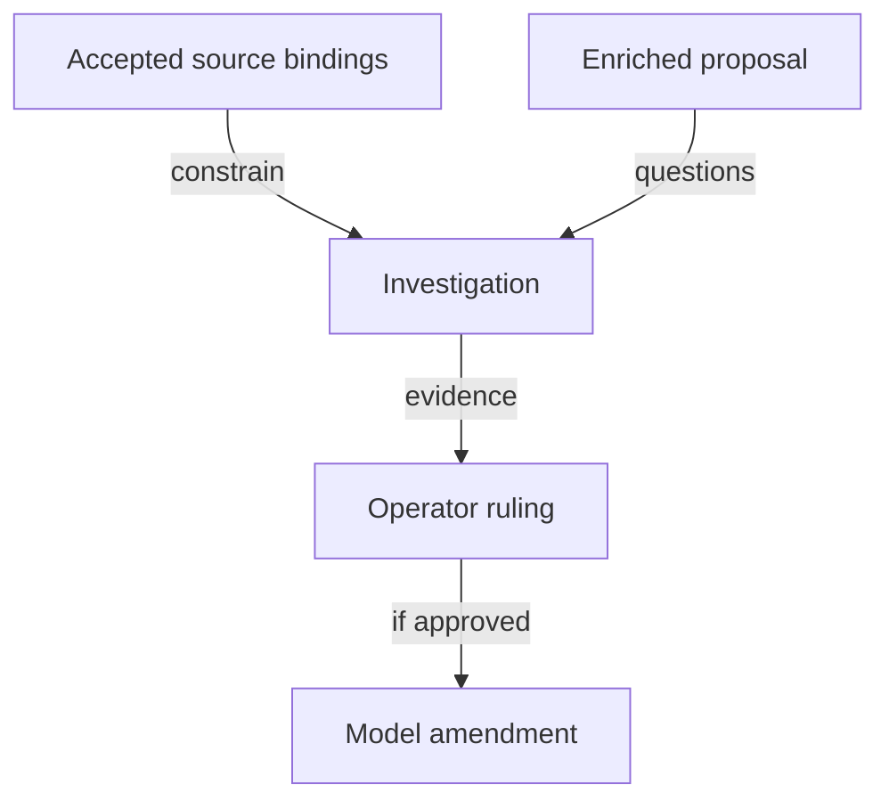

# Authority and source bindings

As the operator, I want every model conclusion traceable to a specific accepted source or a clearly marked proposal.

## Bound checkout

Repository: lambdasistemi/singular.
Investigation base: `00771d77af996605845cf062285263909a049cf8`.
Compiler: `leanprover/lean4:v4.27.0`.
Constitution: `.specify/memory/constitution.md`, identical to the canonical checkout during intake.
Machine-readable file hashes accompany this page in `base-hashes.json`.

## Operator directions

- Enriched #731, dated 21 October: investigation on its own branch, touching nothing of #529; conditional main landing after protected rejection and before 1.x.
- 22 October: "review for verticality (leave out the model, this comes before everything)".
- 22 October: "do the ticket speckit work, the spawn opus as t.o. , sol high as co, sonnet as auditor".
- Follow-up: "sonnet xhigh".

The staffing direction changes the earlier unapproved proposal. The agreed seats are Opus 5.5 high ticket owner, Codex gpt-6.1-sol high commit owner, Sonnet 5.5 xhigh auditor. No simulator or extra research seat is commissioned.

## Evidence status

| Source | Observed status at intake | Permitted use |
|---|---|---|
| Root model and economics at the bound base | Source inspected; no model build executed in this planning phase | Binding baseline, not fresh proof/check evidence |
| Open-datum model at the same base | App remains registry-parameterized; protected Control carries registry and active policy | Bound consumer obligations to reconcile |
| #679 and #680 | Both open on 22 October; their ledger/history module surface is absent from this main checkout | Dependency inventory and questions; no claim of accepted completed proofs |
| #731 proposal and #741 criteria | Current issue bodies read | Investigation mandate, not a soundness ruling |
| #529 | Separate protected-rejection lane | Reuse accepted model/rulings through exact source bindings only; no active-lane mutation or restart |

## Questions that must receive an evidence-bound disposition

Cross-policy same-seed uniqueness; role authentication under the common policy; hash assumptions and byte/abstract correspondence; acyclic application release with pending termination; complete economic configuration; reader information requirements.

The bound constitution describes abandonment of earlier contract instances, whereas #731 discusses a compatible-release path. Identify the exact releases and any later ruling before treating either phrase as authority for this new line. This investigation records the scope question; it does not amend compatibility policy.

No new semantic ruling is recorded by these planning documents.

