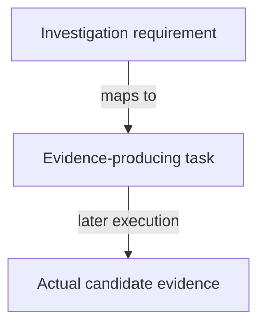

# Investigation specification checklist

As the ticket owner, I want to check that the investigation is specified without claiming its answers in advance.

- [x] The actor and observable decision outcome are stated before mechanism.
- [x] Identity, supply, reader and decision stories have independent checks.
- [x] All nine requirements map to explicit tasks.
- [x] Same-transaction multiple-policy seed use is distinguished from historical reuse.
- [x] Hash premises, asset roles, application cycles and pending custody are explicit.
- [x] Economic parameters and consumer conflicts remain visible.
- [x] Unavailable upstream results are not counted as accepted guarantees.
- [x] Proof, model, simulator, implementation and release evidence remain distinct.
- [x] Statement audit precedes proofs; operator ruling precedes accepted-law amendment.
- [x] Scope excludes production implementation and mutation of the active #529 lane.
- [x] The named three-seat roster governs delegation; no extra author/auditor is implicit.
- [x] Exact new signatures are an explicit investigation checkpoint, not an invented answer in this plan.

These marks concern specification completeness only. Every behavioral task in [tasks.md](../tasks.md) remains pending.

