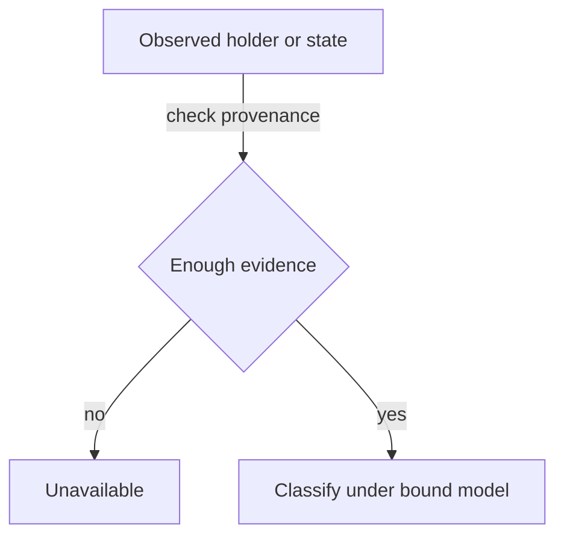

# Observation contract for the investigation

As an integrator, I want to know what evidence permits a conclusion about a key before I trust that conclusion.

This is the required decision surface, not a new implemented CLI or wire format. The model investigation must bind each row to executable declarations and exact premises.

| Conclusion | Required distinction | Forbidden inference |
|---|---|---|
| Active in application custody | Genuine derived asset at a holder satisfying the approved application predicate | Any same-policy token or fabricated datum is a registry state |
| Pending termination | Genuine token held in the approved pending request, with the applicable reachable-world evidence | Token outside application custody means already retired |
| Never registered | Approved state/proof classification of an unknown key | Token lookup returned nothing, therefore never registered |
| Terminal | Approved evidence of permanent retirement | Missing token alone proves the terminal transition |
| Unavailable or incomplete | Insufficient, conflicting, stale or unsupported observation | Provider failure means a valid negative lookup |

Each executable result binds candidate revision, input identities, observation extent and provenance. Preserve `accepted`, `refused` and `unsupported` wherever the existing driver uses those outcomes; do not overload unsupported execution as a ledger refusal.

The full candidate signature and codec are frozen only after the authority inventory. No browser-specific semantic implementation is introduced.

