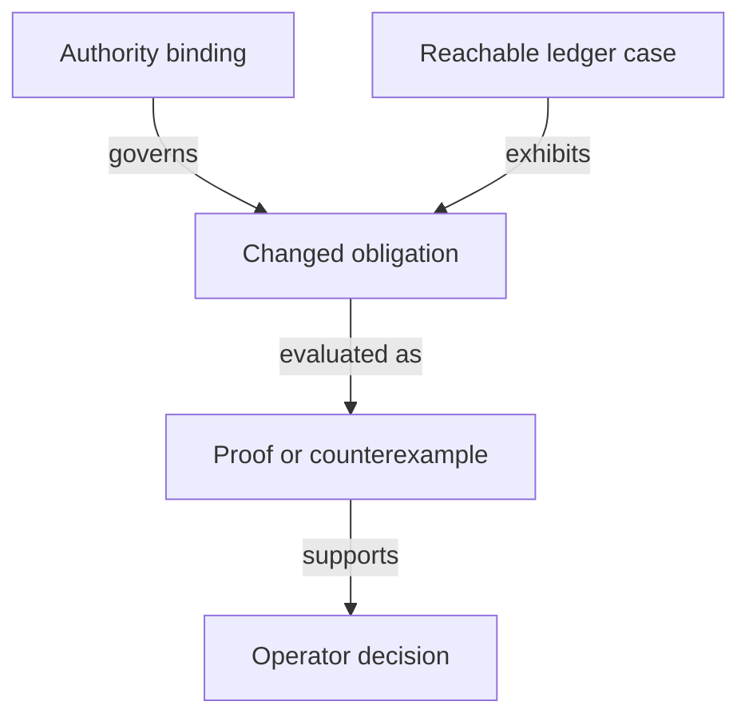

# Records needed to decide the proposal

As a model reviewer, I want to see exactly what an identity or evidence record contains and which assertions are still hypothetical.

| Record | Required fields and relationships | Validation |
|---|---|---|
| Authority binding | repository revision, path, declaration, digest, acceptance status and source of ruling | Source presence does not imply acceptance; changed identities reopen dependent evidence. |
| Candidate identity | application identity, state-policy identity, registry asset name, token kind and canonical key | Keep complete policy/name identity; do not erase policy until the claimed cross-policy uniqueness is proved under accepted premises. |
| Naming premise | exact preimage encoding, hash domain, applicable finite preimage set, explicit proposition and satisfying witness | Unambiguous encoding and collision assumptions are separate; no unconditional finite-hash injectivity. |
| Ledger case | accepted-history prefix, seed reference, policies invoked, input/output assets, redeemers and candidate state effect | Same-transaction multiple-policy use differs from across-history reuse; reuse #679/#680 vocabulary when bound. |
| Custody observation | key, registry, holder role, pending request identity, active asset, available evidence and observation provenance | Count genuine tokens in application custody and pending requests; missing evidence cannot prove terminal/never registered. |
| Changed obligation | readable guarantee, old declaration/digest, candidate declaration/digest, premise, consumer list and disposition | Every changed definition/theorem/observation is preserved, restated, retired by ruling or explicitly unresolved. |
| Decision evidence | candidate, command, actual exit, proof/axiom or counterexample pointers, audit stage and uncovered implementation claims | PROVED, REFUTED and OPEN remain distinct; only the operator rules on a semantic conflict. |

## Configuration and application controls

The bound root `Config` contains the four policy pins plus root, minimum tip, processing/reclaim windows, registry identity, registration cost and booking width. The four-field proposal is not adopted by this plan. The investigation must account for each field and preserve every required economic obligation.

The bound application has a registry-parameterized `App` and protected `Control` fields. Changing that dependency requires a recorded comparison of controller update, genuine-token release and pending-custody behavior. This table specifies no replacement wire datum.

