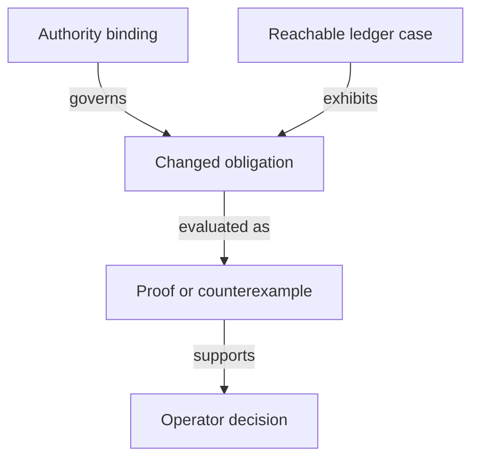

# Records needed to decide the proposal

As a model reviewer, I want to see exactly what an identity or evidence record contains and which assertions are still hypothetical.

| Record | Required fields and relationships | Validation |
|---|---|---|
| Authority binding | repository revision, path, declaration, digest, acceptance status and source of ruling | Source presence does not imply acceptance; changed identities reopen dependent evidence. |
| Candidate identity | application identity, state-policy identity, registry asset name, token kind and canonical key | Keep complete policy/name identity; do not erase policy until the claimed cross-policy uniqueness is proved under accepted premises. |
| Naming premise | exact preimage encoding, hash domain, applicable finite preimage set, explicit proposition and satisfying witness | Unambiguous encoding and collision assumptions are separate; no unconditional finite-hash injectivity. |
| Ledger case | accepted-history prefix, seed reference, policies invoked, input/output assets, redeemers and candidate state effect | Same-transaction multiple-policy use differs from across-history reuse; reuse #679/#680 vocabulary when bound. |
| Custody observation | key, registry, holder role, pending request identity, active asset, available evidence and observation provenance | Count genuine tokens in application custody and pending requests; missing evidence cannot prove terminal/never registered. |
| Changed obligation | readable guarantee, old declaration/digest, candidate declaration/digest, premise, consumer list and disposition | Every changed definition/theorem/observation is preserved, restated, retired by ruling or explicitly unresolved. |
| Decision evidence | candidate, command, actual exit, proof/axiom or counterexample pointers, audit stage and uncovered implementation claims | PROVED, REFUTED and OPEN remain distinct; only the operator rules on a semantic conflict. |

## Configuration and application controls

The bound root `Config` contains the four policy pins plus root, minimum tip, processing/reclaim windows, registry identity, registration cost and booking width. The four-field proposal is not adopted by this plan. The investigation must account for each field and preserve every required economic obligation.

The bound application has a registry-parameterized `App` and protected `Control` fields. Changing that dependency requires a recorded comparison of controller update, genuine-token release and pending-custody behavior. This table specifies no replacement wire datum.

## Frozen candidate records

These records are hypotheses under the identity, role and hash questions, constrained by the complete-identity ruling. They define no ledger laws or wire migration.

| Record | Fields or constructors | Scope |
|---|---|---|
| `Payload` | `edge key owner destination nonce : Nat` | Existing authorization tuple and booking nonce remain explicit. |
| `Role` | `state witness trieReady application` | Four classification cases, discovered from compiled constructors. |
| `Binding` | `full nameOnly` | Ruled complete binding and rejected name-only contrast. |
| `Reading` | `policyOnly authenticated` | Unresolved recognition alternatives. |
| `Preimage` | `application release`; `statePolicy appPolicy`; `seed OutRef`; `role Role TokenId key`; `approval TokenId Payload` | Tagged structural domains with complete identities. Name-only contrast replaces the policy component by zero. |
| `Observation` | `asset : TokenId`, `stateDatum : Bool`, `provenance : TokenId` | Provenance is explicit authenticated-origin evidence with external validity still a premise. Fabricating a datum changes no asset or provenance. |
| `TxOutput` | `assets : List (TokenId × Nat)` | Asset counts only; no fee or script semantics. |
| `TxView` | `spent : List OutRef`, `outputs : List TxOutput`, `mint : List (TokenId × Int)`, `invoked : List Nat` | Observation only; quantities sum per complete asset; history is a list of views. |
| `Query`, `Scenario` | Named public case, finite hash table, explicit application/registry/payload/key/assets, observation, seed, transaction and history; scenario adds a mutation selector | Generic oracle input only, with no theorem-specific projection. `none` selects the candidate; other selectors serve the mutant ledger. |
| `Guard` | Full/name-only approval, policy-state, four authenticated roles, genesis seed count, history uniqueness | Selector is `none` or `flip Guard`; exactly one guard changes. |
| Statement ledger | theorem, compiled statement digest, status, question/ruling, witness declarations, selectors, optional inversion case | Rejected readings have a separate status marker. |
| Mutant ledger | theorem, selector, premise/positive/falsification declarations | Candidate and selector evaluate the same instance; no unrelated mutant function. |

The minimal transaction view must later bind to accepted ledger/history vocabulary, as [impact.md](impact.md) records. It cannot establish ledger validity, lineage, custody, supply or real hash collision freedom. Economic configuration and the termination custody ruling belong to subsequent stages.

## Frozen application-held records

The records below belong only to NoPin.Held. They are explicitly hypothetical. They specify no wire layout, policy implementation or cancellation ruling. The public application address family is distinct from logical custody classification.

| Record | Fields and meaning |
|---|---|
| Control | registry : TokenId; key, controller, deposit : Nat |
| Holding | reference : OutRef; family : Nat; control : Control; token : TokenId; quantity : Nat; provenance : TokenId; rootHolding : Singular.Holding; payload, lovelace : Nat. Complete identity and authenticated origin are explicit, never inferred from payload. |
| Pending | holding : Holding; booking : Singular.TerminationBooking. The fresh holding reference equals the retained request reference; family/control/token/payload are retained from the spent live holding; root exact contents determine pending value and tags. |
| LockedOutput | live Holding or pending Pending. Tagged, disjoint states; address equality does not erase the tag. |
| ApplicationState | registry : Singular.RegistryState; registrations : Singular.RequestPool; outputs : List LockedOutput; treasury : Nat. The economic projection uses these actual records and preserves the root configuration/trie/treasury. |
| LiveSpend | update or release. Derived from OpenDatumSpend; no controller-change path. Both are refused for pending records. |
| LocalPayment | output index, controller payment-key identity and observed lovelace. Bound to the same transaction outputs by explicit correspondence, not expected amounts. |
| LocalTransaction | assets : NoPin.TxView; spent : List Pending; payments : List LocalPayment. No state or request-validator credential. Retained deposits can be summed locally; registryOwed and carrier eligibility cannot be recovered from these fields. |
| FoldObservation | before, after : Singular.World; unspent : Singular.EconomicUtxo; transaction : Singular.EconomicTransaction. Accepted outcome is an explicit proposition over Singular.foldAccepted; no duplicated fold function. |
| Case, Guard, Mutation | Separate compiled pending-case and guard inventory; none selects the candidate, flip selects one atomic guard. Does not alter the existing identity selectors. |

Authentication, supply and availability statements name the explicit root projection and its reachability premises. Root abstract tags and candidate shared-policy assets require a named correspondence; new identities use the existing parameterized NoPin hash/codec, never the root FNV stand-ins. Calling the unchanged root admission reads its accepted tag definition and does not adopt that stand-in as a new cryptographic construction.
