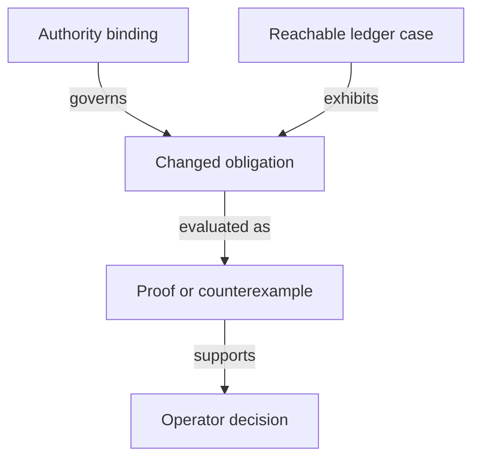

# Records needed to decide the proposal

As a model reviewer, I want to see exactly what an identity or evidence record contains and which assertions are still hypothetical.

| Record | Required fields and relationships | Validation |
|---|---|---|
| Authority binding | repository revision, path, declaration, digest, acceptance status and source of ruling | Source presence does not imply acceptance; changed identities reopen dependent evidence. |
| Candidate identity | application identity, state-policy identity, registry asset name, token kind and canonical key | Keep complete policy/name identity; do not erase policy until the claimed cross-policy uniqueness is proved under accepted premises. |
| Naming premise | exact preimage encoding, hash domain, applicable finite preimage set, explicit proposition and satisfying witness | Unambiguous encoding and collision assumptions are separate; no unconditional finite-hash injectivity. |
| Ledger case | accepted-history prefix, seed reference, policies invoked, input/output assets, redeemers and candidate state effect | Same-transaction multiple-policy use differs from across-history reuse; reuse #679/#680 vocabulary when bound. |
| Custody observation | key, registry, holder role, pending request identity, active asset, available evidence and observation provenance | Count genuine tokens in application custody and pending requests; missing evidence cannot prove terminal/never registered. |
| Changed obligation | readable guarantee, old declaration/digest, candidate declaration/digest, premise, consumer list and disposition | Every changed definition/theorem/observation is preserved, restated, retired by ruling or explicitly unresolved. |
| Decision evidence | candidate, command, actual exit, proof/axiom or counterexample pointers, audit stage and uncovered implementation claims | PROVED, REFUTED and OPEN remain distinct; only the operator rules on a semantic conflict. |

## Configuration and application controls

The bound root `Config` contains the four policy pins plus root, minimum tip, processing/reclaim windows, registry identity, registration cost and booking width. The four-field proposal is not adopted by this plan. The investigation must account for each field and preserve every required economic obligation.

The bound application has a registry-parameterized `App` and protected `Control` fields. Changing that dependency requires a recorded comparison of controller update, genuine-token release and pending-custody behavior. This table specifies no replacement wire datum.

## Frozen candidate records

These records are hypotheses under the identity, role and hash questions, constrained by the complete-identity ruling. They define no ledger laws or wire migration.

| Record | Fields or constructors | Scope |
|---|---|---|
| `Payload` | `edge key owner destination nonce : Nat` | Existing authorization tuple and booking nonce remain explicit. |
| `Role` | `state witness trieReady application` | Four classification cases, discovered from compiled constructors. |
| `Binding` | `full nameOnly` | Ruled complete binding and rejected name-only contrast. |
| `Reading` | `policyOnly authenticated` | Unresolved recognition alternatives. |
| `Preimage` | `application release`; `statePolicy appPolicy`; `seed OutRef`; `role Role TokenId key`; `approval TokenId Payload` | Tagged structural domains with complete identities. Name-only contrast replaces the policy component by zero. |
| `Observation` | `asset : TokenId`, `stateDatum : Bool`, `provenance : TokenId` | Provenance is explicit authenticated-origin evidence with external validity still a premise. Fabricating a datum changes no asset or provenance. |
| `TxOutput` | `assets : List (TokenId × Nat)` | Asset counts only; no fee or script semantics. |
| `TxView` | `spent : List OutRef`, `outputs : List TxOutput`, `mint : List (TokenId × Int)`, `invoked : List Nat` | Observation only; quantities sum per complete asset; history is a list of views. |
| `Query`, `Scenario` | Named public case, finite hash table, explicit application/registry/payload/key/assets, observation, seed, transaction and history; scenario adds a mutation selector | Generic oracle input only, with no theorem-specific projection. `none` selects the candidate; other selectors serve the mutant ledger. |
| `Guard` | Full/name-only approval, policy-state, four authenticated roles, genesis seed count, history uniqueness | Selector is `none` or `flip Guard`; exactly one guard changes. |
| Statement ledger | theorem, compiled statement digest, status, question/ruling, witness declarations, selectors, optional inversion case | Rejected readings have a separate status marker. |
| Mutant ledger | theorem, selector, premise/positive/falsification declarations | Candidate and selector evaluate the same instance; no unrelated mutant function. |

The minimal transaction view must later bind to accepted ledger/history vocabulary, as [impact.md](impact.md) records. It cannot establish ledger validity, lineage, custody, supply or real hash collision freedom. Economic configuration and the termination custody ruling belong to subsequent stages.

## Frozen application-held records

The records below belong only to NoPin.Held. They are explicitly hypothetical. They specify no wire layout, policy implementation or cancellation ruling. The public application address family is distinct from logical custody classification.

| Record | Fields and meaning |
|---|---|
| Control | registry : TokenId; key, controller, deposit : Nat |
| Holding | reference : OutRef; family : Nat; control : Control; token : TokenId; quantity : Nat; provenance : TokenId; rootHolding : Singular.Holding; payload, lovelace : Nat. Complete identity and authenticated origin are explicit, never inferred from payload. |
| Pending | holding : Holding; booking : Singular.TerminationBooking. The fresh holding reference equals the retained request reference; family/control/token/payload are retained from the spent live holding; root exact contents determine tags and the root value allocation; physical lovelace adds the disjoint protected deposit. |
| LockedOutput | live Holding or pending Pending. Tagged, disjoint states; address equality does not erase the tag. |
| ApplicationState | registryIdentity : TokenId; registry : Singular.RegistryState; registrations : Singular.RequestPool; outputs : List LockedOutput; treasury : Nat. The economic projection uses these actual records and preserves the root configuration/trie/treasury. |
| LiveSpend | update or release. Derived from OpenDatumSpend; no controller-change path. Both are refused for pending records. |
| LocalPayment | output index, controller payment-key identity and observed lovelace. Bound to the same transaction outputs by explicit correspondence, not expected amounts. |
| LocalTransaction | assets : NoPin.TxView; spent : List Pending; payments : List LocalPayment. No state or request-validator credential. Retained deposits can be summed locally; registryOwed and carrier eligibility cannot be recovered from these fields. |
| FoldObservation | registryIdentity : TokenId; before, after : Singular.World; unspent : Singular.EconomicUtxo; transaction : Singular.EconomicTransaction. Accepted outcome is an explicit proposition over Singular.foldAccepted; no duplicated fold function. |
| Case, Guard, Mutation | Separate compiled pending-case and guard inventory; none selects the candidate, flip selects one atomic guard. Does not alter the existing identity selectors. |

Authentication, supply and availability statements name the explicit root projection and its reachability premises. Root abstract tags and candidate shared-policy assets require a named correspondence; new identities use the existing parameterized NoPin hash/codec, never the root FNV stand-ins. Calling the unchanged root admission reads its accepted tag definition and does not adopt that stand-in as a new cryptographic construction.

## Authorized slice-4 physical value partition

A-003 amends the approved pending-output value surface. Holding.lovelace is physical value: pending root request.contents.lovelace plus control.deposit. These are disjoint allocations. The root request itself still contains exactly its declared tip plus carrier, with no protected deposit hidden inside that amount.

PhysicalOutput records output index, optional controller address and physical lovelace. PhysicalView records reference/value input pairs, indexed physical outputs and explicit index/deposit allocations. A FoldObservation records the unchanged economic world before and after, observed unspent set and actual economic transaction. LocalTransaction keeps the minimal TxView plus selected pending records and indexed physical payments. Its local settlement sums deposits by application family and controller, and refuses repeated payment indices.

The valuePartition correspondence subtracts the retained deposit from each physical pending input and each allocated controller output to obtain the root observer's amounts. It proves no fact about the provider or ledger. A two-holding instance uses deposits five and seven; its root and physical balances and twelve-lovelace controller payment must be computed. Overlapping the deposit with root contents and omitting its physical payment are required violating twins.

The observed ApplicationState and FoldObservation also carry registryIdentity : TokenId. This labels the accepted abstract world with its independently observed complete registry token. The named correspondence checks policy and name, while authentication of this label and interpretation of the root registryId remain upstream debt. Booking binds the controller registry to that observed identity and binds the request key/custody to the retained token.

## Frozen shared-request records

As a requester, I want my registration to name its complete registry and its own booked parameters, so that sharing a script cannot substitute another registry's identity or reclaim windows. These records belong to the hypothetical NoPin.Shared family. They define no accepted wire format, ledger evaluator or parameter removal. All earlier records and statement rows remain unchanged.

| Record | Frozen fields and ownership |
|---|---|
| PublishedRelease | applicationCredential, requestCredential, stateProgram, statePolicy : Nat. Shared application and request credentials and the once-applied state policy are authenticated release constants. The state program is a publisher input only. |
| ApplyState | Nat → Nat → Nat, an explicit publisher-side program/application interpretation. PublishedReleaseCorrespondence states statePolicy = applyState stateProgram applicationCredential; the client never receives or calls ApplyState. Concrete application/hash correspondence remains external debt. |
| RegistrationData | reference : OutRef; key, refundAddress, destination, submittedAt, registrationCost, declaredTip, carrierAda, nonce : Nat; datum : Option Nat. All fields come from public booked data. No asset name is a field in its own preimage. |
| RequestDatum | registry : Singular.TokenId; configuration : Singular.Config; payload : RegistrationData. The complete configuration snapshot is retained for this abstract candidate, including all economic fields. It is not a claim about the final pin-free wire layout. Root and pins retain their existing abstract meanings. |
| Preimage | witness(registry,key); registrationReady(registry,configuration,payload); registrationApproval(registry,configuration,payload). These are three distinct constructors, each registry a complete TokenId. Seed naming remains NoPin.stateName. Exact constructor numbers and bytes are not frozen here. |
| Codec, Hash | Preimage → List Nat and List Nat → Nat. CanonicalSerialisation means codec separates the explicitly finite occurring preimages. FiniteCollisionFree separately means hash separates their distinct encodings. Neither is unconditional injectivity. |
| RequestOutput | reference : OutRef; credential : Nat; datum : RequestDatum; lovelace : Nat; ready, approvals, otherAssets : List (TokenId × Nat). Actual quantities, exact datum and address are observed together. Absence of tags is distinguished from an authentic pending registration. |
| StateOutput | reference : OutRef; identity : TokenId; quantity : Nat; configuration : Config. A state observation is not authenticated merely by decoding these fields; its origin and correspondence to the actual economic unspent output are explicit premises. |
| ObservationBundle | assets : unchanged NoPin.TxView; references : List OutRef; requests : List RequestOutput; states : List StateOutput; world : Singular.World; unspent : Singular.EconomicUtxo; transaction : Singular.EconomicTransaction. This records observations only, with no new ledger step, validity or policy evaluator. References supplement rather than change the minimal TxView. |
| Exit | fold; rejection; reclaim; untaggedSweep. Rejection carries the existing Singular.Rejection observation. Fold and rejection may be batches. Reclaim is the existing single-registration economic exit. Sweep has a distinct untagged, world-preserving prerequisite and does not remove a pending request. |
| Action | create; register; terminate; fold; reject; reclaim. Derived identity needs are exhaustive over these constructors. Terminate uses application-held custody; only registrations use the shared request address. |
| Derivation | published constant; public chain value; hash of a structured role preimage; publisher state application. Client recipes contain only the first three. A ranked dependency observation records each derivation's actual arguments, including seed and complete registry. |
| Query and Scenario | One named public case and explicit release, public identity/payload, observation bundle, booking/rejection data, finite hash interpretation and mutation selector. No theorem name, expected acceptance bit or private booking file. Mutation.none is the candidate; flip selects one discovered atomic guard. |

ConfigurationCorrespondence binds the datum's snapshot to the authenticated booked registry's immutable parameters and the current root world's corresponding configuration fields. The current trie root may differ: equality of snapshot and current root is not required. CompleteRegistryCorrespondence binds the separately observed policy/name to the root's abstract registryId and stateToken interpretation; it does not compare policy alone. RequestObservationCorrespondence binds same-output datum, reference, credential, physical value and candidate assets to the actual root registration, exact accepted tags and booking. LedgerObservationCorrespondence binds complete spending/reference sets, state observations and mint to the same transaction and unspent view. Completeness and authentic origin are premises, never consequences of an empty list.

The canonical serialization premise and finite collision premise range over the preimages actually used, with an explicit nontrivial satisfying domain and violating twins. CDDL, exact CBOR/Plutus Data bytes, list forms, long byte strings and hash choices remain obligations in the impact inventory. Application-held observations, value partition and BurnCoupling keep their earlier explicit boundaries.

Termination shape is under revision in the following stage. No new termination record or termination-ready preimage is introduced here. The terminate client inventory lists the existing complete-identity application approval hash and the active witness hash, with any revised approval payload held for that stage.

## Application-owned request records

As an application author, I want every observed output, identity and payment allocation explicit before the candidate states a guarantee. This new hypothetical family is NoPin.ApplicationRequests. Earlier families and their statement rows remain historical and unchanged. The [source and journey trace](application-requests.md) owns the replacement inventory; no record here amends accepted law or specifies concrete CBOR bytes.

| Record | Frozen fields and ownership |
|---|---|
| PublishedRelease | applicationCredential, stateProgram, statePolicy, terminationTip : Nat. The publisher applies the state program to the application once per release. The termination tip belongs only to open datum; treasury payments are the observed ledger donation field. Authentic release publication and actual script/hash correspondence are separate premises. |
| Preimage | state(seed : OutRef); active(registry : TokenId, key : Key); registrationApproval(registry : TokenId, key : Key, holdingAddress : Nat, initialDatum : Nat); terminationApproval(registry : TokenId, key : Key). Distinct structured constructors separate every role and operation. The registry always includes policy and name. No request-tag constructor exists. |
| Codec, Hash, TrieCommit | Preimage → List Nat; List Nat → Nat; Singular.Trie → Nat. They are explicit pure parameters. The codec represents structured CBOR in the abstract; no numerical constructor choices, serialization bytes or cryptographic implementation are claimed. TrieCommit never calls the accepted FNV root. |
| FiniteEncoding, FiniteCollisionFree | Separate propositions over the finite occurring Preimage domain. State/active separation includes the state seed and every active preimage a genesis or fold actually mentions. A matching digest implies a matching constructor only under both premises. |
| ObservedOutput | reference : OutRef; credential, lovelace : Nat; datum : OutputDatum; assets : List (TokenId × Nat). OutputDatum is root(commitment : Nat), application(data : Nat), or empty. Values and datums belong to this same output; quantities sum on complete assets. |
| PublicRegistry | identity : TokenId; seed : OutRef; state : ObservedOutput; trie : Singular.Trie. The seed is public genesis data supplied with the fold, not stored in the root-only datum and not recovered by inverting its token name. Complete authentic observations and public availability of genesis/proofs are explicit prerequisites. |
| ProtectedControl | registry : TokenId; activeAsset : TokenId; key, controller, deposit : Nat. Live holdings preserve control and their other assets under controller-authorized payload updates. The registry-independent application reads full runtime identities. |
| RegistrationData | registry : TokenId; key, controller, refundAddress, holdingAddress, initialDatum, deposit, registrationCost, declaredTip, carrierAda, bookedAt, processDeadline, reclaimEnd : Nat. The application authenticates this immutable booked record and a nonempty interval; processDeadline and reclaimEnd are fixed at booking. Carrier covers the protected deposit. No field is its own hashed asset name. |
| RegistrationRequest | output : ObservedOutput; data : RegistrationData; approval : TokenId. The output stays at the application and holds exactly one matching registration approval and the declared ADA. Its datum exposes the booked data. Generic Singular uses only approval/operation/placement data; the application owns all economic and clock fields. |
| TerminationRequest | output : ObservedOutput; registry : TokenId; key : Key; approval, activeAsset : TokenId. Registry/key are supplied asset preimages and public context, not fields in its empty datum. The output holds one matching approval, one genuine active token and ADA. No per-request declared tip or treasury-share field is inferred. |
| PendingRequest | registration RegistrationRequest or termination TerminationRequest. This is an application observation, never a Singular pending pool. Live holding and pending termination remain disjoint logical categories at the same address. |
| Change | register(requestReference : OutRef, key : Key, holdingIndex : Nat); terminate(requestReference : OutRef, key : Key). Each change consumes exactly one matching approval-bearing request; references are distinct and every selected approval pairs once. Proof/seed witnesses come from the public registry observation. |
| FoldObservation | before, after : PublicRegistry; assets : unchanged NoPin.TxView; spentOutputs, outputs : List ObservedOutput; changes : List Change; signers : List Nat; interval : Singular.Interval; fee, donation : Nat. This is a judgement input, with no new ledger transition or script evaluator. The same-output/transaction correspondence binds every field to the actual complete view. |
| LedgerObservationCorrespondence | A proposition relating FoldObservation's indexed records, complete references, policy/name quantities, datums, state input/output and the unchanged TxView to one actual transaction. Ledger conservation, no duplicated inputs and authenticated state lineage remain explicit upstream premises. |
| ApplicationSpend | registrationFold; ownerReclaim; expiredCleanup; terminationFold. Registration fold ends by processDeadline, signed owner reclaim starts there and ends by reclaimEnd, and permissionless cleanup starts at reclaimEnd. Nonempty intervals make all three disjoint. Termination has no clock or other spend path. |
| ApplicationPayments | Actual indexed output ADA/address observations, state ADA, ordinary input/output ADA, fee and treasury donation. No expected amount or folder ownership label is supplied as an observed payment. The gross reward equation uses the same observed conservation and ordinary-funding premises as accepted economics. |
| CandidateReachable, ApplicationReachable | Separate histories over candidate genesis/folds and application bookings/spends/updates. Token census is computed over complete actual unspent assets, including live holdings and pending terminations. An application booking changes no Singular state. |
| AcceptedProjection | Explicit correspondence to the accepted logical trie/holding transition and its true Reachable premise, used when reusing Singular.Statements.termination and batch_burns_only_live_holdings. The accepted root hash occurs only inside that old mathematical projection, never in candidate identity derivation. |
| ClientAction, Derivation | create, register, terminate, fold, ownerReclaim, expiredCleanup, update; published constant, public chain value, or hash of a structured preimage. Parameter application belongs solely to publisherState; it is absent from every client recipe. Dependencies retain their actual input edges and increasing ranks. |

Open datum's fixed termination tip is the ticket owner's selected candidate interpretation of the empty-datum direction. It explicitly restates the accepted variable declared-tip result; this exception is not an equality claim or an accepted-law amendment. Registration retains its declared tip and full three-phase refund schedule. Both request kinds enforce their treasury share at fold through the application spending rule; the protected termination deposit returns at booking. [Questions](questions.md#the-empty-termination-and-its-payment-split) records the counterexample and decision provenance.
