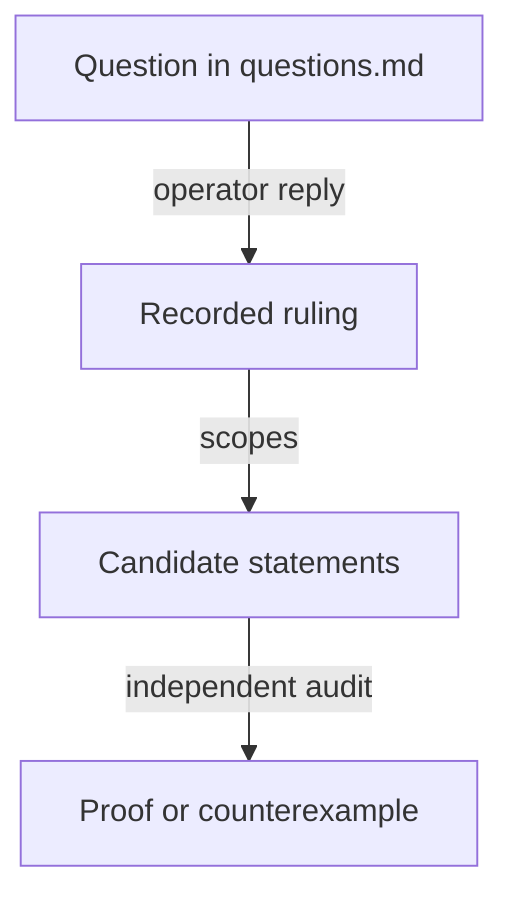

# Decisions for the no-pin investigation

As an integrator, I want each operator ruling on the no-pin proposal recorded with its question, words and scope, so that the candidate model can be checked against what was actually decided.

Each entry quotes the question put to the operator and the reply, then states its precise scope. A ruling is a design decision, not evidence: the candidate model must still state and establish the guarantee under explicit premises. Questions not listed here remain open in [questions.md](questions.md).

## Approvals bind the complete registry asset identity

Date: 22 October 2026. Resolves the first question, two applications using the same seed in one transaction.

The proposal put to the operator: "Use the registry's **full asset identity: policy ID + token name**, and commit both into the approval. The seed-derived name identifies the seed; the policy identifies the application-specific registry. Two registries can share the former without sharing the latter. That would preserve your shared-policy architecture while preventing an approval intended for one registry from authorizing another. The candidate model should verify that separation explicitly."

The operator's reply: "ok".

Scope. The registry identity committed in an approval includes both the state policy ID and the state token asset name. Equal asset names under different policies do not identify one registry, and two registries created from one seed under distinct policies in one transaction stay distinguished. Spending an input at most once across history does not establish global name uniqueness. The candidate states the refusal of an approval reused across registries under explicit encoding and finite-hash premises, and shows that the identity derivation has no cycle. The other approval obligations are unchanged. This ruling does not settle state authentication under a shared policy, hash domains, configuration placement, compatibility or reader evidence, and it is not a proof of hash injectivity or a compiled validator result.

## Termination booking moves the genuine token into the request

Superseded on 23 October 2026: the termination request and its genuine token now stay at the application script; see the last entry. This entry, the open obligation and the proposal below are kept as the history of the investigation.

Date: 22 October 2026. Resolves the fourth question, application release versus pending termination.

The question put to the operator: "Next: where should the token live between termination booking and folding? Registry economics transfers it into the pending request; the application model keeps it locked until burn. We need one consistent custody rule."

The operator's reply: "because it cannot be rejected, it goes to the request".

Scope. When termination is booked, the genuine token moves from application custody into the termination request. It stays there until the later fold, where the termination transition burns it under the existing permanent-key law. The application's release condition must permit that authenticated transfer at booking; a rule requiring the token to burn in the booking transaction contradicts this ruling. The stated reason, that a termination cannot be rejected, must be bound to the exact booking premises and the accepted transitions. If the model admits a contrary rejection, that case returns as a concrete story. The ruling does not extend to cancellation, reclaim, liveness, or any deposit or controller policy not already ruled. Token supply, authenticated registry, key and role, controller authorization and existing deposit obligations are preserved; reconciling the application model follows its own statement and audit stage.

Open obligation (22 October 2026). The operator then asked: "I think that's a problem because the application doesn't really know where the singular address is ?" The custody sequence stands, but its acceptance is held until the application can authenticate the destination. A controller could spend a genuine holding as a termination booking and send the token to a wallet or another validator instead of the request validator, with no burn at booking. Seeing the correct token or an approval does not show that the new custodian enforces the pending and terminal rules, and "a termination cannot be rejected" applies only after a genuine, correctly addressed booking. No application-law change may rely on an unauthenticated transfer. The question is open in [questions.md](questions.md).

Proposal under investigation (22 October 2026). The operator asked: "or we can use the same trick of hashing it into the key ?" The proposal is that the genuine token's asset name commits to its role, registry, logical key and the request destination, so that at release the application recomputes the name from a supplied preimage and requires the destination output to receive the exact token with the required request datum. It is a construction to investigate, not a ruling on encoding. The logical registry key, the witness token asset name and the registry state token name stay distinct, and the key's meaning to users does not change. Open points: which check makes the committed destination the correct request validator rather than an attacker's choice, how that check obtains the request credential, whether the dependency order stays acyclic, and how a reader discovers the destination needed to name the token.

## The termination request stays at the application script

Date: 23 October 2026. Supersedes the 22 October custody entry above as the chosen design, and with it the transfer to a separate request validator and the destination commitment proposal.

The operator's ruling: "ok, so leaving the termination request in the application script is the way to go, that will not require application to know anything about singular".

Scope. While a termination is pending, the termination request and the genuine token stay locked at the application script. The application does not need to embed or derive the state or request validator address to release the token: a candidate release condition observes the burn of the exact held token in the same transaction, and the token's minting policy independently enforces the terminal transition of the same registry and key. Approvals still bind the complete registry identity, and token and registry identities remain runtime data. A pending termination is a state distinct from an ordinary live holding: its representation, authorization, spend paths and accounting must be explicit, and the same address does not by itself mean the same logical custody. The existing release check reads the registry fold and its settlement; removing those reads needs an equivalent guarantee for the controller, deposit and economic obligations. No ruling on datum layout, cancellation, deposits or request tags is implied.

