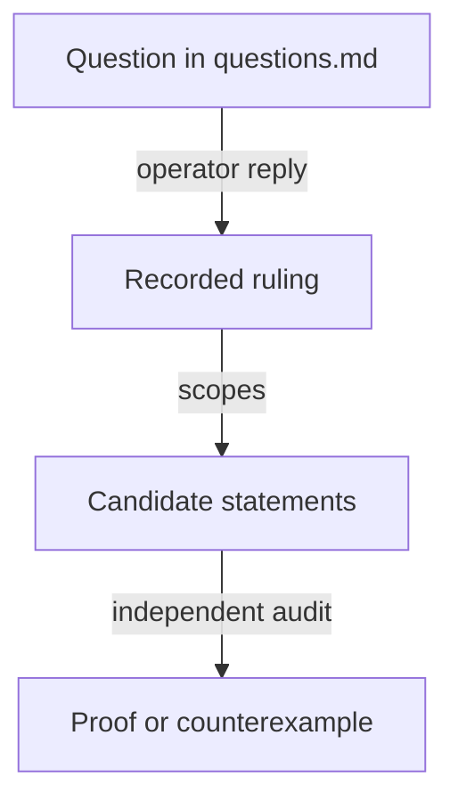

# Decisions for the no-pin investigation

As an integrator, I want each operator ruling on the no-pin proposal recorded with its question, words and scope, so that the candidate model can be checked against what was actually decided.

Each entry quotes the question put to the operator and the reply, then states its precise scope. A ruling is a design decision, not evidence: the candidate model must still state and establish the guarantee under explicit premises. Questions not listed here remain open in [questions.md](questions.md).

## Approvals bind the complete registry asset identity

Date: 22 October 2026. Resolves the first question, two applications using the same seed in one transaction.

The proposal put to the operator: "Use the registry's **full asset identity: policy ID + token name**, and commit both into the approval. The seed-derived name identifies the seed; the policy identifies the application-specific registry. Two registries can share the former without sharing the latter. That would preserve your shared-policy architecture while preventing an approval intended for one registry from authorizing another. The candidate model should verify that separation explicitly."

The operator's reply: "ok".

Scope. The registry identity committed in an approval includes both the state policy ID and the state token asset name. Equal asset names under different policies do not identify one registry, and two registries created from one seed under distinct policies in one transaction stay distinguished. Spending an input at most once across history does not establish global name uniqueness. The candidate states the refusal of an approval reused across registries under explicit encoding and finite-hash premises, and shows that the identity derivation has no cycle. The other approval obligations are unchanged. This ruling does not settle state authentication under a shared policy, hash domains, configuration placement, compatibility or reader evidence, and it is not a proof of hash injectivity or a compiled validator result.

## Termination booking moves the genuine token into the request

Date: 22 October 2026. Resolves the fourth question, application release versus pending termination.

The question put to the operator: "Next: where should the token live between termination booking and folding? Registry economics transfers it into the pending request; the application model keeps it locked until burn. We need one consistent custody rule."

The operator's reply: "because it cannot be rejected, it goes to the request".

Scope. When termination is booked, the genuine token moves from application custody into the termination request. It stays there until the later fold, where the termination transition burns it under the existing permanent-key law. The application's release condition must permit that authenticated transfer at booking; a rule requiring the token to burn in the booking transaction contradicts this ruling. The stated reason, that a termination cannot be rejected, must be bound to the exact booking premises and the accepted transitions. If the model admits a contrary rejection, that case returns as a concrete story. The ruling does not extend to cancellation, reclaim, liveness, or any deposit or controller policy not already ruled. Token supply, authenticated registry, key and role, controller authorization and existing deposit obligations are preserved; reconciling the application model follows its own statement and audit stage.

