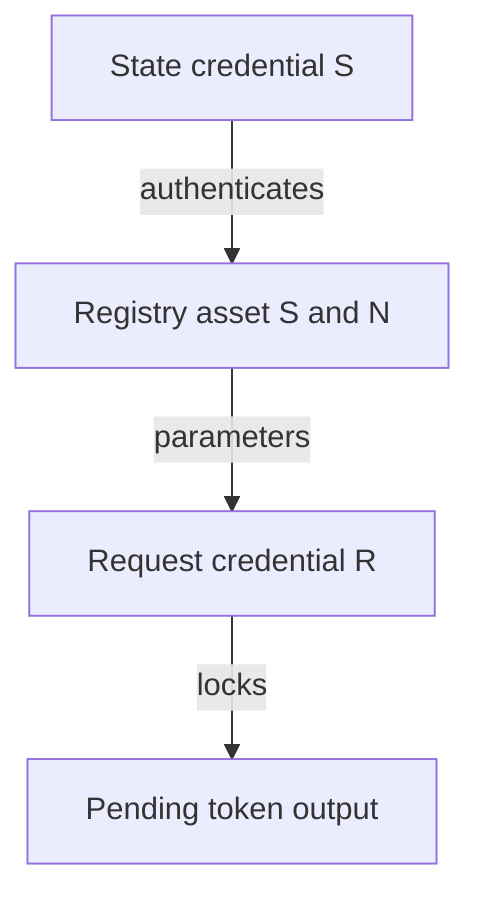
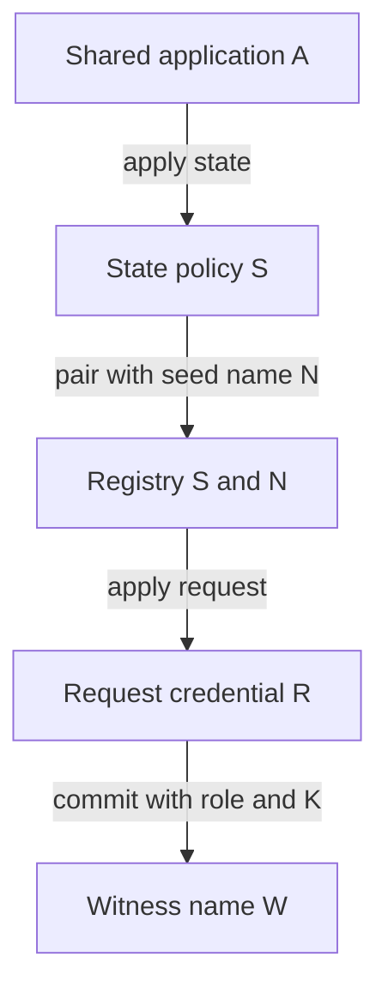
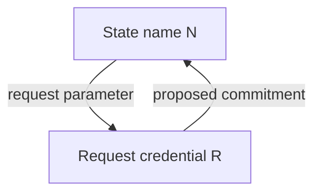
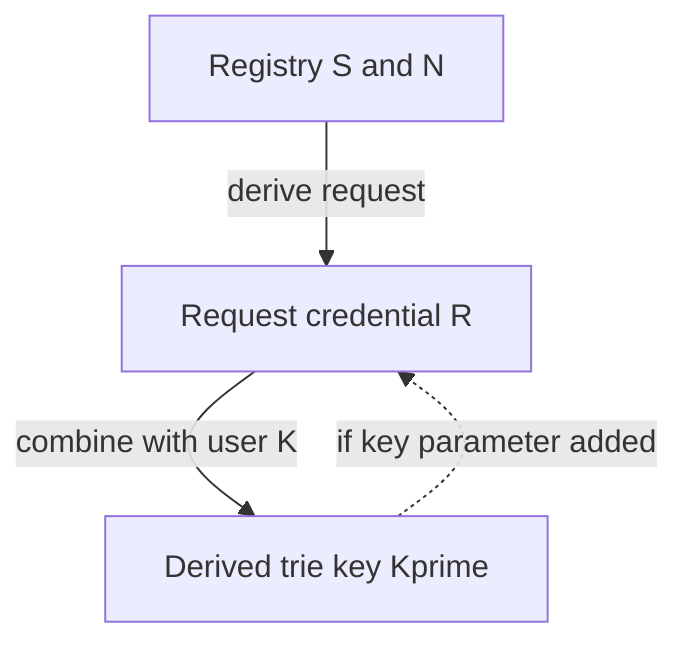
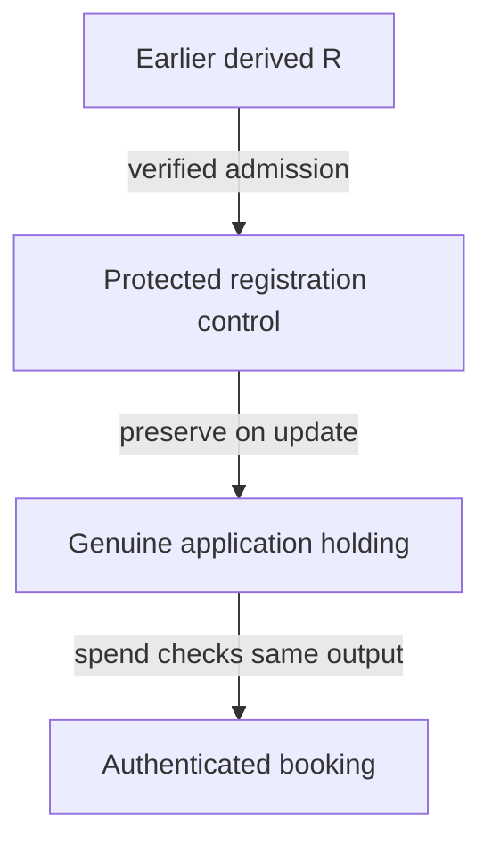
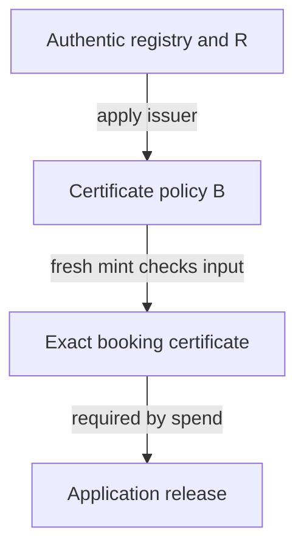

# Authenticate the destination of a pending termination

As a controller, I want to move my genuine token into a termination request that will enforce this registry's permanent retirement rules. As a reader, I want that pending custody to mean more than a token sent to somebody's chosen address.

## Finding and evidence boundary

Committing the request destination in the witness asset name can preserve an already authenticated destination without a script-parameter cycle. It does not authenticate the initial choice. The accepted contracts do not perform that proposed initial check, and the enriched proposal leaves the on-chain derivation of the applied request credential unavailable. A conditional construction is set out below with that precise missing premise. Application-to-request transfer remains held; this investigation adopts no release rule or encoding.

All accepted source facts below bind commit `00771d77af996605845cf062285263909a049cf8`; the line-and-quote register at the end makes their extent explicit. These are source readings and dependency arguments. No new Lean statement, script evaluation, transaction submission, connected lifecycle or implementation acceptance is reported. The separate hypothetical identity model has no destination commitment yet.

The [enriched epic proposal](https://github.com/lambdasistemi/singular/issues/731) was read on 22 October 2026, at updatedAt `2026-10-22T09:38:04Z`. Its retained text says that request remains applied to state policy and registry asset name, that state never computes its hash, and that the application becomes shared per release. Those statements are proposal inputs. The [recorded decisions](decisions.md) require complete registry identity and request custody at termination booking, with destination authentication still open. The proposal's burn-only application release conflicts with that custody sequence and cannot silently supply its replacement.

## Three names and two spending credentials

Let A be the application policy and application spending hash, S the state policy and state spending hash, N the registry state token name, K the logical registry key, and R the request spending credential. The complete registry asset is (S,N). In the enriched dependency order, S is derived from A, N from a seed, and R from the request release's compiled program applied to (S,N). State and request have different spending credentials even though request authenticates that registry's state token.

W is the witness token asset name. The proposed extension is W = H(encode(witness role, S, N, K, R, address scope, release scope)). Its policy is S in the enriched proposal, whereas the accepted active witness is under a separate pinned policy and its asset name is the raw key. K retains its user meaning; W and N are separate derived names. A termination request's destination field is also distinct from the address at which the request itself is locked. The legacy application termination names no delivered destination; that says nothing about the pending request's spending credential.

A full address commitment must specify network context and any stake credential, or explicitly commit only the payment credential and separately constrain the allowed address forms. Encoding, release/version domain and this address scope are unresolved. Merely calling both addresses Singular would erase the check being investigated.

The state credential authenticates the state input; the separately derived request credential locks the pending token. The arrow from registry identity to request is parameter application and script hashing, not an operation that the accepted state script already performs.

## Which credential checks what

The source register identifies the complete handlers and the decisive lines. The following table distinguishes booking from the later fold; transferring an existing asset runs no minting policy by itself.

| Component | Accepted source and parameters | Booking and later fold | Enriched proposal and remaining obligation |
|---|---|---|---|
| Application spend | open_datum(registry), complete state policy concatenated with state name; protected Control holds registry, activePolicy, key, controller and deposit | Update requires controller signature and one successor here with identical control/assets and deposit floor. Release requires this registry's spent state, a matching termination, exact active burn and additive controller payment. Booking currently reads the holding as a reference; it does not release it. | Shared per release, without registry parameter. Controller/update/deposit obligations must be reconciled with the recorded transfer ruling; token presence or approval alone cannot authenticate R. closed_datum delegates Release to this same rule and excludes Update; this is no escape path. |
| Application mint / approval policy | Same applied open_datum script; a fresh positive approval checks actual referenced registry, pinned application policy and booking-specific authorization | Registration binds its delivered application address and envelope. Termination reads a referenced holding and checks its key/registry/controller and an empty delivery destination. The later fold reads approval presence/name, without executing this policy merely because the approval is present. | Complete (S,N) must enter approvals under the ruling. Economic terminations have no application tag. Adding an approval as a booking certificate would be a new design obligation, not existing economic authority. |
| State mint and spend | Parameterless state; genesis checks seed, one state token and its own output credential; spend authenticates state input and dispatches Modify | Pure termination booking with no state spend/mint invokes neither handler. Fold spends state, checks continuation, two-edge trie operation, pinned witness mint and duties. Current state mint cannot mint the proposed witnesses: its non-genesis paths refuse. | state(A) also owns shared-policy witnesses and complete role/mint accounting. A booking mint under S would execute its new mint branch, but no such branch or applied-request hash computation is supplied here. |
| Request spend | request(S,N), applied in this order off chain | Creating a request output executes no request spend handler. Later Contribute checks its request token and a spent state input with fold actions and admission. This is protection after correct placement, not proof of placement at booking. | Parameters remain (S,N). It supplies no initial-destination oracle to the application or state policy. Current legacy rejection/window branches are not evidence for the ruled economic termination sequence. |
| Active singular witness policy | witness(kind, full registry bytes), with fixed state identity; active instance is kind 1, name is K | With zero active-token mint or burn it does not run. At fold it requires the correct registry's state input with Modify; state computes names, quantities and token routing. The terminal pure-burn exception is irrelevant to an active holding. | Witness role moves under S; W becomes hashed. At registration mint S must establish that the committed R is the authentic request credential, and at fold retain same-key mint/burn and no-remint laws. |
| Trie-ready request tag | Abstract Config.trieReadyTag and trieReadyTagAssetName in accepted Lean; no separate concrete policy handler is furnished by these booking definitions | TerminationBooking observes an exact fresh tag mint and exact custody inputs; its judgement checks identities and contents. It neither evaluates a policy nor verifies a concrete output address. | Shared-policy role discrimination and a real booking mint branch remain to be specified. A fresh tag can evidence invocation only when the invoked branch actually constrains R and the exact output. |
| Economic application tag | Abstract applicationTagAssetName plus application's external authorization; keep it distinct from legacy approvals | Registration owns this tag. terminationContentsShape requires applicationTags empty. It cannot be copied into a termination to satisfy the existing judgement. | Approval registry binding and nonce/payload binding must survive. No termination destination certificate follows from an existing registration tag. |

The accepted application Control has no request credential. Its immutability is useful only after a field's correct initial value is established. The registration check authenticates the application delivery address using the mint handler's own policy_id; it does not compute the separate request credential. bookedRequest checks an approval carrier's inline datum and quantity without checking that carrier's address. Termination's bookTerminate does not call that carrier selection at all. These narrower existing checks must not be described as authentication of the proposed pending destination.

## The missing booking predicate

In the model's vocabulary, take a genuine application holding h for registry configuration c and logical key K, a termination request r and its observed booking b. A future application release judgement needs all of the following together:

1. The spent h is the genuine holding for the complete registry asset (S,N), witness role and K, with the protected controller authorization and the ruled treatment of its deposit. Reading controller data from an arbitrary fabricated holding is not genuine-origin evidence.
2. The request credential R is authenticated as the hash of this release's request program applied to exactly (S,N). This must come from an executed check or authenticated prior record whose creation checked it; a caller's supplied address is insufficient.
3. One identified output carries exactly the spent genuine witness at quantity one, at the permitted address whose payment credential is R. No other output carries that witness, and its net mint is zero at booking. The witness name/preimage agrees on role, complete registry, K and R.
4. That same output carries the exact request datum r, including registry, key, request reference/nonce and declared allocations in their eventual concrete representation. Its singularTags equal [c.singularTag K], its trieReadyTags equal [r.trieReadyTag c], and applicationTags, otherAssets, refundAddress and submittedAt have the ruled empty/absent forms. Its lovelace equals declaredTip plus carrierAda and the tip meets the floor.
5. The bound trie-ready tag is freshly minted with this booking; custodyInputs match the one actual active holding removed from application custody. The observing layer binds these records to the very output and spent input, rather than accepting them as independent claims. All unrelated protected assets and deposit duties require their own preserved disposition.

These are requirements for a future judgement, not a Lean declaration introduced by this slice. terminationBookingRefusal already checks the abstract tuple, contents, fresh-tag list, active leaf and actual custody equality. bookTermination moves the holding to the pending pool. TerminationBooking has no general ledger transaction, concrete address or script evaluation; its source comment expressly excludes application release execution. Thus the missing predicate is the conjunction of those existing content/custody checks with authenticated R, exact same-output placement, controller/deposit composition and concrete invocation evidence. No amount of renaming r.destination supplies it.

## A counterfeit destination transaction

Start with a reachable active key K and its one genuine witness in an application holding controlled by C. A transaction T spends that holding and ordinary fee funding, is signed by C, and puts the same one witness in an output at C's wallet or an attacker validator X. Give that output a plausible termination datum if desired. T burns nothing and need not spend state or any existing request. Ordinary value conservation permits the shape; that observation is not a ledger acceptance receipt.

Under the accepted application, Update refuses the changed address and Release refuses release-no-fold before a burn is even considered. If an actual fold is added while the witness still leaves unburned, release-burn and the state's termination mint accounting also refuse. A current positive BookTerminate approval cannot rescue T: its holding is a reference input, whereas T spends it, and its approval branch does not authorize application Release. The accepted Lean application booking also retains the holding. This investigation therefore supplies no exploit of the accepted release rule.

Under a hypothetical replacement that releases on controller signature plus seeing a genuine token or an existing approval, T passes those local conditions and can redirect custody. That is a logical counterexample to the proposed weak predicate; no rewritten validator was executed. Under the original epic burn-only replacement it still fails, because T burns nothing, but so does the desired authentic request transfer. Neither weak presence checking nor burn-only checking meets the recorded custody ruling.

| Check in this transaction | Invoked? | Can it refuse the redirected token? |
|---|---|---|
| Application spend | Yes, the genuine holding is spent | Accepted Update/Release refuses as above; weak token-or-approval replacement lacks the destination condition. |
| Application mint | No for an existing approval or no approval; only a fresh mint/burn invokes it | Copying an approval runs nothing. Current fresh termination approval requires a reference holding and still supplies no Release permission or authenticated request output. |
| State spend | No, no state input is spent | Referencing state would not execute its spend handler. |
| State mint | No in T with zero mint under S | The enriched shared policy is not executed just because a witness under S changes address. |
| Request spend | No, only an output is created | An attacker validator X may accept its later spending; the genuine R has not checked anything. |
| Active witness policy | No, its net mint is zero | It would police an active burn/mint with fold co-presence, not an ordinary transfer. |
| Trie-ready policy / model judgement | No concrete branch is asserted for T | T is not an accepted abstract booking. Adding a genuine freshly minted tag would help only if its actual policy constrains this same output's address and datum. |
| Economic application tag | No, forbidden for a genuine termination | A copied registration tag supplies neither invocation nor the missing credential binding. |

In the enriched variant the attacker may try to mint a trie-ready tag under S. That invokes S's proposed mint branch. If that branch enforces the missing predicate, it rejects X; if it checks only a token and supplied address, the counterfeit remains. Its specification and execution are still owed, so neither outcome is claimed as an observed result.

## First construction: commit the destination in the witness name

This is the operator's proposal, investigated first. Keep K unchanged. Compute the request credential R after S and N, then mint witness (S,W), with W committing to role, complete registry, K and R under a release-specific unambiguous encoding. At booking the application consumes the genuine holding, obtains the preimage, recomputes W and demands the exact witness at an output with credential R and the complete request contents above. The application's spend executes because its holding is spent; its check must select the output by that exact asset and verify quantity and datum there. The original witness policy need not execute at this transfer.

This order has no parameter cycle: W is an asset name derived after the scripts, not a parameter to R or S. It does require an initial authentication premise. At registration's witness mint the shared state policy would have to check R against the real applied request program, or rely on a separately authenticated registration record. The accepted state has no such branch. The accepted application BookInsert checks its own application delivery address, active-policy pin and envelope binding, not R. The enriched issue explicitly avoids state computing the applied request hash. Consequently a supplied R hashed faithfully into W is not a solution: an attacker could mint a perfectly matching commitment to X unless the new mint/registration admission first excludes X.

A concrete conditional construction is therefore: an authenticated registration record binds (release, S, N, K, R); the witness mint verifies that record and exact witness name; application release verifies the preimage and same-output booking predicate. Its unresolved trust boundary is creation and authentication of that record and recognition of its issuer; it is not provided by the accepted registration model. Alternatively implement a concrete verifier of request-script parameter application and script hashing within the invoked mint/registration check. The off-chain applyRequestParams function shows an actual derivation path for builders, not a primitive available to either Aiken handler. Calling the derivation an abstract expectedRequestCredential oracle leaves byte/application/hash correspondence and cost unproved. No such oracle is assumed to be implemented here.

The supplied preimage must not control its own expected policy or registry. Release must tie it to the genuine input asset and authenticated registration binding; otherwise an attacker-controlled issuer can attest to itself. Commitments over finite hashes require an explicit finite occurring-domain separation premise and distinct role domains; canonical encoding must be injective on that domain independently. They are not unconditional hash injectivity claims.

| Adversary | Conditional construction's response | Still owed |
|---|---|---|
| Wrong output credential X with honest R committed | Release compares the selected output's credential with preimage R and refuses | Executable same-output check and address scope |
| Attacker-chosen X committed at initial mint | Hash recomputation alone accepts; initial trusted admission must refuse | Authentic expected R or authenticated issuer, currently missing |
| Wrong registry, key or role | Preimage must equal the authenticated complete registry, protected K and witness role and recompute exact input asset | Full shared-policy role/name separation; no policy-only shortcut |
| Wrong request datum, tags or quantities | Exact same-output predicate refuses even when W matches | Concrete economic datum, nonce/tag codec and mint accounting |
| Genuine token redirected or split | Quantity-one carrier selection and address check refuse; require zero witness mint | Ledger value and policy-invocation correspondence |
| Colliding or ambiguous commitment | Equality cannot distinguish it without the separation/encoding premises | Finite domain, release/address encoding and actual hash correspondence |

A reader given state address and K additionally needs N, the identified request release and the committed address scope to derive R and W. If that release mapping and the public parameter application are authenticated, off-chain derivation can compute them in order. Otherwise the reader must obtain the registration's authenticated R/preimage; it cannot derive W from K alone or accept an arbitrary supplied destination. A negative lookup still cannot distinguish pending, terminal, never registered and unavailable evidence.

## Committing in the state name fails this dependency order

If N instead commits to R, then R still depends on N through request(S,N). This introduces a cycle before any booking check executes. A hash is not a method for solving that fixed-point equation; no such construction is supplied. Adding R as an application parameter also cycles through A, S and R under state(A).

The same state name would be both an input of request derivation and its output's commitment. This candidate fails without changing the request dependency or introducing a separately authenticated earlier identity. Such a redesign is outside the recorded proposal. Directly pinning R in the application has the analogous A to S to R to A cycle and is not adopted.

## Committing in the logical key needs a different reader contract

In the present proposal R depends on S and N, not K, so deriving a new trie key Kprime = H(encode(K,R)) afterwards has no immediate parameter cycle. If request were specialized by Kprime, the edge back to request would make it circular. The accepted request signature confirms it is not currently key-parameterized.

This still needs initial R authentication. It also changes the meaning of the key used by the trie, proofs, approvals, raw-key witness names and direct external lookup. A caller's user key K must remain recoverable as the logical key with an explicit mapping and collision premise; replacing K silently would violate this commission. No key-dependent script parameter or altered external key contract is authorized. Keep the commitment in W for the conditional candidate.

## Protected control can preserve an authenticated destination

Extend the protected Control with (release, complete registry, K, R, address scope) at registration, then preserve those fields under payload updates. At booking its application spend compares the exact outgoing carrier and request datum to those fields. Existing validUpdate shows how immutable control can be preserved; the accepted Control contains no R. Adding a field alone authenticates nothing about the first value written there.

This is acyclic if R remains datum content rather than an application script parameter, and if S and N are derived first as above. At initial registration the mint/registration check must validate that control's R is the authentic applied request credential using the same missing derivation or trust anchor. At booking the application spend really executes, evidenced by the spent holding, so it can enforce exact token/registry/K/datum/quantities/destination after that premise is supplied. Current update immutability protects an authenticated value over time; neither a copied envelope nor a fresh envelope chosen by the controller establishes its initial correctness. This is conditional on initial admission, with no demonstrated accepted-base implementation.

## A policy-validated booking artifact needs a trusted executing issuer

A possible artifact policy B is derived after the authentic R and complete registry identity. It mints a fresh certificate whose payload binds the exact spent holding reference, witness asset, registry, K, nonce, full termination datum, quantities and destination output. The application spend must require a positive mint of the exact certificate under the authenticated B in this transaction, rather than a previously minted certificate or redeemer entry. B's mint handler must inspect that same output and input. If it refuses a wrong destination, transaction acceptance requires that refusal to hold; a mere presence test is insufficient.

This graph is acyclic only if the application's script does not embed the later B: it must obtain B from an authenticated earlier control record or verify a concrete derivation. An attacker-supplied B can always certify X. Existing protected data does not contain B or R, so that authentication is new debt. Committing B in W also remains acyclic if B does not depend on W's final name; requiring B to take W as a parameter and W to commit B would add a cycle. Runtime checking W against B's already-bound registry/role/K/R tuple avoids that particular cycle, but still needs issuer authenticity.

The existing economic trie-ready tag is the natural place to investigate this booking check rather than adding a second persistent tag. Fresh tag mint supplies an invocation trigger, not the missing expected R. Under the shared-policy proposal S can check the witnessed R commitment only if registration authenticated it; deriving R remains the same missing operation. Its exact tag naming must retain operation payload and nonce, not just the simplified identity-stage registry/role/key tuple. Minting an extra economic application tag at termination contradicts the accepted empty applicationTags condition and is not adopted. A one-shot certificate spent at booking would instead execute a spending validator; a reusable reference or copied tag would execute neither. Each alternative still needs authenticated issuer identity and exact output binding.

## Decision and next evidence

The conditional witness-name construction has the cleanest dependency order while preserving user keys. Protected control can carry the same binding. A fresh booking artifact can enforce the binding when its issuer is authenticated and actually invoked. None of the available checks yet authenticates the initial expected R under the enriched shared application's real capability constraints. These are conditional constructions and identified failure cases, not an impossibility theorem or an approved design.

The next ruling must choose a concrete authenticated initial registration/issuer premise, or authorize implementation and proof of an on-chain derivation verifier, or change request identity/dependencies. Then freeze exact encoding/address scope, statement and inversion obligations, controller/deposit composition and full token accounting before accepted-law changes. Keep transfer acceptance held until that choice is modeled and independently audited. [The open question](questions.md#how-does-the-application-know-the-token-went-to-the-request-validator) remains the decision entry point.

## Revision-bound source register

Each row links the exact accepted source line and quotes that line verbatim after trimming indentation. The surrounding handler, read in this investigation, determines its meaning; matching the quote checks citation integrity only. Missing guards are findings over the named handler/record extent, never behavioral test results.

| Source fact | Exact quoted line |
|---|---|
| [State mint dispatch](https://raw.githubusercontent.com/lambdasistemi/singular/00771d77af996605845cf062285263909a049cf8/onchain/validators/state.ak#L48) | `mint(redeemer: MintRedeemer, policyId: PolicyId, tx: Transaction) {` |
| [State mint refusal](https://raw.githubusercontent.com/lambdasistemi/singular/00771d77af996605845cf062285263909a049cf8/onchain/validators/state.ak#L55) | `Migrating(_) -> fail` |
| [State spend dispatch](https://raw.githubusercontent.com/lambdasistemi/singular/00771d77af996605845cf062285263909a049cf8/onchain/validators/state.ak#L77) | `Modify(actions) ->` |
| [State identity](https://raw.githubusercontent.com/lambdasistemi/singular/00771d77af996605845cf062285263909a049cf8/onchain/validators/state.ak#L101) | `/// The script and cage token of a state input: the one state token, at` |
| [Seed-derived state name](https://raw.githubusercontent.com/lambdasistemi/singular/00771d77af996605845cf062285263909a049cf8/onchain/lib/registry/genesis.ak#L49) | `let tokenId = TokenId { assetName: assetName(seed) }` |
| [State destination at genesis](https://raw.githubusercontent.com/lambdasistemi/singular/00771d77af996605845cf062285263909a049cf8/onchain/lib/registry/genesis.ak#L54) | `expect targetScriptHash == policyId` |
| [Request parameters](https://raw.githubusercontent.com/lambdasistemi/singular/00771d77af996605845cf062285263909a049cf8/onchain/validators/request.ak#L18) | `validator request(statePolicyId: PolicyId, cageTokenName: AssetName) {` |
| [Request contribution](https://raw.githubusercontent.com/lambdasistemi/singular/00771d77af996605845cf062285263909a049cf8/onchain/validators/request.ak#L81) | `expect Some(actions) = foldActions(stateRef, tx)` |
| [Witness parameters](https://raw.githubusercontent.com/lambdasistemi/singular/00771d77af996605845cf062285263909a049cf8/onchain/validators/witness.ak#L48) | `validator witness(kind: Int, registry: ByteArray) {` |
| [Witness fold requirement](https://raw.githubusercontent.com/lambdasistemi/singular/00771d77af996605845cf062285263909a049cf8/onchain/validators/witness.ak#L98) | `None -> False` |
| [Witness state credential](https://raw.githubusercontent.com/lambdasistemi/singular/00771d77af996605845cf062285263909a049cf8/onchain/validators/witness.ak#L121) | `address.Script(hash) ->` |
| [Application parameters](https://raw.githubusercontent.com/lambdasistemi/singular/00771d77af996605845cf062285263909a049cf8/applications/open-datum/onchain/validators/open_datum.ak#L69) | `validator open_datum(registry: ByteArray) {` |
| [Application registration checks](https://raw.githubusercontent.com/lambdasistemi/singular/00771d77af996605845cf062285263909a049cf8/applications/open-datum/onchain/validators/open_datum.ak#L220) | `} else if decodeAddress(address) != Some(` |
| [Application registration binding](https://raw.githubusercontent.com/lambdasistemi/singular/00771d77af996605845cf062285263909a049cf8/applications/open-datum/onchain/validators/open_datum.ak#L242) | `} else if name != approvalName(` |
| [Application termination reference](https://raw.githubusercontent.com/lambdasistemi/singular/00771d77af996605845cf062285263909a049cf8/applications/open-datum/onchain/validators/open_datum.ak#L270) | `when find_input(tx.reference_inputs, holding) is {` |
| [Application termination signature](https://raw.githubusercontent.com/lambdasistemi/singular/00771d77af996605845cf062285263909a049cf8/applications/open-datum/onchain/validators/open_datum.ak#L288) | `} else if !list.has(tx.extra_signatories, control.controller) {` |
| [Approval carrier selection](https://raw.githubusercontent.com/lambdasistemi/singular/00771d77af996605845cf062285263909a049cf8/applications/open-datum/onchain/validators/open_datum.ak#L333) | `fn(out) { quantity_of(out.value, policy_id, name) == 1 },` |
| [Application update destination](https://raw.githubusercontent.com/lambdasistemi/singular/00771d77af996605845cf062285263909a049cf8/applications/open-datum/onchain/validators/open_datum.ak#L380) | `if next.address != self.address {` |
| [Application update control](https://raw.githubusercontent.com/lambdasistemi/singular/00771d77af996605845cf062285263909a049cf8/applications/open-datum/onchain/validators/open_datum.ak#L382) | `} else if liveControl(next.datum) != Some(control) {` |
| [Application release needs fold](https://raw.githubusercontent.com/lambdasistemi/singular/00771d77af996605845cf062285263909a049cf8/applications/open-datum/onchain/validators/open_datum.ak#L633) | `None -> traceFalse(@"release-no-fold")` |
| [Application release burn](https://raw.githubusercontent.com/lambdasistemi/singular/00771d77af996605845cf062285263909a049cf8/applications/open-datum/onchain/validators/open_datum.ak#L653) | `} else if quantity_of(tx.mint, control.activePolicy, control.key) != -1 {` |
| [Application release deposit](https://raw.githubusercontent.com/lambdasistemi/singular/00771d77af996605845cf062285263909a049cf8/applications/open-datum/onchain/validators/open_datum.ak#L675) | `if paid < owed + releasedTo(script, control.controller, tx) {` |
| [Protected control](https://raw.githubusercontent.com/lambdasistemi/singular/00771d77af996605845cf062285263909a049cf8/applications/open-datum/onchain/validators/application/envelope.ak#L41) | `pub type Control {` |
| [Protected registry](https://raw.githubusercontent.com/lambdasistemi/singular/00771d77af996605845cf062285263909a049cf8/applications/open-datum/onchain/validators/application/envelope.ak#L43) | `registry: StateAsset,` |
| [Protected active policy](https://raw.githubusercontent.com/lambdasistemi/singular/00771d77af996605845cf062285263909a049cf8/applications/open-datum/onchain/validators/application/envelope.ak#L44) | `activePolicy: ByteArray,` |
| [Request parameter application](https://raw.githubusercontent.com/lambdasistemi/singular/00771d77af996605845cf062285263909a049cf8/offchain/lib/Singular/Registry/Blueprint/Params.hs#L158) | `applyRequestParams statePolicyId (OnChainTokenId (BuiltinByteString token)) sbs =` |
| [Approval admission at fold](https://raw.githubusercontent.com/lambdasistemi/singular/00771d77af996605845cf062285263909a049cf8/onchain/lib/registry/fold.ak#L68) | `let carried = assets.tokens(value, pins.application_policy)` |
| [Request matching at fold](https://raw.githubusercontent.com/lambdasistemi/singular/00771d77af996605845cf062285263909a049cf8/onchain/lib/registry/fold.ak#L98) | `if request.requestToken == tokenId {` |
| [Active token delta](https://raw.githubusercontent.com/lambdasistemi/singular/00771d77af996605845cf062285263909a049cf8/onchain/lib/registry/fold.ak#L231) | `pins.active_policy,` |
| [Burn input duty](https://raw.githubusercontent.com/lambdasistemi/singular/00771d77af996605845cf062285263909a049cf8/onchain/lib/registry/duty.ak#L101) | `BurnFromInput { policy: pins.active_policy, key },` |
| [Continuation credential](https://raw.githubusercontent.com/lambdasistemi/singular/00771d77af996605845cf062285263909a049cf8/onchain/lib/registry/modify.ak#L67) | `if output.address.payment_credential != input.output.address.payment_credential {` |
| [Pinned mint accounting](https://raw.githubusercontent.com/lambdasistemi/singular/00771d77af996605845cf062285263909a049cf8/onchain/lib/registry/modify.ak#L165) | `assets.tokens(expected, pins.active_policy) == assets.tokens(` |
| [Abstract request fields](https://raw.githubusercontent.com/lambdasistemi/singular/00771d77af996605845cf062285263909a049cf8/lean/Singular/Model/Termination.lean#L25) | `structure TerminationRequest where` |
| [Abstract singular identity](https://raw.githubusercontent.com/lambdasistemi/singular/00771d77af996605845cf062285263909a049cf8/lean/Singular/Model/Termination.lean#L20) | `⟨c.registryId, ⟨c.activePolicy, key⟩⟩` |
| [Booking observation boundary](https://raw.githubusercontent.com/lambdasistemi/singular/00771d77af996605845cf062285263909a049cf8/lean/Singular/Model/Termination.lean#L75) | `structure TerminationBooking where` |
| [Exact termination value](https://raw.githubusercontent.com/lambdasistemi/singular/00771d77af996605845cf062285263909a049cf8/lean/Singular/Economics/Termination.lean#L20) | `r.contents.lovelace = terminationDeclaredLovelace r ∧` |
| [Exact termination tags](https://raw.githubusercontent.com/lambdasistemi/singular/00771d77af996605845cf062285263909a049cf8/lean/Singular/Economics/Termination.lean#L40) | `else if !decide (r.contents.trieReadyTags = [r.trieReadyTag c] ∧ b.trieReadyTagsMinted = [r.trieReadyTag c]) then` |
| [Custody input equality](https://raw.githubusercontent.com/lambdasistemi/singular/00771d77af996605845cf062285263909a049cf8/lean/Singular/Economics/Termination.lean#L45) | `else if !decide (b.custodyInputs = terminationCustody registry r.key ∧ b.custodyInputs.length = 1) then` |
| [Pending custody transfer](https://raw.githubusercontent.com/lambdasistemi/singular/00771d77af996605845cf062285263909a049cf8/lean/Singular/Economics/WorldState.lean#L49) | `held := world.registry.held.filter (fun h => !(h.key == booking.request.key && h.kind == .active)) }` |
| [Trie-ready identity](https://raw.githubusercontent.com/lambdasistemi/singular/00771d77af996605845cf062285263909a049cf8/lean/Singular/Model/Booking.lean#L14) | `⟨c.registryId, commitment + 1⟩` |
| [Trie-ready commitment](https://raw.githubusercontent.com/lambdasistemi/singular/00771d77af996605845cf062285263909a049cf8/lean/Singular/Model/Booking.lean#L39) | `| .termination key destination => [1, key, destination]) ++ [nonce])` |
| [Application-tag commitment](https://raw.githubusercontent.com/lambdasistemi/singular/00771d77af996605845cf062285263909a049cf8/lean/Singular/Model/Booking.lean#L25) | `bookingCommitment 0 [(edgeOrdinal .insertActive).toNat, key, refundAddress, destination, nonce]` |
| [Application booking retains custody](https://raw.githubusercontent.com/lambdasistemi/singular/00771d77af996605845cf062285263909a049cf8/applications/open-datum/lean/OpenDatumApplication/Model.lean#L442) | `pure { w with pending := w.pending ++ [{ request := booked w.app r signatures` |
| [Application model parameters](https://raw.githubusercontent.com/lambdasistemi/singular/00771d77af996605845cf062285263909a049cf8/applications/open-datum/lean/OpenDatumApplication/Model.lean#L256) | `structure App where` |
| [Closed-datum release delegation](https://raw.githubusercontent.com/lambdasistemi/singular/00771d77af996605845cf062285263909a049cf8/applications/open-datum/onchain/validators/open_datum.ak#L709) | `validator closed_datum(registry: ByteArray) {` |
