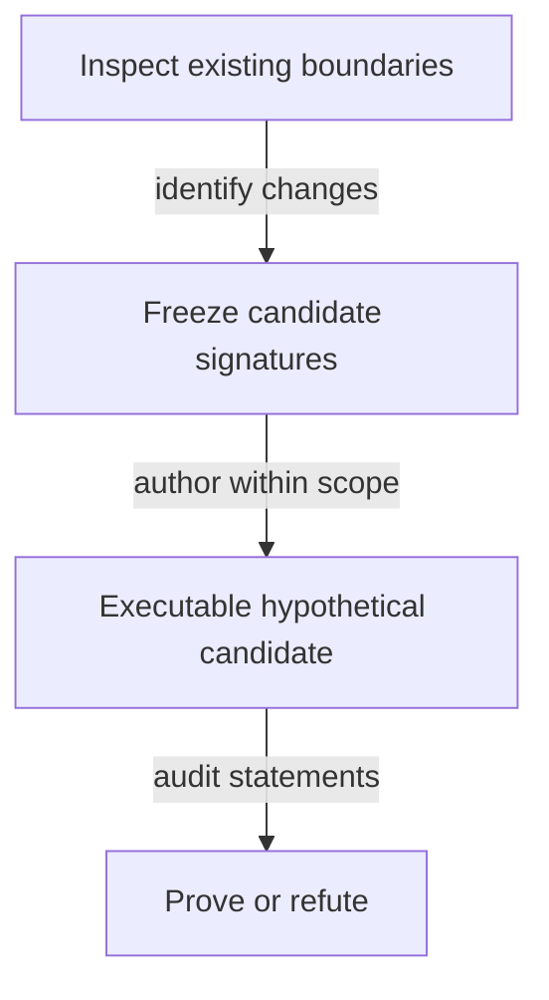

# Callable boundaries for the model investigation

As a reviewer, I want changes to call signatures distinguished from changes to the meaning of an accepted law.

## Planning-stage contract

This is an investigation specification. No production function signature is changed by planning. New hypothetical Lean signatures are frozen in this file by the ticket owner after the authority/impact inventory and before the commit owner implements them. An unresolved semantic choice stays a question; inventing a complete replacement signature now would prejudge that investigation.

The following existing signatures identify the affected boundaries; they are not instructions to rewrite them:

| Existing boundary | Named arguments and result | Question the candidate must answer |
|---|---|---|
| `Singular.kindPolicy` | `c : Config`, `kind : TokenKind` → `Nat` | How does the candidate's application-bound shared policy replace pin lookup while preserving roles? |
| `Singular.tokenAssetName` | `kind : TokenKind`, `key : Key` → `Nat` | Where does full registry identity enter the proposed hashed name, under which declared premises? |
| `Singular.Config.stateToken` | `c : Config` → `TokenId` | How does the abstract state identity correspond to actual policy/name and unique reachable state? |
| `OpenDatumApplication.appAddress` | `app : App` → `Nat` | Can the application be release-shared with no resulting state-policy dependency? |
| `OpenDatumApplication.mintApproval` | `app : App`, `r : Request`, `signatures : List Nat` → `Approval` | What exact registry-bound preimage and authorization are required? |
| `OpenDatumApplication.appStep` | `world : World`, `action : AppAction` → `Except String World` | How are controller update, application release and pending custody composed? |

The candidate's signatures must name all identity, hash-function, ledger-premise and observation inputs explicitly, with pure results. Record any serialization/driver surface changes before implementing them. Reuse the generic driver surface where its semantics suffice; do not add per-theorem expected-result projections.

This staged signature freeze is a planned output of investigation, not a claim that the production design is already specified.

## Bound signature inventory

The six boundaries above are traced individually in [impact.md](impact.md), together with the application registry/control dependencies. Their definitions and source hashes bind the accepted base; runtime declaration checks elaborate their current types. The candidate interfaces below are frozen for the hypothetical statement stage; accepted signatures remain unchanged. The registry-independent ledger script/history vocabulary remains unavailable at this base and is not replaced with a local ledger layer. [Questions](questions.md) records the decisions needed before that freeze.

## Frozen hypothetical identity surface

The isolated Lake project at `investigations/741-no-pin/` requires the unchanged root from `../..`. Namespace `NoPin` owns `Identity.lean` (pure definitions), `Statements.lean` (hypotheses with `sorry`), `Witnesses.lean` (satisfying instances), `Mutants.lean` (falsifications) and `Report.lean` (compiled inventory). `check.py` reconciles the report with statement and mutant ledgers. Accepted signatures and drivers remain unchanged.

Derivation order: release → application policy → state policy; independently seed → state name; then complete registry asset → role assets and approvals. No later output is an earlier input. `Hash : List Nat → Nat` and `Codec : Preimage → List Nat` are explicit parameters; tagged structural natural-number encoding makes no Cardano byte claim.

| Callable | Inputs → result | Hypothetical contract |
|---|---|---|
| `encode` | `Preimage → List Nat` | Constructor tags and full naturals; no accepted FNV reuse. |
| `applicationPolicy`, `statePolicy` | `Hash → Codec → Nat → Nat` | Release-derived application, then application-derived state policy. |
| `stateName` | `Hash → Codec → OutRef → Nat` | Seed-derived name. |
| `registry` | `Hash → Codec → Nat → OutRef → TokenId` | Complete state policy/name identity. |
| `roleAsset` | `Hash → Codec → TokenId → Role → Nat → TokenId` | State is the registry asset; witness and request tags have separate preimages under its policy. No custody rule follows. |
| `approvalAsset` | `Binding → Hash → Codec → Nat → TokenId → Payload → TokenId` | Application policy plus commitment; complete binding as ruled, name-only as rejected contrast. |
| `finiteEncoding`, `finiteHash` | `Codec → List Preimage → Prop`; `Hash → Codec → List Preimage → Prop` | Injectivity over the explicitly finite domain only, with satisfying examples on at least two inputs. |
| `approve` | `Mutation → Binding → Hash → Codec → Nat → TokenId → Payload → TokenId → Bool` | Compare supplied approval to the derived complete asset. |
| `recognize` | `Mutation → Reading → Hash → Codec → TokenId → Role → Nat → Observation → Bool` | Policy-only and authenticated role/name/provenance readings, both hypothetical. Provenance is supplied evidence, never inferred from a datum. |
| `genesis` | `Mutation → TxView → OutRef → TokenId → Bool` | Single seed spend, invoked policy, exact mint and one state output; no ledger acceptance. |
| `historyAllows` | `Mutation → List TxView → Bool` | Explicit spent-once premise over observed inputs; no ledger transition. |

`Mutation.none` is the candidate. Other selectors flip exactly one named atomic guard and exist only for the mutant ledger. The four `Role` constructors and other public predicates supply the inversion inventory; the compiled constructors determine its extent. Name-only safety is marked rejected and expected refutable, separately from stated hypotheses. No accepted serialization changes.

## Frozen application-held termination surface

These are hypothetical signatures for the application-held statement stage. They preserve accepted signatures. The authorized amendment below applies the operator's additive-deposit settlement ruling. All observations are explicit inputs. The minimal identity TxView and its existing statements remain unchanged.

| Callable in NoPin.Held | Inputs and result | Boundary |
|---|---|---|
| project | ApplicationState → Singular.World | Only live records enter registry.held; pending records enter world.terminations, regardless of shared address. Uses actual retained bookings. |
| liveSpend | Mutation → LiveSpend → LockedOutput → Bool | Constructors are Update and Release, derived from accepted OpenDatumSpend. Both refuse pending input. No controller-change constructor exists. |
| genuine | Mutation → Hash → Codec → Config → LockedOutput → Bool | Complete derived token, quantity one, authenticated origin and root-key correspondence; pending records additionally bind actual terminationExactContents and retained token. |
| book | Mutation → Hash → Codec → ApplicationState → LockedOutput → Pending → List Nat → Bool | Only a live genuine holding; protected controller signs; same application family, token, control and payload; fresh pending reference; exact root bookTermination admission; physical value is exact root contents plus the protected deposit. |
| bookEffect | ApplicationState → LockedOutput → Pending → ApplicationState | Replace the selected live record with the pending record. Its projection must equal the admitted root booking result. |
| pendingRelease | Mutation → Hash → Codec → Config → Pending → LocalTransaction → Bool | Authentic pending input is spent once; burn complete held asset at minus one; local retained-deposit checks only. Reads no state/request validator address. The operator's deposit-only local settlement replaces legacy registryPayments. |
| observationCorrespondence | TokenId → Key → TokenId → TxView → FoldObservation → Prop | Names exact spent references and the same registry/key singular-mint correspondence. Full ledger correspondence remains an explicit external obligation. |
| BurnCoupling | TokenId → Key → TokenId → TxView → FoldObservation → Prop | Explicit policy-contract premise: exact burn implies this observed accepted economic fold selects the same registry/key termination and makes that key terminal. Not inferred from the current witness policy. |
| discover | ApplicationState → List Pending | Public tagged records, under authentic complete observation premises; no conclusion from missing provider data. |
| consume | ApplicationState → EconomicTransaction → ApplicationState | Filter the actually consumed pending references; registry result comes only from the accepted fold outcome. |

New theorem bodies remain sorry. Every antecedent gets a satisfying executed instance, every selector is a single atomic guard flip in the same definition, and the public-case inventory is derived from compiled constructors. Ordinary funding, fee, observation authenticity and policy coupling remain premises. Economic-only availability is distinguished from the held composed availability claim.

## Authorized slice-4 value-partition amendment

A-003 amends the approved surfaces: a physical pending input and its physical controller output include a protected deposit in addition to the unchanged root economic amounts. The operator's settlement ruling removes the legacy registryPayments duty. This is a hypothetical candidate; every general theorem remains STATED.

| Pure callable | Explicit inputs | Result and boundary |
|---|---|---|
| NoPin.Held.valuePartition | selected pending records, accepted-root FoldObservation, PhysicalView | Bool checking input and output allocations, distinct indices, valid indices and each controller's full deposit sum |
| NoPin.Held.physicalBalanced | FoldObservation, PhysicalView | Bool comparing physical input total with physical output total plus root fee and donation |
| NoPin.Held.canonicalFold | ApplicationState, selected pending records, chosen time, ordinary funding, fee | FoldObservation computed through unchanged root foldBatch and foldAccepted |
| NoPin.Held.canonicalPhysical | selected pending records, FoldObservation | PhysicalView adding deposit slices to the corresponding inputs and indexed controller outputs |
| NoPin.Held.canonicalLocal | complete registry identity, selected records, FoldObservation, PhysicalView | LocalTransaction whose payments are the actual indexed physical outputs |
| NoPin.Held.composed | explicit Hash and Codec, complete registry identity, selected records, FoldObservation, PhysicalView | Bool conjoining the actual root fold decision, partition, physical balance and every local release |

NoPin.TxView remains unchanged. FoldObservation supplies separate accepted-world observations; observationCorrespondence binds spent references and keyed burns. BurnCoupling is an assumed same-registry/key policy contract. The #679/#680 mapping and physical allocation correspondence remain explicit external debt. No policy evaluation or ledger acceptance follows from these abstractions.

Booking additionally binds the source controller registry to ApplicationState.registryIdentity and binds the retained key and custody to the root request. FoldObservation carries this same independently observed complete registry identity, and observationCorrespondence compares policy and name. The physical and abstract registry interpretation remains an external premise rather than a policy-only authentication shortcut.

## Frozen shared-request surface

As a client author, I want all six operations to obtain their identities from release constants, public data and hashes. These pure surfaces are hypothetical signatures in NoPin.Shared; no accepted law is changed. The shared address contains registrations only. The trace and consumer restatement inventory are in [shared-request.md](shared-request.md).

| Pure callable | Explicit arguments → result | Frozen boundary |
|---|---|---|
| publishState | ApplyState → stateProgram → applicationCredential → Nat | The release publisher's one parameter application per application per release. A named PublishedReleaseCorrespondence binds its published result to the actual script application and hashing; no implementation of this primitive is claimed. |
| requestCredential | PublishedRelease → Nat | Reads only the published release constant; no registry, seed, key or derived name argument. |
| registry | NoPin.Hash → NoPin.Codec → PublishedRelease → OutRef → TokenId | Published statePolicy paired with the existing NoPin.stateName of the public seed. It does not take a request or witness name. |
| witnessAsset | Hash → Codec → TokenId → key → TokenId | Registry policy and hash of the witness constructor with the complete registry identity. |
| readyAsset | Hash → Codec → RequestDatum → TokenId | Registry policy and registrationReady constructor, committing all configuration/payload fields without an asset-name cycle. |
| approvalAsset | Hash → Codec → PublishedRelease → RequestDatum → TokenId | Published application policy and registrationApproval constructor, retaining complete registry, booked data and configuration binding. |
| authenticRequest | Mutation → Hash → Codec → PublishedRelease → expected registry → RequestOutput → Bool | Shared credential, complete registry, matching reference, exact one of both candidate assets, no other assets, exact declared lovelace and accepted exactContents through RequestObservationCorrespondence. Authentication of the release, tag origin and initial configuration is a named premise, not inferred from token shape. |
| discover | Mutation → Hash → Codec → PublishedRelease → registry → List RequestOutput → List RequestOutput | Filter authentic registrations at the one shared credential. Complete public input observations are required; this cannot classify an unavailable lookup. |
| registrationBooking | Mutation → Hash → Codec → PublishedRelease → RequestOutput → Singular.RegistrationBooking → Bool | authenticRequest and same-output request/booking correspondence, followed by the unchanged Singular.registrationBookingRefusal. Success preserves both fresh tag mints, exact cost/tip/carrier, booked time and width. |
| spend | Mutation → Hash → Codec → PublishedRelease → registry → Exit → ObservationBundle → optional Singular.Rejection → Bool | Authenticate every selected root registration at the shared address and bind the complete registry per exit, then call the accepted judgement named below. No independent economic transition or refund calculation. |
| fold arm | Same inputs, Exit.fold | Require matching complete spent state at quantity one, then Singular.foldAccepted. Every consumed registration must be selected from the shared address; application-held terminations retain the held correspondence and their application address. |
| rejection arm | Same inputs, Exit.rejection and Singular.Rejection | Authenticate complete reference state, require no spent state, then Singular.rejectionAccepted. Selected registration identity/address/tag checks cannot be bypassed by another registry's reference. |
| reclaim arm | Same inputs, Exit.reclaim | Require no state read or spent, authenticated own datum/tags and ConfigurationCorrespondence, then Singular.retractionAccepted. Own booked windows are supplied by that correspondence, not by another registry or an untrusted datum. |
| untagged sweep arm | Same inputs, Exit.untaggedSweep | Separate shared-address prerequisite and Singular.sweepAccepted. No pending registration is removed and no tagged request is reclassified as untagged. This is an accepted root prerequisite, not today's failed Aiken Sweep. |
| identitiesFor | Hash → Codec → PublishedRelease → public seed/registry/payload/pending observations → Action → List TokenId/credential identities | Exhaustive create/register/terminate/fold/reject/reclaim identity recipe. Client leaves are published constants or public chain data; internal nodes are hashes. No publisher application node appears in a client recipe. |
| dependencies | PublishedRelease and public derivation inputs → ranked edge observation | Edges come from the recipes' explicit arguments; request identity is release-only. Every edge increases rank and none returns from an asset name to a script identity. |
| CanonicalSerialisation, FiniteCollisionFree | Codec → List Preimage → Prop; Hash → Codec → List Preimage → Prop | Separate finite-domain encoding and collision premises. Digest equality entails structured equality only for two members under both premises. |

Economics-preservation statements compare the actual named root judgement and shared wrapper under CompleteRegistryCorrespondence, ConfigurationCorrespondence, RequestObservationCorrespondence and LedgerObservationCorrespondence. The address and identity prerequisites are part of those representation premises; equality is not claimed for a wrong-address or forged observation that the root abstraction cannot express. False or missing correspondence is a held consumer boundary, not an accepted transaction. Witnesses must compute root acceptance, refunds, windows and balances using the accepted producers and must exercise more than one registry and request.

The new public case inventory covers booking, fold, rejection, reclaim, untagged sweep, authentic discovery, each client action, dependency order, name-role separation and the affected held mappings. Inversions are derived from compiled constructors and decision sites. Each general row remains sorry with executed antecedents and owned single-guard selectors. Original identity/held statement signatures and ledgers stay byte-identical; new universal termination protection, exact supply and permanent-retirement rows retain the accepted statements' real reachability and membership premises.

## Application-owned request callables

As a reviewer, I want the same-output approval and deposit binding, application clock and actual bid separated. These NoPin.ApplicationRequests signatures follow the operator money ruling in NOTE-010. Every general theorem remains hypothetical with sorry; neither current nor historical source prose claims implementation acceptance.

| Pure callable | Explicit arguments → result | Current frozen contract |
|---|---|---|
| publishState | ApplyState → stateProgram → applicationPolicy → Nat | Publisher-only parameter application. PublishedReleaseCorrespondence binds real script/hash application. The application credential is a separate constant, never identified with the policy. |
| stateAsset | Hash → Codec → PublishedRelease → OutRef → TokenId | State policy plus structured state-role seed hash. Public genesis seed provenance is explicit. |
| activeAsset | Hash → Codec → complete registry → Key → TokenId | State policy plus hash of active-role, complete registry and logical key. Separate finite encoding/collision premises distinguish it from a state asset. |
| registrationApproval | Hash → Codec → PublishedRelease → complete registry → key, holdingAddress, initialDatum, deposit → TokenId | Application policy plus the structured registration preimage, including the exact deposit. Changing any committed field changes the name only under the stated finite premises; bid ADA is not committed. |
| terminationApproval | Hash → Codec → PublishedRelease → complete registry → Key → TokenId | Application policy plus termination role, complete registry and key. No tip, payment split or datum payload. |
| configurationAsset | Hash → Codec → PublishedRelease → complete registry → TokenId | Application-policy configuration role, distinct from an approval. No Singular request tag. |
| configurationCreate | Mutation → Hash → Codec → PublishedRelease → ConfigurationRecord → complete genesis input/output/mint observations → Bool | Genuine same-transaction state genesis, one fresh configuration asset and exact inline five parameters at the application. Ledger invocation/conservation/provenance remain explicit. |
| configurationRead | Mutation → Hash → Codec → PublishedRelease → complete registry → ConfigurationRecord → complete reference observations → Bool | Actual reference at the application with the exact full asset, quantity and inline data, under ParametersForRegistry creation provenance. No mutable replacement or registry root read. |
| recognizeState | Mutation → Hash → Codec → PublishedRelease → seed → ObservedOutput → Bool | Script credential, state-role full asset, one token, root-only datum and bare state shape. Active-token possession or a copied datum is insufficient. |
| genesis | Mutation → Hash → Codec → TrieCommit → PublishedRelease → seed → TxView and complete output observations → Bool | Once-spent seed, invoked state policy, exactly one state-role mint/output, empty commitment and nothing else under the policy. No request booking or value routing. |
| change | Mutation → Hash → Codec → TrieCommit → PublishedRelease → current logical trie → Change → FoldObservation → Except String Singular.Trie | Consumed exact operation/key/registry approval, burned once. Registration recomputes the approval from the actual new holding's address/datum hash and its explicit approved-deposit witness, checks actual holding ADA at least that deposit, mints one active token there and moves unknown to active. Open datum independently enforces its exact-deposit and genuine-token rule. Termination burns its actually held token and moves active to terminal. Singular routes no money; beyond state integrity it checks only committed holding delivery, including the deposit floor. No request ADA, clock, cost, declared tip or treasury check. |
| fold | Mutation → Hash → Codec → TrieCommit → PublishedRelease → FoldObservation → Bool | Authentic state, nonempty exact action/input pairing, distinct references, ordered changes, no newly created holding consumed, exact whole own-policy mint support, one bare same-address continuation with correct root and no state ADA drain. |
| wholePolicyDelta | FoldObservation and derived per-change complete assets → Bool | Signed sums over the union of actual/expected policy-name support. No other mint/burn under the state policy, including state-token movement. Actual quantities bind the unique approved holding. |
| registrationBook | Mutation → Hash → Codec → PublishedRelease → ConfigurationRecord → RegistrationRequest → booking interval, complete reference/mint/output observations and actual signatures → Bool | Authenticate per-seed record, controller/control/deposit/datum, exact fresh approval and same application output, and request ADA at least its deposit. Fix bookedAt at interval upper end, bound width and derive both deadlines from processTime/retractTime. minimumTip and registrationCost are not admission inputs; there is no charge or declared-tip/carrier equality. Singular is not invoked. |
| terminationBook | Mutation → Hash → Codec → PublishedRelease → genuine live holding → TerminationRequest → complete mint/output observations, donation and signatures → Bool | Controller signs, one genuine active token moves into the same empty-datum application request with its fresh approval. The protected deposit is donated to treasury at booking; donation obligations are additive across holdings. No return-to-controller obligation, fixed-tip gate or Singular invocation. The request's actual ADA is its bid. |
| registrationSpend | Mutation → Hash → Codec → PublishedRelease → ApplicationSpend → RegistrationRequest → FoldObservation and observed payments → Bool | Fold during processing delivers the exact approved deposit/datum/token and donates nothing; the remaining request value is available to the folder. Signed owner reclaim returns the whole request ADA inside its booked window. Permissionless cleanup after reclaim end returns the deposit to refund address and exposes the rest. All request exits burn approval, have no treasury share and read no registry root/trie proof. |
| terminationSpend | Mutation → Hash → Codec → PublishedRelease → TerminationRequest → actual transaction assets/outputs/payments → Bool | Exact held active-token burn with its consumed/burned approval in the same policy-validated terminal fold. No signature, deadline, configured tip or treasury share. Its whole ADA is available to its folder, subject to actual conservation and fee funding. The application never calls a trie verifier. |
| liveUpdate | Mutation → genuine live holding → successor → actual signatures → Bool | Controller signs; preserve complete protected control and assets at the application and retain the deposit floor; payload may change. Pending requests cannot enter this branch. |
| classifyPhase | RegistrationData → nonempty Interval → processing, reclaim, cleanup or refused | Fold upper bound ends by deadline; owner-reclaim lower bound starts there and upper bound ends by reclaimEnd; cleanup lower bound starts there. Straddling intervals refuse. There is no key-exists phase. |
| requestValueSplit | actual request, ApplicationSpend, indexed payments and ordinary funding/fee → Bool | Exact registration holding deposit, full owner-refund or deposit-only cleanup; no treasury donation except protected deposits at termination booking. Group required amounts by actual address, count each output once, and derive gross available bid and net bounds from observed balance, never a typed reward receipt. |
| discover | Hash → Codec → PublishedRelease → complete registry → complete public application outputs → List PendingRequest | Authenticate approval/active/configuration roles and exact same-output data. Incomplete providers give no absence proof. No application root read or private booking file. |
| buildFold | Hash → Codec → TrieCommit → PublishedRelease → PublicRegistry → acceptable requests → public trie proofs → ordinary funding and fee → FoldObservation | Construct actual transaction and payouts from public data; state separate successful Singular/application judgements under authentic complete observations, genesis/proof availability, sufficient funding, valid phases, minimum-output correspondence and willingness. No owner signature, blueprint application or inclusion claim. |
| liveActiveCount | Hash → Codec → complete registry → Key → complete actual unspent outputs → Nat | Sum actual genuine asset quantities across live/pending outputs. Whole-policy law and reachable conservation support exactly one for active and zero otherwise, without Singular pending accounting. |
| permanentProjection | CandidateReachable plus AcceptedProjection → accepted logical state/Reachable witness | Reuse named accepted permanent-key statements with their true logical premises; no old BurnCoupling replaces the new policy law. |
| identitiesFor, dependencies | Hash → Codec → release/public registry/configuration/request data → ClientAction → identities and ranked edges | Constants, public chain data and structured hashes, including registration deposit. One publisher state application only; no client blueprint application. The five-field record is public data; only its three clock parameters affect booking. |

Open datum never calls Singular's fold/change judgement or reads its root/trie. The same ledger transaction executes both contracts independently; a composition theorem joins their successful judgements and actual observations. No top-up or other competing pending spend is introduced. Case/guard constructors, inversion bindings and oracle replay must be derived from the compiled new family. All historical identity/held statements remain byte-identical; explicit restatements carry the changed money outcomes.
