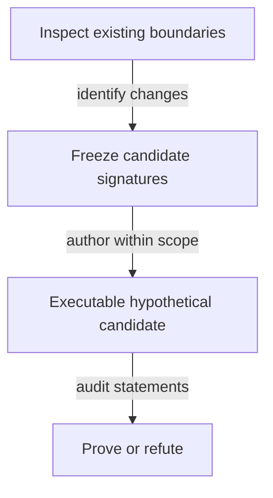

# Callable boundaries for the model investigation

As a reviewer, I want changes to call signatures distinguished from changes to the meaning of an accepted law.

## Planning-stage contract

This is an investigation specification. No production function signature is changed by planning. New hypothetical Lean signatures are frozen in this file by the ticket owner after the authority/impact inventory and before the commit owner implements them. An unresolved semantic choice stays a question; inventing a complete replacement signature now would prejudge that investigation.

The following existing signatures identify the affected boundaries; they are not instructions to rewrite them:

| Existing boundary | Named arguments and result | Question the candidate must answer |
|---|---|---|
| `Singular.kindPolicy` | `c : Config`, `kind : TokenKind` → `Nat` | How does the candidate's application-bound shared policy replace pin lookup while preserving roles? |
| `Singular.tokenAssetName` | `kind : TokenKind`, `key : Key` → `Nat` | Where does full registry identity enter the proposed hashed name, under which declared premises? |
| `Singular.Config.stateToken` | `c : Config` → `TokenId` | How does the abstract state identity correspond to actual policy/name and unique reachable state? |
| `OpenDatumApplication.appAddress` | `app : App` → `Nat` | Can the application be release-shared with no resulting state-policy dependency? |
| `OpenDatumApplication.mintApproval` | `app : App`, `r : Request`, `signatures : List Nat` → `Approval` | What exact registry-bound preimage and authorization are required? |
| `OpenDatumApplication.appStep` | `world : World`, `action : AppAction` → `Except String World` | How are controller update, application release and pending custody composed? |

The candidate's signatures must name all identity, hash-function, ledger-premise and observation inputs explicitly, with pure results. Record any serialization/driver surface changes before implementing them. Reuse the generic driver surface where its semantics suffice; do not add per-theorem expected-result projections.

This staged signature freeze is a planned output of investigation, not a claim that the production design is already specified.

## Bound signature inventory

The six boundaries above are traced individually in [impact.md](impact.md), together with the application registry/control dependencies. Their definitions and source hashes bind the accepted base; runtime declaration checks elaborate their current types. The candidate interfaces below are frozen for the hypothetical statement stage; accepted signatures remain unchanged. The registry-independent ledger script/history vocabulary remains unavailable at this base and is not replaced with a local ledger layer. [Questions](questions.md) records the decisions needed before that freeze.

## Frozen hypothetical identity surface

The isolated Lake project at `investigations/741-no-pin/` requires the unchanged root from `../..`. Namespace `NoPin` owns `Identity.lean` (pure definitions), `Statements.lean` (hypotheses with `sorry`), `Witnesses.lean` (satisfying instances), `Mutants.lean` (falsifications) and `Report.lean` (compiled inventory). `check.py` reconciles the report with statement and mutant ledgers. Accepted signatures and drivers remain unchanged.

Derivation order: release → application policy → state policy; independently seed → state name; then complete registry asset → role assets and approvals. No later output is an earlier input. `Hash : List Nat → Nat` and `Codec : Preimage → List Nat` are explicit parameters; tagged structural natural-number encoding makes no Cardano byte claim.

| Callable | Inputs → result | Hypothetical contract |
|---|---|---|
| `encode` | `Preimage → List Nat` | Constructor tags and full naturals; no accepted FNV reuse. |
| `applicationPolicy`, `statePolicy` | `Hash → Codec → Nat → Nat` | Release-derived application, then application-derived state policy. |
| `stateName` | `Hash → Codec → OutRef → Nat` | Seed-derived name. |
| `registry` | `Hash → Codec → Nat → OutRef → TokenId` | Complete state policy/name identity. |
| `roleAsset` | `Hash → Codec → TokenId → Role → Nat → TokenId` | State is the registry asset; witness and request tags have separate preimages under its policy. No custody rule follows. |
| `approvalAsset` | `Binding → Hash → Codec → Nat → TokenId → Payload → TokenId` | Application policy plus commitment; complete binding as ruled, name-only as rejected contrast. |
| `finiteEncoding`, `finiteHash` | `Codec → List Preimage → Prop`; `Hash → Codec → List Preimage → Prop` | Injectivity over the explicitly finite domain only, with satisfying examples on at least two inputs. |
| `approve` | `Mutation → Binding → Hash → Codec → Nat → TokenId → Payload → TokenId → Bool` | Compare supplied approval to the derived complete asset. |
| `recognize` | `Mutation → Reading → Hash → Codec → TokenId → Role → Nat → Observation → Bool` | Policy-only and authenticated role/name/provenance readings, both hypothetical. Provenance is supplied evidence, never inferred from a datum. |
| `genesis` | `Mutation → TxView → OutRef → TokenId → Bool` | Single seed spend, invoked policy, exact mint and one state output; no ledger acceptance. |
| `historyAllows` | `Mutation → List TxView → Bool` | Explicit spent-once premise over observed inputs; no ledger transition. |

`Mutation.none` is the candidate. Other selectors flip exactly one named atomic guard and exist only for the mutant ledger. The four `Role` constructors and other public predicates supply the inversion inventory; the compiled constructors determine its extent. Name-only safety is marked rejected and expected refutable, separately from stated hypotheses. No accepted serialization changes.

## Frozen application-held termination surface

These are hypothetical signatures for the application-held statement stage. They preserve accepted signatures. The authorized amendment below applies the operator's additive-deposit settlement ruling. All observations are explicit inputs. The minimal identity TxView and its existing statements remain unchanged.

| Callable in NoPin.Held | Inputs and result | Boundary |
|---|---|---|
| project | ApplicationState → Singular.World | Only live records enter registry.held; pending records enter world.terminations, regardless of shared address. Uses actual retained bookings. |
| liveSpend | Mutation → LiveSpend → LockedOutput → Bool | Constructors are Update and Release, derived from accepted OpenDatumSpend. Both refuse pending input. No controller-change constructor exists. |
| genuine | Mutation → Hash → Codec → Config → LockedOutput → Bool | Complete derived token, quantity one, authenticated origin and root-key correspondence; pending records additionally bind actual terminationExactContents and retained token. |
| book | Mutation → Hash → Codec → ApplicationState → LockedOutput → Pending → List Nat → Bool | Only a live genuine holding; protected controller signs; same application family, token, control and payload; fresh pending reference; exact root bookTermination admission; physical value is exact root contents plus the protected deposit. |
| bookEffect | ApplicationState → LockedOutput → Pending → ApplicationState | Replace the selected live record with the pending record. Its projection must equal the admitted root booking result. |
| pendingRelease | Mutation → Hash → Codec → Config → Pending → LocalTransaction → Bool | Authentic pending input is spent once; burn complete held asset at minus one; local retained-deposit checks only. Reads no state/request validator address. The operator's deposit-only local settlement replaces legacy registryPayments. |
| observationCorrespondence | TokenId → Key → TokenId → TxView → FoldObservation → Prop | Names exact spent references and the same registry/key singular-mint correspondence. Full ledger correspondence remains an explicit external obligation. |
| BurnCoupling | TokenId → Key → TokenId → TxView → FoldObservation → Prop | Explicit policy-contract premise: exact burn implies this observed accepted economic fold selects the same registry/key termination and makes that key terminal. Not inferred from the current witness policy. |
| discover | ApplicationState → List Pending | Public tagged records, under authentic complete observation premises; no conclusion from missing provider data. |
| consume | ApplicationState → EconomicTransaction → ApplicationState | Filter the actually consumed pending references; registry result comes only from the accepted fold outcome. |

New theorem bodies remain sorry. Every antecedent gets a satisfying executed instance, every selector is a single atomic guard flip in the same definition, and the public-case inventory is derived from compiled constructors. Ordinary funding, fee, observation authenticity and policy coupling remain premises. Economic-only availability is distinguished from the held composed availability claim.

## Authorized slice-4 value-partition amendment

A-003 amends the approved surfaces: a physical pending input and its physical controller output include a protected deposit in addition to the unchanged root economic amounts. The operator's settlement ruling removes the legacy registryPayments duty. This is a hypothetical candidate; every general theorem remains STATED.

| Pure callable | Explicit inputs | Result and boundary |
|---|---|---|
| NoPin.Held.valuePartition | selected pending records, accepted-root FoldObservation, PhysicalView | Bool checking input and output allocations, distinct indices, valid indices and each controller's full deposit sum |
| NoPin.Held.physicalBalanced | FoldObservation, PhysicalView | Bool comparing physical input total with physical output total plus root fee and donation |
| NoPin.Held.canonicalFold | ApplicationState, selected pending records, chosen time, ordinary funding, fee | FoldObservation computed through unchanged root foldBatch and foldAccepted |
| NoPin.Held.canonicalPhysical | selected pending records, FoldObservation | PhysicalView adding deposit slices to the corresponding inputs and indexed controller outputs |
| NoPin.Held.canonicalLocal | complete registry identity, selected records, FoldObservation, PhysicalView | LocalTransaction whose payments are the actual indexed physical outputs |
| NoPin.Held.composed | explicit Hash and Codec, complete registry identity, selected records, FoldObservation, PhysicalView | Bool conjoining the actual root fold decision, partition, physical balance and every local release |

NoPin.TxView remains unchanged. FoldObservation supplies separate accepted-world observations; observationCorrespondence binds spent references and keyed burns. BurnCoupling is an assumed same-registry/key policy contract. The #679/#680 mapping and physical allocation correspondence remain explicit external debt. No policy evaluation or ledger acceptance follows from these abstractions.

Booking additionally binds the source controller registry to ApplicationState.registryIdentity and binds the retained key and custody to the root request. FoldObservation carries this same independently observed complete registry identity, and observationCorrespondence compares policy and name. The physical and abstract registry interpretation remains an external premise rather than a policy-only authentication shortcut.

## Frozen shared-request surface

As a client author, I want all six operations to obtain their identities from release constants, public data and hashes. These pure surfaces are hypothetical signatures in NoPin.Shared; no accepted law is changed. The shared address contains registrations only. The trace and consumer restatement inventory are in [shared-request.md](shared-request.md).

| Pure callable | Explicit arguments → result | Frozen boundary |
|---|---|---|
| publishState | ApplyState → stateProgram → applicationCredential → Nat | The release publisher's one parameter application per application per release. A named PublishedReleaseCorrespondence binds its published result to the actual script application and hashing; no implementation of this primitive is claimed. |
| requestCredential | PublishedRelease → Nat | Reads only the published release constant; no registry, seed, key or derived name argument. |
| registry | NoPin.Hash → NoPin.Codec → PublishedRelease → OutRef → TokenId | Published statePolicy paired with the existing NoPin.stateName of the public seed. It does not take a request or witness name. |
| witnessAsset | Hash → Codec → TokenId → key → TokenId | Registry policy and hash of the witness constructor with the complete registry identity. |
| readyAsset | Hash → Codec → RequestDatum → TokenId | Registry policy and registrationReady constructor, committing all configuration/payload fields without an asset-name cycle. |
| approvalAsset | Hash → Codec → PublishedRelease → RequestDatum → TokenId | Published application policy and registrationApproval constructor, retaining complete registry, booked data and configuration binding. |
| authenticRequest | Mutation → Hash → Codec → PublishedRelease → expected registry → RequestOutput → Bool | Shared credential, complete registry, matching reference, exact one of both candidate assets, no other assets, exact declared lovelace and accepted exactContents through RequestObservationCorrespondence. Authentication of the release, tag origin and initial configuration is a named premise, not inferred from token shape. |
| discover | Mutation → Hash → Codec → PublishedRelease → registry → List RequestOutput → List RequestOutput | Filter authentic registrations at the one shared credential. Complete public input observations are required; this cannot classify an unavailable lookup. |
| registrationBooking | Mutation → Hash → Codec → PublishedRelease → RequestOutput → Singular.RegistrationBooking → Bool | authenticRequest and same-output request/booking correspondence, followed by the unchanged Singular.registrationBookingRefusal. Success preserves both fresh tag mints, exact cost/tip/carrier, booked time and width. |
| spend | Mutation → Hash → Codec → PublishedRelease → registry → Exit → ObservationBundle → optional Singular.Rejection → Bool | Authenticate every selected root registration at the shared address and bind the complete registry per exit, then call the accepted judgement named below. No independent economic transition or refund calculation. |
| fold arm | Same inputs, Exit.fold | Require matching complete spent state at quantity one, then Singular.foldAccepted. Every consumed registration must be selected from the shared address; application-held terminations retain the held correspondence and their application address. |
| rejection arm | Same inputs, Exit.rejection and Singular.Rejection | Authenticate complete reference state, require no spent state, then Singular.rejectionAccepted. Selected registration identity/address/tag checks cannot be bypassed by another registry's reference. |
| reclaim arm | Same inputs, Exit.reclaim | Require no state read or spent, authenticated own datum/tags and ConfigurationCorrespondence, then Singular.retractionAccepted. Own booked windows are supplied by that correspondence, not by another registry or an untrusted datum. |
| untagged sweep arm | Same inputs, Exit.untaggedSweep | Separate shared-address prerequisite and Singular.sweepAccepted. No pending registration is removed and no tagged request is reclassified as untagged. This is an accepted root prerequisite, not today's failed Aiken Sweep. |
| identitiesFor | Hash → Codec → PublishedRelease → public seed/registry/payload/pending observations → Action → List TokenId/credential identities | Exhaustive create/register/terminate/fold/reject/reclaim identity recipe. Client leaves are published constants or public chain data; internal nodes are hashes. No publisher application node appears in a client recipe. |
| dependencies | PublishedRelease and public derivation inputs → ranked edge observation | Edges come from the recipes' explicit arguments; request identity is release-only. Every edge increases rank and none returns from an asset name to a script identity. |
| CanonicalSerialisation, FiniteCollisionFree | Codec → List Preimage → Prop; Hash → Codec → List Preimage → Prop | Separate finite-domain encoding and collision premises. Digest equality entails structured equality only for two members under both premises. |

Economics-preservation statements compare the actual named root judgement and shared wrapper under CompleteRegistryCorrespondence, ConfigurationCorrespondence, RequestObservationCorrespondence and LedgerObservationCorrespondence. The address and identity prerequisites are part of those representation premises; equality is not claimed for a wrong-address or forged observation that the root abstraction cannot express. False or missing correspondence is a held consumer boundary, not an accepted transaction. Witnesses must compute root acceptance, refunds, windows and balances using the accepted producers and must exercise more than one registry and request.

The new public case inventory covers booking, fold, rejection, reclaim, untagged sweep, authentic discovery, each client action, dependency order, name-role separation and the affected held mappings. Inversions are derived from compiled constructors and decision sites. Each general row remains sorry with executed antecedents and owned single-guard selectors. Original identity/held statement signatures and ledgers stay byte-identical; new universal termination protection, exact supply and permanent-retirement rows retain the accepted statements' real reachability and membership premises.

## Application-owned request callables

As a reviewer, I want Singular's complete law separated from the application's request admission and payments. These signatures freeze the new NoPin.ApplicationRequests family; every declaration is hypothetical and every general theorem remains sorry. The [new records](data-model.md#application-owned-request-records) and [trace](application-requests.md) fix the arguments and changed consumers. No earlier definition or theorem is rewritten.

| Pure callable | Explicit arguments → result | Frozen contract |
|---|---|---|
| publishState | ApplyState → stateProgram → applicationPolicy → Nat | Publisher-only parameter application. PublishedReleaseCorrespondence binds its result to authenticated real script bytes and hashing. The separate applicationCredential is used by application booking/spending and discovery; Singular authenticates the consumed operation approval under applicationPolicy, without identifying that policy with an address. No client calls ApplyState. |
| stateAsset | Hash → Codec → PublishedRelease → OutRef → TokenId | Published state policy and hash of the state-role seed preimage. This new family restates the old seed-name consumer without changing its historical statement. |
| activeAsset | Hash → Codec → TokenId → Key → TokenId | Current state policy plus hash of active-role, complete registry and key. It cannot equal an occurring state-role asset under the separate finite encoding/collision premises. |
| registrationApproval, terminationApproval | Hash → Codec → PublishedRelease → complete registry and operation data → TokenId | Application policy plus the distinct operation constructor. Registration commits key, new holding address and initial datum; termination commits key and registry only. The application authenticates the rest of its booked request data. |
| configurationAsset | Hash → Codec → PublishedRelease → TokenId → TokenId | Application policy plus the configuration-role hash of the complete registry. Finite role separation prevents a configuration asset from being an approval; no Singular asset or request tag is minted. |
| configurationCreate | Mutation → Hash → Codec → PublishedRelease → ConfigurationRecord → complete genesis mint/input/output observations → Bool | Same-transaction genuine state-role genesis, one fresh configuration asset minted under the application policy into one application output with the exact inline five parameters. Open-datum create is the conjunction of this judgement and Singular genesis. Configuration provenance and uniqueness require explicit ledger invocation, conservation and state-genesis premises. |
| configurationRead | Mutation → Hash → Codec → PublishedRelease → complete registry → ConfigurationRecord → complete reference-input observations → Bool | Reference the actual configuration output at the application, with exactly its full derived asset and inline parameters. ParametersForRegistry supplies authenticated creation, not an oracle reconstructed from an application hash. The record is immutable and has no spend/removal path. |
| recognizeState | Mutation → Hash → Codec → PublishedRelease → seed → ObservedOutput → Bool | Script credential, state-role full asset, exact quantity one, root-only datum and bare ADA/state-token shape. A copied datum on an active token fails name/role checks. Origin and actual once-only genesis remain ledger/history premises. |
| genesis | Mutation → Hash → Codec → TrieCommit → PublishedRelease → seed → TxView and complete output observations → Bool | Seed spent once, invoked own policy, exactly one state-role mint and state output at that script, empty commitment and no other mint under that policy. No request booking or owner role is introduced. |
| change | Mutation → Hash → Codec → TrieCommit → PublishedRelease → current logical trie → Change → FoldObservation → Except String Singular.Trie | One observed application request and consumed/burned approval for this exact operation/key/registry; unknown-to-active registration with newly minted token at its committed datum/address, or active-to-terminal with the actual held token burned. No value, window or controller signature check occurs here. |
| fold | Mutation → Hash → Codec → TrieCommit → PublishedRelease → FoldObservation → Bool | Authentic state, nonempty exact input/action pairing, distinct request references, no surplus or missing approval; execute change in order; refuse consuming a holding created by the same batch; compare the complete own-policy mint map; one same-address, bare-state continuation with exactly the computed root and no ADA decrease. |
| wholePolicyDelta | FoldObservation and derived per-change complete assets → Bool | Sum signed quantities over the union of actual and expected complete policy/name support. Every other asset under the state policy has zero delta; no state-token mint/burn occurs in a fold. Actual input/output quantities bind every new token to exactly its committed holding output. |
| registrationBook | Mutation → Hash → Codec → PublishedRelease → ConfigurationRecord → RegistrationRequest → booking interval, complete reference/mint/output observations and actual signatures → Bool | First configurationRead for the same registry; compare cost and tip floor to its parameters, book time at the bounded interval's upper end, compute processing deadline and reclaim end from its immutable durations, and enforce its width. Then controller-authorized initial datum/control/deposit, exactly one freshly minted approval in this same application output and exact cost plus declared tip plus carrier; carrier covers deposit. Singular is not invoked. |
| terminationBook | Mutation → Hash → Codec → PublishedRelease → genuine live holding → TerminationRequest → complete mint/output observations, payments and signatures → Bool | Controller signs, exactly one matching approval is freshly minted into the same empty-datum application request holding the full genuine active token, and the protected deposit returns additively at booking. The chosen candidate requires request ADA at least the application release's termination tip, avoiding a separate top-up path. No Singular mint or state change occurs. |
| registrationSpend | Mutation → Hash → Codec → PublishedRelease → ApplicationSpend → RegistrationRequest → FoldObservation and observed payments → Bool | Fold only through its booked processing deadline, with genuine initial token/datum and exact carrier deposit, treasury cost and declared-tip gross allocation. Signed reclaim wholly within its booked window returns all held value with ordinary funding for the fee. Permissionless cleanup after reclaim end returns held minus declared tip and leaves that tip to the cleaner; neither exit reads/spends Singular state. |
| terminationSpend | Mutation → Hash → Codec → PublishedRelease → TerminationRequest → FoldObservation and observed payments → Bool | The exact input active token burns with the matching approved terminal fold; no signer or deadline gates it. The application enforces treasury donation = request ADA minus its fixed release tip. With separate ordinary fee funding and observed balance, the folder's net request take is at most that tip. This explicitly restates old variable-tip outcomes. |
| liveUpdate | Mutation → live holding → proposed successor → observed controller signatures → Bool | Preserve full protected control, assets, application credential and deposit floor; only payload changes. Pending requests cannot enter this branch. |
| classifyPhase | RegistrationData → nonempty Interval → processing, reclaim, cleanup or refused | Fold upper bound may equal the processing deadline; reclaim lower bound starts there and upper bound may equal reclaim end; cleanup lower bound starts at reclaim end. A range straddling a boundary is refused, proving no competing exit races an acceptable fold. |
| requestValueSplit | Request, ApplicationSpend, actual indexed payments and ordinary funding/fee → Bool | Read every amount from observations; enforce carrier/deposit and treasury/refund floors or exact donation as declared above. Sum deposits/refunds per address and count output indices once, including address coincidences. Do not use a purpose oracle or typed expected receipt. |
| discover | Hash → Codec → PublishedRelease → complete registry → complete public application outputs → List PendingRequest | Authenticate approval and active-token roles and same-output data. An incomplete provider result is unavailable, never evidence of absence or retirement. |
| buildFold | Hash → Codec → TrieCommit → PublishedRelease → PublicRegistry → discovered acceptable requests → public trie proofs → ordinary funding and fee → FoldObservation | Construct the mathematical transaction from public data, then state existence of successful Singular and application judgements under authentic complete observation, public genesis/proof availability, nonoverlapping phases, sufficient ordinary fee funding, balanced allocations and willingness premises. No owner/requester signature, private booking record, actual wallet funds or inclusion claim. |
| liveActiveCount | Hash → Codec → complete registry → key → complete actual unspent outputs → Nat | Compute quantities of the genuine complete active asset over all live and pending application outputs. Reachable conservation and the full policy law imply one exactly for an active leaf, zero otherwise, with no separate Singular pending counter. |
| permanentProjection | CandidateReachable state plus AcceptedProjection → accepted logical state/Reachable witness | Reuse Singular.Statements.termination and batch_burns_only_live_holdings by name with their actual premises; no opaque BurnCoupling assumption replaces the new policy law. |
| identitiesFor, dependencies | Hash → Codec → release/public registry/configuration/request data → ClientAction → identities and ranked derivation edges | All client leaves are published constants or public chain data; internal nodes hash structured preimages. Create derives the application configuration asset after the registry; registration reads its immutable chain record. Create, registration, termination, fold, reclaim, cleanup and update perform no script parameter application. |

Public cases and individual guard selectors will be derived from compiled constructors and decision sites. Every general statement needs a satisfying executed antecedent, a relevant single-guard falsification on the same input, an exact inversion and a generic oracle surface. Concrete CBOR bytes, constructor numbering, real hash/application correspondence and authenticated ledger/history mapping remain explicit separate obligations. The earlier minimal NoPin.TxView is unchanged.

Credential equality here denotes the payment script credential checked by the accepted Aiken continuation. Network and staking-address interpretation are separate byte/address correspondence obligations; no fuller address observation is inferred from a natural-number credential. The new fold keeps the no-drain floor directed by its mandate, while the accepted economic fold's exact state-value equality remains separately recorded in the impact inventory.

The registrationSpend owner-reclaim and expired-cleanup branches inspect only the authenticated booked request, actual transaction inputs/outputs/payments and interval. They never project registry roots or logical tries from the shared FoldObservation record. There is no lifecycle-mismatch spending branch: a registration that Singular cannot fold must wait for its timed exits. On its fold branch, open datum checks actual committed holding/token/deposit and payments in the atomic transaction; Singular owns the trie transition. It does not delegate a root or proof verifier to open datum. This deliberate replacement changes the old early mismatch journey, as classified for every accepted request-kind/ground pair.

Application judgements never call the Singular fold or change verifier. In a composed transaction, Singular independently validates its policy and state spend; open datum reads actual assets, mint, datums, value, signatures and intervals and protects its own configuration and requests. Its folding branch reads no before/after trie or root. The composition statement, rather than an application trie-proof check, joins the two successful judgements at the same ledger transaction. Client construction and Singular remain the consumers of PublicRegistry and trie proofs.
