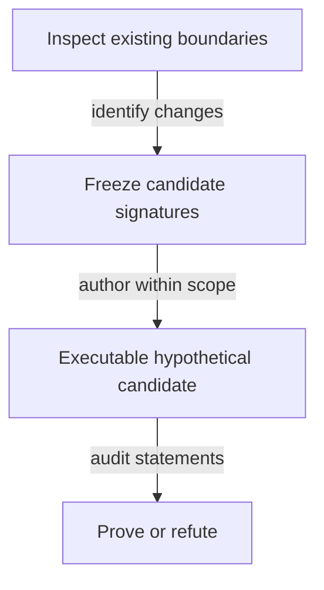

# Callable boundaries for the model investigation

As a reviewer, I want changes to call signatures distinguished from changes to the meaning of an accepted law.

## Planning-stage contract

This is an investigation specification. No production function signature is changed by planning. New hypothetical Lean signatures are frozen in this file by the ticket owner after the authority/impact inventory and before the commit owner implements them. An unresolved semantic choice stays a question; inventing a complete replacement signature now would prejudge that investigation.

The following existing signatures identify the affected boundaries; they are not instructions to rewrite them:

| Existing boundary | Named arguments and result | Question the candidate must answer |
|---|---|---|
| `Singular.kindPolicy` | `c : Config`, `kind : TokenKind` → `Nat` | How does the candidate's application-bound shared policy replace pin lookup while preserving roles? |
| `Singular.tokenAssetName` | `kind : TokenKind`, `key : Key` → `Nat` | Where does full registry identity enter the proposed hashed name, under which declared premises? |
| `Singular.Config.stateToken` | `c : Config` → `TokenId` | How does the abstract state identity correspond to actual policy/name and unique reachable state? |
| `OpenDatumApplication.appAddress` | `app : App` → `Nat` | Can the application be release-shared with no resulting state-policy dependency? |
| `OpenDatumApplication.mintApproval` | `app : App`, `r : Request`, `signatures : List Nat` → `Approval` | What exact registry-bound preimage and authorization are required? |
| `OpenDatumApplication.appStep` | `world : World`, `action : AppAction` → `Except String World` | How are controller update, application release and pending custody composed? |

The candidate's signatures must name all identity, hash-function, ledger-premise and observation inputs explicitly, with pure results. Record any serialization/driver surface changes before implementing them. Reuse the generic driver surface where its semantics suffice; do not add per-theorem expected-result projections.

This staged signature freeze is a planned output of investigation, not a claim that the production design is already specified.

## Bound signature inventory

The six boundaries above are traced individually in [impact.md](impact.md), together with the application registry/control dependencies. Their definitions and source hashes bind the accepted base; runtime declaration checks elaborate their current types. The candidate interfaces below are frozen for the hypothetical statement stage; accepted signatures remain unchanged. The registry-independent ledger script/history vocabulary remains unavailable at this base and is not replaced with a local ledger layer. [Questions](questions.md) records the decisions needed before that freeze.

## Frozen hypothetical identity surface

The isolated Lake project at `investigations/741-no-pin/` requires the unchanged root from `../..`. Namespace `NoPin` owns `Identity.lean` (pure definitions), `Statements.lean` (hypotheses with `sorry`), `Witnesses.lean` (satisfying instances), `Mutants.lean` (falsifications) and `Report.lean` (compiled inventory). `check.py` reconciles the report with statement and mutant ledgers. Accepted signatures and drivers remain unchanged.

Derivation order: release → application policy → state policy; independently seed → state name; then complete registry asset → role assets and approvals. No later output is an earlier input. `Hash : List Nat → Nat` and `Codec : Preimage → List Nat` are explicit parameters; tagged structural natural-number encoding makes no Cardano byte claim.

| Callable | Inputs → result | Hypothetical contract |
|---|---|---|
| `encode` | `Preimage → List Nat` | Constructor tags and full naturals; no accepted FNV reuse. |
| `applicationPolicy`, `statePolicy` | `Hash → Codec → Nat → Nat` | Release-derived application, then application-derived state policy. |
| `stateName` | `Hash → Codec → OutRef → Nat` | Seed-derived name. |
| `registry` | `Hash → Codec → Nat → OutRef → TokenId` | Complete state policy/name identity. |
| `roleAsset` | `Hash → Codec → TokenId → Role → Nat → TokenId` | State is the registry asset; witness and request tags have separate preimages under its policy. No custody rule follows. |
| `approvalAsset` | `Binding → Hash → Codec → Nat → TokenId → Payload → TokenId` | Application policy plus commitment; complete binding as ruled, name-only as rejected contrast. |
| `finiteEncoding`, `finiteHash` | `Codec → List Preimage → Prop`; `Hash → Codec → List Preimage → Prop` | Injectivity over the explicitly finite domain only, with satisfying examples on at least two inputs. |
| `approve` | `Mutation → Binding → Hash → Codec → Nat → TokenId → Payload → TokenId → Bool` | Compare supplied approval to the derived complete asset. |
| `recognize` | `Mutation → Reading → Hash → Codec → TokenId → Role → Nat → Observation → Bool` | Policy-only and authenticated role/name/provenance readings, both hypothetical. Provenance is supplied evidence, never inferred from a datum. |
| `genesis` | `Mutation → TxView → OutRef → TokenId → Bool` | Single seed spend, invoked policy, exact mint and one state output; no ledger acceptance. |
| `historyAllows` | `Mutation → List TxView → Bool` | Explicit spent-once premise over observed inputs; no ledger transition. |

`Mutation.none` is the candidate. Other selectors flip exactly one named atomic guard and exist only for the mutant ledger. The four `Role` constructors and other public predicates supply the inversion inventory; the compiled constructors determine its extent. Name-only safety is marked rejected and expected refutable, separately from stated hypotheses. No accepted serialization changes.

## Frozen application-held termination surface

These are hypothetical signatures for the application-held statement stage. They preserve accepted signatures. The authorized amendment below applies the operator's additive-deposit settlement ruling. All observations are explicit inputs. The minimal identity TxView and its existing statements remain unchanged.

| Callable in NoPin.Held | Inputs and result | Boundary |
|---|---|---|
| project | ApplicationState → Singular.World | Only live records enter registry.held; pending records enter world.terminations, regardless of shared address. Uses actual retained bookings. |
| liveSpend | Mutation → LiveSpend → LockedOutput → Bool | Constructors are Update and Release, derived from accepted OpenDatumSpend. Both refuse pending input. No controller-change constructor exists. |
| genuine | Mutation → Hash → Codec → Config → LockedOutput → Bool | Complete derived token, quantity one, authenticated origin and root-key correspondence; pending records additionally bind actual terminationExactContents and retained token. |
| book | Mutation → Hash → Codec → ApplicationState → LockedOutput → Pending → List Nat → Bool | Only a live genuine holding; protected controller signs; same application family, token, control and payload; fresh pending reference; exact root bookTermination admission; physical value is exact root contents plus the protected deposit. |
| bookEffect | ApplicationState → LockedOutput → Pending → ApplicationState | Replace the selected live record with the pending record. Its projection must equal the admitted root booking result. |
| pendingRelease | Mutation → Hash → Codec → Config → Pending → LocalTransaction → Bool | Authentic pending input is spent once; burn complete held asset at minus one; local retained-deposit checks only. Reads no state/request validator address. The operator's deposit-only local settlement replaces legacy registryPayments. |
| observationCorrespondence | TokenId → Key → TokenId → TxView → FoldObservation → Prop | Names exact spent references and the same registry/key singular-mint correspondence. Full ledger correspondence remains an explicit external obligation. |
| BurnCoupling | TokenId → Key → TokenId → TxView → FoldObservation → Prop | Explicit policy-contract premise: exact burn implies this observed accepted economic fold selects the same registry/key termination and makes that key terminal. Not inferred from the current witness policy. |
| discover | ApplicationState → List Pending | Public tagged records, under authentic complete observation premises; no conclusion from missing provider data. |
| consume | ApplicationState → EconomicTransaction → ApplicationState | Filter the actually consumed pending references; registry result comes only from the accepted fold outcome. |

New theorem bodies remain sorry. Every antecedent gets a satisfying executed instance, every selector is a single atomic guard flip in the same definition, and the public-case inventory is derived from compiled constructors. Ordinary funding, fee, observation authenticity and policy coupling remain premises. Economic-only availability is distinguished from the held composed availability claim.

## Authorized slice-4 value-partition amendment

A-003 amends the approved surfaces: a physical pending input and its physical controller output include a protected deposit in addition to the unchanged root economic amounts. The operator's settlement ruling removes the legacy registryPayments duty. This is a hypothetical candidate; every general theorem remains STATED.

| Pure callable | Explicit inputs | Result and boundary |
|---|---|---|
| NoPin.Held.valuePartition | selected pending records, accepted-root FoldObservation, PhysicalView | Bool checking input and output allocations, distinct indices, valid indices and each controller's full deposit sum |
| NoPin.Held.physicalBalanced | FoldObservation, PhysicalView | Bool comparing physical input total with physical output total plus root fee and donation |
| NoPin.Held.canonicalFold | ApplicationState, selected pending records, chosen time, ordinary funding, fee | FoldObservation computed through unchanged root foldBatch and foldAccepted |
| NoPin.Held.canonicalPhysical | selected pending records, FoldObservation | PhysicalView adding deposit slices to the corresponding inputs and indexed controller outputs |
| NoPin.Held.canonicalLocal | complete registry identity, selected records, FoldObservation, PhysicalView | LocalTransaction whose payments are the actual indexed physical outputs |
| NoPin.Held.composed | explicit Hash and Codec, complete registry identity, selected records, FoldObservation, PhysicalView | Bool conjoining the actual root fold decision, partition, physical balance and every local release |

NoPin.TxView remains unchanged. FoldObservation supplies separate accepted-world observations; observationCorrespondence binds spent references and keyed burns. BurnCoupling is an assumed same-registry/key policy contract. The #679/#680 mapping and physical allocation correspondence remain explicit external debt. No policy evaluation or ledger acceptance follows from these abstractions.

Booking additionally binds the source controller registry to ApplicationState.registryIdentity and binds the retained key and custody to the root request. FoldObservation carries this same independently observed complete registry identity, and observationCorrespondence compares policy and name. The physical and abstract registry interpretation remains an external premise rather than a policy-only authentication shortcut.
