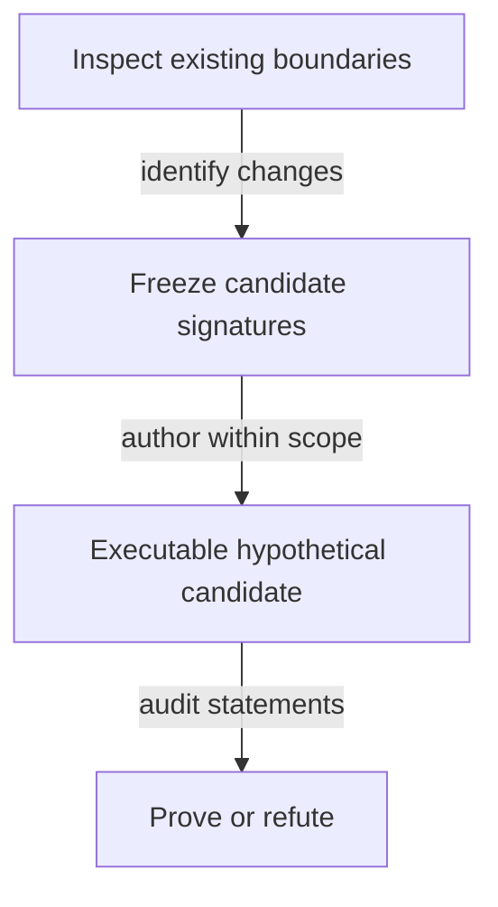

# Callable boundaries for the model investigation

As a reviewer, I want changes to call signatures distinguished from changes to the meaning of an accepted law.

## Planning-stage contract

This is an investigation specification. No production function signature is changed by planning. New hypothetical Lean signatures are frozen in this file by the ticket owner after the authority/impact inventory and before the commit owner implements them. An unresolved semantic choice stays a question; inventing a complete replacement signature now would prejudge that investigation.

The following existing signatures identify the affected boundaries; they are not instructions to rewrite them:

| Existing boundary | Named arguments and result | Question the candidate must answer |
|---|---|---|
| `Singular.kindPolicy` | `c : Config`, `kind : TokenKind` → `Nat` | How does the candidate's application-bound shared policy replace pin lookup while preserving roles? |
| `Singular.tokenAssetName` | `kind : TokenKind`, `key : Key` → `Nat` | Where does full registry identity enter the proposed hashed name, under which declared premises? |
| `Singular.Config.stateToken` | `c : Config` → `TokenId` | How does the abstract state identity correspond to actual policy/name and unique reachable state? |
| `OpenDatumApplication.appAddress` | `app : App` → `Nat` | Can the application be release-shared with no resulting state-policy dependency? |
| `OpenDatumApplication.mintApproval` | `app : App`, `r : Request`, `signatures : List Nat` → `Approval` | What exact registry-bound preimage and authorization are required? |
| `OpenDatumApplication.appStep` | `world : World`, `action : AppAction` → `Except String World` | How are controller update, application release and pending custody composed? |

The candidate's signatures must name all identity, hash-function, ledger-premise and observation inputs explicitly, with pure results. Record any serialization/driver surface changes before implementing them. Reuse the generic driver surface where its semantics suffice; do not add per-theorem expected-result projections.

This staged signature freeze is a planned output of investigation, not a claim that the production design is already specified.

## Bound signature inventory

The six boundaries above are traced individually in [impact.md](impact.md), together with the application registry/control dependencies. Their definitions and source hashes bind the accepted base; runtime declaration checks elaborate their current types. No candidate callable surface is frozen and no signature changes here. The registry-independent ledger script/history vocabulary remains unavailable at this base and is not replaced with a local ledger layer. [Questions](questions.md) records the decisions needed before that freeze.
