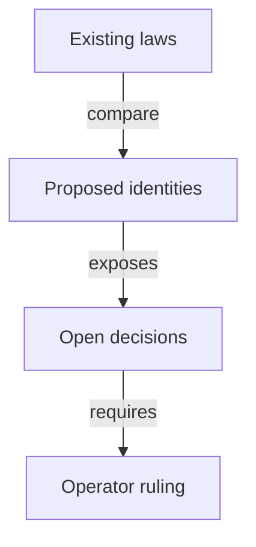

# What must survive removing policy pins

As an integrator, I want to see each existing guarantee, the proposed replacement and the evidence still needed before trusting a registry without pins.

This inventory binds the accepted source revision in [authority.md](authority.md). Every candidate claim below is a hypothesis. Accepted declarations, statements, wire formats, application rules and guarantees remain unchanged; hypothetical additions are recorded below. Old definition digests are SHA256 of the complete source-file blob; theorem digests are the base register's statementSha256. A declaration existing or a digest matching proves identity only.

The eleven configuration fields are listed individually. The constitution's driver translation still calls config an "eight-field" value, although the bound structure has eleven fields. This discrepancy is recorded in [questions.md](questions.md); its text is not amended here. The proposed four-field datum does not authorize dropping registration cost or booking width.

## Obligation inventory

| Guarantee | Base declaration | Kind | Old digest | Candidate hypothesis | Required premise | Consumers | Disposition |
|---|---|---|---|---|---|---|---|
| Trie commitment changes only with the admitted transition | [`Singular.Config.root`](https://raw.githubusercontent.com/lambdasistemi/singular/00771d77af996605845cf062285263909a049cf8/lean/Singular/Model/Registry.lean) | definition | `88abab50744690efea3554dcd4f3d440f8a38f3bb60ad521fb5a538e9ad6b6a3` | Preserve root/effect binding; byte commitment remains separate | Root coherence; economic continuation and authenticated reference state | Root/driver corpora; theorem registers; simulator mirror; coverage; model/economics explanations | unresolved |
| A booking meets its declared tip floor, serialized as maxFee | [`Singular.Config.minimumTip`](https://raw.githubusercontent.com/lambdasistemi/singular/00771d77af996605845cf062285263909a049cf8/lean/Singular/Model/Registry.lean) | definition | `88abab50744690efea3554dcd4f3d440f8a38f3bb60ad521fb5a538e9ad6b6a3` | Preserve the one tip floor | Registration and termination contents; exact fold reward and refund accounting | Root/driver corpora; theorem registers; simulator mirror; coverage; model/economics explanations | unresolved |
| Registration folding obeys its booked processing window | [`Singular.Config.processTime`](https://raw.githubusercontent.com/lambdasistemi/singular/00771d77af996605845cf062285263909a049cf8/lean/Singular/Model/Registry.lean) | definition | `88abab50744690efea3554dcd4f3d440f8a38f3bb60ad521fb5a538e9ad6b6a3` | Preserve the processing window | Finite interval and booked submission time; economic fold member admission | Root/driver corpora; theorem registers; simulator mirror; coverage; model/economics explanations | unresolved |
| Reclaim and expiry obey their separate booked windows | [`Singular.Config.retractTime`](https://raw.githubusercontent.com/lambdasistemi/singular/00771d77af996605845cf062285263909a049cf8/lean/Singular/Model/Registry.lean) | definition | `88abab50744690efea3554dcd4f3d440f8a38f3bb60ad521fb5a538e9ad6b6a3` | Preserve the reclaim window | Retraction signing/refund; rejection expiry after both windows | Root/driver corpora; theorem registers; simulator mirror; coverage; model/economics explanations | unresolved |
| Approval admission and registration booking read the pinned application | [`Singular.Config.applicationPolicy`](https://raw.githubusercontent.com/lambdasistemi/singular/00771d77af996605845cf062285263909a049cf8/lean/Singular/Model/Registry.lean) | definition | `88abab50744690efea3554dcd4f3d440f8a38f3bb60ad521fb5a538e9ad6b6a3` | Replace lookup only after proving state(application policy) binding | Exact certified tuple and application authorization; no cyclic script dependency | Root/driver corpora; theorem registers; simulator mirror; coverage; model/economics explanations | unresolved |
| The genuine active holding is named by the active pin and key | [`Singular.Config.activePolicy`](https://raw.githubusercontent.com/lambdasistemi/singular/00771d77af996605845cf062285263909a049cf8/lean/Singular/Model/Registry.lean) | definition | `88abab50744690efea3554dcd4f3d440f8a38f3bb60ad521fb5a538e9ad6b6a3` | Investigate a shared state policy with registry-bound witness names | Exact policy/name identity and per-key complete mint/burn accounting | Root/driver corpora; theorem registers; simulator mirror; coverage; model/economics explanations | unresolved |
| The absent-kind pin remains immutable, though its edges are excluded | [`Singular.Config.absentPolicy`](https://raw.githubusercontent.com/lambdasistemi/singular/00771d77af996605845cf062285263909a049cf8/lean/Singular/Model/Registry.lean) | definition | `88abab50744690efea3554dcd4f3d440f8a38f3bb60ad521fb5a538e9ad6b6a3` | Investigate removal without admitting an absent operation | Fixed two-edge admission and preserved refusal encodings | Root/driver corpora; theorem registers; simulator mirror; coverage; model/economics explanations | unresolved |
| The terminal-kind pin remains immutable, though terminal witness creation is excluded | [`Singular.Config.terminalPolicy`](https://raw.githubusercontent.com/lambdasistemi/singular/00771d77af996605845cf062285263909a049cf8/lean/Singular/Model/Registry.lean) | definition | `88abab50744690efea3554dcd4f3d440f8a38f3bb60ad521fb5a538e9ad6b6a3` | Investigate removal without adding terminal witnesses | Permanent retirement; no new terminal-attestation feature | Root/driver corpora; theorem registers; simulator mirror; coverage; model/economics explanations | unresolved |
| State/reference/request identities bind this registry | [`Singular.Config.registryId`](https://raw.githubusercontent.com/lambdasistemi/singular/00771d77af996605845cf062285263909a049cf8/lean/Singular/Model/Registry.lean) | definition | `88abab50744690efea3554dcd4f3d440f8a38f3bb60ad521fb5a538e9ad6b6a3` | Determine full shared-policy identity before erasing any policy component | Actual state token and complete configuration; cross-policy same-seed case | Root/driver corpora; theorem registers; simulator mirror; coverage; model/economics explanations | unresolved |
| Booking holds the configured cost and folding donates it | [`Singular.Config.registrationCost`](https://raw.githubusercontent.com/lambdasistemi/singular/00771d77af996605845cf062285263909a049cf8/lean/Singular/Model/Registry.lean) | definition | `88abab50744690efea3554dcd4f3d440f8a38f3bb60ad521fb5a538e9ad6b6a3` | Preserve cost explicitly; a four-field datum is only a hypothesis | Exact held value; treasury donation; cost returned by allowed exits | Root/driver corpora; theorem registers; simulator mirror; coverage; model/economics explanations | unresolved |
| Booking bounds its interval and fixes booked time at the upper end | [`Singular.Config.bookingWidth`](https://raw.githubusercontent.com/lambdasistemi/singular/00771d77af996605845cf062285263909a049cf8/lean/Singular/Model/Registry.lean) | definition | `88abab50744690efea3554dcd4f3d440f8a38f3bb60ad521fb5a538e9ad6b6a3` | Preserve width explicitly; no field disappears to meet datum size | Valid interval; width limit; sizing below processing window where required | Root/driver corpora; theorem registers; simulator mirror; coverage; model/economics explanations | unresolved |
| The width-sizing predicate is separate from old-config decoding | [`Singular.Config.bookingWidthSized`](https://raw.githubusercontent.com/lambdasistemi/singular/00771d77af996605845cf062285263909a049cf8/lean/Singular/Model/Registry.lean) | definition | `88abab50744690efea3554dcd4f3d440f8a38f3bb60ad521fb5a538e9ad6b6a3` | Retain its scope without treating it as automatic admission | A width strictly below the processing window | Root/driver corpora; theorem registers; simulator mirror; coverage; model/economics explanations | unresolved |
| The abstract state identity is registryId with name zero | [`Singular.Config.stateToken`](https://raw.githubusercontent.com/lambdasistemi/singular/00771d77af996605845cf062285263909a049cf8/lean/Singular/Model/Registry.lean) | definition | `88abab50744690efea3554dcd4f3d440f8a38f3bb60ad521fb5a538e9ad6b6a3` | Investigate correspondence to the actual seed-derived policy/name pair | No equality with Cardano bytes is established by this abstraction | Root/driver corpora; theorem registers; simulator mirror; coverage; model/economics explanations | unresolved |
| Each witness kind reads its own pin | [`Singular.kindPolicy`](https://raw.githubusercontent.com/lambdasistemi/singular/00771d77af996605845cf062285263909a049cf8/lean/Singular/Model/Registry.lean) | definition | `88abab50744690efea3554dcd4f3d440f8a38f3bb60ad521fb5a538e9ad6b6a3` | Investigate shared-policy replacement | Authenticated kind and complete asset identity | Root/driver corpora; theorem registers; simulator mirror; coverage; model/economics explanations | unresolved |
| The abstract witness name is its key | [`Singular.tokenAssetName`](https://raw.githubusercontent.com/lambdasistemi/singular/00771d77af996605845cf062285263909a049cf8/lean/Singular/Model/Registry.lean) | definition | `88abab50744690efea3554dcd4f3d440f8a38f3bb60ad521fb5a538e9ad6b6a3` | Investigate kind + registry name + key hashing | Fixed kind/registry widths and finite collision premise; witness pending candidate stage | Root/driver corpora; theorem registers; simulator mirror; coverage; model/economics explanations | unresolved |
| The executable stand-in has a finite UInt64 result | [`Singular.fnv1a`](https://raw.githubusercontent.com/lambdasistemi/singular/00771d77af996605845cf062285263909a049cf8/lean/Singular/Model/Registry.lean) | definition | `88abab50744690efea3554dcd4f3d440f8a38f3bb60ad521fb5a538e9ad6b6a3` | Do not assert universal injectivity | Finite occurring preimages with at least two distinct members | Root/driver corpora; theorem registers; simulator mirror; coverage; model/economics explanations | unresolved |
| A UInt64 is encoded in eight bytes | [`Singular.u64bytes`](https://raw.githubusercontent.com/lambdasistemi/singular/00771d77af996605845cf062285263909a049cf8/lean/Singular/Model/Registry.lean) | definition | `88abab50744690efea3554dcd4f3d440f8a38f3bb60ad521fb5a538e9ad6b6a3` | Separate encoding from collision resistance | Natural-number truncation must be bounded or explicitly represented | Root/driver corpora; theorem registers; simulator mirror; coverage; model/economics explanations | unresolved |
| The executable root hashes sorted pairs after byte conversion of keys | [`Singular.rootOf`](https://raw.githubusercontent.com/lambdasistemi/singular/00771d77af996605845cf062285263909a049cf8/lean/Singular/Model/Registry.lean) | definition | `88abab50744690efea3554dcd4f3d440f8a38f3bb60ad521fb5a538e9ad6b6a3` | Preserve logical root use; investigate claimed collision-free commentary | Keys 1 and 257 expose truncation; no cryptographic or byte equality follows | Root/driver corpora; theorem registers; simulator mirror; coverage; model/economics explanations | unresolved |
| Full state classifies unknown, active and terminal leaves | [`Singular.trieGet`](https://raw.githubusercontent.com/lambdasistemi/singular/00771d77af996605845cf062285263909a049cf8/lean/Singular/Model/Registry.lean) | definition | `88abab50744690efea3554dcd4f3d440f8a38f3bb60ad521fb5a538e9ad6b6a3` | Keep full classification separate from token lookup | Authenticated, current and complete state evidence | Root/driver corpora; theorem registers; simulator mirror; coverage; model/economics explanations | unresolved |
| Registry holdings count tokens by kind and key | [`Singular.kindCount`](https://raw.githubusercontent.com/lambdasistemi/singular/00771d77af996605845cf062285263909a049cf8/lean/Singular/Model/Registry.lean) | definition | `88abab50744690efea3554dcd4f3d440f8a38f3bb60ad521fb5a538e9ad6b6a3` | Positive lookup must distinguish pending custody | Reachability of registry versus world is a different premise | Root/driver corpora; theorem registers; simulator mirror; coverage; model/economics explanations | unresolved |
| The existing leaf observation includes unknown and terminal | [`Singular.leafJson`](https://raw.githubusercontent.com/lambdasistemi/singular/00771d77af996605845cf062285263909a049cf8/lean/Singular/Model/Registry.lean) | definition | `88abab50744690efea3554dcd4f3d440f8a38f3bb60ad521fb5a538e9ad6b6a3` | No absence-only replacement for full classification | Successful model execution and bound state | Root/driver corpora; theorem registers; simulator mirror; coverage; model/economics explanations | unresolved |
| The held observation exposes key, kind and output | [`Singular.heldObservationJson`](https://raw.githubusercontent.com/lambdasistemi/singular/00771d77af996605845cf062285263909a049cf8/lean/Singular/Model/Registry.lean) | definition | `88abab50744690efea3554dcd4f3d440f8a38f3bb60ad521fb5a538e9ad6b6a3` | Keep provenance and unavailable evidence explicit | It is not a provider-completeness guarantee | Root/driver corpora; theorem registers; simulator mirror; coverage; model/economics explanations | unresolved |
| Legacy approval hashes ordinal and byte-truncated key/owner/destination | [`Singular.approvalAssetName`](https://raw.githubusercontent.com/lambdasistemi/singular/00771d77af996605845cf062285263909a049cf8/lean/Singular/Model/Request.lean) | definition | `022823e289fa8c945ae5fb12fb724ab35e14e9f860d05d283cff7b4aff0738cd` | Investigate registry-bound complete approval preimage | Registry identity omitted today; collisions do not bypass the separately compared tuple | Root/driver corpora; theorem registers; simulator mirror; coverage; model/economics explanations | unresolved |
| Economic application tag commits kind, key, refund, destination and nonce | [`Singular.applicationTagAssetName`](https://raw.githubusercontent.com/lambdasistemi/singular/00771d77af996605845cf062285263909a049cf8/lean/Singular/Model/Booking.lean) | definition | `ae67700447beaab2169241eb1d88325d74efed312393eb510cdd5da0e2979a65` | Investigate appended registry binding without losing nonce or exact tuple | Canonical JSON stand-in and actual byte encoding are separate | Root/driver corpora; theorem registers; simulator mirror; coverage; model/economics explanations | unresolved |
| Booking commitment encodes full naturals through JSON and a domain | [`Singular.bookingCommitment`](https://raw.githubusercontent.com/lambdasistemi/singular/00771d77af996605845cf062285263909a049cf8/lean/Singular/Model/Booking.lean) | definition | `ae67700447beaab2169241eb1d88325d74efed312393eb510cdd5da0e2979a65` | Keep domain encoding and hash assumptions separate | Finite FNV output; no injectivity assumed by booking judgement | Root/driver corpora; theorem registers; simulator mirror; coverage; model/economics explanations | unresolved |
| Trie-ready commitment includes operation payload and nonce | [`Singular.trieReadyTagAssetName`](https://raw.githubusercontent.com/lambdasistemi/singular/00771d77af996605845cf062285263909a049cf8/lean/Singular/Model/Booking.lean) | definition | `ae67700447beaab2169241eb1d88325d74efed312393eb510cdd5da0e2979a65` | Preserve authenticated request discovery under shared policy | Exact registration cost/tip/carrier or termination key/destination | Root/driver corpora; theorem registers; simulator mirror; coverage; model/economics explanations | unresolved |
| Positive tag names differ from abstract state name zero | [`Singular.Config.trieReadyTag`](https://raw.githubusercontent.com/lambdasistemi/singular/00771d77af996605845cf062285263909a049cf8/lean/Singular/Model/Booking.lean) | definition | `ae67700447beaab2169241eb1d88325d74efed312393eb510cdd5da0e2979a65` | Investigate separation from witnesses as well as state | Positive arithmetic separation is not a shared-policy byte proof | Root/driver corpora; theorem registers; simulator mirror; coverage; model/economics explanations | unresolved |
| Genuine termination tag keeps registry, active policy and key | [`Singular.Config.singularTag`](https://raw.githubusercontent.com/lambdasistemi/singular/00771d77af996605845cf062285263909a049cf8/lean/Singular/Model/Termination.lean) | definition | `9111b875cdfb3632b52db48c65564e01ce7320e421244348665ca036fb84561b` | Do not erase registry/policy before uniqueness is established | Full tuple equality; no current byte correspondence | Root/driver corpora; theorem registers; simulator mirror; coverage; model/economics explanations | unresolved |
| Only unknown-to-active and active-to-terminal transitions exist | [`Singular.transition`](https://raw.githubusercontent.com/lambdasistemi/singular/00771d77af996605845cf062285263909a049cf8/lean/Singular/Model/Fold.lean) | definition | `0d15087bbf92ca6f1742cedf5291562f50cb4e2471a813f599db972320a156d0` | Preserve exactly these operations | No absent, active-update, deletion or terminal-witness edge | Root/driver corpora; theorem registers; simulator mirror; coverage; model/economics explanations | unresolved |
| Mint and burn are attached to the request key | [`Singular.assetDelta`](https://raw.githubusercontent.com/lambdasistemi/singular/00771d77af996605845cf062285263909a049cf8/lean/Singular/Model/Fold.lean) | definition | `0d15087bbf92ca6f1742cedf5291562f50cb4e2471a813f599db972320a156d0` | Investigate same-key ledger coupling under shared policy | Abstract kind/key delta is not whole ledger mint observation | Root/driver corpora; theorem registers; simulator mirror; coverage; model/economics explanations | unresolved |
| Approval, leaf and genuine holding guards precede effects | [`Singular.step`](https://raw.githubusercontent.com/lambdasistemi/singular/00771d77af996605845cf062285263909a049cf8/lean/Singular/Model/Fold.lean) | definition | `0d15087bbf92ca6f1742cedf5291562f50cb4e2471a813f599db972320a156d0` | Preserve key-exists and terminal-immutable refusals | Reachable source; matching certified tuple; actual held token | Root/driver corpora; theorem registers; simulator mirror; coverage; model/economics explanations | unresolved |
| Batch refusal is atomic with keyed mint and created-holding checks | [`Singular.foldBatch`](https://raw.githubusercontent.com/lambdasistemi/singular/00771d77af996605845cf062285263909a049cf8/lean/Singular/Model/Fold.lean) | definition | `0d15087bbf92ca6f1742cedf5291562f50cb4e2471a813f599db972320a156d0` | Assess extra mint/burn, excluded edges and mixed requests | Full claimed delta; a burn cannot consume an earlier same-batch creation | Root/driver corpora; theorem registers; simulator mirror; coverage; model/economics explanations | unresolved |
| Mint comparison sums per kind and key, not kind alone | [`Singular.assetSame`](https://raw.githubusercontent.com/lambdasistemi/singular/00771d77af996605845cf062285263909a049cf8/lean/Singular/Model/Assets.lean) | definition | `ce37d142de6aac50806c440fa7136e337db2936890285ea5637c2ab50628f6b5` | Retain full-entry accounting when kinds share one policy | Observed whole mint must map faithfully into this vocabulary | Root/driver corpora; theorem registers; simulator mirror; coverage; model/economics explanations | unresolved |
| Booking authenticates exact allocations, both minted tags and booked clock | [`Singular.registrationBookingRefusal`](https://raw.githubusercontent.com/lambdasistemi/singular/00771d77af996605845cf062285263909a049cf8/lean/Singular/Economics/Booking.lean) | definition | `ac1761460a9f719d931fb92ca9133183c076f5583f9e5e2027a074920df4ca55` | Preserve cost, floor, width and tag obligations | No hidden surplus or forged trie-ready tag; application authorization external | Root/driver corpora; theorem registers; simulator mirror; coverage; model/economics explanations | unresolved |
| Termination takes one genuine active custody token with exact tags | [`Singular.terminationBookingRefusal`](https://raw.githubusercontent.com/lambdasistemi/singular/00771d77af996605845cf062285263909a049cf8/lean/Singular/Economics/Termination.lean) | definition | `3bafd04f3b047bc3f2565f4faedc570ce9c6a30460115f346c7157992bc1760c` | Reconcile this transfer with a burn-only application rule | No refund, clock or application tag; exact custody inputs | Root/driver corpora; theorem registers; simulator mirror; coverage; model/economics explanations | unresolved |
| Booking removes custody and retains the genuine token pending | [`Singular.bookTermination`](https://raw.githubusercontent.com/lambdasistemi/singular/00771d77af996605845cf062285263909a049cf8/lean/Singular/Economics/WorldState.lean) | definition | `9c198fb28267f081d2fe606ef32ec403d1e86e7f0e757b6dacddf4715dbefb17` | Burn-only application release is unresolved against this sequence | Active leaf persists; reference fresh across both request pools | Root/driver corpora; theorem registers; simulator mirror; coverage; model/economics explanations | unresolved |
| Supply counts application custody plus actual pending tags | [`Singular.worldSingularSupply`](https://raw.githubusercontent.com/lambdasistemi/singular/00771d77af996605845cf062285263909a049cf8/lean/Singular/Economics/World.lean) | definition | `872733d8b6926c00baae124296da7f567d2ed3fc0e4110978fa5a0fcfffbe631` | Keep pending termination distinct from terminal | World reachability; genuine registry and key | Root/driver corpora; theorem registers; simulator mirror; coverage; model/economics explanations | unresolved |
| Rejection authenticates a referenced state and refunds registrations | [`Singular.rejectionAccepted`](https://raw.githubusercontent.com/lambdasistemi/singular/00771d77af996605845cf062285263909a049cf8/lean/Singular/Economics/Rejection.lean) | definition | `0f59f3266b6906493c5a6a32451738f2b3c112eeca7641bc13be84178ff9dd7d` | Preserve protected rejection and exact tag burns | No state spend; current complete configuration; expiry or mismatch evidence | Root/driver corpora; theorem registers; simulator mirror; coverage; model/economics explanations | unresolved |
| Retraction returns held value with signed booked-window admission | [`Singular.retractionAccepted`](https://raw.githubusercontent.com/lambdasistemi/singular/00771d77af996605845cf062285263909a049cf8/lean/Singular/Economics/Retraction.lean) | definition | `f555302c59fba5528d023858b75dd31f7f59ee628601f745e9f4438dbc1e6914` | Preserve request refunds and ordinary fee funding | No state read/spend; burn both request tags; balanced ordinary funding | Root/driver corpora; theorem registers; simulator mirror; coverage; model/economics explanations | unresolved |
| Economic fold authenticates state, routing, donations and exact reward | [`Singular.foldAccepted`](https://raw.githubusercontent.com/lambdasistemi/singular/00771d77af996605845cf062285263909a049cf8/lean/Singular/Economics/Fold.lean) | definition | `4c8a49e19bb91c62ef6a482baa485a6053ac95002a9b0c80cb1503a42523622c` | Preserve all ruled economics while changing identity | Observed transaction, pending requests, state continuation and fee envelope | Root/driver corpora; theorem registers; simulator mirror; coverage; model/economics explanations | unresolved |
| The legacy driver distinguishes accepted, refused and unsupported | [`Singular.Driver.runSurface`](https://raw.githubusercontent.com/lambdasistemi/singular/00771d77af996605845cf062285263909a049cf8/lean/Singular/Driver.lean) | definition | `663aa60e5946f6707fce81e4833a98af120358b61cca88665797a12df738eef9` | No new provider reader result is implemented in this slice | Declared observation extent; no pending-economic-world question inferred | Root/driver corpora; theorem registers; simulator mirror; coverage; model/economics explanations | unresolved |
| The application embeds the full registry asset | [`OpenDatumApplication.App.registry`](https://raw.githubusercontent.com/lambdasistemi/singular/00771d77af996605845cf062285263909a049cf8/applications/open-datum/lean/OpenDatumApplication/Model.lean) | definition | `1538abb8b9fa2aba83b9103d5e0be502a04aee1dbda9b8378be6acf978ca485d` | Investigate a release-shared application | Remove dependency only after an acyclic release rule is approved | Open-datum corpus and ledgers; application driver; simulator/application explanations | unresolved |
| Protected control binds the registry asset | [`OpenDatumApplication.Control.registry`](https://raw.githubusercontent.com/lambdasistemi/singular/00771d77af996605845cf062285263909a049cf8/applications/open-datum/lean/OpenDatumApplication/Model.lean) | definition | `1538abb8b9fa2aba83b9103d5e0be502a04aee1dbda9b8378be6acf978ca485d` | Preserve controller update protection or obtain a ruling | Wrong registry must remain observable | Open-datum corpus and ledgers; application driver; simulator/application explanations | unresolved |
| Protected control carries the active pin | [`OpenDatumApplication.Control.activePolicy`](https://raw.githubusercontent.com/lambdasistemi/singular/00771d77af996605845cf062285263909a049cf8/applications/open-datum/lean/OpenDatumApplication/Model.lean) | definition | `1538abb8b9fa2aba83b9103d5e0be502a04aee1dbda9b8378be6acf978ca485d` | Investigate deriving genuine witness identity without a cycle | Shared policy cannot authenticate a fabricated state datum by itself | Open-datum corpus and ledgers; application driver; simulator/application explanations | unresolved |
| The application address is its abstract policy | [`OpenDatumApplication.appAddress`](https://raw.githubusercontent.com/lambdasistemi/singular/00771d77af996605845cf062285263909a049cf8/applications/open-datum/lean/OpenDatumApplication/Model.lean) | definition | `1538abb8b9fa2aba83b9103d5e0be502a04aee1dbda9b8378be6acf978ca485d` | Investigate a shared address per release | Actual applied script hashing remains unavailable upstream vocabulary | Open-datum corpus and ledgers; application driver; simulator/application explanations | unresolved |
| Approval policy is application policy and name is the legacy tuple commitment | [`OpenDatumApplication.mintApproval`](https://raw.githubusercontent.com/lambdasistemi/singular/00771d77af996605845cf062285263909a049cf8/applications/open-datum/lean/OpenDatumApplication/Model.lean) | definition | `1538abb8b9fa2aba83b9103d5e0be502a04aee1dbda9b8378be6acf978ca485d` | Investigate registry-bound approvals | Controller certification and exact tuple must survive | Open-datum corpus and ledgers; application driver; simulator/application explanations | unresolved |
| Application actions compose booking, updates, folds, rejection and withdrawal | [`OpenDatumApplication.appStep`](https://raw.githubusercontent.com/lambdasistemi/singular/00771d77af996605845cf062285263909a049cf8/applications/open-datum/lean/OpenDatumApplication/Model.lean) | definition | `1538abb8b9fa2aba83b9103d5e0be502a04aee1dbda9b8378be6acf978ca485d` | Reconcile pending custody without silently changing release semantics | Bound application world; independent economic world has a different booking | Open-datum corpus and ledgers; application driver; simulator/application explanations | unresolved |
| Termination booking keeps output, token and deposit locked | [`OpenDatumApplication.bookTerminateStep`](https://raw.githubusercontent.com/lambdasistemi/singular/00771d77af996605845cf062285263909a049cf8/applications/open-datum/lean/OpenDatumApplication/Model.lean) | definition | `1538abb8b9fa2aba83b9103d5e0be502a04aee1dbda9b8378be6acf978ca485d` | Investigate transfer-before-fold versus burn-only release | Controller signs; correct key and registry; no silent weakening | Open-datum corpus and ledgers; application driver; simulator/application explanations | unresolved |
| One carrying successor preserves control, assets and deposit under controller signature | [`OpenDatumApplication.updateStep`](https://raw.githubusercontent.com/lambdasistemi/singular/00771d77af996605845cf062285263909a049cf8/applications/open-datum/lean/OpenDatumApplication/Model.lean) | definition | `1538abb8b9fa2aba83b9103d5e0be502a04aee1dbda9b8378be6acf978ca485d` | Preserve free payload updates with genuine holdings | No registry edge added by payload update | Open-datum corpus and ledgers; application driver; simulator/application explanations | unresolved |
| The abstract holding predicate finds a positive active kind/key | [`OpenDatumApplication.carriesKey`](https://raw.githubusercontent.com/lambdasistemi/singular/00771d77af996605845cf062285263909a049cf8/applications/open-datum/lean/OpenDatumApplication/Model.lean) | definition | `1538abb8b9fa2aba83b9103d5e0be502a04aee1dbda9b8378be6acf978ca485d` | Do not mistake it for a concrete full policy/name judgement | Unrelated real assets and multiplicities need ledger correspondence | Open-datum corpus and ledgers; application driver; simulator/application explanations | unresolved |
| All non-root configuration fields survive a step | [`Singular.Statements.parameters_preserved_by_fold`](https://raw.githubusercontent.com/lambdasistemi/singular/00771d77af996605845cf062285263909a049cf8/lean/Singular/Statements/Preservation.lean) | theorem | `6da6cfc86b1fe02a09fa5534189674a4a9db43e21db1cd8d779dcaeda12e5854` | Restate pin clauses only after a ruling; keep economics | Successful step | Root/driver corpora; theorem registers; simulator mirror; coverage; model/economics explanations | unresolved |
| All non-root configuration fields survive a batch | [`Singular.Statements.parameters_preserved_by_batch`](https://raw.githubusercontent.com/lambdasistemi/singular/00771d77af996605845cf062285263909a049cf8/lean/Singular/Statements/Preservation.lean) | theorem | `c510d2694f9b450b6e357f4991c59980130d000854e0cc3e5a7d80cd05e2d46d` | Keep configuration preservation under shared identities | Successful batch | Root/driver corpora; theorem registers; simulator mirror; coverage; model/economics explanations | unresolved |
| Every admitted operation carries the pinned matching approval | [`Singular.Statements.no_tree_change_without_approval`](https://raw.githubusercontent.com/lambdasistemi/singular/00771d77af996605845cf062285263909a049cf8/lean/Singular/Statements/Preservation.lean) | theorem | `675ac9aa1522c14f7f620861bbea5194b21721f612e594c6aa48fe9b753f248b` | Investigate parameter-bound replacement without losing authorization | Reachable registry and admitted step | Root/driver corpora; theorem registers; simulator mirror; coverage; model/economics explanations | unresolved |
| Registration starts at an unknown key | [`Singular.Statements.occupancy`](https://raw.githubusercontent.com/lambdasistemi/singular/00771d77af996605845cf062285263909a049cf8/lean/Singular/Statements/Preservation.lean) | theorem | `b6760b43f9a243015d269f18ac4932eaf9a3887571df7d6637ef63bb4a7e4b40` | Preserve unknown-key mint law; ledger invocation still unavailable | Reachable registry; successful insertActive | Root/driver corpora; theorem registers; simulator mirror; coverage; model/economics explanations | unresolved |
| A terminal key cannot change or register again | [`Singular.Statements.termination`](https://raw.githubusercontent.com/lambdasistemi/singular/00771d77af996605845cf062285263909a049cf8/lean/Singular/Statements/Preservation.lean) | theorem | `99a39dc2ba8581b8d2ea5d9c5dfad152d1a506551706eedf14ec36087e1e8bc2` | Preserve permanent no-remint through future batches | Reachable terminal source; successful later batch | Root/driver corpora; theorem registers; simulator mirror; coverage; model/economics explanations | unresolved |
| Retirement consumes an active key holding and emits its keyed burn | [`Singular.Statements.update_terminal_inversion`](https://raw.githubusercontent.com/lambdasistemi/singular/00771d77af996605845cf062285263909a049cf8/lean/Singular/Statements/Inversions.lean) | theorem | `55610f5a33da76d49c9f8e5eee2170af33700b0222530d6548629960133bc470` | Prove actual same-transaction burn/transition later, not from this name | Successful logical termination; ledger mapping absent | Root/driver corpora; theorem registers; simulator mirror; coverage; model/economics explanations | unresolved |
| Reachable registry custody has at most one active token | [`Singular.Statements.active_witness_unique`](https://raw.githubusercontent.com/lambdasistemi/singular/00771d77af996605845cf062285263909a049cf8/lean/Singular/Statements/Preservation.lean) | theorem | `76745382fd82c31a71125904f0c9e558e2ee4b770df5224ceaf41aac93ef3879` | Use world law after custody moves to pending | Registry reachability, not just a world component | Root/driver corpora; theorem registers; simulator mirror; coverage; model/economics explanations | unresolved |
| A batch burns holdings present at its start | [`Singular.Statements.batch_burns_only_live_holdings`](https://raw.githubusercontent.com/lambdasistemi/singular/00771d77af996605845cf062285263909a049cf8/lean/Singular/Statements/Batch.lean) | theorem | `a41747f7a66da028b998e3ce27edf19c4419ee232ce0030092291a0e82009e06` | Preserve prohibition on consuming a created holding | Successful batch | Root/driver corpora; theorem registers; simulator mirror; coverage; model/economics explanations | unresolved |
| Accepted claimed mint equals actual per-kind/key sums | [`Singular.Statements.fold_batch_claimed_mint_by_kind_key`](https://raw.githubusercontent.com/lambdasistemi/singular/00771d77af996605845cf062285263909a049cf8/lean/Singular/Statements/Batch.lean) | theorem | `9c01e278443498d3488e6671cc1799393f565a2a1c0055c1926a8d3e559da988` | Require complete policy accounting for shared policy | Successful batch; faithful observed-mint projection | Root/driver corpora; theorem registers; simulator mirror; coverage; model/economics explanations | unresolved |
| Actual custody plus pending tokens equals one exactly for an active key | [`Singular.Statements.world_supply_sync`](https://raw.githubusercontent.com/lambdasistemi/singular/00771d77af996605845cf062285263909a049cf8/lean/Singular/Statements/Termination.lean) | theorem | `677482a96629adb878cea08b3d4d76db1fccf65ee06e8622a3abd67a1deb4d14` | Preserve world-wide supply and pending lifecycle meaning | WorldReachable; actual pending tag identities | Root/driver corpora; theorem registers; simulator mirror; coverage; model/economics explanations | unresolved |
| Pending termination retains genuine token and its accepted booking | [`Singular.Statements.termination_request_carries_genuine_token`](https://raw.githubusercontent.com/lambdasistemi/singular/00771d77af996605845cf062285263909a049cf8/lean/Singular/Statements/Termination.lean) | theorem | `fb922d86fb9583f36711401337968e922d9da0a58a01c90e6ed7dfb8a36b5559` | Reconcile application release before proposing a burn-only rule | Reachable world; pending membership | Root/driver corpora; theorem registers; simulator mirror; coverage; model/economics explanations | unresolved |
| Booking consumes one custody token and mints its bound request tag | [`Singular.Statements.termination_booking_has_exact_contents`](https://raw.githubusercontent.com/lambdasistemi/singular/00771d77af996605845cf062285263909a049cf8/lean/Singular/Statements/Termination.lean) | theorem | `4140eb588853fe8b1a019d906b5d83a36bf07987c97d5c5c90e4574340d9c448` | Preserve exact custody and tag accounting | Admitted termination booking | Root/driver corpora; theorem registers; simulator mirror; coverage; model/economics explanations | unresolved |
| Request-tag counts track actual pending requests | [`Singular.Statements.tag_supplies_equal_pending`](https://raw.githubusercontent.com/lambdasistemi/singular/00771d77af996605845cf062285263909a049cf8/lean/Singular/Statements/TagSupply.lean) | theorem | `0700e6a117d38944ee1896f4276cc5e0147d76162f59ccc6613f8c6393a68ec0` | Preserve authenticated request discovery | Reachable world; application supply outside Singular not claimed | Root/driver corpora; theorem registers; simulator mirror; coverage; model/economics explanations | unresolved |
| Booked interval width meets the configured maximum | [`Singular.Statements.booking_width_within_limit`](https://raw.githubusercontent.com/lambdasistemi/singular/00771d77af996605845cf062285263909a049cf8/lean/Singular/Statements/Booking.lean) | theorem | `5d12a9178a46bc78852ba4af63ee95a28713b278e2c9b7e37d1c8c5ac32e1c49` | Preserve required width even if datum pins disappear | Admitted registration booking | Root/driver corpora; theorem registers; simulator mirror; coverage; model/economics explanations | unresolved |
| Fold donates exactly the included registration costs | [`Singular.Statements.fold_donates_registration_cost`](https://raw.githubusercontent.com/lambdasistemi/singular/00771d77af996605845cf062285263909a049cf8/lean/Singular/Statements/FoldAccounting.lean) | theorem | `73acdb292ac4e0c3e60f20c815b78f9fde51710353ecc22978f3945b1e517e1a` | Preserve treasury routing | Accepted economic fold | Root/driver corpora; theorem registers; simulator mirror; coverage; model/economics explanations | unresolved |
| Payload update requires the controller | [`OpenDatumApplication.Statements.update_requires_controller`](https://raw.githubusercontent.com/lambdasistemi/singular/00771d77af996605845cf062285263909a049cf8/applications/open-datum/lean/OpenDatumApplication/Statements.lean) | theorem | `bdc250edc8194c67ddb79deb53307780d2ce6e9b865edc11fceceba564b912f7` | Preserve controller authority | Accepted application update | Open-datum corpus and ledgers; application driver; simulator/application explanations | unresolved |
| Payload update preserves registry protection | [`OpenDatumApplication.Statements.update_keeps_registry`](https://raw.githubusercontent.com/lambdasistemi/singular/00771d77af996605845cf062285263909a049cf8/applications/open-datum/lean/OpenDatumApplication/Statements.lean) | theorem | `1d0bd504d8cbe90ccfcdc7c2a32096a4e370c8652a72d485b01715d5963a3e12` | A shared release must retain equivalent binding | Accepted application update | Open-datum corpus and ledgers; application driver; simulator/application explanations | unresolved |
| Booking leaves application custody locked | [`OpenDatumApplication.Statements.bookTerminate_keeps_locked`](https://raw.githubusercontent.com/lambdasistemi/singular/00771d77af996605845cf062285263909a049cf8/applications/open-datum/lean/OpenDatumApplication/Statements.lean) | theorem | `5a7005e580b6f5d315f334255d8d920d888513e365df661edc4b47b2a7eaf519` | Unresolved conflict with economic transfer-before-fold | Accepted application booking | Open-datum corpus and ledgers; application driver; simulator/application explanations | unresolved |
| Application release is coupled to the fold burn | [`OpenDatumApplication.Statements.release_burns_atomically`](https://raw.githubusercontent.com/lambdasistemi/singular/00771d77af996605845cf062285263909a049cf8/applications/open-datum/lean/OpenDatumApplication/Statements.lean) | theorem | `7e963ef2c919db15cc34ed9965b55d21d030f6de4b524690720126e4aacdf737` | Investigate burn-only release against pending custody | Accepted application fold | Open-datum corpus and ledgers; application driver; simulator/application explanations | unresolved |
| A disappearing application output is released by a fold | [`OpenDatumApplication.Statements.only_fold_releases`](https://raw.githubusercontent.com/lambdasistemi/singular/00771d77af996605845cf062285263909a049cf8/applications/open-datum/lean/OpenDatumApplication/Statements.lean) | theorem | `aefd57a28089717e856d92cc5ae3c03404e5d47420827f0659798909c080f84d` | Do not silently permit booking release | Accepted application action | Open-datum corpus and ledgers; application driver; simulator/application explanations | unresolved |
| Terminated application keys cannot be inserted again | [`OpenDatumApplication.Statements.resurrection_refused_by_registry`](https://raw.githubusercontent.com/lambdasistemi/singular/00771d77af996605845cf062285263909a049cf8/applications/open-datum/lean/OpenDatumApplication/Statements.lean) | theorem | `2a84afdffe5b91cfd8f0fe9da7980093e77b75107fdbec76f28ba0d2e5bc6184` | Preserve permanent retirement | Accepted application/registry traces | Open-datum corpus and ledgers; application driver; simulator/application explanations | unresolved |
| Every successful batch member is one of two allowed edges | [`Singular.M1.Statements.successful_batch_members_allowed`](https://raw.githubusercontent.com/lambdasistemi/singular/00771d77af996605845cf062285263909a049cf8/lean/Singular/M1.lean) | theorem | `d2f874adef6beea6c8bdbc551d4e6709fcc97e609aaa537a2a8979720aecd78c` | Preserve mixed-transaction exclusion | Successful bounded batch | Root/driver corpora; theorem registers; simulator mirror; coverage; model/economics explanations | unresolved |

## Unavailable ledger boundaries

[The ledger vocabulary ticket](https://github.com/lambdasistemi/singular/issues/679) remains open; [its draft](https://github.com/lambdasistemi/singular/pull/683) is unaccepted. [The history ticket](https://github.com/lambdasistemi/singular/issues/680) remains open with no matching pull request found. Required vocabulary is unavailable at the base: script-purpose invocation, applied script identity, full ledger values, accepted history, one-shot genesis and spent-at-most-once. These are dependency roles, not invented declaration names, and are excluded from declaration checking.

One transaction may invoke two state policies using one spent seed. Across-history spent-once forbids spending it again later; it does not by itself exclude this same-transaction case. Name-only registry binding remains unresolved. No competing ledger layer is introduced.

## Reader meanings and asset roles

The [observation contract](contracts/model-observations.md) requires active application custody, pending termination, never registered, terminal and unavailable evidence. Existing held and leaf observations support logical census and leaf classification; world supply additionally counts genuine pending tokens. None supplies provider freshness/completeness or proves application/release identity from an empty lookup. A negative token lookup alone cannot select the other four classes.

State, active witness, trie-ready request tag and application tag occupy distinct abstract records or fields today. The positive trie-ready name distinguishes it from abstract state name zero; it proves no witness/request-tag separation under the proposed shared concrete policy. A genuine witness at the state address carrying a fabricated state datum still requires an authenticated full-identity/state-provenance proof. Wrong kind/key/registry, extra mint/burn and unrelated application assets remain explicit adverse cases for the later candidate.

## Consumers and compatibility

Implementation consumers are inventoried only: [genesis](https://raw.githubusercontent.com/lambdasistemi/singular/00771d77af996605845cf062285263909a049cf8/onchain/lib/registry/genesis.ak), [registry validators](https://github.com/lambdasistemi/singular/tree/00771d77af996605845cf062285263909a049cf8/onchain/validators), [configuration and identities](https://raw.githubusercontent.com/lambdasistemi/singular/00771d77af996605845cf062285263909a049cf8/offchain/lib/Singular/Registry/Config.hs), [applied script parameters](https://raw.githubusercontent.com/lambdasistemi/singular/00771d77af996605845cf062285263909a049cf8/offchain/lib/Singular/Registry/Blueprint/Params.hs), [asset names](https://raw.githubusercontent.com/lambdasistemi/singular/00771d77af996605845cf062285263909a049cf8/offchain/lib/Singular/Registry/AssetName.hs), [transaction builders](https://github.com/lambdasistemi/singular/tree/00771d77af996605845cf062285263909a049cf8/offchain/lib/Singular/Registry/TxBuilder), and [CLI creation](https://raw.githubusercontent.com/lambdasistemi/singular/00771d77af996605845cf062285263909a049cf8/offchain/cli/src/Singular/CLI/Create.hs), [resolution](https://raw.githubusercontent.com/lambdasistemi/singular/00771d77af996605845cf062285263909a049cf8/offchain/cli/src/Singular/CLI/Registry.hs) and [folding](https://raw.githubusercontent.com/lambdasistemi/singular/00771d77af996605845cf062285263909a049cf8/offchain/cli/src/Singular/CLI/Fold.hs). They are neither edited nor evaluated by this slice.

Model consumers remain byte-identical: root driver/naming/lifecycle/permanent corpora and theorem registers; [application corpus and theorem ledger](https://raw.githubusercontent.com/lambdasistemi/singular/00771d77af996605845cf062285263909a049cf8/applications/open-datum/ledgers.json); [simulator mirror](https://github.com/lambdasistemi/singular/tree/00771d77af996605845cf062285263909a049cf8/simulator); [coverage record](https://github.com/lambdasistemi/singular/tree/00771d77af996605845cf062285263909a049cf8/conformance/coverage); [public model/theorem explanation](https://raw.githubusercontent.com/lambdasistemi/singular/00771d77af996605845cf062285263909a049cf8/docs/theorems.md) and economics paper/register. No regeneration is due from documentation-only inventory; every future semantic change reopens its mapped consumers. No implementation evidence row changes.

The permanent translation keeps the two-edge law, fixed admission, applicable exits, datum delivery and public inputs. Its exact compatibility text is: "Registries from previous releases, including old Demo1 instances, are abandoned: no migration or compatibility recognition is authorized." The epic's exact architectural text is: "Existing registries retain their contracts and explicit compatible-release paths. New application policies create new state policies for new registries." The named releases and scope are unresolved; neither sentence is silently superseded here.

## Identity premises and next decision

[Research](research.md) records each proposition, its domain and a satisfying instance, separating executed premises over the existing model from written candidate examples. [Questions](questions.md) gives the concrete starting state, competing outcomes, evidence limits and ruling needed. Unresolved means the proposed replacement is not accepted, including when the old theorem is registered as proved.

| Choice for this slice | Alternative | Reason |
|---|---|---|
| Preserve accepted model and consumer sources | Edit pins or release rules during inventory | No semantic ruling or candidate signature is frozen |
| Bind complete identities and distinguish same-transaction genesis | Borrow history uniqueness from spent-once | The narrower rule cannot exclude two policies in one transaction |
| Publish unavailable provider/ledger evidence | Interpret an empty lookup or missing module as success | Missing evidence cannot satisfy a consumer guarantee |

## Statement audit result

An independent statement audit on 22 October 2026 found the candidate ready to prove: twelve stated obligations and the true inversion of the rejected name-only reading, with two expected-refutable claims ready for constructive refutation. Nine of nine public cases have one derived inversion, twenty-nine mutants own all twenty-three guards, and fifteen negative controls failed for their intended reasons. The audited statement identities are `statements.json` `97450a8880920e1f81b97a02e2e449c76aec7baa9ae2b17fab63f7fc93fccb87` and `lean/NoPin/Statements.lean` `586c5ee86be8a691970ba245472e4d7be67303667242e42f53a905e6f2d838de` in `investigations/741-no-pin/`. This establishes neither the truth of any statement nor hash separation for a real hash, provenance validity, ledger behaviour, or any custody, economic or reader claim. Separation among witness, trie-ready and application assets, and wrong-key and wrong-registry refusal for the authenticated reading, are not yet stated; they are required before any role-authentication claim.

## Candidate boundary at the interface checkpoint

The isolated `NoPin` project freezes interfaces in [functions-model.md](functions-model.md) and records in [data-model.md](data-model.md). Complete registry identity follows the recorded ruling; name-only binding remains a rejected contrast. State-recognition alternatives stay hypothetical. Custody, economic configuration, reader classification and compatibility remain outside this stage.

The minimal `TxView.spent` must map to accepted ledger spending-input references; `outputs.assets` to complete output values; `mint` to signed per-policy/name quantities; `invoked` to actual policy invocation. A list of views must bind to accepted history and its spent-once theorem before any history claim becomes a ledger guarantee. These are binding obligations on #679/#680, whose vocabulary remains unavailable here. This view has no validity judgement, script evaluator or UTxO update. Its genesis predicate and explicit spent-once premise do not implement those missing layers.

## Identity statements candidate

The candidate states fifteen obligations; every body remains `sorry` and the statement ledger records `sorryAx` debt with standard axioms. Public inversion cases and atomic guards are discovered from the compiled candidate. Separate antecedent instances, candidate instances and single-guard falsifications execute without proof holes. These are author receipts for bounded statement review, not acceptance, general proofs, hosted CI or ledger execution.

Complete-identity approval refusal explicitly covers distinct policies with the same seed-derived name. A single observed transaction can satisfy both application-specific genesis predicates while spending the seed once. The history predicate separately refuses repeated spending in a supplied list of observations. Accepted-history correspondence remains held until the upstream model is bound.

The rejected name-only safety claim and hypothetical policy-only exclusion claim have separate expected-refutable markers. Concrete evaluations expose both unsafe readings. Authenticated state/role separation is stated under explicit finite encoding/hash and seed-name premises; provenance remains external input evidence. Request-tag inversions cover the simplified registry/role/key preimage only, not economic payload/nonce commitments. All preserved economic, custody, consumer and reader rows above retain their prior dispositions; no implementation evidence row changes.

## Destination authentication investigation

[The destination trace](destination.md) adds the source boundaries below to the preserved inventory. All rows are source facts at the accepted revision, with complete-file SHA256 digests. No declaration changes, theorem retirement, proof, policy execution or ledger result follows. Existing dispositions above remain unchanged; application-to-request transfer remains held. Each hypothesis still needs the exact initial credential/issuer authentication and subsequent model/audit stage.

| Obligation | Source | Exact quoted line | Declaration | Source digest | Additional premise and limit | Consumers | Disposition |
|---|---|---|---|---|---|---|---|
| The request spending credential is derived separately from the state credential | [onchain/validators/request.ak:18](https://raw.githubusercontent.com/lambdasistemi/singular/00771d77af996605845cf062285263909a049cf8/onchain/validators/request.ak#L18) | `validator request(statePolicyId: PolicyId, cageTokenName: AssetName) {` | `request` | `443372aedaa103b95c57a086ce6e260fdfa94e9bec1a2a96c896883238dd4fe7` | Concrete parameter application and authenticated expected credential; source alone proves no booking destination | Root and application models, concrete scripts/codecs, reader derivation, statement/corpus registers and later implementation conformance | unresolved; source trace only |
| A builder applies request parameters in a definite order | [offchain/lib/Singular/Registry/Blueprint/Params.hs:158](https://raw.githubusercontent.com/lambdasistemi/singular/00771d77af996605845cf062285263909a049cf8/offchain/lib/Singular/Registry/Blueprint/Params.hs#L158) | `applyRequestParams statePolicyId (OnChainTokenId (BuiltinByteString token)) sbs =` | `applyRequestParams` | `63bfcaf7b553c9f5832d4a60bbde93a18fd9e9d374c78f50e01264ad822a6867` | Off-chain derivation only; no corresponding on-chain hash primitive is established | Root and application models, concrete scripts/codecs, reader derivation, statement/corpus registers and later implementation conformance | unresolved; source trace only |
| Application update preserves the authenticated control record | [applications/open-datum/onchain/validators/open_datum.ak:365](https://raw.githubusercontent.com/lambdasistemi/singular/00771d77af996605845cf062285263909a049cf8/applications/open-datum/onchain/validators/open_datum.ak#L365) | `fn validUpdate(control: Control, self: Output, tx: Transaction) -> Bool {` | `validUpdate` | `8a8899d26b7d4ba662ba940899c3c3a1beb5a3b80025e766fe95896520aec1fb` | New destination field needs initial authentication before preservation matters | Root and application models, concrete scripts/codecs, reader derivation, statement/corpus registers and later implementation conformance | unresolved; source trace only |
| Application release cannot transfer an unburned token before fold | [applications/open-datum/onchain/validators/open_datum.ak:620](https://raw.githubusercontent.com/lambdasistemi/singular/00771d77af996605845cf062285263909a049cf8/applications/open-datum/onchain/validators/open_datum.ak#L620) | `fn validRelease(` | `validRelease` | `8a8899d26b7d4ba662ba940899c3c3a1beb5a3b80025e766fe95896520aec1fb` | Ruled controller/deposit-safe request transfer needs a separate approved judgement | Root and application models, concrete scripts/codecs, reader derivation, statement/corpus registers and later implementation conformance | unresolved; source trace only |
| The protected wire record has no request credential | [applications/open-datum/onchain/validators/application/envelope.ak:41](https://raw.githubusercontent.com/lambdasistemi/singular/00771d77af996605845cf062285263909a049cf8/applications/open-datum/onchain/validators/application/envelope.ak#L41) | `pub type Control {` | `Control` | `f2b8a4dbe9fb690750d0f48d1a1dde309c580117a0e5bdd0f442711874998bfb` | New field would need concrete initial authentication and codec correspondence | Root and application models, concrete scripts/codecs, reader derivation, statement/corpus registers and later implementation conformance | unresolved; source trace only |
| Approval carrier datum selection does not authenticate its spending address | [applications/open-datum/onchain/validators/open_datum.ak:325](https://raw.githubusercontent.com/lambdasistemi/singular/00771d77af996605845cf062285263909a049cf8/applications/open-datum/onchain/validators/open_datum.ak#L325) | `fn bookedRequest(` | `bookedRequest` | `8a8899d26b7d4ba662ba940899c3c3a1beb5a3b80025e766fe95896520aec1fb` | Exact request-output address must be checked by the future booking predicate | Root and application models, concrete scripts/codecs, reader derivation, statement/corpus registers and later implementation conformance | unresolved; source trace only |
| Current witness policy requires fold co-presence when invoked | [onchain/validators/witness.ak:48](https://raw.githubusercontent.com/lambdasistemi/singular/00771d77af996605845cf062285263909a049cf8/onchain/validators/witness.ak#L48) | `validator witness(kind: Int, registry: ByteArray) {` | `witness` | `46ed550bba7ad27585933e59143795b9e3e461943b5659d740a7210ca6ad140e` | Zero-mint transfer supplies no mint-policy execution evidence | Root and application models, concrete scripts/codecs, reader derivation, statement/corpus registers and later implementation conformance | unresolved; source trace only |
| State genesis authenticates its own state output, not a later request output | [onchain/lib/registry/genesis.ak:47](https://raw.githubusercontent.com/lambdasistemi/singular/00771d77af996605845cf062285263909a049cf8/onchain/lib/registry/genesis.ak#L47) | `pub fn validateMint(seed: OutputReference, policyId: PolicyId, tx: Transaction) {` | `validateMint` | `68993da33e178975026bf53ed341b7dd977bdf8811cebc547ca11924e8fdf22c` | New shared-policy branches require complete role/mint accounting and destination authentication | Root and application models, concrete scripts/codecs, reader derivation, statement/corpus registers and later implementation conformance | unresolved; source trace only |
| Termination exact contents omit concrete address authentication | [lean/Singular/Economics/Termination.lean:17](https://raw.githubusercontent.com/lambdasistemi/singular/00771d77af996605845cf062285263909a049cf8/lean/Singular/Economics/Termination.lean#L17) | `def terminationExactContents (c : Config) (r : TerminationRequest) : Bool :=` | `terminationExactContents` | `3bafd04f3b047bc3f2565f4faedc570ce9c6a30460115f346c7157992bc1760c` | Conjoin existing exact contents with authenticated request credential and same-output placement | Root and application models, concrete scripts/codecs, reader derivation, statement/corpus registers and later implementation conformance | unresolved; source trace only |
| The observed booking separates content/custody from application execution | [lean/Singular/Model/Termination.lean:75](https://raw.githubusercontent.com/lambdasistemi/singular/00771d77af996605845cf062285263909a049cf8/lean/Singular/Model/Termination.lean#L75) | `structure TerminationBooking where` | `TerminationBooking` | `9111b875cdfb3632b52db48c65564e01ce7320e421244348665ca036fb84561b` | Bind real spent input, output and policy invocation; retain model observation limits | Root and application models, concrete scripts/codecs, reader derivation, statement/corpus registers and later implementation conformance | unresolved; source trace only |
| Request-tag naming retains the termination payload and nonce | [lean/Singular/Model/Booking.lean:35](https://raw.githubusercontent.com/lambdasistemi/singular/00771d77af996605845cf062285263909a049cf8/lean/Singular/Model/Booking.lean#L35) | `def trieReadyTagAssetName (operation : BookingOperation) (nonce : Nat) : Nat :=` | `trieReadyTagAssetName` | `ae67700447beaab2169241eb1d88325d74efed312393eb510cdd5da0e2979a65` | A fresh artifact must bind the exact booking without losing payload/nonce | Root and application models, concrete scripts/codecs, reader derivation, statement/corpus registers and later implementation conformance | unresolved; source trace only |
| Economic application tags belong to registration authorization | [lean/Singular/Model/Booking.lean:24](https://raw.githubusercontent.com/lambdasistemi/singular/00771d77af996605845cf062285263909a049cf8/lean/Singular/Model/Booking.lean#L24) | `def applicationTagAssetName (key refundAddress destination nonce : Nat) : Nat :=` | `applicationTagAssetName` | `ae67700447beaab2169241eb1d88325d74efed312393eb510cdd5da0e2979a65` | Termination applicationTags remains empty; adding a certificate is a new design decision | Root and application models, concrete scripts/codecs, reader derivation, statement/corpus registers and later implementation conformance | unresolved; source trace only |
| The state mint and spend handlers have distinct invocation conditions | [onchain/validators/state.ak:47](https://raw.githubusercontent.com/lambdasistemi/singular/00771d77af996605845cf062285263909a049cf8/onchain/validators/state.ak#L47) | `validator state {` | `state.mint, state.spend, stateIdentity` | `41557e712e256d3b177b8709675c4b378cb937617b5672b7af63f774742ca0d6` | State spending authenticates its own input; neither handler executes on a zero-mint transfer without state spend | Root and application models, concrete scripts/codecs, reader derivation and later conformance | unresolved; source trace only |
| The application mint and spend handlers share one registry parameter | [applications/open-datum/onchain/validators/open_datum.ak:69](https://raw.githubusercontent.com/lambdasistemi/singular/00771d77af996605845cf062285263909a049cf8/applications/open-datum/onchain/validators/open_datum.ak#L69) | `validator open_datum(registry: ByteArray) {` | `open_datum.mint, open_datum.spend, actualState, stateOf, holdsRegistry` | `8a8899d26b7d4ba662ba940899c3c3a1beb5a3b80025e766fe95896520aec1fb` | Future shared application must authenticate the registry and request separately without its current parameter | Root and application models, concrete scripts/codecs, reader derivation and later conformance | unresolved; source trace only |
| The retained closed-datum release delegates to the same application guard | [applications/open-datum/onchain/validators/open_datum.ak:709](https://raw.githubusercontent.com/lambdasistemi/singular/00771d77af996605845cf062285263909a049cf8/applications/open-datum/onchain/validators/open_datum.ak#L709) | `validator closed_datum(registry: ByteArray) {` | `closed_datum` | `8a8899d26b7d4ba662ba940899c3c3a1beb5a3b80025e766fe95896520aec1fb` | No separate transfer authorization follows from its retained Release branch | Root and application models, concrete scripts/codecs, reader derivation and later conformance | unresolved; source trace only |
| Initial insertion authenticates the application delivery address | [applications/open-datum/onchain/validators/open_datum.ak:194](https://raw.githubusercontent.com/lambdasistemi/singular/00771d77af996605845cf062285263909a049cf8/applications/open-datum/onchain/validators/open_datum.ak#L194) | `fn bookInsert(` | `bookInsert` | `8a8899d26b7d4ba662ba940899c3c3a1beb5a3b80025e766fe95896520aec1fb` | This checks the application destination and envelope, not the applied request spending credential | Root and application models, concrete scripts/codecs, reader derivation and later conformance | unresolved; source trace only |
| Termination approval booking observes a reference holding | [applications/open-datum/onchain/validators/open_datum.ak:260](https://raw.githubusercontent.com/lambdasistemi/singular/00771d77af996605845cf062285263909a049cf8/applications/open-datum/onchain/validators/open_datum.ak#L260) | `fn bookTerminate(` | `bookTerminate` | `8a8899d26b7d4ba662ba940899c3c3a1beb5a3b80025e766fe95896520aec1fb` | Reference authorization neither spends that holding nor authenticates a new request custodian | Root and application models, concrete scripts/codecs, reader derivation and later conformance | unresolved; source trace only |
| A live holding check reads an exact active asset quantity | [applications/open-datum/onchain/validators/open_datum.ak:358](https://raw.githubusercontent.com/lambdasistemi/singular/00771d77af996605845cf062285263909a049cf8/applications/open-datum/onchain/validators/open_datum.ak#L358) | `fn holdsItsToken(control: Control, self: Output) -> Bool {` | `holdsItsToken` | `8a8899d26b7d4ba662ba940899c3c3a1beb5a3b80025e766fe95896520aec1fb` | Genuine-origin and initial destination authentication remain separate premises | Root and application models, concrete scripts/codecs, reader derivation and later conformance | unresolved; source trace only |
| Witness invocation couples to the exact state input and its redeemer | [onchain/validators/witness.ak:91](https://raw.githubusercontent.com/lambdasistemi/singular/00771d77af996605845cf062285263909a049cf8/onchain/validators/witness.ak#L91) | `fn foldPresent(registry: ByteArray, tx: Transaction) -> Bool {` | `foldPresent, isRegistry` | `46ed550bba7ad27585933e59143795b9e3e461943b5659d740a7210ca6ad140e` | Co-presence is checked only on policy invocation; transferring the witness is not invocation | Root and application models, concrete scripts/codecs, reader derivation and later conformance | unresolved; source trace only |
| Request contribution reads its bound state and matching actions | [onchain/validators/request.ak:69](https://raw.githubusercontent.com/lambdasistemi/singular/00771d77af996605845cf062285263909a049cf8/onchain/validators/request.ak#L69) | `fn validateContribute(` | `validateContribute, foldActions, matchingAction, folded` | `443372aedaa103b95c57a086ce6e260fdfa94e9bec1a2a96c896883238dd4fe7` | Its spend guard protects an already-correct request location; no output-placement check runs when creating it | Root and application models, concrete scripts/codecs, reader derivation and later conformance | unresolved; source trace only |
| Fold approval admission reads the pinned policy and exact request commitment | [onchain/lib/registry/fold.ak:61](https://raw.githubusercontent.com/lambdasistemi/singular/00771d77af996605845cf062285263909a049cf8/onchain/lib/registry/fold.ak#L61) | `fn admitted(` | `admitted, mkAction, stepRequest, applyEdge` | `cfb3a3a6b05830315fdbc6ffe9d46bad0a4391c75b072e4ee8ab91e1abcdca42` | Future shared-policy admission must retain full registry, role and per-key accounting | Root and application models, concrete scripts/codecs, reader derivation and later conformance | unresolved; source trace only |
| State continuation and mint accounting constrain an actual fold | [onchain/lib/registry/modify.ak:55](https://raw.githubusercontent.com/lambdasistemi/singular/00771d77af996605845cf062285263909a049cf8/onchain/lib/registry/modify.ak#L55) | `pub fn validFold(` | `validFold, pinsPreserved, mintMatches` | `82c5fc548fa26c8eb4848e737417e2661d66b6aebfa159de3e53e4bb2e9ac68b` | These spend-time checks do not authenticate an unspent future request output | Root and application models, concrete scripts/codecs, reader derivation and later conformance | unresolved; source trace only |
| A termination fold owes an actual active-token input | [onchain/lib/registry/duty.ak:80](https://raw.githubusercontent.com/lambdasistemi/singular/00771d77af996605845cf062285263909a049cf8/onchain/lib/registry/duty.ak#L80) | `pub fn dutiesOf(` | `dutiesOf` | `9df316188a1ce0c041e659c4269c48106cc099fd528dcc9775fb29d9f0b6ecbe` | The later burn duty does not by itself authenticate custody at earlier booking | Root and application models, concrete scripts/codecs, reader derivation and later conformance | unresolved; source trace only |
| Termination content shape forbids an economic application tag | [lean/Singular/Economics/Termination.lean:11](https://raw.githubusercontent.com/lambdasistemi/singular/00771d77af996605845cf062285263909a049cf8/lean/Singular/Economics/Termination.lean#L11) | `def terminationContentsShape (c : Config) (r : TerminationRequest) : Bool :=` | `terminationContentsShape` | `3bafd04f3b047bc3f2565f4faedc570ce9c6a30460115f346c7157992bc1760c` | An added termination certificate requires a newly ruled representation; copying a registration tag cannot satisfy this shape | Root and application models, concrete scripts/codecs, reader derivation and later conformance | unresolved; source trace only |
| The termination record and genuine tag are abstract model observations | [lean/Singular/Model/Termination.lean:25](https://raw.githubusercontent.com/lambdasistemi/singular/00771d77af996605845cf062285263909a049cf8/lean/Singular/Model/Termination.lean#L25) | `structure TerminationRequest where` | `TerminationRequest, SingularTag` | `9111b875cdfb3632b52db48c65564e01ce7320e421244348665ca036fb84561b` | Concrete script/address provenance and same-output binding require correspondence beyond these abstract records | Root and application models, concrete scripts/codecs, reader derivation and later conformance | unresolved; source trace only |

## Application-held termination source bindings

The 23 October application-held candidate supersedes only the selected destination-transfer direction. Earlier rows remain historical and unchanged. Every row below is a source fact at revision `00771d77af996605845cf062285263909a049cf8`, with a complete-file digest. The candidate is hypothetical; application law, generated consumers and implementation remain unchanged. Full economic-to-candidate token identity, payment observations and the separate FoldObservation-to-TxView correspondence remain debt to accepted ledger/history vocabulary in #679/#680. No validity or script evaluator is introduced.

| Obligation | Declaration | Source digest | Disposition |
|---|---|---|---|
| Application booking | [def bookTerminateStep (w : World) (r : Request) (ref : Nat) (signatures : List Nat) :](https://raw.githubusercontent.com/lambdasistemi/singular/00771d77af996605845cf062285263909a049cf8/applications/open-datum/lean/OpenDatumApplication/Model.lean#L431) | `1538abb8b9fa2aba83b9103d5e0be502a04aee1dbda9b8378be6acf978ca485d` | Preserved source; new hypothetical pending mapping, no accepted-law change. |
| Consumer combined payments | [def foldPayments (rows : List FoldRow) : List Payment :=](https://raw.githubusercontent.com/lambdasistemi/singular/00771d77af996605845cf062285263909a049cf8/applications/open-datum/lean/OpenDatumApplication/Model.lean#L532) | `1538abb8b9fa2aba83b9103d5e0be502a04aee1dbda9b8378be6acf978ca485d` | Equivalent composed settlement held; source binding only. |
| Consumer settlement | [def settleFold (law : Law) (rows : List FoldRow) (outputs : List TxOutput) : Option String :=](https://raw.githubusercontent.com/lambdasistemi/singular/00771d77af996605845cf062285263909a049cf8/applications/open-datum/lean/OpenDatumApplication/Model.lean#L538) | `1538abb8b9fa2aba83b9103d5e0be502a04aee1dbda9b8378be6acf978ca485d` | Equivalent composed settlement held; source binding only. |
| Live spend constructors | [pub type OpenDatumSpend {](https://raw.githubusercontent.com/lambdasistemi/singular/00771d77af996605845cf062285263909a049cf8/applications/open-datum/onchain/validators/application/envelope.ak#L75) | `f2b8a4dbe9fb690750d0f48d1a1dde309c580117a0e5bdd0f442711874998bfb` | Preserved source; new hypothetical pending mapping, no accepted-law change. |
| Application update | [fn validUpdate(control: Control, self: Output, tx: Transaction) -> Bool {](https://raw.githubusercontent.com/lambdasistemi/singular/00771d77af996605845cf062285263909a049cf8/applications/open-datum/onchain/validators/open_datum.ak#L365) | `8a8899d26b7d4ba662ba940899c3c3a1beb5a3b80025e766fe95896520aec1fb` | Preserved source; new hypothetical pending mapping, no accepted-law change. |
| Application release | [fn validRelease(](https://raw.githubusercontent.com/lambdasistemi/singular/00771d77af996605845cf062285263909a049cf8/applications/open-datum/onchain/validators/open_datum.ak#L620) | `8a8899d26b7d4ba662ba940899c3c3a1beb5a3b80025e766fe95896520aec1fb` | Preserved source; new hypothetical pending mapping, no accepted-law change. |
| Registry fold selection | [fn ownFold(](https://raw.githubusercontent.com/lambdasistemi/singular/00771d77af996605845cf062285263909a049cf8/applications/open-datum/onchain/validators/open_datum.ak#L535) | `8a8899d26b7d4ba662ba940899c3c3a1beb5a3b80025e766fe95896520aec1fb` | Preserved source; new hypothetical pending mapping, no accepted-law change. |
| Registry obligations | [fn registryOwed(](https://raw.githubusercontent.com/lambdasistemi/singular/00771d77af996605845cf062285263909a049cf8/applications/open-datum/onchain/validators/open_datum.ak#L557) | `8a8899d26b7d4ba662ba940899c3c3a1beb5a3b80025e766fe95896520aec1fb` | Equivalent composed settlement held; source binding only. |
| Released deposit aggregate | [fn releasedTo(script: ByteArray, controller: ByteArray, tx: Transaction) -> Int {](https://raw.githubusercontent.com/lambdasistemi/singular/00771d77af996605845cf062285263909a049cf8/applications/open-datum/onchain/validators/open_datum.ak#L586) | `8a8899d26b7d4ba662ba940899c3c3a1beb5a3b80025e766fe95896520aec1fb` | Preserved source; new hypothetical pending mapping, no accepted-law change. |
| Eligible settlement outputs | [pub fn settlesOf(](https://raw.githubusercontent.com/lambdasistemi/singular/00771d77af996605845cf062285263909a049cf8/onchain/lib/registry/settlement.ak#L138) | `1fd206cfd74766eca45ca890bd834bce38dedd6e998c6558714f37983fee4e55` | Equivalent composed settlement held; source binding only. |
| Witness policy | [validator witness(kind: Int, registry: ByteArray) {](https://raw.githubusercontent.com/lambdasistemi/singular/00771d77af996605845cf062285263909a049cf8/onchain/validators/witness.ak#L48) | `46ed550bba7ad27585933e59143795b9e3e461943b5659d740a7210ca6ad140e` | Preserved source; new hypothetical pending mapping, no accepted-law change. |
| Witness co-presence | [fn foldPresent(registry: ByteArray, tx: Transaction) -> Bool {](https://raw.githubusercontent.com/lambdasistemi/singular/00771d77af996605845cf062285263909a049cf8/onchain/validators/witness.ak#L91) | `46ed550bba7ad27585933e59143795b9e3e461943b5659d740a7210ca6ad140e` | Preserved source; new hypothetical pending mapping, no accepted-law change. |
| Keyed fold mint accounting | [fn mintMatches(pins: State, expected: Value, mint: Value) -> Bool {](https://raw.githubusercontent.com/lambdasistemi/singular/00771d77af996605845cf062285263909a049cf8/onchain/lib/registry/modify.ak#L159) | `82c5fc548fa26c8eb4848e737417e2661d66b6aebfa159de3e53e4bb2e9ac68b` | Preserved source; new hypothetical pending mapping, no accepted-law change. |
| Termination admission | [def terminationBookingRefusal (registry : RegistryState) (b : TerminationBooking) : Option String :=](https://raw.githubusercontent.com/lambdasistemi/singular/00771d77af996605845cf062285263909a049cf8/lean/Singular/Economics/Termination.lean#L31) | `3bafd04f3b047bc3f2565f4faedc570ce9c6a30460115f346c7157992bc1760c` | Preserved source; new hypothetical pending mapping, no accepted-law change. |
| Termination booking | [def bookTermination (world : World) (booking : TerminationBooking) : Except String World :=](https://raw.githubusercontent.com/lambdasistemi/singular/00771d77af996605845cf062285263909a049cf8/lean/Singular/Economics/WorldState.lean#L39) | `9c198fb28267f081d2fe606ef32ec403d1e86e7f0e757b6dacddf4715dbefb17` | Preserved source; new hypothetical pending mapping, no accepted-law change. |
| Actual pending-token census | [def carriedSingularCount (world : World) (key : Key) : Nat :=](https://raw.githubusercontent.com/lambdasistemi/singular/00771d77af996605845cf062285263909a049cf8/lean/Singular/Economics/World.lean#L32) | `872733d8b6926c00baae124296da7f567d2ed3fc0e4110978fa5a0fcfffbe631` | Preserved source; new hypothetical pending mapping, no accepted-law change. |
| World supply | [def worldSingularSupply (world : World) (key : Key) : Nat :=](https://raw.githubusercontent.com/lambdasistemi/singular/00771d77af996605845cf062285263909a049cf8/lean/Singular/Economics/World.lean#L40) | `872733d8b6926c00baae124296da7f567d2ed3fc0e4110978fa5a0fcfffbe631` | Preserved source; new hypothetical pending mapping, no accepted-law change. |
| Fold projection | [def foldProjectedRegistry (world : World) : RegistryState :=](https://raw.githubusercontent.com/lambdasistemi/singular/00771d77af996605845cf062285263909a049cf8/lean/Singular/Economics/FoldProjection.lean#L56) | `fa2aeb257a0b5d7323d595ae478b9746313677d08378ec74dbd171589662808e` | Preserved source; new hypothetical pending mapping, no accepted-law change. |
| Fold consumption | [def foldAccepted (world : World) (u : EconomicUtxo) (tx : EconomicTransaction) : Except String World :=](https://raw.githubusercontent.com/lambdasistemi/singular/00771d77af996605845cf062285263909a049cf8/lean/Singular/Economics/Fold.lean#L43) | `4c8a49e19bb91c62ef6a482baa485a6053ac95002a9b0c80cb1503a42523622c` | Preserved source; new hypothetical pending mapping, no accepted-law change. |
| Termination routing | [def FoldMember.donation : FoldMember → Nat](https://raw.githubusercontent.com/lambdasistemi/singular/00771d77af996605845cf062285263909a049cf8/lean/Singular/Economics/FoldProjection.lean#L28) | `fa2aeb257a0b5d7323d595ae478b9746313677d08378ec74dbd171589662808e` | Preserved source; new hypothetical pending mapping, no accepted-law change. |
| Non-rejection admission | [def rejectionMemberRefusal (world : World) (interval : Interval)](https://raw.githubusercontent.com/lambdasistemi/singular/00771d77af996605845cf062285263909a049cf8/lean/Singular/Economics/Rejection.lean#L39) | `0f59f3266b6906493c5a6a32451738f2b3c112eeca7641bc13be84178ff9dd7d` | Preserved source; new hypothetical pending mapping, no accepted-law change. |
| Permissionless economic availability | [theorem booked_termination_foldable (world : World) (reachable : WorldReachable world)](https://raw.githubusercontent.com/lambdasistemi/singular/00771d77af996605845cf062285263909a049cf8/lean/Singular/Statements/FoldTermination.lean#L36) | `a9e361cc4c775ac4065636f8b53ac4bc3ec46a2149feaf1afee88ffc0f41a5ce` | Preserved source; new hypothetical pending mapping, no accepted-law change. |
| Permanent retirement | [theorem termination (s : RegistryState) (key : Key) (h : Reachable s)](https://raw.githubusercontent.com/lambdasistemi/singular/00771d77af996605845cf062285263909a049cf8/lean/Singular/Statements/Preservation.lean#L223) | `dc19a17f6f82f9cfaabdf712ddfcf4ce6fe1ad5cbe7b5eb6337637ac1f578d1d` | Preserved source; new hypothetical pending mapping, no accepted-law change. |
| Ruled economics supersedes legacy payments | [These economic rows supersede the legacy rejection, retraction, payment and](https://raw.githubusercontent.com/lambdasistemi/singular/00771d77af996605845cf062285263909a049cf8/.specify/memory/constitution.md#L106) | `3378034aa30903ec13c28c348e2668d41443974230d0899bf4756c21ea4922cd` | Consumer legacy settlement versus ruled treasury routing is a Principle II conflict; acceptance held. |
