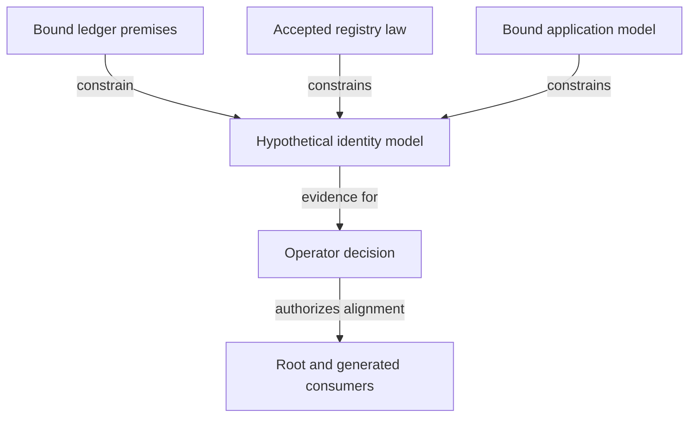

# Responsibilities in the investigation

As an investigator, I want each proposed guarantee assigned to its proper model owner so that a missing ledger or consumer premise stays visible.

| Component and source horizon | Responsibility | Placement decision |
|---|---|---|
| Ticket record, `specs/741-no-pin-model/` | Proposal status, authority, impact table, counterexample explanations and operator decisions | Owns no product law; the decisions record links exact amendments. |
| Hypothetical candidate, `lean/Singular/NoPins/` | New identity and composition investigation under explicit premises | Separate from accepted law until a ruling; exact modules/signatures frozen by the ticket owner. |
| Root model, `lean/Singular/Model/`, `Economics/`, `Statements/` | Accepted two-edge, supply, pending custody and economic obligations | Semantic changes only after a ruling; no parallel second economic system. |
| Ledger/history work in #679/#680 | Script invocation, policy/name and ledger-history premises | Not present on the bound main base; bind an accepted revision before reuse. Do not create a competing ledger layer. |
| Open-datum consumer, `applications/open-datum/lean/` | Controller updates, protected holdings and release semantics | Reconcile against root; a conflict returns to the operator. |
| Existing exports and consumers | Corpora, theorem registers, coverage, simulator mirror and public explanations | Regenerate from the accepted candidate; no hand-typed pass states. |

The data records are specified only in [data-model.md](data-model.md). Callable-change ownership is specified only in [functions-model.md](functions-model.md).

Promote shared identity vocabulary to the nearest existing upstream owner only when the bound ledger and application consumers need the same concept. No new generic registry-free library is authorized by this ticket.

