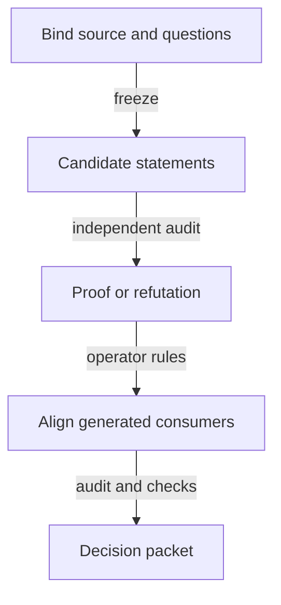

# Plan for the no-pin model investigation

As the ticket owner, I want a bounded sequence that produces a reviewable model decision without replacing an unresolved premise with an assumption.

## Status

Completed: source binding and obligation inventory; hypothetical identity statements (audited, not proved); the request-destination investigation. Rulings are recorded in [decisions.md](decisions.md).
Current: the application-held pending termination stage (23 October ruling).
Blockers for dependent acceptance: asset-role authentication, the application-held termination release and its settlement obligations, complete economic configuration and reader meanings still need model evidence and, where semantic, an operator ruling.
Base: `00771d77af996605845cf062285263909a049cf8`. Exact bindings are in [authority.md](authority.md).

## Technical context

Lean 4.27.0, as pinned by root `lean-toolchain` and `nixpkgs-lean`; root Lake project plus the separate open-datum Lake consumer. Existing JSON corpus/theorem manifests, Python reconciliation checks and JavaScript simulator are reused.
Artifact: `nix run .#model-check`, with application and simulator checks appropriate to the changed surfaces. No runtime-cost or ledger-throughput target is introduced.
No local Spec Kit scripts/templates are installed in this checkout; use the global Spec Kit workflow and templates with the repository's issue-numbered specification convention. No bootstrap changes to AGENTS.md, the constitution or tooling are needed for planning.

## Constitution check

- Preserve accepted Lean and consumer meanings until a concrete recorded ruling changes them.
- Bind candidate definitions and premises; require satisfying witnesses, refusal controls and non-vacuous statements.
- Distinguish executable model, proof, simulator and implementation evidence.
- Keep all missing public implementation evidence uncovered.
- Operate only in this ticket's isolated branch; no #529 lane writes or process changes.
- New semantic findings are returned as actor/start/action/outcome/evidence questions.
- Planning permits investigation, not acceptance of hypothetical model guarantees.

These conditions are met by the investigation plan. Behavioral soundness is deliberately pending and is not a passed gate.

## Architecture and writable boundaries

[modules-model.md](modules-model.md) owns responsibility and dependency placement; [data-model.md](data-model.md) owns report/domain records; [functions-model.md](functions-model.md) owns callable-change decisions.

Initial executable candidate additions, once the owner freezes their signatures, belong to an explicitly hypothetical, isolated Lake project at `investigations/741-no-pin/` that requires the unchanged root model, as the open-datum application does. The root model check admits no proof hole or unimported module under `lean/Singular/`, and importing new modules from the root would move accepted corpus digests. Accepted existing model declarations stay unchanged until the relevant ruling. Reuse exact accepted ledger modules if available; do not fork #679/#680's foundational work or import unaccepted code by implication.

The first authoring fence is ticket-local investigation/decision documents and the explicitly frozen candidate files. Adding model exports, consumer changes, simulator changes or constitution amendments requires the owner to version the per-stage path fence after the corresponding ruling. This is checkpoint control, not a new staffing approval.

## Ordered stages

| Stage | Outcome | Entry/exit |
|---|---|---|
| Bind and investigate | Accepted-source inventory, changed-obligation table, dependency graph and concrete questions | May start after team intake; name unavailable upstream artifacts and continue independent inquiry. |
| State the candidate | Executable hypothetical identity/lifecycle surfaces and complete theorem/inversion statements | Frozen scope and premises; independent statement audit before proof work. |
| Share the request script | A request script shared per release, authenticated from data, with cross-registry refusal and an acyclic order | After the application-held statements are accepted; operator direction of 23 October in decisions.md. |
| Prove or refute | Exact statements proved or constructively refuted, with finite mutation/witness evidence | Accepted statement hashes; semantic change returns to ruling and statement audit. |
| Reconcile consumers | Ruled root/consumer alignment, regenerated exports, simulator mirror and honest coverage | Ruling precedes semantic amendment; dependent artifacts bind the same revision. |
| Decide and hand off | Operator decision packet, integrated audit, exact checks and gaps | No implementation or merge release follows automatically. |

A constructive refutation may conclude a soundness investigation only with an explicit operator disposition. It does not close the epic as delivered.

## Verification contract to freeze before work

The ticket owner and commissioned auditor establish the stage's falsifiable evidence contract using the existing seats. No extra gate authors are authorized.
- Establish baseline model/application checks in the isolated lane, with exact commands and actual exits before semantic changes.
- Candidate checks include satisfying premise instances, relevant reachable witnesses, wrong-role/wrong-key/wrong-registry and extra-mint/burn controls.
- Audit statements/inversions before proofs. Inspect the exact changed statements and standard-axiom reports after a clean build.
- Run `nix run .#model-check`; for changed consumer surfaces run `nix develop --quiet -c just application-model`; run `nix develop --quiet -c just simulator` when generated model/corpus surfaces move.
- Preserve affected theorem/coverage identities and negative-control receipts; run documentation/presentation checks for changed public artifacts.
- Final hosted checks remain required at the submitted candidate. A locally green run or planning commit does not meet that gate.

## Staffing and sequencing

Operator-selected: Opus 5.5 high ticket owner; Codex gpt-6.1-sol high commit owner; Sonnet 5.5 xhigh independent auditor. Existing epic owner remains parent. Four seats maximum including that parent. No additional writers, simulator authors or hidden research agents.

The single commit owner may regenerate the existing simulator mirror. This does not claim an independently authored Lean-clarity experiment. If a new independent simulator author is needed, the ticket owner reports that specific unmet requirement before adding a seat.

## Non-goals and release boundary

No production implementation or active-lane modification. Main landing remains after accepted/landed protected rejection and before 1.x, under #747's composition. Keep this PR draft and do not merge it as an accepted new law while a ruling is unresolved.

## Planning budget

Maximum lines: spec 130, plan 150, modules/data/functions 80 each, research/authority 100 each, tasks 130, contracts 80, quickstart/checklist 70 each. Measure actual bytes/lines in the handoff. No provider token or price measurement is claimed.
