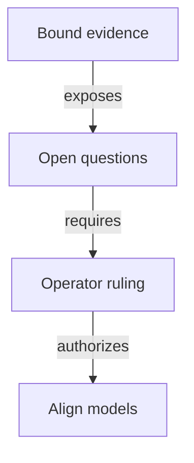

# Decisions needed before accepting a registry without pins

As an integrator, I want each unresolved guarantee stated as a concrete story, so that a model decision cannot silently change the contract I rely on.

The [authority binding](authority.md) fixes the accepted root and application revisions. These are questions for the operator, not amendments or adopted answers. This slice inventories the conflicts; none prevents finishing the inventory. Each affected design or implementation claim remains held. The [impact inventory](impact.md) links the exact declarations and digests.

## Can two applications use the same seed in one transaction?

**Actor and goal:** As a registry reader, I want an approval naming a registry to identify exactly that registry, including when two application releases share a transaction.

**Starting state and action:** An unspent seed is available. One transaction spends it once and invokes state policies applied to application A and application B. Both propose the state name obtained by hashing the same seed. Their policy/name pairs differ; their asset-name components can be equal without a hash collision.

**Competing outcomes and base answer:** Name-only approval binding would treat that name as globally identifying one registry. Full policy/name binding distinguishes two assets. The base state identity is abstract and has no accepted-history or multiple-policy genesis judgement. Spending an input at most once across history alone does not choose between these readings.

**Evidence and limits:** The live issue snapshot leaves the ledger and history work unaccepted and absent at this base. This is a concrete proposed transaction shape, not a compiled or ledger-accepted counterexample. The written candidate witness remains pending the ledger/candidate stage.

**Decision needed:** Establish a cross-policy exclusion rule, bind the application/policy into the registry name, or retain complete identity in approval binding. Recommendation: retain the complete identity until an accepted law rules out the same-transaction case. Do not infer global uniqueness from the narrower history rule.

**Ruling (22 October 2026):** approvals bind the complete registry asset identity, policy ID and token name; see [decisions.md](decisions.md). The candidate must still state and establish the separation under explicit premises.

## What authenticates a state when witnesses share its policy?

**Actor and goal:** As a folder, I want a genuine witness with a fabricated state datum to remain a witness rather than become a second registry state.

**Starting state and action:** A reachable active holding exists. Its genuine token is presented at the state address with a datum copied from a registry state. A proposed shared-policy check sees the expected policy.

**Competing outcomes and base answer:** Policy-only recognition could accept this as state; full role/name/provenance recognition must refuse it. The base keeps state tokens, singular tags and request tags in separate abstract records. State name zero and positive trie-ready names are arithmetically separate, but this establishes neither concrete witness-name separation nor state lineage under the proposed policy.

**Evidence and limits:** The inventory binds state-token identity, trie-ready names, singular-tag identity, rejection state authentication and economic continuation. Runtime premise checks exercise the existing arithmetic separation only. No candidate shared-policy validator or ledger execution exists.

**Decision needed:** Approve the exact role encoding and authenticated state provenance after candidate evidence, including wrong key/registry/kind, extra mint/burn and counterfeit-state controls. Recommendation: keep all four roles explicit and hold any policy-only recognition claim.

## What do the executable hash stand-ins guarantee?

**Actor and goal:** As a model reviewer, I want a commitment's claimed uniqueness to match its actual domain and executable definition.

**Starting state and action:** Register key 1 or key 257 from the empty registry, with each request's matching approval. Inspect the approval name and resulting root in each history.

**Competing outcomes and base answer:** Source commentary describes canonical or collision-free commitments. The executable legacy approval truncates key, owner and destination to bytes; the root also converts a key to one byte. Runtime evaluation gives the same approval name and root for these two keys. The logical trie and separate tuple checks still distinguish the keys. Economic booking names instead encode full naturals through JSON, but still return a finite FNV value.

**Evidence and limits:** The scratch premise file constructs both successful registrations through the existing step and establishes reachability for their resulting states; it checks the equal roots and names. This exposes a stand-in/domain limit, not a SHA-256 or BLAKE2b attack, a ledger transaction or a demonstrated approval-admission bypass. The two-key witness-name function itself still distinguishes 1 and 257.

**Decision needed:** State which bounded encoding domains or explicit finite collision premises govern each future identity guarantee, and how the existing commentary should be aligned in a separately authorized amendment. Recommendation: separate canonical encoding, finite occurring-domain collision assumptions and byte correspondence. No unconditional finite-hash injectivity theorem is licensed.

## When may the application release a token into pending termination?

**Actor and goal:** As the controller, I want to book retirement without losing my genuine holding or contradicting the application's release protection.

**Starting state and action:** An active key has one genuine token in application custody. The controller books its termination before the economic fold.

**Competing outcomes and base answer:** The ruled economic booking removes the holding from custody and carries the genuine tag in the pending request while the key remains active. The bound application booking keeps its output, token and deposit locked; only the later application fold releases them and burns the token. The proposed burn-only release cannot transfer that still-unburned token to pending custody under the same rule.

**Evidence and limits:** The bound booking functions, world supply theorem, application locked-booking theorem and atomic-release theorem express these different sequences. Both baseline suites pass their own models. Neither proves their composition or a rewritten application release condition. This is a consumer-model conflict, not failing execution of either isolated suite.

**Decision needed:** Rule on the allowed release path and controller/deposit obligations, or explicitly revise the pending-custody sequence and its economics. Recommendation: preserve both existing requirements pending that ruling; do not weaken either model to make the proposal pass.

**Ruling (22 October 2026):** termination booking moves the genuine token from application custody into the request, where the later fold burns it; see [decisions.md](decisions.md). Reconciling the application model follows its own statement and audit stage.

## Where do the cost and booking-width requirements live?

**Actor and goal:** As a requester, I want the configured registration cost, minimum tip and booked timing guarantees to survive removal of policy pins.

**Starting state and action:** A registry has nonzero registration cost and a finite maximum booking width. A proposed datum retains only root, the minimum-tip wire field and the two windows. Book a registration and later fold, reject or reclaim it.

**Competing outcomes and base answer:** Required cost and width could remain explicit elsewhere under an approved representation; simply omitting them would change admission, treasury and refund guarantees. The base configuration has eleven fields and the economic rules read cost and width. Its JSON may omit zero-valued optional economic fields, which does not remove the semantic fields. The constitution's driver table calls it an "eight-field" value.

**Evidence and limits:** The inventory lists every field and its economic readers. The root and application baselines pass, including their existing identity reconciliation; they do not validate the proposed four-field replacement or repair the stale count. No datum layout is authored here.

**Decision needed:** Approve the complete configuration owner and representation, plus a correction of the count under the constitutional process. Recommendation: retain every required parameter and guarantee; do not adopt the four-field size as authority.

## Which existing contract releases retain support?

**Actor and goal:** As an existing registry operator, I want to know whether my exact contract remains recognized after the new release.

**Starting state and action:** A registry was created under an earlier release. A reader or command resolves it after the proposed line ships.

**Competing outcomes and base answer:** The permanent translation says: "Registries from previous releases, including old Demo1 instances, are abandoned: no migration or compatibility recognition is authorized." The epic says: "Existing registries retain their contracts and explicit compatible-release paths. New application policies create new state policies for new registries." These might concern different releases, but that scope is not bound here.

**Evidence and limits:** Exact source and issue text are retained in the bound constitution and hashed GitHub JSON snapshot. No later release-specific ruling or runtime compatibility observation was supplied in this slice.

**Decision needed:** Name the affected Singular/application release pairs and recognition policy. Recommendation: preserve the current contract and hold new compatibility claims until that scope is explicit; do not infer migration authority.

## What can an empty token lookup tell a reader?

**Actor and goal:** As a reader, I want an unavailable provider or a token awaiting retirement to remain distinguishable from a reusable or terminal key.

**Starting state and action:** A known address/key lookup returns no application holding. Possible causes include a pending economic termination, an unknown key, a terminal key, a wrong release or incomplete provider data.

**Competing outcomes and base answer:** A positive authenticated token can establish a holding within its observation contract. An empty lookup cannot identify which alternative occurred. The base has logical leaf/holding observations and a separate world supply count; it has no provider-completeness theorem that turns absence into all five reader classifications.

**Evidence and limits:** The existing observation contract names active custody, pending, never registered, terminal and unavailable. No network/application/release resolution or provider query is executed here.

**Decision needed:** Approve each conclusion's evidence and provenance contract before freezing a reader signature. Recommendation: require authenticated state evidence for full lifecycle classification and keep missing/conflicting evidence unavailable.

