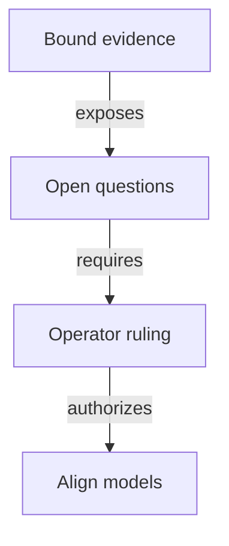

# Decisions needed before accepting a registry without pins

As an integrator, I want each unresolved guarantee stated as a concrete story, so that a model decision cannot silently change the contract I rely on.

The [authority binding](authority.md) fixes the accepted root and application revisions. These are questions for the operator, not amendments or adopted answers. This slice inventories the conflicts; none prevents finishing the inventory. Each affected design or implementation claim remains held. The [impact inventory](impact.md) links the exact declarations and digests.

## Can two applications use the same seed in one transaction?

**Actor and goal:** As a registry reader, I want an approval naming a registry to identify exactly that registry, including when two application releases share a transaction.

**Starting state and action:** An unspent seed is available. One transaction spends it once and invokes state policies applied to application A and application B. Both propose the state name obtained by hashing the same seed. Their policy/name pairs differ; their asset-name components can be equal without a hash collision.

**Competing outcomes and base answer:** Name-only approval binding would treat that name as globally identifying one registry. Full policy/name binding distinguishes two assets. The base state identity is abstract and has no accepted-history or multiple-policy genesis judgement. Spending an input at most once across history alone does not choose between these readings.

**Evidence and limits:** The live issue snapshot leaves the ledger and history work unaccepted and absent at this base. This is a concrete proposed transaction shape, not a compiled or ledger-accepted counterexample. The written candidate witness remains pending the ledger/candidate stage.

**Decision needed:** Establish a cross-policy exclusion rule, bind the application/policy into the registry name, or retain complete identity in approval binding. Recommendation: retain the complete identity until an accepted law rules out the same-transaction case. Do not infer global uniqueness from the narrower history rule.

**Ruling (22 October 2026):** approvals bind the complete registry asset identity, policy ID and token name; see [decisions.md](decisions.md). The candidate must still state and establish the separation under explicit premises.

## What authenticates a state when witnesses share its policy?

**Actor and goal:** As a folder, I want a genuine witness with a fabricated state datum to remain a witness rather than become a second registry state.

**Starting state and action:** A reachable active holding exists. Its genuine token is presented at the state address with a datum copied from a registry state. A proposed shared-policy check sees the expected policy.

**Competing outcomes and base answer:** Policy-only recognition could accept this as state; full role/name/provenance recognition must refuse it. The base keeps state tokens, singular tags and request tags in separate abstract records. State name zero and positive trie-ready names are arithmetically separate, but this establishes neither concrete witness-name separation nor state lineage under the proposed policy.

**Evidence and limits:** The inventory binds state-token identity, trie-ready names, singular-tag identity, rejection state authentication and economic continuation. Runtime premise checks exercise the existing arithmetic separation only. No candidate shared-policy validator or ledger execution exists.

**Decision needed:** Approve the exact role encoding and authenticated state provenance after candidate evidence, including wrong key/registry/kind, extra mint/burn and counterfeit-state controls. Recommendation: keep all four roles explicit and hold any policy-only recognition claim.

## What do the executable hash stand-ins guarantee?

**Actor and goal:** As a model reviewer, I want a commitment's claimed uniqueness to match its actual domain and executable definition.

**Starting state and action:** Register key 1 or key 257 from the empty registry, with each request's matching approval. Inspect the approval name and resulting root in each history.

**Competing outcomes and base answer:** Source commentary describes canonical or collision-free commitments. The executable legacy approval truncates key, owner and destination to bytes; the root also converts a key to one byte. Runtime evaluation gives the same approval name and root for these two keys. The logical trie and separate tuple checks still distinguish the keys. Economic booking names instead encode full naturals through JSON, but still return a finite FNV value.

**Evidence and limits:** The scratch premise file constructs both successful registrations through the existing step and establishes reachability for their resulting states; it checks the equal roots and names. This exposes a stand-in/domain limit, not a SHA-256 or BLAKE2b attack, a ledger transaction or a demonstrated approval-admission bypass. The two-key witness-name function itself still distinguishes 1 and 257.

**Decision needed:** State which bounded encoding domains or explicit finite collision premises govern each future identity guarantee, and how the existing commentary should be aligned in a separately authorized amendment. Recommendation: separate canonical encoding, finite occurring-domain collision assumptions and byte correspondence. No unconditional finite-hash injectivity theorem is licensed.

## When may the application release a token into pending termination?

**Actor and goal:** As the controller, I want to book retirement without losing my genuine holding or contradicting the application's release protection.

**Starting state and action:** An active key has one genuine token in application custody. The controller books its termination before the economic fold.

**Competing outcomes and base answer:** The ruled economic booking removes the holding from custody and carries the genuine tag in the pending request while the key remains active. The bound application booking keeps its output, token and deposit locked; only the later application fold releases them and burns the token. The proposed burn-only release cannot transfer that still-unburned token to pending custody under the same rule.

**Evidence and limits:** The bound booking functions, world supply theorem, application locked-booking theorem and atomic-release theorem express these different sequences. Both baseline suites pass their own models. Neither proves their composition or a rewritten application release condition. This is a consumer-model conflict, not failing execution of either isolated suite.

**Decision needed:** Rule on the allowed release path and controller/deposit obligations, or explicitly revise the pending-custody sequence and its economics. Recommendation: preserve both existing requirements pending that ruling; do not weaken either model to make the proposal pass.

**Ruling (22 October 2026):** termination booking moves the genuine token from application custody into the request, where the later fold burns it; see [decisions.md](decisions.md). Reconciling the application model follows its own statement and audit stage.

**Superseded ruling (23 October 2026):** the termination request and genuine token stay at the application script, released by the exact burn at the fold; see [decisions.md](decisions.md).

## Where do the cost and booking-width requirements live?

**Actor and goal:** As a requester, I want the configured registration cost, minimum tip and booked timing guarantees to survive removal of policy pins.

**Starting state and action:** A registry has nonzero registration cost and a finite maximum booking width. A proposed datum retains only root, the minimum-tip wire field and the two windows. Book a registration and later fold, reject or reclaim it.

**Competing outcomes and base answer:** Required cost and width could remain explicit elsewhere under an approved representation; simply omitting them would change admission, treasury and refund guarantees. The base configuration has eleven fields and the economic rules read cost and width. Its JSON may omit zero-valued optional economic fields, which does not remove the semantic fields. The constitution's driver table calls it an "eight-field" value.

**Evidence and limits:** The inventory lists every field and its economic readers. The root and application baselines pass, including their existing identity reconciliation; they do not validate the proposed four-field replacement or repair the stale count. No datum layout is authored here.

**Decision needed:** Approve the complete configuration owner and representation, plus a correction of the count under the constitutional process. Recommendation: retain every required parameter and guarantee; do not adopt the four-field size as authority.

## Which existing contract releases retain support?

**Actor and goal:** As an existing registry operator, I want to know whether my exact contract remains recognized after the new release.

**Starting state and action:** A registry was created under an earlier release. A reader or command resolves it after the proposed line ships.

**Competing outcomes and base answer:** The permanent translation says: "Registries from previous releases, including old Demo1 instances, are abandoned: no migration or compatibility recognition is authorized." The epic says: "Existing registries retain their contracts and explicit compatible-release paths. New application policies create new state policies for new registries." These might concern different releases, but that scope is not bound here.

**Evidence and limits:** Exact source and issue text are retained in the bound constitution and hashed GitHub JSON snapshot. No later release-specific ruling or runtime compatibility observation was supplied in this slice.

**Decision needed:** Name the affected Singular/application release pairs and recognition policy. Recommendation: preserve the current contract and hold new compatibility claims until that scope is explicit; do not infer migration authority.

## What can an empty token lookup tell a reader?

**Actor and goal:** As a reader, I want an unavailable provider or a token awaiting retirement to remain distinguishable from a reusable or terminal key.

**Starting state and action:** A known address/key lookup returns no application holding. Possible causes include a pending economic termination, an unknown key, a terminal key, a wrong release or incomplete provider data.

**Competing outcomes and base answer:** A positive authenticated token can establish a holding within its observation contract. An empty lookup cannot identify which alternative occurred. The base has logical leaf/holding observations and a separate world supply count; it has no provider-completeness theorem that turns absence into all five reader classifications.

**Evidence and limits:** The existing observation contract names active custody, pending, never registered, terminal and unavailable. No network/application/release resolution or provider query is executed here.

**Decision needed:** Approve each conclusion's evidence and provenance contract before freezing a reader signature. Recommendation: require authenticated state evidence for full lifecycle classification and keep missing/conflicting evidence unavailable.

## How does the application know the token went to the request validator?

**Actor and goal:** As a registry reader, I want a token that left application custody at termination booking to be held by the authentic request validator, so that its pending and terminal rules still apply.

**Starting state and action:** An active key has one genuine token in application custody. Its controller spends that holding as a termination booking but places the token at a wallet or another validator instead of the request validator. Nothing burns at booking.

**Competing outcomes and base answer:** The custody ruling sends the token to the request; the application must allow that transfer. An application that checks only the token or an approval accepts the counterfeit destination. Knowing the asset policy from an input does not by itself give the request script hash, and moving a token does not run its minting policy. In the proposal the request is parameterized by the state policy and registry asset name while the application is registry-independent, so a direct parameter would create a cycle.

**Evidence and limits:** [The destination investigation](destination.md) traces the accepted script parameters and checks, the exact missing booking predicate and the counterfeit-destination transaction. The accepted application refuses that transfer; a token-or-approval-only replacement lacks its destination guard. A witness-name commitment is acyclic when the request credential follows complete registry identity, but authenticating the initial credential is still missing under the enriched proposal's on-chain capability constraints. Protected control and a fresh booking certificate have the same initial authentication debt. These are source and dependency arguments, not executed ledger counterexamples or accepted model amendments.

**Decision needed:** Choose a concrete authenticated registration or certificate-issuer premise, a verified on-chain derivation of the applied request credential, or a revised request dependency, as described in [the conditional constructions](destination.md#first-construction-commit-the-destination-in-the-witness-name). Preserve logical user keys, complete registry identity, exact same-output datum/tag/value checks and controller/deposit obligations. Decide encoding and address scope before model statements and independent audit. Recommendation: retain the application-to-request acceptance hold; hashing an attacker-selected destination or copying a tag does not close it.

**Superseded (23 October 2026):** with the termination request kept at the application script, the token no longer moves to a separate request validator, so this question no longer decides the design. The [destination investigation](destination.md) stays as history.

## Identity-stage evidence and remaining holds

The complete-identity question is ruled in [decisions.md](decisions.md): approvals commit policy and name. The isolated identity candidate states that rule under finite encoding/hash premises and retains name-only safety solely as a rejected, expected-refutable contrast. The termination custody ruling is also recorded there and belongs to its later stage. These rulings are decisions, not proof receipts.

The role question now has executable competing readings and a concrete genuine-witness/fabricated-state-datum instance. The policy-only reading accepts it; the authenticated reading refuses that instance. General state/role separation remains a stated hypothesis under explicit finite separation and external provenance evidence. Request-tag examples use a simplified registry/role/key preimage, so they do not establish economic payload/nonce binding.

Same-transaction two-policy genesis and across-history spent-once are separate stated obligations. The minimal transaction observations do not establish that a ledger accepts either history. The stronger accepted-history uniqueness claim is held for binding to accepted #679/#680 vocabulary. No new cycle is required by the frozen identity derivation. Hash byte correspondence, provenance authentication, configuration, compatibility and reader evidence still require their original decisions and later evidence.

## How can local release preserve the controller's combined payment?

As an application controller, I want all registry fold duties and all released protected deposits paid additively, so that one payment cannot satisfy several independent obligations.

Starting state and action: two genuine application outputs for one controller protect deposits five and seven. A fold also owes that controller eleven and pays twelve through otherwise eligible outputs. The accepted validRelease requires twenty-three; a local deposit-only sum requires twelve. Exact same-key burns do not determine the additional eleven or which outputs are eligible to settle it. This is a source-derived discriminator, not executed script or ledger evidence.

Bindings: accepted revision 00771d77af996605845cf062285263909a049cf8, OpenDatumApplication.foldPayments and settleFold; open_datum.ak validRelease, registryOwed, rowDuties and releasedTo; registry/settlement.ak settlesOf; root foldRoutingRefusal and FoldMember.donation. The [application-held trace](application-held.md) maps every release guard. The economic termination donates held-minus-tip to the treasury, while the application separately protects controller payments; isolated model checks do not establish their composition.

No local equivalent for registryOwed and its settlement-output exclusions has been established. Retaining an authenticated aggregate settlement input, strengthening the executed token-policy contract to enforce the full combined obligation, or explicitly revising the economic/controller promise are alternatives for the operator. None is adopted. The ruling needed is the replacement guarantee and its enforcement owner. Equivalent-settlement and composed permissionless-fold acceptance stay held; independent candidate-state and economic-only results may continue.

## Can a pending termination be cancelled or updated?

As a controller, I want to know whether booking retirement is irrevocable and whether its payload or control can change while pending. Start with an authentic controller-booked pending output at the application. Try Update, ordinary Release, rebooking, cancellation or changing its protected controller. The accepted application has only Update and Release spending constructors and no distinct pending tag; its Control is immutable on Update. The 23 October ruling does not specify pending cancellation or updates.

The hypothetical candidate has a distinct pending state, refuses both live spend constructors and rebooking, and exposes no cancellation path. Those restrictions are unruled hypotheses for review, not an operator decision. The operator must decide the desired interaction before affected application-law acceptance; [the frozen surfaces](functions-model.md) preserve the distinction explicitly. Evidence is a source/interface comparison only at the bound accepted revision, with no production implementation or ledger execution.

The constitution explicitly supersedes legacy rejection, retraction, payment and transaction rules with the ruled economic rows. The bound consumer still computes registryPayments from those legacy duties, whereas the economic termination sends held-minus-tip to the treasury. This is a consumer/model conflict as well as a missing local observation. The operator owns the replacement guarantee; equivalent_settlement and composed_fold_available remain held obligations with no theorem claim.

## Slice-4 settlement resolution and value-partition amendment (23 October)

The operator selected ruled economics and removal of legacy registryPayments (NOTE-002). Application release must still pay every protected deposit additively. The earlier open combined-payment story above is preserved as history; equivalence to legacy registryOwed is no longer the candidate's claim.

A-003 authorizes physical pending lovelace = exact root termination contents + protected deposit. The root observer erases precisely the deposit allocation from the physical pending input and physical controller output. The local release reads the physical outputs. No ruling authorizes cancellation or pending payload/control updates; the candidate exposes no such path as an explicitly unruled hypothesis.

## Reclaim and the old expiry outcome

As a requester, I want the application's replacement exits to preserve both my refund and the period in which I can claim it. At the accepted economic revision, a request booked at zero with processing and reclaim durations of one hundred, cost ten, tip two and carrier five holds seventeen. Owner reclaim during the reclaim window returns seventeen with separate fee funding; after time two hundred that same reclaim is refused, while permissionless expired rejection returns fifteen and leaves two to its processor. An unbounded owner reclaim returning seventeen would change admission, signing and payment outcomes.

The ticket owner resolved the candidate under the direction that open datum keeps its semantics: retain all three phases in the application's booked request data. Fold validity ends by the processing deadline, signed reclaim starts there and ends by the reclaim end, and permissionless cleanup starts at reclaim end. Nonempty validity ranges make the phases disjoint, so no reclaim or cleanup can race an acceptable fold. Reclaim returns all seventeen; expired cleanup returns fifteen and the cleaner's two. There is no Singular rejection handler. The accepted definitions remain byte-identical; this is the new application's statement obligation, with behavior and journey evidence still owed.

The registration treasury share is also decided to remain pending until fold, enforced by the application request spending rule. Paying the cost ten at booking would leave only seven against the full seventeen refund; that immediate-payment alternative is retained solely as the counterexample explaining its exclusion. For both request kinds the application pays the ruled treasury share at fold; a termination's protected deposit separately returns to its controller at booking.

## The empty termination and its payment split

As a treasury recipient and folder, I want the application to authenticate their payment split. Two accepted economic termination requests can both hold ten, with declared tip two and treasury share eight, or tip three and share seven. Their new empty datum, approval for termination/key/complete registry and genuine active token are identical. A deterministic validator cannot recover which per-request split was intended from that output; a caller-supplied redeemer amount or off-chain history is no authenticated on-chain allocation.

The ticket owner's selected candidate uses a fixed termination tip in the application release constants, preserving the empty datum and approval preimage. The application spending rule enforces the treasury donation as held ADA minus that constant. Booking requires at least that tip in the pending request. Under the same ordinary funding and conservation premises, the folder's net request take is at most the constant. If the constant is two, both ten-ADA requests now use the two/eight split; the old three/seven result is explicitly restated, never described as equal. Registration keeps its declared tip in its datum and preserves its three economic outcomes.

This fixed-tip choice is recorded as a ticket-owner candidate interpretation of the termination-shape direction, with the user-visible variable-tip exception exposed. It is not an accepted-law amendment or evidence that the operator accepted the revised theorem. Accepted-model, application and production acceptance remain separate downstream decisions; the proof stage must not hide this exception by narrowing an equivalence premise to only the two/eight instance.

## Does the public registry observation expose the seed and proofs?

As a folder, I want every identity and trie proof I must supply obtainable without a private booking file. The root-only datum and state token name do not reveal a seed by hash inversion. The proposed state-recognition mechanism takes a seed in the fold redeemer and verifies its state-role name, so the PublicRegistry observation explicitly includes public genesis provenance and available trie proofs. Complete authentic public history/proof observations are a premise, not established by the minimal transaction view or an empty provider result. A claim over the current state output alone remains unsupported until its missing inputs have an actual public derivation.

Whether an open top-up path is needed remains open. The selected termination booking requires the application's fixed bid funded at booking and exposes no competing top-up spend; a requester can fold its own acceptable request under the same public-data and ordinary-funding premises. This establishes no wallet funding availability, incentive or ledger inclusion. A future top-up rule needs its own no-race and identity-preservation statements before acceptance.
