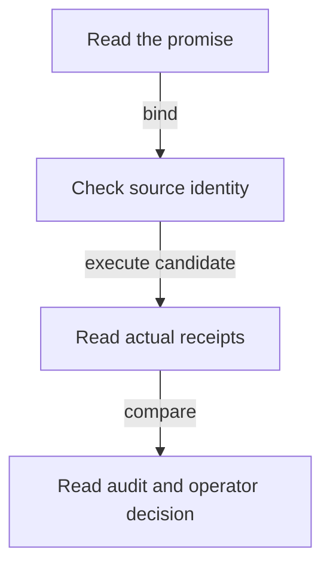

# Review the no-pin investigation

As an integrator, I want to reproduce the candidate checks and understand exactly what they establish.

## Current status

Only the investigation planning package exists at this checkpoint. No new model guarantee, proof, simulator result or ledger behavior is claimed.

1. Read [spec.md](spec.md) for the promised decision surface.
2. Read [authority.md](authority.md) for the exact baseline and unresolved dependencies.
3. Follow [tasks.md](tasks.md) for the evidence stages and [plan.md](plan.md) for the verification fence.
4. At a frozen model candidate, run `nix run .#model-check`.
5. For the corresponding changed consumer, run `nix develop --quiet -c just application-model`; for generated model/simulator changes run `nix develop --quiet -c just simulator`.
6. Read the candidate's impact/decision records and independent audit before interpreting any green result as satisfying an obligation.

The final handoff must record actual command exits and candidate hashes. These commands describe the planned verification path; they have not been run for a new model in this planning phase.

