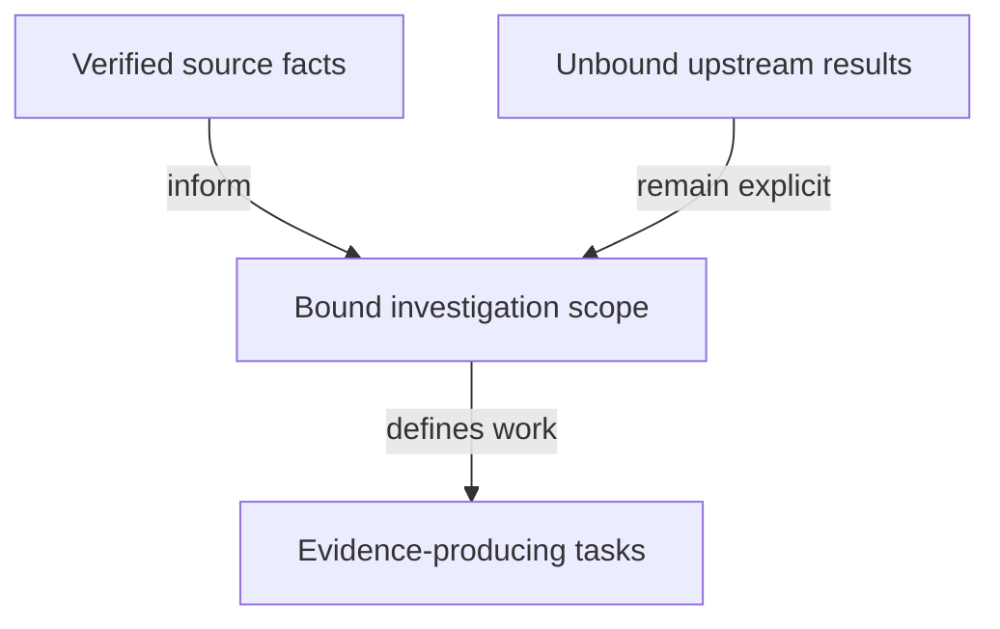

# Source intake for the investigation

As the ticket team, I want the verified source facts and unresolved dependencies in one place so that planning does not accidentally turn a proposal into an accepted guarantee.

## Findings

- At the bound base, `lean/Singular/Model/Registry.lean` defines `TokenId` with policy/name, but `Config.stateToken` uses the abstract registry identity and name zero. Its comment explicitly leaves byte correspondence separate.
- The same file reads witness policies from pins and defines `tokenAssetName` as the key. This does not state the proposal's finite hash injectivity premise.
- `Config` retains `registrationCost` and `bookingWidth` in addition to the proposed residual fields. The issue's four-field datum is a hypothesis to reconcile.
- `applications/open-datum/lean/OpenDatumApplication/Model.lean` defines `App.registry` and protected `Control.registry`/`activePolicy`. Application unparameterization is not a consequence already established by this consumer.
- The constitution's ruled economic translation moves a genuine tag to a pending termination before fold; a burn-only application release proposal must account for that path.
- Ledger tickets #679/#680 are open and their ledger modules are absent from main. No current upstream acceptance or integration is presumed.
- `nix/model.nix` supplies the actual packaged `model-check`. The root `justfile` supplies application-model and simulator checks.
- `.specify/` contains the constitution only. Global Spec Kit templates guide these documents; no generated script is available to run locally and no initialization overwrite is needed.

## Planning decisions and alternatives

| Decision | Reason | Alternative excluded |
|---|---|---|
| Use isolated issue branch from the fetched main revision | Concrete auditable base while preserving #529 and canonical untracked files | Editing another lane or resetting canonical main |
| Investigate under a distinct hypothetical namespace before amendment | Preserve accepted behavioral authority | Replacing accepted pins/semantics before a ruling |
| Treat absent ledger/history work as a dependency | Avoid inheriting unproved or unaccepted guarantees | Reimplementing #679/#680 or claiming an issue body is proof |
| Use current checks and generated consumer owners | Keep one model/evidence vocabulary | Parallel proof/observation frameworks |
| Plan the investigation, with signatures frozen at its first checkpoint | Semantic questions are the requested work | Inventing a replacement contract in planning |

The accepted design remains in the sources bound by [authority.md](authority.md). The initial findings above are source review. The bounded runtime checks below supply their separately stated execution evidence.

## Identity premises and their instances

The runtime scratch file declares each proposition before checking its instance. It imports only the existing model and economics. These are finite examples over that model, not accepted candidate laws or proof that a cryptographic hash is injective. The runtime receipt names, exits and log hashes are listed in [base-hashes.json](base-hashes.json); the unchanged source declarations and their hashes are listed in [impact.md](impact.md).

| Proposition in words | Encoding and domain | Existing declarations read | Where it belongs | Satisfying instance and limit |
|---|---|---|---|---|
| A finite occurring domain contains at least two different inputs | A list of natural keys with length at least two and no duplicates | Key domain of tokenAssetName, approvalAssetName, rootOf and applicationTagAssetName | Runtime FiniteDomain, conjoined with each finite hash premise | Domains [1, 257] for the key-name function and [1, 2] for the other three; empty, singleton and duplicate domains must fail |
| Key names separate distinct occurring keys | Active-kind names; no finite hash is involved in the base identity function | tokenAssetName | Runtime FiniteHashPremise instantiated with the base key-name function | Keys 1 and 257 have different names; this does not establish the proposed hashed witness naming |
| Legacy approval commitments separate the selected occurring inputs | Fixed insert edge, owner 42 and destination 99; key is converted to a byte before FNV and a 32-bit mask | approvalAssetName, edgeOrdinal and fnv1a | Runtime finite hash premise over approvalName | Keys 1 and 2 separate; keys 1 and 257 collide. Exact tuple checks remain independent of this name equality |
| Executable roots separate the selected occurring tries | Sorted one-key active tries; the key is converted to a byte, then hashed into an eight-byte stand-in root | rootOf, leafByte, u64bytes and fnv1a | Runtime finite hash premise over rootName | Keys 1 and 2 separate; registrations of keys 1 and 257 reach distinct logical states with equal roots. No real trie/hash correspondence follows |
| Economic application names separate the selected occurring payloads | Domain zero, insertion ordinal, full key/refund/destination/nonce naturals, canonical JSON bytes and FNV | applicationTagAssetName and bookingCommitment | Runtime finite hash premise over bookingName | Keys 1 and 2 with refund 42, destination 99 and nonce 7 separate; no universal collision statement is inferred |
| Abstract request tags are distinct and cannot equal the abstract state token | Registry identity 11, state name zero, positive tag name commitment plus one | Config.stateToken and Config.trieReadyTag | Runtime PositiveTagSeparation | Commitments 0 and 1 produce names 1 and 2; state name is zero. Concrete witness/tag domains remain unproved |
| The booking interval has declared bounded width below the processing window | Finite intervals with lower included and upper excluded; exact configured width and processing time | Interval.valid, Interval.width and Config.bookingWidthSized | Runtime WidthPremise | Width bound 10, processing 100, intervals [0,1) and [2,12); neither proves fee availability or ledger inclusion |

All six instantiated propositions compile and execute successfully in the scratch check. Their violating twins test a constant hash, actual colliding approval/root pairs, a duplicate key, an empty domain, a one-element domain and an over-wide interval against the same declared predicates. The control exits and their failure reasons are retained separately from the successful run. Earlier scratch setup/type errors are preserved as failed attempts, not counted as counterexamples or successful controls.

## Premises that await a candidate or upstream law

| Required proposition | Complete input/domain obligation | Concrete written example | Status |
|---|---|---|---|
| Proposed witness tuples have distinct encodings and hashes on the occurring domain | One-byte kind, 32-byte registry name and final variable-length key; explicit state/request-tag domains and complete policy/name identity | Active kind, a registry name of 32 zero bytes, keys 01 and 02; then the same name/key with different roles. A genuine witness presented as state is the adverse twin | witness pending candidate stage |
| Approval binding identifies the registry across application/state policies | The complete existing request preimage, any nonce/economic distinctions it needs, plus the approved registry binding | Two state policies applied to different application releases spend one seed in one transaction, producing equal seed-only names but different policies | witness pending candidate stage; no accepted ledger judgement here |
| An applied script hash distinguishes the approved application/state preimages | Actual script bytes, parameter encoding, release identity and finite occurring preimages | Application A and B give different applied-state preimages; a constant hash must not satisfy their finite separation premise | witness pending candidate stage; upstream vocabulary unavailable |
| Every invoked script executes and every failure refuses a transaction | Minting/spending purposes, redeemers, values and complete transaction observation | A transaction invokes two policies and a state script, all accepting; a refusing policy is the negative case | witness pending accepted ledger vocabulary; no locally invented ledger layer |
| A seed is spent once across an accepted history, with the exact needed uniqueness scope | History, unspent outputs, genesis mint and continuation rules; same-transaction multi-policy use addressed separately | Two later transactions attempting to consume the same seed conflict; one transaction invoking two policies is a distinct case | witness pending accepted history vocabulary; cannot justify name-only uniqueness yet |
| Every active burn corresponds to the same key's terminal transition in that transaction | Whole shared-policy mint, genuine state lineage, key/registry binding and application release | Active token of key 1 burned while only key 2 moves is the adverse case | witness pending candidate stage; abstract inversion alone is narrower |
| Reader classification has adequate evidence | Correct application/network/release, current authenticated state and provider completeness | The same empty lookup under an unavailable provider and a pending genuine termination must not become never registered | witness pending candidate observation contract |

The dependency graph and the exact unresolved choices are in [questions.md](questions.md). In particular, acyclic application identity is not inferred merely from removing an application parameter in prose. The application currently binds a registry in both its application and protected control records. At the inventory checkpoint no candidate signature, serialization or driver surface was frozen; the later hypothetical stage is recorded below.

## Hypothetical identity instances

The isolated candidate uses an explicit tagged structural encoding and a caller-supplied hash; it never reuses the accepted FNV stand-ins. The satisfying encoding/hash domains for approval and application separation contain distinct occurring preimages. No universal hash injectivity is asserted. Its transaction record carries observations only, with the future upstream mapping in [impact.md](impact.md).

The candidate keeps complete registry identity in approvals as ruled. Concrete evaluations distinguish equal names under different policies, unsafe name-only reuse, policy-only recognition of a genuine witness carrying a fabricated state datum, and the authenticated candidate's refusal. A finite seed/role separation obligation is stated separately. Request tags here use the simplified registry/role/key preimage, leaving economic payload/nonce commitments outside this stage.

The compiled report discovers public classification cases and guard selectors, checks statement/instance predicate correspondence and computes axiom evidence. Executed antecedents, positive controls and mutant falsifications remain separate from the fifteen `sorry`-bearing statements. The generic JSON oracle replays the computed case/guard corpus, never theorem-specific projections. These are model instances, not accepted laws or ledger histories; independent statement review remains pending.
